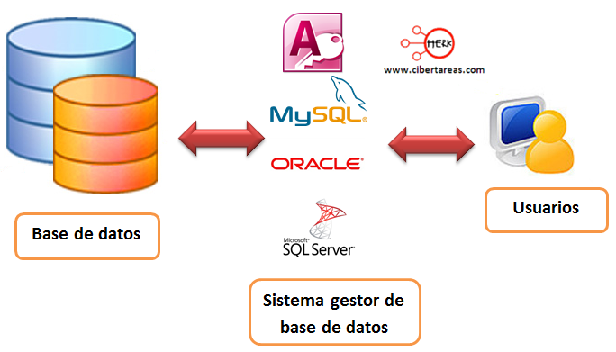
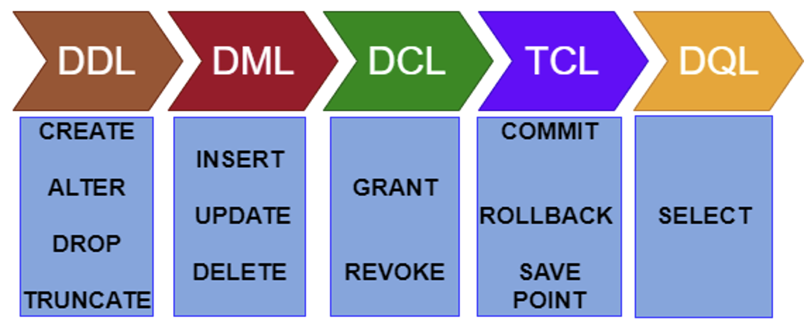
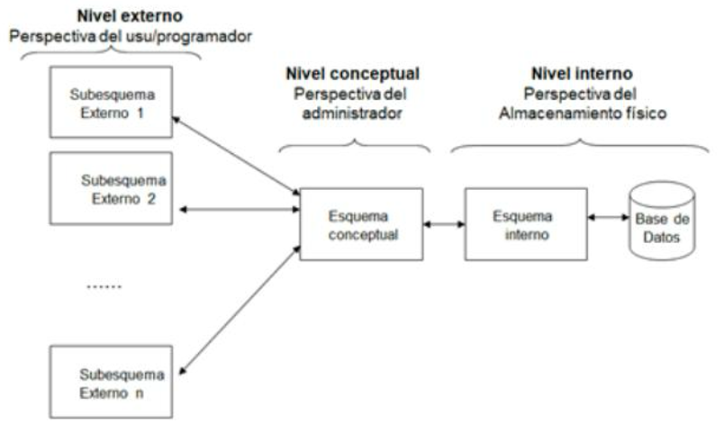

# S**istemas gestors de base de dades SGBD**

  

    🏆 <strong>Progrés d'aquesta secció:</strong> 0 de 4 superats (0%)
    ⭐ <strong>0 punts</strong>
  

  

    

  

## **Què són?**

Conjunt coordinado de programes, procediments, llenguatges, etc., que suministra, tant als usuaris no informàtics, com als analistas programadors, o a l'administrador, els mitjans necessaris per a descriure i manipular les dades continguts en la base de dades, mantenint la seua integritat, confidencialitat i seguretat.

Les avantatges de l'ús de SGBD són:

- Proporcionen a l'usuari una visió abstracta de les dades, ocultant part de la complexitat.

- Ofereixen Independència física, la visió que té l'usuari i la manipulació de les dades és independent de com estiguen emmagatzemats físicament.

- Disminuyen la redundància i la inconsistencia de dades.

- Aseguran la integritat de les dades.

- Faciliten l'accés a les dades, aportant rapidesa i evitant la pèrdua de dades.

- Aumentan la seguretat i privacitat de les dades.

- Mejoran l'eficiència.

- Permeten compartir dades i accessos concurrentes.

- Faciliten l'intercanvi de dades entre diferents sistemes.

- Incorporen mecanismes de còpies de seguretat i recuperació.

## **Funcions**

Un SGBD desenvolupa 3 funcions fonamentals com són la descripció, la manipulació i la utilització de dades.

1. **Funció de descripció o definició**: Permet al dissenyador de la base de dades crear les estructures apropiades per a integrar adequadament les dades. Aquesta funció és la que permet definir les tres estructures de la base de dades: Estructura interna, Estructura conceptual i Estructura externa.

1. **Funció de manipulació**: Permet als usuaris cercar, afegir, suprimir o modificar les dades. Es portarà a cabo per mitjà d'un llenguatge de manipulació de dades (DML) que facilita els instruments necessaris per a la realització d'aquestes tasques..

1. **Funció de control**: Permet a l'administrador de la base de dades establir mecanismes de protecció de les diferents visions de les dades associats a cada usuari, proporcionant elements de creació i modificació d'aquests usuaris.

## **Components**

1. 

**Llenguatges de la BBDD**: Qualsevol SGBD ofereix la possibilitat d'utilitzar llenguatges i interfícies adequades per als seus diferents tipus d'usuaris. A través dels llenguatges es poden especificar les dades que componen la BBDD, la seua estructura, relacions, regles d'integritat, control d'accés, característiques físiques i vistes externes dels usuaris.
Els llenguatges del SGBD són:

  

     
  1. Llenguatge de Definició de les dades (DDL).
     
  1. Llenguatge de Maneig de Dades (DML).
     
  1. Llenguatge de Control de Dades (DCL).
     
  1. Llenguatge de Control de Transaccions (TCL).
     
  1. Llenguatge de Consultes de Dades (DQL).
   

1. 

**El diccionari de dades**: Descripció de les dades emmagatzemats. Es tracta d'informació útil per als programadors d'aplicacions. És el lloc on es deposita la informació sobre la totalitat de les dades que formen la BBDD. Conté les característiques lògiques de les estructures que emmagatzemen les dades, el seu nom, descripció, contingut i organització. En una BBDD relacional aportará informació sobre:
  

     
  1. Estructura lògica i física de la BBDD.
     
  1. Definició de taules, vistes, indexis, disparadors, procediments, funcions, etc.
     
  1. Quantitat d'espai assignat i utilitzat pels elements de la BBDD.
     
  1. Descripció de les restriccions d'integritat.
     
  1. Informació sobre els permisos associats a cada perfil d'usuari.
     
  1. Auditoría d'accés a les dades, utilització, etc.
   

1. 

**El gestor de la BBDD**: És la part de programari encargada de garantir el correcte, segur, íntegro i eficient accés i emmagatzematge de les dades. Aquest component és l'encarregat de proporcionar una interfície entre les dades emmagatzemats i els programes d'aplicació que els manejan. És un intermediario entre l'usuari i les dades. És l'encarregat de garantir la privacitat, seguretat i integritat de les dades, controlant els accessos concurrentes i interactuant amb el sistema operatiu.

1. 

**Usuaris de la BBDD**: En els SGBD existeixen diferents perfiles d'usuari, cada un d'ells amb una sèrie de permisos sobre els objectes de la BBDD.
  

     
  1. L'administrador o Database Administrator (DBA), persona o conjunt encarregades de la funció d'administració de la BBDD. Té el control centralitzat de la BBDD i és el responsable del seu bon funcionament. És l'encarregat d'autoritzar l'accés a la BBDD, de coordinar i vigilar la seua utilització i d'adquirir els recursos programari i maquinari que siguen necessaris.
     
  1. Els usuaris, que seran diferents a la BBDD i amb diferents necessitats sobre les dades, així com diferents accessos i privilegis. Els més comuns són: Diseñadors, Operadors i personal de manteniment, Analistas i programadors d'aplicacions i Usuaris finals.
   

1. 

**Objectius de BBDD**: Són un conjunt d'aplicacions que permeten als administradors la gestió de la base de dades, dels usuaris i permisos, generadors de formularis, informes, interfícies gràfiques, generadors d'aplicacions, etc.

## **Arquitectura**

L'arquitectura 'ANSI/X3/SPARC' és un estàndard de disseny abstracte per a SGBD, proposat per primera vegada en 1975 per al processador SPARC ('Scalable Processor Architecture') de 'Sun Microsystems' i 'Fujitsu' que va ser normalitzat per 'ANSI'. La majoria de SGBD comercials estan basats en aquesta arquitectura 'ANSI/X3/*SPARC' de tres nivells :

- **Nivell intern o físic**: És el més próximo a la màquina. És una representació a sota nivell de la base de dades, en la que es defineix la forma en que les dades s'emmagatzemen físicament en la màquina.

- **Nivell conceptual o lògic**: És una representació abstracta del contingut total de la base de dades. Conté la definició de totes les dades existents juntament amb les restriccions de seguretat i els controls d'integritat.

- **Nivell extern o de visió d'usuari**: És la representació de les dades, tal com els veu l'usuari. Cada usuari tindrà una visió diferent de la base de dades, depenent del conjunt de dades que estiga autoritzat a veure, i de les eines que utilitze.

## **Tipus**

A l'igual que les BBDD, els SGBD es poden classificar per diferents criteris:

- **Model lògic en el que es basa**: Relacional, Xarxa, Jeràrquic, etc.

- **Número d'usuaris**: Monousuario o Multiusuario.

- **Localització**: Centralitzat o Distribuït.

- **Cost comercial**: Ligado al número d'usuaris, monousuarios entre 0€ i 3000€, o multiusuarios entre 10.000€ a 100.000€ o el mes complet per més de 100.000€.

- **Segons el propòsit**: General per a qualsevol tipus de BBDD o Específic on el rendiment es fondamental.

### **SGBD Comercials**

## SISTEMES GESTORS DE BASES DE DADES COMERCIALS

| SGBD | DESCRIPCIÓ |
| --- | --- |
| **ORACLE** | Reconegut com un dels millors a nivell mundial. És multiplataforma, de confianza i segur. És Client/Servidor. Basat en el model de dades Relacional. De gran potència, encara que amb un preu elevat fa que només es vea en empreses molt grans i multinacionals. Ofereix una versió gratuïta Oracle Database 10g Express Edition. |
| **MYSQL** | Sistema molt estès que es ofereix sota dos tipus de llicència, comercial o lliure. Per a aquelles empreses que deseen incorporar-lo en productes privativos, han de comprar una llicència específica. És Relacional, Multihilo, multiusuario i Multiplataforma. El seu gran velocitat el fa ideal per a consulta de bases de dades i plataformes web. |
| **DB2** | Multiplataforma, el motor de base de dades relacional integra XML de manera nativa, el que IBM ha anomenat pureXML, que permet emmagatzemar documents complets per a realitzar operacions i cerques de manera jeràrquica dins del mateix, i integrar-lo amb cerques relacionals. |
| **INFORMIX** | Una altra opció de IBM per al món empresarial que necessita un DBMS senzill i de confianza. És un gestor de base de dades relacional basat en SQL. Multiplataforma. Consume menys recursos que Oracle, amb utilitats molt avançades respecte a conectivitat i funcions relacionades amb tecnologies de Internet/Intranet, XML, etc.. |
| **Microsoft SQL SERVER** | Sistema gestor de base de dades producido per Microsoft. És relacional, només funciona sota Microsoft Windows, utilitza arquitectura Client/Servidor. Constituye l'alternativa a altres potents SGBD com són Oracle, PostgreSQL o MySQL. |
| **SYBASE** | Un DBMS amb bastantes anys en el mercat, té 3 versions per a ajustar-se a les necessitats reals de cada empresa. És un sistema relacional, altament escalable, d'alt rendiment, amb suport a grans volums de dades, transaccions i usuaris, i de sota cost. |

### **SGBD Lliures**

## SISTEMES GESTORS DE BASES DE DADES LLIURES

| SGBD | DESCRIPCIÓ |
| --- | --- |
| **MYSQL** | És un sistema de gestió de base de dades relacional, multihilo i multiusuario amb més de sis milions d'instal·lacions. Distribuït sota dos tipus de licencias, comercial i lliure. Multiplataforma, posseeix diversos motors d'emmagatzematge, accesible a través de múltiples llenguatges de programació i molt ligado a aplicacions web. |
| **PostgreSQL** | Sistema Relacional Orientat a Objectes. Considerado com la base de dades de codi obert més avançada del món. Desenvolupat per una comunitat de desenvolupadors que treballen de manera desinteresada, altruista, lliure i/o secundats per organitzacions comercials. És multiplataforma i accesible des de múltiples llenguatges de programació. |
| **SQLite** | Sistema relacional, basat en una biblioteca escrita en C que interactúa directament amb els programes, redueix els temps d'accés sent més ràpid que MySQL o PostGreSQL, és multiplataforma i amb suport per a diversos llenguatges de programació. |
| **MariaDB** | Sistema de gestió de bases de dades relacional (RDBMS) de codi obert i altament compatible amb MySQL. Va ser desenvolupat com una bifurcació (fork) de MySQL pel seu creador original, Michael "Monty" Widenius, i altres desenvolupadors, a causa de preocupacions sobre el futuro de MySQL després de que Oracle adquiriera Sun Microsystems en 2010. |
| **FireBird** | Sistema gestor de base de dades relacional, multiplataforma, amb sota consumo de recursos, excelente gestió de la concurrencia, alt rendiment i potent suport per a diferents llenguatges. |
| **MongoDB | SGBD NoSQL documental que emmagatzema dades en documents JSON-like, flexible i escalable. És ideal per a aplicacions que requereixen un esquema de dades dinàmic. |
| **Apache Cassandra** | SGBD NoSQL de codi obert, distribuït i altament escalable, dissenyat per a gestionar grans quantitats de dades distribuïts a través de molts servidors. Utilitzat per a aplicacions que requereixen alta disponibilitat sense punts únics de fallada. |

---

## 🎮 Reptes Interactius d'Autoavaluació (+100 XP)

Comprova el teu domini sobre **1.3 Sistemes gestors de base de dades SGBD** superant aquests 4 reptes gamificats (+25 punts cadascun):

  
🎯 <strong>Repte 1 (+25 pts):</strong> Quin és el principal avantatge d'un SGBD enfront dels sistemes tradicionals de fitxers?

  

    <button type="button" class="btn-mcq-opt" data-opt="A">A) Permet prescindir completament de la memòria RAM del servidor.</button>
    <button type="button" class="btn-mcq-opt" data-opt="B">B) Elimina la redundància descontrolada, garanteix la integritat i ofereix independència física i lògica de les dades.</button>
    <button type="button" class="btn-mcq-opt" data-opt="C">C) Impedeix que més d'un usuari accedisca a les dades al mateix temps.</button>
    <button type="button" class="btn-mcq-opt" data-opt="D">D) Emmagatzema totes les dades exclusivament en fitxers de text pla sense format.</button>
  

  

  
🎯 <strong>Repte 2 (+25 pts):</strong> En l'arquitectura ANSI-SPARC de tres nivells, quin nivell defineix les vistes parcials adaptades a cada grup d'usuaris?

  

    <button type="button" class="btn-mcq-opt" data-opt="A">A) Nivell intern o físic.</button>
    <button type="button" class="btn-mcq-opt" data-opt="B">B) Nivell conceptual o lògic global.</button>
    <button type="button" class="btn-mcq-opt" data-opt="C">C) Nivell extern (esquemes externs o vistes d'usuari).</button>
    <button type="button" class="btn-mcq-opt" data-opt="D">D) Nivell de xarxa física.</button>
  

  

  
✅ <strong>Repte 3 (Vertader o Fals · +25 pts):</strong> Segons el Reglament General de Protecció de Dades (RGPD) i la LOPDGDD, el tractament de dades personals requereix base legítima, minimització de dades i mesures de seguretat adequades.

  

    <button type="button" class="btn-vf" data-opt="V">Vertader (V)</button>
    <button type="button" class="btn-vf" data-opt="F">Fals (F)</button>
  

  

  
⌨️ <strong>Repte 4 (+25 pts):</strong> Quines són les sigles en valencià/castellà del programari encarregat de gestionar, administrar i controlar l'accés a una base de dades (Sistema Gestor de Bases de Dades)?

  

    <input type="text" class="quiz-input" placeholder="Escriu la resposta..." />
    <button type="button" class="btn-quiz-check">Comprovar</button>
  

  

### 📋 Llista de Comprovació i Rúbrica d'Assoliment

Marca cada criteri a mesura que completes l'estudi o la resolució pràctica d'aquesta pàgina (**1.3 Sistemes gestors de base de dades SGBD**):

- [ ] He llegit detingudament la teoria o l'enunciat d'aquesta secció i he anotat els conceptes clau.
- [ ] He revisat els esquemes, taules o blocs de codi i he verificat que sé aplicar-los a l'entorn de treball.
- [ ] He resolt correctament els **4 reptes interactius** superiors obtenint els **100 punts XP**.
- [ ] He descarregat el comprovant oficial en PDF per a adjuntar-lo a la tasca d'**Aules**.

  <h3>📤 Comprovant de Lliurament per a Aules</h3>
  
Quan hages completat els reptes interactius i la llista d'autoavaluació d'aquesta pàgina, introdueix el teu nom i descarrega el teu certificat oficial en PDF per a adjuntar-lo a la tasca d'<strong>Aules</strong>.

  

    <label for="aules-student-name">👤 Nom i Cognoms de l'Alumne/a:</label>
    <input type="text" id="aules-student-name" class="aules-student-name" placeholder="Ex: Joan Garcia Pérez" />
  

  

    0/4 reptes completats (0%) · 0 punts · 0/4 criteris d'autoavaluació
  

  

    <button type="button" class="btn-aules-dl" data-module="BBDD" data-unit="UD01" data-activity="ut0103">📥 Descarregar Comprovant PDF</button>
    <button type="button" class="btn-aules-copy">📋 Copiar Resum al Porta-retalls</button>
  

  

