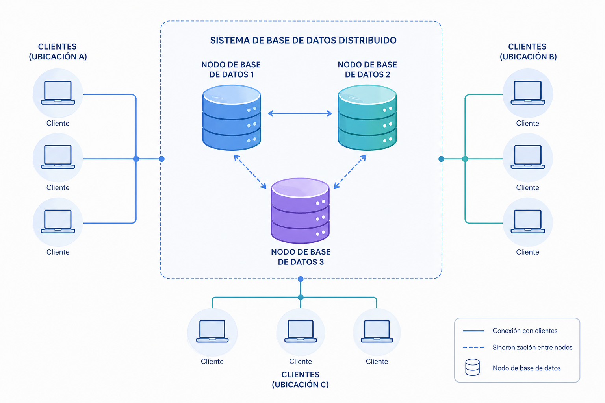

# 1.4 Arquitectura ANSI/SPARC: Nivells Intern, Conceptual i Extern

## **BBDD Centralizadas**

Es aquella estructura en la que el SGBD está implantado en una sola plataforma u ordenador desde donde se gestiona directamente, de modo centralizado, la totalidad de los recursos. Es la arquitectura de los centros de procesamiento de datos tradicionales. Se basa en tecnologías sencillas, muy experimentadas y de gran robusteza.
Las principales características de las BBDD centralizadas son:

- Se almacena completamente en una ubicación central.

- No posee múltiples elementos de procesamiento ni mecanismos de intercomunicación.

- Los componentes de las BBDD centralizadas son: los datos, el software de gestión de BBDD y los dispositivos de emmagatzematge secundario asociados.

- Son sistemas en los que su seguridad puede verse comprometida más fácilmente.

## Ventajas e inconvenientes de las bases de dades centralitzades.

  
    
      
      
    
  
  
    
      
      
    
    
      
      
    
    
      
      
    
    
      
      
    
    
      
      
    
    
      
      
    
  

| Ventajas | Inconvenientes |
| --- | --- |
| Se evita la redundancia debido a la posibilidad de inconsistencias y al desaprovechamiento de espacio. | Un mainframe en comparación de un sistema distribuido no tiene mayor poder de cómputo. |
| Se evita la inconsistencia. Ya que si un hecho específico se representa por una sola entrada, la no‐concordancia de datos no puede ocurrir. | Cuando un sistema de bases de dades centralizado falla, se pierde toda disponibilidad de procesamiento y sobre todo de información confiada al sistema. |
| La seguridad se centraliza. | En caso de un desastre o catástrofe, la recuperación es difícil de sincronizar. |
| Puede conservarse la integridad. | Las cargas de trabajo no es poden difundir entre varias computadoras, ya que los trabajos siempre se ejecutarán en la misma máquina. |
| El procesamiento de los datos ofrece un mejor rendimiento. | Los departamentos de sistemas retienen el control de toda la organización. |
| Mantenimiento más barato. Mejor uso de los recursos y menores recursos humanos. | Los sistemas centralizados requieren un mantenimiento central de datos. |

## **BBDD Distribuidas**

- **Base de dades distribuida(BDD)**: Es un conjunto de múltiples bases de dades lógicamente relacionadas las cuales se encuentran distribuidas entre diferentes nodos interconectados por una red de comunicaciones.

- **Sistema de bases de dades distribuida(SBDD)**: Es un sistema en el que múltiples sitios de BBDD están ligados por un sistema de comunicaciones, de tal forma que, un usuari en cualquier lugar puede acceder los datos en cualquier parte de la red exactamente como si los datos estuvieran almacenados en su sitio propio..

- **Sistema gestor de bases de dades distribuida(SGBDD)**: Es aquel que se encarga del manejo de la BBDD y proporciona un mecanismo de acceso que hace que la distribución sea transparente a los usuaris. El término transparente significa que la aplicación trabajaría, desde un punto de vista lógico, como si un solo SGBD ejecutado en una sola máquina, administrara estos datos.

## Ventajas e inconvenientes de las bases de dades distribuïdes.

  
    
      
      
    
  
  
    
      
      
    
    
      
      
    
    
      
      
    
    
      
      
    
    
      
      
    
    
      
      
    
  

| Ventajas | Inconvenientes |
| --- | --- |
| El acceso y procesamiento de los datos es más rápido ya que varios nodos comparten carga de trabajo. | La probabilidad de violaciones de seguridad es creciente si no se toman las precauciones debidas. |
| Desde una ubicación puede accederse a información alojada en diferentes lugares. | Existe una complejidad añadida que es necesaria para garantizar la coordinación apropiada entre los nodos. |
| Los costes son inferiores a los de las bases centralizadas. | La inversión inicial es menor, pero el mantenimiento y control puede resultar costoso. |
| Existe una cierta tolerancia a fallos. Mediante la replicación, si un nodo deja de funcionar el sistema completo no deja de funcionar. | Dado que los datos pueden estar replicados, el control de concurrencia y los mecanismos de recuperación son mucho más complejos que en un sistema centralizado. |
| El enfoque distribuido se adapta más naturalmente a la estructura de las organizaciones. Permiten la incorporación de nodos de manera flexible y fácil. | El intercambio de mensajes y el cómputo adicional necesario para conseguir la coordinación entre los diferentes nodos constituyen una forma de sobrecarga que no surge en los centralizados. |
| Aunque los nodos están interconectados, tienen independencia local. | Dada la complejidad del procesamiento entre nodos es difícil asegurar la corrección de los algoritmos, el funcionamiento correcto durante un fallo o la recuperación. |