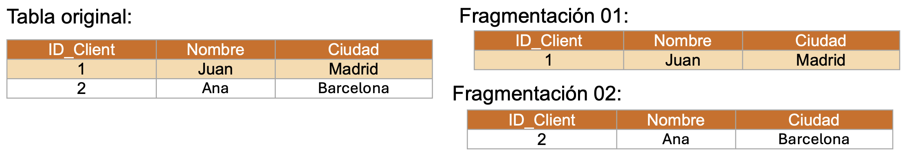
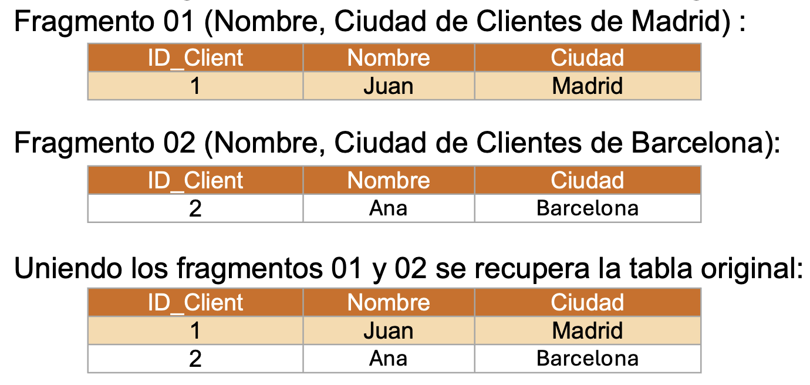
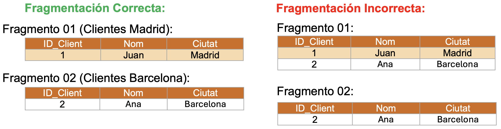
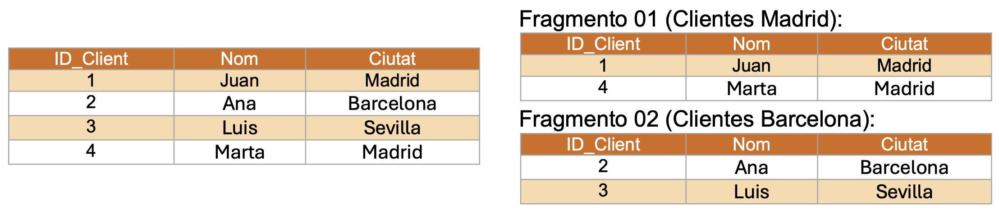
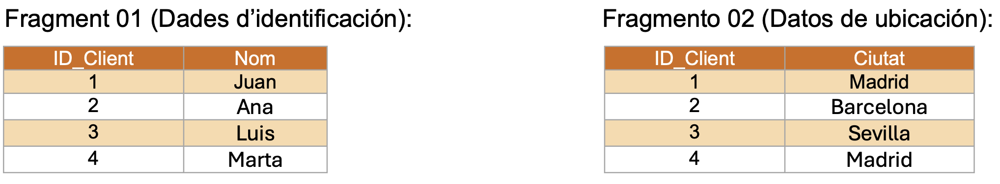
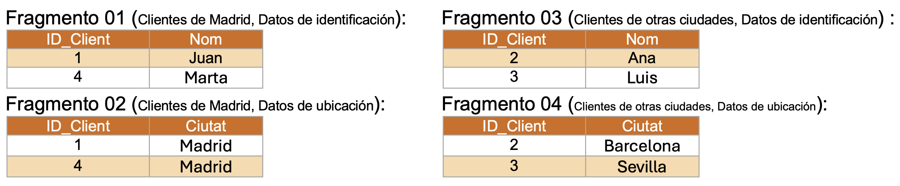

# **Fragmentación**

La fragmentación de BBDD es una técnica utilizada en sistemas distribuidos para dividir una BBDD grande en partes más pequeñas, llamadas fragmentos, que se pueden almacenar y gestionar de manera distribuida en diferentes ubicaciones físicas o lógicas. Esto mejora el rendimiento, la escalabilidad y la disponibilidad de la base de datos, ya que cada fragmento puede ser accedido y procesamiento de manera independiente.
Cuando se lleva a cabo una fragmentación, existen tres reglas fundamentales:

- 

**Completitud (completitud)**: Cada elemento de la BBDD original debe aparecer en al menos uno de los fragmentos. Esto significa que, después de la fragmentación, no se debe perder ningún dato. Si se fragmenta una tabla de clientes, todos los registros (o partes de ellos) deben estar presentes en algún fragmento.

Aquí se cumple la completitud porque no se ha perdido ningún dato; todos están en algún fragmento.

- 

**Reconstruction (Reconstrucción)**: Debe ser posible reconstruir la base de datos original combinando los fragmentos. Esto significa que, a partir de los fragmentos, se debe poder recuperar la base de datos en su forma original sin pérdida de información. Si la tabla de clientes se fragmenta, se debería poder unir los fragmentos para recrear la tabla original.

- 

**Disjointness (Disyunción)**: Cada fragmento debe ser disjunto, es decir, un registro de datos no debe aparecer en más de un fragmento, salvo que se esté utilizando una fragmentación redundante o replicada. Esto evita la duplicación innecesaria de datos entre fragmentos. En una tabla fragmentada horizontalmente, un registro de un cliente en Madrid debe aparecer sólo en un fragmento y no repetirse en otros fragmentos.

## **Tipos de Fragmentación**

### **Fragmentación Horizontal**

Divide una tabla en filas, distribuyendo diferentes subconjuntos de filas en diferentes fragmentos.
En una fragmentación horizontal, podríamos dividir la tabla Clientes en dos fragmentos basados en la ciudad:

- **Ventajas**: Mejora el rendimiento al permitir consultas más rápidas en subconjuntos específicos de la tabla.

- **Desventajas**: Puede ser difícil de gestionar si las consultas requieren combinar fragmentos de diferentes ubicaciones.

### **Fragmentación Vertical**

Divide una tabla en columnas, distribuyendo diferentes subconjuntos de columnas en diferentes fragmentos.

- **Ventajas**: Reduce la cantidad de datos transferidos en consultas que sólo necesitan ciertos atributos.

- **Desventajas**: Requiere juntar fragmentos en consultas que necesitan datos de diversas columnas.

### **Fragmentación Mixta (Combinada)**

Combina la fragmentación horizontal y vertical para adaptar mejor la estructura de la base de datos a las necesidades específicas.

- **Ventajas**: Ofrece flexibilidad y eficiencia al combinar los beneficios de las fragmentaciones horizontal y vertical.

- **Desventajas**: Puede ser más compleja de implementar y gestionar.
