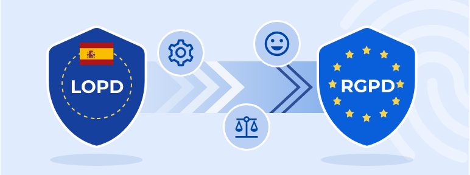
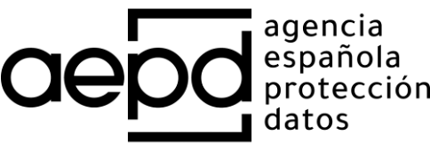
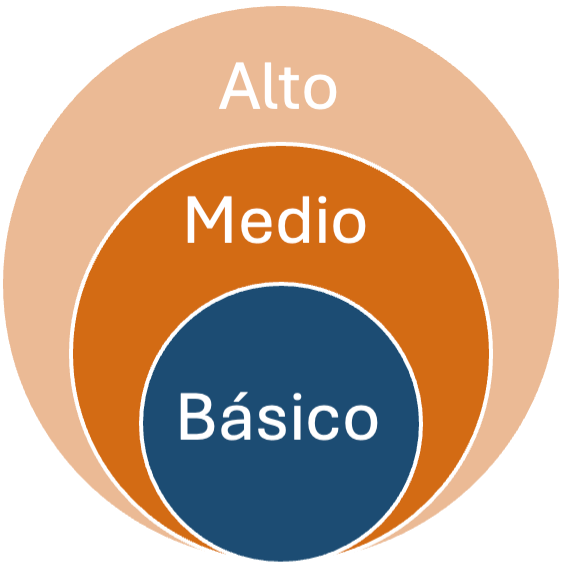

# **Protecció de dades i normativa LOPD**

  

    🏆 <strong>Progrés d'aquesta secció:</strong> 0 de 4 superats (0%)
    ⭐ <strong>0 punts</strong>
  

  

    

  

La protecció de dades personals es ha convertido en un tema crucial en l'era digital degut a l'aumento de la recopilació i processament d'informació personal per part d'empreses i organitzacions.
En l'estat espanyol està vigent la Ley Orgánica de Protecció de Dades Personals i Garantía dels Drets Digitals (LOPDGDD) del 5 de maig de 2018 que complementa i desenvolupa el Reglamento General de Protecció de Dades (RGPD) del 25 de maig de 2018 a nivell europeo.

## **Reglamento General de Protecció de Dades (RGPD)**

Regula el tractament que realitzen persones, empreses o organitzacions de les dades personals relacionats amb persones en la Unió Europea (UE).
Aquest Reglamento s'aplica a les empreses quan:

- L'empresa tracta dades personals i té el seu sede en la UE, independentment d'on es traten de fet les dades.

- L'empresa té el seu sede fora de la UE però tracta dades personals relatius a ofertas de bienes o serveis a ciutadans en la UE, o supervisa el comportament de ciutadans en la UE.

- Les empreses que no tenen sede dins de la UE i que tracten dades de ciutadans de la UE han de nombrar un representant en la UE.

Les dades personals són qualsevol informació relacionada amb una persona identificada o identificable, també denominada "l'interesado".

**Exemples de dades personals**:

- nom i cognoms

- adreça

- número de document d'identitat/pasaporte

- ingresos

- perfil cultural

- adreça de protocol internet (IP)

- dades en poder d'hospitals o metges (que identifican únicament a una persona amb fines sanitarios).

**No es poden tractar dades personals sobre**:

- origen racial o étnic

- orientació sexual

- opiniones polítiques

- conviccions religiosas o filosófiques

- afiliació sindical

- dades genétics, biométrics o sanitarios, excepte en casos específics (quan es dóna un consentiment explícit o quan el tractament és necessari per raons d'interès públic essencial)

- condenas i infraccions penals, excepte que l'autorice el Dret nacional o de la UE.

**Els seus principis són**:

- **Licitud, lealtad i transparencia**: Les dades han de ser processats de manera legal, justa i transparent.

- **Limitació de la finalitat**: Les dades han de recogerse amb finalitats específiques, explícitos i legítimos.

- **Minimizació de dades**: Només han de procesar-se les dades que siguen adequats, pertinentes i limitats.

- **Exactitud**: Les dades han de ser exactos i, si és necessari, actualitzats.

- **Limitació del termini de conservació**: Les dades han de conservar-se durant el temps necessari per als fines del tractament.

- **Integritat i confidencialitat**: Les dades han de ser processats de manera que es garantice una seguretat adequada.

- **Responsabilitat proactiva**: Els responsables del tractament han de ser capaços de demostrar el cumpliment.

**I vela pels drets dels individus sobre les dades**:

- **Dret d'accés**: Els individus tenen el dret d'accedir a les seues dades personals i obtindre informació sobre com es estan utilitzant.

- **Dret de rectificació**: Els individus poden solicitar la correcció de dades inexactos o incompletos.

- **Dret de supresió (dret a l'olvido)**: Els individus poden solicitar l'eliminació de les seues dades personals en certs casos.

- **Dret a la limitació del tractament**: Els individus poden solicitar la restricció del processament de les seues dades en certs casos.

- **Dret a la portabilitat de les dades**: Els individus poden rebre les seues dades en un format estructurat i transferirlos a un altre responsable.

- **Dret d'oposició**: Els individus poden oponerse al processament de les seues dades per motivos específics.

- **Dret a no ser objecte de decisions individuals automatitzades**: Els individus tenen dret a no ser sujetos a decisions basades únicament en el processament automatitzat.

El RGPD no especifica què mesures de seguretat concretes cal aplicar en cada cas, sinó que éstas han de determinar-se pel responsable o pel encarregat segons diverses variables: l'estat de la tècnica, els riscos que existisquen per als drets i libertades dels interesats, la naturalesa, l'abast, el context i els fines del tractament i els costos d'aplicar les mesures.

La **AEPD** ha señalado que es poden seguir aplicant les mateixes mesures de seguretat que estableix la normativa fins a ara vigent **si de l'anàlisi de riscos es concluye que aquestes mesures són idóneas per a oferir un nivell de seguretat adequat** (en cas contrari, serà necessari completar aquestes mesures o prescindir d'alguna d'elles).

### **Mesures de seguretat segons el RGPD**

El **RGPD** no especifica què mesures de seguretat concretes cal aplicar en cada cas, sinó que éstas han de determinar-se pel responsable o pel encarregat segons diverses variables:

- L'estat de la tècnica,

- Els riscos que existisquen per als drets i libertades dels interesats,

- La naturalesa, l'abast, el context i els fines del tractament,

- I els costos d'aplicar les mesures.

## **Nivells de Seguretat de les dades en LOPD**

Les mesures de protecció de dades establides per la LOPDGDD es estructuran en diferents nivells segons el grau de sensibilitat de les dades que es tracten i el risc associat al seu tractament. Aquestes mesures es poden classificar en tres nivells principals: bàsic, mitjà i alt.

### **Nivell Bàsic**

Aquest nivell s'aplica al tractament de dades personals considerats de menor risc o sensibilitat, però que encara requereixen mesures de protecció per a garantir la seua seguretat i confidencialitat.

**Exemples de dades**:

- Dades identificatius bàsics com el nom, adreça, telèfon, etc.

- Informació comercial o laboral no sensible.

**Mesures de protecció associades**:

- Control d'accés: Assegurar que només el personal autoritzat tinga accés a les dades.

- Identificació i autenticació: Els usuaris han d'identificar-se i autenticar-se abans d'accedir a les dades.

- Gestió de suports: Procediments per a la gestió correcta de suports (discs duros, USBs) que continguen dades personals, incloent la seua destrucció segura.

- Còpies de seguretat: Realització de còpies de seguretat periódiques per a evitar la pèrdua de dades.

### **Nivell Mitjà**

Aquest nivell s'aplica quan es tracta dades amb un risc moderado o quan la seua pèrdua o accés no autoritzat podria afectar als drets de les persones.

**Exemples de dades**:

- Dades financieros, bancarios o de solvencia patrimonial.

- Informació que permet identificar a una persona, però que no es considera especialment sensible.

**Mesures de protecció associades**:

- Totes les mesures del nivell bàsic, més:

- Gestió més estricta d'accés: Assignació d'usuaris i perfiles amb permisos específics per a accedir a determinats dades.

- Control d'accés físic: Restriccions físiques per a l'accés als locals on es troben els sistemes d'informació.

- Registre d'accessos: Registre de les activitats d'accés als sistemes que tracten les dades, per a poder identificar qualsevol accés indebido o sospechoso.

- Auditorías de seguretat: Realització periódica d'auditorías per a garantir que es compleixen les mesures de protecció de dades.

### **Nivell Alt**

Aquest nivell és necessari quan es tracta amb dades de caràcter molt sensible, de la qual pèrdua, modificació o accés no autoritzat podria tindre graves conseqüències per als drets i libertades de les persones.

**Exemples de dades**:

- Dades de salud, ideología, afiliació sindical, creencias religiosas, origen étnic, orientació sexual.

- Dades relatius a sancions o infraccions penals o administrativas.

**Mesures de protecció associades**:

- Totes les mesures dels nivells bàsic i mitjà, més:

- Cifrado de dades: Encriptació obligatòria de dades durant l'emmagatzematge i la transmissió per a prevenir l'accés no autoritzat.

- Auditorías freqüents: Auditorías de seguretat més rigurosas i freqüents per a garantir el cumpliment de les mesures establides.

- Seguretat avançada: Implementació de tecnologies de seguretat addicionals, com sistemes de detecció d'intrusions (IDS) o mesures de control d'accés biométric.

- Procediments estrictos de còpia de seguretat: Protocols rigurosos per a la realització i emmagatzematge de còpies de seguretat, asegurant la seua integritat i disponibilitat en cas d'incidentes.

---

## 🎮 Reptes Interactius d'Autoavaluació (+100 XP)

Comprova el teu domini sobre **1.6 Protecció de dades i normativa LOPD** superant aquests 4 reptes gamificats (+25 punts cadascun):

  
🎯 <strong>Repte 1 (+25 pts):</strong> Quin és el principal avantatge d'un SGBD enfront dels sistemes tradicionals de fitxers?

  

    <button type="button" class="btn-mcq-opt" data-opt="A">A) Permet prescindir completament de la memòria RAM del servidor.</button>
    <button type="button" class="btn-mcq-opt" data-opt="B">B) Elimina la redundància descontrolada, garanteix la integritat i ofereix independència física i lògica de les dades.</button>
    <button type="button" class="btn-mcq-opt" data-opt="C">C) Impedeix que més d'un usuari accedisca a les dades al mateix temps.</button>
    <button type="button" class="btn-mcq-opt" data-opt="D">D) Emmagatzema totes les dades exclusivament en fitxers de text pla sense format.</button>
  

  

  
🎯 <strong>Repte 2 (+25 pts):</strong> En l'arquitectura ANSI-SPARC de tres nivells, quin nivell defineix les vistes parcials adaptades a cada grup d'usuaris?

  

    <button type="button" class="btn-mcq-opt" data-opt="A">A) Nivell intern o físic.</button>
    <button type="button" class="btn-mcq-opt" data-opt="B">B) Nivell conceptual o lògic global.</button>
    <button type="button" class="btn-mcq-opt" data-opt="C">C) Nivell extern (esquemes externs o vistes d'usuari).</button>
    <button type="button" class="btn-mcq-opt" data-opt="D">D) Nivell de xarxa física.</button>
  

  

  
✅ <strong>Repte 3 (Vertader o Fals · +25 pts):</strong> Segons el Reglament General de Protecció de Dades (RGPD) i la LOPDGDD, el tractament de dades personals requereix base legítima, minimització de dades i mesures de seguretat adequades.

  

    <button type="button" class="btn-vf" data-opt="V">Vertader (V)</button>
    <button type="button" class="btn-vf" data-opt="F">Fals (F)</button>
  

  

  
⌨️ <strong>Repte 4 (+25 pts):</strong> Quines són les sigles en valencià/castellà del programari encarregat de gestionar, administrar i controlar l'accés a una base de dades (Sistema Gestor de Bases de Dades)?

  

    <input type="text" class="quiz-input" placeholder="Escriu la resposta..." />
    <button type="button" class="btn-quiz-check">Comprovar</button>
  

  

### 📋 Llista de Comprovació i Rúbrica d'Assoliment

Marca cada criteri a mesura que completes l'estudi o la resolució pràctica d'aquesta pàgina (**1.6 Protecció de dades i normativa LOPD**):

- [ ] He llegit detingudament la teoria o l'enunciat d'aquesta secció i he anotat els conceptes clau.
- [ ] He revisat els esquemes, taules o blocs de codi i he verificat que sé aplicar-los a l'entorn de treball.
- [ ] He resolt correctament els **4 reptes interactius** superiors obtenint els **100 punts XP**.
- [ ] He descarregat el comprovant oficial en PDF per a adjuntar-lo a la tasca d'**Aules**.

  <h3>📤 Comprovant de Lliurament per a Aules</h3>
  
Quan hages completat els reptes interactius i la llista d'autoavaluació d'aquesta pàgina, introdueix el teu nom i descarrega el teu certificat oficial en PDF per a adjuntar-lo a la tasca d'<strong>Aules</strong>.

  

    <label for="aules-student-name">👤 Nom i Cognoms de l'Alumne/a:</label>
    <input type="text" id="aules-student-name" class="aules-student-name" placeholder="Ex: Joan Garcia Pérez" />
  

  

    0/4 reptes completats (0%) · 0 punts · 0/4 criteris d'autoavaluació
  

  

    <button type="button" class="btn-aules-dl" data-module="BBDD" data-unit="UD01" data-activity="ut0106">📥 Descarregar Comprovant PDF</button>
    <button type="button" class="btn-aules-copy">📋 Copiar Resum al Porta-retalls</button>
  

  

