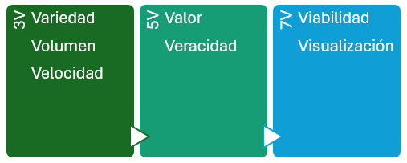
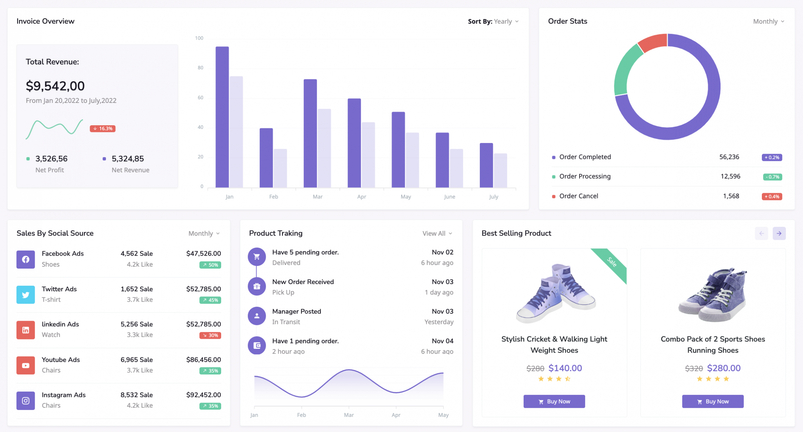

# **Big Data i Intel·ligència de negocis**

  

    🏆 <strong>Progrés d'aquesta secció:</strong> 0 de 4 superats (0%)
    ⭐ <strong>0 punts</strong>
  

  

    

  

## **Què és?**

Big Data es refereix a la recopilació, l'emmagatzematge, la gestió i l'anàlisi de grans volums de dades que són massa complexos i extensos per a ser tratats amb les eines tradicionals de gestió de bases de dades.
Tot volum de dades haurà de tindre en compte els aspectes de les 5v:

- **Volum**: Fa referència a la quantitat masiva de dades generats i recogits.

- **Velocitat**: La rapidesa amb que es generen, procesan i analizan les dades.

- **Varietat**: La diversitat dels tipus de dades recopilats.

- **Veracitat**: La fiabilitat, qualitat i cuidadosa de les dades.

- **Valor**: La capacitat de les dades per a proporcionar informació útil i accionable.

En l'actualitat alguns estudios incorporen 2 v més, parlant de les 7v:

- **Viabilitat**: És necessari saber la capacitat que té una empresa per a realitzar un ús eficaz de les dades, cuestionar-se què i quants dades es necessiten per a predecir els resultats més interesantes per a l'empresa.

- **Visualizació**: Necessitem poder representar les dades, ja siga de manera visual mitjançant gràfics o codificats en indicadors (KPI) per a fer que siguen llegibles i accesibles.

## **Introducció**

L'anàlisi de dades consisteix en l'ús de tècniques analítiques avançades realitzades en el conjunt de big data molt grans i diversos.
Les fases en un anàlisi de dades serien:

- **Recogida de Dades.**

- **Fonts de dades.**

- **Emmagatzematge de Dades.**

- **Sistemes de fitxers distribuïts.**

- **Processament de Dades.**

- **Tècniques de Anàlisi de Dades.**

- **Visualizació de Dades.**

### **Importància del Big Data**

- **Pren de decisions basada en dades**: Les empreses i organitzacions poden utilitzar Big Data per a prendre decisions informades basades en anàlisi detallats.

- **Innovació i millora de productes**: Les dades poden revelar informació sobre les necessitats i preferències dels clients, guiant la innovació de productes i serveis.

- **Optimització operativa**: Les dades poden ayudar a identificar ineficiencias i millorar els processos operatius.

- **Personalització de l'experiència del client**: Mitjançant l'anàlisi de dades, es pot oferir una experiència més personalitzada als clients, millorant la seua satisfacció i fidelizació.

### **Tecnologies associades al Big Data**

- **Sistemes de bases de dades NoSQL**: Dissenyats per a gestionar grans volums de dades no estructurats i semi-estructurats. MongoDB, Cassandra i Couchbase.

- **Processament distribuït**: Permeten el processament distribuït de grans conjunts de dades a través de clústeres de computadors, com Hadoop.

- **Plataformes de processament en temps real**: Apache Spark és un exemple de plataforma que permet processar dades en temps real, ofrecent una alternativa a MapReduce per a certs casos d'ús.

- **Eines d'anàlisi i visualizació**: Eines com Tableau, Power BI, i D3.js ayudan a visualitzar i interpretar grans volums de dades de manera comprensible.

### **Aplicacions del Big Data**

- **Salud**: Anàlisi de dades de pacients per a la investigació médica, predicció de brotes d'enfermetats i personalització de trataments.

- **Finances**: Detecció de fraudes, anàlisi de riscos i pren de decisions d'inversió basada en grans volums de dades del mercat.

- **Comercio i marketing**: Anàlisi de comportaments dels consumidors, personalització de campanyes de marketing i optimització d'estratègies de venda.

- **Ciència i investigació**: Anàlisi de dades masivos per a descubriments científics, investigacions académiques i avances tecnològics.

## **Intel·ligència de negocis**

La Intel·ligència de negocis, o Business intelligence, és un conjunt de tècniques i eines utilitzades per a transformar dades en informació útil per a la pren de decisions.
Per a formar una Intel·ligència de negoci és necessari comptar amb aquests components:

- **ETL (Extract, Transform, Load)**: Processos per a extraer dades, transformar-los i cargar-los en sistemes d'emmagatzematge.

- **Data Warehousing**: Magatzems de dades dissenyats per a emmagatzemar informació histórica i facilitar l'anàlisi.

- **Reporting**: Generació d'informes basats en dades per a l'avaluació de rendiment i altres métriques.

- **Dashboards**: Panells de control interactivos que proporcionen una visió general de les dades empresarials.

Amb tot açò, la intel·ligència de negocis aporta:

- Millora de la pren de decisions: Accés a dades relevantes i anàlisi precisos per a decisions basades en evidencia.

- Major eficiència operativa: Optimització de processos i recursos basats en l'anàlisi de dades.

- Avantatge competitiva: Permet identificar oportunitats de negoci i millorar el posicionament en el mercat.

- Personalització del servei: Permet a les empreses personalitzar ofertas basades en el comportament del client.

### **Aplicacions**

- **Anàlisi de clients**: Comprendre comportaments i preferències dels clients.

- **Optimització de processos**: Millorar l'eficiència operativa mitjançant l'anàlisi de dades.

- **Planificació estratégica**: Suportar decisions estratégiques basades en dades.

- **Monitorizació de rendiment**: Avaluar el rendiment de diferents àrees de l'empresa mitjançant KPIs (Indicadors Clau de Rendiment).

### **Ciència de dades**

La ciència de dades inclou una sèrie de mètodes per a analitzar tant xicotets conjunts de dades com quantitats enormes. Encara que no existisca una procés clarament definits, podem identificar els següents passos:

- **Establir l'objectiu** de la investigació: totes les parts interesades entienden el què, el com i el porqué del projecte i es crea un project charter o acta de constitució del projecte.

- **Recuperació de dades**: cerca de les dades, ja siguen interns o externs a l'empresa. El resultat són dades en bruto que segurament caldrà limpiar (eliminar o corregir dades incompletos o erróneos, com per exemple, edades en negatiu, dates malament formateades, etc...) i transformar abans de poder utilitzar-los.

- **Preparació de les dades**: necessitem transformar les dades perquè siguen utilizables pels models, detectant i corrigent els diferents tipus d'errors, combinant dades de diverses fonts. Un pas molt freqüent consisteix en normalitzar les dades, procés consistente en transformar les dades categórics en numèrics.

- **Exploració de dades**, per a obtindre un coneixement profundo de les dades, cercant patrons, correlacions o desviacions, normalment, mitjançant tècniques visuals i descriptivas.

- Modelatge: creació de models, en ocasions basats en IA, per a obtindre la informació o realitzar les prediccions indicades en l'acta de constitució del projecte.

- **Presentació i automatització**: Amb la presentació dels resultats obtinguts (per exemple, mitjançant eines com PowerBI o Tableau) i la seua comprovació, és probable que es entre en un cicle iterativo que provoque tornar al pas 2 amb dades nous i requiera automatitzar tots el procés.

---

## 🎮 Reptes Interactius d'Autoavaluació (+100 XP)

Comprova el teu domini sobre **1.7 Big Data i Intel·ligència de negocis** superant aquests 4 reptes gamificats (+25 punts cadascun):

  
🎯 <strong>Repte 1 (+25 pts):</strong> Quin és el principal avantatge d'un SGBD enfront dels sistemes tradicionals de fitxers?

  

    <button type="button" class="btn-mcq-opt" data-opt="A">A) Permet prescindir completament de la memòria RAM del servidor.</button>
    <button type="button" class="btn-mcq-opt" data-opt="B">B) Elimina la redundància descontrolada, garanteix la integritat i ofereix independència física i lògica de les dades.</button>
    <button type="button" class="btn-mcq-opt" data-opt="C">C) Impedeix que més d'un usuari accedisca a les dades al mateix temps.</button>
    <button type="button" class="btn-mcq-opt" data-opt="D">D) Emmagatzema totes les dades exclusivament en fitxers de text pla sense format.</button>
  

  

  
🎯 <strong>Repte 2 (+25 pts):</strong> En l'arquitectura ANSI-SPARC de tres nivells, quin nivell defineix les vistes parcials adaptades a cada grup d'usuaris?

  

    <button type="button" class="btn-mcq-opt" data-opt="A">A) Nivell intern o físic.</button>
    <button type="button" class="btn-mcq-opt" data-opt="B">B) Nivell conceptual o lògic global.</button>
    <button type="button" class="btn-mcq-opt" data-opt="C">C) Nivell extern (esquemes externs o vistes d'usuari).</button>
    <button type="button" class="btn-mcq-opt" data-opt="D">D) Nivell de xarxa física.</button>
  

  

  
✅ <strong>Repte 3 (Vertader o Fals · +25 pts):</strong> Segons el Reglament General de Protecció de Dades (RGPD) i la LOPDGDD, el tractament de dades personals requereix base legítima, minimització de dades i mesures de seguretat adequades.

  

    <button type="button" class="btn-vf" data-opt="V">Vertader (V)</button>
    <button type="button" class="btn-vf" data-opt="F">Fals (F)</button>
  

  

  
⌨️ <strong>Repte 4 (+25 pts):</strong> Quines són les sigles en valencià/castellà del programari encarregat de gestionar, administrar i controlar l'accés a una base de dades (Sistema Gestor de Bases de Dades)?

  

    <input type="text" class="quiz-input" placeholder="Escriu la resposta..." />
    <button type="button" class="btn-quiz-check">Comprovar</button>
  

  

### 📋 Llista de Comprovació i Rúbrica d'Assoliment

Marca cada criteri a mesura que completes l'estudi o la resolució pràctica d'aquesta pàgina (**1.7 Big Data i Intel·ligència de negocis**):

- [ ] He llegit detingudament la teoria o l'enunciat d'aquesta secció i he anotat els conceptes clau.
- [ ] He revisat els esquemes, taules o blocs de codi i he verificat que sé aplicar-los a l'entorn de treball.
- [ ] He resolt correctament els **4 reptes interactius** superiors obtenint els **100 punts XP**.
- [ ] He descarregat el comprovant oficial en PDF per a adjuntar-lo a la tasca d'**Aules**.

  <h3>📤 Comprovant de Lliurament per a Aules</h3>
  
Quan hages completat els reptes interactius i la llista d'autoavaluació d'aquesta pàgina, introdueix el teu nom i descarrega el teu certificat oficial en PDF per a adjuntar-lo a la tasca d'<strong>Aules</strong>.

  

    <label for="aules-student-name">👤 Nom i Cognoms de l'Alumne/a:</label>
    <input type="text" id="aules-student-name" class="aules-student-name" placeholder="Ex: Joan Garcia Pérez" />
  

  

    0/4 reptes completats (0%) · 0 punts · 0/4 criteris d'autoavaluació
  

  

    <button type="button" class="btn-aules-dl" data-module="BBDD" data-unit="UD01" data-activity="ut0107">📥 Descarregar Comprovant PDF</button>
    <button type="button" class="btn-aules-copy">📋 Copiar Resum al Porta-retalls</button>
  

  

