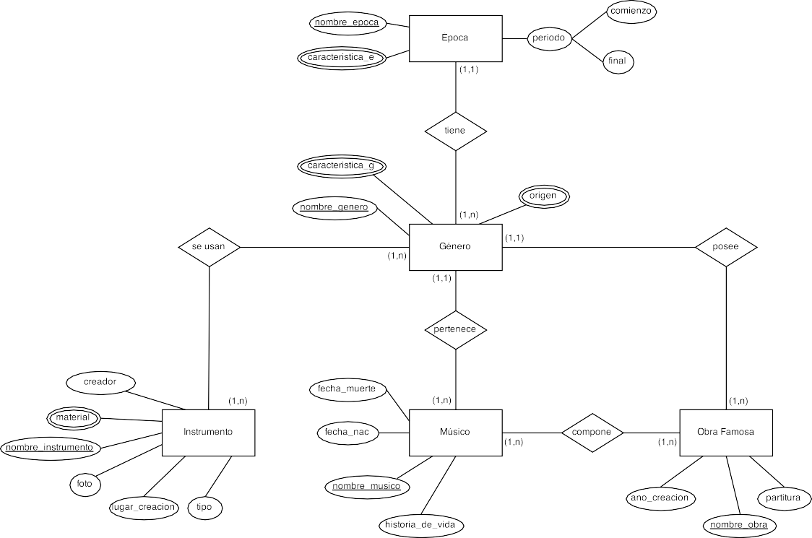
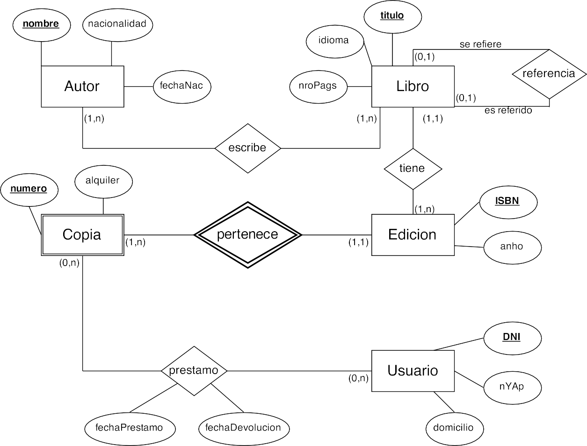
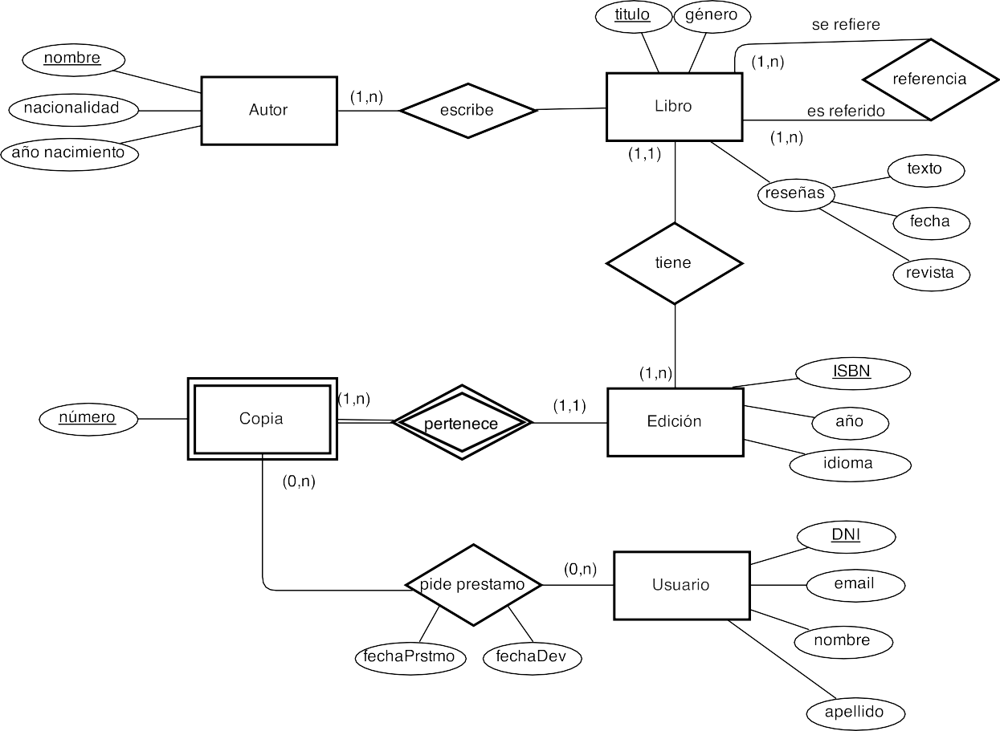

# **Activitat 206**

  

    🏆 <strong>Progrés d'aquesta secció:</strong> 0 de 4 superats (0%)
    ⭐ <strong>0 punts</strong>
  

  

    

  

> **📌 Lliurament**
> 

> - El lliurament serà un **fitxer PDF** que continga la resposta a les preguntes de l'activitat.

> - El nom del fitxer ha de ser `207_NombreApellidos.pdf`.

> - S'haurà de lliurar en la tasca corresponent d'Aules en temps i forma.

> **📌 Es valorarà**
> 

> Es valorarà:

> - La correcta identificació dels elements del model EER.

> - L'ús adequat de la generalització, especialització i agregació.

> - La claredat dels diagrames realitzats.

> - La correcta justificació de les respostes.

> Aquesta activitat servirà per a qualificar:

> - **RA6:** Dissenya models relacionals normalitzats interpretant diagrames entitat/relació.

>   - CE6. a) S'han utilitzat eines gràficas per a representar el disseny lògic. (5%)

>   - CE6. b) S'han identificat les taules del disseny lògic. (3%)

>   - CE6. c) S'han identificat els camps que formen part de les taules del disseny lògic. (3%)

>   - CE6. d) S'han analitzat les relacions entre les taules del disseny lògic. (1%)

>   - CE6. e) S'han identificat els camps clau. (3%)

## **Exercici 1**

**Sistema d'un Centre Cultural**

Un centre cultural vol desenvolupar un sistema per a mantindre i consultar la informació de la història de la música. Per a açò es organitza la informació per épocas, de les quals es sap el nom únic, diferents característiques relevantes, el período (any de començament i any final) i els géneros musicals de l'época.

A la seua vegada, de cada gènere, es vol saber el seu nom únic, diverses característiques, els seus orígenes, els músics associats a eixe gènere i els instruments que intervenían en l'ejecució d'eixe gènere.

Sabem que una época té diversos géneros, però que un gènere pertany a una sola época.

De cada músic, es sap el nom únic, data de naixement, data de muerte i una història de la seua vida.

Un gènere té diversos músics, però un músic pertany a un només gènere.

De cada instrument musical es té el nom únic, una foto, el lloc on es creó, qui va ser el creador, el tipus d'instrument (vent, teclat, etc.) i els materials amb que es fa. En un gènere s'usen diversos instruments, i un instrument apareix en diversos géneros.

Adicionalment, es vol conèixer la llista d'obras famosas que es van fer dins d'un gènere. De les obras famosas, es coneix un nom únic, l'any en que es va fer, els músics autors i la partitura. Tinga en compta que una obra famosa pertany a un només gènere, que una obra famosa la componen diversos músics i que un músic compon diverses obras.

💡 Solució

## **Exercici 2**

**Rincón de Lectura**

Ens piden ajuda per a modelar el sistema d'una biblioteca, brindándonos la següent informació.

Els llibres són escritos per autors dels quals coneixem el seu nom, la seua nacionalitat i la seua data de naixement. Els noms dels autors no poden repetir-se. A més, sabem que els llibres compten amb un títol únic, l'idioma i el seu número de pàgines. Adicionalment, sabem que cada llibre té edicions, de les quals sabem l'any i el ISBN (que no pot repetir-se).

La biblioteca realitza préstamos de distintes edicions a usuaris. De cada préstamo, sabem el número de la còpia del llibre prestado i el preu de l'alquiler, mentre que dels usuaris sabem el seu DNI, el seu nom i cognom i el seu domicili. També volem registrar la data del préstamo i la data de devolució de les transaccions realitzades.

Tinga en compta la següent informació addicional:

- Un autor escriu molts llibres i un llibre pot ser escrit per molts autors. Un llibre pot tindre moltes edicions.

- Una edició té moltes còpies, però cada còpia pertany a una edició.

- Una còpia pudo haver sigut prestada a molts usuaris i molts usuaris poden haver comanda la mateixa còpia en moments distints.

- En alguns casos un llibre pot fer referència a un altre llibre, però només a un, el mateix en el cas invers.

- Les còpies tenen un número únic dins de cada edició, però el mateix pot repetir-se dins d'altres edicions.

💡 Solució

## **Exercici 3**

**Agencia de viatges**

Es vol realitzar una base de dades per a portar la informació de diverses agencias de viatges. De cada una es coneix el seu codi, la data d'inici d'activitats i la seua ciutat.

Cada agencia ofereix paquets turístics, els quals tenen un preu i destinos a diversos països. S'identifican per un codi de paquet. Un paquet pot estar relacionat amb un o més paquets a mode de combo (exemple: viatge a Disney + crucero pel Caribe). Cada paquet és propi de la seua agencia, no pot ser venut en una altra.

Els paquets són comprats per clients, els quals tenen un nom, domicili i són diferenciats pel seu DNI. Aquests clients tenen diverses formes de pagament, de les quals coneixem el seu tipus i el monto a pagar. Els mitjans de pagament són autoritzats per un només banco, dels quals sabem que poseen un nom -que és únic- i sucursal. A l'autoritzar els pagaments, es estableix una data de validesa.

## **Exercici 4**

**Sistema de Farmàcia**

Hem de dissenyar un sistema per a registrar les farmacias en diferents ciutats del nostre país.

Sabem que cada farmàcia té un nom (únic en tot el sistema) i un domicili. Cada farmàcia es ubica en una sola ciutat, però en una ciutat hi ha diverses farmacias. De cada ciutat, sabem el nom, la província en la que es troba, la quantitat d'habitantes i la superfície. Cada ciutat s'identifica amb el nom i la província.

Coneixem també que cada farmàcia pot tindre un propietari, i que cada propietari té solament una farmàcia. Tinga en compta que pot haver farmacias sense propietari. Dels propietaris, coneixem el DNI (únic), el seu nom i el seu domicili, compost per carrer, número, codi postal i ciutat.

Cada farmàcia, a la seua vegada, ven diversos medicamentos i un medicament es ven en diverses farmacias. De cada medicament coneixem el seu id únic, el seu nom comercial i les drogas de les quals es compon. Cada farmàcia ven un medicament a un preu determinat, que no necessàriament és el mateix en diferents farmacias.

Com últim requeriment, un medicament pot complementar a altres medicamentos, però sabem que cada medicament pot ser complementado per un només medicament.

## **Exercici 5**

**Biblioteca**

Una reconocida biblioteca es troba en l'etapa de modelatge del seu base de dades. A continuació es enumeran les dades considerats al portar avant el seu disseny.

Els llibres són un dels components més importants. De cada un d'ells ens interessa registrar el seu títol (únic entre tots els llibres) i gènere al que pertany. A més posseeix un conjunt de reseñas, que es troben conformades per la revista on apareció, la data i el seu text descriptivo.

Un llibre té referències cap a altres llibres. Tot llibre té almenys una referència, i a més és referido almenys una vegada en un altre llibre (no hi ha llibres que no siguen referits, ni llibres que no tinguen referències).

Tot autor escriu almenys un llibre, i a la seua vegada tot llibre té almenys un autor. D'ells interessa saber el seu nom (que és únic, no hi ha dos autors amb el mateix nom), la seua nacionalitat i any de naixement.

Un llibre té a més almenys una edició. D'elles interessa l'any, el ISBN (un identificador únic entre edicions de llibres), i a més el seu idioma.

Les edicions tenen com a mínim una còpia, encara que les més demandades tenen diverses còpies. Cada còpia es diferència pel seu número, encara que aquest número per sí només no basta per a diferenciar-la: és necessari conèixer a més l'edició a la que pertanyen.

Finalment, les còpies són les que seran pedides en préstamo pels usuaris. Un usuari demana prestada una còpia en una data específica, i en eixe moment es li assigna una data de devolució. De l'usuari es coneix el DNI (que l'identifica d'altres usuaris), el seu nom, el seu cognom i un email. Un usuari pot no demanar còpies. A la seua vegada, pot que una còpia mai siga pedida en préstamo.

Respon les següents preguntes:

- Què problema de consistència aparecería si Autor fóra un atribut de Llibre, en lloc de ser una entitat separada?

- Com representarías en el model la relació de maestro-discípulo entre autors? Què relació té açò amb la decisió de com modelar els autors discutida en la pregunta anterior?

- Què diferència hi ha entre les traduccions al model relacional de les relacions Té i Escriu? A què s'ha d'aquesta diferència?

💡 Solució

## **Exercici 6**

**Aficionats de Brasil 2014**

Una pàgina web d'estadístiques deportivas desitja realitzar una base de dades per a manejar la informació dels partits, equips i aficionats que visitaron Brasil durant el mundial en el 2014.

Sabem que els partits tenen un ID que els identifica en el sistema, així com també la instància del torneo que es jugó en aquest partit (fase de grups, octavos, etc.), la duració i la data en la que es jugó, composta pel dia i l'hora, l'àrbitre que dirigió eixe partit i els equips que jugaron el mateix.

Dels árbitros coneixem el seu pasaporte, de què país són, l'any en el que inició l'activitat i el seu nom i cognom, com també què àrbitre reemplaça a quin en cas de lesió o enfermetat; sabem que un àrbitre pot ser reemplazado per diversos i que un àrbitre reemplaça només a un.

Dels equips que participen en els partits coneixem el nom de la selecció, que és únic entre el resta de les seleccions, el nom del DT d'eixa selecció, el lloc on entrena i el cos tècnic que la compon. També coneixem els distints jugadors que formen part de les seleccions, dels que sabem el seu número de camiseta, que els distingeix dins d'un equip, la posició que ocupen en la cancha, el seu nom i cognom i l'apodo de cada un. És sabido que durant un mundial un jugador representa a un només país i que en distintes seleccions pot haver jugadors amb el mateix número. Al ser un mundial, un equip pot jugar com a mínim tres partits (quedó eliminat en fase de grups) o arribar fins a set (llegó a la final).

En aquest sistema els estadios són sede de distints partits. Dels mateixos coneixem el seu nom, la ciutat en la que es troben, la seua capacitat màxima i també la capacitat habitada i la quantitat de policías que es fan present en cada partit. També sabem que els distints aficionats poden visitar els estadios (als que arriben en distints mitjans de transport), els quals reben una gran quantitat d'aficionats per partit. D'ells coneixem el número de ticket de cada un, la vestimenta i la ubicació (composta de zona, fila i número d'asiento) que té cada un. Adicionalment, sabem que un partit es juega només en un estadio i que en un estadio poden jugar-se molts partits.

## **Exercici 7**

**Fàbrica de Pelotas "Golazo"**

Solicitan els nostres serveis per a resoldre l'emmagatzematge de dades d'un sistema de gestió de la producció d'una fàbrica de pelotas. La fàbrica es compon d'una sèrie de plantes, cada una identificada per un color. De les plantes coneixem la superfície en metros cuadrats i la llista de processos que es duen a terme dins d'elles; d'aquests processos només coneixem el seu nom i un grau de complexitat associat.

Dins de cada planta es troben les màquines. Cada màquina és d'una marca i un model, i s'identifica per un número; aquest número és únic al llarg de totes les plantes.

Cada màquina és operada per tècnics. Hem de conèixer en què rang de dates els tècnics estuvieron assignats a eixa màquina, i a més en què turno (demà, tarde o nit).

Dels tècnics coneixem el seu DNI, nom, cognom i data de naixement, a banda d'una sèrie de números telefónics de contacte.

Existeixen situacions normals en les que una màquina ix de servei i ha de ser reparada. L'únic que ens interessa conèixer ací és quin una altra màquina està assignada per a prendre el treball que ella no pot realitzar.

## **Exercici 8**

**Sistema de Vendes**

Es vol dissenyar una BD que permeta registrar les vendes d'una empresa. Específicament, aquesta empresa necessita portar un control de proveïdors, clients, productes i vendes.

Un proveïdor es modela amb CUIT, nom, adreça, telèfon i pàgina web. Un client també es modela amb CUIT, nom i adreça, però pot tindre diversos telèfons de contacte. De cada adreça, ens interessa el seu carrer, número, comuna i ciutat. Tant per als proveïdors com els clients, el CUIT és un valor únic (equivalent al DNI).

Dels productes, sabem que tenen un identificador únic, nom, preu actual, stock i nom del proveïdor que els comercializa. A més, es organitzen en categories, i cada producte es classifica solament en una d'elles, però no obstant això una categoria classifica diversos productes. D'elles ens interessa saber el seu id, nom i descripció.

Sabem que un producte és comercialitzat per diversos proveïdors, però que un proveïdor provee un només producte.

Per raons de contabilitat, s'ha de registrar la informació de cada venda, les quals tenen un número de factura (que és únic), data, client, descompte i monto final. A la seua vegada, sabem que una venda es compon de diversos productes, i per això ens interessa el preu al moment de la venda del producte, la quantitat vendida i el monto total per ell. Tinga en compta que un producte pot estar en diverses vendes, però que podem tindre un producte que no haja sigut venut. Adicionalment, sabem que cada client pot realitzar diverses vendes, i en una venda solament participa un client.

## **Exercici 9**

**Cadena de Deportes**

Una cadena de cases de deportes desitja realitzar una base de dades per a manejar els seus sucursals, empleats, productes i clients.

De les sucursals es sap el número únic que la identifica dins de la cadena, el domicili i la ciutat.

Dels empleats el legajo, el nom, el DNI, el domicili (carrer, número i ciutat) i els números de telèfon en els quals pot ser contactado.

Els empleats treballen en diferents sucursals en diferents dies de la setmana i en cada sucursal tenen assignat un horari en particular, que pot no ser el mateix en diferents sucursals. Per exemple, l'empleat GBA treballa els dilluns de 9hs. a 18hs. en la Sucursal 1, i els dimarts de 10hs. a 20hs. en la Sucursal 2. En cada sucursal treballen diversos empleats.

Dels productes es coneix un codi, una descripció, un color i un cost fix de fabricació. A la seua vegada, existeixen també les fàbriques que són identificades amb CUIT, nom, país d'origen, quantitat d'empleats i nom de gerente. Cada producte és fabricado en una sola fàbrica, i cada fàbrica solament realitza un tipus de producte. El cost fix de fabricació no depèn de la fàbrica.

Cada sucursal pot vendre diversos productes, i a la seua vegada, cada producte pot ser venut per diverses sucursals. Cada sucursal estableix quin és el preu de venda del producte que ofereix. És a dir, un mateix producte podria tindre diferents preus en diferents sucursals.

Dels clients es coneix el codi de client, el DNI, el nom, la data de naixement i la ciutat en la que viu. A la seua vegada, també sabem que cada client pot utilitzar diverses targetes de crèdit, que són identificades pel nom de la targeta, el número, el codi de seguretat i la data de venciment.

Cada client solament realitza compra en una sola sucursal, i en una sucursal poden comprar diversos clients. Cada sucursal li ofereix als seus clients un descompte fix per la seua fidelitat en les compres.

## **Exercici 10**

**Sistema de Blogs**

Una important ràdio decide realitzar un sistema de blogs perquè cada un dels seus programes escriga notes que puguen resultar d'interès als oyentes. Per a això compten amb un Model entitat-relació en el qual s'identifican les següents entitats del domini que van a manejar.

En primer lloc comptem amb els programes. Dels mateixos coneixem el nom (únic), descripció, la llista de conductors i un horari compost per l'hora en la que inicia i l'hora en la que acaba. Aquests programes són els que escriuen les notes, d'elles coneixem el seu títol (únic), contingut, una imatge i un resum de la mateixa per a mostrar en els llistats de notes. Un programa pot escriure moltes notes però cada una està escrita només per un programa.

Per a diferenciar les notes en distints grups, el sistema compta amb la possibilitat d'assignar categories a les mateixes. D'elles coneixem el nom (únic), descripció i una imatge que la identifica. Una avantatge que té el sistema de categories és que es poden crear jerarquías molt fàcilment, açò vol dir que una categoria pot pertànyer a una altra. Per exemple, podria existir la categoria "Arte" i aquesta a la seua vegada contindre dos categories hijas "Música" i "Pintura".

Per a aconseguir interacció amb els oyentes, el sistema permet que els mateixos es registren i comenten les notes. Dels usuaris coneixem el seu username, password, data de registre, avatar i un email el qual només pot registrar-se una vegada. Els comentaris poseen un número d'id i el text que el compon.

## **Exercici 11**

**Articles i encargos**

Una base de dades per a una xicoteta empresa ha de contindre informació sobre clients, articles i comandes. Fins al moment es registran els següents dades en documents diversos:

- Per a cada client: Número de client (únic), Nom, NIF, Adreces d'enviament (diverses per client), Saldo, Límit de crèdit (depèn del client, però en cap cas ha de superar els 18.000 €), Descompte.

- Per a cada article: Número d'article (únic), Fàbriques que el distribuyen, Existencias d'eixe article en cada fàbrica, Descripció de l'article.

- Per a cada comanda: Cada comanda té una capçalera i el cos de la comanda. La capçalera està formada pel número de client, adreça d'enviament i data de la comanda. El cos de la comanda són diverses línies, en cada línia es especifican el número de l'article comanda i la quantitat.

A més, es ha determinat que s'ha d'emmagatzemar la informació de les fàbriques. No obstant això, donat l'ús de distribuidors, s'usarà: Número de la fàbrica (únic), Nom i Telèfon de contacte. I es desean veure quants articles (en total) provee la fàbrica. També, per informació estratégica, es podria incloure informació de fàbriques alternatives respecte de les que ja fabrican articles per a aquesta empresa.

Nota: Una adreça es entenderá com Carrer, Número, Porta, CP i Localitat. Una data inclou dia, mes, any i hora.

Es demana fer el diagrama ER per a la base de dades que represente aquesta informació.

## **Exercici 12**

**Cases de colònies**

Realitzar el diagrama ER per a modelitzar el següent sistema d'informació:

a) Cada casa de colònies té un nom que la identifica. Es desitja saber de cada una, aparte del nom, la capacitat (el número de xiquets que es poden allotjar en cada una com a màxim), la comarca on està situada i les ofertas d'activitats que proporciona. Una casa pot oferir activitats com per exemple natació, esquí, remo, pintura, fotografía, música, etc.

b) És necessari tindre en compte que en una casa de colònies es poden practicar diverses activitats (de fet, cada casa ha d'oferir com a mínim una), i també pot ocórrer que una mateixa activitat es puga dur a terme en diverses cases. No obstant això, tota activitat que es registre en la base de dades ha de ser ofertada com a mínim en una de les cases.

c) Interessa tindre una avaluació de les ofertas d'activitats que proporcionen les cases. S'assigna una qualificació numèrica que indica el nivell de qualitat que té cada una de les activitats ofertades.

d) Les cases de colònies allotgen xiquets que es han inscrito per a passar en elles unes xicotetes vacacions. Es vol tindre constancia dels xiquets que es allotgen en cada una de les cases en el moment actual. S'ha de suposar que hi ha cases que estan buides (en les que no es allotja cap xiquet) durant algunes temporades.

e) Dels xiquets que es allotgen actualment en alguna de les cases, interessa conèixer un codi que es els assigna per a identificar-los, el seu nom, el seu cognom, el número de telèfon dels seus padres i la seua comarca de residencia.

f) De les comarcas on hi ha cases o bé on residen xiquets, es vol tindre registrats la superfície i el número d'habitantes. S'ha de considerar que pot haver comarcas on no reside cap dels xiquets que es allotgen en un moment determinat en les cases de colònies, i comarcas que no disposen de cap casa.

Nota: És possible, per exemple, que una activitat com l'esquí tinga una qualificació de 10 en l'oferta de la casa Grévol, i que la mateixa activitat tinga una qualificació de 8 en la casa Ardilla.

## **Exercici 13**

**Transport**

Es desitja mecanitzar la gestió d'una empresa de transportes que reparte paquets per tota Espanya. Els encarregats de portar els paquets són els camioneros, dels que es vol guardar el DNI, nom, telèfon, adreça, salario i localitat on reside. Dels paquets transportats interessa conèixer el codi de paquet, descripció, destinatari, i adreça del destinatari. Un camionero distribueix molts paquets i un paquet només pot ser distribuït per un camionero.

De les províncies a les que arriben els paquets interessa guardar el codi de província i el nom. Un paquet només pot arribar a una província, no obstant això, a una província poden arribar molts paquets.

Dels camiones que porten els camioneros interessa conèixer la matrícula, model, tipus i potència. Un camionero pot conducir diferents camiones en dates diferents i un camión pot ser conducido per diversos camioneros.

## **Exercici 14**

**Paradors**

La xarxa de Paradors de Turismo vol mantindre un servei d'atenció i reserves a través de Internet. Una de les tasques dins del desenvolupament del sistema és la construcció del model lògic de dades. La informació de partida per a la construcció d'aquest model és la següent:

Els Paradors vendrán definits per un codi únic, nom, adreça, telèfon, nivell i número total d'habitacions. Els Paradors disposen de distints tipus d'habitacions. De cada habitació es desitja emmagatzemar el número d'habitació, la ubicació dins del Parador, el tipus (normal o suite), una descripció i el preu per nit.

Els Paradors poden tindre a més unes instal·lacions addicionals (golf, piscina, hípica, etc.). De cada tipus d'instal·lació es desitja emmagatzemar el codi d'instal·lació, el nom i la descripció. Cal tindre en compte que un mateix tipus d'instal·lació es pot trobar en distints Paradors.

La informació referente als Paradors es completa amb l'oferta gastronómica que tenen. De la gastronomía ofrecida per cada Parador s'emmagatzemarà un codi, nom i tipus de plato. Encara que un mateix plato pot ser servido per distints Paradors, pot haver variacions de preu en cada cas. Es desitja emmagatzemar la informació d'aquesta diferència.

Quan un usuari es conecte al lloc web dels Paradors de Turismo, a més de poder consultar la informació referente al descrit anteriorment, podrà fer reserves d'habitacions. En el cas de realitzar reserves, es prenen les dades del client: NIF, nom i cognoms. S'emmagatzemarà també un codi de client generat per l'aplicació si el client fóra nou.

Una vegada registrat el client, aquest podrà triar en què Parador o Paradors desitja alojar-se, la data d'arribada i el número de nits, així com el tipus de l'habitació que vol. El sistema li asignará les habitacions corresponents, tenint en compte que un client no pot tindre reservades habitacions de dos Paradors distints en la mateixa data.

Finalment, es desitja que un client puga consultar en qualsevol moment què reserves ha realitzat en què paradors per a cada data així com l'habitació reservada.

## **Exercici 15**

**Star Trek 1**

El club de fans de la película Star Trek ha decidido crear una web on poder consultar informació referente a totes les películas i capítulos de la saga. La base de dades haurà de contindre la següent informació.

**Actors:** És necessari conèixer el nom complet de l'actor, el personatge que interpreta, la data de naixement i la seua nacionalitat.

**Personatges:** Es desitja conèixer el nom, la seua raza i graduació militar que desempeña (capitán, teniente, almirante, etc.). És important conèixer l'actor que interpreta el personatge, tenint en compte que un personatge només pot ser interpretat per un actor i un actor només pot interpretar un personatge. A més serà necessari conèixer el personatge del que depèn directament en graduació militar.

**Capítulos:** Cal emmagatzemar tots els capítulos, indicant a què temporada pertany cada capítulo, el títol, l'ordre en el que va ser rodado, data de la seua primera emisió en televisió i els personatges que participaron en cada capítulo.

**Películas:** S'ha d'emmagatzemar totes les películas que es proyectaron en cines, cada una amb el seu any de lanzament, títol i director. També cal guardar els personatges que apareixen en cada película i quin d'ells va ser el protagonista.

**Planetas:** En cada capítulo, es visita 1 o diversos planetas. Cal emmagatzemar el codi del planeta, el seu nom, galaxia a la que pertany, i el problema que es resolvió en eixa visita, així com la nave amb la que es viajó al planeta. Per a la descripció del problema serà suficient amb un camp de text de 255 caràcters. De la nave s'emmagatzemarà el nom, codi i número de tripulantes.

## **Exercici 16**

**Star Trek 2**

El club ha pensat ampliar els requisits de la pàgina web. Es desitja incloure informació extra per als personatges. De mode que si el personatge és un humà, es indicará la seua data de naixement i ciutat terráquea on nació. Si el personatge és Vulcano, s'emmagatzemarà el nom del mentor i la data de graduació, i si és de raza Klingon, es guardarà el seu planeta natal i la data del seu últim combate.

En cada capítulo, la nave que viatja a un planeta, pot disposar d'una nave xicoteta anomenada llançadora amb la que bajan a la superfície del planeta. L'existència de la llançadora només té sentit si existeix la nave a la que pertany. S'identificará cada llançadora mitjançant un número enter i el codi de la nave. És necessari conèixer la capacitat en persones de la llançadora.

## **Exercici 17**

**Mundial de fútbol**

Dissenyar una base de dades per a organitzar el campeonato mundial de fútbol. Considerar els següents aspectes:

**Jugadors:** Un jugador pot pertànyer a un únic equip i pot actuar en diversos puestos distints, però en un determinat partit només pot jugar en un posat.

**Árbitros:** En un partit intervé 3 árbitros titulars, linier dret, esquerre, principal i un àrbitre secundari. Un àrbitre pot realitzar una funció en un partit i una altra distinta en un altre partit.

**Estadístiques:** Es desitja saber els goles que ha marcatge un jugador en què partit i en què minut, també es desitja poder descriure com sucedió el gol.

**Porteros:** Es desitja emmagatzemar quantes parades ha realitzat, en què minut i en què situació es ha producido: penalti, tiro lliure, corner o jugada d'ataque.

**Partits:** Tots generen un acta arbitral on es poden incloure tots els comentaris que l'àrbitre considere oportuno: lesions, expulsions, targetes, etc.

## **Exercici 18**

**Reyes Magos**

La ONG Reyes Magos desitja fer una BD perquè aquesta Navitat tots els xiquets pobres de Espanya puguen rebre els seus regalos la nit dels Reyes Magos. La ONG contacta amb veïns de distints barrios per a disfrazar-los de Reyes Magos i organitzar-los en grups lúdics que realicen esdeveniments perquè els xiquets els visiten i puguen formular les seues peticions. Cada xiquet és rebut per un Rey Mago i pot fer una única petició, la qual queda anotada en la base de dades per a posteriorment, el dia 6 de gener, lliurar eixa petició. La ONG comprará els regalos amb el dinero que distintes organitzacions benéfiques aportarán a la causa. Les dades d'interès són:

- Dels veïns: DNI, Nom i cognoms, Rey Mago al que encarna i els veïns als que ha conseguido convencer perquè es unan a la causa.

- Dels xiquets: Nom, Adreça i el Regalo que demana el Rey Mago. Els xiquets no tenen DNI i necesitarán un dada identificatiu.

- Dels grups de veïns es necessita saber a què Barrio pertanyen, número d'integrantes del grup i els Esdeveniments que han organitzat.

- Dels esdeveniments interessa conèixer la Ubicació física, la Data, la Hora i els xiquets assistents.

## **Exercici 19**

**Empresa S.L.**

Volem gestionar la informació sobre els empleats d'una empresa, a partir de les següents condicions: per a cada empleat dispondremos del seu DNI, nom, data de naixement, salario i departament en el que treballa.

L'empresa està organitzada en departaments. Cada un té un nom únic, el número del despatx en el que es ubica i un empleat que el dirigeix. Ens interessa la data que va començar a dirigir-lo.

Cada departament controla una sèrie de projectes, els quals tenen nom i número únics.

Cada empleat pot treballar en més d'un projecte, dedicándole un determinat número d'hores a la setmana en cada projecte.

Finalment, volem guardar també els familiares de cada empleat, per a administrar informació relativa a les pólizas de seguros. Dels familiares, volem saber el nom, data de naixement i parentesco amb l'empleat.

## **Exercici 20**

**Gestió de la Biblioteca de Barrio**

La Biblioteca de Barrio "Nova Lectura" vol organitzar millor la informació que maneja diariament.

La biblioteca disposa d'una col·lecció de llibres que va crecent cada any. Cada llibre pot trobar-se en un només exemplar o tindre diverses còpies, i en ocasions hi ha còpies que es deterioran o es retiran.

Les persones que utilitzen la biblioteca poden vindre librement a llegir, però per a portar-se llibres a casa han d'estar registrades. Algunes persones usen habitualment la biblioteca, mentre que altres només vénen de vegada en quan. A vegades, quan algú canvia d'adreça o telèfon, la biblioteca actualitza la seua informació.

Quan una persona vol portar-se un llibre, la biblioteca anota quan es el porta i quan el retorna. En alguns casos, si el llibre es retrasa, es registra també una observació o avís. No és raro que una persona tinga diversos llibres prestats al mateix temps, sempre que estiguen disponibles.

La biblioteca també organitza activitats culturals, com cuentacuentos o char-les. Per a preparar aquestes activitats sol haver una persona responsable i una data programada. Algunes activitats atraen a molts assistents; en altres només participen unes poques persones, però la biblioteca desitja guardar eixa informació igualment.

La biblioteca vol un sistema que li permeta controlar tots aquests elements de forma clara.

---

## 🎮 Reptes Interactius d'Autoavaluació (+100 XP)

Comprova el teu domini sobre **Activitat 206** superant aquests 4 reptes gamificats (+25 punts cadascun):

  
🎯 <strong>Repte 1 (+25 pts):</strong> Com s'anomena un atribut el valor del qual es pot calcular automàticament a partir d'altres atributs (com l'edat a partir de la data de naixement)?

  

    <button type="button" class="btn-mcq-opt" data-opt="A">A) Atribut clau primària.</button>
    <button type="button" class="btn-mcq-opt" data-opt="B">B) Atribut derivat o calculat.</button>
    <button type="button" class="btn-mcq-opt" data-opt="C">C) Atribut compost obligatori.</button>
    <button type="button" class="btn-mcq-opt" data-opt="D">D) Entitat associativa.</button>
  

  

  
🎯 <strong>Repte 2 (+25 pts):</strong> Quin grau té una relació que vincula una entitat amb si mateixa (per exemple, 'Empleat dirigeix a Empleat')?

  

    <button type="button" class="btn-mcq-opt" data-opt="A">A) Grau 1 (Relació unària o reflexiva).</button>
    <button type="button" class="btn-mcq-opt" data-opt="B">B) Grau 3 (Relació ternària).</button>
    <button type="button" class="btn-mcq-opt" data-opt="C">C) Grau 0.</button>
    <button type="button" class="btn-mcq-opt" data-opt="D">D) Jerarquia solapada.</button>
  

  

  
✅ <strong>Repte 3 (Vertader o Fals · +25 pts):</strong> Una relació amb correspondència N:M pot tenir atributs propis associats a la pròpia relació (com la data o la quantitat en una comanda).

  

    <button type="button" class="btn-vf" data-opt="V">Vertader (V)</button>
    <button type="button" class="btn-vf" data-opt="F">Fals (F)</button>
  

  

  
⌨️ <strong>Repte 4 (+25 pts):</strong> Quina figura geomètrica s'utilitza en la notació clàssica de Peter Chen per a representar una Relació entre entitats?

  

    <input type="text" class="quiz-input" placeholder="Escriu la resposta..." />
    <button type="button" class="btn-quiz-check">Comprovar</button>
  

  

### 📋 Llista de Comprovació i Rúbrica d'Assoliment

Marca cada criteri a mesura que completes l'estudi o la resolució pràctica d'aquesta pàgina (**Activitat 206**):

- [ ] He llegit detingudament la teoria o l'enunciat d'aquesta secció i he anotat els conceptes clau.
- [ ] He revisat els esquemes, taules o blocs de codi i he verificat que sé aplicar-los a l'entorn de treball.
- [ ] He resolt correctament els **4 reptes interactius** superiors obtenint els **100 punts XP**.
- [ ] He descarregat el comprovant oficial en PDF per a adjuntar-lo a la tasca d'**Aules**.

  <h3>📤 Comprovant de Lliurament per a Aules</h3>
  
Quan hages completat els reptes interactius i la llista d'autoavaluació d'aquesta pàgina, introdueix el teu nom i descarrega el teu certificat oficial en PDF per a adjuntar-lo a la tasca d'<strong>Aules</strong>.

  

    <label for="aules-student-name">👤 Nom i Cognoms de l'Alumne/a:</label>
    <input type="text" id="aules-student-name" class="aules-student-name" placeholder="Ex: Joan Garcia Pérez" />
  

  

    0/4 reptes completats (0%) · 0 punts · 0/4 criteris d'autoavaluació
  

  

    <button type="button" class="btn-aules-dl" data-module="BBDD" data-unit="UD02" data-activity="act206">📥 Descarregar Comprovant PDF</button>
    <button type="button" class="btn-aules-copy">📋 Copiar Resum al Porta-retalls</button>
  

  

