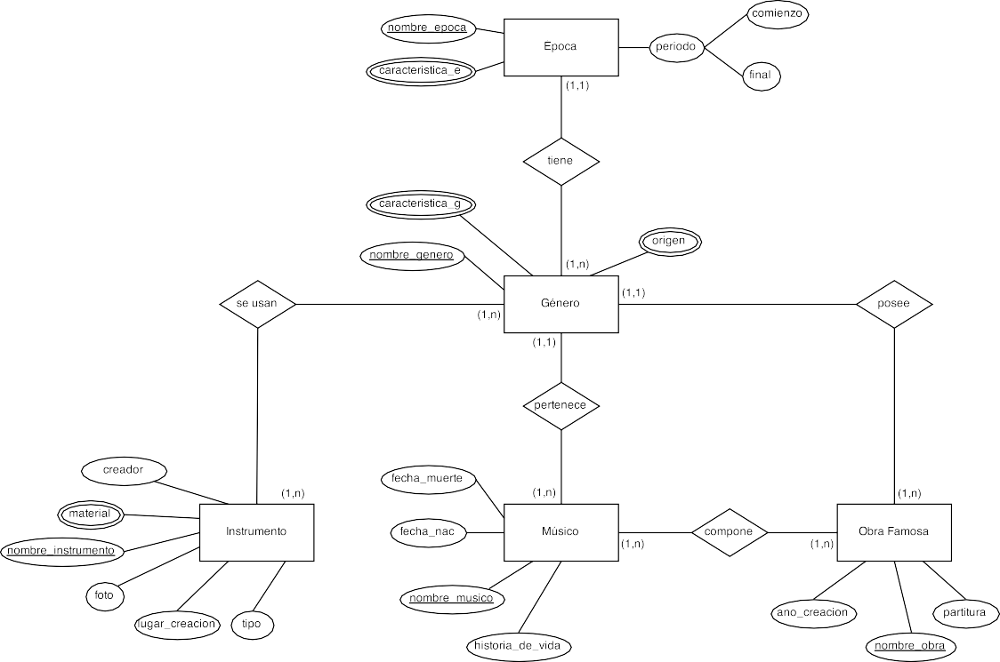
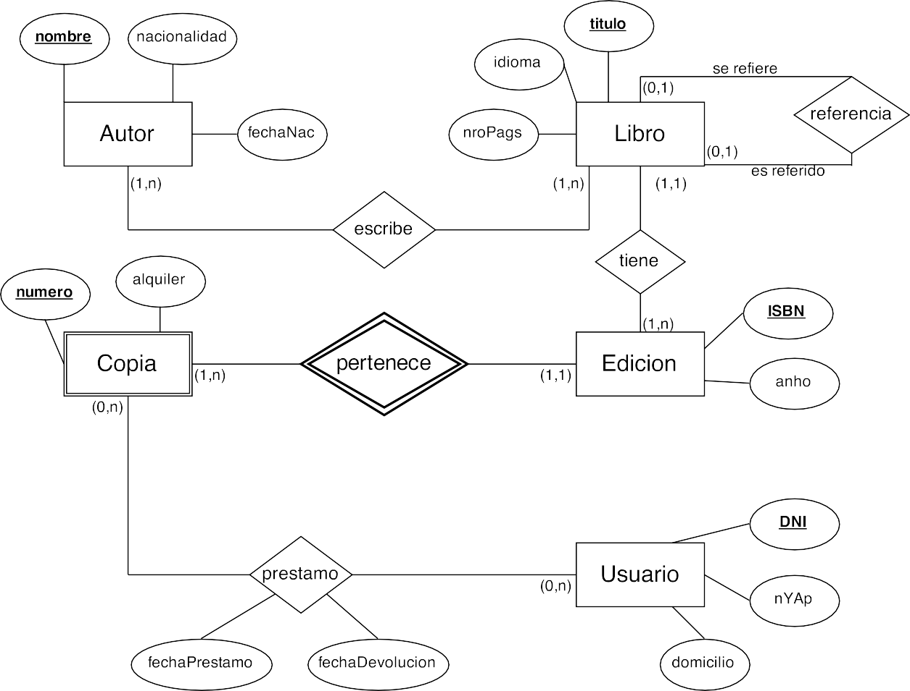
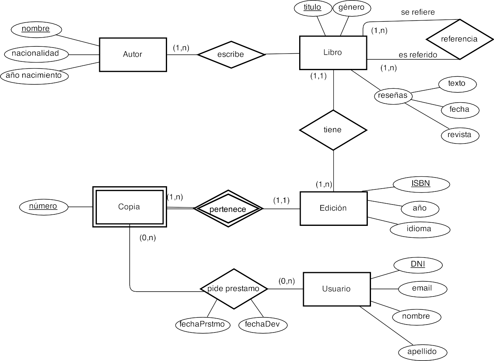

# **Actividad 206**

> **📌 Entrega**
> 

> - La entrega será un **fichero PDF** que contenga la respuesta a las preguntas de la actividad.

> - El nombre del fichero debe ser `207_NombreApellidos.pdf`.

> - Se deberá entregar en la tarea correspondiente de Aules en tiempo y forma.

> **📌 Se valorará**
> 

> Se valorará:

> - La correcta identificación de los elementos del modelo EER.

> - El uso adecuado de la generalización, especialización y agregación.

> - La claridad de los diagramas realizados.

> - La correcta justificación de las respuestas.

> Esta actividad servirá para calificar:

> - **RA6:** Diseña modelos relacionales normalizados interpretando diagramas entidad/relación.

>   - CE6. a) Se han utilizado herramientas gràficas para representar el diseño lógico. (5%)

>   - CE6. b) Se han identificado las tablas del diseño lógico. (3%)

>   - CE6. c) Se han identificado los campos que forman parte de las tablas del diseño lógico. (3%)

>   - CE6. d) Se han analizado las relaciones entre las tablas del diseño lógico. (1%)

>   - CE6. e) Se han identificado los campos clave. (3%)

## **Ejercicio 1**

**Sistema de un Centro Cultural**

Un centro cultural quiere desarrollar un sistema para mantener y consultar la información de la historia de la música. Para esto se organiza la información por épocas, de las cuales se sabe el nombre único, diferentes características relevantes, el período (año de comienzo y año final) y los géneros musicales de la época.

A su vez, de cada género, se quiere saber su nombre único, diversas características, sus orígenes, los músicos asociados a ese género y los instrumentos que intervenían en la ejecución de ese género.

Sabemos que una época tiene varios géneros, pero que un género pertenece a una sola época.

De cada músico, se sabe el nombre único, fecha de nacimiento, fecha de muerte y una historia de su vida.

Un género tiene varios músicos, pero un músico pertenece a un solo género.

De cada instrumento musical se tiene el nombre único, una foto, el lugar donde se creó, quién fue el creador, el tipo de instrumento (viento, teclado, etc.) y los materiales con que se hace. En un género se usan varios instrumentos, y un instrumento aparece en varios géneros.

Adicionalmente, se quiere conocer la lista de obras famosas que se hicieron dentro de un género. De las obras famosas, se conoce un nombre único, el año en que se hizo, los músicos autores y la partitura. Tenga en cuenta que una obra famosa pertenece a un solo género, que una obra famosa la componen varios músicos y que un músico compone varias obras.

💡 Solució

## **Ejercicio 2**

**Rincón de Lectura**

Nos piden ayuda para modelar el sistema de una biblioteca, brindándonos la siguiente información.

Los libros son escritos por autores de los cuales conocemos su nombre, su nacionalidad y su fecha de nacimiento. Los nombres de los autores no pueden repetirse. Además, sabemos que los libros cuentan con un título único, el idioma y su número de páginas. Adicionalmente, sabemos que cada libro tiene ediciones, de las cuales sabemos el año y el ISBN (que no puede repetirse).

La biblioteca realiza préstamos de distintas ediciones a usuarios. De cada préstamo, sabemos el número de la copia del libro prestado y el precio del alquiler, mientras que de los usuarios sabemos su DNI, su nombre y apellido y su domicilio. También queremos registrar la fecha del préstamo y la fecha de devolución de las transacciones realizadas.

Tenga en cuenta la siguiente información adicional:

- Un autor escribe muchos libros y un libro puede ser escrito por muchos autores. Un libro puede tener muchas ediciones.

- Una edición tiene muchas copias, pero cada copia pertenece a una edición.

- Una copia pudo haber sido prestada a muchos usuarios y muchos usuarios pueden haber pedido la misma copia en momentos distintos.

- En algunos casos un libro puede hacer referencia a otro libro, pero solo a uno, lo mismo en el caso inverso.

- Las copias tienen un número único dentro de cada edición, pero el mismo puede repetirse dentro de otras ediciones.

💡 Solució

## **Ejercicio 3**

**Agencia de viajes**

Se quiere realizar una base de datos para llevar la información de varias agencias de viajes. De cada una se conoce su código, la fecha de inicio de actividades y su ciudad.

Cada agencia ofrece paquetes turísticos, los cuales tienen un precio y destinos a varios países. Se identifican por un código de paquete. Un paquete puede estar relacionado con uno o más paquetes a modo de combo (ejemplo: viaje a Disney + crucero por el Caribe). Cada paquete es propio de su agencia, no puede ser vendido en otra.

Los paquetes son comprados por clientes, los cuales tienen un nombre, domicilio y son diferenciados por su DNI. Estos clientes tienen varias formas de pago, de las cuales conocemos su tipo y el monto a pagar. Los medios de pago son autorizados por un solo banco, de los cuales sabemos que poseen un nombre -que es único- y sucursal. Al autorizar los pagos, se establece una fecha de validez.

## **Ejercicio 4**

**Sistema de Farmacia**

Debemos diseñar un sistema para registrar las farmacias en diferentes ciudades de nuestro país.

Sabemos que cada farmacia tiene un nombre (único en todo el sistema) y un domicilio. Cada farmacia se ubica en una sola ciudad, pero en una ciudad hay varias farmacias. De cada ciudad, sabemos el nombre, la provincia en la que se encuentra, la cantidad de habitantes y la superficie. Cada ciudad se identifica con el nombre y la provincia.

Conocemos también que cada farmacia puede tener un propietario, y que cada propietario tiene solamente una farmacia. Tenga en cuenta que puede haber farmacias sin propietario. De los propietarios, conocemos el DNI (único), su nombre y su domicilio, compuesto por calle, número, código postal y ciudad.

Cada farmacia, a su vez, vende varios medicamentos y un medicamento se vende en varias farmacias. De cada medicamento conocemos su id único, su nombre comercial y las drogas de las cuales se compone. Cada farmacia vende un medicamento a un precio determinado, que no necesariamente es el mismo en diferentes farmacias.

Como último requerimiento, un medicamento puede complementar a otros medicamentos, pero sabemos que cada medicamento puede ser complementado por un solo medicamento.

## **Ejercicio 5**

**Biblioteca**

Una reconocida biblioteca se encuentra en la etapa de modelado de su base de datos. A continuación se enumeran los datos considerados al llevar adelante su diseño.

Los libros son uno de los componentes más importantes. De cada uno de ellos nos interesa registrar su título (único entre todos los libros) y género al que pertenece. Además posee un conjunto de reseñas, que se encuentran conformadas por la revista donde apareció, la fecha y su texto descriptivo.

Un libro tiene referencias hacia otros libros. Todo libro tiene al menos una referencia, y además es referido al menos una vez en otro libro (no hay libros que no sean referidos, ni libros que no tengan referencias).

Todo autor escribe al menos un libro, y a su vez todo libro tiene al menos un autor. De ellos interesa saber su nombre (que es único, no hay dos autores con el mismo nombre), su nacionalidad y año de nacimiento.

Un libro tiene además al menos una edición. De ellas interesa el año, el ISBN (un identificador único entre ediciones de libros), y además su idioma.

Las ediciones tienen como mínimo una copia, aunque las más demandadas tienen varias copias. Cada copia se diferencia por su número, aunque este número por sí solo no basta para diferenciarla: es necesario conocer además la edición a la que pertenecen.

Finalmente, las copias son las que serán pedidas en préstamo por los usuarios. Un usuario pide prestada una copia en una fecha específica, y en ese momento se le asigna una fecha de devolución. Del usuario se conoce el DNI (que lo identifica de otros usuarios), su nombre, su apellido y un email. Un usuario puede no pedir copias. A su vez, puede que una copia nunca sea pedida en préstamo.

Responde las siguientes preguntas:

- ¿Qué problema de consistencia aparecería si Autor fuera un atributo de Libro, en lugar de ser una entidad separada?

- ¿Cómo representarías en el modelo la relación de maestro-discípulo entre autores? ¿Qué relación tiene esto con la decisión de cómo modelar los autores discutida en la pregunta anterior?

- ¿Qué diferencia hay entre las traducciones al modelo relacional de las relaciones Tiene y Escribe? ¿A qué se debe esta diferencia?

💡 Solució

## **Ejercicio 6**

**Hinchas de Brasil 2014**

Una página web de estadísticas deportivas desea realizar una base de datos para manejar la información de los partidos, equipos e hinchas que visitaron Brasil durante el mundial en el 2014.

Sabemos que los partidos tienen un ID que los identifica en el sistema, así como también la instancia del torneo que se jugó en dicho partido (fase de grupos, octavos, etc.), la duración y la fecha en la que se jugó, compuesta por el día y la hora, el árbitro que dirigió ese partido y los equipos que jugaron el mismo.

De los árbitros conocemos su pasaporte, de qué país son, el año en el que inició la actividad y su nombre y apellido, como también qué árbitro reemplaza a cuál en caso de lesión o enfermedad; sabemos que un árbitro puede ser reemplazado por varios y que un árbitro reemplaza solo a uno.

De los equipos que participan en los partidos conocemos el nombre de la selección, que es único entre el resto de las selecciones, el nombre del DT de esa selección, el lugar donde entrena y el cuerpo técnico que la compone. También conocemos los distintos jugadores que forman parte de las selecciones, de los que sabemos su número de camiseta, que los distingue dentro de un equipo, la posición que ocupan en la cancha, su nombre y apellido y el apodo de cada uno. Es sabido que durante un mundial un jugador representa a un solo país y que en distintas selecciones puede haber jugadores con el mismo número. Al ser un mundial, un equipo puede jugar como mínimo tres partidos (quedó eliminado en fase de grupos) o llegar hasta siete (llegó a la final).

En este sistema los estadios son sede de distintos partidos. De los mismos conocemos su nombre, la ciudad en la que se encuentran, su capacidad máxima y también la capacidad habitada y la cantidad de policías que se hacen presente en cada partido. También sabemos que los distintos hinchas pueden visitar los estadios (a los que llegan en distintos medios de transporte), los cuales reciben una gran cantidad de hinchas por partido. De ellos conocemos el número de ticket de cada uno, la vestimenta y la ubicación (compuesta de zona, fila y número de asiento) que tiene cada uno. Adicionalmente, sabemos que un partido se juega solo en un estadio y que en un estadio pueden jugarse muchos partidos.

## **Ejercicio 7**

**Fábrica de Pelotas "Golazo"**

Solicitan nuestros servicios para resolver el almacenamiento de datos de un sistema de gestión de la producción de una fábrica de pelotas. La fábrica se compone de una serie de plantas, cada una identificada por un color. De las plantas conocemos la superficie en metros cuadrados y la lista de procesos que se llevan a cabo dentro de ellas; de estos procesos sólo conocemos su nombre y un grado de complejidad asociado.

Dentro de cada planta se encuentran las máquinas. Cada máquina es de una marca y un modelo, y se identifica por un número; este número es único a lo largo de todas las plantas.

Cada máquina es operada por técnicos. Debemos conocer en qué rango de fechas los técnicos estuvieron asignados a esa máquina, y además en qué turno (mañana, tarde o noche).

De los técnicos conocemos su DNI, nombre, apellido y fecha de nacimiento, aparte de una serie de números telefónicos de contacto.

Existen situaciones normales en las que una máquina sale de servicio y debe ser reparada. Lo único que nos interesa conocer aquí es cuál otra máquina está asignada para tomar el trabajo que ella no puede realizar.

## **Ejercicio 8**

**Sistema de Ventas**

Se quiere diseñar una BD que permita registrar las ventas de una empresa. Específicamente, esta empresa necesita llevar un control de proveedores, clientes, productos y ventas.

Un proveedor se modela con CUIT, nombre, dirección, teléfono y página web. Un cliente también se modela con CUIT, nombre y dirección, pero puede tener varios teléfonos de contacto. De cada dirección, nos interesa su calle, número, comuna y ciudad. Tanto para los proveedores como los clientes, el CUIT es un valor único (equivalente al DNI).

De los productos, sabemos que tienen un identificador único, nombre, precio actual, stock y nombre del proveedor que los comercializa. Además, se organizan en categorías, y cada producto se clasifica solamente en una de ellas, pero sin embargo una categoría clasifica varios productos. De ellas nos interesa saber su id, nombre y descripción.

Sabemos que un producto es comercializado por varios proveedores, pero que un proveedor provee un solo producto.

Por razones de contabilidad, se debe registrar la información de cada venta, las cuales tienen un número de factura (que es único), fecha, cliente, descuento y monto final. A su vez, sabemos que una venta se compone de varios productos, y por eso nos interesa el precio al momento de la venta del producto, la cantidad vendida y el monto total por él. Tenga en cuenta que un producto puede estar en varias ventas, pero que podemos tener un producto que no haya sido vendido. Adicionalmente, sabemos que cada cliente puede realizar varias ventas, y en una venta solamente participa un cliente.

## **Ejercicio 9**

**Cadena de Deportes**

Una cadena de casas de deportes desea realizar una base de datos para manejar sus sucursales, empleados, productos y clientes.

De las sucursales se sabe el número único que la identifica dentro de la cadena, el domicilio y la ciudad.

De los empleados el legajo, el nombre, el DNI, el domicilio (calle, número y ciudad) y los números de teléfono en los cuales puede ser contactado.

Los empleados trabajan en diferentes sucursales en diferentes días de la semana y en cada sucursal tienen asignado un horario en particular, que puede no ser el mismo en diferentes sucursales. Por ejemplo, el empleado GBA trabaja los lunes de 9hs. a 18hs. en la Sucursal 1, y los martes de 10hs. a 20hs. en la Sucursal 2. En cada sucursal trabajan varios empleados.

De los productos se conoce un código, una descripción, un color y un costo fijo de fabricación. A su vez, existen también las fábricas que son identificadas con CUIT, nombre, país de origen, cantidad de empleados y nombre de gerente. Cada producto es fabricado en una sola fábrica, y cada fábrica solamente realiza un tipo de producto. El costo fijo de fabricación no depende de la fábrica.

Cada sucursal puede vender varios productos, y a su vez, cada producto puede ser vendido por varias sucursales. Cada sucursal establece cuál es el precio de venta del producto que ofrece. Es decir, un mismo producto podría tener diferentes precios en diferentes sucursales.

De los clientes se conoce el código de cliente, el DNI, el nombre, la fecha de nacimiento y la ciudad en la que vive. A su vez, también sabemos que cada cliente puede utilizar varias tarjetas de crédito, que son identificadas por el nombre de la tarjeta, el número, el código de seguridad y la fecha de vencimiento.

Cada cliente solamente realiza compra en una sola sucursal, y en una sucursal pueden comprar varios clientes. Cada sucursal le ofrece a sus clientes un descuento fijo por su fidelidad en las compras.

## **Ejercicio 10**

**Sistema de Blogs**

Una importante radio decide realizar un sistema de blogs para que cada uno de sus programas escriba notas que puedan resultar de interés a los oyentes. Para ello cuentan con un Modelo Entidad-Relación en el cual se identifican las siguientes entidades del dominio que van a manejar.

En primer lugar contamos con los programas. De los mismos conocemos el nombre (único), descripción, la lista de conductores y un horario compuesto por la hora en la que inicia y la hora en la que termina. Estos programas son los que escriben las notas, de ellas conocemos su título (único), contenido, una imagen y un resumen de la misma para mostrar en los listados de notas. Un programa puede escribir muchas notas pero cada una está escrita solo por un programa.

Para diferenciar las notas en distintos grupos, el sistema cuenta con la posibilidad de asignar categorías a las mismas. De ellas conocemos el nombre (único), descripción y una imagen que la identifica. Una ventaja que tiene el sistema de categorías es que se pueden crear jerarquías muy fácilmente, esto quiere decir que una categoría puede pertenecer a otra. Por ejemplo, podría existir la categoría "Arte" y esta a su vez contener dos categorías hijas "Música" y "Pintura".

Para lograr interacción con los oyentes, el sistema permite que los mismos se registren y comenten las notas. De los usuarios conocemos su username, password, fecha de registro, avatar y un email el cual solo puede registrarse una vez. Los comentarios poseen un número de id y el texto que lo compone.

## **Ejercicio 11**

**Artículos y encargos**

Una base de datos para una pequeña empresa debe contener información acerca de clientes, artículos y pedidos. Hasta el momento se registran los siguientes datos en documentos varios:

- Para cada cliente: Número de cliente (único), Nombre, NIF, Direcciones de envío (varias por cliente), Saldo, Límite de crédito (depende del cliente, pero en ningún caso debe superar los 18.000 €), Descuento.

- Para cada artículo: Número de artículo (único), Fábricas que lo distribuyen, Existencias de ese artículo en cada fábrica, Descripción del artículo.

- Para cada pedido: Cada pedido tiene una cabecera y el cuerpo del pedido. La cabecera está formada por el número de cliente, dirección de envío y fecha del pedido. El cuerpo del pedido son varias líneas, en cada línea se especifican el número del artículo pedido y la cantidad.

Además, se ha determinado que se debe almacenar la información de las fábricas. Sin embargo, dado el uso de distribuidores, se usará: Número de la fábrica (único), Nombre y Teléfono de contacto. Y se desean ver cuántos artículos (en total) provee la fábrica. También, por información estratégica, se podría incluir información de fábricas alternativas respecto de las que ya fabrican artículos para esta empresa.

Nota: Una dirección se entenderá como Calle, Número, Puerta, CP y Localidad. Una fecha incluye día, mes, año y hora.

Se pide hacer el diagrama ER para la base de datos que represente esta información.

## **Ejercicio 12**

**Casas de colonias**

Realizar el diagrama ER para modelizar el siguiente sistema de información:

a) Cada casa de colonias tiene un nombre que la identifica. Se desea saber de cada una, aparte del nombre, la capacidad (el número de niños que se pueden alojar en cada una como máximo), la comarca donde está situada y las ofertas de actividades que proporciona. Una casa puede ofrecer actividades como por ejemplo natación, esquí, remo, pintura, fotografía, música, etc.

b) Es necesario tener en cuenta que en una casa de colonias se pueden practicar varias actividades (de hecho, cada casa debe ofrecer como mínimo una), y también puede ocurrir que una misma actividad se pueda llevar a cabo en varias casas. Sin embargo, toda actividad que se registre en la base de datos debe ser ofertada como mínimo en una de las casas.

c) Interesa tener una evaluación de las ofertas de actividades que proporcionan las casas. Se asigna una calificación numérica que indica el nivel de calidad que tiene cada una de las actividades ofertadas.

d) Las casas de colonias alojan niños que se han inscrito para pasar en ellas unas pequeñas vacaciones. Se quiere tener constancia de los niños que se alojan en cada una de las casas en el momento actual. Se debe suponer que hay casas que están vacías (en las que no se aloja ningún niño) durante algunas temporadas.

e) De los niños que se alojan actualmente en alguna de las casas, interesa conocer un código que se les asigna para identificarlos, su nombre, su apellido, el número de teléfono de sus padres y su comarca de residencia.

f) De las comarcas donde hay casas o bien donde residen niños, se quiere tener registrados la superficie y el número de habitantes. Se debe considerar que puede haber comarcas donde no reside ninguno de los niños que se alojan en un momento determinado en las casas de colonias, y comarcas que no disponen de ninguna casa.

Nota: Es posible, por ejemplo, que una actividad como el esquí tenga una calificación de 10 en la oferta de la casa Grévol, y que la misma actividad tenga una calificación de 8 en la casa Ardilla.

## **Ejercicio 13**

**Transporte**

Se desea mecanizar la gestión de una empresa de transportes que reparte paquetes por toda España. Los encargados de llevar los paquetes son los camioneros, de los que se quiere guardar el DNI, nombre, teléfono, dirección, salario y localidad donde reside. De los paquetes transportados interesa conocer el código de paquete, descripción, destinatario, y dirección del destinatario. Un camionero distribuye muchos paquetes y un paquete sólo puede ser distribuido por un camionero.

De las provincias a las que llegan los paquetes interesa guardar el código de provincia y el nombre. Un paquete sólo puede llegar a una provincia, sin embargo, a una provincia pueden llegar muchos paquetes.

De los camiones que llevan los camioneros interesa conocer la matrícula, modelo, tipo y potencia. Un camionero puede conducir diferentes camiones en fechas diferentes y un camión puede ser conducido por varios camioneros.

## **Ejercicio 14**

**Paradores**

La red de Paradores de Turismo quiere mantener un servicio de atención y reservas a través de Internet. Una de las tareas dentro del desarrollo del sistema es la construcción del modelo lógico de datos. La información de partida para la construcción de dicho modelo es la siguiente:

Los Paradores vendrán definidos por un código único, nombre, dirección, teléfono, nivel y número total de habitaciones. Los Paradores disponen de distintos tipos de habitaciones. De cada habitación se desea almacenar el número de habitación, la ubicación dentro del Parador, el tipo (normal o suite), una descripción y el precio por noche.

Los Paradores pueden tener además unas instalaciones adicionales (golf, piscina, hípica, etc.). De cada tipo de instalación se desea almacenar el código de instalación, el nombre y la descripción. Hay que tener en cuenta que un mismo tipo de instalación se puede encontrar en distintos Paradores.

La información referente a los Paradores se completa con la oferta gastronómica que tienen. De la gastronomía ofrecida por cada Parador se almacenará un código, nombre y tipo de plato. Aunque un mismo plato puede ser servido por distintos Paradores, puede haber variaciones de precio en cada caso. Se desea almacenar la información de esta diferencia.

Cuando un usuario se conecte al sitio web de los Paradores de Turismo, además de poder consultar la información referente a lo descrito anteriormente, podrá hacer reservas de habitaciones. En el caso de realizar reservas, se toman los datos del cliente: NIF, nombre y apellidos. Se almacenará también un código de cliente generado por la aplicación si el cliente fuese nuevo.

Una vez registrado el cliente, este podrá elegir en qué Parador o Paradores desea alojarse, la fecha de llegada y el número de noches, así como el tipo de la habitación que quiere. El sistema le asignará las habitaciones correspondientes, teniendo en cuenta que un cliente no puede tener reservadas habitaciones de dos Paradores distintos en la misma fecha.

Por último, se desea que un cliente pueda consultar en cualquier momento qué reservas ha realizado en qué paradores para cada fecha así como la habitación reservada.

## **Ejercicio 15**

**Star Trek 1**

El club de fans de la película Star Trek ha decidido crear una web donde poder consultar información referente a todas las películas y capítulos de la saga. La base de datos deberá contener la siguiente información.

**Actores:** Es necesario conocer el nombre completo del actor, el personaje que interpreta, la fecha de nacimiento y su nacionalidad.

**Personajes:** Se desea conocer el nombre, su raza y graduación militar que desempeña (capitán, teniente, almirante, etc.). Es importante conocer el actor que interpreta el personaje, teniendo en cuenta que un personaje sólo puede ser interpretado por un actor y un actor sólo puede interpretar un personaje. Además será necesario conocer el personaje del que depende directamente en graduación militar.

**Capítulos:** Hay que almacenar todos los capítulos, indicando a qué temporada pertenece cada capítulo, el título, el orden en el que fue rodado, fecha de su primera emisión en televisión y los personajes que participaron en cada capítulo.

**Películas:** Se debe almacenar todas las películas que se proyectaron en cines, cada una con su año de lanzamiento, título y director. También hay que guardar los personajes que aparecen en cada película y cuál de ellos fue el protagonista.

**Planetas:** En cada capítulo, se visita 1 o varios planetas. Hay que almacenar el código del planeta, su nombre, galaxia a la que pertenece, y el problema que se resolvió en esa visita, así como la nave con la que se viajó al planeta. Para la descripción del problema será suficiente con un campo de texto de 255 caracteres. De la nave se almacenará el nombre, código y número de tripulantes.

## **Ejercicio 16**

**Star Trek 2**

El club ha pensado ampliar los requisitos de la página web. Se desea incluir información extra para los personajes. De modo que si el personaje es un humano, se indicará su fecha de nacimiento y ciudad terráquea donde nació. Si el personaje es Vulcano, se almacenará el nombre del mentor y la fecha de graduación, y si es de raza Klingon, se guardará su planeta natal y la fecha de su último combate.

En cada capítulo, la nave que viaja a un planeta, puede disponer de una nave pequeña llamada lanzadera con la que bajan a la superficie del planeta. La existencia de la lanzadera sólo tiene sentido si existe la nave a la que pertenece. Se identificará cada lanzadera mediante un número entero y el código de la nave. Es necesario conocer la capacidad en personas de la lanzadera.

## **Ejercicio 17**

**Mundial de fútbol**

Diseñar una base de datos para organizar el campeonato mundial de fútbol. Considerar los siguientes aspectos:

**Jugadores:** Un jugador puede pertenecer a un único equipo y puede actuar en varios puestos distintos, pero en un determinado partido sólo puede jugar en un puesto.

**Árbitros:** En un partido interviene 3 árbitros titulares, linier derecho, izquierdo, principal y un árbitro secundario. Un árbitro puede realizar una función en un partido y otra distinta en otro partido.

**Estadísticas:** Se desea saber los goles que ha marcado un jugador en qué partido y en qué minuto, también se desea poder describir cómo sucedió el gol.

**Porteros:** Se desea almacenar cuántas paradas ha realizado, en qué minuto y en qué situación se ha producido: penalti, tiro libre, corner o jugada de ataque.

**Partidos:** Todos generan un acta arbitral donde se pueden incluir todos los comentarios que el árbitro considere oportuno: lesiones, expulsiones, tarjetas, etc.

## **Ejercicio 18**

**Reyes Magos**

La ONG Reyes Magos desea hacer una BD para que esta Navidad todos los niños pobres de España puedan recibir sus regalos la noche de los Reyes Magos. La ONG contacta con vecinos de distintos barrios para disfrazarlos de Reyes Magos y organizarlos en grupos lúdicos que realicen eventos para que los niños los visiten y puedan formular sus peticiones. Cada niño es recibido por un Rey Mago y puede hacer una única petición, la cual queda anotada en la base de datos para posteriormente, el día 6 de enero, entregar esa petición. La ONG comprará los regalos con el dinero que distintas organizaciones benéficas aportarán a la causa. Los datos de interés son:

- De los vecinos: DNI, Nombre y apellidos, Rey Mago al que encarna y los vecinos a los que ha conseguido convencer para que se unan a la causa.

- De los niños: Nombre, Dirección y el Regalo que pide el Rey Mago. Los niños no tienen DNI y necesitarán un dato identificativo.

- De los grupos de vecinos se necesita saber a qué Barrio pertenecen, número de integrantes del grupo y los Eventos que han organizado.

- De los eventos interesa conocer la Ubicación física, la Fecha, la Hora y los niños asistentes.

## **Ejercicio 19**

**Empresa S.L.**

Queremos gestionar la información sobre los empleados de una empresa, a partir de las siguientes condiciones: para cada empleado dispondremos de su DNI, nombre, fecha de nacimiento, salario y departamento en el que trabaja.

La empresa está organizada en departamentos. Cada uno tiene un nombre único, el número del despacho en el que se ubica y un empleado que lo dirige. Nos interesa la fecha que empezó a dirigirlo.

Cada departamento controla una serie de proyectos, los cuales tienen nombre y número únicos.

Cada empleado puede trabajar en más de un proyecto, dedicándole un determinado número de horas a la semana en cada proyecto.

Finalmente, queremos guardar también los familiares de cada empleado, para administrar información relativa a las pólizas de seguros. De los familiares, queremos saber el nombre, fecha de nacimiento y parentesco con el empleado.

## **Ejercicio 20**

**Gestión de la Biblioteca de Barrio**

La Biblioteca de Barrio "Nova Lectura" quiere organizar mejor la información que maneja diariamente.

La biblioteca dispone de una colección de libros que va creciendo cada año. Cada libro puede encontrarse en un solo ejemplar o tener varias copias, y en ocasiones hay copias que se deterioran o se retiran.

Las personas que utilizan la biblioteca pueden venir libremente a leer, pero para llevarse libros a casa deben estar registradas. Algunas personas usan habitualmente la biblioteca, mientras que otras solo vienen de vez en cuando. A veces, cuando alguien cambia de dirección o teléfono, la biblioteca actualiza su información.

Cuando una persona quiere llevarse un libro, la biblioteca anota cuándo se lo lleva y cuándo lo devuelve. En algunos casos, si el libro se retrasa, se registra también una observación o aviso. No es raro que una persona tenga varios libros prestados al mismo tiempo, siempre que estén disponibles.

La biblioteca también organiza actividades culturales, como cuentacuentos o charlas. Para preparar estas actividades suele haber una persona responsable y una fecha programada. Algunas actividades atraen a muchos asistentes; en otras solo participan unas pocas personas, pero la biblioteca desea guardar esa información igualmente.

La biblioteca quiere un sistema que le permita controlar todos estos elementos de forma clara.
