# UD2: Diseño Conceptual — Modelo Entidad-Relación (E/R y EER)

Bienvenido/a a la **UD2: Diseño Conceptual — Modelo Entidad-Relación (E/R y EER)** del módulo profesional de **Bases de Datos** (1º DAW / DAM / ASIX · Bases de Datos).

En esta unidad encontrarás los contenidos teóricos, ejemplos prácticos, ejercicios resueltos y actividades de evaluación curricular desarrollados por el profesor **Manuel Alonso Argente**.

---

### 📑 Índice de Apartados y Actividades de la Unidad

- [**📋 2.0 Propuesta Didáctica: Diseño Conceptual. Modelo Entidad/Relación**](./ut0200.html)
- [**2.1 Diseño de Bases de Datos**](./ut0201.html)
- [**2.2 Componentes del Modelo E/R**](./ut0202.html)
- [**2.3 Semántica de las relaciones**](./ut0203.html)
- [**2.4 Herramientas gráficas para el diseño lógico de bases de datos**](./ut0204.html)
- [**2.5 Restricciones sobre relaciones**](./ut0205.html)
- [**2.6 El modelo Entidad Relación Extendido**](./ut0206.html)

**Actividades Prácticas y Fichas de Trabajo:**

- [**✏️ ACT201 201**](./act_act201.html)
- [**✏️ ACT202 202**](./act_act202.html)
- [**✏️ ACT203 203**](./act_act203.html)
- [**✏️ ACT204 204**](./act_act204.html)
- [**✏️ ACT205 205**](./act_act205.html)
- [**✏️ ACT206 206**](./act_act206.html)

---

# 📖 Vista Completa de la Unidad

## 2.0 Propuesta Didáctica — Diseño Conceptual. Modelo Entidad/Relación

# **Diseño Conceptual. Modelo Entidad/Relación**

## **Propuesta didáctica**

En esta unidad vamos a trabajar parte del RA6: **Diseña modelos relacionales normalizados interpretando diagramas entidad/relación**.

## **Criterios de evaluación**

### **Respecto al RA6**:

| Código | Descripción | Peso (%) | Herramientas Evaluación |
| --- | --- | --- | --- |
| **CE6a** | Se han utilizado herramientas gràficas para representar el diseño lógico | 5% | ACT206 (5%) EXA201 (95%) |
| **CE6b** | Se han identificado las tablas del diseño lógico. | 15% | ACT201 (1%) -- ACT202 (1%) -- ACT206 (3%) -- EXA201 (95%) |
| **CE6c** | Se han identificado los campos que forman parte de las tablas del diseño lógico. | 15% | ACT201 (1%) -- ACT202 (1%) -- ACT206 (3%) -- EXA201 (95%) |
| **CE6d** | Se han analizado las relaciones entre las tablas del diseño lógico. | 10% | ACT202 (1%) -- ACT203 (1%) -- ACT204 (1%) --ACT205 (1%) -- ACT206 (1%) -- EXA101 (95%) |
| **CE6e** | Se han identificado los campos clave. | 15% | ACT201 (1%) -- ACT202 (1%) -- ACT206 (3%) -- EXA201 (95%) |

## **Contenidos**

### **Diseño Conceptual. Modelo Entidad/Relación.**:

- Procesos de Diseño BBDD Relacional.

- Diseño Conceptual

- Componentes del Modelo E/R.

- Restricciones del Modelo E/R.

- Semántica de las Relaciones.

- Restricciones sobre Relaciones.

- Modelo Entidad Relación Extendido

  - Generalización/Especialización.

  - Agregación.

- Diseño del Diagrama Entidad-Relación.

> **📌 Cuestionario inicial**
> 

> 1. ¿Conoces algún modelo conceptual?

> 1. ¿Cuál es el propósito del modelo ER?

> 1. ¿Qué tres elementos son los más importantes en un modelo ER?

> 1. ¿Qué valores puede tomar la cardinalidad mínima? ¿Y la máxima?

> 1. ¿Qué diferencia una entidad fuerte de una débil?

> 1. A partir de la cardinalidad máxima, ¿que tres tipos de relaciones binarias se pueden dar?

> 1. ¿Qué tipos de atributos conoces?

> 1. ¿Qué es una relación reflexiva?

> 1. ¿Qué relación existe entre la generalización y la especialización?

> 1. ¿Qué relación existe entre una superclase y una subclase?

> 1. ¿Qué diferencia una restricción de identificación de una cardinalidad mínima a 1?

> 1. ¿Cuándo se utiliza una agregación o entidad asociativa?

## **Programación de Aula (16 sesiones)**

Esta unidad es la segunda, con lo que se imparte en la primera evaluación, con una duración estimada de 20 sesiones lectivas, durante las últimas semanas de septiembre y las tres primeras semanas de octubre:

### **Septiembre 2026**

| Lunes | Martes | Miércoles | Jueves | Viernes | Sábado | Domingo |
| --- | --- | --- | --- | --- | --- | --- |
|  | 1 | 2 | 3 | 4 | **5 🛑** | **6 🛑** |
| 7 | 8 | 9 | 10 | 11 | **12 🛑** | **13 🛑** |
| 14 | 15 | 16 | 17 | 18 | **19 🛑** | **20 🛑** |
| 21 | 22 | 23 | 24 | **25 📚** | **26 🛑** | **27 🛑** |
| 28 | **29 📚** | **30 📚** |  |  |  |  |

### **Octubre 2026**

| Lunes | Martes | Miércoles | Jueves | Viernes | Sábado | Domingo |
| --- | --- | --- | --- | --- | --- | --- |
|  |  |  | 1 | **2 📚** | **3 🛑** | **4 🛑** |
| 5 | **6 📚** | **7 📚** | 8 | **9 🛑** | **10 🛑** | **11 🛑** |
| **12 🛑** | **13 📚** | **14 📚** | 15 | **16 📚** | **17 🛑** | **28 🛑** |
| 19 | **20 📚** | **21 📚** | 22 | **23 📚** | **24 🛑** | **25 🛑** |
| 26 | 27 | 28 | 29 | 30 | **31 🛑** |  |

| Sesión | Contenidos | Actividades | Criterios trabajados |
| --- | --- | --- | --- |
| 1 | 01 Modelo Entidad Relación |  | CE6b, CE6c |
| 2 | 02 Componentes del Modelo E/R |  | CE6b, CE6c, CE6.e |
| 3 | 02 Componentes del Modelo E/R | ACT202 | CE6b, CE6c, CE6.e |
| 4 | 03 Semántica de las relaciones |  | CE6d |
| 5 | 03 Semántica de las relaciones |  | CE6d |
| 6 | 03 Semántica de las relaciones | ACT203 | CE6d |
| 7 | 04 Herramientas representación |  | CE6a |
| 8 | 05 Restricciones sobre Relaciones |  | CE6d |
| 9 | 05 Restricciones sobre Relaciones | ACT204 | CE6d |
| 10 | 05 Restricciones sobre Relaciones | ACT204 | CE6d |
| 11 | 06 Modelo Entidad Relación Extendido |  | CE6d |
| 12 | 06 Modelo Entidad Relación Extendido | ACT205 | CE6d |
| 13 | Actividades | ACT202 -- ACT203 -- ACT204 -- ACT205 -- ACT206 | CE6a, CE6b, CE6c, CE6d, CE6e |
| 14 | Actividades | EXA201 | CE6a, CE6b, CE6c, CE6d, CE6e |
| 15 | Actividades | EXA201 | CE6a, CE6b, CE6c, CE6d, CE6e |
| 16 | Actividades | EXA201 | CE6a, CE6b, CE6c, CE6d, CE6e |

### **Seguimiento**

| Sesión | Contenidos | Actividades | Descripción | Fecha |
| --- | --- | --- | --- | --- |
| 1 | 01 Modelo Entidad Relación -- 02 Componentes del Modelo E/R |  | Se realiza la presentación de la UP y se introduce el contenido y los RA. Se ven los puntos 2.1 y 2.2. | 25/09/2026 |
| 2 | 03 Semántica de las relaciones -- 04 Herramientas representación |  | Se revisan los puntos 2.3 y 2.4 | 25/09/2026 |
| 3 | 05 Restricciones sobre Relaciones |  | Se revisan los puntos las resctricciones de exclusividad y exclusión | 30/09/2026 |
| 4 | 05 Restricciones sobre Relaciones - 06 Modelo Entidad Relación Extendido |  | Se realiza la clase en formato online. Retomamos las restricciones sobre las relaciones con la inclusividad y la inclusión. Y terminamos con el model E/R extendido con la Generalización/Especialización y con la Agrupación | 02/10/2026 |
| 5 | Actividades | Actividades | Se corrige el ejercicio 1 de la actividad 206 | 06/10/2026 |
| 6 | Actividades | Actividades | Se corrige el ejercicio 1 de la actividad 206 | 06/10/2026 |
| 7 | Actividades | Actividades |  | 07/10/2026 |
| 8 | Actividades | Actividades | Se corrige el ejercicio 2 de la actividad 206 | 13/10/2026 |
| 9 | Actividades | Actividades |  | 13/10/2026 |
| 10 | Actividades | Actividades |  | 14/10/2026 |
| 11 | Actividades | Actividades | Se corrige el ejercicio de una editorial y sus revistas | 16/10/2026 |
| 12 | Actividades | Actividades |  | 16/10/2026 |
| 13 | Actividades | Actividades |  | 20/10/2026 |
| 14 | Actividades | Actividades |  | 20/10/2026 |
| 15 | Actividades | Actividades |  | 21/10/2026 |
| 16 | Actividades | Actividades |  | 23/10/2026 |
| 17 | Actividades | Actividades |  | 23/10/2026 |
| 18 | Actividades | Actividades |  | 26/10/2026 |
| 19 | Examen Unidad |  | Se realiza el examen de la unidad | 27/10/2026 |
| 20 | Examen Unidad |  | Se realiza el examen de la unidad | 27/10/2026 |

---

## 2.1 Diseño de Bases de Datos

# **Diseño de Bases de Datos**

Una vez que hemos trabajado conceptos generales asociados a las bases de datos y los sistemas gestores de bases de datos, tenemos claro que existen diferentes modelos de datos que dan lugar a diferentes tipos de soluciones.

Pero antes de entrar en uno de los modelos, conviene saber cual es el proceso de diseño de una base de datos. Es lógico pensar que un buen diseño sobre los datos va a facilitar el posterior desarrollo de las aplicaciones que explotan la base de datos.

El objetivo general del diseñar bases de datos es ofrecer una base de datos bien estructurada y eficiente que cumpla los requisitos de usuarios y empresas. Además de cumplir estos requisitos, un diseño de bases de datos, generalmente, cumple cinco objetivos comunes (los cuales trabajaremos a lo largo del curso):

1. Coherencia e integridad de los datos.

1. Mantenibilidad y facilidad de uso.

1. Rendimiento y optimización.

1. Seguridad de los datos.

1. Escalabilidad y flexibilidad.

Así pues, antes de comenzar el diseño, el primer paso y más crítico es determinar los requisitos de la base de datos mediante un **sistema de información**, describiendo el problema que la base de datos debe cubrir. Este paso está más asociado a la **ingeniería del software** y lo estudiarás en detalle en el módulo de **Entornos de Desarrollo**.

El proceso de diseño de una Bases de Datos Relacional se elabora en 4 fases a partir de una descripción del sistema de información de una empresa u organización.

- **Fase 1**: Tras el establecimiento de las restricciones del sistema y un análisis de las mismas, se pasa a realizar con el cliente el diagrama entidad relación del Sistema de Información, primer **diagrama conceptual**. Suele ser un proceso cíclico y con realimentación y realizado interactivamente.

- **Fase 2**: Aplicando unas ciertas reglas se traduce el esquema inicial a un **modelo lógico o relacional**. Obteniendo el **esquema relacional** de la Base de Datos.

- **Fase 3**: Se refina el esquema relacional eliminando errores o impurezas mediante la **normalización**.

- **Fase 4**: Usando un DDL adaptamos la Base de Datos al Sistema de **Gestión de Bases de Datos** Relacional.

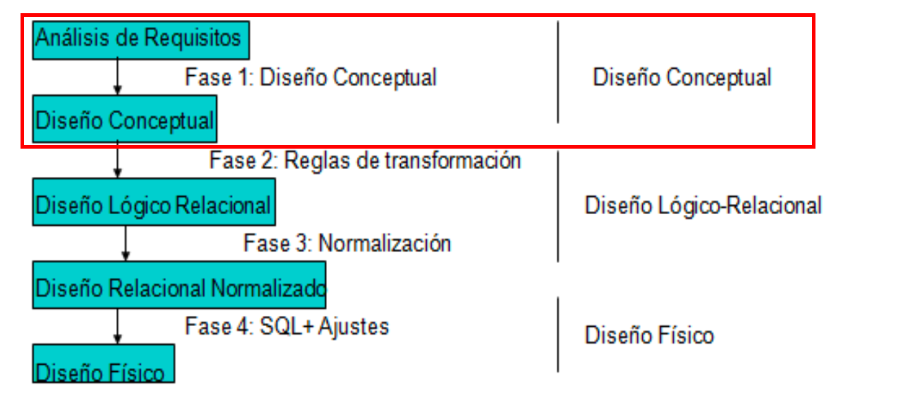

## **El modelo Entidad Relación**

Entendemos como **modelo conceptual** el conjunto de conceptos y reglas que nos permiten aplicar una serie de abstracciones con el propósito de definir y manipular datos de la realidad, almacenándola en una base de datos. Debemos incidir en el hecho de que los modelos conceptuales son modelos incompletos ya que no pueden captar la totalidad de la semántica del mundo real.

Centrándonos en el **modelo entidad/relación**, cuyo nombre completo es modelo entidad/interrelación (entity/relationship en inglés), es un modelo de datos conceptual de alto nivel, propuesto por **Peter Chen** en 1976, y vigente a día de hoy por su simplicidad y legibilidad, ya que el resultado del análisis del problema se representa de forma visual mediante diagramas entidad/relación, representado mediante cajas y líneas que las unen. Ha tenido numerosas extensiones y aportaciones de muchos otros autores, teniendo soporte por múltiples herramientas de software de diseño (CASE), lo que ha dado lugar a que no exista un único modelo ER, sino una familia de modelos.

El modelo ER describe el mundo real como un conjunto de **entidades** y sus **atributos**, así como las **relaciones** existentes entre diferentes entidades.

## **Nomenclatura**

A la hora de nombrar a los diferentes elementos, en todos los casos, es recomendable no utilizar espacios en blanco ni tildes, para facilitar la futura transformación al modelo físico.

- Las entidades suelen ser sustantivos y se nombran en singular y mayúsculas.

- Los atributos también en singular, pero en minúsculas.

- Las relaciones son verbos en mayúsculas.

- Para las palabras compuestas, utilizaremos la convención [camelCase](https://es.wikipedia.org/wiki/Camel_case), que une las palabras poniendo la primera letra en mayúsculas. Ejemplos de atributos serían mediante camelCase serían `nombreCompleto` o `codigoPostal`.

---

## 2.2 Componentes del Modelo E/R

# **Componentes del Modelo E/R**

El Modelo E/R es un diseño conceptual, en el ámbito de la estructura y organización de nuestro sistema de una forma lo más visual posible desde el punto de vista de los datos.

Para realizar este modelo no utilizaremos lenguajes de definición y manipulación de datos. Los **elementos del modelo de E/R** son:

- **Entidad**

- **Relación**

- **Atributo**

## **Entidad**

> **📌 Peter P. Chen**
> 

> Cualquier elemento (real o abstracto) que existe en la realidad y sobre el que queremos almacenar información en la base de datos

> **📌 ANSI 1977**
> 

> Una persona, lugar, cosa, concepto o suceso, real o abstracto de interés para el funcionamiento de una empresa

- Una entidad es cualquier objeto o elemento acerca del cual se pueda almacenar información en la BD.

- Las entidades pueden ser concretas como una persona o abstractas como una fecha.

- Para identificar una entidad lo primero que necesitamos es el Nombre de la misma para referenciarla, así como el conjunto de características que definirán a los ejemplares que la integran, es decir, los Atributos.

- Las entidades se representan gráficamente mediante rectángulos y su nombre aparece en el interior.

- Un nombre de entidad sólo puede aparecer una vez.


### **Tipos**

- **Fuerte**: (También llamadas Regulares) Son aquellas cuyos ejemplares tienen existencia por sí mismos, cuentan con algún atributo que los identifica ya que los valores del mismo no se repiten. Son las entidades por excelencia.

- **Débil**: Son aquellas entidades en las que la existencia de un ejemplar depende de que exista un cierto ejemplar de otra entidad.


## **Relación**

Una relación representa una asociación, relacionando los datos del modelo. Para ello, dibujaremos un rombo que unirá las entidades que participan en la relación, y la nombraremos mediante un verbo en mayúsculas.

> **📌 Peter P. Chen**
> 

> Una Relació és una Associació, Vinculació o Correspondència entre Entitats

**1 Ejemplar** de la **Relación** sólo tendrá sentido si hay al menos **1 conexión** en la que intervenga **1 Ejemplar** de cada una de las **Entidades** que se vinculan o conectan en esta. Correspondencia o asociación entre dos o más entidades.
Consideramos una Relación como un tipo especial de Entidad cuya existencia depende de la existencia de las entidades a las que relaciona.
Cada relación tiene un nombre que describre su función.

## 

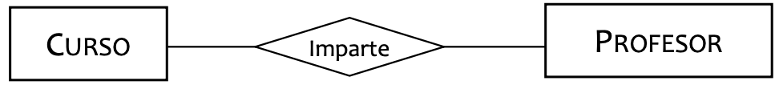

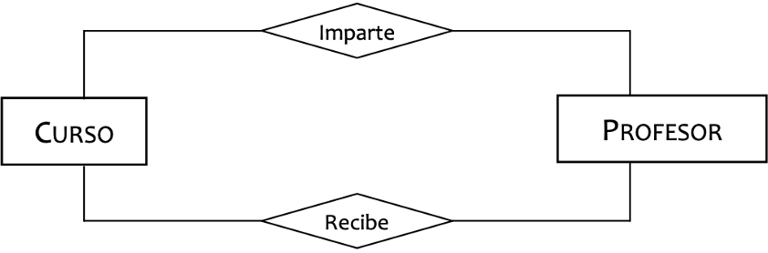

> **📌 Ejercicios**
> 

> 1. Crear una relación coche-cliente con los siguientes campos:

>   - Coche: Matricula, Año Matriculación, Color

>   - Cliente: NIF, Nombre, FechaNac

> 1. Crea una relación entre jugadores y equipos.

>   - Añade 1 atributo identificativo y 1 atributo simple para cada entidad.

> 1. Crea una relación entre clientes y cuenta bancaria (débil).

>   - Añade 1 atributo identificativo y 2 atributos simples para cada entidad

## **Atributos**

Las propiedades o características que tienen una Entidad o Relación se denominan Atributos.
Están representados por un óvalo o un círculo etiquetado con su nombre:


La forma de representarlos en el diagrama E/R és:

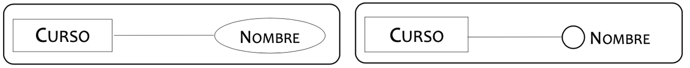

### **Tipos**

**Según la finalidad**

- **Atributo Descriptor**: Es el atributo normal, describe a una entidad o relación.

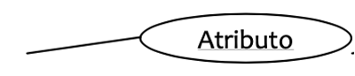

- **Atributo Identificador Principal**: Es un atributo o conjunto de atributos que permite distinguir entre las diferentes ocurrencias de una entidad.


- **Atributo Identificador alternativo**: Tiene las mismas características que el atributo identificador principal, pero no se le escoge como tal para ser funcionalmente menos acertado.


**Según su estructura**

- **Atributo Simple**: Los valores que toman son indivisibles.


- **Atributo Compuesto**: Se trata de un conjunto de elementos (atributos simples) que corresponden a una misma característica. (dirección: Calle, nombre, escalera, piso, etc..).

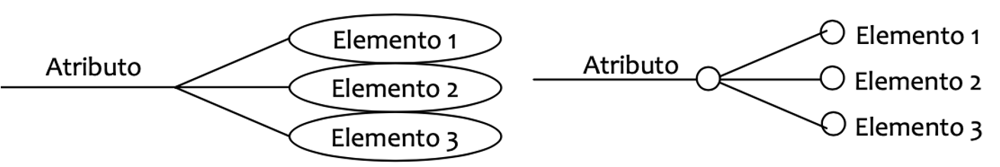

**Según el número de valores**

- **Atributo Atómico**: Para cada ocurrencia de la entidad el atributo toma un único valor.

- **Atributo Multievaluado**: Por cada ocurrencia el atributo puede tomar varios valores.

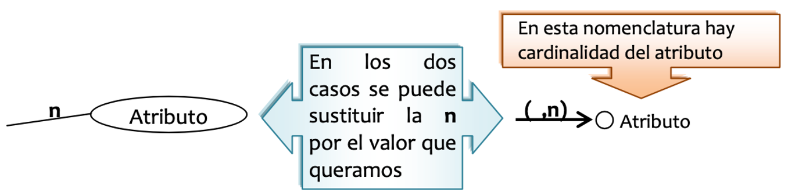

**Según la dependencia con otros Atributos**

- **Atributo no Derivado**: Atributos que se almacenan directamente y no dependen de otros atributos para su cálculo.


- **Atributo Derivado**: Son aquellos cuyo valor se puede calcular a partir de otros atributos.

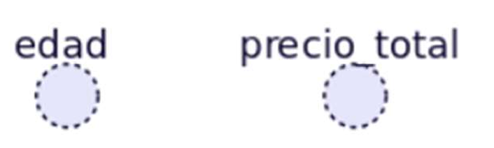

## **Restricciones en el Modelo E/R**

### **Restricciones Inherente**

- Sólo permite establecer relaciones entre entidades.

- Obligatorio que todas las entidades y relaciones no tengan ocurrencias repetidas, es decir cada ejemplar es único.

### **Restricciones Especificas**

- Estructura de la Entidad, de entre todos los atributos de una entidad deben existir uno o varios (simples y/o compuestos) que identifiquen cada uno de los ejemplares de esta entidad..

- Estos conjuntos de atributos se denomina Identificador Candidato (IC). Cuando un IC está compuesto, el número de los atributos que lo componen debe ser mínimo. Por lo tanto TODO IC DEBE CUMPLIR LA CONDICIÓN DE SER UNÍVOCO Y MÍNIMO.

- De entre los IC se elige uno como Identificador (o clave) Principal (IP) y el resto serán Identificadores (o claves) Alternativos (IA).

- Prohibición de valores nulos para un atributo IP o IA, es decir, no admitir la opcionalidad del atributo, le debemos un valor obligatoriamente.

---

## 2.3 Semántica de las relaciones

# **Semántica de las relaciones**

En una relación nos encontraremos los siguientos elementos, que definen las partes de una relación:

- **Nombre**: Es necesario identificar de forma única dentro de nuestro Esquema conceptual a la relación.

- **Grado**: Nos indica el número de entidades que participan en la relación.

- **Tipos de correspondencia**: Nos indica el número máximo de ocurrencias de una entidad que puede intervenir por cada ocurrencia del otro tipo de entidad asociada a la relación.

## **Tipos de relación**

Las relaciones se agrupan por los **tipos de relación** según:

- El grado de la relación.

- Tipo de correspondencia.

### **Grado de la relación**

- **Relaciones Unitarias**: También llamadas Relaciones reflexivas, en ellas intervienen una única entidad.

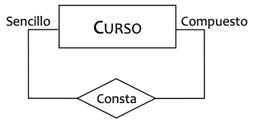

- **Relaciones Binarias**: En ellas intervienen dos entidades, son las ralaciones más habituales.

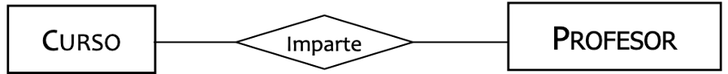

- **Relaciones Ternarias o Superiores**: Intervienen tres o más entidades.

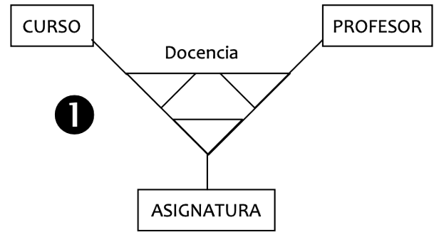

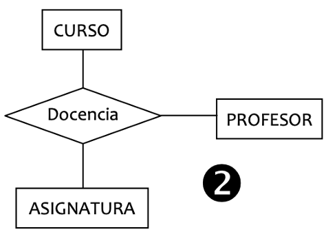

### **Tipo de correpondencia**

#### **Binaria**

- 

**UNO A UNO (1:1)**: Cuando en la relación sólo puede aparecer, como máximo, una ocurrencia de una entidad por cada ocurrencia de la otra entidad..
Hay dos maneras de representarlas gráficamente, dependiendo de la nomenclatura utilizada, y sobre todo de donde colocamos el nombre de la relación:

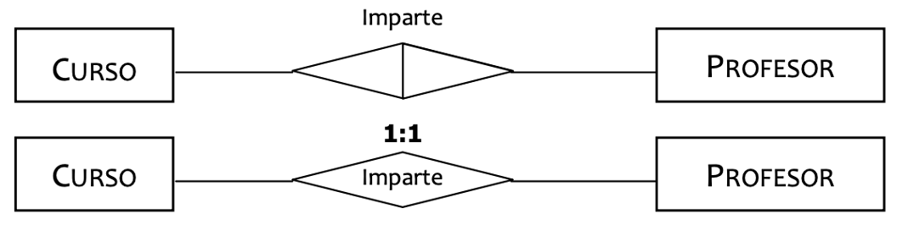

- 

**UNO A MUCHOS (1:N)**: Cuando en la relación sólo puede aparecer, muchas ocurrencias de una entidad por cada ocurrencia de la otra entidad, pero en sentido contrario sólo podemos tener como máximo 1 ocurrencia de una entidad respecto a una ocurrencia de la otra.

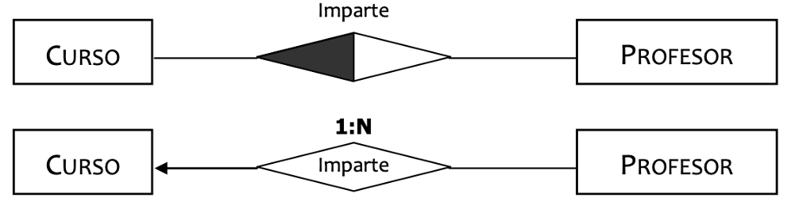

- 

**MUCHOS A MUCHOS (N:N)**: Cuando en la relación sólo puede aparecer, muchas ocurrencias de una entidad por cada ocurrencia de la otra entidad. En ambos sentidos de la relación.

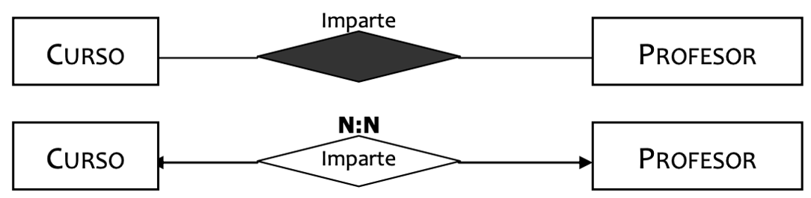

#### **Ternaria**

- 

**UNO A UNO A UNO (1:1:1)**: Cuando en la relación sólo puede aparecer, como máximo, una correspondencia de una entidad por cada par de ocurrencias de las otras entidades..

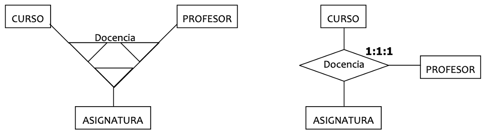

- 

**UNO A UNO A MUCHOS (1:1:N)**: Cuando en la relación sólo puede aparecer, como máximo, una correspondencia de una entidad por cada par de ocurrencias de las otras entidades, pero para una de las entidades pueden aparecer varias ocurrencias por cada par de ocurrencias de las otras dos entidades.

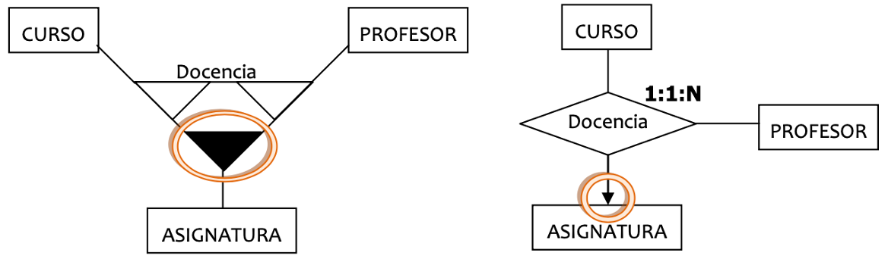

- 

**UNO A MUCHOS A MUCHOS (1:N:N)**: Cuando en la relación sólo puede aparecer, como máximo, una correspondencia de una entidad por cada par de ocurrencias de las otras entidades, pero para las otras dos entidades pueden aparecer varias ocurrencias por cada par de ocurrencias de las otras dos entidades.

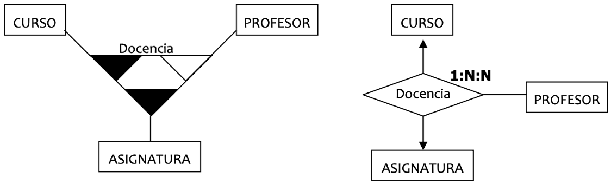

- 

**MUCHOS A MUCHOS A MUCHOS (N:N:N)**: Cuando en la relación sólo pueden aparecer muchas ocurrencias de cualquier entidad por cada par de ocurrencias de las otras entidades.

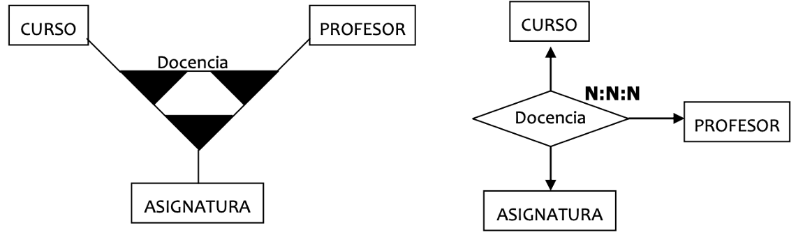

## **Cardinalidades**

Se define como el número **máximo** y **mínimo** de **ocurrencias** de una **entidad** que pueden estar relacionadas con una ocurrencia de la **otra** u otras **entidades** que participan en la relación. Se representan gráficamente mediante una etiqueta del tipo (0,1), (1,1), (0,n) o (1,n) (según corresponda), junto a las entidades asociadas por la relación.

- **Cardinalidad Mínima**

- **Cardinalitat Màxima**

### **Cardinalidad Mínima**

Dada una Relación entre dos entidades, la Cardinalidad Mínima nos indica el número mínimo de ocurrencias de una entidad que pueden ser relacionadas con una ocurrencia de la otra u otras entidades que intervienen en la relación.

- 1 Profesor como mínimo cuántos cursos imparte = 0

- 1 Curso como mínimo por cuantos profesores es impartido = 1

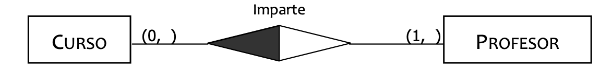

### **Cardinalidad Máxima**

Dada una Relación entre dos entidades, la Cardinalidad Máxima nos indica el número máximo de ocurrencias de una entidad que pueden ser relacionadas con una ocurrencia de la otra u otras entidades que intervienen en la relación.

- 1 Profesor como máximo cuántos cursos imparte = n

- 1 Curso como máximo por cuantos profesores es impartido = 1

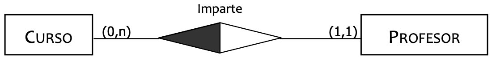

## **Dependencia de Existencia/Identificación**

Cuando conectamos o asociamos dos entidades mediante una relación nos encontramos con determinadas características funcionales que obligan a que tengamos una ocurrencia de una de las entidades (en este caso la entidad fuerte) para poder tener una ocurrencia de la otra entidad (la entidad débil).

- **DEPENDENCIA DE EXISTENCIA**: Cuando las ocurrencias de la entidad débil no pueden existir si desaparece la ocurrencia de la entidad fuerte de la que dependen.

- **DEPENDENCIA DE IDENTIFICACIÓN**: Cuando además de cumplirse la condición anterior, las ocurrencias de la entidad débil no pueden identificarse por sí mismos, es decir, mediante los atributos de la entidad, y exigen añadir el identificador principal de la entidad fuerte de la que dependen.

### **Existencia**

Siempre que la cardinalidad mínima de una Entidad sea 1 nos está indicando que la otra entidad de la relación es débil respecto a ella por una dependencia de existencia..

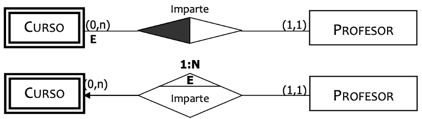

### **Identificación**

En este caso a pesar de darse un caso de interbloqueo por la dependencia de existencia, sí se especifica la debilidad de Edición respecto a Curso, ya que la dependencia de identificación es más fuerte o restrictiva que la de existencia.

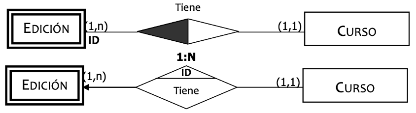

---

## 2.4 Herramientas gráficas para el diseño lógico de bases de datos

# **Herramientas gráficas para el diseño lógico de bases de datos**

## **¿Por qué utilizar herramientas gráficas?**

Cuando diseñamos una base de datos es habitual comenzar realizando un **modelo conceptual** (Modelo Entidad/Relación). Una vez validado, este modelo debe transformarse en un **modelo lógico**, donde ya aparecen las tablas, los atributos, las claves primarias y las claves ajenas.

Aunque este proceso puede realizarse sobre papel, existen numerosas herramientas que facilitan el trabajo permitiendo:

- Diseñar tablas de forma visual.

- Crear relaciones entre ellas.

- Detectar errores de diseño.

- Exportar el modelo a imágenes o PDF.

- Generar automáticamente el código SQL de creación de la base de datos (en algunas herramientas).

- Documentar el proyecto de forma profesional.

> **📌 Ventaja principal**
> 

> El uso de herramientas gráficas permite **visualizar fácilmente** la estructura de una base de datos y facilita enormemente su mantenimiento y comunicación con otros miembros del equipo.

## **Herramientas más utilizadas**

Actualmente existen numerosas aplicaciones para diseñar bases de datos. Algunas son completamente gratuitas y otras disponen de versiones de pago con funcionalidades avanzadas.

| Herramienta | Gratuita | Código abierto | Ingeniería inversa | Genera SQL | Nivel |
| --- | --- | --- | --- | --- | --- |
| [**draw.io (diagrams.net)**](https://app.diagrams.net/) | Sí | Sí | No | No | Muy fácil |
| [**MySQL Workbench**](https://www.mysql.com/products/workbench/) | Sí | Sí | Sí | Sí | Fácil |
| [**DBeaver Community**](https://dbeaver.io/) | Sí | Sí | Sí | Parcial | Fácil |
| [**Oracle SQL Developer Data Modeler**](https://www.oracle.com/es/database/sqldeveloper/technologies/sql-data-modeler/) | Sí | No | Sí | Sí | Difícil |
| [**DbSchema**](https://dbschema.com/) | Limitada | No | Sí | Sí | Difícil |
| [**Navicat Data Modeler**](https://www.navicat.com/es/) | No | No | Sí | Sí | Difícil |
| [**ERDPlus**](https://erdplus.com/) | Sí | No | No | Parcial | Muy fácil |
| [**Visual Paradigm**](https://www.visual-paradigm.com/) | Limitada | No | Sí | Sí | Muy Difícil |

## **Comparativa de herramientas**

| Herramienta | Ventajas | Inconvenientes | Uso recomendado |
| --- | --- | --- | --- |
| **draw.io** | Gratuito. Funciona desde el navegador. No requiere instalación. Muy sencillo de utilizar. Ideal para aprender modelado. | No genera automáticamente la base de datos. No valida restricciones ni normalización. | Aprendizaje del modelado E/R y lógico. |
| **MySQL Workbench** | Gratuito. Diseñado para MySQL. Genera automáticamente el código SQL. Permite ingeniería directa e inversa. Sincroniza modelos con la base de datos. | Principalmente orientado a MySQL. Interfaz más compleja para principiantes. | Diseño y desarrollo de bases de datos MySQL. |
| **DBeaver Community** | Gratuito y de código abierto. Compatible con numerosos SGBD. Permite visualizar estructuras y diagramas. Excelente gestor de bases de datos. | Las funciones de modelado son más limitadas que otras herramientas. Algunas características avanzadas solo están en la versión Enterprise. | Administración y mantenimiento de bases de datos. |
| **DbSchema** | Diseño visual muy completo. Sincronización con bases de datos. Generación de documentación. Compatible con numerosos SGBD. Ingeniería inversa. | La versión completa es de pago. Curva de aprendizaje algo mayor. | Proyectos profesionales y documentación técnica. |
| **ERDPlus** | Gratuito y online. Muy sencillo de utilizar. No requiere instalación. Permite crear diagramas E/R, modelos relacionales y ejercicios de normalización. | Funcionalidades limitadas. No genera bases de datos completas. Interfaz muy básica. | Aprendizaje y realización de ejercicios académicos. |

## **¿Qué herramienta utilizaremos?**

Durante este módulo utilizaremos **draw.io (diagrams.net)** porque:

- Es completamente **gratuita**.

- Es muy **sencilla** de utilizar.

- Funciona desde **cualquier navegador**.

- Permite **exportar** nuestros diagramas fácilmente.

- **No requiere** crear una cuenta.

> **📌 Más adelante...**
> 

> Cuando aprendamos SQL, utilizaremos también **MySQL Workbench**, ya que permite generar automáticamente las tablas de una base de datos a partir de un diagrama.

## **Primeros pasos con draw.io**

### **Paso 1 · Acceder a la aplicación**

Para comenzar, abrimos nuestro navegador y accedemos a la siguiente dirección:

 [https://app.diagrams.net](https://app.diagrams.net)

Al acceder por primera vez, aparecerá una pantalla donde podremos elegir **dónde guardar nuestros diagramas**:

- **Device** (nuestro ordenador)

- Google Drive

- OneDrive

- Dropbox

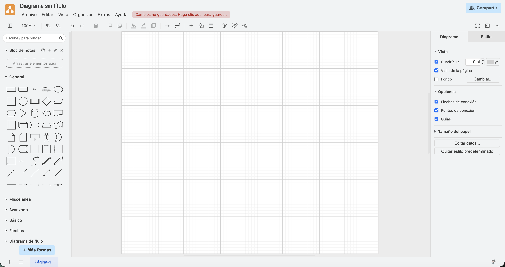

> **📌 Para clase**
> 

> Utilizaremos siempre **Device** para guardar los diagramas en nuestro ordenador.

### **Paso 2 · Crear un nuevo diagrama**

Una vez dentro de la aplicación, para crear un diagrama nuevo debemos ir a:

**Archivo → Nuevo** (o pulsar Ctrl+N en Windows / Cmd+N en Mac)

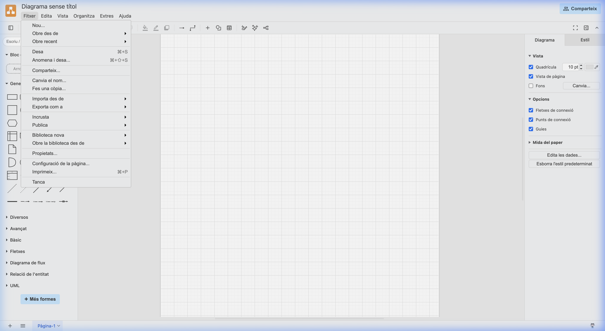

Se creará un nuevo lienzo en blanco listo para comenzar a trabajar.

### **Paso 3 · Conocer la interfaz**

La ventana principal de draw.io está formada por **cuatro zonas** bien diferenciadas:

#### **Panel izquierdo — Paleta de figuras**

Contiene todas las figuras disponibles agrupadas por categorías: **General**, **Básicos**, **UML**, **Entidad Relación**, etc.

En la sección de **Entidad Relación** encontramos los elementos específicos para diseñar diagramas de bases de datos: entidades, relaciones, atributos, tablas y todas sus variantes.

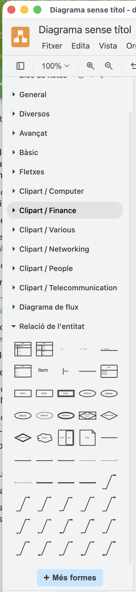

#### **Zona central — Área de trabajo**

Es el **lienzo** donde construiremos nuestro diagrama. Aquí arrastraremos las tablas, crearemos relaciones y organizaremos nuestro diseño.

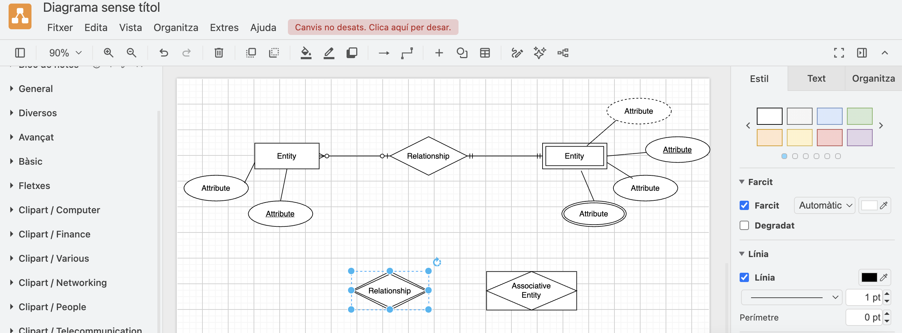

#### **Panel derecho — Propiedades y formato**

Cuando seleccionamos un elemento del diagrama, el panel derecho nos permite modificar todas sus propiedades visuales:

- **Estilo**: Color de relleno, bordes, opacidad, sombra, esquinas redondeadas.

- **Texto**: Fuente, tamaño, color, alineación, negrita, cursiva.

- **Organizar**: Posición exacta (X, Y), tamaño (ancho, alto), rotación.

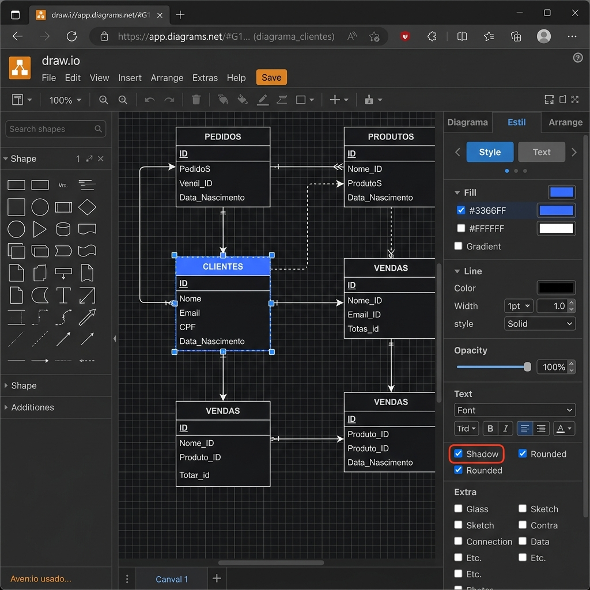

#### **Barra superior — Herramientas principales**

Incluye las herramientas principales de la aplicación:

| Herramienta | Función |
| --- | --- |
| Guardar | Guarda el diagrama actual |
| Deshacer | Deshace la última acción |
| Rehacer | Rehace una acción deshecha |
| Zoom | Acerca o aleja la vista |
| Exportar | Exporta a imagen o PDF |
| Imprimir | Imprime el diagrama |

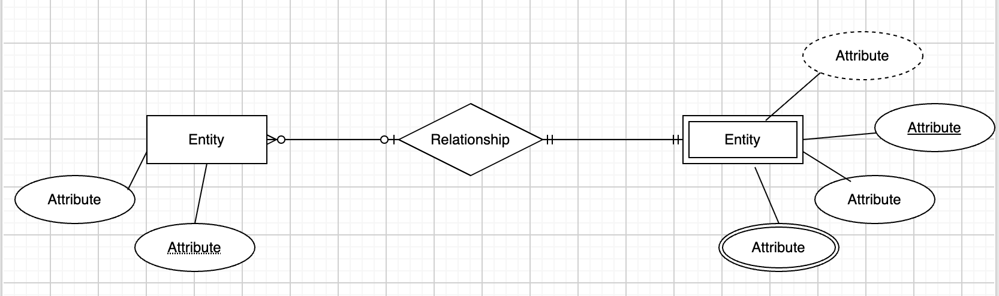

### **Paso 4 · Crear una tabla**

Para crear una tabla en draw.io seguimos estos pasos:

1. En el **panel izquierdo**, desplegamos la sección **Entidad Relación** (o buscamos "Entity" en el buscador).

1. **Arrastramos** una forma de tabla al lienzo central.

1. **Hacemos doble clic** sobre el nombre de la tabla para editarlo.

1. Escribimos el nombre de nuestra tabla y los atributos.

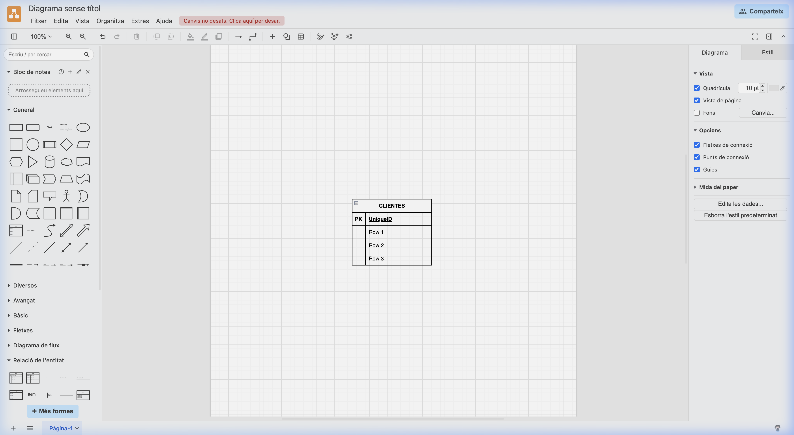

> **📌 Ejemplo: tabla CLIENTES**
> 

```sql
CLIENTES
─────────────────
PK │ id_cliente
   │ nombre
   │ apellidos
   │ telefono
   │ email
```

### **Paso 5 · Crear varias tablas**

Para diseñar un modelo completo, repetimos el proceso anterior para cada tabla que necesitemos. Es importante **distribuir las tablas** con suficiente espacio entre ellas para que las relaciones se visualicen con claridad.

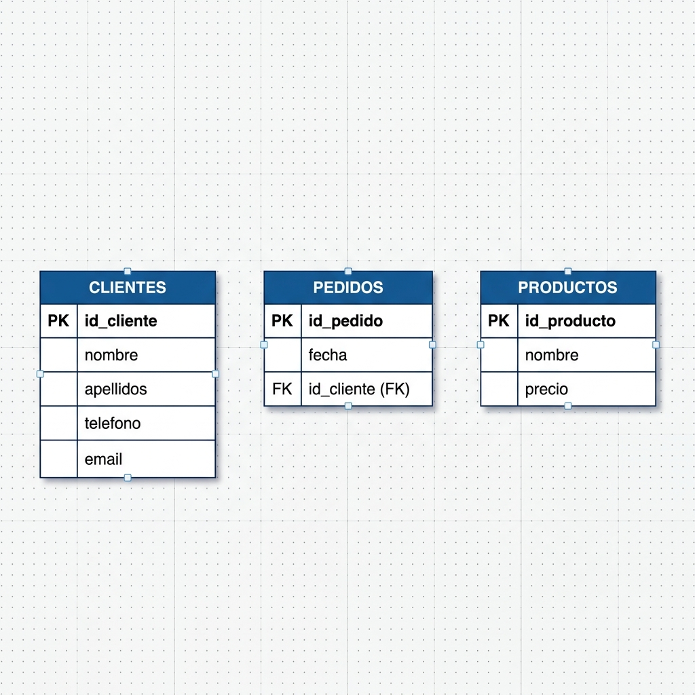

> **📌 Ejemplo: tres tablas de una tienda online**
> 

```sql
CLIENTES                 PEDIDOS                  PRODUCTOS
─────────────────        ─────────────────        ─────────────────
PK │ id_cliente          PK │ id_pedido           PK │ id_producto
   │ nombre                 │ fecha                  │ nombre
   │ apellidos           FK │ id_cliente             │ precio
   │ telefono
   │ email
```

### **Paso 6 · Crear relaciones entre tablas**

Para conectar dos tablas y representar una relación:

1. **Seleccionamos** una tabla haciendo clic sobre ella.

1. Aparecerán unas **pequeñas flechas azules** en los bordes.

1. **Arrastramos** una de ellas hacia otra tabla — se crea automáticamente un conector.

1. 

Una vez creada la relación, podemos personalizar:

| Propiedad | Descripción |
| --- | --- |
| Grosor | Ancho de la línea de conexión |
| Tipo de flecha | Punta de flecha o sin flecha |
| Color | Color de la línea |
| Tipo de línea | Continua, discontinua, punteada |
| Etiquetas | Texto sobre la línea (1:N, N:M, etc.) |

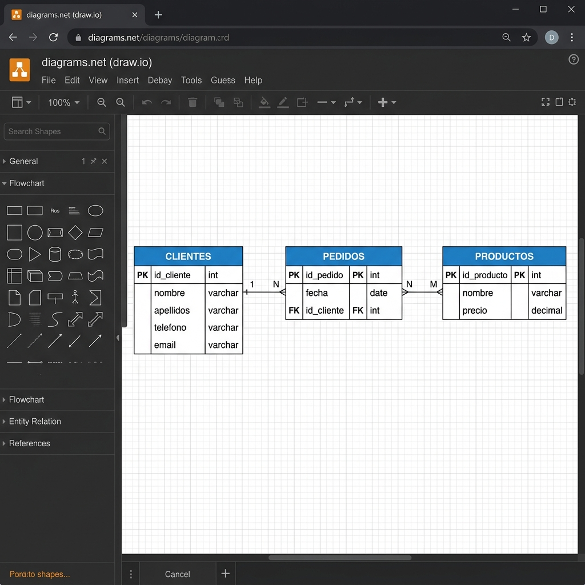

> **📌 Consejo**
> 

> Es recomendable añadir **etiquetas de cardinalidad** (1:1, 1:N, N:M) sobre las líneas de relación para que el diagrama sea más informativo.

### **Paso 7 · Organizar el diagrama**

Un buen diagrama debe ser **claro, limpio y profesional**. Para conseguirlo, debemos seguir estas buenas prácticas:

| Regla | Descripción |
| --- | --- |
| No cruzar líneas | Evitar que las líneas de relación se crucen entre sí |
| Alinear tablas | Mantener las tablas alineadas horizontal o verticalmente |
| Separación adecuada | Dejar suficiente espacio entre tablas |
| Tamaños similares | Utilizar dimensiones consistentes en todas las tablas |
| Nombres legibles | Asegurarse de que todos los textos se lean con claridad |

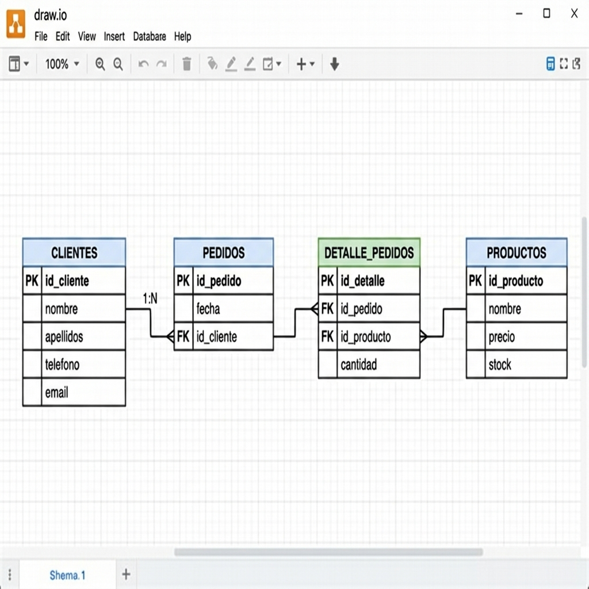

> **📌 Importante**
> 

> Un diagrama desordenado con líneas cruzadas y tablas mal alineadas dificulta enormemente su comprensión. **Dedicar tiempo a organizar el diagrama es tan importante como diseñarlo correctamente.**

### **Paso 8 · Exportar el diagrama**

Una vez terminado el diagrama, podemos exportarlo para incluirlo en documentación, presentaciones o entregas de actividades.

Para exportar, vamos a: **Archivo → Exportar como**

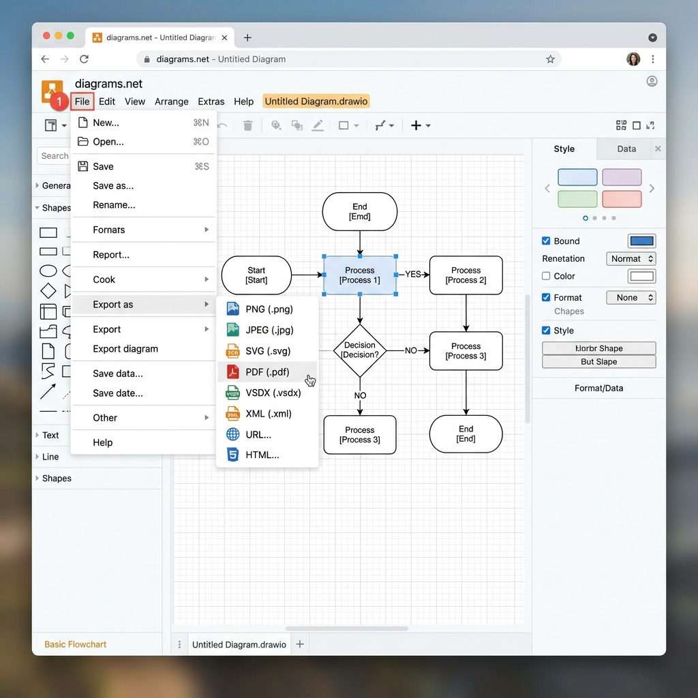

Los **formatos disponibles** son:

| Formato | Extensión | Uso recomendado |
| --- | --- | --- |
| **PNG** | `.png` | El más utilizado. Ideal para entregas y documentación |
| **JPEG** | `.jpg` | Imágenes con fondos fotográficos |
| **SVG** | `.svg` | Gráficos vectoriales escalables (webs, presentaciones) |
| **PDF** | `.pdf` | Documentos formales y presentaciones |
| **XML** | `.xml` | Intercambio de datos entre aplicaciones |

> **📌 Recomendación**
> 

> Para entregar actividades, el formato **PNG** suele ser la mejor opción por su compatibilidad universal y buena calidad.

### **Paso 9 · Guardar el proyecto**

Draw.io guarda los proyectos en su formato nativo con la extensión:

```sql
.drawio
```

Este archivo permite **abrir y modificar** el diagrama en cualquier momento. Al guardarlo por primera vez, se abrirá un diálogo para elegir el nombre y la ubicación del archivo.


> **📌 ¡No olvides guardar el archivo .drawio!**
> 

> Nunca debemos entregar **únicamente** una imagen exportada. Es fundamental conservar también el archivo `.drawio` para poder **editar** el diagrama en el futuro.

> Siempre debemos entregar **ambos archivos**: la imagen exportada (`.png`) y el proyecto editable (`.drawio`).

## **Ejemplo completo de trabajo**

Vamos a ver un ejemplo completo paso a paso. Supongamos que debemos diseñar la base de datos de una **tienda online**.

### **Identificar las tablas necesarias**

Analizamos el problema y determinamos que necesitamos las siguientes tablas:

| Tabla | Descripción |
| --- | --- |
| **CLIENTES** | Almacena los datos de los clientes |
| **PEDIDOS** | Registra los pedidos realizados |
| **DETALLE_PEDIDOS** | Detalla los productos de cada pedido |
| **PRODUCTOS** | Contiene el catálogo de productos |

### **Definir los atributos de cada tabla**

```sql
CLIENTES                    PEDIDOS
─────────────────           ─────────────────
PK │ id_cliente             PK │ id_pedido
   │ nombre                    │ fecha
   │ apellidos              FK │ id_cliente
   │ telefono
   │ email

DETALLE_PEDIDOS             PRODUCTOS
─────────────────           ─────────────────
PK │ id_detalle             PK │ id_producto
FK │ id_pedido                 │ nombre
FK │ id_producto               │ precio
   │ cantidad                  │ stock
```

### **Crear las tablas en draw.io**

Arrastramos las formas de tabla desde el panel izquierdo y completamos los datos de cada una.

### **Establecer las relaciones**

| Relación | Tipo | Descripción |
| --- | --- | --- |
| CLIENTES → PEDIDOS | 1:N | Un cliente puede realizar muchos pedidos |
| PEDIDOS → DETALLE_PEDIDOS | 1:N | Un pedido puede tener muchos detalles |
| PRODUCTOS → DETALLE_PEDIDOS | 1:N | Un producto puede aparecer en muchos detalles |

### **Organizar y exportar**

Finalmente, organizamos el diagrama, lo exportamos como **PNG** y guardamos el archivo `.drawio`.


## **Buenas prácticas**

Para crear diagramas profesionales y de calidad, es importante seguir estas recomendaciones:

| # | Práctica | Descripción |
| --- | --- | --- |
| 1 | **Nombres claros** | Utilizar nombres descriptivos para las tablas (en MAYÚSCULAS) |
| 2 | **Atributos en minúsculas** | Escribir los nombres de los atributos en minúsculas con guiones bajos |
| 3 | **Clave primaria identificada** | Marcar claramente la clave primaria (PK) en cada tabla |
| 4 | **Claves ajenas identificadas** | Marcar las claves ajenas (FK) y su tabla de referencia |
| 5 | **Distribución ordenada** | Mantener las tablas alineadas y con espacio suficiente |
| 6 | **Guardar periódicamente** | Guardar el trabajo frecuentemente para no perder cambios |
| 7 | **Conservar el .drawio** | Guardar siempre el archivo del proyecto junto con la imagen exportada |

---

## 2.5 Restricciones sobre relaciones

# **Restricciones sobre relaciones**

Las **restricciones sobre relaciones** permiten expresar **reglas de negocio** que no pueden representarse únicamente mediante las cardinalidades mínima y máxima.

Mientras que las cardinalidades indican **cuántas veces puede participar una entidad en una relación**, estas restricciones establecen **cómo se relacionan varias relaciones entre sí** cuando comparten una o varias entidades.

Gracias a ellas es posible modelar situaciones reales como:

- Un empleado que no puede ser simultáneamente jefe y subordinado.

- Un alumno que debe estar matriculado para poder solicitar una beca.

- Un vehículo que solo puede estar alquilado o vendido, pero nunca ambas cosas al mismo tiempo.

Las cuatro restricciones principales son:

- Restricción de Exclusividad.

- Restricción de Exclusión.

- Restricción de Inclusividad.

- Restricción de Inclusión.

## **Restricción de Exclusividad**

La **restricción de exclusividad** se produce cuando **dos o más relaciones comparten una misma entidad** y **cada ocurrencia de esa entidad únicamente puede participar en una de ellas**.

Es decir, una vez que una ocurrencia participa en una relación, **queda excluida de participar en las demás relaciones afectadas por la restricción**.

Esta restricción afecta **a la entidad**, no a la combinación de entidades.

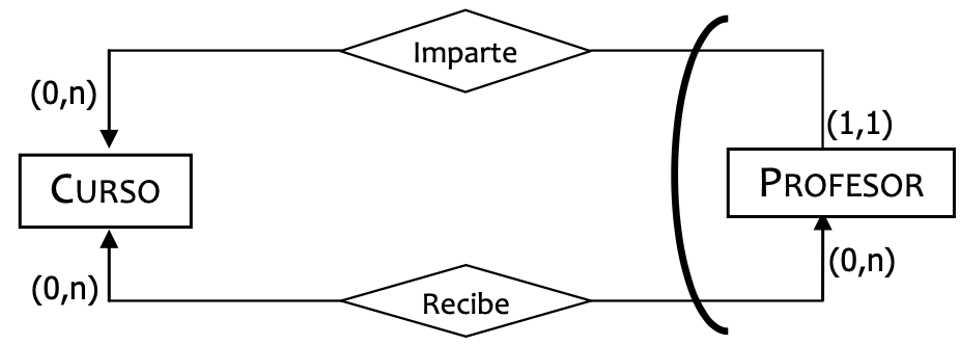

> **📌 Ejemplo 1**
> 

> En una universidad existe la entidad **Profesor** y dos relaciones:

> - **Dirige Departamento**

> - **Es Profesor Asociado**

> Un profesor puede ser **director de un departamento** o **profesor asociado**, pero nunca ambas cosas al mismo tiempo.

Cada profesor solo puede aparecer en una de las dos relaciones.

> **📌 Ejemplo 2**
> 

> Una **Cuenta Bancaria** puede encontrarse en uno de los siguientes estados:

> - **Activa**

> - **Bloqueada**

> Una cuenta únicamente puede estar en uno de esos estados.

## **Restricción de Exclusión**

La **restricción de exclusión** afecta **a un par de ocurrencias**, una de cada entidad que participan en varias relaciones.

Esto significa que **la misma pareja de entidades no puede aparecer simultáneamente en dos relaciones distintas**.

A diferencia de la exclusividad, aquí una entidad puede participar en ambas relaciones, pero **no con la misma combinación de entidades**.

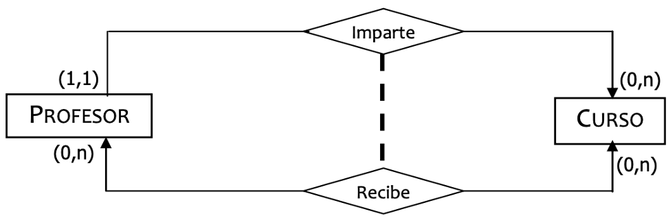

> **📌 Ejemplo 1**
> 

> Entre **Empleado** y **Proyecto** existen las relaciones:

> - **Dirige**

> - **Participa**

> Si el empleado **Juan** dirige el **Proyecto A**, esa misma pareja no podrá aparecer también en la relación **Participa**, aunque Juan sí pueda participar en otros proyectos.

| Empleado | Proyecto | Relación |
| --- | --- | --- |
| Juan | Proyecto A | Dirige ✅ |
| Juan | Proyecto A | Participa ❌ |

> **📌 Ejemplo 2**
> 

> Entre **Médico** y **Paciente** existen las relaciones:

> - **Atiende**

> - **Supervisa**

> Si la médica **Ana** supervisa al paciente **Carlos**, esa misma pareja no podrá aparecer también en la relación **Atiende**.

## **Restricción de Inclusividad**

La **restricción de inclusividad** establece que **toda ocurrencia de una entidad que participa en una relación debe participar también en otra relación**.

En este caso la obligación afecta **a la entidad individual**, no a la pareja de entidades.

Es una forma de indicar que una relación **implica necesariamente la existencia de otra**.

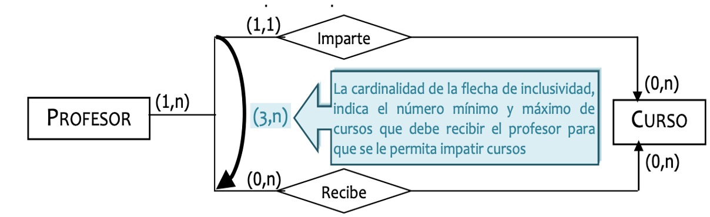

> **📌 Ejemplo 1**
> 

> Una empresa dispone de las relaciones:

> - **Empleado → Trabaja en Departamento**

> - **Empleado → Tiene Usuario Informático**

> Todo empleado que tenga un usuario informático debe pertenecer necesariamente a un departamento.

> Puede haber empleados en un departamento sin usuario, pero nunca usuarios sin departamento.

> **📌 Ejemplo 2**
> 

> En una universidad existen las relaciones:

> - **Alumno → Matriculado**

> - **Alumno → Solicita Beca**

> Todo alumno que solicita una beca debe estar previamente matriculado.

## **Restricción de Inclusión**

La **restricción de inclusión** afecta **a la combinación de dos entidades**.

Un par de ocurrencias solo puede pertenecer a una relación **si esa misma pareja ya pertenece a otra relación**.

Es decir, una relación queda **contenida dentro de otra**.

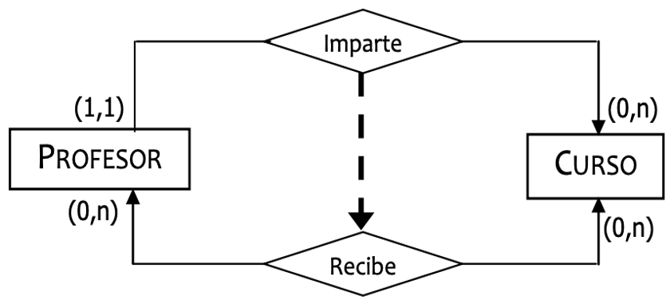

> **📌 Ejemplo 1**
> 

> Entre **Alumno** y **Asignatura** existen las relaciones:

> - **Matriculado**

> - **Examinado**

> Un alumno solo puede ser examinado de una asignatura si previamente está matriculado en esa misma asignatura.

| Alumno | Asignatura | Matriculado | Examinado |
| --- | --- | --- | --- |
| Laura | Bases de Datos | ✅ | ✅ |
| Pedro | Programación | ❌ | ❌ |

> **📌 Ejemplo 2**
> 

> Entre **Cliente** y **Producto** existen las relaciones:

> - **Compra**

> - **Devuelve**

> Un cliente únicamente puede devolver un producto si previamente ha comprado ese mismo producto.

## **Resumen de las restricciones**

| Restricción | ¿Sobre qué actúa? | Significado | Ejemplo |
| --- | --- | --- | --- |
| **Exclusividad** | Una entidad | Una ocurrencia solo puede participar en una de las relaciones. | Un profesor es director **o** profesor asociado. |
| **Exclusión** | Un par de entidades | La misma pareja no puede aparecer en dos relaciones distintas. | Un empleado dirige un proyecto **o** participa en él. |
| **Inclusividad** | Una entidad | Participar en una relación obliga a participar también en otra. | Todo alumno con beca debe estar matriculado. |
| **Inclusión** | Un par de entidades | Una pareja solo puede estar en una relación si ya pertenece a otra. | Un cliente solo puede devolver un producto que ha comprado. |

> **📌 Cómo recordar fácilmente estas restricciones**
> 

> **Exclusividad** e **Inclusividad** hablan de **una única entidad**.

> - Un profesor.

> - Un alumno.

> - Un empleado.

> **Exclusión** e **Inclusión** hablan de **una pareja de entidades**.

> - Alumno–Asignatura.

> - Cliente–Producto.

> - Empleado–Proyecto.

### Regla mnemotécnica

> - **"...una entidad..."** → **Exclusividad** / **Inclusividad**

> - **"...una pareja de entidades..."** → **Exclusión** / **Inclusión**

> **📌 Diferencia entre Exclusividad y Exclusión**
> 

> Aunque sus nombres son muy parecidos, existe una diferencia importante:

> - **Exclusividad** impide que **una entidad** participe en varias relaciones.

> - **Exclusión** impide que **la misma pareja de entidades** aparezca en varias relaciones.

> **📌 Diferencia entre Inclusividad e Inclusión**
> 

> También conviene distinguir estos dos conceptos:

> - **Inclusividad** obliga a que **una entidad** participe en otra relación.

> - **Inclusión** obliga a que **la misma pareja de entidades** exista previamente en otra relación.

---

## 2.6 El modelo Entidad Relación Extendido

# **El modelo Entidad Relación Extendido**

Con el paso de los años, y dadas ciertas carencias del modelo entidad relación, a mediados de los años 80 se extendió con la incorporación de los conceptos de clase y subclase, junto con los conceptos de generalización y especialización, así como la agregación de entidades, dando lugar al m**odelo Entidad Relación Extendido (EER)**.

## **Generalización/Especialización**

La jerarquía de Generalización/Especialización, en el Modelo E/R, se considera como un caso especial de relación entre varias entidades Subtipo (subclases o entidades hijas) y una entidad más general Supertipo (Superclase o entidad padre) cuyas características son comunes a todos los subtipos.

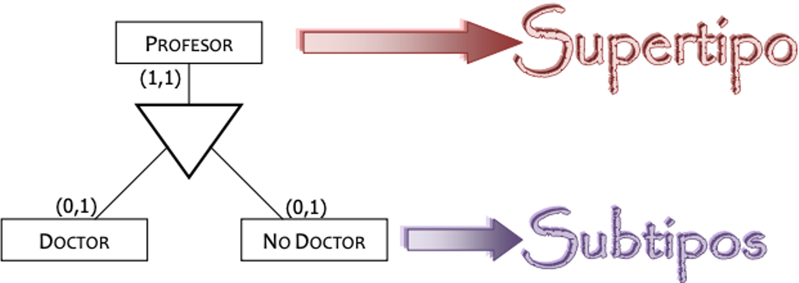

- La **entidad Supertipo** modela las características comunes de la entidad vista de una forma genérica.

- Las **entidades Subtipo** modelan las características propias de sus especializaciones.

Es necesario que se cumpla que toda ocurrencia de una entidad subclase sea también una ocurrencia de su entidad superclase, propagando sus características de padres a hijos, lo que se denomina herencia de propiedades.

La aparición de estas jerarquías en el modelado de bases de datos puede surgir de dos formas diferentes:

- **Generalización**: Se observa que dos o más entidades comparten diversos atributos y/o relaciones, de donde se deduce la existencia de una especie de entidad de nivel superior (supertipo) que contiene los atributos y las relaciones comunes a todos los subtipos.

- **Especialización**: Se observa que una entidad tiene ciertos atributos y/o relaciones que tienen sentido para unas ocurrencias pero no para otras, por lo que es conveniente definir uno o varios subtipos que contengan estos atributos y/o relaciones específicas, dejando en el supertipo los que son comunes.

> **📌 Tip**
> 

> Con **generalización** y la **especialización** se establece una relación **ES-UN** (en inglés, IS-A), indicando que una entidad hijo ES-UN con la entidad padre. Por ejemplo, si la Supertipo es `VEHICULO`, ejemplos de subtipo serían `CAMION`, `AUTOBUS`, `MOTO`, etc... ya que un `CAMION` es un `VEHICULO`.

### **Herencia**

Es la propiedad por la que los atributos y relaciones de un supertipo son heredados por el subtipo.
En este tipo de abstracción los atributos comunes a todos los subtipos (incluidos los identificadores) se asignan al supertipo, mientras que los atributos específicos se asocian al subtipo al que pertenecen. Del mismo modo, las interrelaciones que afectan a todos los subtipos se asocian al supertipo, dejándose para los subtipos las interrelaciones específicas en las que sólo participa el correspondiente subtipo.

### **Tipos**

Cuando definimos una especialización es muy importante definir cómo se relacionan los Supertipos con los Subtipos. Vamos a centrarnos en un supuesto donde tenemos una supertipo `PROFESOR` y tenemos tres subtipos: `NUMERARIO`, `NO NUMERARIO` y `COMERCIAL`.

Si nos centramos en la cantidad de subtipos posibles tenemos:

- **Total**: El supretipo pertenece obligatoriamente a alguno de los subtipos. No puede haber un `EMPLEADO` que no sea ni `DIRECTIVO`, ni `TECNICO`, ni `COMERCIAL`. Se representa incluyendo un cirulo (`o`) al final de la línea que relaciona el triangulo con la entidad.

- **Parcial**: El supertipo puede no pertenecer a alguna de los subtipos. Podríamos tener un `EMPLEADO` que no sea ni `DIRECTIVO`, ni `TECNICO`, ni `COMERCIAL`. Se representa sin indicar nada en el modelo.

Y si ponemos en foco en la exclusividad de las subclases:

- **Disjunta / Exclusiva**: El supertipo sólo pertenece a uno de los subtipos. Si un `EMPLEADO` es un `DIRECTIVO`, no puede ser un `TECNICO` ni un `COMERCIAL`. Se representa uniendo las líneas que relacionan los subtipos con el triangulo de la especialización.

- **Solapada**: El supertipo puede pertenecer a varios de los subtipos a la vez. Un `EMPLEADO` puede ser un `DIRECTIVO` y un `COMERCIAL` a la vez. Se representa sin indicar nada en el modelo.

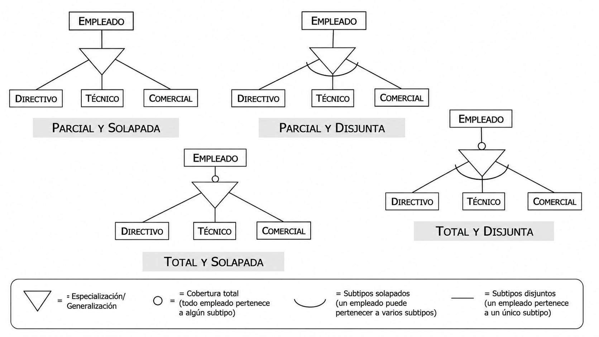

## **Agregación**

Abstracción que permite representar entidades compuestas que se obtienen por unión de otras simples. Cuando hablamos de la entidad compuesta la denominamos como TODO, mientras que los componentes son las PARTES.

- **Agregación Compuesto/Componente**: Abstracción que permite representar que un todo se obtiene por la unión de varias partes que pueden ser tipos de objetos diferentes y que desempeñan diferentes papeles en la agregación.

Ejemplo01Ejemplo02Ejemplo03

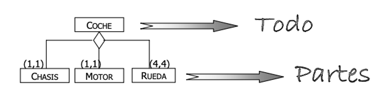

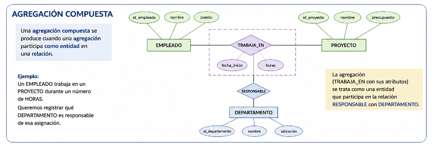

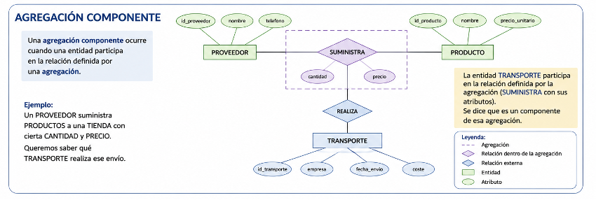

- **Agregación Miembro/Colección**: Abstracción que permite representar un todo como una colección de partes, donde todas las partes son de un mismo tipo y desempeñan el mismo papel. También se le conoce como asociación y en muchos casos, viene representada como una relación normal pero exigiendo una cardinalidad mínima que determina el número de miembros necesarios para establecer la asociación o colección.

Ejemplo01Ejemplo02Ejemplo03

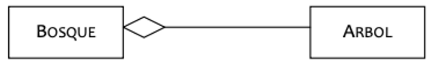


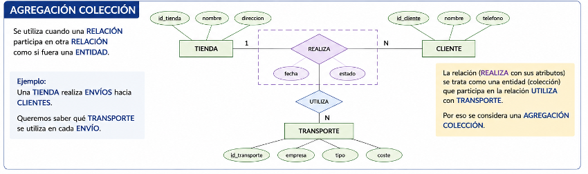

---

## ✏️ Actividades y Prácticas de la Unidad


---

### Actividad Práctica ACT201 — 201

# **Actividad 201**

> **📌 Entrega**
> 

> - La entrega será un **fichero pdf** que contenga la respuesta a las preguntas de la actividad.

> - El nombre del fichero debe ser `202_NombreApellidos.pdf`.

> - Se deberá entregar en la tarea correspondiente de Aules en tiempo y forma.

> **📌 Se valorará**
> 

> Se valorará:

> - La claridad de la respuesta.

> - La correcta maquetación del documento.

> - Respuesta correcta o aproximación a la misma.

> Esta actividad servirá para calificar:

> - RA6: Diseña modelos relacionales normalizados interpretando diagramas entidad/relación.

>   - CE6. b) Se han identificado las entidades del diseño lógico. (1%)

>   - CE6. c) Se han identificado los campos que forman parte de las tablas del diseño lógico. (1%)

>   - CE6. e) Se han identificado los campos clave. (1%)

## Actividad 1

Explica con tus palabras por qué no es recomendable comenzar creando directamente las tablas de una base de datos.

## Actividad 2

Ordena correctamente las siguientes fases del diseño de una base de datos.

- Diseño lógico

- Implementación

- Análisis de requisitos

- Normalización

- Diseño conceptual

## Actividad 3

Indica en qué fase se realizan las siguientes tareas.

| Tarea | Fase |
| --- | --- |
| Crear tablas |  |
| Entrevistar al cliente |  |
| Dibujar el modelo E/R |  |
| Aplicar formas normales |  |
| Crear índices |  |

## Actividad 4

Una clínica dental desea informatizar la gestión de pacientes, citas y tratamientos.

Indica qué información intentarías obtener durante la fase de análisis de requisitos.

## Actividad 5

Realiza un esquema donde aparezcan todas las fases del diseño de una base de datos indicando el objetivo principal de cada una de ellas.

---

### Actividad Práctica ACT202 — 202

# **Actividad 202**

> **📌 Entrega**
> 

> - La entrega será un **fichero pdf** que contenga la respuesta a las preguntas de la actividad.

> - El nombre del fichero debe ser `202_NombreApellidos.pdf`.

> - Se deberá entregar en la tarea correspondiente de Aules en tiempo y forma.

> **📌 Se valorará**
> 

> Se valorará:

> - La claridad de la respuesta.

> - La correcta maquetación del documento.

> - Respuesta correcta o aproximación a la misma.

> Esta actividad servirá para calificar:

> - RA6: Diseña modelos relacionales normalizados interpretando diagramas entidad/relación.

>   - CE6. b) Se han identificado las entidades del diseño lógico. (1%)

>   - CE6. c) Se han identificado los campos que forman parte de las tablas del diseño lógico. (1%)

>   - CE6. d) Se han analizado las relaciones entre las tablas del diseño lógico. (1%)

>   - CE6. e) Se han identificado los campos clave. (1%)

## **Entidades**

### **Ejercicio 1**

**Crear entidades**

Diseña las siguientes entidades indicando:

- Un atributo identificador.

- Tres atributos simples.

**Entidades:**

- Empleado

- Departamento

- Proyecto

### **Ejercicio 2**

**Entidades fuertes y débiles**

Indica cuáles de las siguientes entidades serían **fuertes** y cuáles **débiles**, justificando la respuesta.

- Cliente

- Factura

- Línea de factura

- País

- Pedido

- Detalle de pedido

- Habitación de un hotel

- Reserva

### **Actividad 3**

**Identifica la entidad débil**

Indica cuál es la **entidad fuerte** y cuál es la **entidad débil**.

| Situación | Entidad fuerte | Entidad débil |
| --- | --- | --- |
| Pedido - LíneaPedido |  |  |
| Hotel - Habitación |  |  |
| Cliente - Cuenta bancaria |  |  |
| Universidad - Facultad |  |  |
| Factura - DetalleFactura |  |  |

## **Atributos**

### **Ejercicio 4**

**Identificar tipos de atributos**

Indica el tipo de cada atributo.

| Atributo | Tipo |
| --- | --- |
| DNI |  |
| Edad |  |
| Dirección (calle, número, ciudad) |  |
| Teléfonos |  |
| FechaNacimiento |  |
| Nombre |  |
| Código Postal |  |
| Antigüedad (calculada) |  |

### **Ejercicio 5**

**Diseñar atributos**

Diseña los atributos para las siguientes entidades.

**Vehículo**

Debe tener:

- Un identificador principal.

- Un identificador alternativo.

- Dos atributos simples.

- Un atributo compuesto.

- Un atributo multievaluado.

- Un atributo derivado.

**Persona**
Debe tener los mismos tipos de atributos.

## **Relciones**

### **Ejercicio 6**

**Crear relaciones**

Dibuja el modelo E/R para los siguientes casos.

- Un profesor imparte asignaturas.

- Un cliente realiza pedidos.

- Un médico atiende pacientes.

Añade un verbo adecuado para nombrar cada relación.

### **Ejercicio 7**

**Completar el modelo**

Dispones de las siguientes entidades:

- Alumno

- Curso

- Profesor

Crea las relaciones necesarias para representar que:

- Un alumno se matricula en un curso.

- Un profesor imparte un curso.

## **Componentes**

### **Ejercicio 8**

**Identificar los componentes**

Indica cuáles son las **entidades**, las **relaciones** y algunos **atributos** del siguiente caso:

- Una biblioteca almacena información de sus libros. Los usuarios pueden tomar prestados los libros durante un periodo de tiempo.

**Responde indicando:**

- Entidades:

- Relaciones:

- Atributos de cada entidad:

### **Ejercicio 9**

**Distinguir entidades y atributos**

Clasifica los siguientes conceptos en **Entidad**, **Relación** o **Atributo**.

| Concepto | Clasificación |
| --- | --- |
| Alumno |  |
| Nombre |  |
| Matrícula |  |
| ASISTE |  |
| Profesor |  |
| Fecha de nacimiento |  |
| IMPARTE |  |
| Asignatura |  |
| Aula |  |
| DNI |  |

---

### Actividad Práctica ACT203 — 203

# **Actividad 203**

> **📌 Entrega**
> 

> - La entrega será un **fichero pdf** que contenga la respuesta a las preguntas de la actividad.

> - El nombre del fichero debe ser `203_NombreApellidos.pdf`.

> - Se deberá entregar en la tarea correspondiente de Aules en tiempo y forma.

> **📌 Se valorará**
> 

> Se valorará:

> - La claridad de la respuesta.

> - La correcta maquetación del documento.

> - Respuesta correcta o aproximación a la misma.

> Esta actividad servirá para calificar:

> - RA6: Diseña modelos relacionales normalizados interpretando diagramas entidad/relación.

>   - CE6. d) Se han analizado las relaciones entre las tablas del diseño lógico. (1%)

## **Grado y Correspondencia**

### **Actividad 1**

**Identificar el grado de una relación**

Identifica el **grado** de cada una de las siguientes relaciones indicando si se trata de una relación **unitaria**, **binaria** o **ternaria**.

| Relación | Grado |
| --- | --- |
| Un empleado supervisa a otro empleado. |  |
| Un alumno se matricula en un curso. |  |
| Un médico prescribe un medicamento a un paciente. |  |
| Un producto pertenece a una categoría. |  |
| Una persona está casada con otra persona. |  |
| Un profesor imparte una asignatura en un aula. |  |
| Un departamento controla otro departamento. |  |
| Un conductor conduce un vehículo. |  |

### **Actividad 2**

**Tipo de correspondencia**

Indica el **tipo de correspondencia** que representa cada una de las siguientes relaciones.

Selecciona una de las siguientes opciones:

- **1:1**

- **1:N**

- **N:N**

Indica la correspondencia en estos casos:

1. 

Un país tiene muchas provincias y una provincia pertenece únicamente a un país.

1. 

Un alumno puede matricularse en varias asignaturas y una asignatura puede tener muchos alumnos.

1. 

Un trabajador tiene un único número de la Seguridad Social y cada número pertenece únicamente a un trabajador.

1. 

Un cliente realiza muchos pedidos y cada pedido pertenece únicamente a un cliente.

1. 

Un actor participa en muchas películas y una película tiene muchos actores.

1. 

Un ordenador tiene un único número de serie y dicho número identifica únicamente a ese ordenador.

### **Actividad 3**

**Relaciones ternarias**

Indica cuáles de los siguientes ejemplos requieren realmente una **relación ternaria**.

1. Un profesor pertenece a un departamento.

1. Un médico prescribe un medicamento a un paciente.

1. Un cliente compra productos.

1. Un profesor imparte una asignatura en un aula.

1. Un jugador pertenece a un equipo.

1. Un proveedor suministra un producto a un almacén.

### **Actividad 4**

**¿Qué tipo de relación es?**

Para cada situación indica:

- Grado de la relación.

- Tipo de correspondencia (1:1, 1:N o N:N).

| Situación | Grado | Correspondencia |
| --- | --- | --- |
| Un profesor tutoriza a varios alumnos. |  |  |
| Un empleado sustituye temporalmente a otro empleado. |  |  |
| Un cliente reserva una habitación en un hotel. |  |  |
| Un médico realiza una intervención a un paciente en un quirófano. |  |  |
| Un actor interpreta un personaje en una película. |  |  |
| Un departamento depende de otro departamento. |  |  |

### **Actividad 5**

**Diseña una relación**

Para cada enunciado identifica:

- Las entidades.

- El nombre de la relación.

- El grado.

- El tipo de correspondencia.

**Ejercicio A**: Una empresa asigna vehículos a sus empleados.

**Ejercicio B**: Un alumno realiza un examen de una asignatura.

**Ejercicio C**: Un profesor coordina otro profesor.

**Ejercicio D**: Una empresa vende un producto a un cliente.

**Ejercicio E**: Un entrenador dirige un equipo.

> **📌 Recuerda**
> 

> Para determinar el **grado** de una relación debes contar el número de **entidades diferentes** que participan en ella:

> - **1 entidad → Relación unitaria**

> - **2 entidades → Relación binaria**

> - **3 o más entidades → Relación ternaria o superior**

## **Cardinalidades**

### **Actividad 6**

**Cardinalidades mínimas y máximas**
Completa las **cardinalidades mínimas y máximas** de las siguientes relaciones.

**Caso 1. Cliente - Pedido**

Un cliente puede no realizar ningún pedido, aunque puede realizar muchos.

Cada pedido pertenece obligatoriamente a un único cliente.

```sql
CLIENTE -------- REALIZA -------- PEDIDO
```

Completa:

- Cliente (**,**)

- Pedido (**,**)

<details markdown="1">

<summary>💡 Solució</summary>

Cliente **(0,n)**

Pedido **(1,1)**

</details>

**Caso 2. Empleado - Departamento**

Cada empleado trabaja obligatoriamente en un departamento.

Un departamento puede no tener empleados.

```sql
EMPLEADO ------- TRABAJA ------- DEPARTAMENTO
```

Completa:

- Empleado (**,**)

- Departamento (**,**)

<details markdown="1">

<summary>💡 Solució</summary>

Empleado **(1,1)**

Departamento **(0,n)**

</details>

**Caso 3. Médico - Paciente**

Un médico puede atender muchos pacientes.

Cada paciente tiene asignado exactamente un médico.

Completa las cardinalidades.

<details markdown="1">

<summary>💡 Solució</summary>

Médico **(0,n)**

Paciente **(1,1)**

</details>

**Caso 4. Profesor - Asignatura**

Un profesor puede impartir varias asignaturas.

Cada asignatura debe ser impartida por un profesor.

Completa las cardinalidades.

<details markdown="1">

<summary>💡 Solució</summary>

Profesor **(0,n)**

Asignatura **(1,1)**

</details>

**Caso 5. Libro - Editorial**

Cada libro pertenece a una editorial.

Una editorial publica muchos libros.

### **Actividad 7**

**Interpreta las cardinalidades**

Explica con tus propias palabras qué significan las siguientes cardinalidades.

| Cardinalidad | Significado |
| --- | --- |
| (0,1) |  |
| (1,1) |  |
| (0,n) |  |
| (1,n) |  |

### **Actividad 8**

**Completa la cardinalidad correcta**

Indica qué cardinalidad corresponde a la entidad resaltada.

**Ejercicio 1**

Cada matrícula pertenece a un único alumno.

Un alumno puede tener varias matrículas.

**Alumno:** (**,**)

**Ejercicio 2**

Cada empleado tiene un despacho.

Cada despacho pertenece únicamente a un empleado.

**Empleado:** (**,**)

**Ejercicio 3**

Un cliente puede alquilar varios vehículos.

Cada vehículo puede ser alquilado muchas veces a lo largo de su vida.

**Cliente:** (**,**)

**Vehículo:** (**,**)

**Ejercicio 4**

Cada ordenador pertenece a un aula.

Un aula contiene muchos ordenadores.

**Aula:** (**,**)

## **Dependencia de existencia e identificación**

### **Actividad 9**

**¿Existe dependencia?**

Indica si existe:

- Dependencia de existencia.

- Dependencia de identificación.

- Ninguna de las anteriores.

**Caso A**

Un pedido no puede existir sin el cliente que lo realizó.

Sin embargo, el pedido posee un identificador propio.

**Caso B**

Las líneas de un pedido únicamente existen dentro del pedido y se identifican mediante:

```sql
NúmeroPedido + NúmeroLínea
```

**Caso C**

Las habitaciones de un hotel se identifican mediante:

```sql
CódigoHotel + NúmeroHabitación
```

**Caso D**

Un libro pertenece a una editorial.

El ISBN identifica al libro de forma única.

**Caso E**

Un empleado pertenece a un departamento.

El empleado tiene un código único dentro de toda la empresa.

---

### Actividad Práctica ACT204 — 204

# **Actividad 204**

> **📌 Entrega**
> 

> - La entrega será un **fichero pdf** que contenga la respuesta a las preguntas de la actividad.

> - El nombre del fichero debe ser `205_NombreApellidos.pdf`.

> - Se deberá entregar en la tarea correspondiente de Aules en tiempo y forma.

> **📌 Se valorará**
> 

> Se valorará:

> - La claridad de la respuesta.

> - La correcta maquetación del documento.

> - Respuesta correcta o aproximación a la misma.

> Esta actividad servirá para calificar:

> - RA6: Diseña modelos relacionales normalizados interpretando diagramas entidad/relación.

>   - CE6. d) Se han analizado las relaciones entre las tablas del diseño lógico. (1%)

## **Ejercicio 1**

**Gestión de vehículos de una empresa**

Una empresa dispone de una flota de vehículos. Cada vehículo puede:

- ser asignado a un empleado para uso habitual;

- o bien ser alquilado temporalmente a un cliente externo.

Un vehículo nunca podrá estar asignado a un empleado y alquilado al mismo tiempo. Se pide

- Identificar las entidades.

- Identificar las relaciones.

- Representar el modelo E/R indicando la restricción correspondiente.

## **Ejercicio 2**

**Hospital**

En un hospital existen médicos y pacientes. Entre ellos pueden existir dos relaciones:

- Atiende

- Supervisa

Un médico puede atender a muchos pacientes y supervisar a otros muchos. Sin embargo, un mismo médico no puede atender y supervisar simultáneamente al mismo paciente.
Se pide representar el modelo E/R completo.

## **Ejercicio 3**

**Universidad**

Los alumnos pueden:

- matricularse en asignaturas;

- solicitar una beca.

La universidad establece que cualquier alumno que solicite una beca debe estar matriculado. Puede haber alumnos matriculados que no soliciten ninguna beca. Se pide representar el modelo E/R.

## **Ejercicio 4**

**Tienda online**

Los clientes pueden:

- comprar productos;

- devolver productos.

La tienda únicamente acepta devoluciones de productos que previamente hayan sido comprados por ese mismo cliente. Se pide realizar el modelo E/R indicando la restricción correspondiente.

## **Ejercicio 5**

**Biblioteca**

Los usuarios pueden:

- reservar libros;

- prestar libros.

Un libro reservado por un usuario debe ser posteriormente prestado a ese mismo usuario antes de que pueda retirarlo. Diseña el modelo E/R indicando la restricción existente.

## **Ejercicio 6**

**Recursos Humanos**

Un empleado puede participar en dos relaciones:

- Responsable de un proyecto.

- Miembro del proyecto.

Si un empleado es responsable de un proyecto, no puede aparecer también como miembro de ese mismo proyecto. Realiza el modelo E/R.

## **Ejercicio 7**

**Aeropuerto**

Los pilotos pueden:

- Pilotar vuelos comerciales.

- Pilotar vuelos de entrenamiento.

Un piloto sólo podrá pertenecer a uno de esos grupos. Además, un piloto únicamente podrá impartir formación a otro piloto si ambos participan previamente en un vuelo de entrenamiento. Representa todas las restricciones necesarias.

## **Ejercicio 8**

**Infotech**

Una empresa informática dispone de:

- Técnicos.

- Equipos.

Los técnicos pueden:

- Reparar equipos.

- Revisar equipos.

Un mismo técnico no puede reparar y revisar simultáneamente el mismo equipo. Además, un técnico únicamente puede revisar un equipo si previamente está autorizado para trabajar sobre él. Realiza el modelo E/R indicando todas las restricciones.

---

### Actividad Práctica ACT205 — 205

# **Actividad 205**

> **📌 Entrega**
> 

> - La entrega será un **fichero PDF** que contenga la respuesta a las preguntas de la actividad.

> - El nombre del fichero debe ser `206_NombreApellidos.pdf`.

> - Se deberá entregar en la tarea correspondiente de Aules en tiempo y forma.

> **📌 Se valorará**
> 

> Se valorará:

> - La correcta identificación de los elementos del modelo EER.

> - El uso adecuado de la generalización, especialización y agregación.

> - La claridad de los diagramas realizados.

> - La correcta justificación de las respuestas.

> Esta actividad servirá para calificar:

> - **RA6:** Diseña modelos relacionales normalizados interpretando diagramas entidad/relación.

>   - CE6. d) Se han analizado las relaciones entre las tablas del diseño lógico. (1%)

## **Generalización y Especialización**

### **Ejercicio 1**

**Generalización o Especialización**

Indica si en cada caso es más adecuado utilizar una **generalización** o una **especialización**.

| Caso | Respuesta |
| --- | --- |
| Existen las entidades COCHE, MOTO y CAMIÓN con muchos atributos comunes. |  |
| La entidad EMPLEADO tiene algunos trabajadores que cobran comisión y otros que no. |  |
| Existen TARJETA_DÉBITO y TARJETA_CRÉDITO con atributos comunes. |  |
| Una PERSONA puede ser ALUMNO o PROFESOR. |  |
| Existen GATO, PERRO y AVE con características comunes. |  |

### **Ejercicio 2**

**Descubre el supertipo**

Indica cuál sería el **supertipo**.

- Bicicleta, Patinete y Motocicleta.

- Círculo, Rectángulo y Triángulo.

- Profesor, Alumno y Personal Administrativo.

- Cuenta Corriente, Cuenta Ahorro y Cuenta Empresa.

### **Ejercicio 3**

**Descubre los subtipos**

Propón **tres subtipos** para cada uno de los siguientes supertipos.

- Vehículo

- Animal

- Empleado

- Producto

- Usuario

### **Ejercicio 4**

**Herencia de atributos**

Se dispone de la entidad **EMPLEADO** con los siguientes atributos:

- DNI

- Nombre

- Dirección

- Teléfono

- FechaContratación

Además existen los siguientes subtipos:

**Directivo**

- Despacho

- Complemento

**Comercial**

- Comisión

- ZonaVentas

**Técnico**

- Especialidad

- Certificación

Se pide:

- Dibujar el modelo EER.

- Indicar los atributos del supertipo.

- Indicar los atributos propios de cada subtipo.

- Explicar qué atributos hereda cada subtipo.

### **Ejercicio 5**

**Total o Parcial**

Indica el tipo de especialización.

| Caso | Tipo |
| --- | --- |
| Todo vehículo es coche, moto o camión. |  |
| Existen empleados que no pertenecen a ninguna categoría. |  |
| Todos los animales pertenecen a una especie. |  |

### **Ejercicio 6**

**Disjunta o Solapada**

Indica el tipo de especialización.

| Caso | Tipo |
| --- | --- |
| Un estudiante sólo pertenece a un grupo. |  |
| Un profesor puede ser investigador. |  |
| Un empleado puede ser jefe y responsable de calidad. |  |
| Un vehículo sólo puede ser coche o motocicleta. |  |

### **Ejercicio 7**

**Clasifica la jerarquía**

Indica para cada caso si la especialización es:

- Total o Parcial.

- Disjunta o Solapada.

**Caso 1**

Todo empleado pertenece a:

- Directivo

- Comercial

- Técnico

Ninguno puede pertenecer a dos categorías.

**Caso 2**

Un profesor puede ser:

- Tutor

- Coordinador

- Jefe de Departamento

Puede desempeñar varios cargos y algunos profesores no desempeñan ninguno.

### **Ejercicio 8**

**Diseño de una especialización**

Diseña un modelo EER para una universidad.

Debe contener:

- Supertipo PERSONA.

- Subtipos ALUMNO y PROFESOR.

- Cuatro atributos comunes.

- Dos atributos específicos para cada subtipo.

Indica además:

- Si es Total o Parcial.

- Si es Disjunta o Solapada.

## **Agregación**

### **Ejercicio 9**

**¿Cuándo utilizar agregación?**

Indica en qué casos utilizarías una agregación.

- Un profesor imparte una asignatura y un aula donde se imparte.

- Un cliente compra un producto y posteriormente una empresa de transporte realiza el envío de esa compra.

- Un médico atiende pacientes.

- Un jugador pertenece a un equipo.

### **Ejercicio 10**

**Diseño con agregación**

Una biblioteca registra:

- Usuarios

- Libros

Ambos participan en la relación **PRÉSTAMO**.

Posteriormente un empleado supervisa cada préstamo.

Se pide:

- Diseñar el modelo EER utilizando una agregación.

- Identificar las entidades.

- Identificar las relaciones.

## **Ejercicio Completo**

### **Ejercicio 11**

**Modelado completo**

Diseña el modelo EER para una empresa de alquiler de vehículos.

Debe contener:

- Una jerarquía de especialización.

- Un supertipo.

- Tres subtipos.

- Una especialización Total.

- Una especialización Disjunta.

- Una agregación.

- Al menos diez atributos.

- Dos relaciones adicionales.

---

### Actividad Práctica ACT206 — 206

# **Actividad 206**

> **📌 Entrega**
> 

> - La entrega será un **fichero PDF** que contenga la respuesta a las preguntas de la actividad.

> - El nombre del fichero debe ser `207_NombreApellidos.pdf`.

> - Se deberá entregar en la tarea correspondiente de Aules en tiempo y forma.

> **📌 Se valorará**
> 

> Se valorará:

> - La correcta identificación de los elementos del modelo EER.

> - El uso adecuado de la generalización, especialización y agregación.

> - La claridad de los diagramas realizados.

> - La correcta justificación de las respuestas.

> Esta actividad servirá para calificar:

> - **RA6:** Diseña modelos relacionales normalizados interpretando diagramas entidad/relación.

>   - CE6. a) Se han utilizado herramientas gràficas para representar el diseño lógico. (5%)

>   - CE6. b) Se han identificado las tablas del diseño lógico. (3%)

>   - CE6. c) Se han identificado los campos que forman parte de las tablas del diseño lógico. (3%)

>   - CE6. d) Se han analizado las relaciones entre las tablas del diseño lógico. (1%)

>   - CE6. e) Se han identificado los campos clave. (3%)

## **Ejercicio 1**

**Sistema de un Centro Cultural**

Un centro cultural quiere desarrollar un sistema para mantener y consultar la información de la historia de la música. Para esto se organiza la información por épocas, de las cuales se sabe el nombre único, diferentes características relevantes, el período (año de comienzo y año final) y los géneros musicales de la época.

A su vez, de cada género, se quiere saber su nombre único, diversas características, sus orígenes, los músicos asociados a ese género y los instrumentos que intervenían en la ejecución de ese género.

Sabemos que una época tiene varios géneros, pero que un género pertenece a una sola época.

De cada músico, se sabe el nombre único, fecha de nacimiento, fecha de muerte y una historia de su vida.

Un género tiene varios músicos, pero un músico pertenece a un solo género.

De cada instrumento musical se tiene el nombre único, una foto, el lugar donde se creó, quién fue el creador, el tipo de instrumento (viento, teclado, etc.) y los materiales con que se hace. En un género se usan varios instrumentos, y un instrumento aparece en varios géneros.

Adicionalmente, se quiere conocer la lista de obras famosas que se hicieron dentro de un género. De las obras famosas, se conoce un nombre único, el año en que se hizo, los músicos autores y la partitura. Tenga en cuenta que una obra famosa pertenece a un solo género, que una obra famosa la componen varios músicos y que un músico compone varias obras.

<details markdown="1">

<summary>💡 Solució</summary>

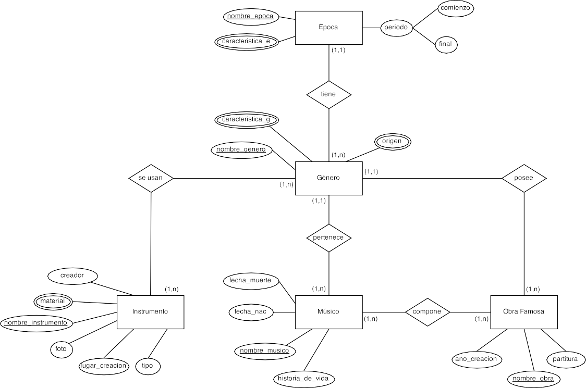

</details>

## **Ejercicio 2**

**Rincón de Lectura**

Nos piden ayuda para modelar el sistema de una biblioteca, brindándonos la siguiente información.

Los libros son escritos por autores de los cuales conocemos su nombre, su nacionalidad y su fecha de nacimiento. Los nombres de los autores no pueden repetirse. Además, sabemos que los libros cuentan con un título único, el idioma y su número de páginas. Adicionalmente, sabemos que cada libro tiene ediciones, de las cuales sabemos el año y el ISBN (que no puede repetirse).

La biblioteca realiza préstamos de distintas ediciones a usuarios. De cada préstamo, sabemos el número de la copia del libro prestado y el precio del alquiler, mientras que de los usuarios sabemos su DNI, su nombre y apellido y su domicilio. También queremos registrar la fecha del préstamo y la fecha de devolución de las transacciones realizadas.

Tenga en cuenta la siguiente información adicional:

- Un autor escribe muchos libros y un libro puede ser escrito por muchos autores. Un libro puede tener muchas ediciones.

- Una edición tiene muchas copias, pero cada copia pertenece a una edición.

- Una copia pudo haber sido prestada a muchos usuarios y muchos usuarios pueden haber pedido la misma copia en momentos distintos.

- En algunos casos un libro puede hacer referencia a otro libro, pero solo a uno, lo mismo en el caso inverso.

- Las copias tienen un número único dentro de cada edición, pero el mismo puede repetirse dentro de otras ediciones.

<details markdown="1">

<summary>💡 Solució</summary>

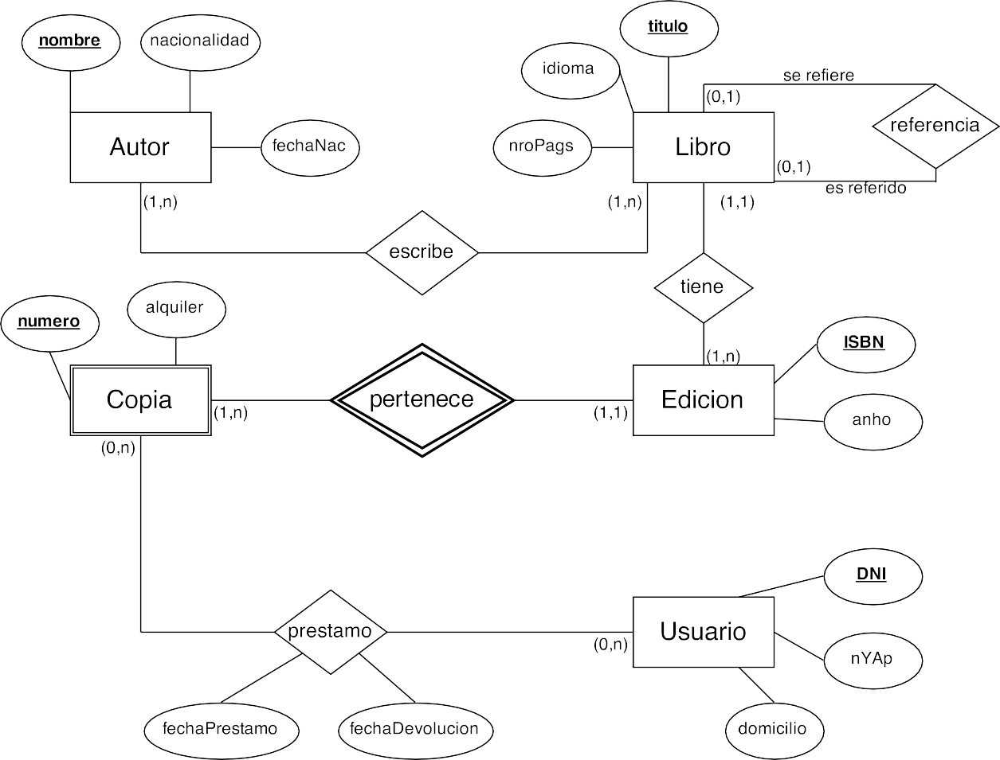

</details>

## **Ejercicio 3**

**Agencia de viajes**

Se quiere realizar una base de datos para llevar la información de varias agencias de viajes. De cada una se conoce su código, la fecha de inicio de actividades y su ciudad.

Cada agencia ofrece paquetes turísticos, los cuales tienen un precio y destinos a varios países. Se identifican por un código de paquete. Un paquete puede estar relacionado con uno o más paquetes a modo de combo (ejemplo: viaje a Disney + crucero por el Caribe). Cada paquete es propio de su agencia, no puede ser vendido en otra.

Los paquetes son comprados por clientes, los cuales tienen un nombre, domicilio y son diferenciados por su DNI. Estos clientes tienen varias formas de pago, de las cuales conocemos su tipo y el monto a pagar. Los medios de pago son autorizados por un solo banco, de los cuales sabemos que poseen un nombre -que es único- y sucursal. Al autorizar los pagos, se establece una fecha de validez.

## **Ejercicio 4**

**Sistema de Farmacia**

Debemos diseñar un sistema para registrar las farmacias en diferentes ciudades de nuestro país.

Sabemos que cada farmacia tiene un nombre (único en todo el sistema) y un domicilio. Cada farmacia se ubica en una sola ciudad, pero en una ciudad hay varias farmacias. De cada ciudad, sabemos el nombre, la provincia en la que se encuentra, la cantidad de habitantes y la superficie. Cada ciudad se identifica con el nombre y la provincia.

Conocemos también que cada farmacia puede tener un propietario, y que cada propietario tiene solamente una farmacia. Tenga en cuenta que puede haber farmacias sin propietario. De los propietarios, conocemos el DNI (único), su nombre y su domicilio, compuesto por calle, número, código postal y ciudad.

Cada farmacia, a su vez, vende varios medicamentos y un medicamento se vende en varias farmacias. De cada medicamento conocemos su id único, su nombre comercial y las drogas de las cuales se compone. Cada farmacia vende un medicamento a un precio determinado, que no necesariamente es el mismo en diferentes farmacias.

Como último requerimiento, un medicamento puede complementar a otros medicamentos, pero sabemos que cada medicamento puede ser complementado por un solo medicamento.

## **Ejercicio 5**

**Biblioteca**

Una reconocida biblioteca se encuentra en la etapa de modelado de su base de datos. A continuación se enumeran los datos considerados al llevar adelante su diseño.

Los libros son uno de los componentes más importantes. De cada uno de ellos nos interesa registrar su título (único entre todos los libros) y género al que pertenece. Además posee un conjunto de reseñas, que se encuentran conformadas por la revista donde apareció, la fecha y su texto descriptivo.

Un libro tiene referencias hacia otros libros. Todo libro tiene al menos una referencia, y además es referido al menos una vez en otro libro (no hay libros que no sean referidos, ni libros que no tengan referencias).

Todo autor escribe al menos un libro, y a su vez todo libro tiene al menos un autor. De ellos interesa saber su nombre (que es único, no hay dos autores con el mismo nombre), su nacionalidad y año de nacimiento.

Un libro tiene además al menos una edición. De ellas interesa el año, el ISBN (un identificador único entre ediciones de libros), y además su idioma.

Las ediciones tienen como mínimo una copia, aunque las más demandadas tienen varias copias. Cada copia se diferencia por su número, aunque este número por sí solo no basta para diferenciarla: es necesario conocer además la edición a la que pertenecen.

Finalmente, las copias son las que serán pedidas en préstamo por los usuarios. Un usuario pide prestada una copia en una fecha específica, y en ese momento se le asigna una fecha de devolución. Del usuario se conoce el DNI (que lo identifica de otros usuarios), su nombre, su apellido y un email. Un usuario puede no pedir copias. A su vez, puede que una copia nunca sea pedida en préstamo.

Responde las siguientes preguntas:

- ¿Qué problema de consistencia aparecería si Autor fuera un atributo de Libro, en lugar de ser una entidad separada?

- ¿Cómo representarías en el modelo la relación de maestro-discípulo entre autores? ¿Qué relación tiene esto con la decisión de cómo modelar los autores discutida en la pregunta anterior?

- ¿Qué diferencia hay entre las traducciones al modelo relacional de las relaciones Tiene y Escribe? ¿A qué se debe esta diferencia?

<details markdown="1">

<summary>💡 Solució</summary>

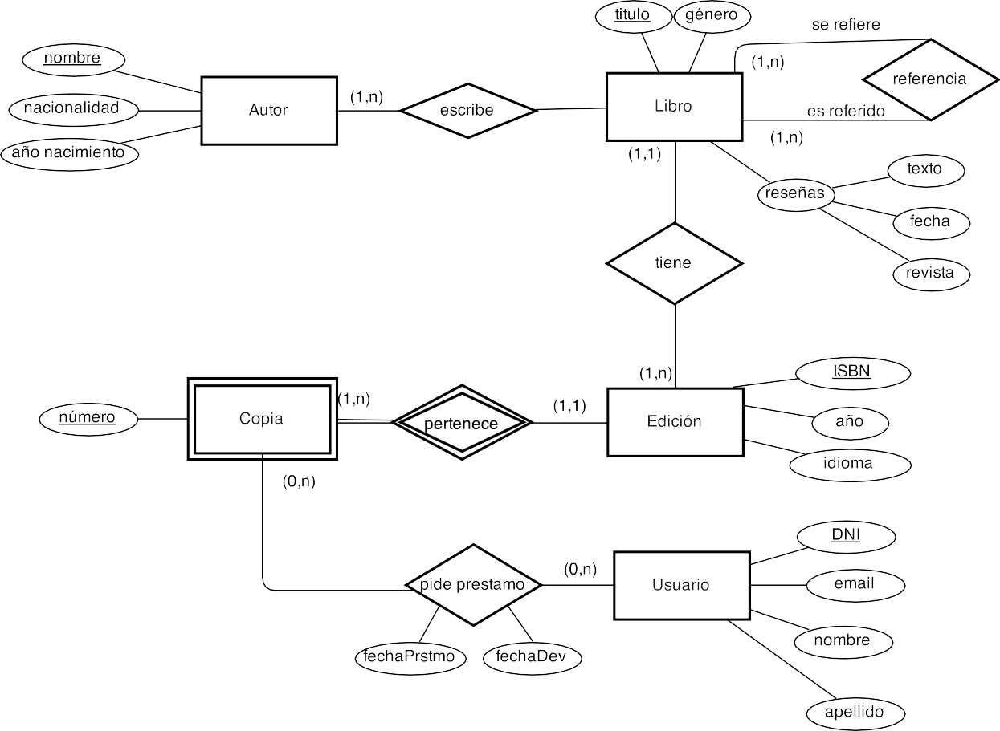

</details>

## **Ejercicio 6**

**Hinchas de Brasil 2014**

Una página web de estadísticas deportivas desea realizar una base de datos para manejar la información de los partidos, equipos e hinchas que visitaron Brasil durante el mundial en el 2014.

Sabemos que los partidos tienen un ID que los identifica en el sistema, así como también la instancia del torneo que se jugó en dicho partido (fase de grupos, octavos, etc.), la duración y la fecha en la que se jugó, compuesta por el día y la hora, el árbitro que dirigió ese partido y los equipos que jugaron el mismo.

De los árbitros conocemos su pasaporte, de qué país son, el año en el que inició la actividad y su nombre y apellido, como también qué árbitro reemplaza a cuál en caso de lesión o enfermedad; sabemos que un árbitro puede ser reemplazado por varios y que un árbitro reemplaza solo a uno.

De los equipos que participan en los partidos conocemos el nombre de la selección, que es único entre el resto de las selecciones, el nombre del DT de esa selección, el lugar donde entrena y el cuerpo técnico que la compone. También conocemos los distintos jugadores que forman parte de las selecciones, de los que sabemos su número de camiseta, que los distingue dentro de un equipo, la posición que ocupan en la cancha, su nombre y apellido y el apodo de cada uno. Es sabido que durante un mundial un jugador representa a un solo país y que en distintas selecciones puede haber jugadores con el mismo número. Al ser un mundial, un equipo puede jugar como mínimo tres partidos (quedó eliminado en fase de grupos) o llegar hasta siete (llegó a la final).

En este sistema los estadios son sede de distintos partidos. De los mismos conocemos su nombre, la ciudad en la que se encuentran, su capacidad máxima y también la capacidad habitada y la cantidad de policías que se hacen presente en cada partido. También sabemos que los distintos hinchas pueden visitar los estadios (a los que llegan en distintos medios de transporte), los cuales reciben una gran cantidad de hinchas por partido. De ellos conocemos el número de ticket de cada uno, la vestimenta y la ubicación (compuesta de zona, fila y número de asiento) que tiene cada uno. Adicionalmente, sabemos que un partido se juega solo en un estadio y que en un estadio pueden jugarse muchos partidos.

## **Ejercicio 7**

**Fábrica de Pelotas "Golazo"**

Solicitan nuestros servicios para resolver el almacenamiento de datos de un sistema de gestión de la producción de una fábrica de pelotas. La fábrica se compone de una serie de plantas, cada una identificada por un color. De las plantas conocemos la superficie en metros cuadrados y la lista de procesos que se llevan a cabo dentro de ellas; de estos procesos sólo conocemos su nombre y un grado de complejidad asociado.

Dentro de cada planta se encuentran las máquinas. Cada máquina es de una marca y un modelo, y se identifica por un número; este número es único a lo largo de todas las plantas.

Cada máquina es operada por técnicos. Debemos conocer en qué rango de fechas los técnicos estuvieron asignados a esa máquina, y además en qué turno (mañana, tarde o noche).

De los técnicos conocemos su DNI, nombre, apellido y fecha de nacimiento, aparte de una serie de números telefónicos de contacto.

Existen situaciones normales en las que una máquina sale de servicio y debe ser reparada. Lo único que nos interesa conocer aquí es cuál otra máquina está asignada para tomar el trabajo que ella no puede realizar.

## **Ejercicio 8**

**Sistema de Ventas**

Se quiere diseñar una BD que permita registrar las ventas de una empresa. Específicamente, esta empresa necesita llevar un control de proveedores, clientes, productos y ventas.

Un proveedor se modela con CUIT, nombre, dirección, teléfono y página web. Un cliente también se modela con CUIT, nombre y dirección, pero puede tener varios teléfonos de contacto. De cada dirección, nos interesa su calle, número, comuna y ciudad. Tanto para los proveedores como los clientes, el CUIT es un valor único (equivalente al DNI).

De los productos, sabemos que tienen un identificador único, nombre, precio actual, stock y nombre del proveedor que los comercializa. Además, se organizan en categorías, y cada producto se clasifica solamente en una de ellas, pero sin embargo una categoría clasifica varios productos. De ellas nos interesa saber su id, nombre y descripción.

Sabemos que un producto es comercializado por varios proveedores, pero que un proveedor provee un solo producto.

Por razones de contabilidad, se debe registrar la información de cada venta, las cuales tienen un número de factura (que es único), fecha, cliente, descuento y monto final. A su vez, sabemos que una venta se compone de varios productos, y por eso nos interesa el precio al momento de la venta del producto, la cantidad vendida y el monto total por él. Tenga en cuenta que un producto puede estar en varias ventas, pero que podemos tener un producto que no haya sido vendido. Adicionalmente, sabemos que cada cliente puede realizar varias ventas, y en una venta solamente participa un cliente.

## **Ejercicio 9**

**Cadena de Deportes**

Una cadena de casas de deportes desea realizar una base de datos para manejar sus sucursales, empleados, productos y clientes.

De las sucursales se sabe el número único que la identifica dentro de la cadena, el domicilio y la ciudad.

De los empleados el legajo, el nombre, el DNI, el domicilio (calle, número y ciudad) y los números de teléfono en los cuales puede ser contactado.

Los empleados trabajan en diferentes sucursales en diferentes días de la semana y en cada sucursal tienen asignado un horario en particular, que puede no ser el mismo en diferentes sucursales. Por ejemplo, el empleado GBA trabaja los lunes de 9hs. a 18hs. en la Sucursal 1, y los martes de 10hs. a 20hs. en la Sucursal 2. En cada sucursal trabajan varios empleados.

De los productos se conoce un código, una descripción, un color y un costo fijo de fabricación. A su vez, existen también las fábricas que son identificadas con CUIT, nombre, país de origen, cantidad de empleados y nombre de gerente. Cada producto es fabricado en una sola fábrica, y cada fábrica solamente realiza un tipo de producto. El costo fijo de fabricación no depende de la fábrica.

Cada sucursal puede vender varios productos, y a su vez, cada producto puede ser vendido por varias sucursales. Cada sucursal establece cuál es el precio de venta del producto que ofrece. Es decir, un mismo producto podría tener diferentes precios en diferentes sucursales.

De los clientes se conoce el código de cliente, el DNI, el nombre, la fecha de nacimiento y la ciudad en la que vive. A su vez, también sabemos que cada cliente puede utilizar varias tarjetas de crédito, que son identificadas por el nombre de la tarjeta, el número, el código de seguridad y la fecha de vencimiento.

Cada cliente solamente realiza compra en una sola sucursal, y en una sucursal pueden comprar varios clientes. Cada sucursal le ofrece a sus clientes un descuento fijo por su fidelidad en las compras.

## **Ejercicio 10**

**Sistema de Blogs**

Una importante radio decide realizar un sistema de blogs para que cada uno de sus programas escriba notas que puedan resultar de interés a los oyentes. Para ello cuentan con un Modelo Entidad-Relación en el cual se identifican las siguientes entidades del dominio que van a manejar.

En primer lugar contamos con los programas. De los mismos conocemos el nombre (único), descripción, la lista de conductores y un horario compuesto por la hora en la que inicia y la hora en la que termina. Estos programas son los que escriben las notas, de ellas conocemos su título (único), contenido, una imagen y un resumen de la misma para mostrar en los listados de notas. Un programa puede escribir muchas notas pero cada una está escrita solo por un programa.

Para diferenciar las notas en distintos grupos, el sistema cuenta con la posibilidad de asignar categorías a las mismas. De ellas conocemos el nombre (único), descripción y una imagen que la identifica. Una ventaja que tiene el sistema de categorías es que se pueden crear jerarquías muy fácilmente, esto quiere decir que una categoría puede pertenecer a otra. Por ejemplo, podría existir la categoría "Arte" y esta a su vez contener dos categorías hijas "Música" y "Pintura".

Para lograr interacción con los oyentes, el sistema permite que los mismos se registren y comenten las notas. De los usuarios conocemos su username, password, fecha de registro, avatar y un email el cual solo puede registrarse una vez. Los comentarios poseen un número de id y el texto que lo compone.

## **Ejercicio 11**

**Artículos y encargos**

Una base de datos para una pequeña empresa debe contener información acerca de clientes, artículos y pedidos. Hasta el momento se registran los siguientes datos en documentos varios:

- Para cada cliente: Número de cliente (único), Nombre, NIF, Direcciones de envío (varias por cliente), Saldo, Límite de crédito (depende del cliente, pero en ningún caso debe superar los 18.000 €), Descuento.

- Para cada artículo: Número de artículo (único), Fábricas que lo distribuyen, Existencias de ese artículo en cada fábrica, Descripción del artículo.

- Para cada pedido: Cada pedido tiene una cabecera y el cuerpo del pedido. La cabecera está formada por el número de cliente, dirección de envío y fecha del pedido. El cuerpo del pedido son varias líneas, en cada línea se especifican el número del artículo pedido y la cantidad.

Además, se ha determinado que se debe almacenar la información de las fábricas. Sin embargo, dado el uso de distribuidores, se usará: Número de la fábrica (único), Nombre y Teléfono de contacto. Y se desean ver cuántos artículos (en total) provee la fábrica. También, por información estratégica, se podría incluir información de fábricas alternativas respecto de las que ya fabrican artículos para esta empresa.

Nota: Una dirección se entenderá como Calle, Número, Puerta, CP y Localidad. Una fecha incluye día, mes, año y hora.

Se pide hacer el diagrama ER para la base de datos que represente esta información.

## **Ejercicio 12**

**Casas de colonias**

Realizar el diagrama ER para modelizar el siguiente sistema de información:

a) Cada casa de colonias tiene un nombre que la identifica. Se desea saber de cada una, aparte del nombre, la capacidad (el número de niños que se pueden alojar en cada una como máximo), la comarca donde está situada y las ofertas de actividades que proporciona. Una casa puede ofrecer actividades como por ejemplo natación, esquí, remo, pintura, fotografía, música, etc.

b) Es necesario tener en cuenta que en una casa de colonias se pueden practicar varias actividades (de hecho, cada casa debe ofrecer como mínimo una), y también puede ocurrir que una misma actividad se pueda llevar a cabo en varias casas. Sin embargo, toda actividad que se registre en la base de datos debe ser ofertada como mínimo en una de las casas.

c) Interesa tener una evaluación de las ofertas de actividades que proporcionan las casas. Se asigna una calificación numérica que indica el nivel de calidad que tiene cada una de las actividades ofertadas.

d) Las casas de colonias alojan niños que se han inscrito para pasar en ellas unas pequeñas vacaciones. Se quiere tener constancia de los niños que se alojan en cada una de las casas en el momento actual. Se debe suponer que hay casas que están vacías (en las que no se aloja ningún niño) durante algunas temporadas.

e) De los niños que se alojan actualmente en alguna de las casas, interesa conocer un código que se les asigna para identificarlos, su nombre, su apellido, el número de teléfono de sus padres y su comarca de residencia.

f) De las comarcas donde hay casas o bien donde residen niños, se quiere tener registrados la superficie y el número de habitantes. Se debe considerar que puede haber comarcas donde no reside ninguno de los niños que se alojan en un momento determinado en las casas de colonias, y comarcas que no disponen de ninguna casa.

Nota: Es posible, por ejemplo, que una actividad como el esquí tenga una calificación de 10 en la oferta de la casa Grévol, y que la misma actividad tenga una calificación de 8 en la casa Ardilla.

## **Ejercicio 13**

**Transporte**

Se desea mecanizar la gestión de una empresa de transportes que reparte paquetes por toda España. Los encargados de llevar los paquetes son los camioneros, de los que se quiere guardar el DNI, nombre, teléfono, dirección, salario y localidad donde reside. De los paquetes transportados interesa conocer el código de paquete, descripción, destinatario, y dirección del destinatario. Un camionero distribuye muchos paquetes y un paquete sólo puede ser distribuido por un camionero.

De las provincias a las que llegan los paquetes interesa guardar el código de provincia y el nombre. Un paquete sólo puede llegar a una provincia, sin embargo, a una provincia pueden llegar muchos paquetes.

De los camiones que llevan los camioneros interesa conocer la matrícula, modelo, tipo y potencia. Un camionero puede conducir diferentes camiones en fechas diferentes y un camión puede ser conducido por varios camioneros.

## **Ejercicio 14**

**Paradores**

La red de Paradores de Turismo quiere mantener un servicio de atención y reservas a través de Internet. Una de las tareas dentro del desarrollo del sistema es la construcción del modelo lógico de datos. La información de partida para la construcción de dicho modelo es la siguiente:

Los Paradores vendrán definidos por un código único, nombre, dirección, teléfono, nivel y número total de habitaciones. Los Paradores disponen de distintos tipos de habitaciones. De cada habitación se desea almacenar el número de habitación, la ubicación dentro del Parador, el tipo (normal o suite), una descripción y el precio por noche.

Los Paradores pueden tener además unas instalaciones adicionales (golf, piscina, hípica, etc.). De cada tipo de instalación se desea almacenar el código de instalación, el nombre y la descripción. Hay que tener en cuenta que un mismo tipo de instalación se puede encontrar en distintos Paradores.

La información referente a los Paradores se completa con la oferta gastronómica que tienen. De la gastronomía ofrecida por cada Parador se almacenará un código, nombre y tipo de plato. Aunque un mismo plato puede ser servido por distintos Paradores, puede haber variaciones de precio en cada caso. Se desea almacenar la información de esta diferencia.

Cuando un usuario se conecte al sitio web de los Paradores de Turismo, además de poder consultar la información referente a lo descrito anteriormente, podrá hacer reservas de habitaciones. En el caso de realizar reservas, se toman los datos del cliente: NIF, nombre y apellidos. Se almacenará también un código de cliente generado por la aplicación si el cliente fuese nuevo.

Una vez registrado el cliente, este podrá elegir en qué Parador o Paradores desea alojarse, la fecha de llegada y el número de noches, así como el tipo de la habitación que quiere. El sistema le asignará las habitaciones correspondientes, teniendo en cuenta que un cliente no puede tener reservadas habitaciones de dos Paradores distintos en la misma fecha.

Por último, se desea que un cliente pueda consultar en cualquier momento qué reservas ha realizado en qué paradores para cada fecha así como la habitación reservada.

## **Ejercicio 15**

**Star Trek 1**

El club de fans de la película Star Trek ha decidido crear una web donde poder consultar información referente a todas las películas y capítulos de la saga. La base de datos deberá contener la siguiente información.

**Actores:** Es necesario conocer el nombre completo del actor, el personaje que interpreta, la fecha de nacimiento y su nacionalidad.

**Personajes:** Se desea conocer el nombre, su raza y graduación militar que desempeña (capitán, teniente, almirante, etc.). Es importante conocer el actor que interpreta el personaje, teniendo en cuenta que un personaje sólo puede ser interpretado por un actor y un actor sólo puede interpretar un personaje. Además será necesario conocer el personaje del que depende directamente en graduación militar.

**Capítulos:** Hay que almacenar todos los capítulos, indicando a qué temporada pertenece cada capítulo, el título, el orden en el que fue rodado, fecha de su primera emisión en televisión y los personajes que participaron en cada capítulo.

**Películas:** Se debe almacenar todas las películas que se proyectaron en cines, cada una con su año de lanzamiento, título y director. También hay que guardar los personajes que aparecen en cada película y cuál de ellos fue el protagonista.

**Planetas:** En cada capítulo, se visita 1 o varios planetas. Hay que almacenar el código del planeta, su nombre, galaxia a la que pertenece, y el problema que se resolvió en esa visita, así como la nave con la que se viajó al planeta. Para la descripción del problema será suficiente con un campo de texto de 255 caracteres. De la nave se almacenará el nombre, código y número de tripulantes.

## **Ejercicio 16**

**Star Trek 2**

El club ha pensado ampliar los requisitos de la página web. Se desea incluir información extra para los personajes. De modo que si el personaje es un humano, se indicará su fecha de nacimiento y ciudad terráquea donde nació. Si el personaje es Vulcano, se almacenará el nombre del mentor y la fecha de graduación, y si es de raza Klingon, se guardará su planeta natal y la fecha de su último combate.

En cada capítulo, la nave que viaja a un planeta, puede disponer de una nave pequeña llamada lanzadera con la que bajan a la superficie del planeta. La existencia de la lanzadera sólo tiene sentido si existe la nave a la que pertenece. Se identificará cada lanzadera mediante un número entero y el código de la nave. Es necesario conocer la capacidad en personas de la lanzadera.

## **Ejercicio 17**

**Mundial de fútbol**

Diseñar una base de datos para organizar el campeonato mundial de fútbol. Considerar los siguientes aspectos:

**Jugadores:** Un jugador puede pertenecer a un único equipo y puede actuar en varios puestos distintos, pero en un determinado partido sólo puede jugar en un puesto.

**Árbitros:** En un partido interviene 3 árbitros titulares, linier derecho, izquierdo, principal y un árbitro secundario. Un árbitro puede realizar una función en un partido y otra distinta en otro partido.

**Estadísticas:** Se desea saber los goles que ha marcado un jugador en qué partido y en qué minuto, también se desea poder describir cómo sucedió el gol.

**Porteros:** Se desea almacenar cuántas paradas ha realizado, en qué minuto y en qué situación se ha producido: penalti, tiro libre, corner o jugada de ataque.

**Partidos:** Todos generan un acta arbitral donde se pueden incluir todos los comentarios que el árbitro considere oportuno: lesiones, expulsiones, tarjetas, etc.

## **Ejercicio 18**

**Reyes Magos**

La ONG Reyes Magos desea hacer una BD para que esta Navidad todos los niños pobres de España puedan recibir sus regalos la noche de los Reyes Magos. La ONG contacta con vecinos de distintos barrios para disfrazarlos de Reyes Magos y organizarlos en grupos lúdicos que realicen eventos para que los niños los visiten y puedan formular sus peticiones. Cada niño es recibido por un Rey Mago y puede hacer una única petición, la cual queda anotada en la base de datos para posteriormente, el día 6 de enero, entregar esa petición. La ONG comprará los regalos con el dinero que distintas organizaciones benéficas aportarán a la causa. Los datos de interés son:

- De los vecinos: DNI, Nombre y apellidos, Rey Mago al que encarna y los vecinos a los que ha conseguido convencer para que se unan a la causa.

- De los niños: Nombre, Dirección y el Regalo que pide el Rey Mago. Los niños no tienen DNI y necesitarán un dato identificativo.

- De los grupos de vecinos se necesita saber a qué Barrio pertenecen, número de integrantes del grupo y los Eventos que han organizado.

- De los eventos interesa conocer la Ubicación física, la Fecha, la Hora y los niños asistentes.

## **Ejercicio 19**

**Empresa S.L.**

Queremos gestionar la información sobre los empleados de una empresa, a partir de las siguientes condiciones: para cada empleado dispondremos de su DNI, nombre, fecha de nacimiento, salario y departamento en el que trabaja.

La empresa está organizada en departamentos. Cada uno tiene un nombre único, el número del despacho en el que se ubica y un empleado que lo dirige. Nos interesa la fecha que empezó a dirigirlo.

Cada departamento controla una serie de proyectos, los cuales tienen nombre y número únicos.

Cada empleado puede trabajar en más de un proyecto, dedicándole un determinado número de horas a la semana en cada proyecto.

Finalmente, queremos guardar también los familiares de cada empleado, para administrar información relativa a las pólizas de seguros. De los familiares, queremos saber el nombre, fecha de nacimiento y parentesco con el empleado.

## **Ejercicio 20**

**Gestión de la Biblioteca de Barrio**

La Biblioteca de Barrio "Nova Lectura" quiere organizar mejor la información que maneja diariamente.

La biblioteca dispone de una colección de libros que va creciendo cada año. Cada libro puede encontrarse en un solo ejemplar o tener varias copias, y en ocasiones hay copias que se deterioran o se retiran.

Las personas que utilizan la biblioteca pueden venir libremente a leer, pero para llevarse libros a casa deben estar registradas. Algunas personas usan habitualmente la biblioteca, mientras que otras solo vienen de vez en cuando. A veces, cuando alguien cambia de dirección o teléfono, la biblioteca actualiza su información.

Cuando una persona quiere llevarse un libro, la biblioteca anota cuándo se lo lleva y cuándo lo devuelve. En algunos casos, si el libro se retrasa, se registra también una observación o aviso. No es raro que una persona tenga varios libros prestados al mismo tiempo, siempre que estén disponibles.

La biblioteca también organiza actividades culturales, como cuentacuentos o charlas. Para preparar estas actividades suele haber una persona responsable y una fecha programada. Algunas actividades atraen a muchos asistentes; en otras solo participan unas pocas personas, pero la biblioteca desea guardar esa información igualmente.

La biblioteca quiere un sistema que le permita controlar todos estos elementos de forma clara.
