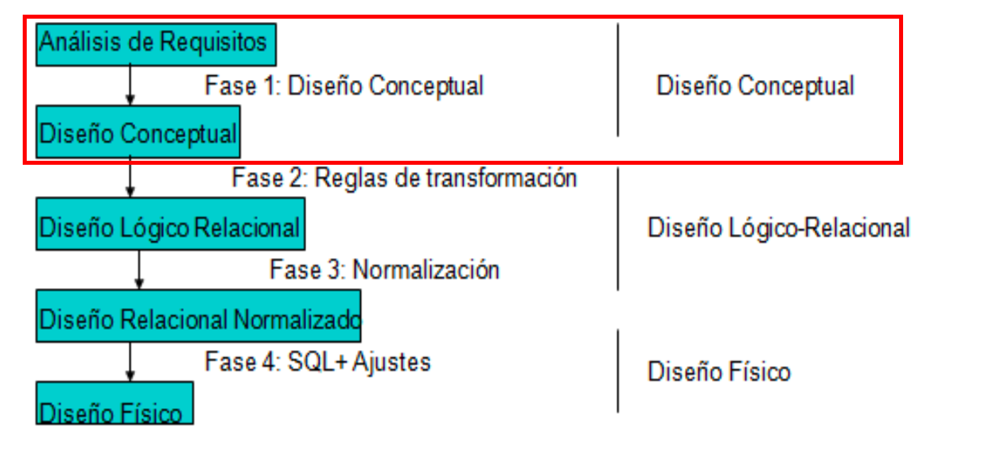

# 2.1 Metodologia de Disseny de Bases de Dades

Una vez que hemos trabajado conceptos generales asociados a las bases de dades y los sistemes gestors de bases de dades, tenemos claro que existen diferentes modelos de datos que dan lugar a diferentes tipos de soluciones.

Pero antes de entrar en uno de los modelos, conviene saber cual es el proceso de diseño de una base de dades. Es lógico pensar que un buen diseño sobre los datos va a facilitar el posterior desarrollo de las aplicaciones que explotan la base de dades.

El objetivo general del diseñar bases de dades es ofrecer una base de dades bien estructurada y eficiente que cumpla los requisitos de usuaris y empresas. A més de cumplir estos requisitos, un diseño de bases de dades, generalmente, cumple cinco objetivos comunes (los cuales trabajaremos a lo largo del curso):

- Coherencia e integridad de los datos.

- Mantenibilidad y facilidad de uso.

- Rendimiento y optimización.

- Seguridad de los datos.

- Escalabilidad y flexibilidad.

Así pues, antes de comenzar el diseño, el primer paso y más crítico es determinar los requisitos de la base de dades mediante un **sistema de información**, describiendo el problema que la base de dades debe cubrir. Este paso está más asociado a la **ingeniería del software** y lo estudiarás en detalle en el módulo de **Entornos de Desarrollo**.

El proceso de diseño de una Bases de Datos Relacional se elabora en 4 fases a partir de una descripción del sistema de información de una empresa u organización.

- **Fase 1**: Tras el establecimiento de las restricciones del sistema y un análisis de las mismas, se pasa a realizar con el cliente el diagrama entidad relación del Sistema de Información, primer **diagrama conceptual**. Suele ser un proceso cíclico y con realimentación y realizado interactivamente.

- **Fase 2**: Aplicando unas ciertas reglas se traduce el esquema inicial a un **modelo lógico o relacional**. Obteniendo el **esquema relacional** de la Base de Datos.

- **Fase 3**: Se refina el esquema relacional eliminando errores o impurezas mediante la **normalització**.

- **Fase 4**: Usando un DDL adaptamos la Base de Datos al Sistema de **Gestión de Bases de Datos** Relacional.

## **El modelo Entidad Relación**

Entendemos como **modelo conceptual** el conjunto de conceptos y reglas que nos permeten aplicar una serie de abstracciones con el propósito de definir y manipular datos de la realidad, almacenándola en una base de dades. Debemos incidir en el hecho de que los modelos conceptuales son modelos incompletos ya que no pueden captar la totalidad de la semántica del mundo real.

Centrándonos en el **model entitat-relació (E/R)**, cuyo nombre completo es modelo entidad/interrelación (entity/relationship en inglés), es un modelo de datos conceptual de alto nivel, propuesto por **Peter Chen** en 1976, y vigente a día de hoy por su simplicidad y legibilidad, ya que el resultado del análisis del problema se representa de forma visual mediante diagramas entidad/relación, representado mediante cajas y líneas que las unen. Ha tenido numerosas extensiones y aportaciones de muchos otros autores, teniendo soporte por múltiples herramientas de software de diseño (CASE), lo que ha dado lugar a que no exista un único modelo ER, sino una familia de modelos.

El modelo ER describe el mundo real como un conjunto de **entidades** y sus **atributos**, así como las **relaciones** existentes entre diferentes entidades.

## **Nomenclatura**

A la hora de nombrar a los diferentes elementos, en todos los casos, es recomendable no utilizar espacios en blanco ni tildes, para facilitar la futura transformación al modelo físico.

- Las entidades suelen ser sustantivos y se nombran en singular y mayúsculas.

- Los atributos també en singular, pero en minúsculas.

- Las relaciones son verbos en mayúsculas.

- Para las palabras compuestas, utilizaremos la convención camelCase, que une las palabras poniendo la primera letra en mayúsculas. Ejemplos de atributos serían mediante camelCase serían `nombreCompleto` o `codigoPostal`.