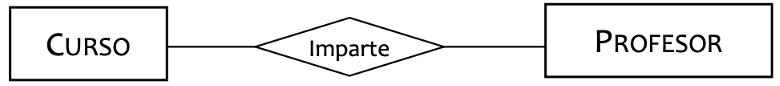
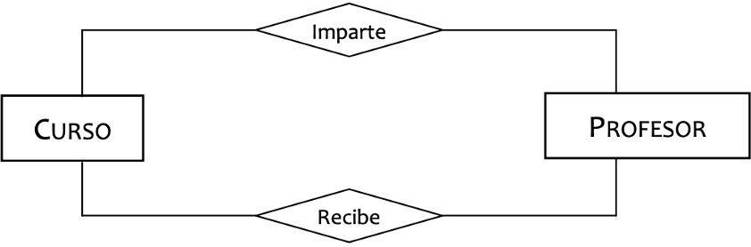
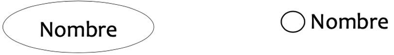
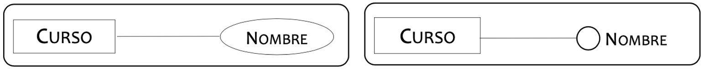
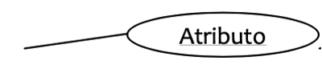
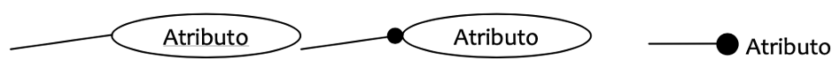
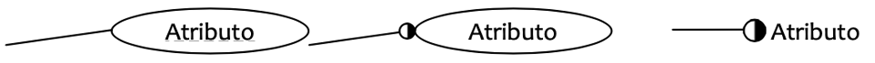
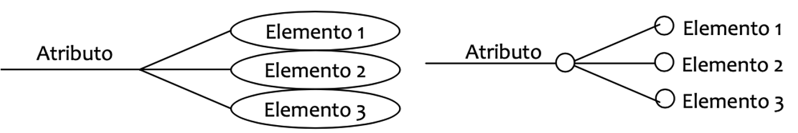
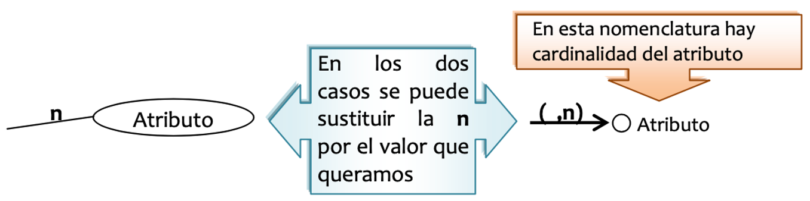
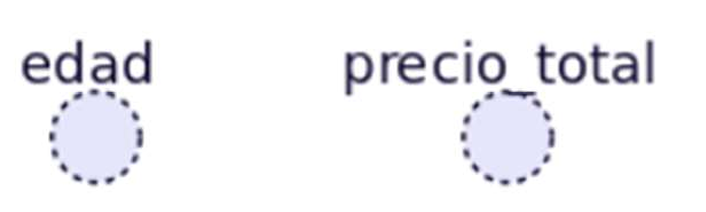

# **Componentes del Modelo E/R**

El Modelo E/R es un diseño conceptual, en el ámbito de la estructura y organización de nuestro sistema de una forma lo más visual posible desde el punto de vista de los datos.

Para realizar este modelo no utilizaremos lenguajes de definición y manipulación de datos. Los **elementos del modelo de E/R** son:

- **Entidad**

- **Relación**

- **Atributo**

## **Entidad**

> **📌 Peter P. Chen**
> 

> Cualquier elemento (real o abstracto) que existe en la realidad y sobre el que queremos almacenar información en la base de datos

> **📌 ANSI 1977**
> 

> Una persona, lugar, cosa, concepto o suceso, real o abstracto de interés para el funcionamiento de una empresa

- Una entidad es cualquier objeto o elemento acerca del cual se pueda almacenar información en la BD.

- Las entidades pueden ser concretas como una persona o abstractas como una fecha.

- Para identificar una entidad lo primero que necesitamos es el Nombre de la misma para referenciarla, así como el conjunto de características que definirán a los ejemplares que la integran, es decir, los Atributos.

- Las entidades se representan gráficamente mediante rectángulos y su nombre aparece en el interior.

- Un nombre de entidad sólo puede aparecer una vez.

### **Tipos**

- **Fuerte**: (También llamadas Regulares) Son aquellas cuyos ejemplares tienen existencia por sí mismos, cuentan con algún atributo que los identifica ya que los valores del mismo no se repiten. Son las entidades por excelencia.

- **Débil**: Son aquellas entidades en las que la existencia de un ejemplar depende de que exista un cierto ejemplar de otra entidad.

## **Relación**

Una relación representa una asociación, relacionando los datos del modelo. Para ello, dibujaremos un rombo que unirá las entidades que participan en la relación, y la nombraremos mediante un verbo en mayúsculas.

> **📌 Peter P. Chen**
> 

> Una Relació és una Associació, Vinculació o Correspondència entre Entitats

**1 Ejemplar** de la **Relación** sólo tendrá sentido si hay al menos **1 conexión** en la que intervenga **1 Ejemplar** de cada una de las **Entidades** que se vinculan o conectan en esta. Correspondencia o asociación entre dos o más entidades.
Consideramos una Relación como un tipo especial de Entidad cuya existencia depende de la existencia de las entidades a las que relaciona.
Cada relación tiene un nombre que describre su función.

## 

> **📌 Ejercicios**
> 

> 1. Crear una relación coche-cliente con los siguientes campos:

>   - Coche: Matricula, Año Matriculación, Color

>   - Cliente: NIF, Nombre, FechaNac

> 1. Crea una relación entre jugadores y equipos.

>   - Añade 1 atributo identificativo y 1 atributo simple para cada entidad.

> 1. Crea una relación entre clientes y cuenta bancaria (débil).

>   - Añade 1 atributo identificativo y 2 atributos simples para cada entidad

## **Atributos**

Las propiedades o características que tienen una Entidad o Relación se denominan Atributos.
Están representados por un óvalo o un círculo etiquetado con su nombre:

La forma de representarlos en el diagrama E/R és:

### **Tipos**

**Según la finalidad**

- **Atributo Descriptor**: Es el atributo normal, describe a una entidad o relación.

- **Atributo Identificador Principal**: Es un atributo o conjunto de atributos que permite distinguir entre las diferentes ocurrencias de una entidad.

- **Atributo Identificador alternativo**: Tiene las mismas características que el atributo identificador principal, pero no se le escoge como tal para ser funcionalmente menos acertado.

**Según su estructura**

- **Atributo Simple**: Los valores que toman son indivisibles.

- **Atributo Compuesto**: Se trata de un conjunto de elementos (atributos simples) que corresponden a una misma característica. (dirección: Calle, nombre, escalera, piso, etc..).

**Según el número de valores**

- **Atributo Atómico**: Para cada ocurrencia de la entidad el atributo toma un único valor.

- **Atributo Multievaluado**: Por cada ocurrencia el atributo puede tomar varios valores.

**Según la dependencia con otros Atributos**

- **Atributo no Derivado**: Atributos que se almacenan directamente y no dependen de otros atributos para su cálculo.

- **Atributo Derivado**: Son aquellos cuyo valor se puede calcular a partir de otros atributos.

## **Restricciones en el Modelo E/R**

### **Restricciones Inherente**

- Sólo permite establecer relaciones entre entidades.

- Obligatorio que todas las entidades y relaciones no tengan ocurrencias repetidas, es decir cada ejemplar es único.

### **Restricciones Especificas**

- Estructura de la Entidad, de entre todos los atributos de una entidad deben existir uno o varios (simples y/o compuestos) que identifiquen cada uno de los ejemplares de esta entidad..

- Estos conjuntos de atributos se denomina Identificador Candidato (IC). Cuando un IC está compuesto, el número de los atributos que lo componen debe ser mínimo. Por lo tanto TODO IC DEBE CUMPLIR LA CONDICIÓN DE SER UNÍVOCO Y MÍNIMO.

- De entre los IC se elige uno como Identificador (o clave) Principal (IP) y el resto serán Identificadores (o claves) Alternativos (IA).

- Prohibición de valores nulos para un atributo IP o IA, es decir, no admitir la opcionalidad del atributo, le debemos un valor obligatoriamente.
