# **Semàntica de les relacions**

  

    🏆 <strong>Progrés d'aquesta secció:</strong> 0 de 4 superats (0%)
    ⭐ <strong>0 punts</strong>
  

  

    

  

En una relació ens trobarem els siguientos elements, que defineixen les parts d'una relació:

- **Nom**: És necessari identificar de forma única dins del nostre Esquema conceptual a la relació.

- **Grau**: Ens indica el número d'entitats que participen en la relació.

- **Tipus de correspondència**: Ens indica el número màxim d'ocurrències d'una entitat que pot intervindre per cada ocurrència de l'un altre tipus d'entitat associada a la relació.

## **Tipus de relació**

Les relacions es agrupen pels **tipus de relació** segons:

- El grau de la relació.

- Tipus de correspondència.

### **Grau de la relació**

- **Relacions Unitarias**: També anomenades Relacions reflexivas, en elles intervenen una única entitat.

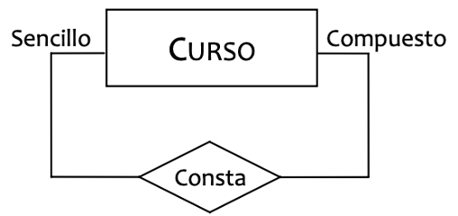

- **Relacions Binàries**: En elles intervenen dos entitats, són les ralacions més habituals.

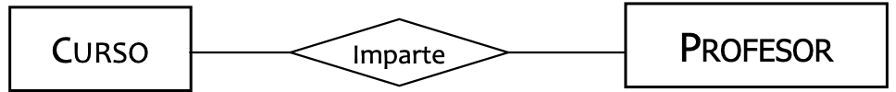

- **Relacions Ternàries o Superiors**: Intervenen tres o més entitats.

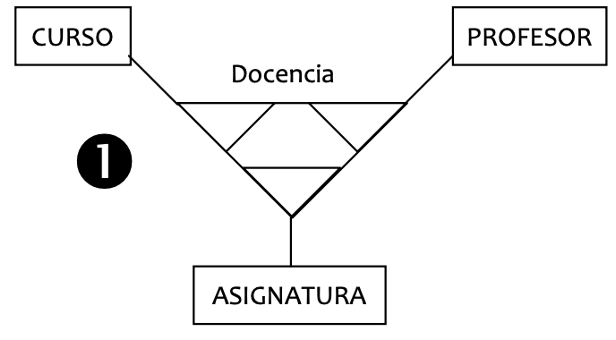

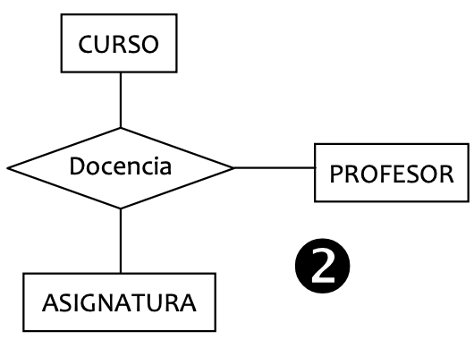

### **Tipus de correpondencia**

#### **Binària**

- 

**UN A UN (1:1)**: Quan en la relació només pot aparèixer, com a màxim, una ocurrència d'una entitat per cada ocurrència de la una altra entitat..
Hi ha dos maneres de representar-les gràficament, depenent de la nomenclatura utilitzada, i sobre tot d'on colocamos el nom de la relació:

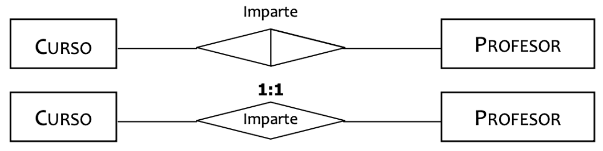

- 

**UN A MOLTS (1:N)**: Quan en la relació només pot aparèixer, moltes ocurrències d'una entitat per cada ocurrència de la una altra entitat, però en sentit contrari només podem tindre com a màxim 1 ocurrència d'una entitat respecte a una ocurrència de la una altra.

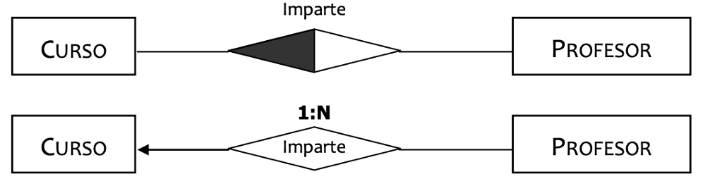

- 

**MOLTS A MOLTS (N:N)**: Quan en la relació només pot aparèixer, moltes ocurrències d'una entitat per cada ocurrència de la una altra entitat. En tots dos sentits de la relació.

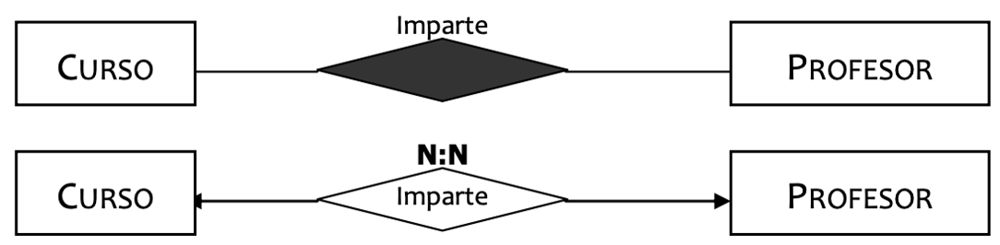

#### **Ternària**

- 

**UN A UN A UN (1:1:1)**: Quan en la relació només pot aparèixer, com a màxim, una correspondència d'una entitat per cada parell d'ocurrències de les altres entitats..

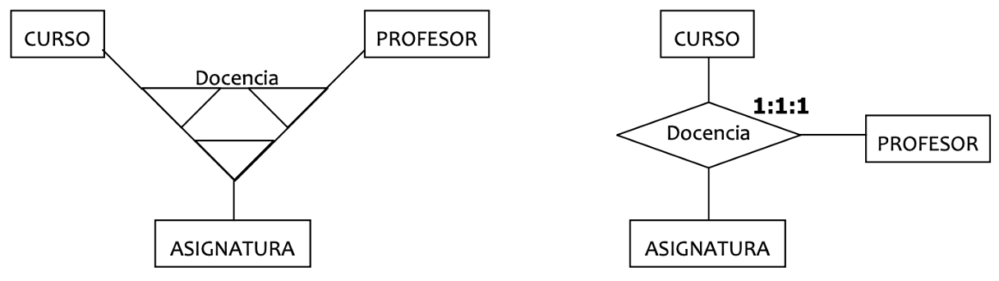

- 

**UN A UN A MOLTS (1:1:N)**: Quan en la relació només pot aparèixer, com a màxim, una correspondència d'una entitat per cada parell d'ocurrències de les altres entitats, però per a una de les entitats poden aparèixer diverses ocurrències per cada parell d'ocurrències de les altres dos entitats.

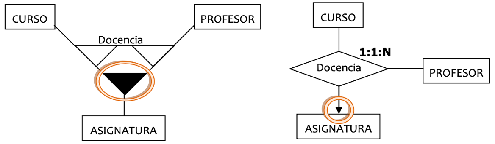

- 

**UN A MOLTS A MOLTS (1:N:N)**: Quan en la relació només pot aparèixer, com a màxim, una correspondència d'una entitat per cada parell d'ocurrències de les altres entitats, però per a les altres dos entitats poden aparèixer diverses ocurrències per cada parell d'ocurrències de les altres dos entitats.

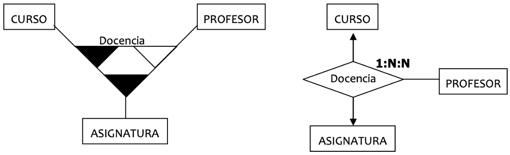

- 

**MOLTS A MOLTS A MOLTS (N:N:N)**: Quan en la relació només poden aparèixer moltes ocurrències de qualsevol entitat per cada parell d'ocurrències de les altres entitats.

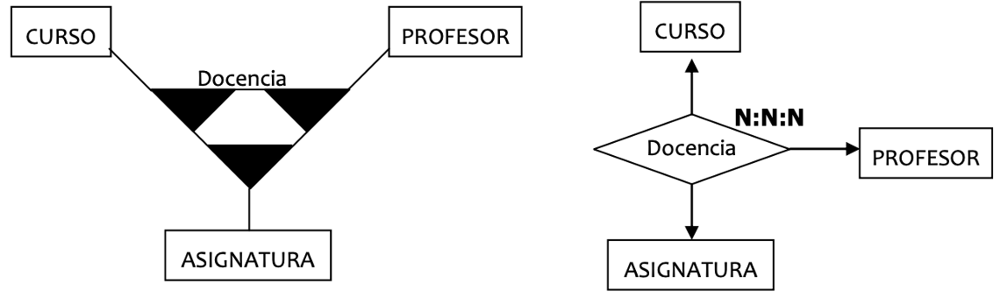

## **Cardinalitats**

Es defineix com el número **màxim** i **mínim** de **ocurrències** d'una **entitat** que poden estar relacionades amb una ocurrència de la **una altra** o altres **entitats** que participen en la relació. Es representen gràficament mitjançant una etiqueta del tipus (0,1), (1,1), (0,n) o (1,n) (segons corresponda), al costat de les entitats associades per la relació.

- **Cardinalitat Mínima**

- **Cardinalitat Màxima**

### **Cardinalitat Mínima**

Donada una Relació entre dos entitats, la Cardinalitat Mínima ens indica el número mínim d'ocurrències d'una entitat que poden ser relacionades amb una ocurrència de la una altra o altres entitats que intervenen en la relació.

- 1 Professor com a mínim quants cursos imparteix = 0

- 1 Curs com a mínim per cuantos professors és impartido = 1

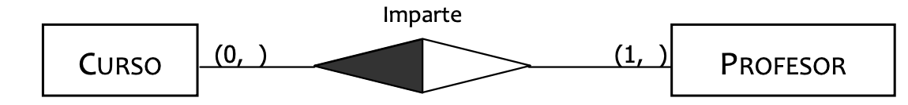

### **Cardinalitat Màxima**

Donada una Relació entre dos entitats, la Cardinalitat Màxima ens indica el número màxim d'ocurrències d'una entitat que poden ser relacionades amb una ocurrència de la una altra o altres entitats que intervenen en la relació.

- 1 Professor com a màxim quants cursos imparteix = n

- 1 Curs com a màxim per cuantos professors és impartido = 1

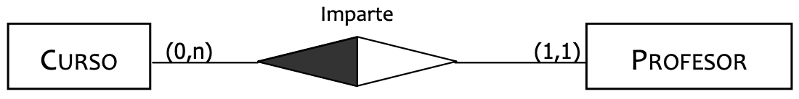

## **Dependència de Existència/Identificació**

Quan conectamos o asociamos dos entitats mitjançant una relació ens trobem amb determinades característiques funcionals que obligan a que tinguem una ocurrència d'una de les entitats (en aquest cas l'entitat fort) per a poder tindre una ocurrència de la una altra entitat (l'entitat feble).

- **DEPENDÈNCIA DE EXISTÈNCIA**: Quan les ocurrències de l'entitat feble no poden existir si desaparece l'ocurrència de l'entitat fort de la que depenen.

- **DEPENDÈNCIA DE IDENTIFICACIÓ**: Quan a més de complir-se la condició anterior, les ocurrències de l'entitat feble no poden identificar-se per sí mateixos, és a dir, mitjançant els atributs de l'entitat, i exigen afegir l'identificador principal de l'entitat fort de la que depenen.

### **Existència**

Sempre que la cardinalitat mínima d'una Entitat siga 1 ens està indicant que la una altra entitat de la relació és feble respecte a ella per una dependència d'existència..

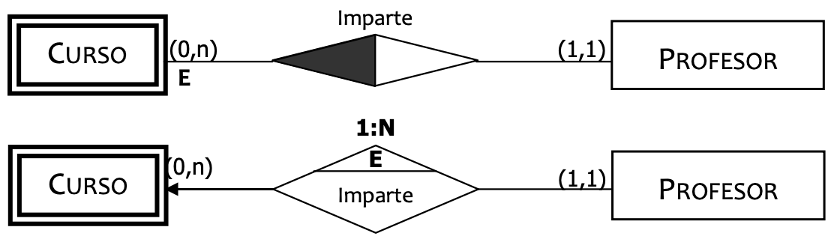

### **Identificació**

En aquest cas malgrat donar-se un cas d'interbloqueig per la dependència d'existència, sí es especifica la debilitat de Edició respecte a Curs, ja que la dependència d'identificació és més fort o restrictiva que la d'existència.

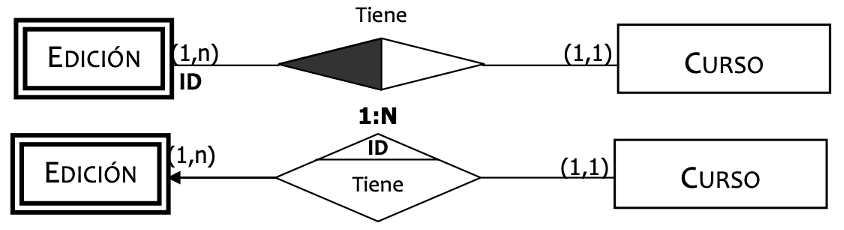

---

## 🎮 Reptes Interactius d'Autoavaluació (+100 XP)

Comprova el teu domini sobre **2.3 Semàntica de les relacions** superant aquests 4 reptes gamificats (+25 punts cadascun):

  
🎯 <strong>Repte 1 (+25 pts):</strong> Com s'anomena un atribut el valor del qual es pot calcular automàticament a partir d'altres atributs (com l'edat a partir de la data de naixement)?

  

    <button type="button" class="btn-mcq-opt" data-opt="A">A) Atribut clau primària.</button>
    <button type="button" class="btn-mcq-opt" data-opt="B">B) Atribut derivat o calculat.</button>
    <button type="button" class="btn-mcq-opt" data-opt="C">C) Atribut compost obligatori.</button>
    <button type="button" class="btn-mcq-opt" data-opt="D">D) Entitat associativa.</button>
  

  

  
🎯 <strong>Repte 2 (+25 pts):</strong> Quin grau té una relació que vincula una entitat amb si mateixa (per exemple, 'Empleat dirigeix a Empleat')?

  

    <button type="button" class="btn-mcq-opt" data-opt="A">A) Grau 1 (Relació unària o reflexiva).</button>
    <button type="button" class="btn-mcq-opt" data-opt="B">B) Grau 3 (Relació ternària).</button>
    <button type="button" class="btn-mcq-opt" data-opt="C">C) Grau 0.</button>
    <button type="button" class="btn-mcq-opt" data-opt="D">D) Jerarquia solapada.</button>
  

  

  
✅ <strong>Repte 3 (Vertader o Fals · +25 pts):</strong> Una relació amb correspondència N:M pot tenir atributs propis associats a la pròpia relació (com la data o la quantitat en una comanda).

  

    <button type="button" class="btn-vf" data-opt="V">Vertader (V)</button>
    <button type="button" class="btn-vf" data-opt="F">Fals (F)</button>
  

  

  
⌨️ <strong>Repte 4 (+25 pts):</strong> Quina figura geomètrica s'utilitza en la notació clàssica de Peter Chen per a representar una Relació entre entitats?

  

    <input type="text" class="quiz-input" placeholder="Escriu la resposta..." />
    <button type="button" class="btn-quiz-check">Comprovar</button>
  

  

### 📋 Llista de Comprovació i Rúbrica d'Assoliment

Marca cada criteri a mesura que completes l'estudi o la resolució pràctica d'aquesta pàgina (**2.3 Semàntica de les relacions**):

- [ ] He llegit detingudament la teoria o l'enunciat d'aquesta secció i he anotat els conceptes clau.
- [ ] He revisat els esquemes, taules o blocs de codi i he verificat que sé aplicar-los a l'entorn de treball.
- [ ] He resolt correctament els **4 reptes interactius** superiors obtenint els **100 punts XP**.
- [ ] He descarregat el comprovant oficial en PDF per a adjuntar-lo a la tasca d'**Aules**.

  <h3>📤 Comprovant de Lliurament per a Aules</h3>
  
Quan hages completat els reptes interactius i la llista d'autoavaluació d'aquesta pàgina, introdueix el teu nom i descarrega el teu certificat oficial en PDF per a adjuntar-lo a la tasca d'<strong>Aules</strong>.

  

    <label for="aules-student-name">👤 Nom i Cognoms de l'Alumne/a:</label>
    <input type="text" id="aules-student-name" class="aules-student-name" placeholder="Ex: Joan Garcia Pérez" />
  

  

    0/4 reptes completats (0%) · 0 punts · 0/4 criteris d'autoavaluació
  

  

    <button type="button" class="btn-aules-dl" data-module="BBDD" data-unit="UD02" data-activity="ut0203">📥 Descarregar Comprovant PDF</button>
    <button type="button" class="btn-aules-copy">📋 Copiar Resum al Porta-retalls</button>
  

  

