# **Herramientas gráficas para el diseño lógico de bases de datos**

## **¿Por qué utilizar herramientas gráficas?**

Cuando diseñamos una base de datos es habitual comenzar realizando un **modelo conceptual** (Modelo Entidad/Relación). Una vez validado, este modelo debe transformarse en un **modelo lógico**, donde ya aparecen las tablas, los atributos, las claves primarias y las claves ajenas.

Aunque este proceso puede realizarse sobre papel, existen numerosas herramientas que facilitan el trabajo permitiendo:

- Diseñar tablas de forma visual.

- Crear relaciones entre ellas.

- Detectar errores de diseño.

- Exportar el modelo a imágenes o PDF.

- Generar automáticamente el código SQL de creación de la base de datos (en algunas herramientas).

- Documentar el proyecto de forma profesional.

> **📌 Ventaja principal**
> 

> El uso de herramientas gráficas permite **visualizar fácilmente** la estructura de una base de datos y facilita enormemente su mantenimiento y comunicación con otros miembros del equipo.

## **Herramientas más utilizadas**

Actualmente existen numerosas aplicaciones para diseñar bases de datos. Algunas son completamente gratuitas y otras disponen de versiones de pago con funcionalidades avanzadas.

| Herramienta | Gratuita | Código abierto | Ingeniería inversa | Genera SQL | Nivel |
| --- | --- | --- | --- | --- | --- |
| [**draw.io (diagrams.net)**](https://app.diagrams.net/) | Sí | Sí | No | No | Muy fácil |
| [**MySQL Workbench**](https://www.mysql.com/products/workbench/) | Sí | Sí | Sí | Sí | Fácil |
| [**DBeaver Community**](https://dbeaver.io/) | Sí | Sí | Sí | Parcial | Fácil |
| [**Oracle SQL Developer Data Modeler**](https://www.oracle.com/es/database/sqldeveloper/technologies/sql-data-modeler/) | Sí | No | Sí | Sí | Difícil |
| [**DbSchema**](https://dbschema.com/) | Limitada | No | Sí | Sí | Difícil |
| [**Navicat Data Modeler**](https://www.navicat.com/es/) | No | No | Sí | Sí | Difícil |
| [**ERDPlus**](https://erdplus.com/) | Sí | No | No | Parcial | Muy fácil |
| [**Visual Paradigm**](https://www.visual-paradigm.com/) | Limitada | No | Sí | Sí | Muy Difícil |

## **Comparativa de herramientas**

| Herramienta | Ventajas | Inconvenientes | Uso recomendado |
| --- | --- | --- | --- |
| **draw.io** | Gratuito. Funciona desde el navegador. No requiere instalación. Muy sencillo de utilizar. Ideal para aprender modelado. | No genera automáticamente la base de datos. No valida restricciones ni normalización. | Aprendizaje del modelado E/R y lógico. |
| **MySQL Workbench** | Gratuito. Diseñado para MySQL. Genera automáticamente el código SQL. Permite ingeniería directa e inversa. Sincroniza modelos con la base de datos. | Principalmente orientado a MySQL. Interfaz más compleja para principiantes. | Diseño y desarrollo de bases de datos MySQL. |
| **DBeaver Community** | Gratuito y de código abierto. Compatible con numerosos SGBD. Permite visualizar estructuras y diagramas. Excelente gestor de bases de datos. | Las funciones de modelado son más limitadas que otras herramientas. Algunas características avanzadas solo están en la versión Enterprise. | Administración y mantenimiento de bases de datos. |
| **DbSchema** | Diseño visual muy completo. Sincronización con bases de datos. Generación de documentación. Compatible con numerosos SGBD. Ingeniería inversa. | La versión completa es de pago. Curva de aprendizaje algo mayor. | Proyectos profesionales y documentación técnica. |
| **ERDPlus** | Gratuito y online. Muy sencillo de utilizar. No requiere instalación. Permite crear diagramas E/R, modelos relacionales y ejercicios de normalización. | Funcionalidades limitadas. No genera bases de datos completas. Interfaz muy básica. | Aprendizaje y realización de ejercicios académicos. |

## **¿Qué herramienta utilizaremos?**

Durante este módulo utilizaremos **draw.io (diagrams.net)** porque:

- Es completamente **gratuita**.

- Es muy **sencilla** de utilizar.

- Funciona desde **cualquier navegador**.

- Permite **exportar** nuestros diagramas fácilmente.

- **No requiere** crear una cuenta.

> **📌 Más adelante...**
> 

> Cuando aprendamos SQL, utilizaremos también **MySQL Workbench**, ya que permite generar automáticamente las tablas de una base de datos a partir de un diagrama.

## **Primeros pasos con draw.io**

### **Paso 1 · Acceder a la aplicación**

Para comenzar, abrimos nuestro navegador y accedemos a la siguiente dirección:

 [https://app.diagrams.net](https://app.diagrams.net)

Al acceder por primera vez, aparecerá una pantalla donde podremos elegir **dónde guardar nuestros diagramas**:

- **Device** (nuestro ordenador)

- Google Drive

- OneDrive

- Dropbox

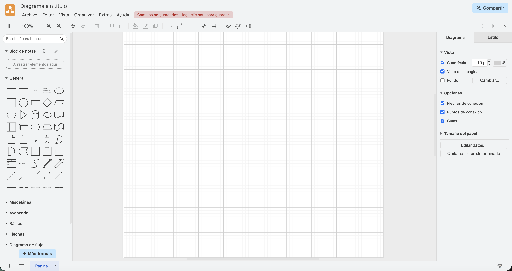

> **📌 Para clase**
> 

> Utilizaremos siempre **Device** para guardar los diagramas en nuestro ordenador.

### **Paso 2 · Crear un nuevo diagrama**

Una vez dentro de la aplicación, para crear un diagrama nuevo debemos ir a:

**Archivo → Nuevo** (o pulsar Ctrl+N en Windows / Cmd+N en Mac)

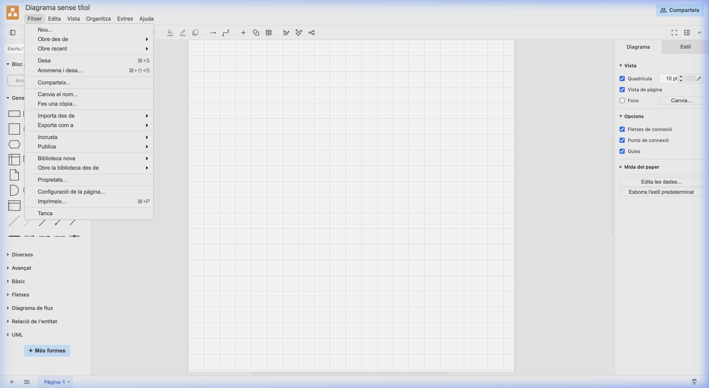

Se creará un nuevo lienzo en blanco listo para comenzar a trabajar.

### **Paso 3 · Conocer la interfaz**

La ventana principal de draw.io está formada por **cuatro zonas** bien diferenciadas:

#### **Panel izquierdo — Paleta de figuras**

Contiene todas las figuras disponibles agrupadas por categorías: **General**, **Básicos**, **UML**, **Entidad Relación**, etc.

En la sección de **Entidad Relación** encontramos los elementos específicos para diseñar diagramas de bases de datos: entidades, relaciones, atributos, tablas y todas sus variantes.

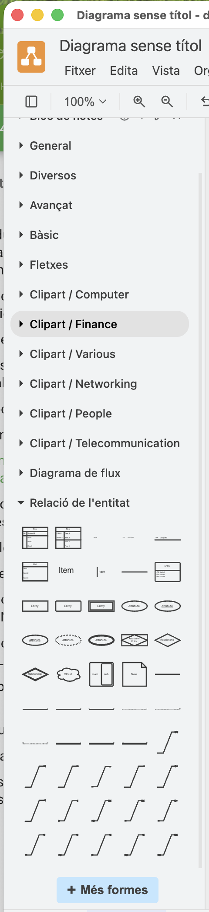

#### **Zona central — Área de trabajo**

Es el **lienzo** donde construiremos nuestro diagrama. Aquí arrastraremos las tablas, crearemos relaciones y organizaremos nuestro diseño.

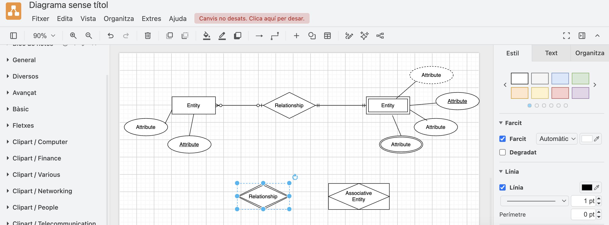

#### **Panel derecho — Propiedades y formato**

Cuando seleccionamos un elemento del diagrama, el panel derecho nos permite modificar todas sus propiedades visuales:

- **Estilo**: Color de relleno, bordes, opacidad, sombra, esquinas redondeadas.

- **Texto**: Fuente, tamaño, color, alineación, negrita, cursiva.

- **Organizar**: Posición exacta (X, Y), tamaño (ancho, alto), rotación.

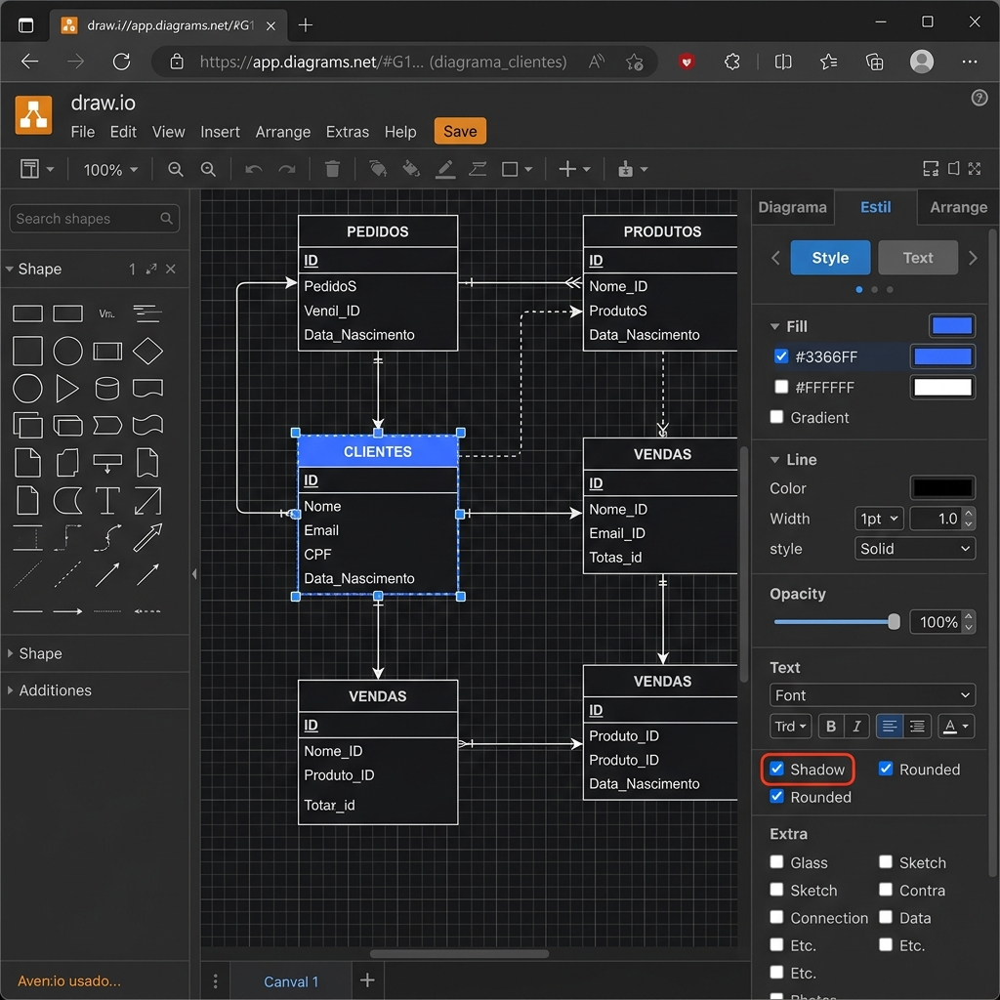

#### **Barra superior — Herramientas principales**

Incluye las herramientas principales de la aplicación:

| Herramienta | Función |
| --- | --- |
| Guardar | Guarda el diagrama actual |
| Deshacer | Deshace la última acción |
| Rehacer | Rehace una acción deshecha |
| Zoom | Acerca o aleja la vista |
| Exportar | Exporta a imagen o PDF |
| Imprimir | Imprime el diagrama |

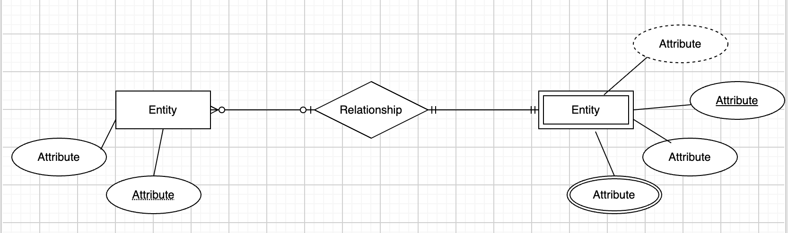

### **Paso 4 · Crear una tabla**

Para crear una tabla en draw.io seguimos estos pasos:

1. En el **panel izquierdo**, desplegamos la sección **Entidad Relación** (o buscamos "Entity" en el buscador).

1. **Arrastramos** una forma de tabla al lienzo central.

1. **Hacemos doble clic** sobre el nombre de la tabla para editarlo.

1. Escribimos el nombre de nuestra tabla y los atributos.

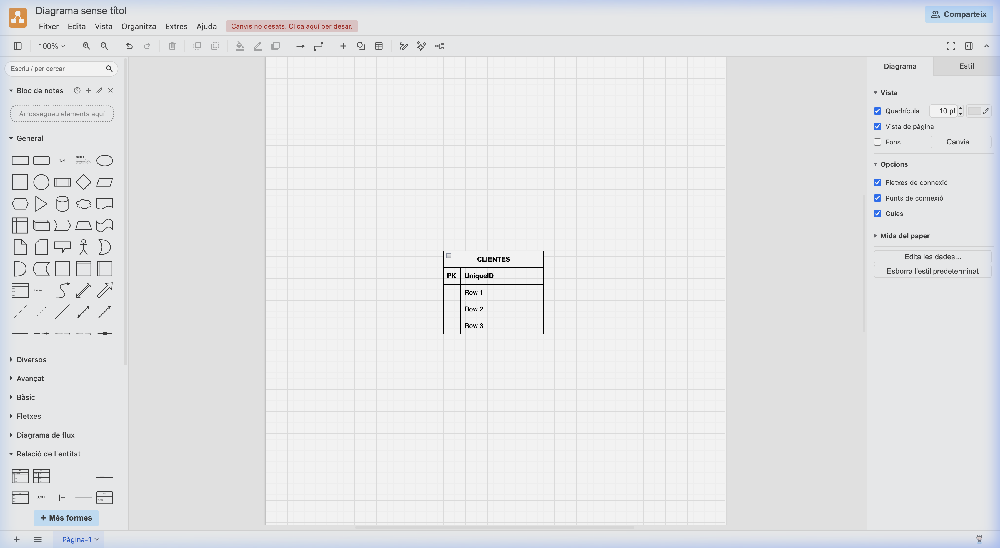

> **📌 Ejemplo: tabla CLIENTES**
> 

```sql
CLIENTES
─────────────────
PK │ id_cliente
   │ nombre
   │ apellidos
   │ telefono
   │ email
```

### **Paso 5 · Crear varias tablas**

Para diseñar un modelo completo, repetimos el proceso anterior para cada tabla que necesitemos. Es importante **distribuir las tablas** con suficiente espacio entre ellas para que las relaciones se visualicen con claridad.

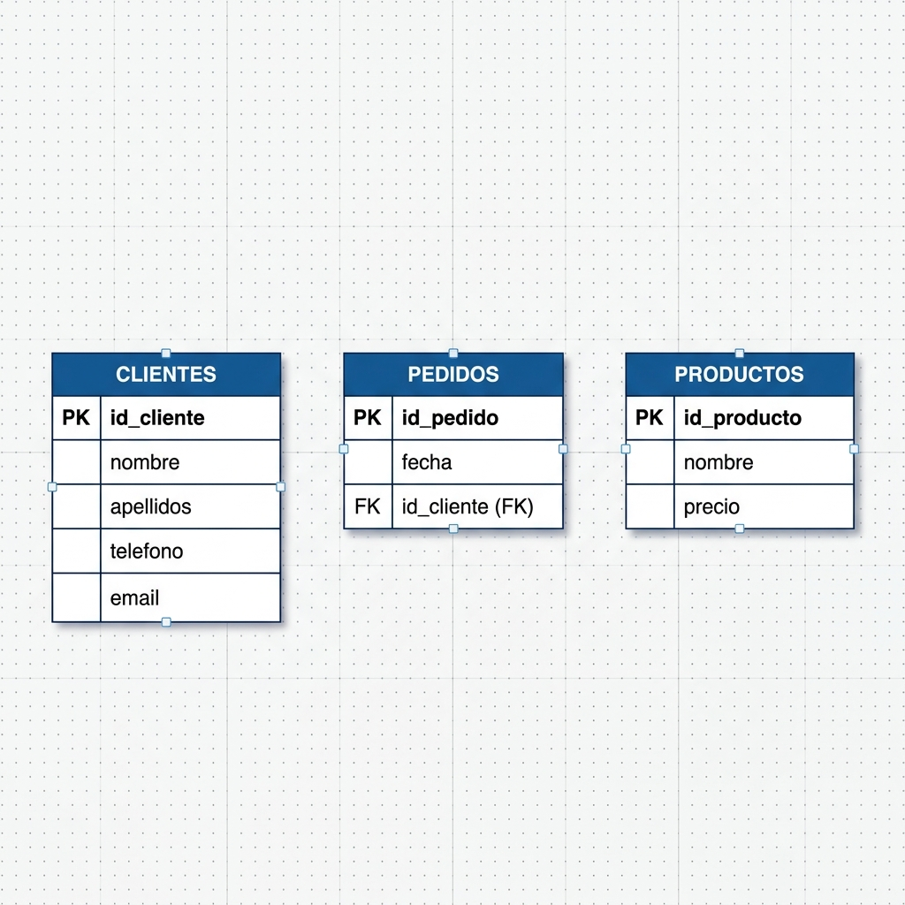

> **📌 Ejemplo: tres tablas de una tienda online**
> 

```sql
CLIENTES                 PEDIDOS                  PRODUCTOS
─────────────────        ─────────────────        ─────────────────
PK │ id_cliente          PK │ id_pedido           PK │ id_producto
   │ nombre                 │ fecha                  │ nombre
   │ apellidos           FK │ id_cliente             │ precio
   │ telefono
   │ email
```

### **Paso 6 · Crear relaciones entre tablas**

Para conectar dos tablas y representar una relación:

1. **Seleccionamos** una tabla haciendo clic sobre ella.

1. Aparecerán unas **pequeñas flechas azules** en los bordes.

1. **Arrastramos** una de ellas hacia otra tabla — se crea automáticamente un conector.

1. 

Una vez creada la relación, podemos personalizar:

| Propiedad | Descripción |
| --- | --- |
| Grosor | Ancho de la línea de conexión |
| Tipo de flecha | Punta de flecha o sin flecha |
| Color | Color de la línea |
| Tipo de línea | Continua, discontinua, punteada |
| Etiquetas | Texto sobre la línea (1:N, N:M, etc.) |

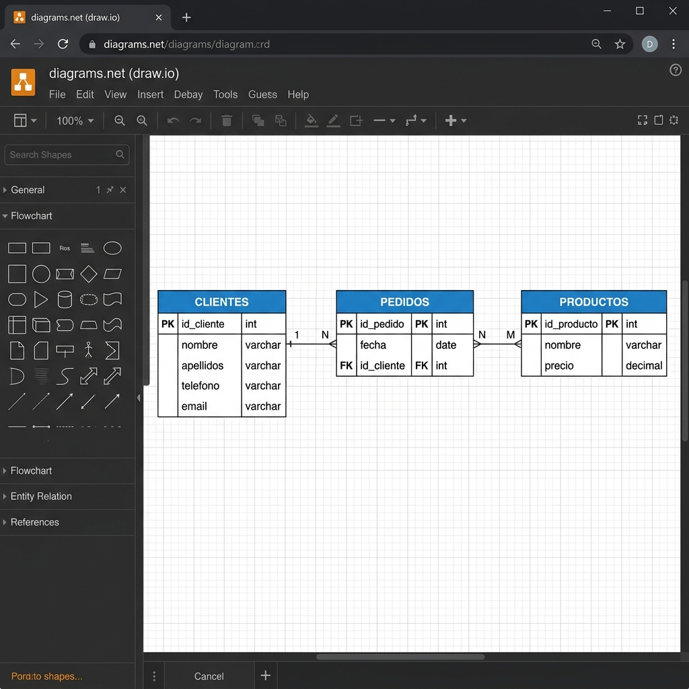

> **📌 Consejo**
> 

> Es recomendable añadir **etiquetas de cardinalidad** (1:1, 1:N, N:M) sobre las líneas de relación para que el diagrama sea más informativo.

### **Paso 7 · Organizar el diagrama**

Un buen diagrama debe ser **claro, limpio y profesional**. Para conseguirlo, debemos seguir estas buenas prácticas:

| Regla | Descripción |
| --- | --- |
| No cruzar líneas | Evitar que las líneas de relación se crucen entre sí |
| Alinear tablas | Mantener las tablas alineadas horizontal o verticalmente |
| Separación adecuada | Dejar suficiente espacio entre tablas |
| Tamaños similares | Utilizar dimensiones consistentes en todas las tablas |
| Nombres legibles | Asegurarse de que todos los textos se lean con claridad |

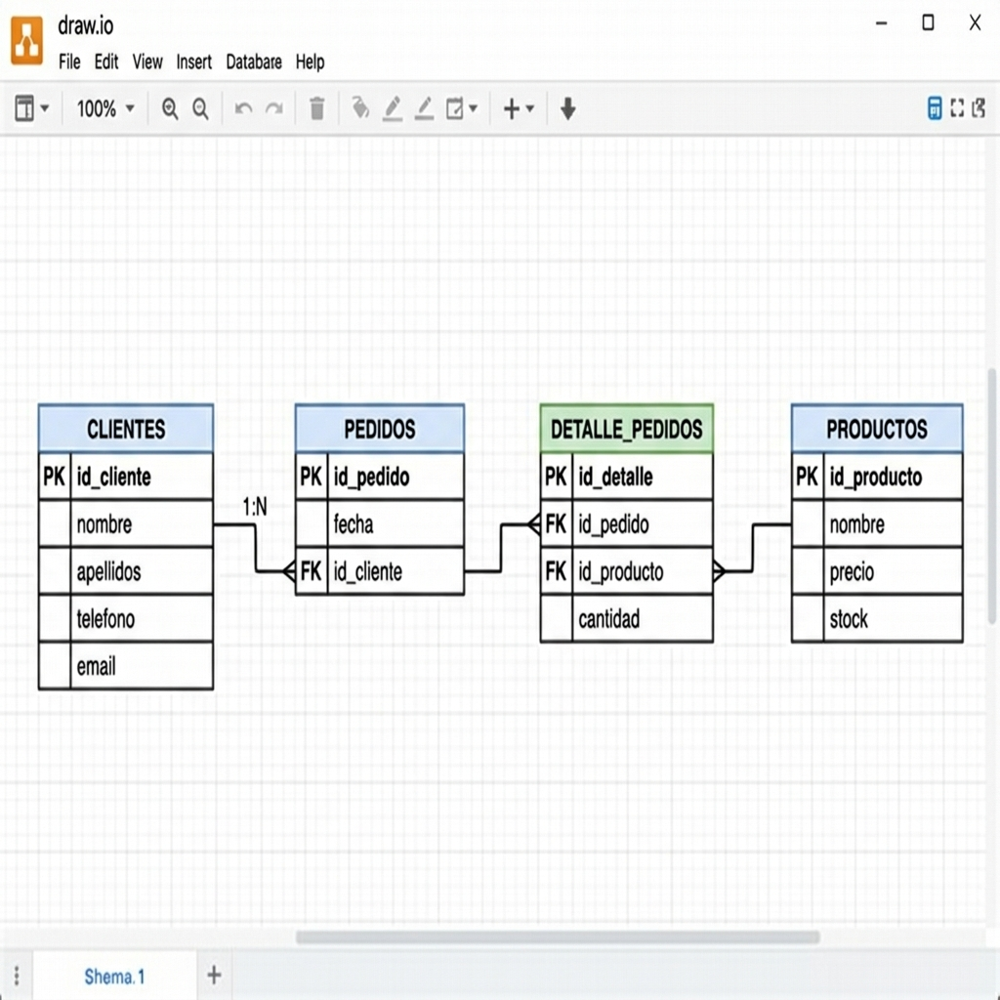

> **📌 Importante**
> 

> Un diagrama desordenado con líneas cruzadas y tablas mal alineadas dificulta enormemente su comprensión. **Dedicar tiempo a organizar el diagrama es tan importante como diseñarlo correctamente.**

### **Paso 8 · Exportar el diagrama**

Una vez terminado el diagrama, podemos exportarlo para incluirlo en documentación, presentaciones o entregas de actividades.

Para exportar, vamos a: **Archivo → Exportar como**

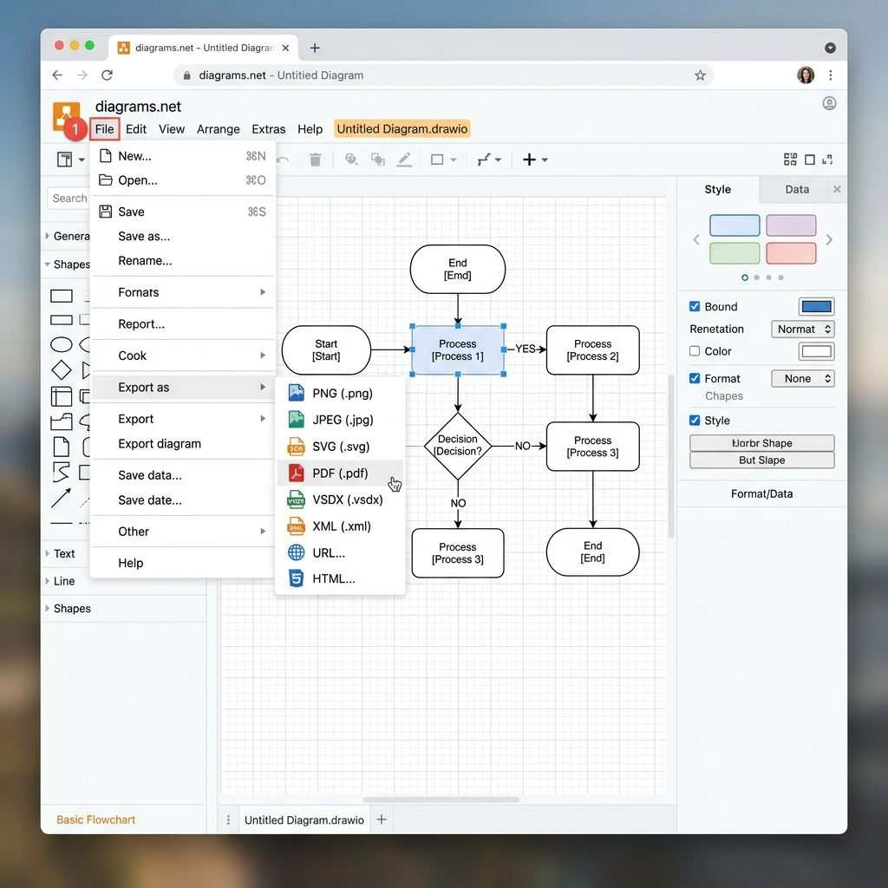

Los **formatos disponibles** son:

| Formato | Extensión | Uso recomendado |
| --- | --- | --- |
| **PNG** | `.png` | El más utilizado. Ideal para entregas y documentación |
| **JPEG** | `.jpg` | Imágenes con fondos fotográficos |
| **SVG** | `.svg` | Gráficos vectoriales escalables (webs, presentaciones) |
| **PDF** | `.pdf` | Documentos formales y presentaciones |
| **XML** | `.xml` | Intercambio de datos entre aplicaciones |

> **📌 Recomendación**
> 

> Para entregar actividades, el formato **PNG** suele ser la mejor opción por su compatibilidad universal y buena calidad.

### **Paso 9 · Guardar el proyecto**

Draw.io guarda los proyectos en su formato nativo con la extensión:

```sql
.drawio
```

Este archivo permite **abrir y modificar** el diagrama en cualquier momento. Al guardarlo por primera vez, se abrirá un diálogo para elegir el nombre y la ubicación del archivo.

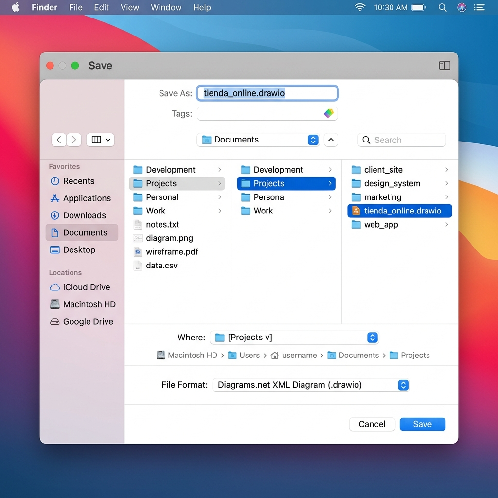

> **📌 ¡No olvides guardar el archivo .drawio!**
> 

> Nunca debemos entregar **únicamente** una imagen exportada. Es fundamental conservar también el archivo `.drawio` para poder **editar** el diagrama en el futuro.

> Siempre debemos entregar **ambos archivos**: la imagen exportada (`.png`) y el proyecto editable (`.drawio`).

## **Ejemplo completo de trabajo**

Vamos a ver un ejemplo completo paso a paso. Supongamos que debemos diseñar la base de datos de una **tienda online**.

### **Identificar las tablas necesarias**

Analizamos el problema y determinamos que necesitamos las siguientes tablas:

| Tabla | Descripción |
| --- | --- |
| **CLIENTES** | Almacena los datos de los clientes |
| **PEDIDOS** | Registra los pedidos realizados |
| **DETALLE_PEDIDOS** | Detalla los productos de cada pedido |
| **PRODUCTOS** | Contiene el catálogo de productos |

### **Definir los atributos de cada tabla**

```sql
CLIENTES                    PEDIDOS
─────────────────           ─────────────────
PK │ id_cliente             PK │ id_pedido
   │ nombre                    │ fecha
   │ apellidos              FK │ id_cliente
   │ telefono
   │ email

DETALLE_PEDIDOS             PRODUCTOS
─────────────────           ─────────────────
PK │ id_detalle             PK │ id_producto
FK │ id_pedido                 │ nombre
FK │ id_producto               │ precio
   │ cantidad                  │ stock
```

### **Crear las tablas en draw.io**

Arrastramos las formas de tabla desde el panel izquierdo y completamos los datos de cada una.

### **Establecer las relaciones**

| Relación | Tipo | Descripción |
| --- | --- | --- |
| CLIENTES → PEDIDOS | 1:N | Un cliente puede realizar muchos pedidos |
| PEDIDOS → DETALLE_PEDIDOS | 1:N | Un pedido puede tener muchos detalles |
| PRODUCTOS → DETALLE_PEDIDOS | 1:N | Un producto puede aparecer en muchos detalles |

### **Organizar y exportar**

Finalmente, organizamos el diagrama, lo exportamos como **PNG** y guardamos el archivo `.drawio`.


## **Buenas prácticas**

Para crear diagramas profesionales y de calidad, es importante seguir estas recomendaciones:

| # | Práctica | Descripción |
| --- | --- | --- |
| 1 | **Nombres claros** | Utilizar nombres descriptivos para las tablas (en MAYÚSCULAS) |
| 2 | **Atributos en minúsculas** | Escribir los nombres de los atributos en minúsculas con guiones bajos |
| 3 | **Clave primaria identificada** | Marcar claramente la clave primaria (PK) en cada tabla |
| 4 | **Claves ajenas identificadas** | Marcar las claves ajenas (FK) y su tabla de referencia |
| 5 | **Distribución ordenada** | Mantener las tablas alineadas y con espacio suficiente |
| 6 | **Guardar periódicamente** | Guardar el trabajo frecuentemente para no perder cambios |
| 7 | **Conservar el .drawio** | Guardar siempre el archivo del proyecto junto con la imagen exportada |
