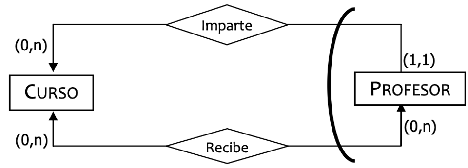
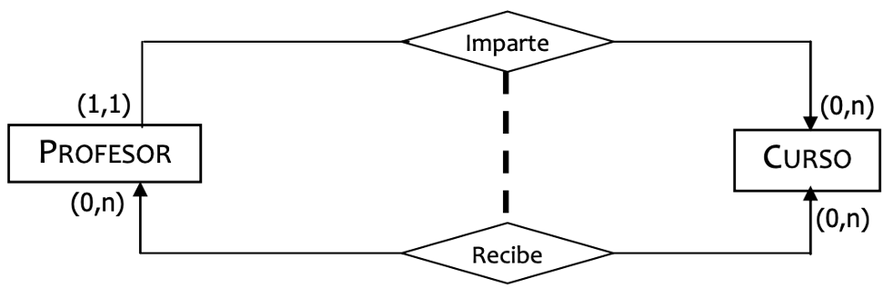
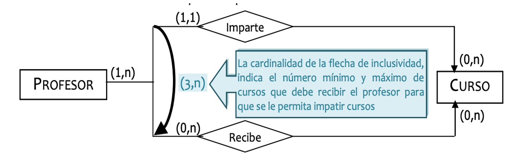
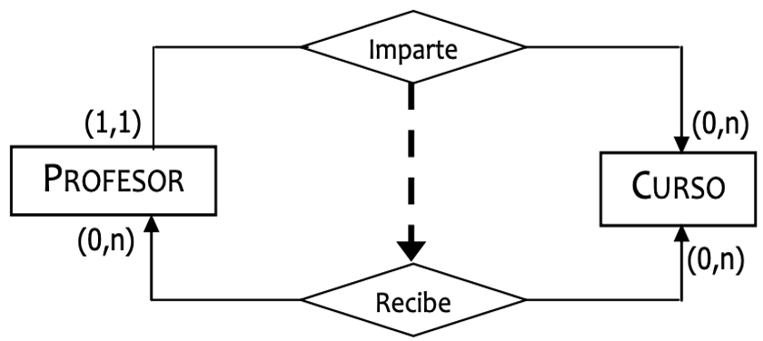

# **Restricciones sobre relaciones**

Las **restricciones sobre relaciones** permiten expresar **reglas de negocio** que no pueden representarse únicamente mediante las cardinalidades mínima y máxima.

Mientras que las cardinalidades indican **cuántas veces puede participar una entidad en una relación**, estas restricciones establecen **cómo se relacionan varias relaciones entre sí** cuando comparten una o varias entidades.

Gracias a ellas es posible modelar situaciones reales como:

- Un empleado que no puede ser simultáneamente jefe y subordinado.

- Un alumno que debe estar matriculado para poder solicitar una beca.

- Un vehículo que solo puede estar alquilado o vendido, pero nunca ambas cosas al mismo tiempo.

Las cuatro restricciones principales son:

- Restricción de Exclusividad.

- Restricción de Exclusión.

- Restricción de Inclusividad.

- Restricción de Inclusión.

## **Restricción de Exclusividad**

La **restricción de exclusividad** se produce cuando **dos o más relaciones comparten una misma entidad** y **cada ocurrencia de esa entidad únicamente puede participar en una de ellas**.

Es decir, una vez que una ocurrencia participa en una relación, **queda excluida de participar en las demás relaciones afectadas por la restricción**.

Esta restricción afecta **a la entidad**, no a la combinación de entidades.

> **📌 Ejemplo 1**
> 

> En una universidad existe la entidad **Profesor** y dos relaciones:

> - **Dirige Departamento**

> - **Es Profesor Asociado**

> Un profesor puede ser **director de un departamento** o **profesor asociado**, pero nunca ambas cosas al mismo tiempo.

Cada profesor solo puede aparecer en una de las dos relaciones.

> **📌 Ejemplo 2**
> 

> Una **Cuenta Bancaria** puede encontrarse en uno de los siguientes estados:

> - **Activa**

> - **Bloqueada**

> Una cuenta únicamente puede estar en uno de esos estados.

## **Restricción de Exclusión**

La **restricción de exclusión** afecta **a un par de ocurrencias**, una de cada entidad que participan en varias relaciones.

Esto significa que **la misma pareja de entidades no puede aparecer simultáneamente en dos relaciones distintas**.

A diferencia de la exclusividad, aquí una entidad puede participar en ambas relaciones, pero **no con la misma combinación de entidades**.

> **📌 Ejemplo 1**
> 

> Entre **Empleado** y **Proyecto** existen las relaciones:

> - **Dirige**

> - **Participa**

> Si el empleado **Juan** dirige el **Proyecto A**, esa misma pareja no podrá aparecer también en la relación **Participa**, aunque Juan sí pueda participar en otros proyectos.

| Empleado | Proyecto | Relación |
| --- | --- | --- |
| Juan | Proyecto A | Dirige ✅ |
| Juan | Proyecto A | Participa ❌ |

> **📌 Ejemplo 2**
> 

> Entre **Médico** y **Paciente** existen las relaciones:

> - **Atiende**

> - **Supervisa**

> Si la médica **Ana** supervisa al paciente **Carlos**, esa misma pareja no podrá aparecer también en la relación **Atiende**.

## **Restricción de Inclusividad**

La **restricción de inclusividad** establece que **toda ocurrencia de una entidad que participa en una relación debe participar también en otra relación**.

En este caso la obligación afecta **a la entidad individual**, no a la pareja de entidades.

Es una forma de indicar que una relación **implica necesariamente la existencia de otra**.

> **📌 Ejemplo 1**
> 

> Una empresa dispone de las relaciones:

> - **Empleado → Trabaja en Departamento**

> - **Empleado → Tiene Usuario Informático**

> Todo empleado que tenga un usuario informático debe pertenecer necesariamente a un departamento.

> Puede haber empleados en un departamento sin usuario, pero nunca usuarios sin departamento.

> **📌 Ejemplo 2**
> 

> En una universidad existen las relaciones:

> - **Alumno → Matriculado**

> - **Alumno → Solicita Beca**

> Todo alumno que solicita una beca debe estar previamente matriculado.

## **Restricción de Inclusión**

La **restricción de inclusión** afecta **a la combinación de dos entidades**.

Un par de ocurrencias solo puede pertenecer a una relación **si esa misma pareja ya pertenece a otra relación**.

Es decir, una relación queda **contenida dentro de otra**.

> **📌 Ejemplo 1**
> 

> Entre **Alumno** y **Asignatura** existen las relaciones:

> - **Matriculado**

> - **Examinado**

> Un alumno solo puede ser examinado de una asignatura si previamente está matriculado en esa misma asignatura.

| Alumno | Asignatura | Matriculado | Examinado |
| --- | --- | --- | --- |
| Laura | Bases de Datos | ✅ | ✅ |
| Pedro | Programación | ❌ | ❌ |

> **📌 Ejemplo 2**
> 

> Entre **Cliente** y **Producto** existen las relaciones:

> - **Compra**

> - **Devuelve**

> Un cliente únicamente puede devolver un producto si previamente ha comprado ese mismo producto.

## **Resumen de las restricciones**

| Restricción | ¿Sobre qué actúa? | Significado | Ejemplo |
| --- | --- | --- | --- |
| **Exclusividad** | Una entidad | Una ocurrencia solo puede participar en una de las relaciones. | Un profesor es director **o** profesor asociado. |
| **Exclusión** | Un par de entidades | La misma pareja no puede aparecer en dos relaciones distintas. | Un empleado dirige un proyecto **o** participa en él. |
| **Inclusividad** | Una entidad | Participar en una relación obliga a participar también en otra. | Todo alumno con beca debe estar matriculado. |
| **Inclusión** | Un par de entidades | Una pareja solo puede estar en una relación si ya pertenece a otra. | Un cliente solo puede devolver un producto que ha comprado. |

> **📌 Cómo recordar fácilmente estas restricciones**
> 

> **Exclusividad** e **Inclusividad** hablan de **una única entidad**.

> - Un profesor.

> - Un alumno.

> - Un empleado.

> **Exclusión** e **Inclusión** hablan de **una pareja de entidades**.

> - Alumno–Asignatura.

> - Cliente–Producto.

> - Empleado–Proyecto.

### Regla mnemotécnica

> - **"...una entidad..."** → **Exclusividad** / **Inclusividad**

> - **"...una pareja de entidades..."** → **Exclusión** / **Inclusión**

> **📌 Diferencia entre Exclusividad y Exclusión**
> 

> Aunque sus nombres son muy parecidos, existe una diferencia importante:

> - **Exclusividad** impide que **una entidad** participe en varias relaciones.

> - **Exclusión** impide que **la misma pareja de entidades** aparezca en varias relaciones.

> **📌 Diferencia entre Inclusividad e Inclusión**
> 

> También conviene distinguir estos dos conceptos:

> - **Inclusividad** obliga a que **una entidad** participe en otra relación.

> - **Inclusión** obliga a que **la misma pareja de entidades** exista previamente en otra relación.
