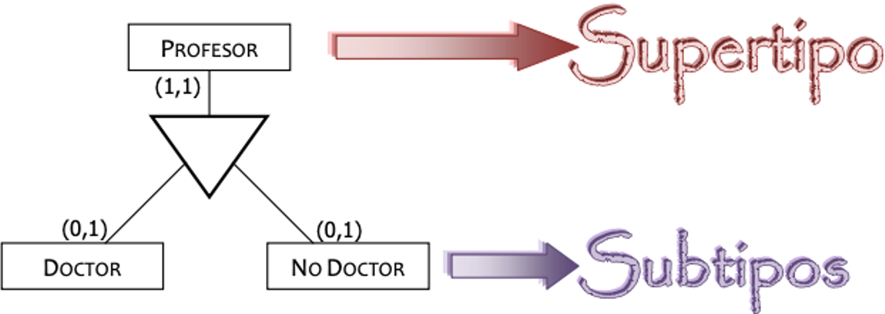
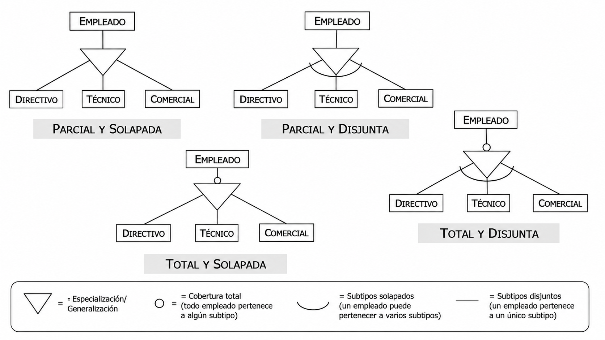
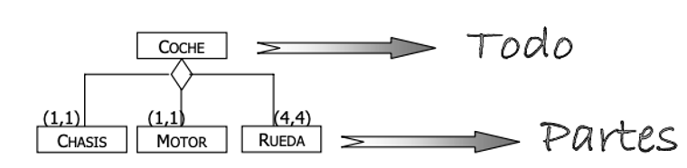
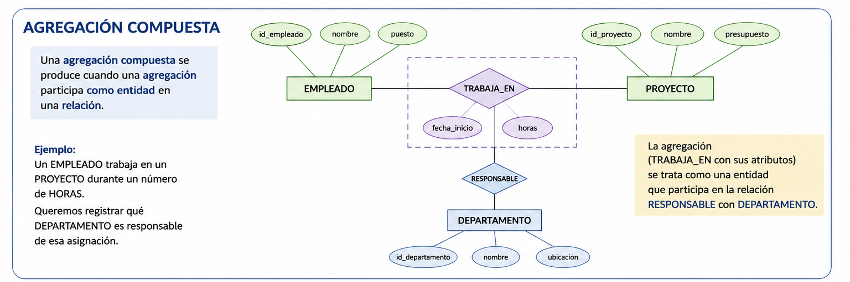
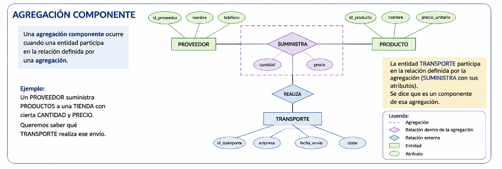
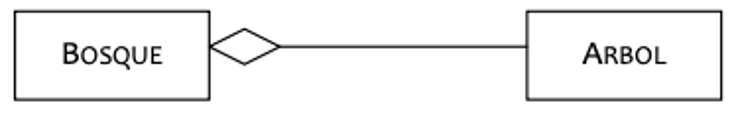
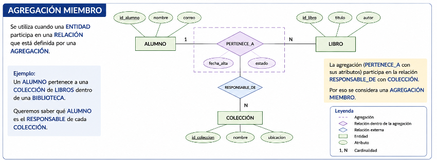
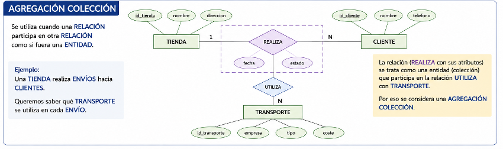

# 2.6 Model Entitat-Relació Estès (EER): Jerarquies, Especialització i Agregació

Con el paso de los años, y dadas ciertas carencias del modelo entidad relación, a mediados de los años 80 se extendió con la incorporación de los conceptos de clase y subclase, junto con los conceptos de generalización y especialización, así como la agregación de entidades, dando lugar al m**odelo Entidad Relación Extendido (EER)**.

## **Generalización/Especialización**

La jerarquía de Generalización/Especialización, en el Modelo E/R, se considera como un caso especial de relación entre varias entidades Subtipo (subclases o entidades hijas) y una entidad más general Supertipo (Superclase o entidad padre) cuyas características son comunes a todos los subtipos.

- La **entidad Supertipo** modela las características comunes de la entidad vista de una forma genérica.

- Las **entidades Subtipo** modelan las características propias de sus especializaciones.

Es necesario que se cumpla que toda ocurrencia de una entidad subclase sea també una ocurrencia de su entidad superclase, propagando sus características de padres a hijos, lo que se denomina herencia de propiedades.

La aparición de estas jerarquías en el modelado de bases de dades puede surgir de dos formas diferentes:

- **Generalización**: Se observa que dos o más entidades comparten diversos atributos y/o relaciones, de donde se deduce la existencia de una especie de entidad de nivel superior (supertipo) que contiene los atributos y las relaciones comunes a todos los subtipos.

- **Especialización**: Se observa que una entidad tiene ciertos atributos y/o relaciones que tienen sentido para unas ocurrencias pero no para otras, por lo que es conveniente definir uno o varios subtipos que contengan estos atributos y/o relaciones específicas, dejando en el supertipo los que son comunes.

Tip

Con **generalización** y la **especialización** se establece una relación **ES-UN** (en inglés, IS-A), indicando que una entidad hijo ES-UN con la entidad padre. Per exemple, si la Supertipo es `VEHICULO`, ejemplos de subtipo serían `CAMION`, `AUTOBUS`, `MOTO`, etc... ya que un `CAMION` es un `VEHICULO`.

### **Herencia**

Es la propiedad por la que los atributos y relaciones de un supertipo son heredados por el subtipo.
En este tipo de abstracción los atributos comunes a todos los subtipos (incluidos los identificadores) se asignan al supertipo, mientras que los atributos específicos se asocian al subtipo al que pertenecen. Del mismo modo, las interrelaciones que afectan a todos los subtipos se asocian al supertipo, dejándose para los subtipos las interrelaciones específicas en las que sólo participa el correspondiente subtipo.

### **Tipos**

Cuando definimos una especialización es muy importante definir cómo se relacionan los Supertipos con los Subtipos. Vamos a centrarnos en un supuesto donde tenemos una supertipo `PROFESOR` y tenemos tres subtipos: `NUMERARIO`, `NO NUMERARIO` y `COMERCIAL`.

Si nos centramos en la cantidad de subtipos posibles tenemos:

- **Total**: El supretipo pertenece obligatoriamente a alguno de los subtipos. No puede haber un `EMPLEADO` que no sea ni `DIRECTIVO`, ni `TECNICO`, ni `COMERCIAL`. Se representa incluyendo un cirulo (`o`) al final de la línea que relaciona el triangulo con la entidad.

- **Parcial**: El supertipo puede no pertenecer a alguna de los subtipos. Podríamos tener un `EMPLEADO` que no sea ni `DIRECTIVO`, ni `TECNICO`, ni `COMERCIAL`. Se representa sin indicar nada en el modelo.

Y si ponemos en foco en la exclusividad de las subclases:

- **Disjunta / Exclusiva**: El supertipo sólo pertenece a uno de los subtipos. Si un `EMPLEADO` es un `DIRECTIVO`, no puede ser un `TECNICO` ni un `COMERCIAL`. Se representa uniendo las líneas que relacionan los subtipos con el triangulo de la especialización.

- **Solapada**: El supertipo puede pertenecer a varios de los subtipos a la vez. Un `EMPLEADO` puede ser un `DIRECTIVO` y un `COMERCIAL` a la vez. Se representa sin indicar nada en el modelo.

## **Agregación**

Abstracción que permet representar entidades compuestas que se obtienen por unión de otras simples. Cuando hablamos de la entidad compuesta la denominamos como TODO, mientras que los componentes son las PARTES.

- **Agregación Compuesto/Componente**: Abstracción que permet representar que un todo se obtiene por la unión de varias partes que pueden ser tipos de objetos diferentes y que desempeñan diferentes papeles en la agregación.

Ejemplo01Ejemplo02Ejemplo03

- **Agregación Miembro/Colección**: Abstracción que permet representar un todo como una colección de partes, donde todas las partes son de un mismo tipo y desempeñan el mismo papel. També se le conoce como asociación y en muchos casos, viene representada como una relación normal pero exigiendo una cardinalidad mínima que determina el número de miembros necesarios para establecer la asociación o colección.

Ejemplo01Ejemplo02Ejemplo03

