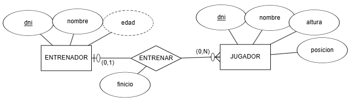
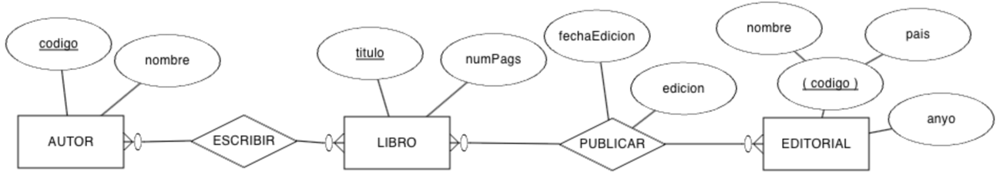
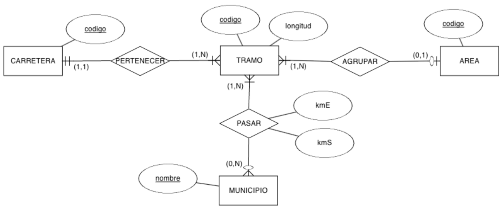
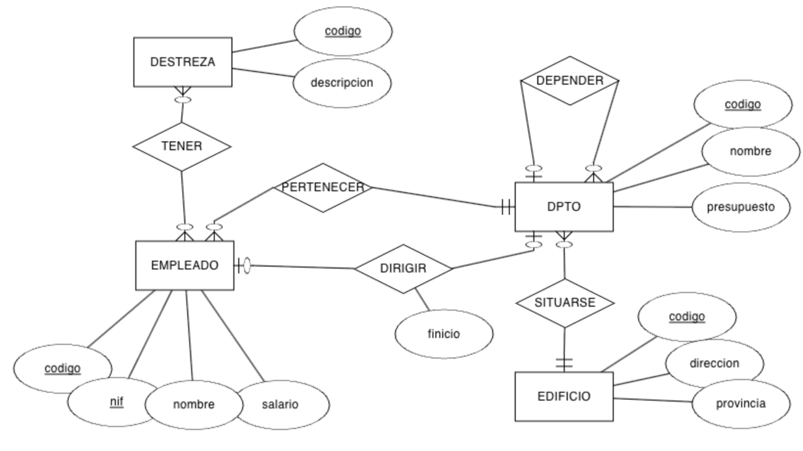
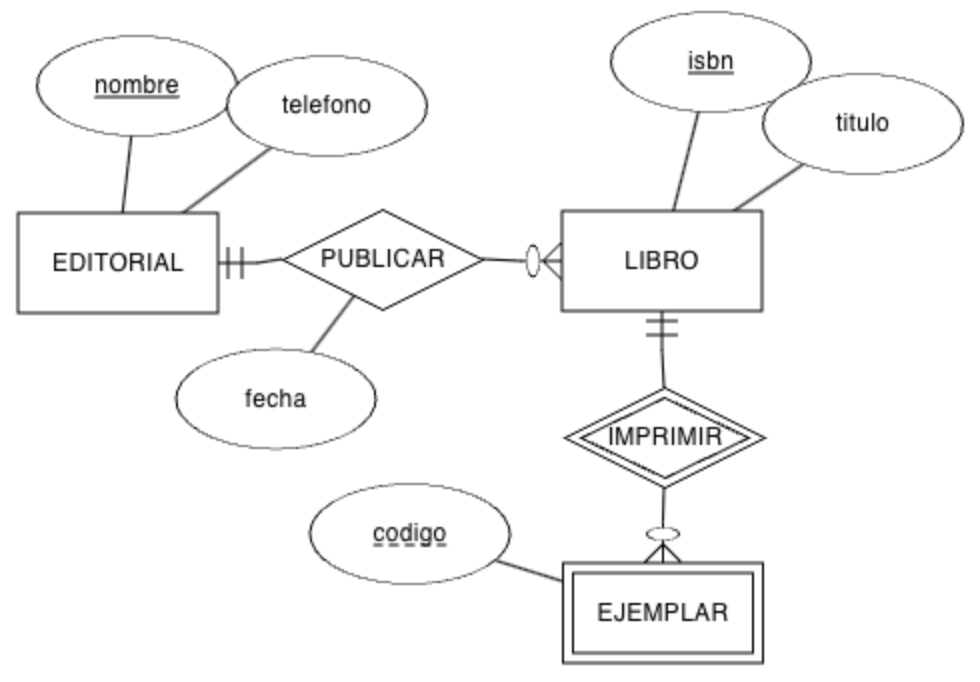
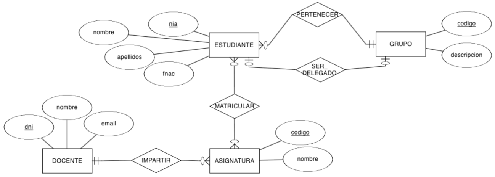
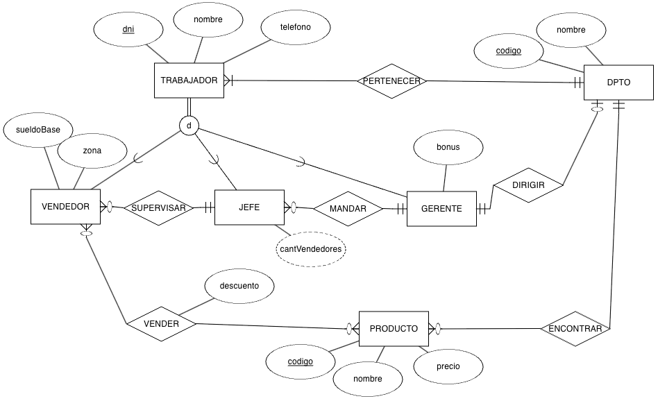
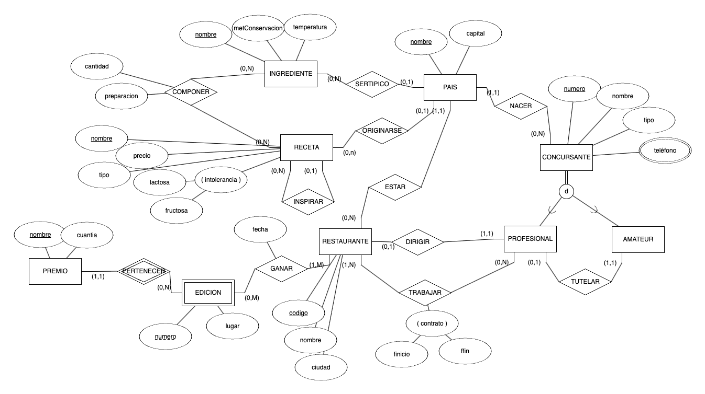

# **Activitat 302**

<div class="interactive-progress-tracker">
  <div class="tracker-header">
    <span>🏆 <strong>Progrés d'aquesta secció:</strong> <span class="tracker-count">0 de 4 superats (0%)</span></span>
    <span class="tracker-pts">⭐ <strong>0 punts</strong></span>
  </div>
  <div class="tracker-bar">
    <div class="tracker-fill" style="width: 0%;"></div>
  </div>
</div>

> **📌 Lliurament**
> 

> - El lliurament serà un **fitxer pdf** que continga la resposta a les preguntes de l'activitat.

> - El nom del fitxer ha de ser `302_NombreApellidos.pdf`.

> - S'haurà de lliurar en la tasca corresponent d'Aules en temps i forma.

> **📌 Es valorarà**
> 

> Es valorarà:

> - La claredat de la resposta.

> - La correcta maquetació del document.

> - Resposta correcta o aproximació a aquesta.

> Aquesta activitat servirà per a qualificar:

> - RA6: Dissenya models relacionals normalitzats interpretant diagrames entitat/relació.

>   - CE6. a) S'han utilitzat eines gràfiques per a representar el disseny lògic. (5%)

>   - CE6. b) S'han identificat les taules del disseny lògic. (5%)

>   - CE6. c) S'han identificat els camps que formen part de les taules del disseny lògic. (5%)

>   - CE6. d) S'han analitzat les relacions entre les taules del disseny lògic. (5%)

>   - CE6. e) S'han identificat els camps clau. (5%)

> **📌 Recorda**
> 

> Per a passar d'un **diagrama E/R** al **model relacional** has d'aplicar les regles de transformació estudiades en classe:

> - Cada **entitat** es transforma en una **taula**.

> - Les relacions **N:M** es converteixen en **taules d'unió** amb la seua clau composta.

> - Les relacions **1:N** es resolen afegint la **clau forana** en el costat del *molts*.

> - Les relacions **1:1** es resolen afegint la **clau forana** (que a més és **clau alternativa**).

## **Exercici 1**

Suposem el següent model E/R on representamos un sistema d'informació on modelamos les dades d'un **entrenador** i els **jugadors** d'un equip de baloncesto. De moment, només modelamos la relació entre l'entrenador i els jugadors:



Obtingues el **esquema relacional** i, a continuació, **dibuixa el model relacional**.

## **Exercici 2**

Sobre l'exercici anterior, anem a afegir l'entitat **EQUIP** amb el nom del mateix, el seu logotipo, adreça i any de creació. Clarament, **cada equip només té un únic entrenador**, i **un entrenador només pot serlo d'un equip**.

Es demana:

1. Modifica el model E/R per a afegir la nova entitat i la relació necessària.

1. Modifica el model relacional a partir del nou model E/R.

## **Exercici 3**

Tenim el següent model E/R que representa les diferents **edicions** que d'un llibre publica una **editorial**, i els **autors** que escriuen els llibres:



Obtingues el **esquema relacional** i completa el **diccionari de dades**.

## **Exercici 4**

Realitza el **esquema lògic** mitjançant un **model relacional** del següent model E/R:



## **Exercici 5**

Tenim el següent model E/R sobre l'organització d'una **empresa** en **departaments** i les característiques dels seus **empleats**:



Obtingues el **esquema relacional** i indica les **cardinalitats** de les relacions.

## **Exercici 6**

A partir del següent model E/R que conté restriccions de **cardinalitat mínima** i restriccions de **identificació**, es demana:



1. Genera el **model relacional**.

1. Indica les **cardinalitats** de les relacions.

1. Emplena **tres taules** amb dades ficticios (almenys 3 registres per taula), ja siguen dades relacionats o no, conforme consideres.

## **Exercici 7**

Crea el **model relacional** a partir del model conceptual sobre un **centre educativo**:



## **Exercici 8**

Crea el **model relacional** a partir del model conceptual:



## **Exercici 9**

Crea el **model relacional** a partir del model conceptual:



## **Exercici 10**

(RABD.6 // CE6a, CE6e // 3p) A partir dels següents **esquemes lògics**, dibuixa el **model E/R**:

### **Esquema 1**

```sql
A (a0, a1)
· PK: (a0)

B (b0, b1, b2, a0*, c0*)
· PK: (a0)
· FK: (a0) → A
· FK: (c0) → C

C (c0, c1)
· PK: (c0)

M (c0*, m, n)
· PK: (c0, m)
· FK: (c0) → C
```

### **Esquema 2**

```sql
A (a0, a1, bo*)
· PK: (a0)
· UK: (b0)
· VNN: (b0)
· FK: (b0) → B

B (b0, b1)
· PK: (b0)

C (b0*, a0*, c0)
· PK: (b0, a0)
· FK: (b0) → B
· FK: (a0) → A
· VNN: (c0)
```

## **Exercici 11**

(RABD.6 // CE6a, CE6e // 3p) A partir del següent **model relacional**, dibuixa el **diagrama E/R**:

```sql
EMPLEADO (num, dni, nombre, direccion, banco)
· PK: (num)
· UK: (dni)

MEDICO (num*, espec, anyo)
· PK: (num)
· FK: (num) → EMPLEADO

SOCIO (num*, dniS, fechaNac, medicoChequeo*, fechaChequeo, resultadoChequeo)
· PK: (num)
· UK: (dniS)
· FK: (num) → EMPLEADO
· FK: (medicoChequeo) → MEDICO

TAQUILLA (nun, estado, tamaño)
· PK: (nun)

FIJA (num*, socio*)
· PK: (num)
· FK: (num) → TAQUILLA
· FK: (socio) → SOCIO

DIARIA (num*, socio*)
· PK: (num)
· FK: (num) → TAQUILLA
· FK: (socio) → SOCIO

DISCIPLINA (nombre, descripcion)
· PK: (nombre)

MONITOR (num*, fechaNac, disciplina*)
· PK: (num)
· FK: (num) → EMPLEADO
· FK: (disciplina) → DISCIPLINA

SESION (dia, hora, sala, monitor*, disciplina*)
· PK: (dia, hora, sala)
· FK: (monitor) → MONITOR
· FK: (disciplina) → DISCIPLINA
· VNN: (monitor)
· VNN: (disciplina)

TECNICO (num*)
· PK: (num)
· FK: (num) → EMPLEADO

MODELO (codigo, descripcion, empresas, tecnico*)
· PK: (codigo)
· FK: (tecnico) → TECNICO

APARATO (num, codigo*, fechaAdquisic, estado)
· PK: (num, codigo)
· FK: (codigo) → MODELO
```

## **Exercici 12**

(RABD.6 // CE6a, CE6e // 3p) A partir del següent **model relacional**, dibuixa el **diagrama E/R**:

```sql
EDIFICIO (num, numPlantas, gestor*)
· PK: (num)
· FK: (gestor) → GESTOR

GESTOR (codigo, nombre, apellido1, apellido2, salario, residencia*)
· PK: (codigo)
· FK: (residencia) → EDIFICIO
· UK: (residencia)

INSPECTOR (codigo, nombre)
· PK: (codigo)

SUPERVISAR (codigo*, num*, fUltima, fSiguiente)
· PK: (codigo, num)
· FK: (codigo) → INSPECTOR
· FK: (num) → EDIFICIO

TRABAJADOR (codigo, nombre)
· PK: (codigo)

APARTAMENTO (numA, numE*, dormitorios)
· PK: (numA, numE)
· FK: (numE) → EDIFICIO

LIMPIAR (codigo*, numA*, numE*)
· PK: (codigo, numA, numE)
· FK: (numA, numE) → APARTAMENTO
· FK: (codigo) → TRABAJADOR
```

## **Exercici 13**

A partir del següent **model relacional**:

```sql
EQUIPO (num, fUltimaRevision, fAlta, detalle*)
· PK: (num)
· FK: (detalle) → DETALLE_EQUIPO
· VNN: (detalle)

DETALLE_EQUIPO (codigo, tipo, modelo, fUltimaRevision)
· PK: (codigo)

VENTA (codigo, precio, fecha, equipo*, cliente*, comercial*)
· PK: (codigo)
· FK: (equipo) → EQUIPO
· FK: (cliente) → CLIENTE
· FK: (comercial) → COMERCIAL
· VNN: (equipo)
· VNN: (cliente)
· VNN: (comercial)

ALQUILER (codigo, precio, fecha, equipo*, cliente*, comercial*)
· PK: (codigo)
· FK: (equipo) → EQUIPO
· FK: (cliente) → CLIENTE
· FK: (comercial) → COMERCIAL
· VNN: (equipo)
· VNN: (cliente)
· VNN: (comercial)

CLIENTE (id, nombre, categoría)
· PK: (id)

COMERCIAL (codigo, nombre, apellido1, rango, mentor*)
· PK: (id)
· FK: (mentor) → COMERCIAL
```

Contesta a les següents preguntes **argumentant** les teues respostes:

a. Pot un **EQUIP** tindre més d'un **DETALLE_EQUIPO**?

b. Pot un **COMERCIAL** vendre diversos **EQUIP**?

c. Un **ALQUILER** quants **DETALLE_EQUIPO** tindrà?

d. Pot un **CLIENT** alquilar i vendre el mateix **EQUIP**?

e. Podem averiguar què **COMERCIAL** vendió un determinat **EQUIP**?

f. Una persona pot ser **CLIENT** i **COMERCIAL** alhora?

g. Tot **COMERCIAL** ha de tindre un **mentor**?

h. Un **COMERCIAL** pot tindre diversos mentors o un mentor pot mentoritzar a diversos comercials?


---

## 🎮 Reptes Interactius d'Autoavaluació (+100 XP)

Comprova el teu domini sobre **Activitat 302** superant aquests 4 reptes gamificats (+25 punts cadascun):

<div class="interactive-mcq" data-answer="A" data-hint="La 1FN exigeix que tots els dominis siguen atòmics (sense atributs multivaluats ni compostos dins d'una columna).">
  <div class="mcq-question">🎯 <strong>Repte 1 (+25 pts):</strong> Quina condició ha de complir una taula per a trobar-se en Primera Forma Normal (1FN)?</div>
  <div class="mcq-options">
    <button type="button" class="btn-mcq-opt" data-opt="A">A) Tots els seus atributs han de contenir valors atòmics (indivisibles), sense grups repetitius ni llistes en una mateixa cel·la.</button>
    <button type="button" class="btn-mcq-opt" data-opt="B">B) Ha de tenir exactament 10 columnes.</button>
    <button type="button" class="btn-mcq-opt" data-opt="C">C) No pot tenir clau primària.</button>
    <button type="button" class="btn-mcq-opt" data-opt="D">D) Ha d'estar emmagatzemada en MongoDB.</button>
  </div>
  <div class="quiz-feedback"></div>
</div>

<div class="interactive-mcq" data-answer="A" data-hint="En una relació 1:N, la taula del costat 'molts' (N) incorpora com a clau forana la clau primària del costat '1'.">
  <div class="mcq-question">🎯 <strong>Repte 2 (+25 pts):</strong> En transformar una relació binària 1:N on el costat N té participació obligatòria (1,1), on es propaga la clau forana?</div>
  <div class="mcq-options">
    <button type="button" class="btn-mcq-opt" data-opt="A">A) La clau primària del costat '1' passa com a clau forana a la taula del costat 'N'.</button>
    <button type="button" class="btn-mcq-opt" data-opt="B">B) La clau del costat 'N' passa al costat '1' creant columnes infinites.</button>
    <button type="button" class="btn-mcq-opt" data-opt="C">C) Sempre es creen 4 taules noves.</button>
    <button type="button" class="btn-mcq-opt" data-opt="D">D) No es posa cap clau forana.</button>
  </div>
  <div class="quiz-feedback"></div>
</div>

<div class="interactive-vf" data-answer="V" data-hint="La 2FN elimina les dependències funcionals parcials respecte a una part d'una clau primària composta.">
  <div class="vf-statement">✅ <strong>Repte 3 (Vertader o Fals · +25 pts):</strong> La Segona Forma Normal (2FN) exigeix que la taula estiga en 1FN i que tots els atributs que no són clau depenguen de forma completa (total) de tota la clau primària composta.</div>
  <div class="vf-buttons">
    <button type="button" class="btn-vf" data-opt="V">Vertader (V)</button>
    <button type="button" class="btn-vf" data-opt="F">Fals (F)</button>
  </div>
  <div class="quiz-feedback" style="width: 100%;"></div>
</div>

<div class="interactive-quiz" data-answer="tupla|tuples" data-hint="En el model relacional formal, les files s'anomenen tuples.">
  <div class="quiz-question">⌨️ <strong>Repte 4 (+25 pts):</strong> Com s'anomena cada fila o registre d'una relació (taula) en la terminologia formal del model relacional?</div>
  <div class="quiz-controls">
    <input type="text" class="quiz-input" placeholder="Escriu la resposta..." />
    <button type="button" class="btn-quiz-check">Comprovar</button>
  </div>
  <div class="quiz-feedback"></div>
</div>

### 📋 Llista de Comprovació i Rúbrica d'Assoliment

Marca cada criteri a mesura que completes l'estudi o la resolució pràctica d'aquesta pàgina (**Activitat 302**):

- [ ] He llegit detingudament la teoria o l'enunciat d'aquesta secció i he anotat els conceptes clau.
- [ ] He revisat els esquemes, taules o blocs de codi i he verificat que sé aplicar-los a l'entorn de treball.
- [ ] He resolt correctament els **4 reptes interactius** superiors obtenint els **100 punts XP**.
- [ ] He descarregat el comprovant oficial en PDF per a adjuntar-lo a la tasca d'**Aules**.

<div class="aules-delivery-card">
  <h3>📤 Comprovant de Lliurament per a Aules</h3>
  <p>Quan hages completat els reptes interactius i la llista d'autoavaluació d'aquesta pàgina, introdueix el teu nom i descarrega el teu certificat oficial en PDF per a adjuntar-lo a la tasca d'<strong>Aules</strong>.</p>
  <div class="aules-student-field">
    <label for="aules-student-name">👤 Nom i Cognoms de l'Alumne/a:</label>
    <input type="text" id="aules-student-name" class="aules-student-name" placeholder="Ex: Joan Garcia Pérez" />
  </div>
  <div class="aules-score-badge">
    <span class="aules-score-count">0/4 reptes completats (0%) · 0 punts · 0/4 criteris d'autoavaluació</span>
  </div>
  <div class="aules-actions">
    <button type="button" class="btn-aules-dl" data-module="BBDD" data-unit="UD03" data-activity="act302">📥 Descarregar Comprovant PDF</button>
    <button type="button" class="btn-aules-copy">📋 Copiar Resum al Porta-retalls</button>
  </div>
  <div class="aules-toast"></div>
</div>
