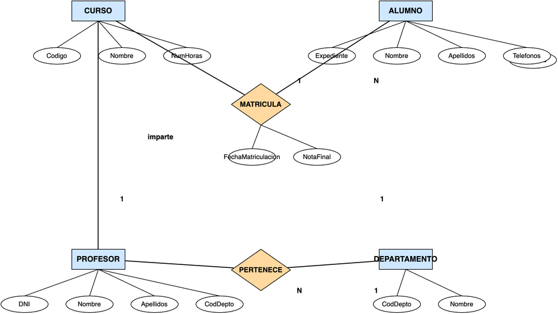
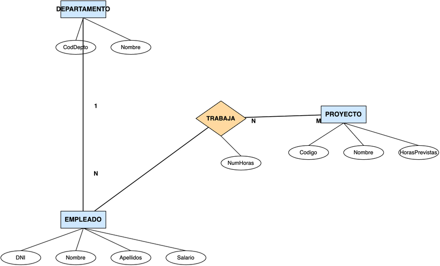
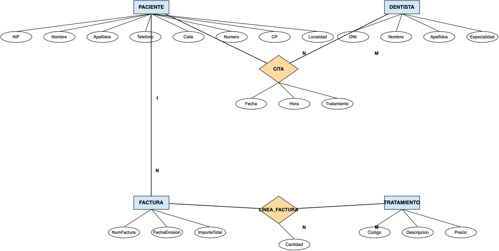
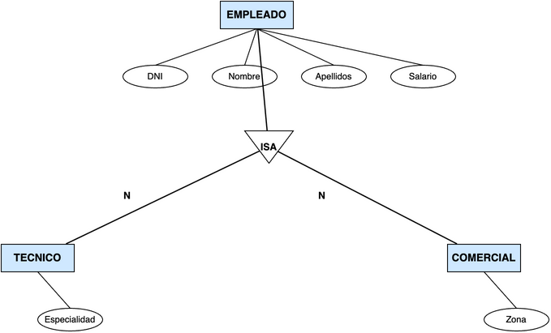

# **Actividad 305**

  

    🏆 <strong>Progreso de esta sección:</strong> 0 de 4 superados (0%)
    ⭐ <strong>0 puntos</strong>
  

  

    

  

> **📌 Entrega**
> 

> - La entrega será un **fichero pdf** que contenga la respuesta a las preguntas de la actividad.

> - El nombre del fichero debe ser `305_NombreApellidos.pdf`.

> - Se deberá entregar en la tarea correspondiente de Aules en tiempo y forma.

> **📌 Se valorará:**
> 

> Es valorarà:

> - La claridad de la respuesta.

> - La correcta maquetación del documento.

> - Respuesta correcta o aproximación a esta.

> Esta actividad servirá para calificar:

> - RA6: Dissenya models relacionals normalitzats interpretant diagrames entitat/relació.

>   - CE6. a) S'han utilitzat eines gràfiques per a representar el disseny lògic. (5%)

>   - CE6. b) S'han identificat les taules del disseny lògic. (5%)

>   - CE6. c) S'han identificat els camps que formen part de les taules del disseny lògic. (5%)

>   - CE6. d) S'han analitzat les relacions entre les taules del disseny lògic. (5%)

>   - CE6. e) S'han identificat els camps clau. (5%)

>   - CE6. f) S'han aplicat regles d'integritat. (5%)

>   - CE6. g) S'han aplicat regles de normalització. (5%)

>   - CE6. h) S'han analitzat i documentat les restriccions que no poden plasmar-se en el disseny lògic. (5%)

> **📌 Recorda**
> 

> Aquesta és una activitat **integradora** de tota la unitat. Per a cada exercici hauràs de:

> 1. **Llegir la descripció del model E/R** que acompanya al diagrama.

> 1. **Analitzar el diagrama E/R** i aplicar les regles de transformació vistes en classe.

> 1. **Obtindre el model relacional**, indicant per a cada taula:

>   - **CP**: clau primària.

>   - **CAlt**: claus alternatives, si existeixen.

>   - **CAj**: claus foranes, indicant la taula a la que referencian.

>   - **VNN**: atributs que no poden ser nuls.

> 1. **Normalitzar** les taules quan siga necessari aplicant les 3 Formes normals vistes en classe:

>   - **1FN**: atributs atòmics i files úniques.

>   - **2FN**: dependència funcional completa de la clau primària.

>   - **3FN**: sense dependències transitives.

> 1. **Documentar les restriccions** que no poden plasmar-se en el disseny lògic.

## **Ejercicio 1**

**INSTITUT**

El model E/R representa la gestió d'un **institut**. L'entitat **CURS** s'identifica pel seu **Codigo** i guarda a més el **Nom** i el **NumHoras**. L'entitat **ALUMNE** s'identifica pel seu **Expediente** i guarda **Nom**, **Cognoms** i els **Telefonos** de contacte (diversos per alumne, per això apareix amb doble elipse). Un **alumne** es matricula en **diversos cursos** i en cada **curs** hi ha **diversos alumnes**; aquesta relació N:M es anomena **MATRICULA** i té els seus propis atributs: la **FechaMatriculacion** i la **NotaFinal**. Cada **curs** és impartido per **un únic professor** (relació 1:1 **imparteix**) i un **professor** pertany a **un únic departament**, encara que un **departament** pot tindre **diversos professors** (relació N:1 **PERTANY**). L'entitat **PROFESSOR** s'identifica pel seu **DNI** i guarda **Nom**, **Cognoms** i la **CodDepto** del departament al que pertany. L'entitat **DEPARTAMENT** s'identifica pel seu **CodDepto** i guarda el seu **Nom**.

**Es demana:**

a) Obtindre el **model relacional** corresponent al diagrama E/R, indicant per a cada taula el seu **CP**, **CAlt**, **CAj** i **VNN**.

b) **Normalitzar** la taula d'alumnes per a eliminar l'atribut multivaluat *telefonos*, documentant el procés de 1FN i 2FN.

## **Ejercicio 2**

**EMPRESA**

El model E/R representa la gestió d'una **empresa**. L'entitat **DEPARTAMENT** s'identifica pel seu **CodDepto** i guarda el seu **Nom**. L'entitat **EMPLEAT** s'identifica pel seu **DNI** i guarda **Nom**, **Cognoms** i **Salario**. Un **departament** té **diversos empleats** i cada **empleat** pertany a **un únic departament** (relació N:1). L'entitat **PROJECTE** s'identifica pel seu **Codigo** i guarda el **Nom** i les **HorasPrevistas**. Un **empleat** pot **treballar en diversos projectes** i un **projecte** pot tindre **diversos empleats**; aquesta relació N:M es anomena **TREBALLA** i guarda l'atribut **NumHoras** dedicades per cada empleat a cada projecte.

**Es demana:**

a) Obtindre el **model relacional** corresponent al diagrama E/R, indicant per a cada taula el seu **CP**, **CAlt**, **CAj** i **VNN**.

b) Documentar les **restriccions** que no poden plasmar-se en el disseny lògic. Es sap que:

- Un empleat pot treballar com a màxim en 3 projectes.

- El salario d'un empleat no pot superar els 5.000 €.

- Un departament pot no tindre empleats, però un empleat sempre pertany a un departament.

- Un projecte no pot estar sense empleats.

## **Ejercicio 3**

**CLÍNICA DENTAL**

El model E/R representa la gestió d'una **clínica dental**. L'entitat **PACIENT** s'identifica pel seu **NIF** i guarda **Nom**, **Cognoms**, **Telefono** i la **adreça** descompuesta en **Carrer**, **Numero**, **CP** i **Localitat**. L'entitat **DENTISTA** s'identifica pel seu **DNI** i guarda **Nom**, **Cognoms** i **Especialitat**. Un **pacient** té **diverses citas** i un **dentista** té **diverses citas**; aquesta relació N:M es anomena **CITA** i guarda la **Data**, la **Hora** i el **Tractament** realitzat. Un **pacient** pot tindre **diverses factures** i cada **factura** correspon a **un únic pacient** (relació N:1). L'entitat **FACTURA** s'identifica pel seu **NumFactura** i guarda la **FechaEmision** i el **ImporteTotal**. L'entitat **TRACTAMENT** s'identifica pel seu **Codigo** i guarda la **Descripcion** i el **Preu**. Una **factura** detalla **diversos trataments** i un **tractament** pot aparèixer en **diverses factures**; aquesta relació N:M es anomena **LINEA_FACTURA** i guarda la **Quantitat** de cada tractament en cada factura.

**Es demana:**

a) Obtindre el **model relacional** corresponent al diagrama E/R, indicant per a cada taula el seu **CP**, **CAlt**, **CAj** i **VNN**.

b) Documentar les **restriccions** que no poden plasmar-se en el disseny lògic.

## **Ejercicio 4**

**ESPECIALITZACIÓ**

El model E/R representa la gestió dels **empleats** d'una empresa mitjançant una **especialització**. L'entitat **EMPLEAT** s'identifica pel seu **DNI** i guarda **Nom**, **Cognoms** i **Salario**. Un empleat és de dos tipus possibles: l'entitat **TECNIC** guarda el seu **Especialitat** i l'entitat **COMERCIAL** guarda el seu **Zona**. L'especialització es representa amb el símbol **ISA**.

**Es demana:**

a) Obtindre el **model relacional** corresponent al diagrama E/R amb l'especialització, indicant per a cada taula el seu **CP**, **CAlt**, **CAj** i **VNN**.

b) Indicar en què casos es guardarían les dades de tècnics i comercials en **taules independents** i en què casos es guardarían en la **mateixa taula** que els empleats.

---

## 🎮 Retos Interactivos de Autoevaluación (+100 XP)

Comprueba tu dominio sobre **Activitat 305** superando estos 4 retos gamificados (+25 puntos cada uno):

  
🎯 <strong>Reto 1 (+25 pts):</strong> En la transformació del model E/R al model Relacional, com es transforma una relació binària amb correspondència N:M (molts a molts)?

  

    <button type="button" class="btn-mcq-opt" data-opt="A">A) Es fusionen les dues entitats en una sola taula sense clau primària.</button>
    <button type="button" class="btn-mcq-opt" data-opt="B">B) Es crea una nova taula (relació) la clau primària de la qual és la composició de les claus foranes de les dues entitats.</button>
    <button type="button" class="btn-mcq-opt" data-opt="C">C) S'elimina la relació perquè el model relacional no admet N:M.</button>
    <button type="button" class="btn-mcq-opt" data-opt="D">D) Es duplica tota la base de dades en un segon servidor.</button>
  

  

  
🎯 <strong>Reto 2 (+25 pts):</strong> Quina regla d'integritat del model relacional estableix que cap atribut que forme part de la clau primària d'una relació pot prendre el valor NULL?

  

    <button type="button" class="btn-mcq-opt" data-opt="A">A) Integritat referencial.</button>
    <button type="button" class="btn-mcq-opt" data-opt="B">B) Integritat d'entitat.</button>
    <button type="button" class="btn-mcq-opt" data-opt="C">C) Tercera Forma Normal (3FN).</button>
    <button type="button" class="btn-mcq-opt" data-opt="D">D) Dependència transitiva.</button>
  

  

  
✅ <strong>Repte 3 (Vertader o Fals · +25 pts):</strong> Una relació es troba en Tercera Forma Normal (3FN) si està en 2FN i cap atribut no-clau depèn transitivament de la clau primària.

  

    <button type="button" class="btn-vf" data-opt="V">Vertader (V)</button>
    <button type="button" class="btn-vf" data-opt="F">Fals (F)</button>
  

  

  
⌨️ <strong>Repte 4 (+25 pts):</strong> Com s'anomena en el model relacional la clau (Foreign Key) que fa referència a la clau primària d'una altra taula per a mantenir la integritat referencial?

  

    <input type="text" class="quiz-input" placeholder="Escriu la resposta..." />
    <button type="button" class="btn-quiz-check">Comprovar</button>
  

  

### 📋 Llista de Comprovació i Rúbrica d'Assoliment

Marca cada criteri a mesura que completes l'estudi o la resolució pràctica d'aquesta pàgina (**Activitat 305**):

- [ ] He llegit detingudament la teoria o l'enunciat d'aquesta secció i he anotat els conceptes clau.
- [ ] He revisat els esquemes, taules o blocs de codi i he verificat que sé aplicar-los a l'entorn de treball.
- [ ] He resolt correctament els **4 reptes interactius** superiors obtenint els **100 puntos XP**.
- [ ] He descarregat el comprovant oficial en PDF per a adjuntar-lo a la tasca d'**Aules**.

  <h3>📤 Comprovant de Lliurament per a Aules</h3>
  
Quan hages completat els reptes interactius i la llista d'autoavaluació d'aquesta pàgina, introdueix el teu nom i descarrega el teu certificat oficial en PDF per a adjuntar-lo a la tasca d'<strong>Aules</strong>.

  

    <label for="aules-student-name">👤 Nom i Cognoms de l'Alumne/a:</label>
    <input type="text" id="aules-student-name" class="aules-student-name" placeholder="Ex: Joan Garcia Pérez" />
  

  

    0/4 reptes completats (0%) · 0 puntos · 0/4 criteris d'autoavaluació
  

  

    <button type="button" class="btn-aules-dl" data-module="BBDD" data-unit="UD03" data-activity="act305">📥 Descarregar Comprovant PDF</button>
    <button type="button" class="btn-aules-copy">📋 Copiar Resum al Porta-retalls</button>
  

  

