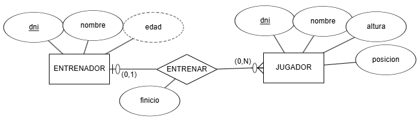
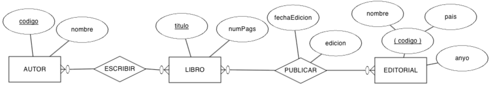
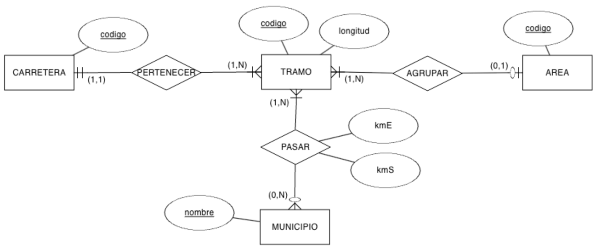
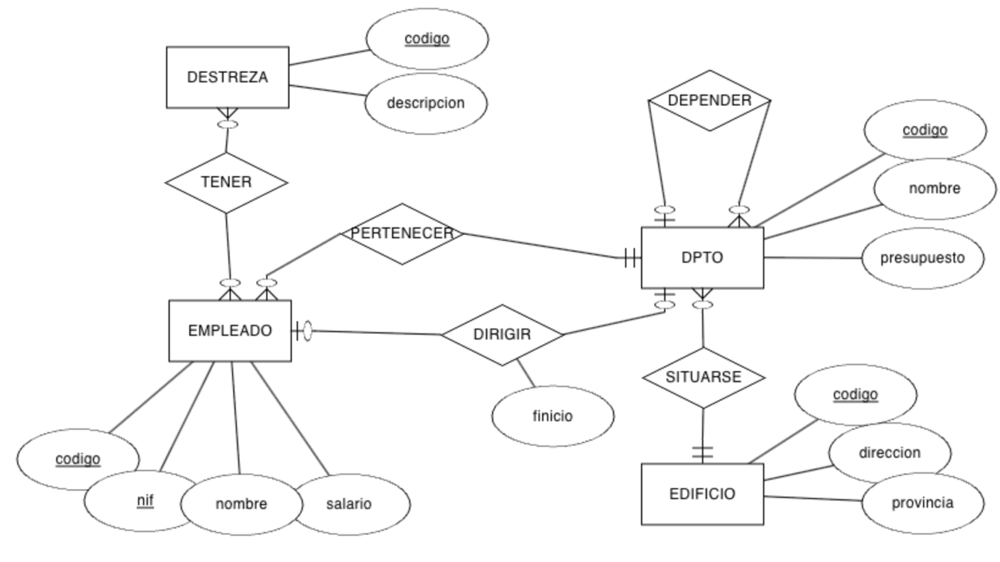
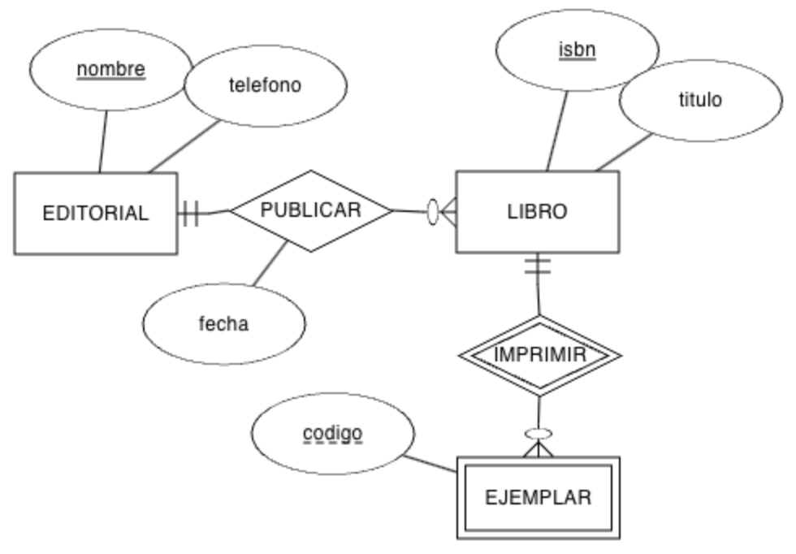
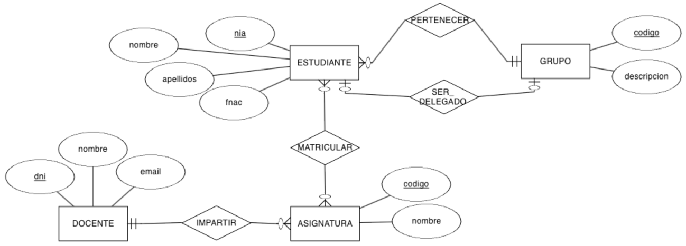
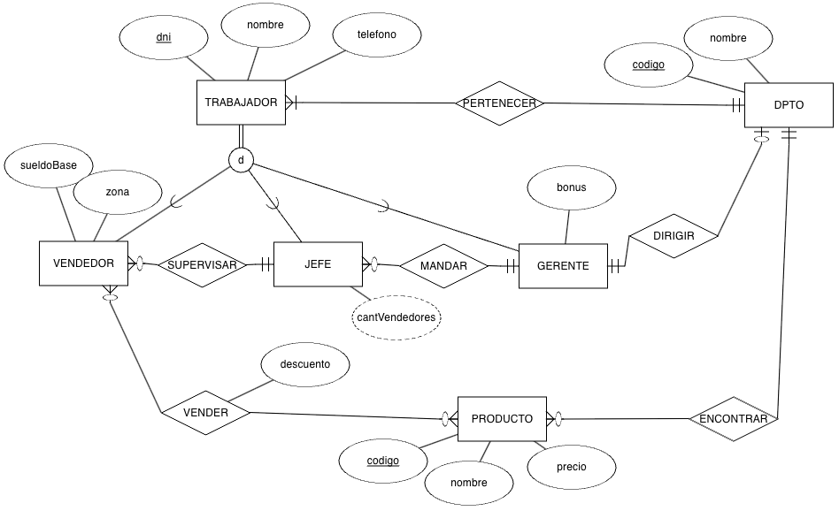
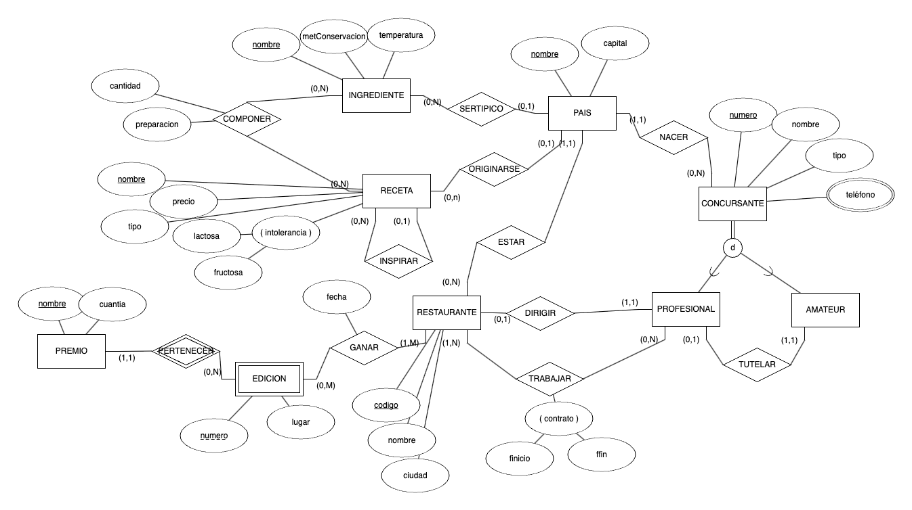

# **Actividad 302**

> **📌 Entrega**
> 

> - La entrega será un **fichero pdf** que contenga la respuesta a las preguntas de la actividad.

> - El nombre del fichero debe ser `302_NombreApellidos.pdf`.

> - Se deberá entregar en la tarea correspondiente de Aules en tiempo y forma.

> **📌 Se valorará**
> 

> Se valorará:

> - La claridad de la respuesta.

> - La correcta maquetación del documento.

> - Respuesta correcta o aproximación a la misma.

> Esta actividad servirá para calificar:

> - RA6: Diseña modelos relacionales normalizados interpretando diagramas entidad/relación.

>   - CE6. a) Se han utilizado herramientas gráficas para representar el diseño lógico. (5%)

>   - CE6. b) Se han identificado las tablas del diseño lógico. (5%)

>   - CE6. c) Se han identificado los campos que forman parte de las tablas del diseño lógico. (5%)

>   - CE6. d) Se han analizado las relaciones entre las tablas del diseño lógico. (5%)

>   - CE6. e) Se han identificado los campos clave. (5%)

> **📌 Recuerda**
> 

> Para pasar de un **diagrama E/R** al **modelo relacional** debes aplicar las reglas de transformación estudiadas en clase:

> - Cada **entidad** se transforma en una **tabla**.

> - Las relaciones **N:M** se convierten en **tablas de unión** con su clave compuesta.

> - Las relaciones **1:N** se resuelven añadiendo la **clave ajena** en el lado del *muchos*.

> - Las relaciones **1:1** se resuelven añadiendo la **clave ajena** (que además es **clave alternativa**).

## **Ejercicio 1**

Supongamos el siguiente modelo E/R donde representamos un sistema de información donde modelamos los datos de un **entrenador** y los **jugadores** de un equipo de baloncesto. De momento, sólo modelamos la relación entre el entrenador y los jugadores:



Obtén el **esquema relacional** y, a continuación, **dibuja el modelo relacional**.

## **Ejercicio 2**

Sobre el ejercicio anterior, vamos a añadir la entidad **EQUIPO** con el nombre del mismo, su logotipo, dirección y año de creación. Claramente, **cada equipo sólo tiene un único entrenador**, y **un entrenador sólo puede serlo de un equipo**.

Se pide:

1. Modifica el modelo E/R para añadir la nueva entidad y la relación necesaria.

1. Modifica el modelo relacional a partir del nuevo modelo E/R.

## **Ejercicio 3**

Tenemos el siguiente modelo E/R que representa las diferentes **ediciones** que de un libro publica una **editorial**, y los **autores** que escriben los libros:



Obtén el **esquema relacional** y completa el **diccionario de datos**.

## **Ejercicio 4**

Realiza el **esquema lógico** mediante un **modelo relacional** del siguiente modelo E/R:



## **Ejercicio 5**

Tenemos el siguiente modelo E/R sobre la organización de una **empresa** en **departamentos** y las características de sus **empleados**:



Obtén el **esquema relacional** e indica las **cardinalidades** de las relaciones.

## **Ejercicio 6**

A partir del siguiente modelo E/R que contiene restricciones de **cardinalidad mínima** y restricciones de **identificación**, se pide:



1. Genera el **modelo relacional**.

1. Indica las **cardinalidades** de las relaciones.

1. Rellena **tres tablas** con datos ficticios (al menos 3 registros por tabla), ya sean datos relacionados o no, conforme consideres.

## **Ejercicio 7**

Crea el **modelo relacional** a partir del modelo conceptual sobre un **centro educativo**:



## **Ejercicio 8**

Crea el **modelo relacional** a partir del modelo conceptual:



## **Ejercicio 9**

Crea el **modelo relacional** a partir del modelo conceptual:



## **Ejercicio 10**

(RABD.6 // CE6a, CE6e // 3p) A partir de los siguientes **esquemas lógicos**, dibuja el **modelo E/R**:

### **Esquema 1**

```sql
A (a0, a1)
· PK: (a0)

B (b0, b1, b2, a0*, c0*)
· PK: (a0)
· FK: (a0) → A
· FK: (c0) → C

C (c0, c1)
· PK: (c0)

M (c0*, m, n)
· PK: (c0, m)
· FK: (c0) → C
```

### **Esquema 2**

```sql
A (a0, a1, bo*)
· PK: (a0)
· UK: (b0)
· VNN: (b0)
· FK: (b0) → B

B (b0, b1)
· PK: (b0)

C (b0*, a0*, c0)
· PK: (b0, a0)
· FK: (b0) → B
· FK: (a0) → A
· VNN: (c0)
```

## **Ejercicio 11**

(RABD.6 // CE6a, CE6e // 3p) A partir del siguiente **modelo relacional**, dibuja el **diagrama E/R**:

```sql
EMPLEADO (num, dni, nombre, direccion, banco)
· PK: (num)
· UK: (dni)

MEDICO (num*, espec, anyo)
· PK: (num)
· FK: (num) → EMPLEADO

SOCIO (num*, dniS, fechaNac, medicoChequeo*, fechaChequeo, resultadoChequeo)
· PK: (num)
· UK: (dniS)
· FK: (num) → EMPLEADO
· FK: (medicoChequeo) → MEDICO

TAQUILLA (nun, estado, tamaño)
· PK: (nun)

FIJA (num*, socio*)
· PK: (num)
· FK: (num) → TAQUILLA
· FK: (socio) → SOCIO

DIARIA (num*, socio*)
· PK: (num)
· FK: (num) → TAQUILLA
· FK: (socio) → SOCIO

DISCIPLINA (nombre, descripcion)
· PK: (nombre)

MONITOR (num*, fechaNac, disciplina*)
· PK: (num)
· FK: (num) → EMPLEADO
· FK: (disciplina) → DISCIPLINA

SESION (dia, hora, sala, monitor*, disciplina*)
· PK: (dia, hora, sala)
· FK: (monitor) → MONITOR
· FK: (disciplina) → DISCIPLINA
· VNN: (monitor)
· VNN: (disciplina)

TECNICO (num*)
· PK: (num)
· FK: (num) → EMPLEADO

MODELO (codigo, descripcion, empresas, tecnico*)
· PK: (codigo)
· FK: (tecnico) → TECNICO

APARATO (num, codigo*, fechaAdquisic, estado)
· PK: (num, codigo)
· FK: (codigo) → MODELO
```

## **Ejercicio 12**

(RABD.6 // CE6a, CE6e // 3p) A partir del siguiente **modelo relacional**, dibuja el **diagrama E/R**:

```sql
EDIFICIO (num, numPlantas, gestor*)
· PK: (num)
· FK: (gestor) → GESTOR

GESTOR (codigo, nombre, apellido1, apellido2, salario, residencia*)
· PK: (codigo)
· FK: (residencia) → EDIFICIO
· UK: (residencia)

INSPECTOR (codigo, nombre)
· PK: (codigo)

SUPERVISAR (codigo*, num*, fUltima, fSiguiente)
· PK: (codigo, num)
· FK: (codigo) → INSPECTOR
· FK: (num) → EDIFICIO

TRABAJADOR (codigo, nombre)
· PK: (codigo)

APARTAMENTO (numA, numE*, dormitorios)
· PK: (numA, numE)
· FK: (numE) → EDIFICIO

LIMPIAR (codigo*, numA*, numE*)
· PK: (codigo, numA, numE)
· FK: (numA, numE) → APARTAMENTO
· FK: (codigo) → TRABAJADOR
```

## **Ejercicio 13**

A partir del siguiente **modelo relacional**:

```sql
EQUIPO (num, fUltimaRevision, fAlta, detalle*)
· PK: (num)
· FK: (detalle) → DETALLE_EQUIPO
· VNN: (detalle)

DETALLE_EQUIPO (codigo, tipo, modelo, fUltimaRevision)
· PK: (codigo)

VENTA (codigo, precio, fecha, equipo*, cliente*, comercial*)
· PK: (codigo)
· FK: (equipo) → EQUIPO
· FK: (cliente) → CLIENTE
· FK: (comercial) → COMERCIAL
· VNN: (equipo)
· VNN: (cliente)
· VNN: (comercial)

ALQUILER (codigo, precio, fecha, equipo*, cliente*, comercial*)
· PK: (codigo)
· FK: (equipo) → EQUIPO
· FK: (cliente) → CLIENTE
· FK: (comercial) → COMERCIAL
· VNN: (equipo)
· VNN: (cliente)
· VNN: (comercial)

CLIENTE (id, nombre, categoría)
· PK: (id)

COMERCIAL (codigo, nombre, apellido1, rango, mentor*)
· PK: (id)
· FK: (mentor) → COMERCIAL
```

Contesta a las siguientes preguntas **argumentando** tus respuestas:

a. ¿Puede un **EQUIPO** tener más de un **DETALLE_EQUIPO**?

b. ¿Puede un **COMERCIAL** vender varios **EQUIPO**?

c. ¿Un **ALQUILER** cuántos **DETALLE_EQUIPO** tendrá?

d. ¿Puede un **CLIENTE** alquilar y vender el mismo **EQUIPO**?

e. ¿Podemos averiguar qué **COMERCIAL** vendió un determinado **EQUIPO**?

f. ¿Una persona puede ser **CLIENTE** y **COMERCIAL** a la vez?

g. ¿Todo **COMERCIAL** debe tener un **mentor**?

h. ¿Un **COMERCIAL** puede tener varios mentores o un mentor puede mentorizar a varios comerciales?
