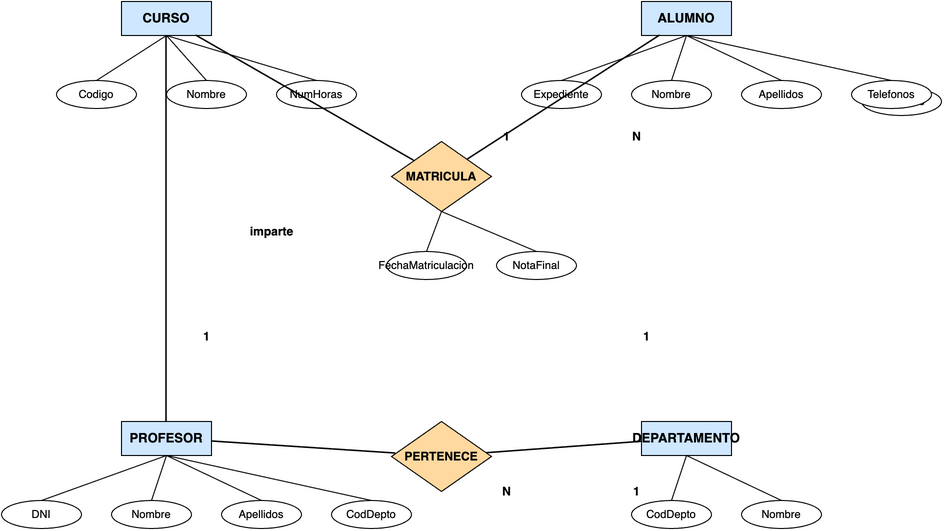
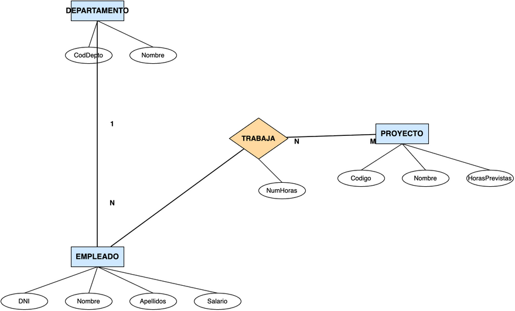
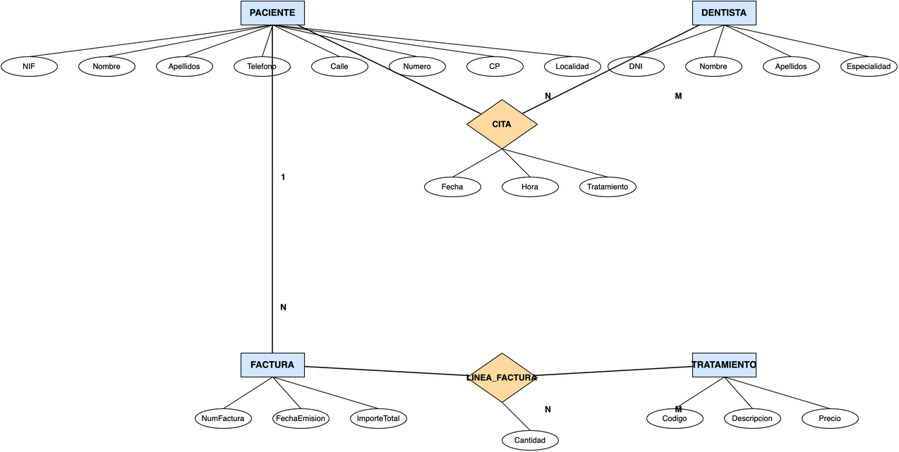
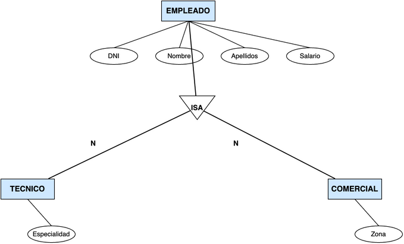

# **Actividad 305**

> **📌 Entrega**
> 

> - La entrega será un **fichero pdf** que contenga la respuesta a las preguntas de la actividad.

> - El nombre del fichero debe ser `305_NombreApellidos.pdf`.

> - Se deberá entregar en la tarea correspondiente de Aules en tiempo y forma.

> **📌 Se valorará**
> 

> Se valorará:

> - La claridad de la respuesta.

> - La correcta maquetación del documento.

> - Respuesta correcta o aproximación a la misma.

> Esta actividad servirá para calificar:

> - RA6: Diseña modelos relacionales normalizados interpretando diagramas entidad/relación.

>   - CE6. a) Se han utilizado herramientas gráficas para representar el diseño lógico. (5%)

>   - CE6. b) Se han identificado las tablas del diseño lógico. (5%)

>   - CE6. c) Se han identificado los campos que forman parte de las tablas del diseño lógico. (5%)

>   - CE6. d) Se han analizado las relaciones entre las tablas del diseño lógico. (5%)

>   - CE6. e) Se han identificado los campos clave. (5%)

>   - CE6. f) Se han aplicado reglas de integridad. (5%)

>   - CE6. g) Se han aplicado reglas de normalización. (5%)

>   - CE6. h) Se han analizado y documentado las restricciones que no pueden plasmarse en el diseño lógico. (5%)

> **📌 Recuerda**
> 

> Esta es una actividad **integradora** de toda la unidad. Para cada ejercicio deberás:

> 1. **Leer la descripción del modelo E/R** que acompaña al diagrama.

> 1. **Analizar el diagrama E/R** y aplicar las reglas de transformación vistas en clase.

> 1. **Obtener el modelo relacional**, indicando para cada tabla:

>   - **CP**: clave primaria.

>   - **CAlt**: claves alternativas, si existen.

>   - **CAj**: claves ajenas, indicando la tabla a la que referencian.

>   - **VNN**: atributos que no pueden ser nulos.

> 1. **Normalizar** las tablas cuando sea necesario aplicando las 3 Formas Normales vistas en clase:

>   - **1FN**: atributos atómicos y filas únicas.

>   - **2FN**: dependencia funcional completa de la clave primaria.

>   - **3FN**: sin dependencias transitivas.

> 1. **Documentar las restricciones** que no pueden plasmarse en el diseño lógico.

## **Ejercicio 1**

**INSTITUTO**

El modelo E/R representa la gestión de un **instituto**. La entidad **CURSO** se identifica por su **Codigo** y guarda además el **Nombre** y el **NumHoras**. La entidad **ALUMNO** se identifica por su **Expediente** y guarda **Nombre**, **Apellidos** y los **Telefonos** de contacto (varios por alumno, por eso aparece con doble elipse). Un **alumno** se matricula en **varios cursos** y en cada **curso** hay **varios alumnos**; esta relación N:M se llama **MATRICULA** y tiene sus propios atributos: la **FechaMatriculacion** y la **NotaFinal**. Cada **curso** es impartido por **un único profesor** (relación 1:1 **imparte**) y un **profesor** pertenece a **un único departamento**, aunque un **departamento** puede tener **varios profesores** (relación N:1 **PERTENECE**). La entidad **PROFESOR** se identifica por su **DNI** y guarda **Nombre**, **Apellidos** y la **CodDepto** del departamento al que pertenece. La entidad **DEPARTAMENTO** se identifica por su **CodDepto** y guarda su **Nombre**.

**Se pide:**

a) Obtener el **modelo relacional** correspondiente al diagrama E/R, indicando para cada tabla su **CP**, **CAlt**, **CAj** y **VNN**.

b) **Normalizar** la tabla de alumnos para eliminar el atributo multivaluado *telefonos*, documentando el proceso de 1FN y 2FN.

## **Ejercicio 2**

**EMPRESA**

El modelo E/R representa la gestión de una **empresa**. La entidad **DEPARTAMENTO** se identifica por su **CodDepto** y guarda su **Nombre**. La entidad **EMPLEADO** se identifica por su **DNI** y guarda **Nombre**, **Apellidos** y **Salario**. Un **departamento** tiene **varios empleados** y cada **empleado** pertenece a **un único departamento** (relación N:1). La entidad **PROYECTO** se identifica por su **Codigo** y guarda el **Nombre** y las **HorasPrevistas**. Un **empleado** puede **trabajar en varios proyectos** y un **proyecto** puede tener **varios empleados**; esta relación N:M se llama **TRABAJA** y guarda el atributo **NumHoras** dedicadas por cada empleado a cada proyecto.

**Se pide:**

a) Obtener el **modelo relacional** correspondiente al diagrama E/R, indicando para cada tabla su **CP**, **CAlt**, **CAj** y **VNN**.

b) Documentar las **restricciones** que no pueden plasmarse en el diseño lógico. Se sabe que:

- Un empleado puede trabajar como máximo en 3 proyectos.

- El salario de un empleado no puede superar los 5.000 €.

- Un departamento puede no tener empleados, pero un empleado siempre pertenece a un departamento.

- Un proyecto no puede estar sin empleados.

## **Ejercicio 3**

**CLÍNICA DENTAL**

El modelo E/R representa la gestión de una **clínica dental**. La entidad **PACIENTE** se identifica por su **NIF** y guarda **Nombre**, **Apellidos**, **Telefono** y la **dirección** descompuesta en **Calle**, **Numero**, **CP** y **Localidad**. La entidad **DENTISTA** se identifica por su **DNI** y guarda **Nombre**, **Apellidos** y **Especialidad**. Un **paciente** tiene **varias citas** y un **dentista** tiene **varias citas**; esta relación N:M se llama **CITA** y guarda la **Fecha**, la **Hora** y el **Tratamiento** realizado. Un **paciente** puede tener **varias facturas** y cada **factura** corresponde a **un único paciente** (relación N:1). La entidad **FACTURA** se identifica por su **NumFactura** y guarda la **FechaEmision** y el **ImporteTotal**. La entidad **TRATAMIENTO** se identifica por su **Codigo** y guarda la **Descripcion** y el **Precio**. Una **factura** detalla **varios tratamientos** y un **tratamiento** puede aparecer en **varias facturas**; esta relación N:M se llama **LINEA_FACTURA** y guarda la **Cantidad** de cada tratamiento en cada factura.

**Se pide:**

a) Obtener el **modelo relacional** correspondiente al diagrama E/R, indicando para cada tabla su **CP**, **CAlt**, **CAj** y **VNN**.

b) Documentar las **restricciones** que no pueden plasmarse en el diseño lógico.

## **Ejercicio 4**

**ESPECIALIZACIÓN**

El modelo E/R representa la gestión de los **empleados** de una empresa mediante una **especialización**. La entidad **EMPLEADO** se identifica por su **DNI** y guarda **Nombre**, **Apellidos** y **Salario**. Un empleado es de dos tipos posibles: la entidad **TECNICO** guarda su **Especialidad** y la entidad **COMERCIAL** guarda su **Zona**. La especialización se representa con el símbolo **ISA**.

**Se pide:**

a) Obtener el **modelo relacional** correspondiente al diagrama E/R con la especialización, indicando para cada tabla su **CP**, **CAlt**, **CAj** y **VNN**.

b) Indicar en qué casos se guardarían los datos de técnicos y comerciales en **tablas independientes** y en qué casos se guardarían en la **misma tabla** que los empleados.
