# Cuaderno Práctico de Actividades — UD3: Disseny Lògic — Model Relacional i Normalització

<div class="interactive-progress-tracker">
  <div class="tracker-header">
    <span>🏆 <strong>Progreso de esta sección:</strong> <span class="tracker-count">0 de 4 superados (0%)</span></span>
    <span class="tracker-pts">⭐ <strong>0 puntos</strong></span>
  </div>
  <div class="tracker-bar">
    <div class="tracker-fill" style="width: 0%;"></div>
  </div>
</div>

En esta sección tienes acceso directo a todas las actividades prácticas, fichas de trabajo y retos evaluables de esta unidad didáctica. Puedes acceder a cada actividad individualmente o consultar la recopilación completa a continuación:

## 🗂️ Índice de Actividades de la Unidad

- **[⚡ Activitat 301](act301.html)**
- **[⚡ Activitat 302](act302.html)**
- **[⚡ Activitat 303](act303.html)**
- **[⚡ Activitat 304: Activitat 01](act304.html)**
- **[⚡ Activitat 305](act305.html)**

---

## Actividad 301

👉 *[Obrir aquesta activitat en pàgina individual](act301.html)*

# **Actividad 301**

> **📌 Entrega**
> 

> - La entrega será un **fichero pdf** que contenga la respuesta a las preguntas de la actividad.

> - El nombre del fichero debe ser `301_NombreApellidos.pdf`.

> - Se deberá entregar en la tarea correspondiente de Aules en tiempo y forma.

> **📌 Se valorará:**
> 

> Es valorarà:

> - La claridad de la respuesta.

> - La correcta maquetación del documento.

> - Respuesta correcta o aproximación a esta.

> Esta actividad servirá para calificar:

> - RA6: Dissenya models relacionals normalitzats interpretant diagrames entitat/relació.

>   - CE6. b) S'han identificat les taules del disseny lògic. (5%)

>   - CE6. c) S'han identificat els camps que formen part de les taules del disseny lògic. (5%)

>   - CE6. e) S'han identificat els camps clau. (5%)

>   - CE6. f) S'han aplicat regles d'integritat. (5%)

>   - CE6. h) S'han analitzat i documentat les restriccions que no poden plasmar-se en el disseny lògic. (5%)

> **📌 Recorda**
> 

> Has d'obtindre el **esquema relacional** (taules amb els seus atributs) indicant per a cada una:

> - **CP**: clau primària.

> - **CAlt**: claus alternatives, si existeixen.

> - **CAj**: claus foranes, indicant la taula a la que referencian.

> - **VNN**: atributs que no poden ser nuls.

## **Ejercicio 1**

**ARTICLES I ENCARGOS**

Una base de dades per a una xicoteta empresa ha de contindre informació sobre clients, articles i comandes. Fins al moment es registran els següents dades en documents diversos:

- Per a cada **client**: Número de client (únic), Nom, NIF, Adreces d'enviament (diverses per client), Saldo, Límit de crèdit (depèn del client, però en cap cas ha de superar els 18.000 €), Descompte.

- Per a cada **article**: Número d'article (únic), Fàbriques que el distribuyen, Existencias d'eixe article en cada fàbrica, Descripció de l'article.

- Per a cada **comanda**: Cada comanda té una capçalera i el cos de la comanda. La capçalera està formada pel número de client, adreça d'enviament i data de la comanda. El cos de la comanda són diverses línies, en cada línia es especifican el número de l'article comanda i la quantitat.

A més, es ha determinat que s'ha d'emmagatzemar la informació de les **fàbriques**. No obstant això, donat l'ús de distribuidors, s'usarà: Número de la fàbrica (únic), Nom i Telèfon de contacte. I es desean veure quants articles (en total) provee la fàbrica. També, per informació estratégica, es podria incloure informació de fàbriques alternatives respecte de les que ja fabrican articles per a aquesta empresa.

> **📌 Nota**
> 

> Una adreça es entenderá com **Carrer, Número, Porta, CP i Localitat**. Una data inclou **dia, mes, any i hora**.

**Es demana:** obtindre el model relacional de la base de dades.

## **Ejercicio 2**

**CASES DE COLÒNIES**

a) Cada casa de colònies té un **nom** que la identifica. Es desitja saber de cada una, aparte del nom, la **capacitat** (el número de xiquets que es poden allotjar en cada una com a màxim), la **comarca** on està situada i les **ofertas d'activitats** que proporciona. Una casa pot oferir activitats com per exemple natació, esquí, remo, pintura, fotografía, música, etc.

b) És necessari tindre en compte que en una casa de colònies es poden practicar **diverses activitats** (de fet, cada casa ha d'oferir com a mínim una), i també pot ocórrer que una mateixa activitat es puga dur a terme en diverses cases. No obstant això, tota activitat que es registre en la base de dades ha de ser ofertada com a mínim en una de les cases.

c) Interessa tindre una **avaluació de les ofertas d'activitats** que proporcionen les cases. S'assigna una qualificació numèrica que indica el nivell de qualitat que té cada una de les activitats ofertades.

d) Les cases de colònies **allotgen xiquets** que es han inscrito per a passar en elles unes xicotetes vacacions. Es vol tindre constancia dels xiquets que es allotgen en cada una de les cases en el moment actual. S'ha de suposar que hi ha cases que estan buides (en les que no es allotja cap xiquet) durant algunes temporades.

e) Dels xiquets que es allotgen actualment en alguna de les cases, interessa conèixer un **codi** que es els assigna per a identificar-los, el seu **nom**, el seu **cognom**, el **número de telèfon dels seus padres** i el seu **comarca de residencia**.

f) De les **comarcas** on hi ha cases o bé on residen xiquets, es vol tindre registrats la **superfície** i el **número d'habitantes**. S'ha de considerar que pot haver comarcas on no reside cap dels xiquets que es allotgen en un moment determinat en les cases de colònies, i comarcas que no disposen de cap casa.

> **📌 Nota**
> 

> És possible, per exemple, que una activitat com l'esquí tinga una qualificació de 10 en l'oferta de la casa Grévol, i que la mateixa activitat tinga una qualificació de 8 en la casa Ardilla.

**Es demana:** obtindre el model relacional de la base de dades.

## **Ejercicio 3**

**TRANSPORT**

Es desitja mecanitzar la gestió d'una empresa de transportes que reparte paquets per tota Espanya. Els encarregats de portar els paquets són els **camioneros** dels que es vol guardar el DNI, nom, telèfon, adreça, salario i localitat on reside.

Dels **paquets** transportats interessa conèixer el codi de paquet, descripció, destinatari, i adreça del destinatari. Un camionero distribueix molts paquets i un paquet només pot ser distribuït per un camionero.

De les **províncies** a les que arriben els paquets interessa guardar el codi de província, i el nom. Un paquet només pot arribar a una província, no obstant això, a una província poden arribar molts paquets.

Dels **camiones** que porten els camioneros interessa conèixer la matrícula, model, tipus i potència. Un camionero pot conducir diferents camiones en dates diferents i un camión pot ser conducido per diversos camioneros.

**Es demana:** obtindre el model relacional de la base de dades.

## **Ejercicio 4**

**PARADORS**

La xarxa de Paradors de Turismo vol mantindre un servei d'atenció i reserves a través de Internet. Una de les tasques dins del desenvolupament del sistema és la construcció del model lògic de dades. La informació de partida per a la construcció d'aquest model és la següent:

- Els **Paradors** vendrán definits per un codi únic, nom, adreça, telèfon, nivell i número total d'habitacions. Els Paradors disposen de distints tipus d'habitacions. De cada **habitació** es desitja emmagatzemar el número d'habitació, la ubicació dins del Parador, el tipus (normal o suite), una descripció i el preu per nit.

- Els Paradors poden tindre a més unes **instal·lacions addicionals** (golf, piscina, hípica, etc.). De cada tipus d'instal·lació es desitja emmagatzemar el codi d'instal·lació, el nom i la descripció. Cal tindre en compte que un mateix tipus d'instal·lació es pot trobar en distints Paradors.

- La informació referente als Paradors es completa amb la **oferta gastronómica** que tenen. De la gastronomía ofrecida per cada Parador s'emmagatzemarà un codi, nom i tipus de plato. Encara que un mateix plato pot ser servido per distints Paradors, pot haver **variacions de preu** en cada cas. Es desitja emmagatzemar la informació d'aquesta diferència.

- Quan un usuari es conecte al lloc web dels Paradors de Turismo, a més de poder consultar la informació referente al descrit anteriorment, podrà fer **reserves** d'habitacions. En el cas de realitzar reserves, es prenen les dades del client: NIF, nom i cognoms. S'emmagatzemarà també un codi de client generat per l'aplicació si el client fóra nou.

- Una vegada registrat el client, aquest podrà triar en què Parador o Paradors desitja alojar-se, la data d'arribada i el número de nits, així com el tipus de l'habitació que vol. El sistema li asignará les habitacions corresponents, tenint en compte que **un client no pot tindre reservades habitacions de dos Paradors distints en la mateixa data**.

- Finalment, es desitja que un client puga consultar en qualsevol moment **què reserves ha realitzat, en què paradors i per a cada data**, així com l'habitació reservada.

**Es demana:** obtindre el model relacional de la base de dades, documentant les restriccions que no poden plasmar-se en el disseny lògic.

---

## Actividad 302

👉 *[Obrir aquesta activitat en pàgina individual](act302.html)*

# **Actividad 302**

> **📌 Entrega**
> 

> - La entrega será un **fichero pdf** que contenga la respuesta a las preguntas de la actividad.

> - El nombre del fichero debe ser `302_NombreApellidos.pdf`.

> - Se deberá entregar en la tarea correspondiente de Aules en tiempo y forma.

> **📌 Se valorará:**
> 

> Es valorarà:

> - La claridad de la respuesta.

> - La correcta maquetación del documento.

> - Respuesta correcta o aproximación a esta.

> Esta actividad servirá para calificar:

> - RA6: Dissenya models relacionals normalitzats interpretant diagrames entitat/relació.

>   - CE6. a) S'han utilitzat eines gràfiques per a representar el disseny lògic. (5%)

>   - CE6. b) S'han identificat les taules del disseny lògic. (5%)

>   - CE6. c) S'han identificat els camps que formen part de les taules del disseny lògic. (5%)

>   - CE6. d) S'han analitzat les relacions entre les taules del disseny lògic. (5%)

>   - CE6. e) S'han identificat els camps clau. (5%)

> **📌 Recorda**
> 

> Per a passar d'un **diagrama E/R** al **model relacional** has d'aplicar les regles de transformació estudiades en classe:

> - Cada **entitat** es transforma en una **taula**.

> - Les relacions **N:M** es converteixen en **taules d'unió** amb la seua clau composta.

> - Les relacions **1:N** es resolen afegint la **clau forana** en el costat del *molts*.

> - Les relacions **1:1** es resolen afegint la **clau forana** (que a més és **clau alternativa**).

## **Ejercicio 1**

Suposem el següent model E/R on representamos un sistema d'informació on modelamos les dades d'un **entrenador** i els **jugadors** d'un equip de baloncesto. De moment, només modelamos la relació entre l'entrenador i els jugadors:

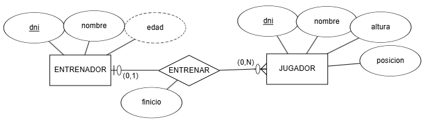

Obtingues el **esquema relacional** i, a continuació, **dibuixa el model relacional**.

## **Ejercicio 2**

Sobre l'exercici anterior, anem a afegir l'entitat **EQUIP** amb el nom del mateix, el seu logotipo, adreça i any de creació. Clarament, **cada equip només té un únic entrenador**, i **un entrenador només pot serlo d'un equip**.

Es demana:

1. Modifica el model E/R per a afegir la nova entitat i la relació necessària.

1. Modifica el model relacional a partir del nou model E/R.

## **Ejercicio 3**

Tenim el següent model E/R que representa les diferents **edicions** que d'un llibre publica una **editorial**, i els **autors** que escriuen els llibres:

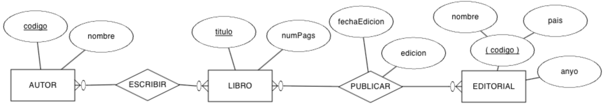

Obtingues el **esquema relacional** i completa el **diccionari de dades**.

## **Ejercicio 4**

Realitza el **esquema lògic** mitjançant un **model relacional** del següent model E/R:

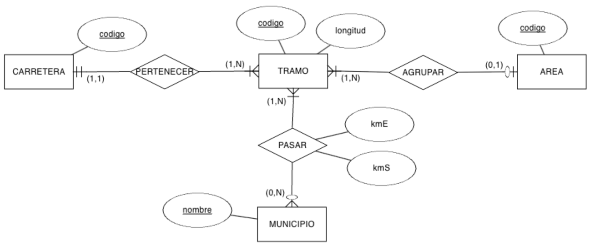

## **Ejercicio 5**

Tenim el següent model E/R sobre l'organització d'una **empresa** en **departaments** i les característiques dels seus **empleats**:

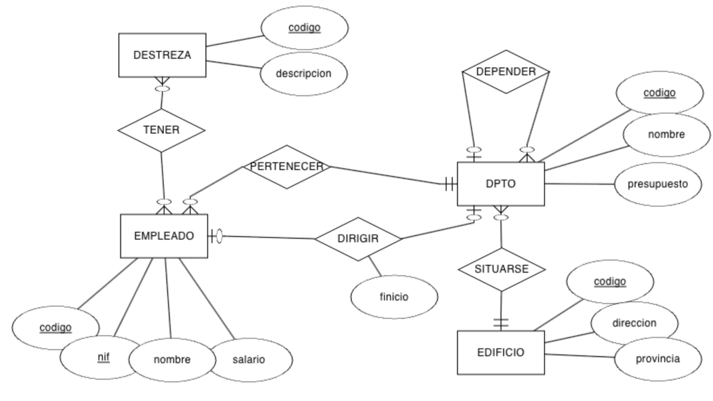

Obtingues el **esquema relacional** i indica les **cardinalitats** de les relacions.

## **Ejercicio 6**

A partir del següent model E/R que conté restriccions de **cardinalitat mínima** i restriccions de **identificació**, es demana:

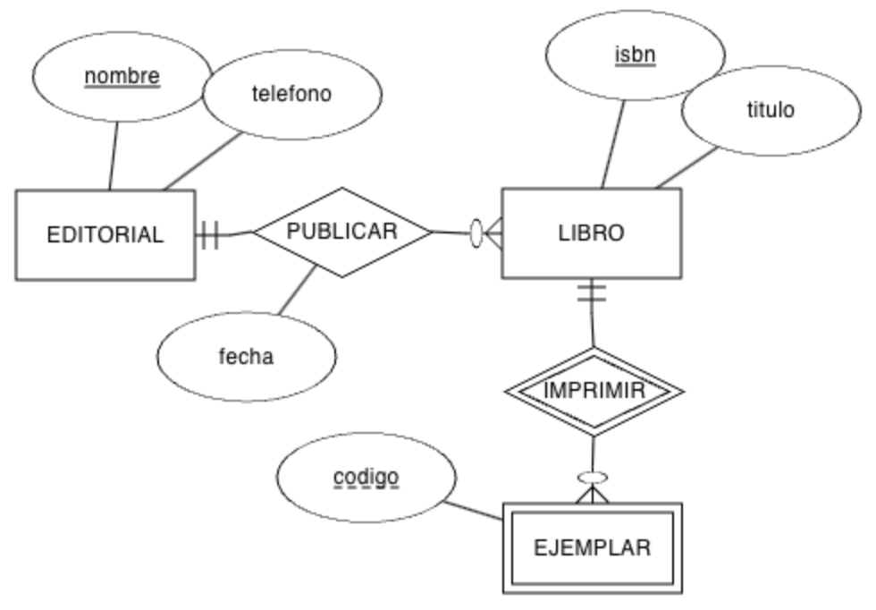

1. Genera el **model relacional**.

1. Indica les **cardinalitats** de les relacions.

1. Emplena **tres taules** amb dades ficticios (almenys 3 registres per taula), ja siguen dades relacionats o no, conforme consideres.

## **Ejercicio 7**

Crea el **model relacional** a partir del model conceptual sobre un **centre educativo**:

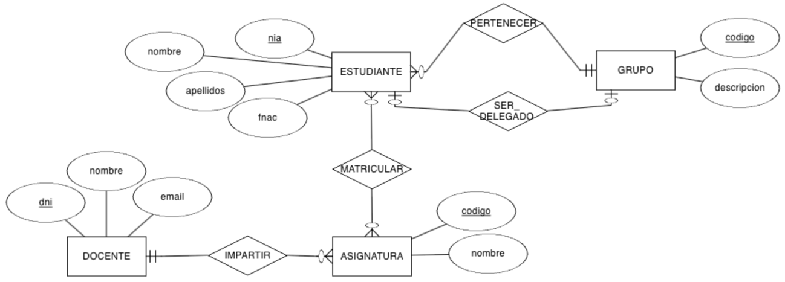

## **Ejercicio 8**

Crea el **model relacional** a partir del model conceptual:

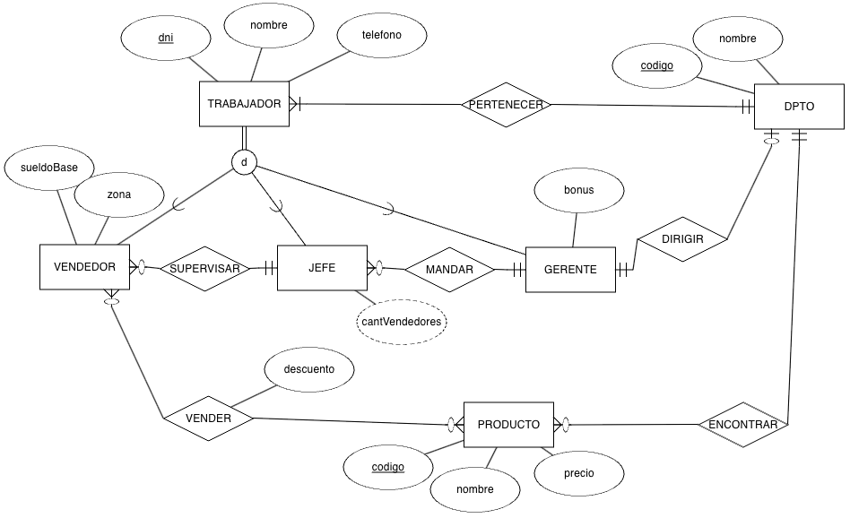

## **Ejercicio 9**

Crea el **model relacional** a partir del model conceptual:

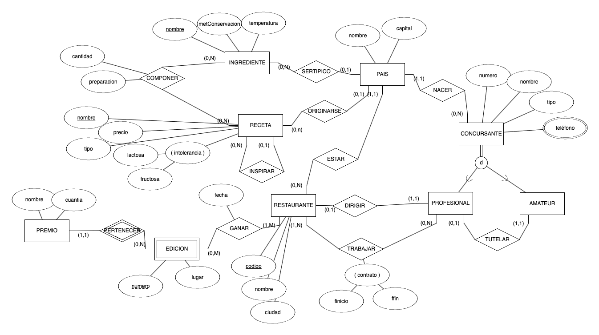

## **Ejercicio 10**

(RABD.6 // CE6a, CE6e // 3p) A partir dels següents **esquemes lògics**, dibuixa el **model E/R**:

### **Esquema 1**

```sql
A (a0, a1)
· PK: (a0)

B (b0, b1, b2, a0*, c0*)
· PK: (a0)
· FK: (a0) → A
· FK: (c0) → C

C (c0, c1)
· PK: (c0)

M (c0*, m, n)
· PK: (c0, m)
· FK: (c0) → C
```

### **Esquema 2**

```sql
A (a0, a1, bo*)
· PK: (a0)
· UK: (b0)
· VNN: (b0)
· FK: (b0) → B

B (b0, b1)
· PK: (b0)

C (b0*, a0*, c0)
· PK: (b0, a0)
· FK: (b0) → B
· FK: (a0) → A
· VNN: (c0)
```

## **Ejercicio 11**

(RABD.6 // CE6a, CE6e // 3p) A partir del següent **model relacional**, dibuixa el **diagrama E/R**:

```sql
EMPLEADO (num, dni, nombre, direccion, banco)
· PK: (num)
· UK: (dni)

MEDICO (num*, espec, anyo)
· PK: (num)
· FK: (num) → EMPLEADO

SOCIO (num*, dniS, fechaNac, medicoChequeo*, fechaChequeo, resultadoChequeo)
· PK: (num)
· UK: (dniS)
· FK: (num) → EMPLEADO
· FK: (medicoChequeo) → MEDICO

TAQUILLA (nun, estado, tamaño)
· PK: (nun)

FIJA (num*, socio*)
· PK: (num)
· FK: (num) → TAQUILLA
· FK: (socio) → SOCIO

DIARIA (num*, socio*)
· PK: (num)
· FK: (num) → TAQUILLA
· FK: (socio) → SOCIO

DISCIPLINA (nombre, descripcion)
· PK: (nombre)

MONITOR (num*, fechaNac, disciplina*)
· PK: (num)
· FK: (num) → EMPLEADO
· FK: (disciplina) → DISCIPLINA

SESION (dia, hora, sala, monitor*, disciplina*)
· PK: (dia, hora, sala)
· FK: (monitor) → MONITOR
· FK: (disciplina) → DISCIPLINA
· VNN: (monitor)
· VNN: (disciplina)

TECNICO (num*)
· PK: (num)
· FK: (num) → EMPLEADO

MODELO (codigo, descripcion, empresas, tecnico*)
· PK: (codigo)
· FK: (tecnico) → TECNICO

APARATO (num, codigo*, fechaAdquisic, estado)
· PK: (num, codigo)
· FK: (codigo) → MODELO
```

## **Ejercicio 12**

(RABD.6 // CE6a, CE6e // 3p) A partir del següent **model relacional**, dibuixa el **diagrama E/R**:

```sql
EDIFICIO (num, numPlantas, gestor*)
· PK: (num)
· FK: (gestor) → GESTOR

GESTOR (codigo, nombre, apellido1, apellido2, salario, residencia*)
· PK: (codigo)
· FK: (residencia) → EDIFICIO
· UK: (residencia)

INSPECTOR (codigo, nombre)
· PK: (codigo)

SUPERVISAR (codigo*, num*, fUltima, fSiguiente)
· PK: (codigo, num)
· FK: (codigo) → INSPECTOR
· FK: (num) → EDIFICIO

TRABAJADOR (codigo, nombre)
· PK: (codigo)

APARTAMENTO (numA, numE*, dormitorios)
· PK: (numA, numE)
· FK: (numE) → EDIFICIO

LIMPIAR (codigo*, numA*, numE*)
· PK: (codigo, numA, numE)
· FK: (numA, numE) → APARTAMENTO
· FK: (codigo) → TRABAJADOR
```

## **Ejercicio 13**

A partir del següent **model relacional**:

```sql
EQUIPO (num, fUltimaRevision, fAlta, detalle*)
· PK: (num)
· FK: (detalle) → DETALLE_EQUIPO
· VNN: (detalle)

DETALLE_EQUIPO (codigo, tipo, modelo, fUltimaRevision)
· PK: (codigo)

VENTA (codigo, precio, fecha, equipo*, cliente*, comercial*)
· PK: (codigo)
· FK: (equipo) → EQUIPO
· FK: (cliente) → CLIENTE
· FK: (comercial) → COMERCIAL
· VNN: (equipo)
· VNN: (cliente)
· VNN: (comercial)

ALQUILER (codigo, precio, fecha, equipo*, cliente*, comercial*)
· PK: (codigo)
· FK: (equipo) → EQUIPO
· FK: (cliente) → CLIENTE
· FK: (comercial) → COMERCIAL
· VNN: (equipo)
· VNN: (cliente)
· VNN: (comercial)

CLIENTE (id, nombre, categoría)
· PK: (id)

COMERCIAL (codigo, nombre, apellido1, rango, mentor*)
· PK: (id)
· FK: (mentor) → COMERCIAL
```

Contesta a les següents preguntes **argumentant** les teues respostes:

a. Pot un **EQUIP** tindre més d'un **DETALLE_EQUIPO**?

b. Pot un **COMERCIAL** vendre diversos **EQUIP**?

c. Un **ALQUILER** quants **DETALLE_EQUIPO** tindrà?

d. Pot un **CLIENT** alquilar i vendre el mateix **EQUIP**?

e. Podem averiguar què **COMERCIAL** vendió un determinat **EQUIP**?

f. Una persona pot ser **CLIENT** i **COMERCIAL** alhora?

g. Tot **COMERCIAL** ha de tindre un **mentor**?

h. Un **COMERCIAL** pot tindre diversos mentors o un mentor pot mentoritzar a diversos comercials?

---

## Actividad 303

👉 *[Obrir aquesta activitat en pàgina individual](act303.html)*

# **Actividad 303**

> **📌 Entrega**
> 

> - La entrega será un **fichero pdf** que contenga la respuesta a las preguntas de la actividad.

> - El nombre del fichero debe ser `303_NombreApellidos.pdf`.

> - Se deberá entregar en la tarea correspondiente de Aules en tiempo y forma.

> **📌 Se valorará:**
> 

> Es valorarà:

> - La claridad de la respuesta.

> - La correcta maquetación del documento.

> - Respuesta correcta o aproximación a esta.

> Esta actividad servirá para calificar:

> - RA6: Dissenya models relacionals normalitzats interpretant diagrames entitat/relació.

>   - CE6. g) S'han aplicat regles de normalització. (5%)

> **📌 Recorda**
> 

| Forma normal | Requisits |
| --- | --- |
| **1FN** | Atributs atòmics i files úniques. |
| **2FN** | 1FN + dependència funcional completa de la clau primària. |
| **3FN** | 2FN + sense dependències transitives. |
| **FNBC** | 3FN + tot determinante ha de ser una superclave. |
| **4FN** | FNBC + sense dependències multivaluades. |
| **5FN** | 4FN + sense dependències d'unió (pèrdua de dades). |

## **Exercici 1: Primera forma normal (1FN)**

### **Actividad 01**

La següent taula **no està en 1FN** perquè conté **atributs multivaluats**:

| ID_Cliente | Nom | Telèfons | Adreça |
| --- | --- | --- | --- |
| 1 | Ana Pérez | 123456, 789012 | Carrer A |
| 2 | Juan López | 345678, 901234 | Carrer B |

Transforma la taula a **1FN**, de manera que no haja atributs multivaluats.

### **Actividad 02**

La taula conté **atributs multivaluats i valors repetits en una mateixa cel·la**:

| ID_Pedido | Productes | Quantitat | Client |
| --- | --- | --- | --- |
| 1 | Llàmpada, Taula | 2, 1 | Ana Pérez |
| 2 | Cadira, Escriptori | 4, 1 | Juan López |

Transforma la taula perquè complisca **1FN**.

### **Actividad 03**

La taula conté **atributs multivaluats i valors repetits en una mateixa cel·la**:

| ID_Cliente | Nom | Compres |
| --- | --- | --- |
| 1 | Ana Pérez | Llàmpada, Escriptori |
| 2 | Juan López | Cadira |

Transforma la taula perquè complisca amb **1FN** eliminant els valors multivaluats.

## **Exercici 2: Segona forma normal (2FN)**

### **Actividad 01**

La següent taula està en **1FN**, però no compleix **2FN** a causa de **dependències parcials**:

| ID_Orden | ID_Producto | Producte | Quantitat | Client | Adreça |
| --- | --- | --- | --- | --- | --- |
| 1 | 101 | Llàmpada | 2 | Ana Pérez | Carrer A |
| 1 | 102 | Taula | 1 | Ana Pérez | Carrer A |
| 2 | 103 | Cadira | 4 | Juan López | Carrer B |

Elimina les dependències parcials. La clau primària és `(ID_Orden, ID_Producto)`.

### **Actividad 02**

La següent taula està en **1FN**, però no compleix **2FN** a causa de **dependències parcials**:

| ID_Producto | ID_Pedido | Nombre_Producto | Quantitat | Client |
| --- | --- | --- | --- | --- |
| 1 | 101 | Llàmpada | 2 | Ana Pérez |
| 2 | 101 | Escriptori | 1 | Ana Pérez |
| 3 | 102 | Cadira | 4 | Juan López |

Descompón la taula per a eliminar les dependències parcials.

### **Actividad 03**

La següent taula està en **1FN**, però no compleix **2FN** a causa de **dependències parcials**:

| ID_Pedido | ID_Producto | Nombre_Producto | Quantitat | Client | Adreça |
| --- | --- | --- | --- | --- | --- |
| 1 | 101 | Llàmpada | 2 | Ana Pérez | Carrer A |
| 1 | 102 | Taula | 1 | Ana Pérez | Carrer A |
| 2 | 103 | Cadira | 4 | Juan López | Carrer B |

Identifica i elimina les dependències parcials.

## **Exercici 3: Tercera forma normal (3FN)**

### **Actividad 01**

La següent taula està en **2FN**, però no compleix **3FN** a causa de **dependències transitives**:

| ID_Empleado | Nombre_Empleado | Departament | Jefe_Departamento |
| --- | --- | --- | --- |
| 1 | Luis Gómez | Vendes | Ana Pérez |
| 2 | Marta Ruiz | Marketing | Juan López |

Descompón la taula per a eliminar les dependències transitives.

### **Actividad 02**

La següent taula està en **2FN**, però no compleix **3FN** a causa de **dependències transitives**:

| ID_Empleado | Nom | Departament | Jefe_Departamento | Oficina |
| --- | --- | --- | --- | --- |
| 1 | Luis Gómez | Vendes | Ana Pérez | Oficina A |
| 2 | Marta Ruiz | Marketing | Juan López | Oficina B |

Elimina les dependències transitives.

### **Actividad 03**

La següent taula està en **2FN**, però no compleix **3FN** a causa de **dependències transitives**:

| ID_Empleado | Nom | Departament | Jefe_Departamento | Oficina |
| --- | --- | --- | --- | --- |
| 1 | Luis Gómez | Vendes | Ana Pérez | Oficina A |
| 2 | Marta Ruiz | Marketing | Juan López | Oficina B |

Elimina les dependències transitives.

## **Exercici 4: Forma normal de Boyce-Codd (FNBC)**

### **Actividad 01**

Una taula que no compleix FNBC té dependències funcionals on **un atribut no clau determina part de la clau primària**.

| ID_Proyecto | ID_Empleado | Rol |
| --- | --- | --- |
| 1 | 101 | Dissenyador |
| 1 | 102 | Programador |
| 2 | 103 | Dissenyador |

Dependències funcionals:

- **Rol → ID_Empleado** (un rol determina a l'empleat).

Descompón la taula perquè complisca **FNBC**.

### **Actividad 02**

Una taula que no compleix FNBC té dependències funcionals on **un atribut no clau determina part de la clau primària**.

| ID_Curso | ID_Profesor | Nombre_Curso |
| --- | --- | --- |
| 1 | 101 | Matemàtiques |
| 2 | 101 | Física |
| 3 | 102 | Química |

Dependència funcional:

- **ID_Profesor → Nombre_Curso** (un professor enseña un curs específic).

Elimina les dependències funcionals problemátiques.

## **Exercici 5: Quarta Forma normal (4FN)**

### **Actividad 01**

La taula està en **3FN**. En aquesta taula hi ha una **dependència multivaluada**, on un client pot tindre múltiples **telèfons** i **correus electrònics**.

| Client | Telèfon | Correu electrònic |
| --- | --- | --- |
| Ana Pérez | 123456789 | ana@gmail.com |
| Ana Pérez | 987654321 | ana.perez@yahoo.com |
| Juan López | 555666777 | juan@gmail.com |

Elimina la dependència multivaluada.

### **Actividad 02**

La taula està en **3FN**. En aquesta taula hi ha una **dependència multivaluada**, on un client pot tindre múltiples **telèfons** i **compres**.

| Client | Telèfon | Producte |
| --- | --- | --- |
| Ana Pérez | 123456789 | Llàmpada |
| Ana Pérez | 987654321 | Escriptori |
| Juan López | 555666777 | Cadira |

Elimina les dependències multivaluades.

## **Exercici 6: Cinquena Forma normal (5FN)**

### **Actividad 01**

La taula està en **4FN**. La taula representa relacions entre **clients**, **productes** i **vendedors**.

| Client | Producte | Vendedor |
| --- | --- | --- |
| Ana Pérez | Llàmpada | Juan Gómez |
| Ana Pérez | Taula | Juan Gómez |
| Ana Pérez | Taula | Marta Ruiz |

Descompón la taula en relacions independents per a evitar redundancias.

### **Actividad 02**

La taula està en **4FN**. La taula representa relacions entre **projectes**, **empleats** i **rols**.

| Projecte | Empleat | Rol |
| --- | --- | --- |
| Projecte A | Luis Gómez | Dissenyador |
| Projecte A | Luis Gómez | Programador |
| Projecte B | Marta Ruiz | Dissenyador |

Elimina redundancias distribuyendo les dades en taules més xicotetes.

---

## Actividad 304: Activitat 01

👉 *[Obrir aquesta activitat en pàgina individual](act304.html)*

# **Actividad 304**

> **📌 Entrega**
> 

> - La entrega será un **fichero pdf** que contenga la respuesta a las preguntas de la actividad.

> - El nombre del fichero debe ser `304_NombreApellidos.pdf`.

> - Se deberá entregar en la tarea correspondiente de Aules en tiempo y forma.

> **📌 Se valorará:**
> 

> Es valorarà:

> - La claridad de la respuesta.

> - La correcta maquetación del documento.

> - Respuesta correcta o aproximación a esta.

> Esta actividad servirá para calificar:

> - RA6: Dissenya models relacionals normalitzats interpretant diagrames entitat/relació.

>   - CE6. g) S'han aplicat regles de normalització. (5%)

> **📌 Recorda**
> 

> Donades les següents taules, realitza la **normalització** de les bases de dades aplicant les **3 Formes normals** vistes en classe:

> 1. **1FN**: atributs atòmics i files úniques.

> 1. **2FN**: dependència funcional completa de la clau primària.

> 1. **3FN**: sense dependències transitives.

## **Actividad 01**

**Sèries**

Tenim la següent taula. Aplica les **tres formes normals** vistes en classe.

| CodSerie | Títol | Genero | Añolanzament | Plataforma |
| --- | --- | --- | --- | --- |
| 0123 | The Last of Us | Suspense, Drama | 2023 | HBO |
| 0219 | The Mandalorian | Ciència ficció, Accion, Fantasia | 12-11-2019 | Disney+ |
| 0318 | Succession | Comedia negra, tragicomedia | 03-Juny-2018 | HBO |
| 0419 | The Boys | Superheroes | 2019 | PrimeVideo |
| 0519 | Sex Education | Drama, Comedia | 11/1/2019 | Netflix |
| 0619 | The Umbrella Academy | Drama, Superhéroes | 2019 | Netflix |
| 0720 | Ted Lasso | Comedia | 2020 | Apple TV |

## **Actividad 02**

**Ordenes**

Tenim la següent taula relacionada amb una **compra**. Realitza les tres formes normals de la taula.

| Id_Orden | Data | Id_cliente | Nom_client | Id_art | Nom_art | Cant | Preu |
| --- | --- | --- | --- | --- | --- | --- | --- |
| 2301 | 23/febrer /24 | 101 | José Perez | 3786 | Xarxa | 3 | 3500 céntimos |
| 2301 | 23/febrer /24 | 101 | José Perez | 4011 | Raqueta | 6 | 65 € |
| 2301 | 23/febrer /24 | 101 | José Perez | 9132 | 3 Pelotas | 8 | 4,75 € |
| 2302 | 25/02/24 | 107 | Fernant Hernandez | 5794 | 6 Pelotas | 4 | 500 céntimos |
| 2303 | 27/2/24 | 110 | Pedro Fernandez | 4011 | Raqueta | 2 | 65 € |
| 2303 | 27/2/24 | 110 | Pedro Fernandez | 3141 | Funda | 2 | 10 € |

---

## Actividad 305

👉 *[Obrir aquesta activitat en pàgina individual](act305.html)*

# **Actividad 305**

> **📌 Entrega**
> 

> - La entrega será un **fichero pdf** que contenga la respuesta a las preguntas de la actividad.

> - El nombre del fichero debe ser `305_NombreApellidos.pdf`.

> - Se deberá entregar en la tarea correspondiente de Aules en tiempo y forma.

> **📌 Se valorará:**
> 

> Es valorarà:

> - La claridad de la respuesta.

> - La correcta maquetación del documento.

> - Respuesta correcta o aproximación a esta.

> Esta actividad servirá para calificar:

> - RA6: Dissenya models relacionals normalitzats interpretant diagrames entitat/relació.

>   - CE6. a) S'han utilitzat eines gràfiques per a representar el disseny lògic. (5%)

>   - CE6. b) S'han identificat les taules del disseny lògic. (5%)

>   - CE6. c) S'han identificat els camps que formen part de les taules del disseny lògic. (5%)

>   - CE6. d) S'han analitzat les relacions entre les taules del disseny lògic. (5%)

>   - CE6. e) S'han identificat els camps clau. (5%)

>   - CE6. f) S'han aplicat regles d'integritat. (5%)

>   - CE6. g) S'han aplicat regles de normalització. (5%)

>   - CE6. h) S'han analitzat i documentat les restriccions que no poden plasmar-se en el disseny lògic. (5%)

> **📌 Recorda**
> 

> Aquesta és una activitat **integradora** de tota la unitat. Per a cada exercici hauràs de:

> 1. **Llegir la descripció del model E/R** que acompanya al diagrama.

> 1. **Analitzar el diagrama E/R** i aplicar les regles de transformació vistes en classe.

> 1. **Obtindre el model relacional**, indicant per a cada taula:

>   - **CP**: clau primària.

>   - **CAlt**: claus alternatives, si existeixen.

>   - **CAj**: claus foranes, indicant la taula a la que referencian.

>   - **VNN**: atributs que no poden ser nuls.

> 1. **Normalitzar** les taules quan siga necessari aplicant les 3 Formes normals vistes en classe:

>   - **1FN**: atributs atòmics i files úniques.

>   - **2FN**: dependència funcional completa de la clau primària.

>   - **3FN**: sense dependències transitives.

> 1. **Documentar les restriccions** que no poden plasmar-se en el disseny lògic.

## **Ejercicio 1**

**INSTITUT**

El model E/R representa la gestió d'un **institut**. L'entitat **CURS** s'identifica pel seu **Codigo** i guarda a més el **Nom** i el **NumHoras**. L'entitat **ALUMNE** s'identifica pel seu **Expediente** i guarda **Nom**, **Cognoms** i els **Telefonos** de contacte (diversos per alumne, per això apareix amb doble elipse). Un **alumne** es matricula en **diversos cursos** i en cada **curs** hi ha **diversos alumnes**; aquesta relació N:M es anomena **MATRICULA** i té els seus propis atributs: la **FechaMatriculacion** i la **NotaFinal**. Cada **curs** és impartido per **un únic professor** (relació 1:1 **imparteix**) i un **professor** pertany a **un únic departament**, encara que un **departament** pot tindre **diversos professors** (relació N:1 **PERTANY**). L'entitat **PROFESSOR** s'identifica pel seu **DNI** i guarda **Nom**, **Cognoms** i la **CodDepto** del departament al que pertany. L'entitat **DEPARTAMENT** s'identifica pel seu **CodDepto** i guarda el seu **Nom**.

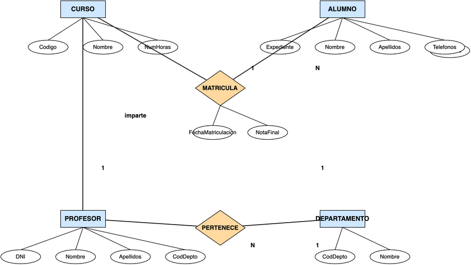

**Es demana:**

a) Obtindre el **model relacional** corresponent al diagrama E/R, indicant per a cada taula el seu **CP**, **CAlt**, **CAj** i **VNN**.

b) **Normalitzar** la taula d'alumnes per a eliminar l'atribut multivaluat *telefonos*, documentant el procés de 1FN i 2FN.

## **Ejercicio 2**

**EMPRESA**

El model E/R representa la gestió d'una **empresa**. L'entitat **DEPARTAMENT** s'identifica pel seu **CodDepto** i guarda el seu **Nom**. L'entitat **EMPLEAT** s'identifica pel seu **DNI** i guarda **Nom**, **Cognoms** i **Salario**. Un **departament** té **diversos empleats** i cada **empleat** pertany a **un únic departament** (relació N:1). L'entitat **PROJECTE** s'identifica pel seu **Codigo** i guarda el **Nom** i les **HorasPrevistas**. Un **empleat** pot **treballar en diversos projectes** i un **projecte** pot tindre **diversos empleats**; aquesta relació N:M es anomena **TREBALLA** i guarda l'atribut **NumHoras** dedicades per cada empleat a cada projecte.

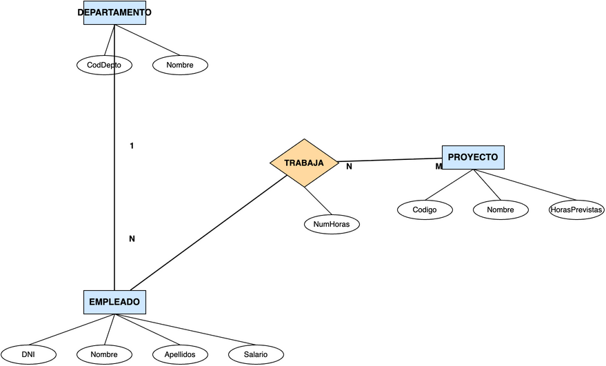

**Es demana:**

a) Obtindre el **model relacional** corresponent al diagrama E/R, indicant per a cada taula el seu **CP**, **CAlt**, **CAj** i **VNN**.

b) Documentar les **restriccions** que no poden plasmar-se en el disseny lògic. Es sap que:

- Un empleat pot treballar com a màxim en 3 projectes.

- El salario d'un empleat no pot superar els 5.000 €.

- Un departament pot no tindre empleats, però un empleat sempre pertany a un departament.

- Un projecte no pot estar sense empleats.

## **Ejercicio 3**

**CLÍNICA DENTAL**

El model E/R representa la gestió d'una **clínica dental**. L'entitat **PACIENT** s'identifica pel seu **NIF** i guarda **Nom**, **Cognoms**, **Telefono** i la **adreça** descompuesta en **Carrer**, **Numero**, **CP** i **Localitat**. L'entitat **DENTISTA** s'identifica pel seu **DNI** i guarda **Nom**, **Cognoms** i **Especialitat**. Un **pacient** té **diverses citas** i un **dentista** té **diverses citas**; aquesta relació N:M es anomena **CITA** i guarda la **Data**, la **Hora** i el **Tractament** realitzat. Un **pacient** pot tindre **diverses factures** i cada **factura** correspon a **un únic pacient** (relació N:1). L'entitat **FACTURA** s'identifica pel seu **NumFactura** i guarda la **FechaEmision** i el **ImporteTotal**. L'entitat **TRACTAMENT** s'identifica pel seu **Codigo** i guarda la **Descripcion** i el **Preu**. Una **factura** detalla **diversos trataments** i un **tractament** pot aparèixer en **diverses factures**; aquesta relació N:M es anomena **LINEA_FACTURA** i guarda la **Quantitat** de cada tractament en cada factura.

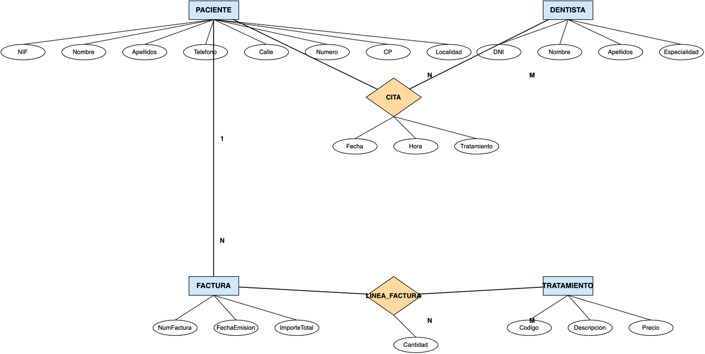

**Es demana:**

a) Obtindre el **model relacional** corresponent al diagrama E/R, indicant per a cada taula el seu **CP**, **CAlt**, **CAj** i **VNN**.

b) Documentar les **restriccions** que no poden plasmar-se en el disseny lògic.

## **Ejercicio 4**

**ESPECIALITZACIÓ**

El model E/R representa la gestió dels **empleats** d'una empresa mitjançant una **especialització**. L'entitat **EMPLEAT** s'identifica pel seu **DNI** i guarda **Nom**, **Cognoms** i **Salario**. Un empleat és de dos tipus possibles: l'entitat **TECNIC** guarda el seu **Especialitat** i l'entitat **COMERCIAL** guarda el seu **Zona**. L'especialització es representa amb el símbol **ISA**.

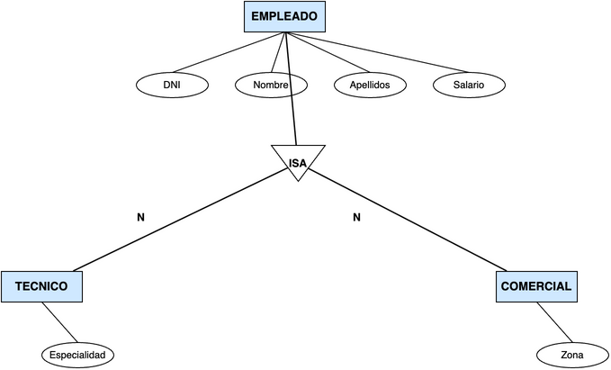

**Es demana:**

a) Obtindre el **model relacional** corresponent al diagrama E/R amb l'especialització, indicant per a cada taula el seu **CP**, **CAlt**, **CAj** i **VNN**.

b) Indicar en què casos es guardarían les dades de tècnics i comercials en **taules independents** i en què casos es guardarían en la **mateixa taula** que els empleats.

---


---

## 🎮 Retos Interactivos de Autoevaluación (+100 XP)

Comprueba tu dominio sobre **Cuaderno Completo de Actividades — UD3** superando estos 4 retos gamificados (+25 puntos cada uno):

<div class="interactive-mcq" data-answer="B" data-hint="Tota relació N:M genera una nova taula amb les claus primàries d'ambdues entitats com a clau composta i claus foranes.">
  <div class="mcq-question">🎯 <strong>Reto 1 (+25 pts):</strong> En la transformació del model E/R al model Relacional, com es transforma una relació binària amb correspondència N:M (molts a molts)?</div>
  <div class="mcq-options">
    <button type="button" class="btn-mcq-opt" data-opt="A">A) Es fusionen les dues entitats en una sola taula sense clau primària.</button>
    <button type="button" class="btn-mcq-opt" data-opt="B">B) Es crea una nova taula (relació) la clau primària de la qual és la composició de les claus foranes de les dues entitats.</button>
    <button type="button" class="btn-mcq-opt" data-opt="C">C) S'elimina la relació perquè el model relacional no admet N:M.</button>
    <button type="button" class="btn-mcq-opt" data-opt="D">D) Es duplica tota la base de dades en un segon servidor.</button>
  </div>
  <div class="quiz-feedback"></div>
</div>

<div class="interactive-mcq" data-answer="B" data-hint="La regla d'integritat d'entitat prohibeix valors nuls (NULL) en qualsevol atribut de la clau primària.">
  <div class="mcq-question">🎯 <strong>Reto 2 (+25 pts):</strong> Quina regla d'integritat del model relacional estableix que cap atribut que forme part de la clau primària d'una relació pot prendre el valor NULL?</div>
  <div class="mcq-options">
    <button type="button" class="btn-mcq-opt" data-opt="A">A) Integritat referencial.</button>
    <button type="button" class="btn-mcq-opt" data-opt="B">B) Integritat d'entitat.</button>
    <button type="button" class="btn-mcq-opt" data-opt="C">C) Tercera Forma Normal (3FN).</button>
    <button type="button" class="btn-mcq-opt" data-opt="D">D) Dependència transitiva.</button>
  </div>
  <div class="quiz-feedback"></div>
</div>

<div class="interactive-vf" data-answer="V" data-hint="La 3FN elimina les dependències funcionals transitives entre atributs que no formen part de la clau.">
  <div class="vf-statement">✅ <strong>Repte 3 (Vertader o Fals · +25 pts):</strong> Una relació es troba en Tercera Forma Normal (3FN) si està en 2FN i cap atribut no-clau depèn transitivament de la clau primària.</div>
  <div class="vf-buttons">
    <button type="button" class="btn-vf" data-opt="V">Vertader (V)</button>
    <button type="button" class="btn-vf" data-opt="F">Fals (F)</button>
  </div>
  <div class="quiz-feedback" style="width: 100%;"></div>
</div>

<div class="interactive-quiz" data-answer="clau forana|clau aliena|foreign key|fk" data-hint="En valencià s'anomena clau forana o clau aliena (FK).">
  <div class="quiz-question">⌨️ <strong>Repte 4 (+25 pts):</strong> Com s'anomena en el model relacional la clau (Foreign Key) que fa referència a la clau primària d'una altra taula per a mantenir la integritat referencial?</div>
  <div class="quiz-controls">
    <input type="text" class="quiz-input" placeholder="Escriu la resposta..." />
    <button type="button" class="btn-quiz-check">Comprovar</button>
  </div>
  <div class="quiz-feedback"></div>
</div>

### 📋 Llista de Comprovació i Rúbrica d'Assoliment

Marca cada criteri a mesura que completes l'estudi o la resolució pràctica d'aquesta pàgina (**Cuaderno Completo de Actividades — UD3**):

- [ ] He llegit detingudament la teoria o l'enunciat d'aquesta secció i he anotat els conceptes clau.
- [ ] He revisat els esquemes, taules o blocs de codi i he verificat que sé aplicar-los a l'entorn de treball.
- [ ] He resolt correctament els **4 reptes interactius** superiors obtenint els **100 puntos XP**.
- [ ] He descarregat el comprovant oficial en PDF per a adjuntar-lo a la tasca d'**Aules**.

<div class="aules-delivery-card">
  <h3>📤 Comprovant de Lliurament per a Aules</h3>
  <p>Quan hages completat els reptes interactius i la llista d'autoavaluació d'aquesta pàgina, introdueix el teu nom i descarrega el teu certificat oficial en PDF per a adjuntar-lo a la tasca d'<strong>Aules</strong>.</p>
  <div class="aules-student-field">
    <label for="aules-student-name">👤 Nom i Cognoms de l'Alumne/a:</label>
    <input type="text" id="aules-student-name" class="aules-student-name" placeholder="Ex: Joan Garcia Pérez" />
  </div>
  <div class="aules-score-badge">
    <span class="aules-score-count">0/4 reptes completats (0%) · 0 puntos · 0/4 criteris d'autoavaluació</span>
  </div>
  <div class="aules-actions">
    <button type="button" class="btn-aules-dl" data-module="BBDD" data-unit="UD03" data-activity="activitats">📥 Descarregar Comprovant PDF</button>
    <button type="button" class="btn-aules-copy">📋 Copiar Resum al Porta-retalls</button>
  </div>
  <div class="aules-toast"></div>
</div>
