# UD3: Diseño Lógico — Modelo Relacional y Normalización

Bienvenido/a a la **UD3: Diseño Lógico — Modelo Relacional y Normalización** del módulo profesional de **Bases de Datos** (1º DAW / DAM / ASIX · Bases de Datos).

En esta unidad encontrarás los contenidos teóricos, ejemplos prácticos, ejercicios resueltos y actividades de evaluación curricular desarrollados por el profesor **Manuel Alonso Argente**.

---

### 📑 Índice de Apartados y Actividades de la Unidad

- [**📋 3.0 Propuesta Didáctica: Diseño Lógico. Modelo Relacional. Normalización**](./ut0300.html)
- [**3.1 El modelo relacional**](./ut0301.html)
- [**3.2 Transformación al modelo relacional (I)**](./ut0302.html)
- [**3.3 Transformación al modelo relacional (II)**](./ut0303.html)
- [**3.4 Especialización**](./ut0304.html)
- [**3.5 Dependencias y restricciones**](./ut0305.html)
- [**3.6 Introducción a la normalización. 1ª Forma Normal**](./ut0306.html)
- [**3.7 ª y 3ª Forma Normal**](./ut0307.html)
- [**3.8 Otras formas normales: FNBC, 4FN y 5FN**](./ut0308.html)

**Actividades Prácticas y Fichas de Trabajo:**

- [**✏️ ACT301 301**](./act_act301.html)
- [**✏️ ACT302 302**](./act_act302.html)
- [**✏️ ACT303 303**](./act_act303.html)
- [**✏️ ACT304 304**](./act_act304.html)
- [**✏️ ACT305 305**](./act_act305.html)

---

# 📖 Vista Completa de la Unidad

## 3.0 Propuesta Didáctica — Diseño Lógico. Modelo Relacional. Normalización

# **Diseño Lógico. Modelo Relacional. Normalización**

## **Propuesta didáctica**

En esta UT vamos a continuar trabajando el **RA6**: Diseña modelos relacionales normalizados interpretando diagramas entidad/relación.

## **Criterios de evaluación**

### **Respecto al RA6**:

| Código | Descripción | Peso (%) | Herramientas Evaluación |
| --- | --- | --- | --- |
| **CE6a** | Se han utilizado herramientas gráficas para representar el diseño lógico. | 5% | ACT301 (5%) -- ACT305 (5%) -- EXA301 (90%) |
| **CE6b** | Se han identificado las tablas del diseño lógico. | 15% | ACT301 (5%) -- ACT302 (5%) -- ACT305 (5%) -- EXA301 (85%) |
| **CE6c** | Se han identificado los campos que forman parte de las tablas del diseño lógico. | 15% | ACT301 (5%) -- ACT302 (5%) -- ACT305 (5%) -- EXA301 (85%) |
| **CE6d** | Se han analizado las relaciones entre las tablas del diseño lógico. | 10% | ACT302 (5%) -- ACT305 (5%) -- EXA301 (90%) |
| **CE6e** | Se han identificado los campos clave. | 15% | ACT301 (5%) -- ACT302 (5%) -- ACT305 (5%) -- EXA301 (85%) |
| **CE6f** | Se han aplicado reglas de integridad. | 15% | ACT301 (5%) -- ACT305 (5%) -- EXA301 (90%) |
| **CE6g** | Se han aplicado reglas de normalización. | 15% | ACT303 (5%) -- ACT304 (5%) -- ACT305 (5%) -- EXA301 (85%) |
| **CE6h** | Se han analizado y documentado las restricciones que no pueden plasmarse en el diseño lógico. | 10% | ACT301 (5%) -- ACT305 (5%) -- EXA301 (90%) |

## **Contenidos**

### **Modelo Relacional:**

- **Modelo de datos.**

- **Terminología del modelo relacional.**

- **Tipos de datos.**

- **Claves primarias.**

- **Restricciones de validación.**

- **El valor NULL.**

- **Claves ajenas.**

### **Paso del Diagrama E/R al Modelo Relacional:**

- **Elementos del modelo relacional.**

- **Transformación de entidades y relaciones.**

- **Restricciones semánticas del modelo relacional.**

- **Especializaciones.**

- **Dependencias de existencia e identificación.**

- **Restricciones entre relaciones.**

### **Normalización:**

- **Teoría de la normalización.**

- **Dependencias funcionales.**

- **1ª, 2ª y 3ª Forma Normal.**

- **FNBC, 4FN y 5FN.**

- **Denormalización.**

> **📌 Cuestionario inicial**
> 

> 1. ¿Qué diferencia el modelo conceptual del lógico?

> 1. ¿Cuál es el elemento principal del modelo relacional?

> 1. ¿Podemos tener dos atributos con el mismo nombre?

> 1. Si una tabla tiene 3 columnas y 5 filas, ¿Cuál es su cardinalidad y grado?

> 1. ¿Podemos tener una tabla sin columnas?

> 1. ¿Y una tabla sin filas?

> 1. ¿Qué función tiene la clave primaria?

> 1. ¿Qué es una clave alternativa?

> 1. ¿Todas las tablas tienen más de una clave candidata?

> 1. ¿En qué consiste la integridad referencial?

> 1. ¿El valor de una clave ajena siempre debe tener valor?

> 1. ¿Qué es una dependencia funcional?

> 1. ¿Y una dependencia funcional completa?

> 1. ¿En qué consiste la 1FN? ¿Y la 2FN? ¿Y la 3FN?

> 1. ¿Qué es la denormalización y cuál es su objetivo?

## **Programación de Aula (20h)**

Esta unidad es la tercera, con lo que se imparte en la primera evaluación, durante la segunda quincena de octubre y las tres primeras semanas de noviembre, con una duración estimada de 20 horas lectivas (los días de clase son martes, miércoles y viernes, con dos horas, una hora y dos horas respectivamente):

### **Octubre 2026**

| Lunes | Martes | Miércoles | Jueves | Viernes | Sábado | Domingo |
| --- | --- | --- | --- | --- | --- | --- |
|  |  |  | 1 | 2 | **3 🛑** | **4 🛑** |
| 5 | 6 | 7 | 8 | 9 | **10 🛑** | **11 🛑** |
| **12 🛑** | 13 | 14 | 15 | 16 | **17 🛑** | **18 🛑** |
| 19 | 20 | 21 | 22 | 23 | **24 🛑** | **25 🛑** |
| 26 | **27 📚** | **28 📚** | 29 | **30 📚** | **31 🛑** |  |

> **📌 Leyenda**
> 

> 🛑 Día no lectivo (fin de semana o festivo) · 📚 Sesión de la U03.

### **Noviembre 2026**

| Lunes | Martes | Miércoles | Jueves | Viernes | Sábado | Domingo |
| --- | --- | --- | --- | --- | --- | --- |
| 2 | **3 📚** | **4 📚** | 5 | **6 📚** | **7 🛑** | **8 🛑** |
| 9 | **10 📚** | **11 📚** | 12 | **13 📚** | **14 🛑** | **15 🛑** |
| 16 | **17 📚** | **18 📚** | 19 | **20 📚** | **21 🛑** | **22 🛑** |
| 23 | 24 | 25 | 26 | 27 | **28 🛑** | **29 🛑** |
| 30 |  |  |  |  |  |  |

### **Sesiones**

| Sesión | Contenidos | Actividades | Criterios trabajados |
| --- | --- | --- | --- |
| 1 | El modelo relacional |  | CE6b, CE6c, CE6e |
| 2 | El modelo relacional | ACT301 | CE6e, CE6f, CE6h |
| 3 | Transformación al modelo relacional (I) | ACT301 | CE6b, CE6c, CE6e |
| 4 | Transformación al modelo relacional (II) |  | CE6a, CE6b, CE6c, CE6d, CE6e |
| 5 | Especialización |  | CE6b, CE6c, CE6e |
| 6 | Especialización | ACT302 | CE6b, CE6c, CE6e |
| 7 | Dependencias y restricciones (I) | ACT301 -- ACT302 | CE6d, CE6f |
| 8 | Dependencias y restricciones (II) | ACT301 -- ACT302 | CE6f, CE6h |
| 9 | Introducción a la normalización. 1FN |  | CE6g |
| 10 | 2ª y 3ª Forma Normal (I) |  | CE6g |
| 11 | 2ª y 3ª Forma Normal (II) | ACT303 | CE6g |
| 12 | FNBC, 4FN y 5FN |  | CE6g |
| 13 | Denormalización | ACT304 | CE6g |
| 14 | Actividades | ACT301 -- ACT302 -- ACT303 -- ACT304 -- ACT305 | CE6a, CE6b, CE6c, CE6d, CE6e, CE6f, CE6g, CE6h |
| 15 | Actividades | ACT301 -- ACT302 -- ACT303 -- ACT304 -- ACT305 | CE6a, CE6b, CE6c, CE6d, CE6e, CE6f, CE6g, CE6h |
| 16 | Actividades | ACT301 -- ACT302 -- ACT303 -- ACT304 -- ACT305 | CE6a, CE6b, CE6c, CE6d, CE6e, CE6f, CE6g, CE6h |
| 17 | Actividades | ACT301 -- ACT302 -- ACT303 -- ACT304 -- ACT305 | CE6a, CE6b, CE6c, CE6d, CE6e, CE6f, CE6g, CE6h |
| 18 | Actividades | ACT301 -- ACT302 -- ACT303 -- ACT304 -- ACT305 | CE6a, CE6b, CE6c, CE6d, CE6e, CE6f, CE6g, CE6h |
| 19 | Examen | EXA301 | CE6a, CE6b, CE6c, CE6d, CE6e, CE6f, CE6g, CE6h |
| 20 | Examen | EXA301 | CE6a, CE6b, CE6c, CE6d, CE6e, CE6f, CE6g, CE6h |

### **Seguimiento**

| Sesión | Contenidos | Actividades | Descripción | Fecha |
| --- | --- | --- | --- | --- |
| 1 | El modelo relacional |  | Se realiza la presentación de la UP y se introduce el contenido y los RA. Se ven los puntos 3.0 y 3.1 | 30/10/2026 |
| 2 | Transformación al modelo relacional (I) |  | Se ve hasta la transformación de las entidades débiles del punto 3.2 | 30/10/2026 |

---

## 3.1 El modelo relacional

# **El modelo relacional**

Una vez validado el **modelo conceptual** (diagrama Entidad/Relación) de nuestro sistema de información, el siguiente paso en el proceso de diseño de una base de datos consiste en transformarlo en un **modelo lógico**. Para ello utilizaremos el **modelo de datos relacional**, propuesto por **Edgar F. Codd** en 1970 y que está presente en la mayoría de los SGBD actuales.

El modelo relacional **organiza y representa los datos en forma de tablas o relaciones**. Así pues:

> **📌 Definición**
> 

> Una **base de datos relacional** es una colección de **relaciones** [tablas], cada una de las cuales tiene un **nombre único**.

```sql
TRABAJADORES
┌─────────────────────────────────────────────────┐
│ id_trabajador │ nombre │ tarifa_hr │ tipo_oficio │
├─────────────────────────────────────────────────┤
│ 001           │ Ana    │ 25        │ Soldador    │
│ 002           │ Luis   │ 20        │ Oficial     │
└─────────────────────────────────────────────────┘
```

El objetivo de esta unidad es obtener el **esquema relacional** de la base de datos, es decir, el conjunto de tablas con sus atributos, claves y restricciones, **independientemente del SGBD** que se vaya a utilizar posteriormente.

## **Elementos del modelo relacional**

Dentro de una relación (tabla) distinguimos los siguientes elementos:

- **Atributo (Ai)**: Elemento susceptible de tomar valores (cada una de las **columnas** de la tabla).

- **Dominio (Di)**: Conjunto de valores que puede tomar un atributo (se considera finito).

- **Tupla**: Cada uno de los elementos que contiene una instancia de la relación (**filas**).

| Término | En el modelo relacional | En la tabla |
| --- | --- | --- |
| **Atributo** | A1, A2, ..., An | Columnas |
| **Tupla** | (X1, X2, ..., Xn) | Filas |
| **Relación** | Esquema de la relación | Tabla |
| **Dominio** | D1, D2, ..., Dn | Tipo de datos de cada columna |

> **📌 Ejemplo**
> 

> Para la relación `TRABAJADORES` anterior:

> - **Atributos**: `id_trabajador`, `nombre`, `tarifa_hr`, `tipo_oficio`.

> - **Dominio de `tarifa_hr`**: número decimal (por ejemplo, `DECIMAL(5,2)`).

> - **Tupla**: cada fila de la tabla, por ejemplo `(001, Ana, 25, Soldador)`.

### **Dominio**

- El **dominio** de un atributo indica el **tipo de valores** que puede tomar un determinado campo. Dicho de otro modo, cada atributo sólo puede tomar un valor dentro del dominio en el que está inscrito.

- **Dos atributos diferentes pueden tener el mismo dominio**.

- No es más que un **tipo de dato**, que puede ser definido por el sistema (como `Integer` o `char`) o, uno más complejo, definido por el usuario.

> **📌 Importante**
> 

> La importancia de los dominios radica en que **cuando se desea realizar una relación entre dos o más tablas, las claves por las que se relacionan deben pertenecer forzosamente al mismo dominio**.

## **Esquema e instancia de la relación**

En una relación hay que distinguir dos aspectos:

- **Esquema de relación**: Los atributos A1...An que la componen.

  - p. ej. `Trabajadores (id_trabajadores, nombre, tarifa_hr, tipo_de_oficio, id_supv)`.

- **Instancia de la relación**: Conjunto de tuplas {(X1, X2,…,Xn)} = producto cartesiano D1xD2xD3...xDn que la componen en cada momento.

**Consecuencias** de la definición de relación como conjunto de tuplas:

- **No existen tuplas duplicadas** (concepto de clave primaria).

- **No existe orden** en las tuplas (ni en los atributos).

## **Esquema e instancia de la base de datos**

Una base de datos relacional es un **conjunto finito de relaciones** junto con una serie de **restricciones o reglas de integridad**:

- **Restricción de integridad**: Condición necesaria para preservar la **corrección semántica** de la base de datos.

- **Esquema de la base de datos**: Colección de esquemas de relaciones junto con las restricciones de integridad que se definen sobre las relaciones.

- **Instancia (o estado) de la base de datos**: Colección de instancias de relaciones que **verifican las restricciones** de integridad.

- **Base de datos relacional**: Instancia de la base de datos junto con su esquema.

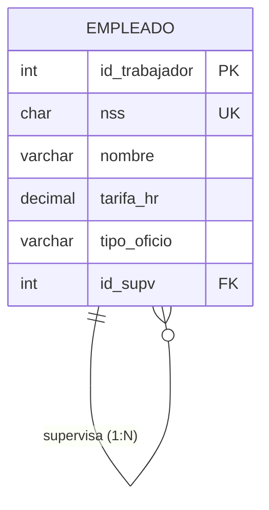

## **Restricciones de integridad**

Las restricciones de integridad garantizan que los datos almacenados sean correctos y mantengan las conexiones entre las tablas. Se clasifican en dos grandes grupos:

### **Asociadas a las tuplas de una relación**

En ocasiones **no se conoce el valor** de un atributo para una determinada tupla. En esos casos, a ese atributo de esa tupla se le asigna un **valor nulo (`NULL`)**, que indica que:

- El valor de ese atributo es **desconocido**, o

- simplemente, que ese atributo **no es aplicable** a esa tupla.

> **📌 El valor NULL**
> 

> El valor `NULL` **no es el cero** ni la cadena vacía, sino la **ausencia de valor**. Debe utilizarse con precaución, ya que puede provocar resultados impredecibles en las consultas y en las operaciones con datos.

### **Asociadas a las relaciones de la base de datos**

- **Clave primaria**: Conjunto de atributos **seleccionados para identificar unívocamente** a las tuplas de una relación.

- **Integridad de entidad**: Los atributos de la clave primaria **no pueden tomar valores nulos**, ya que la clave primaria debe permitirnos identificar unívocamente cada tupla de la relación.

### **Integridad referencial**

La **integridad referencial** mantiene las **conexiones entre las tablas** en las bases de datos relacionales, mediante las **claves ajenas (o foráneas)**:

- `imparte.NRP ∈ profesor.NRP`: El profesor que imparte una asignatura **debe existir** en la tabla profesores.

- `cuenta.sucursal ∈ sucursal.numero`: Una cuenta **tiene que pertenecer a una sucursal existente**.

> **📌 Resumen**
> 

| Restricción | Función |
| --- | --- |
| **Integridad de entidad** | La clave primaria no puede ser `NULL`. |
| **Integridad referencial** | Toda clave ajena debe hacer referencia a una tupla existente en la tabla relacionada. |
| **Clave ajena (FK)** | Atributo que referencia a la clave primaria de otra tabla, manteniendo la relación entre tablas. |

### **Claves en el modelo relacional**

En el modelo relacional, además de la clave primaria (CP), podemos encontrar otros tipos de claves:

- **Clave candidata**: Conjunto de atributos que puede identificar unívocamente a las tuplas (unívoco y mínimo).

- **Clave primaria (CP)**: Clave candidata elegida por el diseñador para identificar cada tupla.

- **Clave alternativa (CAlt)**: Claves candidatas que **no** han sido elegidas como clave primaria.

- **Clave ajena (CAj)**: Atributo que referencia a la clave primaria de otra relación.

> **📌 Nomenclatura**
> 

> En el **diccionario de datos** representaremos cada tabla con su esquema y sus claves. Por ejemplo:

```sql
TRABAJADORES (id_trabajadores, nombre, tarifa_hr, tipo_oficio, id_supv)
CP: {id_trabajadores}
CAj: {id_supv} → TRABAJADORES   (relación reflexiva: jefe)
```

## **Ejercicios propuestos**

> **📌 Ejercicio 1**
> 

> Dada la siguiente instancia de la relación `ALUMNO`, indica:

| num_expediente | dni | nombre | telefono | fecha_nac |
| --- | --- | --- | --- | --- |
| 001 | 12345678A | Ana | 611111111 | 12/03/2007 |
| 002 | 87654321B | Luis | 622222222 | 05/07/2006 |
| 003 | 13579246C | Eva | NULL | 28/11/2006 |

> 1. ¿Cuál es el esquema de la relación?

> 1. ¿Cuál es el grado de la relación? ¿Y su cardinalidad?

> 1. Identifica las claves candidatas y propón una clave primaria.

> 1. ¿Qué significaría el valor `NULL` en el atributo `telefono` de Eva?

> **📌 Ejercicio 2**
> 

> Indica qué restricción de integridad incumple cada una de las siguientes situaciones:

> 1. Se intenta insertar una tupla en `PEDIDO` con `id_cliente = 999`, y ese cliente no existe en la tabla `CLIENTE`.

> 1. Se intenta insertar una tupla en `EMPLEADO` con valor `NULL` en el atributo `dni` (clave primaria).

> 1. Se intenta insertar dos tuplas en `PRODUCTO` con el mismo valor en la clave primaria `codigo`.

> **📌 Ejercicio 3**
> 

> Dada la relación `TRABAJADORES (id_trabajador, nss, nombre, tarifa_hr, id_supv)`:

> 1. Indica un ejemplo de **clave alternativa**.

> 1. Indica un ejemplo de **clave ajena** y a qué tabla hace referencia.

> 1. Razona si `nss` y `id_trabajador` pertenecen al mismo dominio.

---

## 3.2 Transformación al modelo relacional (I)

# **Transformación al modelo relacional (I)**

El paso del **diseño conceptual** (diagrama E/R) al **modelo relacional** consiste en transformar todos los elementos del diagrama Entidad/Relación en **tablas** con sus atributos, claves y restricciones.

## **Reglas de transformación**

Para transformar un diagrama E/R en un esquema relacional seguiremos los siguientes pasos:

1. Se transforman en tablas **todos los tipos de entidades y relaciones** que aparecen en el diagrama E/R.

1. Se **seleccionan las claves primarias** para cada una de las tablas de nuestro esquema lógico.

1. **Fusión de tablas**: se combinan aquellas tablas que compartan su clave primaria.

1. **Normalización**: se normaliza el esquema resultante.

1. Se definen **todas las restricciones de integridad** que sean aplicables al esquema obtenido.

## **Transformación de entidades**

Toda **entidad** del modelo E/R se transforma en una **relación (tabla)** del modelo relacional:

- **Atributos**: Todos los atributos de la entidad se transforman en un atributo de la relación.

- **Clave primaria**: Una de las claves candidatas del conjunto de entidades.

- **Atributos compuestos**: Se incluyen en la relación los **atributos simples (atómicos)** que forman parte del atributo compuesto.

- **Atributos derivados**: **No se almacenarán** en la base de datos, por lo que **no se incluyen** como atributos de las relaciones.

> **📌 Ejemplo**
> 

> Dada la entidad `EMPLEADO` con los atributos:

> - Identificador principal: `DNI`

> - Identificador alternativo: `NSS`

> - Compuesto: `Nombre` (Nombre, Ape-1, Ape-2)

> - Simples: `Edad`, `Sueldo`

> - Multievaluado: `telefono`

> - Derivado: `Antiguedad`

> La transformación al modelo relacional quedaría:

```sql
Empleado (DNI:cad-9, NSS:cad-9, {Nombre:cad-30, Ape-1:cad-30, Ape-2:cad-30}, Edad:num, Sueldo:moneda, {telefono:cad-9}n)
CP: {DNI}
CAlt: {NSS}
VNN: {Edad}
```

Observa que:

- El atributo compuesto `Nombre` se ha descompuesto en sus **atributos atómicos**.

- El atributo derivado `Antiguedad` **no aparece** en la relación.

- El atributo multievaluado `telefono` se mantiene como una lista `{...}n` (se resolverá en la **normalización**).

## **Transformación de entidades débiles**

Una **entidad débil** depende existencialmente de una **entidad fuerte**:

- **Atributos**: Además de los atributos propios de la entidad débil, se añaden los atributos pertenecientes a la **clave primaria de la entidad fuerte** de la que depende existencialmente.

- **Clave primaria**: La clave primaria de la **entidad fuerte más un conjunto de atributos propios** de la entidad débil (**discriminante**).

- **Clave ajena**: Una clave que hace referencia a la **entidad fuerte** de la que depende existencialmente la entidad débil.

> **📌 Ejemplo**
> 

> La entidad débil `EDICION` depende de la entidad fuerte `CURSO`. Si `CURSO (Cod-Cur)` y los atributos propios de `EDICION` son `{Edicion, Fecha, Plazas}`:

```sql
Edicion (Cod-Cur:cad-4, Edicion:num, Fecha:fecha, Plazas:num)
CP: {Cod-Cur, Edicion}
CAj: {Cod-Cur} → CURSO
VNN: {Edicion, Fecha}
```

La clave primaria es compuesta: la clave de la entidad fuerte (`Cod-Cur`) más el discriminante (`Edicion`).

## **Transformación de relaciones unarias**

Las **relaciones unarias o reflexivas** son aquellas en las que interviene **una única entidad**. La forma de transformarlas depende del **tipo de correspondencia**:

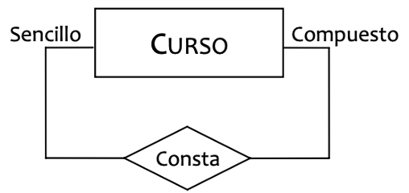

- **Relación Unaria 1:1** → La **clave ajena** será también **clave alternativa**.

- **Relación Unaria 1:N** → Trabajamos con la **clave ajena** solamente.

- **Relación Unaria N:N** → La relación E/R pasa a tratarse como una **nueva relación** del modelo.

### **Relaciones unarias 1:1**

Dada la entidad `EMPLEADO` con la relación reflexiva `SUPERVISA` 1:1 (un empleado supervisa a un único empleado y viceversa):

```sql
Empleado (DNI:cad-9, NSS:cad-9, {Nombre:cad-30, Ape-1:cad-30, Ape-2:cad-30}, Edad:num, Sueldo:moneda, {telefono:cad-9}n, DNI-J:cad-9, Turno:num)
CP: {DNI}
CAlt: {NSS}, {DNI-J}
VNN: {Edad}
CAj: {DNI-J} → EMPLEADO
```

- **Clave ajena** → `DNI-J`, pero igualmente podríamos haber cogido `DNI-S`.

- **Clave alternativa** → `DNI-J`, es decir, **la CAj debe ser alternativa** para garantizar la relación tipo 1:1.

- **Atributos de la relación** → `Turno`, los atributos de la relación deben ir junto con la CAj que representa a la relación.

### **Relaciones unarias 1:N**

Dada la entidad `EMPLEADO` con la relación reflexiva `SUPERVISA` 1:N (un jefe supervisa a muchos empleados):

```sql
Empleado (DNI:cad-9, NSS:cad-9, {Nombre:cad-30, Ape-1:cad-30, Ape-2:cad-30}, Edad:num, Sueldo:moneda, {telefono:cad-9}n, DNI-J:cad-9, Turno:num)
CP: {DNI}
CAlt: {NSS}
VNN: {Edad}
CAj: {DNI-J} → EMPLEADO
```

- **Clave ajena** → `DNI-J`, ya que el jefe puede tener **muchos subordinados**, pero un subordinado tendrá un **único jefe**.

  - Si la relación hubiera tenido el muchos hacia el Jefe, la clave ajena tendría que ser `DNI-S`.

- **Atributos de la relación** → `Turno`, los atributos de la relación deben ir junto con la CAj que representa a la relación.

> **📌 Diferencia con el caso 1:1**
> 

> En la relación **1:N la clave ajena no es alternativa**, ya que un mismo jefe puede aparecer en muchas tuplas.

### **Relaciones unarias N:N**

En este caso **NO** vamos a añadir los elementos relativos a la relación a la tabla de la entidad, sino que tenemos que **crear una nueva relación**, así nuestra nueva relación quedará como sigue:

```sql
Supervisa (DNI-J:cad-9, DNI-S:cad-9, Turno:num)
CP: {DNI-J, DNI-S}
CAj: {DNI-J} → EMPLEADO
CAj: {DNI-S} → EMPLEADO
```

- **Clave principal** → Es una **clave compuesta**, por un lado `DNI-J` representa a los Empleados Jefes, y por el otro `DNI-S` representa a los Empleados Subordinados, así tendremos una fila por cada conexión jefe-subordinado que se establezca entre nuestros empleados.

- **Clave ajena** → En este caso tendremos **dos**, y ambas con Dependencia de Identificación:

  - `DNI-J` → conecta con empleados asignando la función de jefe.

  - `DNI-S` → conecta con empleados asignando la función de subordinado.

- **Atributos de la relación** → `Turno`, los atributos de la relación deben ir junto con la clave ajena que representa a la relación.

> **📌 Resumen relaciones unarias**
> 

| Tipo de correspondencia | Transformación | Clave ajena |
| --- | --- | --- |
| **1:1** | Se añade la CAj a la entidad | CAj que además es **clave alternativa** |
| **1:N** | Se añade la CAj a la entidad | CAj en el lado del **muchos** |
| **N:N** | Se crea una **nueva relación** | La CAj forma parte de la **clave primaria** |

## **Ejercicios propuestos**

> **📌 Ejercicio 1**
> 

> Dada la entidad fuerte `PROFESOR (Cod-Prof, nombre, apellidos, departamento)` y la entidad débil `EDICION_ASIG`, de la que se conocen los atributos `{Cod-Edi, FechaInicio, Aula}` y que depende de la entidad `ASIGNATURA (Cod-Asig, nombre, creditos)`:

> 1. Obtén el esquema relacional de las tres tablas, indicando CP, CAlt, CAj y VNN.

> 1. Razona cuál es el discriminante de la entidad débil.

> **📌 Ejercicio 2**
> 

> La entidad `EMPLEADO` participa en la relación reflexiva `GESTIONA` de tipo **1:1** (cada empleado gestiona un único empleado y viceversa). Si la clave primaria es `DNI`, indica:

> 1. ¿Qué atributo debe añadirse a la tabla EMPLEADO?

> 1. ¿Debe esa clave ajena ser además clave alternativa? ¿Por qué?

> **📌 Ejercicio 3**
> 

> Indica qué transformación habría que aplicar (añadir CAj a la entidad o crear una nueva relación) para cada uno de los siguientes casos de relaciones unarias sobre la entidad `PIEZA (Cod-Pieza, nombre, peso)`:

> 1. Una pieza se **compone** de muchas piezas y una pieza forma parte de una única pieza (COMPONE 1:N).

> 1. Una pieza **sucede** a una única pieza y viceversa (SUCEDE 1:1).

> 1. Una pieza **comparte** con muchas otras piezas (COMPARTE N:N).

---

## 3.3 Transformación al modelo relacional (II)

# **Transformación al modelo relacional (II)**

En esta página vamos a aumentar el grado de las relaciones del modelo E/R y trabajaremos con las **relaciones binarias** y **ternarias**.

## **Transformación de relaciones binarias**

Con las relaciones binarias se pretende **conectar dos entidades**. Al igual que con las relaciones unarias, vamos a trabajar con un supuesto en el que iremos cambiando el tipo de correspondencia de la relación.

- **Relación Binaria 1:1** → La **clave ajena** se puede incluir en **cualquiera de las dos relaciones** (generalmente en la relación donde menos atributos tengamos). Lo que hay que tener en cuenta es que **la clave ajena (esté en la relación que esté) será también clave alternativa**.

- **Relación Binaria 1:N** → Trabajamos con la **clave ajena** solamente. Ponemos el **Atributo Identificador Principal** de la entidad hacia donde tenemos **Cardinalidad Máxima 1** como **clave ajena** en la entidad hacia donde tenemos **Cardinalidad Máxima N**.

- **Relación Binaria N:N** → La relación E/R pasa a tratarse como una **nueva relación** del modelo.

### **Relaciones binarias 1:1**

Vamos a ver cómo transformar la relación `OCUPA` entre `EMPLEADO` y `PUESTO`, analizando las dos opciones posibles poniendo la clave ajena en una o en otra entidad.

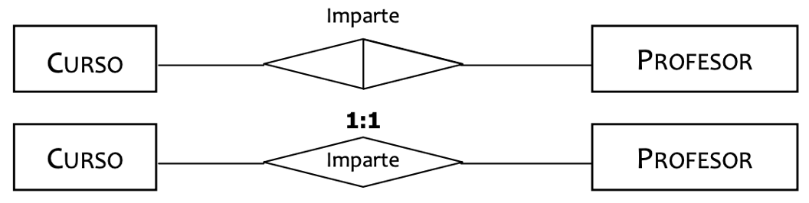

Opción 1Opción 2

**Clave ajena en la relación EMPLEADO.**

```sql
Empleado (DNI:cad-9, NSS:cad-9, {Nombre:cad-30, Ape-1:cad-30, Ape-2:cad-30}, Edad:num, Sueldo:moneda, {telefono:cad-9}n, Cod-P:cad-9, Turno:num)
CP: {DNI}
CAlt: {NSS}, {Cod-P}
VNN: {Edad}
CAj: {Cod-P} → PUESTO
```

Añadimos a la relación `EMPLEADO` dos nuevos atributos: `Cod-P` (clave principal de la relación `PUESTO`) que será la clave ajena permitiéndonos conectar las dos relaciones, y por otro lado el atributo `Turno`, que es el atributo de la relación `OCUPA` (en E/R).

**Clave ajena en la relación PUESTO.**

```sql
Puesto (Cod-P:cad-9, Descripcion:cad-30, Horario:num, DNI:cad-9, Turno:num)
CP: {Cod-P}
CAlt: {DNI}
CAj: {DNI} → EMPLEADO
```

Añadimos a la relación `PUESTO` dos nuevos atributos: `DNI` (clave principal de la relación `EMPLEADO`) que será la clave ajena permitiéndonos conectar las dos relaciones, y por otro lado el atributo `Turno`, que es el atributo de la relación `OCUPA` (en E/R).

> **📌 ¿Qué opción elegir?**
> 

> Se elige la opción donde la relación quede con el **menor número posible de atributos**. En este caso lo más normal sería elegir la **Opción 2**, ya que `PUESTO` tiene menos atributos que `EMPLEADO`.

### **Relaciones binarias 1:N**

Vamos a ver cómo transformar la relación `OCUPA` 1:N entre `EMPLEADO` y `PUESTO`, considerando las dos posibilidades de este tipo de relación.

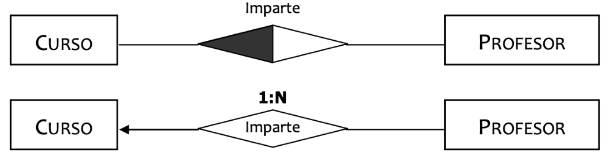

1 EMPLEADO – N PUESTOSN EMPLEADOS – 1 PUESTO

**Clave ajena en la relación PUESTO.**

```sql
Puesto (Cod-P:cad-9, Descripcion:cad-30, Horario:num, DNI:cad-9, Turno:num)
CP: {Cod-P}
CAj: {DNI} → EMPLEADO
```

Añadimos a la relación `PUESTO` dos nuevos atributos: `DNI` (clave principal de la relación `EMPLEADO`) que será la clave ajena permitiéndonos conectar las dos relaciones, y por otro lado el atributo `Turno`, que es el atributo de la relación `OCUPA` (en E/R).

**Clave ajena en la relación EMPLEADO.**

```sql
Empleado (DNI:cad-9, NSS:cad-9, {Nombre:cad-30, Ape-1:cad-30, Ape-2:cad-30}, Edad:num, Sueldo:moneda, {telefono:cad-9}n, Cod-P:cad-9, Turno:num)
CP: {DNI}
CAlt: {NSS}
VNN: {Edad}
CAj: {Cod-P} → PUESTO
```

Añadimos a la relación `EMPLEADO` dos nuevos atributos: `Cod-P` (clave principal de la relación `PUESTO`) que será la clave ajena permitiéndonos conectar las dos relaciones, y por otro lado el atributo `Turno`, que es el atributo de la relación `OCUPA` (en E/R).

> **📌 Importante**
> 

> Observamos que en **ninguno de los dos casos la clave ajena aparece como clave alternativa**. La clave ajena se coloca siempre en la entidad del lado de **cardinalidad máxima N**.

### **Relaciones binarias N:N**

En este caso la transformación de la relación que tenemos en el Modelo E/R a Modelo Relacional **solamente se puede hacer de una forma**. No tenemos que modificar las relaciones correspondientes a las entidades sino que **creamos una nueva relación** en el Modelo Relacional:

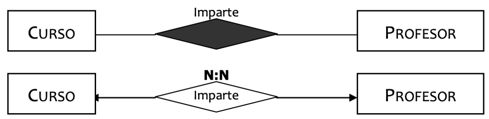

```sql
Ocupa (Cod-P:cad-9, DNI:cad-9, Turno:num)
CP: {Cod-P, DNI}
CAj: {DNI} → EMPLEADO
CAj: {Cod-P} → PUESTO
```

Como podemos ver:

- **Toma el nombre** de la Relación del Modelo E/R.

- Cuenta con una **clave principal compuesta** por las claves principales de las relaciones que interconecta.

- Las **claves ajenas son los atributos** que integran la clave principal.

> **📌 Resumen relaciones binarias**
> 

| Tipo de correspondencia | Transformación | Clave ajena |
| --- | --- | --- |
| **1:1** | Se añade la CAj a una de las dos entidades | CAj que además es **clave alternativa** |
| **1:N** | Se añade la CAj a la entidad del lado **N** | CAj en el lado del **muchos** |
| **N:N** | Se crea una **nueva relación** | Las CAj forman parte de la **clave primaria** |

## **Transformación de relaciones ternarias**

Para la transformación de **relaciones ternarias** del Modelo E/R, siempre tendremos que **crear una relación nueva** en el Modelo Relacional. Dependiendo del tipo de correspondencia nos encontramos con las siguientes cuatro posibilidades:

| Tipo de correspondencia | Clave principal | Claves alternativas | Valor no nulo |
| --- | --- | --- | --- |
| **N:N:N** | Las **3 CAj** | — | — |
| **1:N:N** | Las **2 CAj** de cardinalidad N | — | La CAj de cardinalidad 1 |
| **1:1:N** | La CAj de cardinalidad **N** + **1** de las de cardinalidad 1 | (CAj N, CAj VNN) | La 3ª CAj |
| **1:1:1** | Un par de CAj | Los otros **2 pares** de CAj | La CAj que no está en la CP |

Utilizaremos como ejemplo la relación ternaria `DOCENCIA` entre `ALUMNO (NEXP)`, `PROFESOR (DNI-P)` y `ASIGNATURA (Cod-A)`, con los atributos `{Ev-1:nota, Ev-2:nota, Ev-3:nota}`.

### **Relaciones ternarias N:N:N**

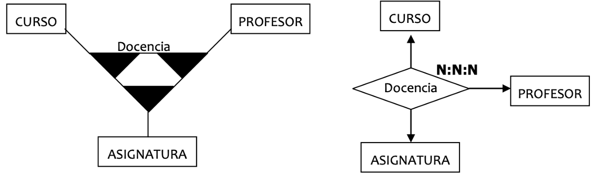

```sql
Docencia (NEXP:cad-6, DNI-P:cad-9, Cod-A:cad-6, {Ev-1:nota, Ev-2:nota, Ev-3:nota})
CP: {NEXP, DNI-P, Cod-A}
CAj: {NEXP} → ALUMNO
CAj: {DNI-P} → PROFESOR
CAj: {Cod-A} → ASIGNATURA
```

En la **clave principal** tenemos las **3 claves ajenas**. Además, en la relación tendremos que incluir los **atributos que tenga la relación ternaria** del Modelo E/R.

### **Relaciones ternarias 1:N:N**

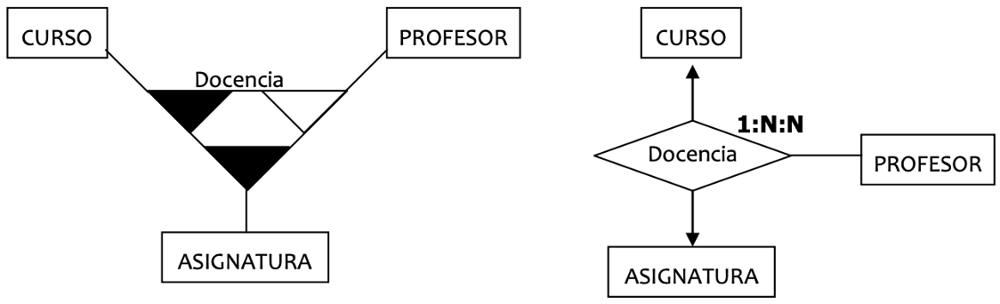

```sql
Docencia (NEXP:cad-6, DNI-P:cad-9, Cod-A:cad-6, {Ev-1:nota, Ev-2:nota, Ev-3:nota})
CP: {NEXP, DNI-P}
VNN: {Cod-A}
CAj: {NEXP} → ALUMNO
CAj: {DNI-P} → PROFESOR
CAj: {Cod-A} → ASIGNATURA
```

1º.- En la **clave principal** de nuestra nueva relación, debemos tener las **claves ajenas** que nos llevan a las dos entidades que se encuentran en los vértices de **cardinalidad N**, es decir, `ALUMNO` y `PROFESOR`.
2º.- La **3ª clave ajena**, la que corresponde a la entidad que está en el vértice de **cardinalidad 1**, debe marcarse como **atributo obligatorio**, es decir, **valor no nulo (VNN)**.

### **Relaciones ternarias 1:1:N**

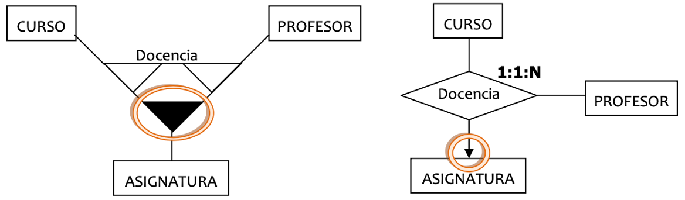

```sql
Docencia (NEXP:cad-6, DNI-P:cad-9, Cod-A:cad-6, {Ev-1:nota, Ev-2:nota, Ev-3:nota})
CP: {NEXP, DNI-P}
CAlt: {NEXP, Cod-A}
VNN: {Cod-A}
CAj: {NEXP} → ALUMNO
CAj: {DNI-P} → PROFESOR
CAj: {Cod-A} → ASIGNATURA
```

1º.- En la **clave principal** de nuestra nueva relación, debemos tener **obligatoriamente** la **clave ajena** que nos lleva a la entidad que se encuentra en el vértice de **cardinalidad N**, es decir, `ALUMNO`.
2º.- Además incluiremos **una de las claves ajenas** que corresponden a las entidades que están en los vértices de **cardinalidad 1**.
3º.- La **3ª clave ajena**, la que corresponde a la entidad que está en el vértice de **cardinalidad 1** que todavía no se ha usado, debe marcarse como **atributo obligatorio**, es decir, **valor no nulo (VNN)**.
4º.- Por último debemos establecer como **clave alternativa** el **par** formado por la **clave ajena de cardinalidad N** y la **clave ajena** que no entra en la clave principal y que hemos marcado con **VNN**.

### **Relaciones ternarias 1:1:1**

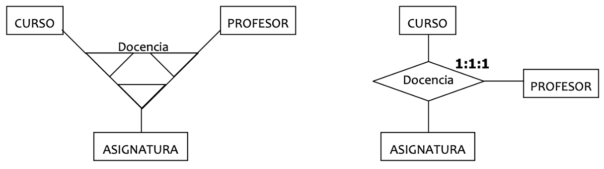

```sql
Docencia (NEXP:cad-6, DNI-P:cad-9, Cod-A:cad-6, {Ev-1:nota, Ev-2:nota, Ev-3:nota})
CP: {NEXP, DNI-P}
CAlt: {NEXP, Cod-A}
CAlt: {DNI-P, Cod-A}
VNN: {Cod-A}
CAj: {NEXP} → ALUMNO
CAj: {DNI-P} → PROFESOR
CAj: {Cod-A} → ASIGNATURA
```

1º.- Como paso inicial, creamos **3 claves alternativas**, cada una de ellas formada por un **par de claves ajenas** de dos de nuestras entidades.
2º.- Usaremos **una de estas claves alternativas como clave principal**.
3º.- La **3ª clave ajena**, que no está incluida en la clave principal, debe marcarse como **atributo obligatorio**, es decir, **valor no nulo (VNN)**.

## **Ejercicios propuestos**

> **📌 Ejercicio 1**
> 

> Dadas las entidades `EMPLEADO (DNI, NSS, nombre)` y `PROYECTO (Cod-Proy, nombre, presupuesto)`, transforma al modelo relacional la relación binaria `TRABAJA` para cada uno de los siguientes casos, indicando CP, CAlt, CAj y VNN:

> 1. Un empleado trabaja en un único proyecto y un proyecto lo forman muchos empleados (**1:N**).

> 1. Un empleado trabaja en varios proyectos y un proyecto lo forman varios empleados (**N:N**).

> 1. Un empleado trabaja en un único proyecto y un proyecto lo dirige un único empleado (**1:1**).

> **📌 Ejercicio 2**
> 

> Sea la relación ternaria `EVALUA` entre `ALUMNO (NEXP)`, `PROFESOR (DNI-P)` y `MODULO (Cod-Mod)` de tipo **1:1:N**, con atributo `nota`:

> 1. Obtén el esquema relacional indicando CP, CAlt, VNN y CAj.

> 1. Justifica cada uno de los elementos de la solución.

> **📌 Ejercicio 3**
> 

> Indica el tipo de correspondencia de una relación ternaria si en su transformación al modelo relacional:

> 1. Las tres claves ajenas forman la clave principal.

> 1. Dos claves ajenas forman la clave principal y la tercera es VNN.

> 1. La clave principal está formada por un par de claves ajenas y existen dos claves alternativas.

---

## 3.4 Especialización

# **Especialización**

En la unidad anterior vimos el concepto de **generalización/especialización** del modelo E/R extendido, que permite modelar una jerarquía entre un **supertipo** (entidad padre) y varios **subtipos** (entidades hijas) mediante una relación **ES-UN**.

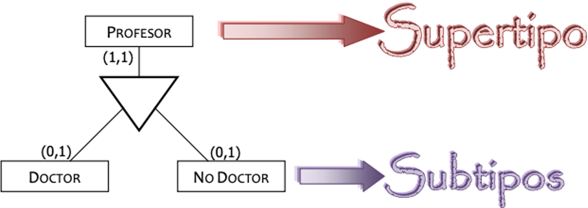

En este tema vamos a estudiar la **transformación al modelo relacional** de estas jerarquías. Según el tipo de especialización nos encontraremos con las siguientes cuatro posibilidades:

- **Especialización parcial y solapada.**

- **Especialización total y solapada.**

- **Especialización parcial y disjunta.**

- **Especialización total y disjunta.**

Recuerda que una especialización puede ser:

|  | Total | Parcial |
| --- | --- | --- |
| **Disjunta** | Todo elemento del supertipo está en **uno** de los subtipos. | No todos los elementos del supertipo están en los subtipos, y si lo están, en **uno** solo. |
| **Solapada** | Todo elemento del supertipo está en **al menos uno** de los subtipos. | No todos los elementos del supertipo están en los subtipos, pudiendo estar en **varios** a la vez. |

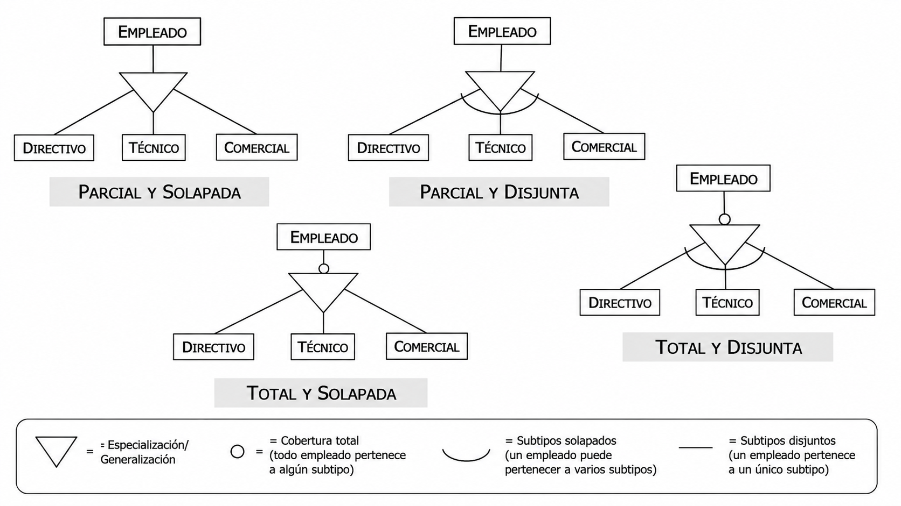

## **Transformación general**

En todos los casos la **transformación básica** es la misma. Tomando como ejemplo el supertipo `PARTICIPANTE` y los subtipos `JUGADOR` y `ARBITRO`:

```sql
Participante (Num-Asoc:cad-6, nombre:cad-60, Telefono:cad-9, Direccion:cad-60)
CP: {Num-Asoc}

Jugador (Num-Asoc:cad-6, Nivel:num)
CP: {Num-Asoc}
CAj: {Num-Asoc} → PARTICIPANTE

Arbitro (Num-Asoc:cad-6, Categoria:cad-9)
CP: {Num-Asoc}
CAj: {Num-Asoc} → PARTICIPANTE
```

- El **supertipo** se transforma en una tabla con los atributos y las relaciones comunes.

- Cada **subtipo** se transforma en una tabla con sus atributos propios.

- La clave primaria de cada subtipo es la misma que la del supertipo, que actúa a su vez como **clave ajena** hacia el supertipo.

La diferencia entre los cuatro casos está en las **restricciones de integridad (R.I.)** que debemos añadir al esquema.

## **Especialización parcial y solapada**

- **PARCIAL** → No todos los elementos del supertipo deben estar incluidos en alguno de los subtipos.

- **SOLAPADA** → Un elemento del supertipo puede encontrarse en **varios** subtipos.

```sql
Participante (Num-Asoc:cad-6, nombre:cad-60, Telefono:cad-9, Direccion:cad-60)
CP: {Num-Asoc}

Jugador (Num-Asoc:cad-6, Nivel:num)
CP: {Num-Asoc}
CAj: {Num-Asoc} → PARTICIPANTE

Arbitro (Num-Asoc:cad-6, Categoria:cad-9)
CP: {Num-Asoc}
CAj: {Num-Asoc} → PARTICIPANTE
```

No se añade ninguna restricción de integridad extra.

## **Especialización total y solapada**

- **TOTAL** → Todos los elementos del supertipo deben estar incluidos en alguno de los subtipos.

- **SOLAPADA** → Un elemento del supertipo puede encontrarse en **varios** subtipos.

La transformación coincide con la transformación básica que ya hemos mostrado en el caso general. Pero además debemos incluir una **restricción de integridad** que especifique:

> **📌 R.I. (TOTAL)**
> 

> **TODO ELEMENTO DE LA ENTIDAD SUPERTIPO `PARTICIPANTE` DEBE ESTAR AL MENOS EN UNA DE LAS ENTIDADES SUBTIPO.**

## **Especialización parcial y disjunta**

- **PARCIAL** → No todos los elementos del supertipo deben estar incluidos en alguno de los subtipos.

- **DISJUNTA** → Un elemento del supertipo puede encontrarse **solamente en uno** de los subtipos.

La transformación coincide con la transformación básica que ya hemos mostrado en el caso general. Pero además debemos incluir una **restricción de integridad** que especifique:

> **📌 R.I. (DISJUNTA)**
> 

> **TODO ELEMENTO DE LA ENTIDAD SUPERTIPO `PARTICIPANTE` PODRÁ ESTAR SOLAMENTE EN UNA DE LAS ENTIDADES SUBTIPO.**

## **Especialización total y disjunta**

- **TOTAL** → Todos los elementos del supertipo deben estar incluidos en alguno de los subtipos.

- **DISJUNTA** → Un elemento del supertipo puede encontrarse **solamente en uno** de los subtipos.

La transformación coincide con la transformación básica que ya hemos mostrado en el caso general. Pero además debemos incluir las **dos restricciones de integridad**:

> **📌 R.I. (TOTAL)**
> 

> **TODO ELEMENTO DE LA ENTIDAD SUPERTIPO `PARTICIPANTE` DEBE ESTAR AL MENOS EN UNA DE LAS ENTIDADES SUBTIPO.**

> **📌 R.I. (DISJUNTA)**
> 

> **TODO ELEMENTO DE LA ENTIDAD SUPERTIPO `PARTICIPANTE` PODRÁ ESTAR SOLAMENTE EN UNA DE LAS ENTIDADES SUBTIPO.**

## **Resumen**

| Especialización | R.I. que se añade |
| --- | --- |
| **Parcial y solapada** | Ninguna |
| **Total y solapada** | R.I. (TOTAL): todo elemento del supertipo está en **al menos un** subtipo. |
| **Parcial y disjunta** | R.I. (DISJUNTA): todo elemento del supertipo está **solamente en un** subtipo. |
| **Total y disjunta** | R.I. (TOTAL) + R.I. (DISJUNTA) |

> **📌 Restricciones no plasmables en el diseño lógico**
> 

> Estas restricciones de integridad (**TOTAL** y **DISJUNTA**) **no pueden plasmarse directamente en el diseño lógico** y deberán documentarse en el **diccionario de datos**, para poder implementarlas posteriormente mediante triggers o procedimientos en el modelo físico. Este es el criterio de evaluación **CE6h**.

## **Ejercicios propuestos**

> **📌 Ejercicio 1**
> 

> Dado el supertipo `VEHICULO (Matricula, marca, modelo, anio)` y los subtipos `CAMION (tara)` y `TURISMO (num_plazas)`:

> 1. Obtén el esquema relacional indicando CP, CAj y VNN.

> 1. Añade las restricciones de integridad necesarias si la especialización es **total y disjunta**.

> **📌 Ejercicio 2**
> 

> Indica qué restricción o restricciones de integridad habría que añadir en cada uno de los siguientes casos:

> 1. Todo `EMPLEADO` es, como mínimo, `TECNICO`, `COMERCIAL` o `DIRECTIVO`, pero nunca dos a la vez.

> 1. Un `EMPLEADO` puede ser o no `COMERCIAL`, y si lo es, también puede ser `TECNICO`.

> 1. Todo `EMPLEADO` es necesariamente `TECNICO`, `COMERCIAL` o `DIRECTIVO`, pudiendo ser varios a la vez.

---

## 3.5 Dependencias y restricciones

# **Dependencias y restricciones**

En este tema vamos a ver cómo se plasman en el modelo relacional las **dependencias de existencia e identificación**, así como las **restricciones entre relaciones** que no pueden expresarse únicamente con las claves.

## **Dependencias**

- **DEPENDENCIA DE EXISTENCIA (DE)**: Se da cuando los elementos de una de las entidades (conocida como **DÉBIL**) **no pueden existir** si desaparece o no existe el elemento de la otra entidad (conocida como **FUERTE**) con la que está relacionada.

- **DEPENDENCIA DE IDENTIFICACIÓN (DI)**: Se da cuando, además de darse una DE, los elementos de la **ENTIDAD DÉBIL no pueden identificarse por sí mismos**, sino que necesitan recurrir al **identificador principal de la ENTIDAD FUERTE** con la que se ha establecido la relación.

## **Dependencia de existencia (DE)**

### **1º caso: Relación binaria 1:1**

En este caso la transformación a Modelo Relacional implica que la **clave ajena** la debemos poner en la relación `EMPLEADO`, para así poder hacer efectiva la DE indicando que la clave ajena es un atributo **VNN**.

```sql
Puesto (Cod-P:cad-9, Descripcion:cad-30, Horario:num)
CP: {Cod-P}

Empleado (DNI:cad-9, NSS:cad-9, {Nombre:cad-30, Ape-1:cad-30, Ape-2:cad-30}, Edad:num, Sueldo:moneda, {telefono:cad-9}n, Cod-P:cad-9, Turno:num)
CP: {DNI}
CAlt: {NSS}, {Cod-P}
VNN: {Edad}, {Cod-P}
CAj: {Cod-P} → PUESTO
```

### **2º caso: Relación binaria 1:1 con interbloqueo**

Vemos que tenemos un **interbloqueo** en una relación binaria del tipo **1:1** (ambas entidades dependen la una de la otra). Esto nos indica que la forma más eficiente de representar esta situación en el Modelo Relacional sería **crear una única relación** cuya estructura sería:

```sql
Em-Pu (DNI:cad-9, NSS:cad-9, {Nombre:cad-30, Ape-1:cad-30, Ape-2:cad-30}, Edad:num, Sueldo:moneda, {telefono:cad-9}n, Cod-P:cad-9, Descripcion:cad-30, Horario:num, Turno:num)
CP: {DNI}
CAlt: {Cod-P}, {NSS}
VNN: {Cod-P}, {Edad}
```

### **3º caso: Relación binaria 1:N**

En este caso la transformación a Modelo Relacional implica que la **clave ajena** la debemos poner en la relación `EMPLEADO`, para así poder hacer efectiva la DE indicando que la clave ajena es un atributo **VNN**.

```sql
Puesto (Cod-P:cad-9, Descripcion:cad-30, Horario:num)
CP: {Cod-P}

Empleado (DNI:cad-9, NSS:cad-9, {Nombre:cad-30, Ape-1:cad-30, Ape-2:cad-30}, Edad:num, Sueldo:moneda, {telefono:cad-9}n, Cod-P:cad-9, Turno:num)
CP: {DNI}
CAlt: {NSS}
VNN: {Edad}, {Cod-P}
CAj: {Cod-P} → PUESTO
```

### **4º caso: Relación binaria 1:N con restricción**

Como vemos, la **Dependencia de Existencia está en el lado de cardinalidad máxima 1**, lo que supone un problema, ya que la clave ajena que organiza la relación se encontrará en la relación del lado de **cardinalidad máxima N**.

Así pues, la regla general de poner **VNN a la clave ajena no se puede aplicar**, y por tanto debemos recurrir a establecer una **restricción**:

> **📌 R.I. (DE)**
> 

> **PARA TODO PUESTO QUE TENGAMOS REGISTRADO EN EL SISTEMA, DEBE DE EXISTIR AL MENOS UN EMPLEADO QUE LO TENGA ASIGNADO.**

### **5º caso: Relación binaria 1:N con interbloqueo**

- `EMPLEADO` → Relación en el lado de **cardinalidad máxima N**, cuenta con la **clave ajena**, y por tanto podemos indicar la dependencia de existencia con **VNN**.

- `PUESTO` → Relación en el lado de **cardinalidad máxima 1**, **no cuenta con la clave ajena**, y por tanto **no podemos indicar la dependencia de existencia con VNN**, sino que debemos recurrir nuevamente a la **restricción**.

```sql
Empleado (DNI:cad-9, NSS:cad-9, {Nombre:cad-30, Ape-1:cad-30, Ape-2:cad-30}, Edad:num, Sueldo:moneda, {telefono:cad-9}n, Cod-P:cad-9, Turno:num)
CP: {DNI}
CAlt: {NSS}
VNN: {Edad}, {Cod-P}
CAj: {Cod-P} → PUESTO

Puesto (Cod-P:cad-9, Descripcion:cad-30, Horario:num)
CP: {Cod-P}
```

> **📌 R.I. (DE)**
> 

> **PARA TODO PUESTO QUE TENGAMOS REGISTRADO EN EL SISTEMA, DEBE DE EXISTIR AL MENOS UN EMPLEADO QUE LO TENGA ASIGNADO.**

### **6º caso: Relación binaria N:N**

En este caso contamos con una relación del tipo **N:N**, lo que supone que, al realizar la transformación del Esquema E/R al Esquema Relacional, esta debe aparecer como una **nueva relación**:

```sql
Ocupa (DNI:cad-9, Cod-P:cad-9, Turno:num)
CP: {DNI, Cod-P}
CAj: {DNI} → EMPLEADO
CAj: {Cod-P} → PUESTO
```

Pero además la transformación a Modelo Relacional implica que debemos indicar mediante una **restricción** que `EMPLEADO` necesita que se dé la relación `OCUPA`:

> **📌 R.I. (DE)**
> 

> **PARA TODO EMPLEADO QUE TENGAMOS REGISTRADO EN EL SISTEMA, DEBE DE EXISTIR AL MENOS UNA OCUPACIÓN QUE LO ASOCIE A UN PUESTO.**

### **7º caso: Relación binaria N:N**

Al igual que en el caso anterior, la relación **N:N** aparece como una nueva relación:

```sql
Ocupa (DNI:cad-9, Cod-P:cad-9, Turno:num)
CP: {DNI, Cod-P}
CAj: {DNI} → EMPLEADO
CAj: {Cod-P} → PUESTO
```

En este caso la transformación a Modelo Relacional implica que debemos indicar mediante una **restricción** que `PUESTO` necesita que se dé la relación `OCUPA`:

> **📌 R.I. (DE)**
> 

> **PARA TODO PUESTO QUE TENGAMOS REGISTRADO EN EL SISTEMA, DEBE DE EXISTIR AL MENOS UNA OCUPACIÓN QUE LO ASOCIE A UN EMPLEADO.**

### **8º caso: Relación binaria N:N**

Seguimos trabajando con una relación del tipo **N:N**. En este caso se tienen que cumplir **las dos restricciones** indicadas en los dos casos anteriores:

```sql
Ocupa (DNI:cad-9, Cod-P:cad-9, Turno:num)
CP: {DNI, Cod-P}
CAj: {DNI} → EMPLEADO
CAj: {Cod-P} → PUESTO
```

> **📌 R.I. (DE)**
> 

> **PARA TODO EMPLEADO QUE TENGAMOS REGISTRADO EN EL SISTEMA, DEBE DE EXISTIR AL MENOS UNA OCUPACIÓN QUE LO ASOCIE A UN PUESTO.**

> **📌 R.I. (DE)**
> 

> **PARA TODO PUESTO QUE TENGAMOS REGISTRADO EN EL SISTEMA, DEBE DE EXISTIR AL MENOS UNA OCUPACIÓN QUE LO ASOCIE A UN EMPLEADO.**

### **9º caso: Relación unaria**

En el caso de las relaciones unarias con **dependencia de existencia**, seguiremos el mismo razonamiento que en los casos binarios: si la entidad se encuentra en el lado de la **clave ajena**, indicaremos la DE mediante **VNN**; en caso contrario, mediante una **restricción** entre relaciones.

### **10º caso: Relaciones ternarias**

En la transformación de las relaciones ternarias siempre tendremos que **crear una relación nueva** que corresponda a la ternaria. Procederemos como en el caso de las relaciones binarias N:N, indicando la **restricción** que asegure la dependencia de la relación donde tenemos la DE con respecto a la relación que corresponde a la ternaria.

```sql
Alumno (NEXP:cad-6, nombre:cad-60, Edad:num)
CP: {NEXP}

Profesor (DNI-P:cad-9, nombre:cad-60)
CP: {DNI-P}

Asignatura (Cod-A:cad-6, nombre:cad-60, desc:cad-60)
CP: {Cod-A}

Docencia (NEXP:cad-6, DNI-P:cad-9, Cod-A:cad-6, {Ev-1:nota, Ev-2:nota, Ev-3:nota})
CP: {NEXP, DNI-P, Cod-A}
CAlt: {NEXP, Cod-A}, {DNI-P, Cod-A}, {NEXP, DNI-P}
VNN: {Cod-A}, {NEXP}, {DNI-P}
CAj: {NEXP} → ALUMNO
CAj: {DNI-P} → PROFESOR
CAj: {Cod-A} → ASIGNATURA
```

> **📌 R.I. (DE)**
> 

> **PARA TODA ASIGNATURA QUE TENGAMOS REGISTRADA EN EL SISTEMA, DEBE DE EXISTIR AL MENOS UNA DOCENCIA QUE LA ASOCIE CON PROFESORES Y ALUMNOS.**

## **Dependencia de identificación (DI)**

Debido a su significado funcional, la **DEPENDENCIA DE IDENTIFICACIÓN** tiene sentido con las **relaciones binarias del tipo 1:N** o, como mucho, con las relaciones **1:1** (aunque en este caso se suelen fusionar las dos entidades), pero **NUNCA** tendrá sentido con las relaciones tipo **N:N**, ni con relaciones **unarias o ternarias**.

### **1º caso: Relación binaria 1:N con DI**

Como ya vimos en el apartado correspondiente, la transformación a Modelo Relacional de la relación **1:N** implica que la clave ajena la debemos poner en la relación que se encuentra en el lado de **cardinalidad máxima N**:

```sql
Puesto (Cod-P:cad-9, Descripcion:cad-30, Horario:num)
CP: {Cod-P}

Empleado (DNI:cad-9, NSS:cad-9, {Nombre:cad-30, Ape-1:cad-30, Ape-2:cad-30}, Edad:num, Sueldo:moneda, {telefono:cad-9}n, Cod-P:cad-9, Turno:num)
CP: {DNI, Cod-P}
CAlt: {NSS}
VNN: {Edad}
CAj: {Cod-P} → PUESTO
```

Para indicar la **DI** en la transformación, lo que hacemos es **incluir la clave ajena en la clave principal**.

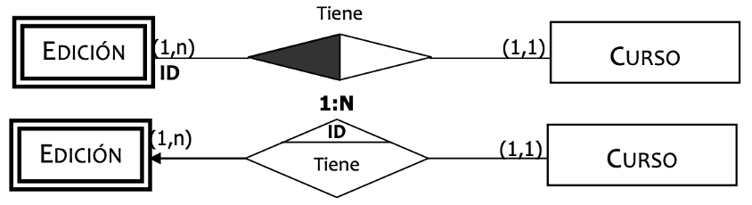

### **2º caso: Relación binaria 1:1 con DI**

Como ya vimos en el apartado correspondiente, la transformación a Modelo Relacional de la relación **1:1** implica que la clave ajena la debemos poner en la relación que consideremos más apropiada funcionalmente, o la que tenga menos atributos.

En este caso lo más apropiado es poner la clave ajena en la entidad donde tenemos que representar la **Dependencia de Identificación**:

```sql
Puesto (Cod-P:cad-9, Descripcion:cad-30, Horario:num)
CP: {Cod-P}

Empleado (DNI:cad-9, NSS:cad-9, {Nombre:cad-30, Ape-1:cad-30, Ape-2:cad-30}, Edad:num, Sueldo:moneda, {telefono:cad-9}n, Cod-P:cad-9, Turno:num)
CP: {DNI, Cod-P}
CAlt: {NSS}
VNN: {Edad}
CAj: {Cod-P} → PUESTO
```

Como podemos observar, el resultado es el mismo que tuvimos en el caso 1:N, por tanto, y aunque no tenga mucho sentido semánticamente, se indica mediante una **restricción** que un puesto puede ser ocupado por un único empleado. Aunque lo que se suele hacer en estos casos realmente es **fusionar ambas entidades en una**.

## **Restricciones entre relaciones**

Cuando hablamos de **restricciones entre relaciones** nos podemos encontrar con:

- **Restricción de Exclusividad.**

- **Restricción de Exclusión.**

- **Restricción de Inclusividad.**

- **Restricción de Inclusión.**

Como en otros casos, lo primero que haremos será la **transformación de las entidades y relaciones** que ya tengamos claras. Tomaremos como ejemplo las relaciones `IMPARTE` y `RECIBE` entre `PROFESOR` y `CURSO`:

```sql
Profesor (Cod-Prof:cad-4)
CP: {Cod-Prof}

Curso (Cod-Cur:cad-4, Prof-Imp:cad-4)
CP: {Cod-Cur}
CAj: {Prof-Imp} → PROFESOR

Recibe (Prof:cad-4, Cur:cad-4)
CP: {Prof, Cur}
CAj: {Prof} → PROFESOR
CAj: {Cur} → CURSO
```

> **📌 Recordatorio**
> 

> Como vimos en la unidad anterior, la diferencia entre estas restricciones está en **sobre qué actúa**:

> - **Exclusividad / Inclusividad** → actúan sobre **una entidad**.

> - **Exclusión / Inclusión** → actúan sobre **un par de entidades**.

### **Restricción de Exclusividad**

Lo que nos indica esta restricción es que si un **Profesor** imparte un curso, ya no puede **recibir** ningún curso, es decir, si su código aparece en la relación `IMPARTE` ya no puede aparecer en la relación `RECIBE`.

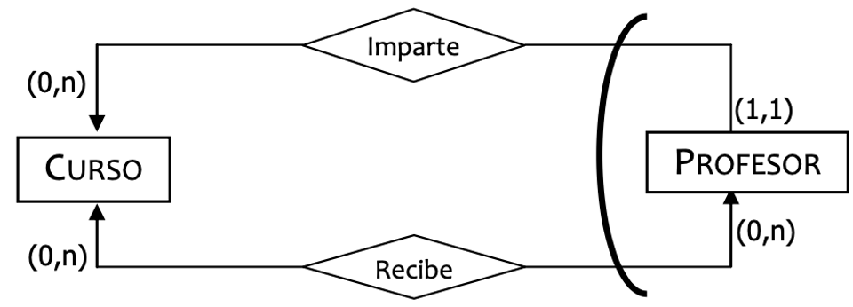

Por tanto, lo que debemos añadir a nuestro esquema relacional es la siguiente **restricción** debajo de las tres relaciones (que ya hemos transformado):

> **📌 R.I. (R. EXCLUSIVIDAD)**
> 

> Si tenemos el código de un profesor en la relación `IMPARTE`, ya no podemos tener ese mismo código de profesor en la relación `RECIBE` y viceversa.

### **Restricción de Exclusión**

Lo que implica esta restricción es que si un **Profesor** imparte un **Curso**, **NO puede recibir ese mismo Curso**, pero sí puede recibir otros. Por tanto, lo que debemos añadir a nuestro esquema relacional es la siguiente **restricción**:

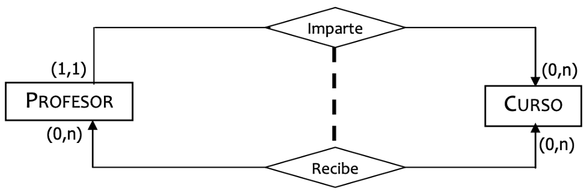

> **📌 R.I. (R. EXCLUSIÓN)**
> 

> Si conectamos un código de curso y un código de profesor en la relación `IMPARTE`, ya no podemos tener ese mismo par de códigos en la relación `RECIBE` y viceversa.

### **Restricción de Inclusividad**

Lo que nos indica esta restricción es que si un **Profesor** imparte un **Curso**, obligatoriamente tiene que haber **recibido un curso**, no tiene por qué ser el mismo. La relación que manda (fuerte) es aquella hacia donde apunta la flecha. Por tanto, lo que debemos añadir a nuestro esquema relacional es la siguiente **restricción**:

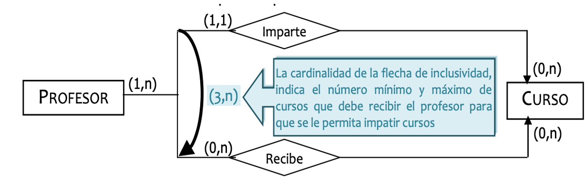

> **📌 R.I. (R. INCLUSIVIDAD)**
> 

> Para poder tener el código de un profesor en la relación `IMPARTE`, debemos tener ese mismo código de profesor en la relación `RECIBE`.

### **Restricción de Inclusión**

Lo que implica esta restricción es que **para que un Profesor imparta un Curso, debe recibir ese mismo Curso**. Por tanto, lo que debemos añadir a nuestro esquema relacional es la siguiente **restricción**:

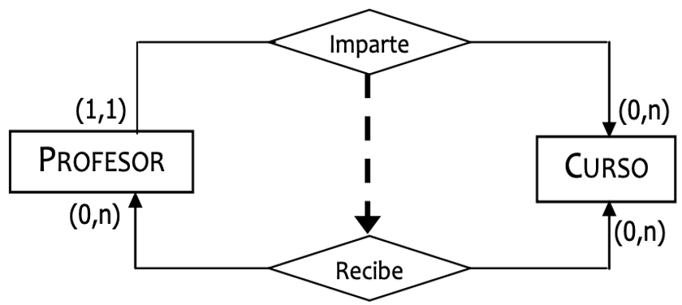

> **📌 R.I. (R. INCLUSIÓN)**
> 

> Podremos establecer una conexión entre un código de curso y un código de profesor en la relación `IMPARTE`, si tenemos ese mismo par de códigos en la relación `RECIBE`.

## **Resumen de restricciones**

| Restricción | ¿Sobre qué actúa? | Significado | Cómo se representa en el modelo relacional |
| --- | --- | --- | --- |
| **Exclusividad** | Una entidad | Una ocurrencia solo puede participar en una de las relaciones. | R.I. entre las relaciones |
| **Exclusión** | Un par de entidades | La misma pareja no puede aparecer en dos relaciones distintas. | R.I. entre las relaciones |
| **Inclusividad** | Una entidad | Participar en una relación obliga a participar también en otra. | R.I. entre las relaciones |
| **Inclusión** | Un par de entidades | Una pareja solo puede estar en una relación si ya pertenece a otra. | R.I. entre las relaciones |

> **📌 CE6h**
> 

> Todas estas restricciones, así como las de la **dependencia de existencia** e **identificación**, **no pueden plasmarse directamente en el diseño lógico**, por lo que deben **analizarse y documentarse** en el diccionario de datos para su posterior implementación.

## **Ejercicios propuestos**

> **📌 Ejercicio 1**
> 

> Indica cómo transformarías al modelo relacional la dependencia de existencia en una relación binaria **1:N** en la que la DE se encuentra en la entidad del lado de **cardinalidad máxima 1**. ¿Por qué no podemos utilizar VNN?

> **📌 Ejercicio 2**
> 

> Dada la relación binaria **1:N** `PASA` entre `SOCIO (id)` y `CUOTA (numero)`, donde un socio debe tener al menos una cuota (DE sobre SOCIO):

> 1. Obtén el esquema relacional.

> 1. Indica cómo se representa la DE (¿con VNN o con restricción?) y justifica tu respuesta.

> **📌 Ejercicio 3**
> 

> Entre `ALUMNO` y `ASIGNATURA` existen las relaciones `MATRICULA` y `EXAMEN`. Indica qué restricción de integridad (R.I.) debería añadirse para representar cada una de las siguientes reglas de negocio:

> 1. Un alumno solo puede examinarse de una asignatura si está matriculado de **esa misma** asignatura.

> 1. Todo alumno que se examina de alguna asignatura debe estar matriculado de **alguna** asignatura.

> 1. Un alumno no puede estar matriculado y examinarse de la **misma** asignatura a la vez.

---

## 3.6 Introducción a la normalización. 1ª Forma Normal

# **Introducción a la normalización. 1ª Forma Normal**

## **Introducción**

La **normalización** es una **técnica de diseño de bases de datos** que reduce la **redundancia de datos** y elimina características indeseables como las **anomalías de inserción, actualización y eliminación**.

- Las reglas de normalización **dividen las tablas más grandes en tablas más pequeñas** y las vinculan mediante relaciones.

- El propósito de la normalización es **eliminar los datos redundantes** (repetitivos) y garantizar que los datos se almacenen de forma lógica.

El inventor del modelo relacional, **Edgar Codd**, propuso la teoría de la normalización de datos con la introducción de la **Primera Forma Normal**, y continuó ampliando la teoría con la **Segunda** y **Tercera Forma Normal**. Posteriormente se unió a **Raymond F. Boyce** para desarrollar la teoría de la **Forma Normal de Boyce-Codd (FNBC)**.

> **📌 Ventajas de la normalización**
> 

> - Elimina la **redundancia** de datos.

> - Evita las **anomalías** de inserción, actualización y borrado.

> - Facilita la **consistencia** e **integridad** de los datos.

> - Hace la base de datos más **flexible** para futuros cambios.

## **Teoría de la normalización**

La normalización es el **proceso de organizar los datos en una base de datos**. Esto incluye la creación de tablas y el establecimiento de relaciones entre esas tablas de acuerdo con unas reglas diseñadas tanto para **proteger los datos** como para hacer que la base de datos sea más flexible al eliminar la **redundancia** y la **dependencia inconsistente**.

Las reglas formales de la teoría de la normalización son conocidas con el nombre de **formas normales**. Existen **seis formas normales**, de modo que cuando la base de datos cumple las reglas de la primera forma normal, se considera que está en **1FN**; cuando supera la segunda, en **2FN**, etcétera.

| Forma Normal | Siglas |
| --- | --- |
| 1ª Forma Normal | 1FN |
| 2ª Forma Normal | 2FN |
| 3ª Forma Normal | 3FN |
| Forma Normal de Boyce-Codd | FNBC |
| 4ª Forma Normal | 4FN |
| 5ª Forma Normal | 5FN |

> **📌 Importante**
> 

> De las seis formas normales, **generalmente sólo se aplican las tres primeras**, considerando que una base de datos que está en **3FN** es una base de datos **correctamente diseñada**.

## **1ª Forma Normal (1FN)**

Una base de datos se considera que está en **1FN** si:

- **Cada atributo (campo) de una tabla contiene un solo valor atómico (simple)**, es decir, un atributo no puede tomar varios valores para un mismo registro (atributos multivaluados).

- **Cada registro (fila) es único.**

### **Reglas de la 1FN**

La 1FN espera que sigamos algunas reglas simples mientras diseñamos nuestra base de datos:

- **Atributos de un solo valor**: Cada columna de nuestra tabla debe tener un **solo valor**, lo que significa que no deben contener campos **multivaluados**.

- **El dominio de atributo no debe cambiar**: En cada columna los valores almacenados deben ser **del mismo tipo**.

  - Por ejemplo: si tiene una columna `fechaNacimiento` para guardar la fecha de nacimiento de los/as alumnos/as, entonces no puede guardar los nombres de algunos de ellos en esa columna junto con la fecha de nacimiento de otros.

- **Nombre único para atributos/columnas**: Esta regla es para evitar confusiones al momento de recuperar datos o realizar cualquier otra operación sobre los datos almacenados. Si una o más columnas tienen el mismo nombre, el sistema gestor de bases de datos quedará confuso.

- **El orden no importa**: Esta regla dice que el orden en el que almacenas los datos en tu tabla no importa.

> **📌 No se permite**
> 

> No se permite que en una tabla existan **atributos que tomen más de un valor**. Todos sus valores deben ser **atómicos**, es decir, **unievalorados**.

## **Ejemplo: atributos multivaluados**

Partimos de la siguiente tabla, que **no está en 1FN** porque el atributo `Teléfonos` es multivaluado:

| ID_Cliente | Nombre | Teléfonos | Dirección |
| --- | --- | --- | --- |
| 1 | Ana Pérez | 123456, 789012 | Calle A |
| 2 | Juan López | 345678, 901234 | Calle B |

> **📌 Solución mala**
> 

> El primer paso es **atomizar el campo teléfono** separando los valores en varias columnas. Esta solución **genera una fuerte redundancia de datos** y no es correcta.

| ID_Cliente | Nombre | Teléfono 1 | Teléfono 2 | Dirección |
| --- | --- | --- | --- | --- |
| 1 | Ana Pérez | 123456 | 789012 | Calle A |
| 2 | Juan López | 345678 | 901234 | Calle B |

> **📌 Solución óptima**
> 

> La solución óptima pasa por **separar los datos en dos tablas diferentes**: una para los datos que ya eran atómicos y otra para el campo multivaluado.

> **Tabla CLIENTES:**

| ID_Cliente | Nombre | Dirección |
| --- | --- | --- |
| 1 | Ana Pérez | Calle A |
| 2 | Juan López | Calle B |

> **Tabla TELEFONOS:**

| ID_Cliente | Teléfono |
| --- | --- |
| 1 | 123456 |
| 1 | 789012 |
| 2 | 345678 |
| 2 | 901234 |

> La clave primaria de `TELEFONOS` será compuesta: `{ID_Cliente, Teléfono}`, siendo `ID_Cliente` una clave ajena que referencia a `CLIENTES`.

## **Ejemplo: valores repetidos en una misma celda**

Partimos de la siguiente tabla, que tampoco está en 1FN porque contiene **valores repetidos en una misma celda**:

| ID_Pedido | Productos | Cantidad | Cliente |
| --- | --- | --- | --- |
| 1 | Lámpara, Mesa | 2, 1 | Ana Pérez |
| 2 | Silla, Escritorio | 4, 1 | Juan López |

La solución es **repetir la fila tantas veces como productos tenga el pedido**, dejando una fila por producto:

| ID_Pedido | Producto | Cantidad | Cliente |
| --- | --- | --- | --- |
| 1 | Lámpara | 2 | Ana Pérez |
| 1 | Mesa | 1 | Ana Pérez |
| 2 | Silla | 4 | Juan López |
| 2 | Escritorio | 1 | Juan López |

> **📌 ¿Está ya en 2FN?**
> 

> La tabla cumple la **1FN**, pero aún no la **2FN**: `Cliente` depende únicamente de `ID_Pedido` (dependencia parcial). Lo resolveremos en la siguiente página.

## **Ejercicios propuestos**

> **📌 Ejercicio 1**
> 

> Indica qué reglas de la 1FN incumple cada una de las siguientes tablas:

| ID_Cliente | Nombre | Compras |
| --- | --- | --- |
| 1 | Ana Pérez | Lámpara, Escritorio |
| 2 | Juan López | Silla |

| CodSerie | Título | Genero | AñoLanzamiento | Plataforma |
| --- | --- | --- | --- | --- |
| 0123 | The Last of Us | Suspense, Drama | 2023 | HBO |
| 0219 | The Mandalorian | Ciencia ficción, Accion, Fantasia | 12-11-2019 | Disney+ |

> **📌 Ejercicio 2**
> 

> Dada la siguiente tabla, transforma los datos a la **1FN** separando los valores multivaluados:

| CodSerie | Título | Genero | AñoLanzamiento | Plataforma |
| --- | --- | --- | --- | --- |
| 0123 | The Last of Us | Suspense, Drama | 2023 | HBO |
| 0219 | The Mandalorian | Ciencia ficción, Accion, Fantasia | 2019 | Disney+ |
| 0519 | Sex Education | Drama, Comedia | 2019 | Netflix |
| 0720 | Ted Lasso | Comedia | 2020 | Apple TV |

> **📌 Ejercicio 3**
> 

> Justifica por qué la siguiente solución a la tabla `CLIENTES` con `Teléfonos` multivaluado **no es correcta**, aunque cumpla con que cada celda tenga un único valor:

| ID_Cliente | Nombre | Teléfono_1 | Teléfono_2 | Teléfono_3 | Dirección |
| --- | --- | --- | --- | --- | --- |
| 1 | Ana Pérez | 123456 | 789012 | NULL | Calle A |
| 2 | Juan López | 345678 | NULL | NULL | Calle B |

---

## 3.7 ª y 3ª Forma Normal

# **2ª y 3ª Forma Normal**

## **Dependencia funcional**

Antes de estudiar la 2FN debemos conocer el concepto de **dependencia funcional**:

> **📌 Definición**
> 

> La **Dependencia Funcional** es la relación que tienen los atributos (campos) de una tabla con otros atributos de la propia tabla. Un campo tiene dependencia funcional si **necesita información de otro/s campo/s** para contener un valor concreto.

Si un atributo **B** depende funcionalmente de un atributo **A**, lo representamos como **A → B**, y significa que dado un valor de **A** podemos determinar un único valor de **B**.

> **📌 Ejemplo**
> 

> En la tabla `EMPLEADO (DNI, nombre, apellidos, telefono)`, el atributo `nombre` depende funcionalmente del `DNI`:

```sql
DNI → nombre
DNI → apellidos
DNI → telefono
```

Dado un `DNI`, siempre podremos determinar el nombre, los apellidos y el teléfono del empleado.

## **2ª Forma Normal (2FN)**

Una tabla se dice que está en **segunda forma normal (2FN)** si sucede que:

- **Está en 1FN.**

- **Todos los atributos que no forman parte de la clave principal tienen dependencia funcional completa de ella.**

Por tanto, una base de datos estará en 2FN si **todas sus tablas** lo están.

> **📌 Dependencia parcial**
> 

> La 2FN se relaciona con el concepto de **dependencia funcional completa**. Si una clave primaria es **compuesta**, puede ocurrir que un atributo dependa **únicamente de una parte de la clave** (y no de la clave completa). Esa dependencia parcial es la que debemos eliminar.

### **Ejemplo 1: dependencias parciales**

La siguiente tabla está en 1FN, pero no cumple la 2FN:

| ID_Orden | ID_Producto | Producto | Cantidad | Cliente | Dirección |
| --- | --- | --- | --- | --- | --- |
| 1 | 101 | Lámpara | 2 | Ana Pérez | Calle A |
| 1 | 102 | Mesa | 1 | Ana Pérez | Calle A |
| 2 | 103 | Silla | 4 | Juan López | Calle B |

La clave primaria es compuesta: `{ID_Orden, ID_Producto}`. Pero:

- `Producto` depende únicamente de `ID_Producto`.

- `Cliente` y `Dirección` dependen únicamente de `ID_Orden`.

Eliminamos las **dependencias parciales** descomponiendo la tabla en tres:

**Tabla PEDIDOS:**

| ID_Orden | ID_Producto | Cantidad |
| --- | --- | --- |
| 1 | 101 | 2 |
| 1 | 102 | 1 |
| 2 | 103 | 4 |

**Tabla PRODUCTOS:**

| ID_Producto | Producto |
| --- | --- |
| 101 | Lámpara |
| 102 | Mesa |
| 103 | Silla |

**Tabla CLIENTES:**

| ID_Orden | Cliente | Dirección |
| --- | --- | --- |
| 1 | Ana Pérez | Calle A |
| 2 | Juan López | Calle B |

> **📌 ¿Está ya en 3FN?**
> 

> Las tres tablas cumplen la **2FN** (dependencia funcional completa de la clave). Pero `PEDIDOS` aún no está en **3FN**: `Dirección` depende de `Cliente` (dependencia transitiva). Lo resolveremos a continuación.

### **Ejemplo 2: clave primaria no compuesta**

Una tabla con clave primaria **no compuesta** siempre cumple la 2FN (no puede haber dependencias parciales de la clave). Por ejemplo:

| ID_Empleado | Nombre | Departamento | Jefe_Departamento |
| --- | --- | --- | --- |
| 1 | Luis Gómez | Ventas | Ana Pérez |
| 2 | Marta Ruiz | Marketing | Juan López |

Está en 1FN y en 2FN (la clave es un único atributo). ¿Está en 3FN? El atributo `Jefe_Departamento` depende de `Departamento`, que no es clave → **dependencia transitiva**. Lo veremos en el siguiente ejemplo.

## **3ª Forma Normal (3FN)**

La tercera forma normal también se relaciona con el concepto de **dependencia funcional**. Para pasar de 2FN a 3FN nos tendremos que fijar en si **alguno de los campos depende de otros atributos que no forman parte de la clave primaria**.

Si un atributo que no es clave **depende de otro atributo que no es clave**, la tabla posiblemente contiene datos acerca de **más de una entidad**, contradiciendo el principio de que cada tabla almacene información de una entidad.

Una tabla se dice que está en **tercera forma normal (3FN)** si:

- **Está en 2FN.**

- **Todos los atributos que no son claves deben ser mutuamente independientes**, es decir, un atributo no debe depender de otro atributo no clave de su tabla.

Decimos que una relación está en 3FN cuando está en 2FN y cuando los atributos que no forman parte de la clave primaria son independientes entre sí, es decir, **no presentan dependencias transitivas**.

### **Ejemplo: dependencias transitivas**

Partimos de la siguiente tabla, que está en 2FN pero no en 3FN:

| Cod. Empleado | Nombre | Cod. Dpto | Nombre Dpto |
| --- | --- | --- | --- |
| 1 | Luis Gómez | 10 | Ventas |
| 2 | Marta Ruiz | 20 | Marketing |

Podemos ver que el campo `Nombre Dpto` depende **transitivamente** de la clave a través del campo `Cod. Dpto`, por tanto, **esta tabla no está en 3FN**.

Para llegar a una solución óptima podemos **crear dos tablas**, eliminando la información que tenía dependencia transitiva y creando una nueva tabla para ella:

**Tabla EMPLEADOS:**

| Cod. Empleado | Nombre | Cod. Dpto |
| --- | --- | --- |
| 1 | Luis Gómez | 10 |
| 2 | Marta Ruiz | 20 |

**Tabla DEPARTAMENTOS:**

| Cod. Dpto | Nombre Dpto |
| --- | --- |
| 10 | Ventas |
| 20 | Marketing |

## **Ejemplo completo: normalización de un pedido**

Vamos a aplicar las tres formas normales sobre la tabla `PEDIDO` de una tienda:

| PedidoID | Cliente | DirecciónCliente | Producto | Cantidad | PrecioProducto |
| --- | --- | --- | --- | --- | --- |
| 1 | Juan Pérez | Calle Falsa 123 | Lápiz | 10 | 0.50 |
| 2 | María García | Av. Siempre Viva 456 | Cuaderno | 5 | 2.00 |
| 3 | Juan Pérez | Calle Falsa 123 | Bolígrafo | 15 | 1.00 |

**1FN**: la tabla ya cumple la 1FN, ya que no hay valores multivaluados ni repetidos en las celdas.

**2FN**: `Cliente` y `DirecciónCliente` dependen solo de `PedidoID`, pero no de `Producto`. Por tanto, dividimos en dos tablas:

- `PEDIDO (PedidoID, Cliente, DirecciónCliente)`

- `DETALLE_PEDIDO (PedidoID, Producto, Cantidad, PrecioProducto)`

**3FN**: la tabla `PEDIDO` tiene una dependencia transitiva entre `Cliente` y `DirecciónCliente`. Dividimos nuevamente:

| Tabla | Esquema |
| --- | --- |
| **PEDIDO** | `PedidoID, ClienteID` |
| **CLIENTE** | `ClienteID, Cliente, DirecciónCliente` |
| **DETALLE_PEDIDO** | `PedidoID, Producto, Cantidad, PrecioProducto` |

> **📌 Resultado final**
> 

> Ahora el modelo de datos está normalizado y cumple las formas normales hasta **3FN**. Esto reduce redundancias y asegura consistencia en los datos.

## **Resumen**

| Forma Normal | Requisitos |
| --- | --- |
| **1FN** | Atributos atómicos y filas únicas. |
| **2FN** | Está en 1FN y todos los atributos no clave tienen **dependencia funcional completa** de la clave primaria. |
| **3FN** | Está en 2FN y los atributos no clave son **mutuamente independientes** (no hay dependencias transitivas). |

## **Ejercicios propuestos**

> **📌 Ejercicio 1**
> 

> La siguiente tabla está en 1FN. Identifica las **dependencias parciales** y descompón la tabla hasta la **2FN** (clave primaria `{ID_Producto, ID_Pedido}`):

| ID_Producto | ID_Pedido | Nombre_Producto | Cantidad | Cliente |
| --- | --- | --- | --- | --- |
| 1 | 101 | Lámpara | 2 | Ana Pérez |
| 2 | 101 | Escritorio | 1 | Ana Pérez |
| 3 | 102 | Silla | 4 | Juan López |

> **📌 Ejercicio 2**
> 

> La siguiente tabla está en 2FN pero no en 3FN. Elimina las **dependencias transitivas**:

| ID_Empleado | Nombre | Departamento | Jefe_Departamento | Oficina |
| --- | --- | --- | --- | --- |
| 1 | Luis Gómez | Ventas | Ana Pérez | Oficina A |
| 2 | Marta Ruiz | Marketing | Juan López | Oficina B |

> **📌 Ejercicio 3**
> 

> Aplica las **tres formas normales** a la siguiente tabla de órdenes de compra. Indica en cada paso qué forma normal se cumple y por qué:

| Id_Orden | Fecha | Id_cliente | Nom_client | Id_art | Nom_art | Cant | Precio |
| --- | --- | --- | --- | --- | --- | --- | --- |
| 2301 | 23/02/2024 | 101 | José Perez | 3786 | Red | 3 | 35 € |
| 2301 | 23/02/2024 | 101 | José Perez | 4011 | Raqueta | 6 | 65 € |
| 2302 | 25/02/2024 | 107 | Fernando Hernandez | 5794 | 6 Pelotas | 4 | 5 € |
| 2303 | 27/02/2024 | 110 | Pedro Fernandez | 4011 | Raqueta | 2 | 65 € |

---

## 3.8 Otras formas normales: FNBC, 4FN y 5FN

# **Otras formas normales: FNBC, 4FN y 5FN**

## **Forma Normal de Boyce-Codd (FNBC)**

La **Forma Normal de Boyce-Codd (FNBC)** es una **extensión de la tercera forma normal** y también se conoce como **forma normal 3,5**.

Una tabla se dice que está en **Forma Normal de Boyce-Codd (FNBC)** si:

- **Está en 3FN.**

- **Para cualquier dependencia A → B, A debería ser una superclave.**

Por tanto, una base de datos estará en FNBC si **todas sus tablas** lo están.

El segundo punto suena un poco complicado, ¿verdad? En palabras simples, significa que **para una dependencia A → B, A no puede ser un atributo no principal**, si B es un atributo principal.

> **📌 Ejemplo**
> 

> La siguiente tabla no cumple la FNBC. Tiene la dependencia funcional:

```sql
Rol → ID_Empleado  (un rol determina al empleado)
```

| ID_Proyecto | ID_Empleado | Rol |
| --- | --- | --- |
| 1 | 101 | Diseñador |
| 1 | 102 | Programador |
| 2 | 103 | Diseñador |

El problema es que `Rol` (atributo no clave) determina `ID_Empleado` (que forma parte de la clave primaria compuesta `{ID_Proyecto, ID_Empleado}`), y `Rol` **no es una superclave**.

Para que esta relación satisfaga la FNBC, descompondremos esta tabla en **dos tablas**:

**Tabla PROYECTOS-EMPLEADOS:**

| ID_Proyecto | ID_Empleado |
| --- | --- |
| 1 | 101 |
| 1 | 102 |
| 2 | 103 |

**Tabla EMPLEADOS-ROLES:**

| ID_Empleado | Rol |
| --- | --- |
| 101 | Diseñador |
| 102 | Programador |
| 103 | Diseñador |

## **4ª Forma Normal (4FN)**

La 4FN entra en escena cuando la **Dependencia de Valor Múltiple** o **Dependencia Multivaluada** ocurre en cualquier relación. Para que exista una dependencia de valor múltiple, la tabla debe tener **al menos 3 columnas**.

Una tabla se dice que está en **cuarta forma normal (4FN)** si:

- **Está en FNBC.**

- **No existe ninguna dependencia de valor múltiple.**

Por tanto, una base de datos estará en 4FN si **todas sus tablas** lo están.

> **📌 Ejemplo**
> 

> La siguiente tabla está en 3FN, pero contiene una **dependencia multivaluada**: un cliente puede tener **múltiples teléfonos y múltiples correos electrónicos**.

| Cliente | Teléfono | Correo Electrónico |
| --- | --- | --- |
| Ana Pérez | 123456789 | ana@gmail.com |
| Ana Pérez | 987654321 | ana.perez@yahoo.com |
| Juan López | 555666777 | juan@gmail.com |

> Para eliminar la dependencia multivaluada, descomponemos la tabla en **dos tablas**:

> **Tabla TELEFONOS:**

| Cliente | Teléfono |
| --- | --- |
| Ana Pérez | 123456789 |
| Ana Pérez | 987654321 |
| Juan López | 555666777 |

> **Tabla CORREOS:**

| Cliente | Correo Electrónico |
| --- | --- |
| Ana Pérez | ana@gmail.com |
| Ana Pérez | ana.perez@yahoo.com |
| Juan López | juan@gmail.com |

## **5ª Forma Normal (5FN)**

Una tabla está en la **5FN** sólo si **está en 4FN** y **no se puede descomponer en ninguna cantidad de tablas más pequeñas sin pérdida de datos**.

> **📌 6FN**
> 

> La **6FN** de momento no está estandarizada y no será objeto de estudio en esta unidad didáctica. La **5FN** y **6FN** en la normalización de bases de datos **generalmente no se implementan** en el diseño de bases de datos de la vida real.

> **📌 Ejemplo**
> 

> La siguiente tabla está en 4FN. Representa las relaciones entre clientes, productos y vendedores:

| Cliente | Producto | Vendedor |
| --- | --- | --- |
| Ana Pérez | Lámpara | Juan Gómez |
| Ana Pérez | Mesa | Juan Gómez |
| Ana Pérez | Mesa | Marta Ruiz |

> Para llegar a la 5FN eliminamos las redundancias distribuyendo los datos en tablas más pequeñas:

> **Tabla CLIENTE-PRODUCTO:**

| Cliente | Producto |
| --- | --- |
| Ana Pérez | Lámpara |
| Ana Pérez | Mesa |

> **Tabla PRODUCTO-VENDEDOR:**

| Producto | Vendedor |
| --- | --- |
| Lámpara | Juan Gómez |
| Mesa | Juan Gómez |
| Mesa | Marta Ruiz |

> **Tabla CLIENTE-VENDEDOR:**

| Cliente | Vendedor |
| --- | --- |
| Ana Pérez | Juan Gómez |
| Ana Pérez | Marta Ruiz |

## **Resumen de las formas normales**

| Forma Normal | Requisitos |
| --- | --- |
| **1FN** | Atributos atómicos y filas únicas. |
| **2FN** | 1FN + dependencia funcional completa de la clave primaria. |
| **3FN** | 2FN + sin dependencias transitivas. |
| **FNBC** | 3FN + todo determinante debe ser una superclave. |
| **4FN** | FNBC + sin dependencias multivaluadas. |
| **5FN** | 4FN + sin dependencias de unión (pérdida de datos). |

## **Denormalización**

La **denormalización** es el proceso inverso a la normalización: **consiste en combinar deliberadamente tablas** (o añadir datos redundantes) para **mejorar el rendimiento** de las consultas, a costa de la consistencia de los datos.

Se aplica cuando:

- Las consultas sobre la base de datos **son lentas** debido al elevado número de joins (uniones) entre tablas.

- Se trabaja con **grandes volúmenes de datos** y se prioriza la velocidad de lectura.

- En **almacenes de datos (Data Warehouse)** y en sistemas de **inteligencia de negocio**, donde los datos son históricos y rara vez se modifican.

> **📌 Contraindicaciones**
> 

> La denormalización **introduce redundancia** y puede provocar **anomalías de actualización**, por lo que debe aplicarse **solo cuando sea estrictamente necesario** y siempre documentándose adecuadamente.

## **Ejercicios propuestos**

> **📌 Ejercicio 1**
> 

> La siguiente tabla no cumple la FNBC. Dada la dependencia funcional `ID_Profesor → Nombre_Curso` (un profesor enseña un curso específico), descompón la tabla para que cumpla la FNBC:

| ID_Curso | ID_Profesor | Nombre_Curso |
| --- | --- | --- |
| 1 | 101 | Matemáticas |
| 2 | 101 | Física |
| 3 | 102 | Química |

> **📌 Ejercicio 2**
> 

> La siguiente tabla está en 3FN pero contiene una dependencia multivaluada (un cliente puede tener múltiples teléfonos y comprar múltiples productos). Elimina las dependencias multivaluadas para cumplir la 4FN:

| Cliente | Teléfono | Producto |
| --- | --- | --- |
| Ana Pérez | 123456789 | Lámpara |
| Ana Pérez | 987654321 | Escritorio |
| Juan López | 555666777 | Silla |

> **📌 Ejercicio 3**
> 

> Explica en qué consiste la **denormalización**, cuál es su objetivo y qué inconvenientes puede provocar. Pon un ejemplo de cuándo sería recomendable aplicarla.

---

## ✏️ Actividades y Prácticas de la Unidad


---

### Actividad Práctica ACT301 — 301

# **Actividad 301**

> **📌 Entrega**
> 

> - La entrega será un **fichero pdf** que contenga la respuesta a las preguntas de la actividad.

> - El nombre del fichero debe ser `301_NombreApellidos.pdf`.

> - Se deberá entregar en la tarea correspondiente de Aules en tiempo y forma.

> **📌 Se valorará**
> 

> Se valorará:

> - La claridad de la respuesta.

> - La correcta maquetación del documento.

> - Respuesta correcta o aproximación a la misma.

> Esta actividad servirá para calificar:

> - RA6: Diseña modelos relacionales normalizados interpretando diagramas entidad/relación.

>   - CE6. b) Se han identificado las tablas del diseño lógico. (5%)

>   - CE6. c) Se han identificado los campos que forman parte de las tablas del diseño lógico. (5%)

>   - CE6. e) Se han identificado los campos clave. (5%)

>   - CE6. f) Se han aplicado reglas de integridad. (5%)

>   - CE6. h) Se han analizado y documentado las restricciones que no pueden plasmarse en el diseño lógico. (5%)

> **📌 Recuerda**
> 

> Debes obtener el **esquema relacional** (tablas con sus atributos) indicando para cada una:

> - **CP**: clave primaria.

> - **CAlt**: claves alternativas, si existen.

> - **CAj**: claves ajenas, indicando la tabla a la que referencian.

> - **VNN**: atributos que no pueden ser nulos.

## **Ejercicio 1**

**ARTÍCULOS Y ENCARGOS**

Una base de datos para una pequeña empresa debe contener información acerca de clientes, artículos y pedidos. Hasta el momento se registran los siguientes datos en documentos varios:

- Para cada **cliente**: Número de cliente (único), Nombre, NIF, Direcciones de envío (varias por cliente), Saldo, Límite de crédito (depende del cliente, pero en ningún caso debe superar los 18.000 €), Descuento.

- Para cada **artículo**: Número de artículo (único), Fábricas que lo distribuyen, Existencias de ese artículo en cada fábrica, Descripción del artículo.

- Para cada **pedido**: Cada pedido tiene una cabecera y el cuerpo del pedido. La cabecera está formada por el número de cliente, dirección de envío y fecha del pedido. El cuerpo del pedido son varias líneas, en cada línea se especifican el número del artículo pedido y la cantidad.

Además, se ha determinado que se debe almacenar la información de las **fábricas**. Sin embargo, dado el uso de distribuidores, se usará: Número de la fábrica (único), Nombre y Teléfono de contacto. Y se desean ver cuántos artículos (en total) provee la fábrica. También, por información estratégica, se podría incluir información de fábricas alternativas respecto de las que ya fabrican artículos para esta empresa.

> **📌 Nota**
> 

> Una dirección se entenderá como **Calle, Número, Puerta, CP y Localidad**. Una fecha incluye **día, mes, año y hora**.

**Se pide:** obtener el modelo relacional de la base de datos.

## **Ejercicio 2**

**CASAS DE COLONIAS**

a) Cada casa de colonias tiene un **nombre** que la identifica. Se desea saber de cada una, aparte del nombre, la **capacidad** (el número de niños que se pueden alojar en cada una como máximo), la **comarca** donde está situada y las **ofertas de actividades** que proporciona. Una casa puede ofrecer actividades como por ejemplo natación, esquí, remo, pintura, fotografía, música, etc.

b) Es necesario tener en cuenta que en una casa de colonias se pueden practicar **varias actividades** (de hecho, cada casa debe ofrecer como mínimo una), y también puede ocurrir que una misma actividad se pueda llevar a cabo en varias casas. Sin embargo, toda actividad que se registre en la base de datos debe ser ofertada como mínimo en una de las casas.

c) Interesa tener una **evaluación de las ofertas de actividades** que proporcionan las casas. Se asigna una calificación numérica que indica el nivel de calidad que tiene cada una de las actividades ofertadas.

d) Las casas de colonias **alojan niños** que se han inscrito para pasar en ellas unas pequeñas vacaciones. Se quiere tener constancia de los niños que se alojan en cada una de las casas en el momento actual. Se debe suponer que hay casas que están vacías (en las que no se aloja ningún niño) durante algunas temporadas.

e) De los niños que se alojan actualmente en alguna de las casas, interesa conocer un **código** que se les asigna para identificarlos, su **nombre**, su **apellido**, el **número de teléfono de sus padres** y su **comarca de residencia**.

f) De las **comarcas** donde hay casas o bien donde residen niños, se quiere tener registrados la **superficie** y el **número de habitantes**. Se debe considerar que puede haber comarcas donde no reside ninguno de los niños que se alojan en un momento determinado en las casas de colonias, y comarcas que no disponen de ninguna casa.

> **📌 Nota**
> 

> Es posible, por ejemplo, que una actividad como el esquí tenga una calificación de 10 en la oferta de la casa Grévol, y que la misma actividad tenga una calificación de 8 en la casa Ardilla.

**Se pide:** obtener el modelo relacional de la base de datos.

## **Ejercicio 3**

**TRANSPORTE**

Se desea mecanizar la gestión de una empresa de transportes que reparte paquetes por toda España. Los encargados de llevar los paquetes son los **camioneros** de los que se quiere guardar el DNI, nombre, teléfono, dirección, salario y localidad donde reside.

De los **paquetes** transportados interesa conocer el código de paquete, descripción, destinatario, y dirección del destinatario. Un camionero distribuye muchos paquetes y un paquete sólo puede ser distribuido por un camionero.

De las **provincias** a las que llegan los paquetes interesa guardar el código de provincia, y el nombre. Un paquete sólo puede llegar a una provincia, sin embargo, a una provincia pueden llegar muchos paquetes.

De los **camiones** que llevan los camioneros interesa conocer la matrícula, modelo, tipo y potencia. Un camionero puede conducir diferentes camiones en fechas diferentes y un camión puede ser conducido por varios camioneros.

**Se pide:** obtener el modelo relacional de la base de datos.

## **Ejercicio 4**

**PARADORES**

La red de Paradores de Turismo quiere mantener un servicio de atención y reservas a través de Internet. Una de las tareas dentro del desarrollo del sistema es la construcción del modelo lógico de datos. La información de partida para la construcción de dicho modelo es la siguiente:

- Los **Paradores** vendrán definidos por un código único, nombre, dirección, teléfono, nivel y número total de habitaciones. Los Paradores disponen de distintos tipos de habitaciones. De cada **habitación** se desea almacenar el número de habitación, la ubicación dentro del Parador, el tipo (normal o suite), una descripción y el precio por noche.

- Los Paradores pueden tener además unas **instalaciones adicionales** (golf, piscina, hípica, etc.). De cada tipo de instalación se desea almacenar el código de instalación, el nombre y la descripción. Hay que tener en cuenta que un mismo tipo de instalación se puede encontrar en distintos Paradores.

- La información referente a los Paradores se completa con la **oferta gastronómica** que tienen. De la gastronomía ofrecida por cada Parador se almacenará un código, nombre y tipo de plato. Aunque un mismo plato puede ser servido por distintos Paradores, puede haber **variaciones de precio** en cada caso. Se desea almacenar la información de esta diferencia.

- Cuando un usuario se conecte al sitio web de los Paradores de Turismo, además de poder consultar la información referente a lo descrito anteriormente, podrá hacer **reservas** de habitaciones. En el caso de realizar reservas, se toman los datos del cliente: NIF, nombre y apellidos. Se almacenará también un código de cliente generado por la aplicación si el cliente fuese nuevo.

- Una vez registrado el cliente, este podrá elegir en qué Parador o Paradores desea alojarse, la fecha de llegada y el número de noches, así como el tipo de la habitación que quiere. El sistema le asignará las habitaciones correspondientes, teniendo en cuenta que **un cliente no puede tener reservadas habitaciones de dos Paradores distintos en la misma fecha**.

- Por último, se desea que un cliente pueda consultar en cualquier momento **qué reservas ha realizado, en qué paradores y para cada fecha**, así como la habitación reservada.

**Se pide:** obtener el modelo relacional de la base de datos, documentando las restricciones que no pueden plasmarse en el diseño lógico.

---

### Actividad Práctica ACT302 — 302

# **Actividad 302**

> **📌 Entrega**
> 

> - La entrega será un **fichero pdf** que contenga la respuesta a las preguntas de la actividad.

> - El nombre del fichero debe ser `302_NombreApellidos.pdf`.

> - Se deberá entregar en la tarea correspondiente de Aules en tiempo y forma.

> **📌 Se valorará**
> 

> Se valorará:

> - La claridad de la respuesta.

> - La correcta maquetación del documento.

> - Respuesta correcta o aproximación a la misma.

> Esta actividad servirá para calificar:

> - RA6: Diseña modelos relacionales normalizados interpretando diagramas entidad/relación.

>   - CE6. a) Se han utilizado herramientas gráficas para representar el diseño lógico. (5%)

>   - CE6. b) Se han identificado las tablas del diseño lógico. (5%)

>   - CE6. c) Se han identificado los campos que forman parte de las tablas del diseño lógico. (5%)

>   - CE6. d) Se han analizado las relaciones entre las tablas del diseño lógico. (5%)

>   - CE6. e) Se han identificado los campos clave. (5%)

> **📌 Recuerda**
> 

> Para pasar de un **diagrama E/R** al **modelo relacional** debes aplicar las reglas de transformación estudiadas en clase:

> - Cada **entidad** se transforma en una **tabla**.

> - Las relaciones **N:M** se convierten en **tablas de unión** con su clave compuesta.

> - Las relaciones **1:N** se resuelven añadiendo la **clave ajena** en el lado del *muchos*.

> - Las relaciones **1:1** se resuelven añadiendo la **clave ajena** (que además es **clave alternativa**).

## **Ejercicio 1**

Supongamos el siguiente modelo E/R donde representamos un sistema de información donde modelamos los datos de un **entrenador** y los **jugadores** de un equipo de baloncesto. De momento, sólo modelamos la relación entre el entrenador y los jugadores:

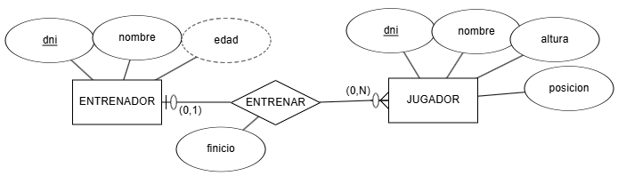

Obtén el **esquema relacional** y, a continuación, **dibuja el modelo relacional**.

## **Ejercicio 2**

Sobre el ejercicio anterior, vamos a añadir la entidad **EQUIPO** con el nombre del mismo, su logotipo, dirección y año de creación. Claramente, **cada equipo sólo tiene un único entrenador**, y **un entrenador sólo puede serlo de un equipo**.

Se pide:

1. Modifica el modelo E/R para añadir la nueva entidad y la relación necesaria.

1. Modifica el modelo relacional a partir del nuevo modelo E/R.

## **Ejercicio 3**

Tenemos el siguiente modelo E/R que representa las diferentes **ediciones** que de un libro publica una **editorial**, y los **autores** que escriben los libros:

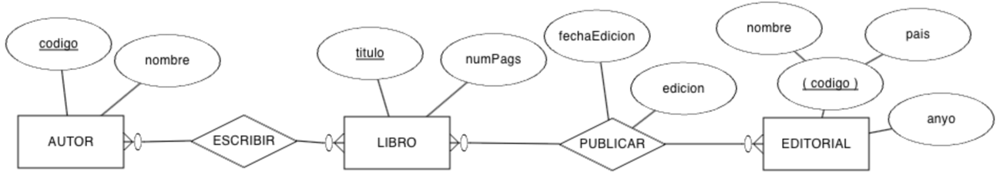

Obtén el **esquema relacional** y completa el **diccionario de datos**.

## **Ejercicio 4**

Realiza el **esquema lógico** mediante un **modelo relacional** del siguiente modelo E/R:

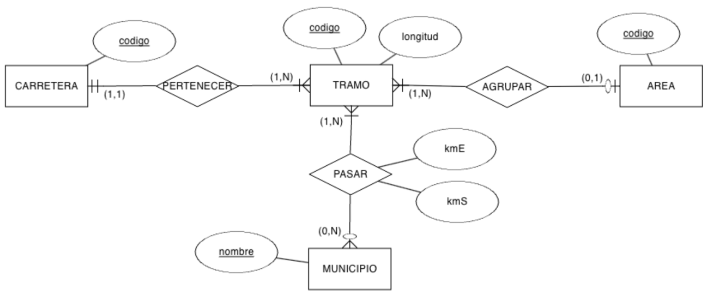

## **Ejercicio 5**

Tenemos el siguiente modelo E/R sobre la organización de una **empresa** en **departamentos** y las características de sus **empleados**:

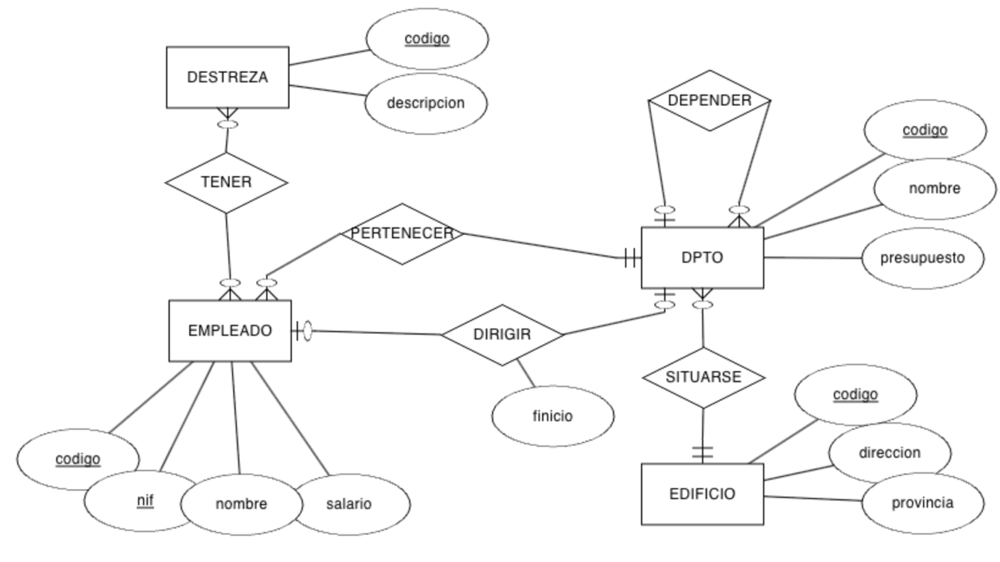

Obtén el **esquema relacional** e indica las **cardinalidades** de las relaciones.

## **Ejercicio 6**

A partir del siguiente modelo E/R que contiene restricciones de **cardinalidad mínima** y restricciones de **identificación**, se pide:

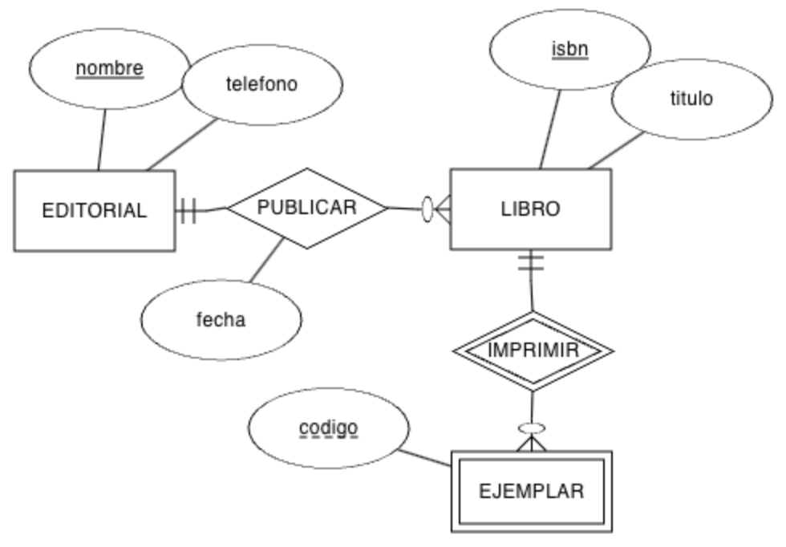

1. Genera el **modelo relacional**.

1. Indica las **cardinalidades** de las relaciones.

1. Rellena **tres tablas** con datos ficticios (al menos 3 registros por tabla), ya sean datos relacionados o no, conforme consideres.

## **Ejercicio 7**

Crea el **modelo relacional** a partir del modelo conceptual sobre un **centro educativo**:

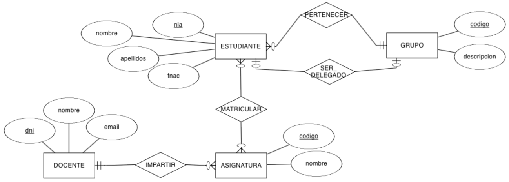

## **Ejercicio 8**

Crea el **modelo relacional** a partir del modelo conceptual:

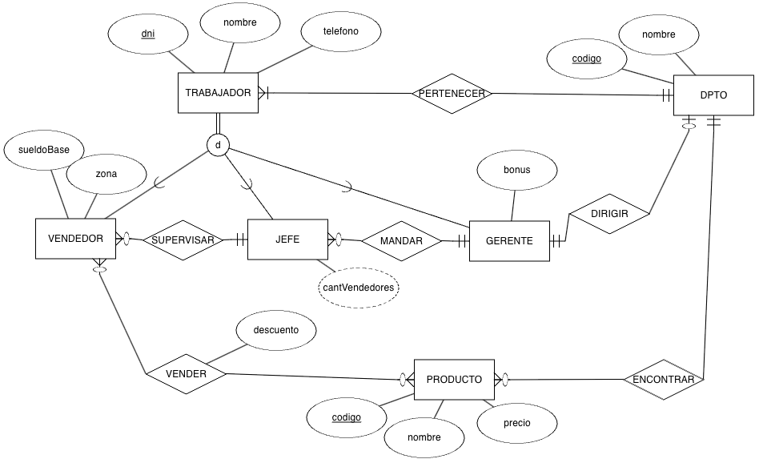

## **Ejercicio 9**

Crea el **modelo relacional** a partir del modelo conceptual:

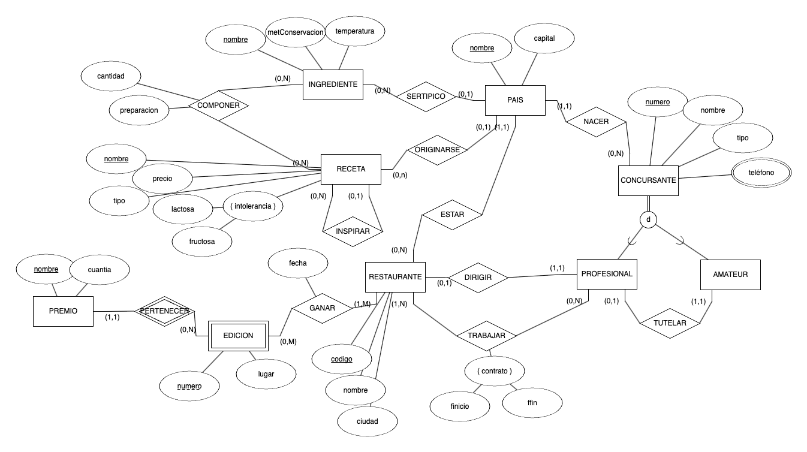

## **Ejercicio 10**

(RABD.6 // CE6a, CE6e // 3p) A partir de los siguientes **esquemas lógicos**, dibuja el **modelo E/R**:

### **Esquema 1**

```sql
A (a0, a1)
· PK: (a0)

B (b0, b1, b2, a0*, c0*)
· PK: (a0)
· FK: (a0) → A
· FK: (c0) → C

C (c0, c1)
· PK: (c0)

M (c0*, m, n)
· PK: (c0, m)
· FK: (c0) → C
```

### **Esquema 2**

```sql
A (a0, a1, bo*)
· PK: (a0)
· UK: (b0)
· VNN: (b0)
· FK: (b0) → B

B (b0, b1)
· PK: (b0)

C (b0*, a0*, c0)
· PK: (b0, a0)
· FK: (b0) → B
· FK: (a0) → A
· VNN: (c0)
```

## **Ejercicio 11**

(RABD.6 // CE6a, CE6e // 3p) A partir del siguiente **modelo relacional**, dibuja el **diagrama E/R**:

```sql
EMPLEADO (num, dni, nombre, direccion, banco)
· PK: (num)
· UK: (dni)

MEDICO (num*, espec, anyo)
· PK: (num)
· FK: (num) → EMPLEADO

SOCIO (num*, dniS, fechaNac, medicoChequeo*, fechaChequeo, resultadoChequeo)
· PK: (num)
· UK: (dniS)
· FK: (num) → EMPLEADO
· FK: (medicoChequeo) → MEDICO

TAQUILLA (nun, estado, tamaño)
· PK: (nun)

FIJA (num*, socio*)
· PK: (num)
· FK: (num) → TAQUILLA
· FK: (socio) → SOCIO

DIARIA (num*, socio*)
· PK: (num)
· FK: (num) → TAQUILLA
· FK: (socio) → SOCIO

DISCIPLINA (nombre, descripcion)
· PK: (nombre)

MONITOR (num*, fechaNac, disciplina*)
· PK: (num)
· FK: (num) → EMPLEADO
· FK: (disciplina) → DISCIPLINA

SESION (dia, hora, sala, monitor*, disciplina*)
· PK: (dia, hora, sala)
· FK: (monitor) → MONITOR
· FK: (disciplina) → DISCIPLINA
· VNN: (monitor)
· VNN: (disciplina)

TECNICO (num*)
· PK: (num)
· FK: (num) → EMPLEADO

MODELO (codigo, descripcion, empresas, tecnico*)
· PK: (codigo)
· FK: (tecnico) → TECNICO

APARATO (num, codigo*, fechaAdquisic, estado)
· PK: (num, codigo)
· FK: (codigo) → MODELO
```

## **Ejercicio 12**

(RABD.6 // CE6a, CE6e // 3p) A partir del siguiente **modelo relacional**, dibuja el **diagrama E/R**:

```sql
EDIFICIO (num, numPlantas, gestor*)
· PK: (num)
· FK: (gestor) → GESTOR

GESTOR (codigo, nombre, apellido1, apellido2, salario, residencia*)
· PK: (codigo)
· FK: (residencia) → EDIFICIO
· UK: (residencia)

INSPECTOR (codigo, nombre)
· PK: (codigo)

SUPERVISAR (codigo*, num*, fUltima, fSiguiente)
· PK: (codigo, num)
· FK: (codigo) → INSPECTOR
· FK: (num) → EDIFICIO

TRABAJADOR (codigo, nombre)
· PK: (codigo)

APARTAMENTO (numA, numE*, dormitorios)
· PK: (numA, numE)
· FK: (numE) → EDIFICIO

LIMPIAR (codigo*, numA*, numE*)
· PK: (codigo, numA, numE)
· FK: (numA, numE) → APARTAMENTO
· FK: (codigo) → TRABAJADOR
```

## **Ejercicio 13**

A partir del siguiente **modelo relacional**:

```sql
EQUIPO (num, fUltimaRevision, fAlta, detalle*)
· PK: (num)
· FK: (detalle) → DETALLE_EQUIPO
· VNN: (detalle)

DETALLE_EQUIPO (codigo, tipo, modelo, fUltimaRevision)
· PK: (codigo)

VENTA (codigo, precio, fecha, equipo*, cliente*, comercial*)
· PK: (codigo)
· FK: (equipo) → EQUIPO
· FK: (cliente) → CLIENTE
· FK: (comercial) → COMERCIAL
· VNN: (equipo)
· VNN: (cliente)
· VNN: (comercial)

ALQUILER (codigo, precio, fecha, equipo*, cliente*, comercial*)
· PK: (codigo)
· FK: (equipo) → EQUIPO
· FK: (cliente) → CLIENTE
· FK: (comercial) → COMERCIAL
· VNN: (equipo)
· VNN: (cliente)
· VNN: (comercial)

CLIENTE (id, nombre, categoría)
· PK: (id)

COMERCIAL (codigo, nombre, apellido1, rango, mentor*)
· PK: (id)
· FK: (mentor) → COMERCIAL
```

Contesta a las siguientes preguntas **argumentando** tus respuestas:

a. ¿Puede un **EQUIPO** tener más de un **DETALLE_EQUIPO**?

b. ¿Puede un **COMERCIAL** vender varios **EQUIPO**?

c. ¿Un **ALQUILER** cuántos **DETALLE_EQUIPO** tendrá?

d. ¿Puede un **CLIENTE** alquilar y vender el mismo **EQUIPO**?

e. ¿Podemos averiguar qué **COMERCIAL** vendió un determinado **EQUIPO**?

f. ¿Una persona puede ser **CLIENTE** y **COMERCIAL** a la vez?

g. ¿Todo **COMERCIAL** debe tener un **mentor**?

h. ¿Un **COMERCIAL** puede tener varios mentores o un mentor puede mentorizar a varios comerciales?

---

### Actividad Práctica ACT303 — 303

# **Actividad 303**

> **📌 Entrega**
> 

> - La entrega será un **fichero pdf** que contenga la respuesta a las preguntas de la actividad.

> - El nombre del fichero debe ser `303_NombreApellidos.pdf`.

> - Se deberá entregar en la tarea correspondiente de Aules en tiempo y forma.

> **📌 Se valorará**
> 

> Se valorará:

> - La claridad de la respuesta.

> - La correcta maquetación del documento.

> - Respuesta correcta o aproximación a la misma.

> Esta actividad servirá para calificar:

> - RA6: Diseña modelos relacionales normalizados interpretando diagramas entidad/relación.

>   - CE6. g) Se han aplicado reglas de normalización. (5%)

> **📌 Recuerda**
> 

| Forma Normal | Requisitos |
| --- | --- |
| **1FN** | Atributos atómicos y filas únicas. |
| **2FN** | 1FN + dependencia funcional completa de la clave primaria. |
| **3FN** | 2FN + sin dependencias transitivas. |
| **FNBC** | 3FN + todo determinante debe ser una superclave. |
| **4FN** | FNBC + sin dependencias multivaluadas. |
| **5FN** | 4FN + sin dependencias de unión (pérdida de datos). |

## **Ejercicio 1: Primera Forma Normal (1FN)**

### **Actividad 01**

La siguiente tabla **no está en 1FN** porque contiene **atributos multivaluados**:

| ID_Cliente | Nombre | Teléfonos | Dirección |
| --- | --- | --- | --- |
| 1 | Ana Pérez | 123456, 789012 | Calle A |
| 2 | Juan López | 345678, 901234 | Calle B |

Transforma la tabla a **1FN**, de manera que no haya atributos multivaluados.

### **Actividad 02**

La tabla contiene **atributos multivaluados y valores repetidos en una misma celda**:

| ID_Pedido | Productos | Cantidad | Cliente |
| --- | --- | --- | --- |
| 1 | Lámpara, Mesa | 2, 1 | Ana Pérez |
| 2 | Silla, Escritorio | 4, 1 | Juan López |

Transforma la tabla para que cumpla **1FN**.

### **Actividad 03**

La tabla contiene **atributos multivaluados y valores repetidos en una misma celda**:

| ID_Cliente | Nombre | Compras |
| --- | --- | --- |
| 1 | Ana Pérez | Lámpara, Escritorio |
| 2 | Juan López | Silla |

Transforma la tabla para que cumpla con **1FN** eliminando los valores multivaluados.

## **Ejercicio 2: Segunda Forma Normal (2FN)**

### **Actividad 01**

La siguiente tabla está en **1FN**, pero no cumple **2FN** debido a **dependencias parciales**:

| ID_Orden | ID_Producto | Producto | Cantidad | Cliente | Dirección |
| --- | --- | --- | --- | --- | --- |
| 1 | 101 | Lámpara | 2 | Ana Pérez | Calle A |
| 1 | 102 | Mesa | 1 | Ana Pérez | Calle A |
| 2 | 103 | Silla | 4 | Juan López | Calle B |

Elimina las dependencias parciales. La clave primaria es `(ID_Orden, ID_Producto)`.

### **Actividad 02**

La siguiente tabla está en **1FN**, pero no cumple **2FN** debido a **dependencias parciales**:

| ID_Producto | ID_Pedido | Nombre_Producto | Cantidad | Cliente |
| --- | --- | --- | --- | --- |
| 1 | 101 | Lámpara | 2 | Ana Pérez |
| 2 | 101 | Escritorio | 1 | Ana Pérez |
| 3 | 102 | Silla | 4 | Juan López |

Descompón la tabla para eliminar las dependencias parciales.

### **Actividad 03**

La siguiente tabla está en **1FN**, pero no cumple **2FN** debido a **dependencias parciales**:

| ID_Pedido | ID_Producto | Nombre_Producto | Cantidad | Cliente | Dirección |
| --- | --- | --- | --- | --- | --- |
| 1 | 101 | Lámpara | 2 | Ana Pérez | Calle A |
| 1 | 102 | Mesa | 1 | Ana Pérez | Calle A |
| 2 | 103 | Silla | 4 | Juan López | Calle B |

Identifica y elimina las dependencias parciales.

## **Ejercicio 3: Tercera Forma Normal (3FN)**

### **Actividad 01**

La siguiente tabla está en **2FN**, pero no cumple **3FN** debido a **dependencias transitivas**:

| ID_Empleado | Nombre_Empleado | Departamento | Jefe_Departamento |
| --- | --- | --- | --- |
| 1 | Luis Gómez | Ventas | Ana Pérez |
| 2 | Marta Ruiz | Marketing | Juan López |

Descompón la tabla para eliminar las dependencias transitivas.

### **Actividad 02**

La siguiente tabla está en **2FN**, pero no cumple **3FN** debido a **dependencias transitivas**:

| ID_Empleado | Nombre | Departamento | Jefe_Departamento | Oficina |
| --- | --- | --- | --- | --- |
| 1 | Luis Gómez | Ventas | Ana Pérez | Oficina A |
| 2 | Marta Ruiz | Marketing | Juan López | Oficina B |

Elimina las dependencias transitivas.

### **Actividad 03**

La siguiente tabla está en **2FN**, pero no cumple **3FN** debido a **dependencias transitivas**:

| ID_Empleado | Nombre | Departamento | Jefe_Departamento | Oficina |
| --- | --- | --- | --- | --- |
| 1 | Luis Gómez | Ventas | Ana Pérez | Oficina A |
| 2 | Marta Ruiz | Marketing | Juan López | Oficina B |

Elimina las dependencias transitivas.

## **Ejercicio 4: Forma Normal de Boyce-Codd (FNBC)**

### **Actividad 01**

Una tabla que no cumple FNBC tiene dependencias funcionales donde **un atributo no clave determina parte de la clave primaria**.

| ID_Proyecto | ID_Empleado | Rol |
| --- | --- | --- |
| 1 | 101 | Diseñador |
| 1 | 102 | Programador |
| 2 | 103 | Diseñador |

Dependencias funcionales:

- **Rol → ID_Empleado** (un rol determina al empleado).

Descompón la tabla para que cumpla **FNBC**.

### **Actividad 02**

Una tabla que no cumple FNBC tiene dependencias funcionales donde **un atributo no clave determina parte de la clave primaria**.

| ID_Curso | ID_Profesor | Nombre_Curso |
| --- | --- | --- |
| 1 | 101 | Matemáticas |
| 2 | 101 | Física |
| 3 | 102 | Química |

Dependencia funcional:

- **ID_Profesor → Nombre_Curso** (un profesor enseña un curso específico).

Elimina las dependencias funcionales problemáticas.

## **Ejercicio 5: Cuarta Forma Normal (4FN)**

### **Actividad 01**

La tabla está en **3FN**. En esta tabla hay una **dependencia multivaluada**, donde un cliente puede tener múltiples **teléfonos** y **correos electrónicos**.

| Cliente | Teléfono | Correo Electrónico |
| --- | --- | --- |
| Ana Pérez | 123456789 | ana@gmail.com |
| Ana Pérez | 987654321 | ana.perez@yahoo.com |
| Juan López | 555666777 | juan@gmail.com |

Elimina la dependencia multivaluada.

### **Actividad 02**

La tabla está en **3FN**. En esta tabla hay una **dependencia multivaluada**, donde un cliente puede tener múltiples **teléfonos** y **compras**.

| Cliente | Teléfono | Producto |
| --- | --- | --- |
| Ana Pérez | 123456789 | Lámpara |
| Ana Pérez | 987654321 | Escritorio |
| Juan López | 555666777 | Silla |

Elimina las dependencias multivaluadas.

## **Ejercicio 6: Quinta Forma Normal (5FN)**

### **Actividad 01**

La tabla está en **4FN**. La tabla representa relaciones entre **clientes**, **productos** y **vendedores**.

| Cliente | Producto | Vendedor |
| --- | --- | --- |
| Ana Pérez | Lámpara | Juan Gómez |
| Ana Pérez | Mesa | Juan Gómez |
| Ana Pérez | Mesa | Marta Ruiz |

Descompón la tabla en relaciones independientes para evitar redundancias.

### **Actividad 02**

La tabla está en **4FN**. La tabla representa relaciones entre **proyectos**, **empleados** y **roles**.

| Proyecto | Empleado | Rol |
| --- | --- | --- |
| Proyecto A | Luis Gómez | Diseñador |
| Proyecto A | Luis Gómez | Programador |
| Proyecto B | Marta Ruiz | Diseñador |

Elimina redundancias distribuyendo los datos en tablas más pequeñas.

---

### Actividad Práctica ACT304 — 304

# **Actividad 304**

> **📌 Entrega**
> 

> - La entrega será un **fichero pdf** que contenga la respuesta a las preguntas de la actividad.

> - El nombre del fichero debe ser `304_NombreApellidos.pdf`.

> - Se deberá entregar en la tarea correspondiente de Aules en tiempo y forma.

> **📌 Se valorará**
> 

> Se valorará:

> - La claridad de la respuesta.

> - La correcta maquetación del documento.

> - Respuesta correcta o aproximación a la misma.

> Esta actividad servirá para calificar:

> - RA6: Diseña modelos relacionales normalizados interpretando diagramas entidad/relación.

>   - CE6. g) Se han aplicado reglas de normalización. (5%)

> **📌 Recuerda**
> 

> Dadas las siguientes tablas, realiza la **normalización** de las bases de datos aplicando las **3 Formas Normales** vistas en clase:

> 1. **1FN**: atributos atómicos y filas únicas.

> 1. **2FN**: dependencia funcional completa de la clave primaria.

> 1. **3FN**: sin dependencias transitivas.

## **Actividad 01**

**Series**

Tenemos la siguiente tabla. Aplica las **tres formas normales** vistas en clase.

| CodSerie | Título | Genero | AñoLanzamiento | Plataforma |
| --- | --- | --- | --- | --- |
| 0123 | The Last of Us | Suspense, Drama | 2023 | HBO |
| 0219 | The Mandalorian | Ciencia ficción, Accion, Fantasia | 12-11-2019 | Disney+ |
| 0318 | Succession | Comedia negra, tragicomedia | 03-Junio-2018 | HBO |
| 0419 | The Boys | Superheroes | 2019 | PrimeVideo |
| 0519 | Sex Education | Drama, Comedia | 11/1/2019 | Netflix |
| 0619 | The Umbrella Academy | Drama, Superhéroes | 2019 | Netflix |
| 0720 | Ted Lasso | Comedia | 2020 | Apple TV |

## **Actividad 02**

**Ordenes**

Tenemos la siguiente tabla relacionada con una **compra**. Realiza las tres formas normales de la tabla.

| Id_Orden | Fecha | Id_cliente | Nom_client | Id_art | Nom_art | Cant | Precio |
| --- | --- | --- | --- | --- | --- | --- | --- |
| 2301 | 23/febrero /24 | 101 | José Perez | 3786 | Red | 3 | 3500 céntimos |
| 2301 | 23/febrero /24 | 101 | José Perez | 4011 | Raqueta | 6 | 65 € |
| 2301 | 23/febrero /24 | 101 | José Perez | 9132 | 3 Pelotas | 8 | 4,75 € |
| 2302 | 25/02/24 | 107 | Fernando Hernandez | 5794 | 6 Pelotas | 4 | 500 céntimos |
| 2303 | 27/2/24 | 110 | Pedro Fernandez | 4011 | Raqueta | 2 | 65 € |
| 2303 | 27/2/24 | 110 | Pedro Fernandez | 3141 | Funda | 2 | 10 € |

---

### Actividad Práctica ACT305 — 305

# **Actividad 305**

> **📌 Entrega**
> 

> - La entrega será un **fichero pdf** que contenga la respuesta a las preguntas de la actividad.

> - El nombre del fichero debe ser `305_NombreApellidos.pdf`.

> - Se deberá entregar en la tarea correspondiente de Aules en tiempo y forma.

> **📌 Se valorará**
> 

> Se valorará:

> - La claridad de la respuesta.

> - La correcta maquetación del documento.

> - Respuesta correcta o aproximación a la misma.

> Esta actividad servirá para calificar:

> - RA6: Diseña modelos relacionales normalizados interpretando diagramas entidad/relación.

>   - CE6. a) Se han utilizado herramientas gráficas para representar el diseño lógico. (5%)

>   - CE6. b) Se han identificado las tablas del diseño lógico. (5%)

>   - CE6. c) Se han identificado los campos que forman parte de las tablas del diseño lógico. (5%)

>   - CE6. d) Se han analizado las relaciones entre las tablas del diseño lógico. (5%)

>   - CE6. e) Se han identificado los campos clave. (5%)

>   - CE6. f) Se han aplicado reglas de integridad. (5%)

>   - CE6. g) Se han aplicado reglas de normalización. (5%)

>   - CE6. h) Se han analizado y documentado las restricciones que no pueden plasmarse en el diseño lógico. (5%)

> **📌 Recuerda**
> 

> Esta es una actividad **integradora** de toda la unidad. Para cada ejercicio deberás:

> 1. **Leer la descripción del modelo E/R** que acompaña al diagrama.

> 1. **Analizar el diagrama E/R** y aplicar las reglas de transformación vistas en clase.

> 1. **Obtener el modelo relacional**, indicando para cada tabla:

>   - **CP**: clave primaria.

>   - **CAlt**: claves alternativas, si existen.

>   - **CAj**: claves ajenas, indicando la tabla a la que referencian.

>   - **VNN**: atributos que no pueden ser nulos.

> 1. **Normalizar** las tablas cuando sea necesario aplicando las 3 Formas Normales vistas en clase:

>   - **1FN**: atributos atómicos y filas únicas.

>   - **2FN**: dependencia funcional completa de la clave primaria.

>   - **3FN**: sin dependencias transitivas.

> 1. **Documentar las restricciones** que no pueden plasmarse en el diseño lógico.

## **Ejercicio 1**

**INSTITUTO**

El modelo E/R representa la gestión de un **instituto**. La entidad **CURSO** se identifica por su **Codigo** y guarda además el **Nombre** y el **NumHoras**. La entidad **ALUMNO** se identifica por su **Expediente** y guarda **Nombre**, **Apellidos** y los **Telefonos** de contacto (varios por alumno, por eso aparece con doble elipse). Un **alumno** se matricula en **varios cursos** y en cada **curso** hay **varios alumnos**; esta relación N:M se llama **MATRICULA** y tiene sus propios atributos: la **FechaMatriculacion** y la **NotaFinal**. Cada **curso** es impartido por **un único profesor** (relación 1:1 **imparte**) y un **profesor** pertenece a **un único departamento**, aunque un **departamento** puede tener **varios profesores** (relación N:1 **PERTENECE**). La entidad **PROFESOR** se identifica por su **DNI** y guarda **Nombre**, **Apellidos** y la **CodDepto** del departamento al que pertenece. La entidad **DEPARTAMENTO** se identifica por su **CodDepto** y guarda su **Nombre**.

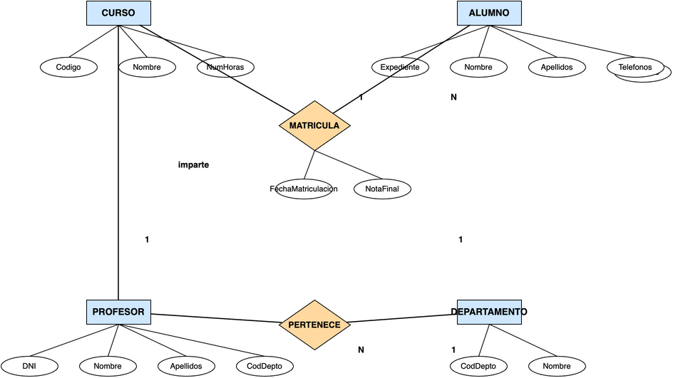

**Se pide:**

a) Obtener el **modelo relacional** correspondiente al diagrama E/R, indicando para cada tabla su **CP**, **CAlt**, **CAj** y **VNN**.

b) **Normalizar** la tabla de alumnos para eliminar el atributo multivaluado *telefonos*, documentando el proceso de 1FN y 2FN.

## **Ejercicio 2**

**EMPRESA**

El modelo E/R representa la gestión de una **empresa**. La entidad **DEPARTAMENTO** se identifica por su **CodDepto** y guarda su **Nombre**. La entidad **EMPLEADO** se identifica por su **DNI** y guarda **Nombre**, **Apellidos** y **Salario**. Un **departamento** tiene **varios empleados** y cada **empleado** pertenece a **un único departamento** (relación N:1). La entidad **PROYECTO** se identifica por su **Codigo** y guarda el **Nombre** y las **HorasPrevistas**. Un **empleado** puede **trabajar en varios proyectos** y un **proyecto** puede tener **varios empleados**; esta relación N:M se llama **TRABAJA** y guarda el atributo **NumHoras** dedicadas por cada empleado a cada proyecto.

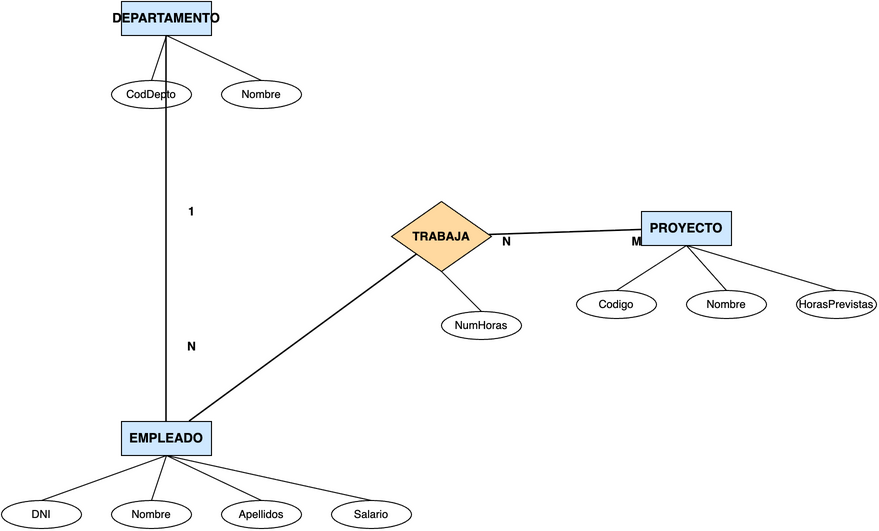

**Se pide:**

a) Obtener el **modelo relacional** correspondiente al diagrama E/R, indicando para cada tabla su **CP**, **CAlt**, **CAj** y **VNN**.

b) Documentar las **restricciones** que no pueden plasmarse en el diseño lógico. Se sabe que:

- Un empleado puede trabajar como máximo en 3 proyectos.

- El salario de un empleado no puede superar los 5.000 €.

- Un departamento puede no tener empleados, pero un empleado siempre pertenece a un departamento.

- Un proyecto no puede estar sin empleados.

## **Ejercicio 3**

**CLÍNICA DENTAL**

El modelo E/R representa la gestión de una **clínica dental**. La entidad **PACIENTE** se identifica por su **NIF** y guarda **Nombre**, **Apellidos**, **Telefono** y la **dirección** descompuesta en **Calle**, **Numero**, **CP** y **Localidad**. La entidad **DENTISTA** se identifica por su **DNI** y guarda **Nombre**, **Apellidos** y **Especialidad**. Un **paciente** tiene **varias citas** y un **dentista** tiene **varias citas**; esta relación N:M se llama **CITA** y guarda la **Fecha**, la **Hora** y el **Tratamiento** realizado. Un **paciente** puede tener **varias facturas** y cada **factura** corresponde a **un único paciente** (relación N:1). La entidad **FACTURA** se identifica por su **NumFactura** y guarda la **FechaEmision** y el **ImporteTotal**. La entidad **TRATAMIENTO** se identifica por su **Codigo** y guarda la **Descripcion** y el **Precio**. Una **factura** detalla **varios tratamientos** y un **tratamiento** puede aparecer en **varias facturas**; esta relación N:M se llama **LINEA_FACTURA** y guarda la **Cantidad** de cada tratamiento en cada factura.

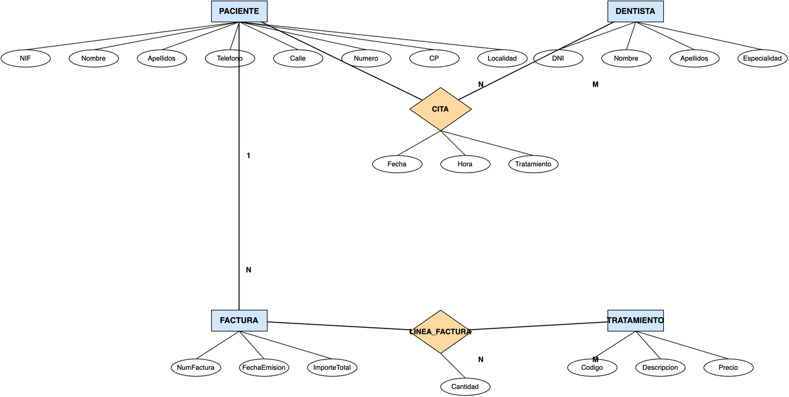

**Se pide:**

a) Obtener el **modelo relacional** correspondiente al diagrama E/R, indicando para cada tabla su **CP**, **CAlt**, **CAj** y **VNN**.

b) Documentar las **restricciones** que no pueden plasmarse en el diseño lógico.

## **Ejercicio 4**

**ESPECIALIZACIÓN**

El modelo E/R representa la gestión de los **empleados** de una empresa mediante una **especialización**. La entidad **EMPLEADO** se identifica por su **DNI** y guarda **Nombre**, **Apellidos** y **Salario**. Un empleado es de dos tipos posibles: la entidad **TECNICO** guarda su **Especialidad** y la entidad **COMERCIAL** guarda su **Zona**. La especialización se representa con el símbolo **ISA**.

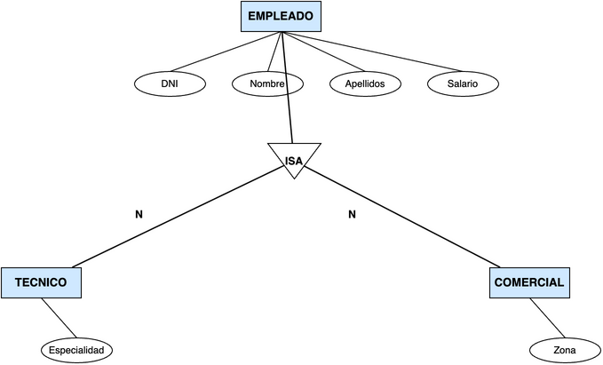

**Se pide:**

a) Obtener el **modelo relacional** correspondiente al diagrama E/R con la especialización, indicando para cada tabla su **CP**, **CAlt**, **CAj** y **VNN**.

b) Indicar en qué casos se guardarían los datos de técnicos y comerciales en **tablas independientes** y en qué casos se guardarían en la **misma tabla** que los empleados.
