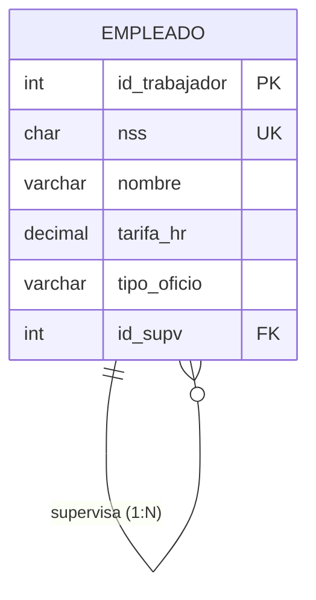

# **El modelo relacional**

Una vez validado el **modelo conceptual** (diagrama Entidad/Relación) de nuestro sistema de información, el siguiente paso en el proceso de diseño de una base de datos consiste en transformarlo en un **modelo lógico**. Para ello utilizaremos el **modelo de datos relacional**, propuesto por **Edgar F. Codd** en 1970 y que está presente en la mayoría de los SGBD actuales.

El modelo relacional **organiza y representa los datos en forma de tablas o relaciones**. Así pues:

> **📌 Definición**
> 

> Una **base de datos relacional** es una colección de **relaciones** [tablas], cada una de las cuales tiene un **nombre único**.

```sql
TRABAJADORES
┌─────────────────────────────────────────────────┐
│ id_trabajador │ nombre │ tarifa_hr │ tipo_oficio │
├─────────────────────────────────────────────────┤
│ 001           │ Ana    │ 25        │ Soldador    │
│ 002           │ Luis   │ 20        │ Oficial     │
└─────────────────────────────────────────────────┘
```

El objetivo de esta unidad es obtener el **esquema relacional** de la base de datos, es decir, el conjunto de tablas con sus atributos, claves y restricciones, **independientemente del SGBD** que se vaya a utilizar posteriormente.

## **Elementos del modelo relacional**

Dentro de una relación (tabla) distinguimos los siguientes elementos:

- **Atributo (Ai)**: Elemento susceptible de tomar valores (cada una de las **columnas** de la tabla).

- **Dominio (Di)**: Conjunto de valores que puede tomar un atributo (se considera finito).

- **Tupla**: Cada uno de los elementos que contiene una instancia de la relación (**filas**).

| Término | En el modelo relacional | En la tabla |
| --- | --- | --- |
| **Atributo** | A1, A2, ..., An | Columnas |
| **Tupla** | (X1, X2, ..., Xn) | Filas |
| **Relación** | Esquema de la relación | Tabla |
| **Dominio** | D1, D2, ..., Dn | Tipo de datos de cada columna |

> **📌 Ejemplo**
> 

> Para la relación `TRABAJADORES` anterior:

> - **Atributos**: `id_trabajador`, `nombre`, `tarifa_hr`, `tipo_oficio`.

> - **Dominio de `tarifa_hr`**: número decimal (por ejemplo, `DECIMAL(5,2)`).

> - **Tupla**: cada fila de la tabla, por ejemplo `(001, Ana, 25, Soldador)`.

### **Dominio**

- El **dominio** de un atributo indica el **tipo de valores** que puede tomar un determinado campo. Dicho de otro modo, cada atributo sólo puede tomar un valor dentro del dominio en el que está inscrito.

- **Dos atributos diferentes pueden tener el mismo dominio**.

- No es más que un **tipo de dato**, que puede ser definido por el sistema (como `Integer` o `char`) o, uno más complejo, definido por el usuario.

> **📌 Importante**
> 

> La importancia de los dominios radica en que **cuando se desea realizar una relación entre dos o más tablas, las claves por las que se relacionan deben pertenecer forzosamente al mismo dominio**.

## **Esquema e instancia de la relación**

En una relación hay que distinguir dos aspectos:

- **Esquema de relación**: Los atributos A1...An que la componen.

  - p. ej. `Trabajadores (id_trabajadores, nombre, tarifa_hr, tipo_de_oficio, id_supv)`.

- **Instancia de la relación**: Conjunto de tuplas {(X1, X2,…,Xn)} = producto cartesiano D1xD2xD3...xDn que la componen en cada momento.

**Consecuencias** de la definición de relación como conjunto de tuplas:

- **No existen tuplas duplicadas** (concepto de clave primaria).

- **No existe orden** en las tuplas (ni en los atributos).

## **Esquema e instancia de la base de datos**

Una base de datos relacional es un **conjunto finito de relaciones** junto con una serie de **restricciones o reglas de integridad**:

- **Restricción de integridad**: Condición necesaria para preservar la **corrección semántica** de la base de datos.

- **Esquema de la base de datos**: Colección de esquemas de relaciones junto con las restricciones de integridad que se definen sobre las relaciones.

- **Instancia (o estado) de la base de datos**: Colección de instancias de relaciones que **verifican las restricciones** de integridad.

- **Base de datos relacional**: Instancia de la base de datos junto con su esquema.



## **Restricciones de integridad**

Las restricciones de integridad garantizan que los datos almacenados sean correctos y mantengan las conexiones entre las tablas. Se clasifican en dos grandes grupos:

### **Asociadas a las tuplas de una relación**

En ocasiones **no se conoce el valor** de un atributo para una determinada tupla. En esos casos, a ese atributo de esa tupla se le asigna un **valor nulo (`NULL`)**, que indica que:

- El valor de ese atributo es **desconocido**, o

- simplemente, que ese atributo **no es aplicable** a esa tupla.

> **📌 El valor NULL**
> 

> El valor `NULL` **no es el cero** ni la cadena vacía, sino la **ausencia de valor**. Debe utilizarse con precaución, ya que puede provocar resultados impredecibles en las consultas y en las operaciones con datos.

### **Asociadas a las relaciones de la base de datos**

- **Clave primaria**: Conjunto de atributos **seleccionados para identificar unívocamente** a las tuplas de una relación.

- **Integridad de entidad**: Los atributos de la clave primaria **no pueden tomar valores nulos**, ya que la clave primaria debe permitirnos identificar unívocamente cada tupla de la relación.

### **Integridad referencial**

La **integridad referencial** mantiene las **conexiones entre las tablas** en las bases de datos relacionales, mediante las **claves ajenas (o foráneas)**:

- `imparte.NRP ∈ profesor.NRP`: El profesor que imparte una asignatura **debe existir** en la tabla profesores.

- `cuenta.sucursal ∈ sucursal.numero`: Una cuenta **tiene que pertenecer a una sucursal existente**.

> **📌 Resumen**
> 

| Restricción | Función |
| --- | --- |
| **Integridad de entidad** | La clave primaria no puede ser `NULL`. |
| **Integridad referencial** | Toda clave ajena debe hacer referencia a una tupla existente en la tabla relacionada. |
| **Clave ajena (FK)** | Atributo que referencia a la clave primaria de otra tabla, manteniendo la relación entre tablas. |

### **Claves en el modelo relacional**

En el modelo relacional, además de la clave primaria (CP), podemos encontrar otros tipos de claves:

- **Clave candidata**: Conjunto de atributos que puede identificar unívocamente a las tuplas (unívoco y mínimo).

- **Clave primaria (CP)**: Clave candidata elegida por el diseñador para identificar cada tupla.

- **Clave alternativa (CAlt)**: Claves candidatas que **no** han sido elegidas como clave primaria.

- **Clave ajena (CAj)**: Atributo que referencia a la clave primaria de otra relación.

> **📌 Nomenclatura**
> 

> En el **diccionario de datos** representaremos cada tabla con su esquema y sus claves. Por ejemplo:

```sql
TRABAJADORES (id_trabajadores, nombre, tarifa_hr, tipo_oficio, id_supv)
CP: {id_trabajadores}
CAj: {id_supv} → TRABAJADORES   (relación reflexiva: jefe)
```

## **Ejercicios propuestos**

> **📌 Ejercicio 1**
> 

> Dada la siguiente instancia de la relación `ALUMNO`, indica:

| num_expediente | dni | nombre | telefono | fecha_nac |
| --- | --- | --- | --- | --- |
| 001 | 12345678A | Ana | 611111111 | 12/03/2007 |
| 002 | 87654321B | Luis | 622222222 | 05/07/2006 |
| 003 | 13579246C | Eva | NULL | 28/11/2006 |

> 1. ¿Cuál es el esquema de la relación?

> 1. ¿Cuál es el grado de la relación? ¿Y su cardinalidad?

> 1. Identifica las claves candidatas y propón una clave primaria.

> 1. ¿Qué significaría el valor `NULL` en el atributo `telefono` de Eva?

> **📌 Ejercicio 2**
> 

> Indica qué restricción de integridad incumple cada una de las siguientes situaciones:

> 1. Se intenta insertar una tupla en `PEDIDO` con `id_cliente = 999`, y ese cliente no existe en la tabla `CLIENTE`.

> 1. Se intenta insertar una tupla en `EMPLEADO` con valor `NULL` en el atributo `dni` (clave primaria).

> 1. Se intenta insertar dos tuplas en `PRODUCTO` con el mismo valor en la clave primaria `codigo`.

> **📌 Ejercicio 3**
> 

> Dada la relación `TRABAJADORES (id_trabajador, nss, nombre, tarifa_hr, id_supv)`:

> 1. Indica un ejemplo de **clave alternativa**.

> 1. Indica un ejemplo de **clave ajena** y a qué tabla hace referencia.

> 1. Razona si `nss` y `id_trabajador` pertenecen al mismo dominio.
