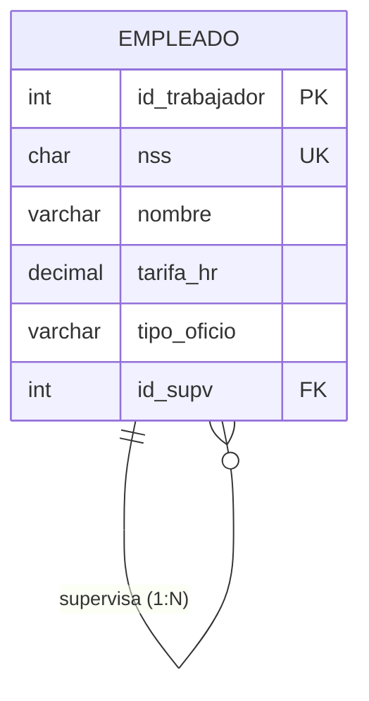

# **El model relacional**

<div class="interactive-progress-tracker">
  <div class="tracker-header">
    <span>🏆 <strong>Progrés d'aquesta secció:</strong> <span class="tracker-count">0 de 4 superats (0%)</span></span>
    <span class="tracker-pts">⭐ <strong>0 punts</strong></span>
  </div>
  <div class="tracker-bar">
    <div class="tracker-fill" style="width: 0%;"></div>
  </div>
</div>

Una vegada validat el **model conceptual** (diagrama Entitat/Relació) del nostre sistema d'informació, el següent pas en el procés de disseny d'una base de dades consisteix en transformar-lo en un **model lògic**. Per a això utilitzarem el **model de dades relacional**, proposat per **Edgar F. Codd** en 1970 i que està present en la majoria dels SGBD actuals.

El model relacional **organitza i representa les dades en forma de taules o relacions**. Així ja que:

> **📌 Definició**
> 

> Una **base de dades relacional** és una col·lecció de **relacions** [taules], cada una de les quals té un **nom únic**.

```sql
TRABAJADORES
┌─────────────────────────────────────────────────┐
│ id_trabajador │ nombre │ tarifa_hr │ tipo_oficio │
├─────────────────────────────────────────────────┤
│ 001           │ Ana    │ 25        │ Soldador    │
│ 002           │ Luis   │ 20        │ Oficial     │
└─────────────────────────────────────────────────┘
```

L'objectiu d'aquesta unitat és obtindre el **esquema relacional** de la base de dades, és a dir, el conjunt de taules amb els seus atributs, claus i restriccions, **independentment del SGBD** que es vaja a utilitzar posteriorment.

## **Elements del model relacional**

Dins d'una relació (taula) distinguimos els següents elements:

- **Atribut (Ai)**: Element susceptible de prendre valors (cada una de les **columnes** de la taula).

- **Domini (Di)**: Conjunt de valors que pot prendre un atribut (es considera finito).

- **Tupla**: Cada un dels elements que conté una instància de la relació (**files**).

| Terme | En el model relacional | En la taula |
| --- | --- | --- |
| **Atribut** | A1, A2, ..., An | Columnes |
| **Tupla** | (X1, X2, ..., Xn) | Files |
| **Relació** | Esquema de la relació | Taula |
| **Domini** | D1, D2, ..., Dn | Tipus de dades de cada columna |

> **📌 Exemple**
> 

> Per a la relació `TRABAJADORES` anterior:

> - **Atributs**: `id_trabajador`, `nombre`, `tarifa_hr`, `tipo_oficio`.

> - **Domini de `tarifa_hr`**: número decimal (per exemple, `DECIMAL(5,2)`).

> - **Tupla**: cada fila de la taula, per exemple `(001, Ana, 25, Soldador)`.

### **Domini**

- El **domini** d'un atribut indica el **tipus de valors** que pot prendre un determinat camp. Aquest d'un altre mode, cada atribut només pot prendre un valor dins del domini en el que està inscrito.

- **Dos atributs diferents poden tindre el mateix domini**.

- No és més que un **tipus de dada**, que pot ser definit pel sistema (com `Integer` o `char`) o, un més complex, definit pel usuari.

> **📌 Important**
> 

> La importància dels dominis radica en que **quan es desitja realitzar una relació entre dos o més taules, les claus per les que es relacionen han de pertànyer forzosament al mateix domini**.

## **Esquema i instància de la relació**

En una relació cal distingir dos aspectes:

- **Esquema de relació**: Els atributs A1...An que la componen.

  - p. ej. `Trabajadores (id_trabajadores, nombre, tarifa_hr, tipo_de_oficio, id_supv)`.

- **Instància de la relació**: Conjunt de tuples {(X1, X2,…,Xn)} = producte cartesiano D1xD2xD3...xDn que la componen en cada moment.

**Conseqüències** de la definició de relació com conjunt de tuples:

- **No existeixen tuples duplicades** (concepte de clau primària).

- **No existeix ordre** en les tuples (ni en els atributs).

## **Esquema i instància de la base de dades**

Una base de dades relacional és un **conjunt finito de relacions** juntament amb una sèrie de **restriccions o regles d'integritat**:

- **Restricció d'integritat**: Condició necessària per a preservar la **correcció semàntica** de la base de dades.

- **Esquema de la base de dades**: Col·lecció d'esquemes de relacions juntament amb les restriccions d'integritat que es defineixen sobre les relacions.

- **Instància (o estat) de la base de dades**: Col·lecció d'instàncies de relacions que **verifican les restriccions** d'integritat.

- **Base de dades relacional**: Instància de la base de dades juntament amb el seu esquema.



## **Restriccions d'integritat**

Les restriccions d'integritat garanteixen que les dades emmagatzemats siguen correctes i mantengan les connexions entre les taules. Es classifiquen en dos grans grups:

### **Associades a les tuples d'una relació**

En ocasions **no es coneix el valor** d'un atribut per a una determinada tupla. En eixos casos, a eixe atribut d'eixa tupla es li assigna un **valor nul (`NULL`)**, que indica que:

- El valor d'eixe atribut és **desconocido**, o

- simplement, que eixe atribut **no és aplicable** a eixa tupla.

> **📌 El valor NULL**
> 

> El valor `NULL` **no és el zero** ni la cadena buida, sinó la **ausencia de valor**. Ha d'utilitzar-se amb precaució, ja que pot provocar resultats impredecibles en les consultes i en les operacions amb dades.

### **Associades a les relacions de la base de dades**

- **Clau primària**: Conjunt d'atributs **seleccionats per a identificar unívocament** a les tuples d'una relació.

- **Integritat d'entitat**: Els atributs de la clau primària **no poden prendre valors nuls**, ja que la clau primària ha de permitirnos identificar unívocament cada tupla de la relació.

### **Integritat referencial**

La **integritat referencial** manté les **connexions entre les taules** en les bases de dades relacionals, mitjançant les **claus foranes (o foráneas)**:

- `imparte.NRP ∈ profesor.NRP`: El professor que imparteix una assignatura **ha d'existir** en la taula professors.

- `cuenta.sucursal ∈ sucursal.numero`: Una compta **ha de pertànyer a una sucursal existent**.

> **📌 Resum**
> 

| Restricció | Funció |
| --- | --- |
| **Integritat d'entitat** | La clau primària no pot ser `NULL`. |
| **Integritat referencial** | Tota clau forana ha de fer referència a una tupla existent en la taula relacionada. |
| **Clau forana (FK)** | Atribut que referència a la clau primària d'una altra taula, mantenint la relació entre taules. |

### **Claus en el model relacional**

En el model relacional, a més de la clau primària (CP), podem trobar altres tipus de claus:

- **Clau candidata**: Conjunt d'atributs que pot identificar unívocament a les tuples (unívoc i mínim).

- **Clau primària (CP)**: Clau candidata elegida pel dissenyador per a identificar cada tupla.

- **Clau alternativa (CAlt)**: Claus candidates que **no** han sigut elegides com clau primària.

- **Clau forana (CAj)**: Atribut que referència a la clau primària d'una altra relació.

> **📌 Nomenclatura**
> 

> En el **diccionari de dades** representarem cada taula amb el seu esquema i les seues claus. Per exemple:

```sql
TRABAJADORES (id_trabajadores, nombre, tarifa_hr, tipo_oficio, id_supv)
CP: {id_trabajadores}
CAj: {id_supv} → TRABAJADORES   (relación reflexiva: jefe)
```

## **Exercicis proposats**

> **📌 Exercici 1**
> 

> Donada la següent instància de la relació `ALUMNO`, indica:

| num_expediente | dni | nom | telefono | fecha_nac |
| --- | --- | --- | --- | --- |
| 001 | 12345678A | Ana | 611111111 | 12/03/2007 |
| 002 | 87654321B | Luis | 622222222 | 05/07/2006 |
| 003 | 13579246C | Eva | NULL | 28/11/2006 |

> 1. Quin és l'esquema de la relació?

> 1. Quin és el grau de la relació? I la seua cardinalitat?

> 1. Identifica les claus candidates i propón una clau primària.

> 1. Què significaría el valor `NULL` en l'atribut `telefono` de Eva?

> **📌 Exercici 2**
> 

> Indica què restricció d'integritat incumple cada una de les següents situacions:

> 1. Es intenta inserir una tupla en `PEDIDO` amb `id_cliente = 999`, i eixe client no existeix en la taula `CLIENTE`.

> 1. Es intenta inserir una tupla en `EMPLEADO` amb valor `NULL` en l'atribut `dni` (clau primària).

> 1. Es intenta inserir dos tuples en `PRODUCTO` amb el mateix valor en la clau primària `codigo`.

> **📌 Exercici 3**
> 

> Donada la relació `TRABAJADORES (id_trabajador, nss, nombre, tarifa_hr, id_supv)`:

> 1. Indica un exemple de **clau alternativa**.

> 1. Indica un exemple de **clau forana** i a què taula fa referència.

> 1. Raona si `nss` i `id_trabajador` pertanyen al mateix domini.


---

## 🎮 Reptes Interactius d'Autoavaluació (+100 XP)

Comprova el teu domini sobre **3.1 El model relacional** superant aquests 4 reptes gamificats (+25 punts cadascun):

<div class="interactive-mcq" data-answer="B" data-hint="Tota relació N:M genera una nova taula amb les claus primàries d'ambdues entitats com a clau composta i claus foranes.">
  <div class="mcq-question">🎯 <strong>Repte 1 (+25 pts):</strong> En la transformació del model E/R al model Relacional, com es transforma una relació binària amb correspondència N:M (molts a molts)?</div>
  <div class="mcq-options">
    <button type="button" class="btn-mcq-opt" data-opt="A">A) Es fusionen les dues entitats en una sola taula sense clau primària.</button>
    <button type="button" class="btn-mcq-opt" data-opt="B">B) Es crea una nova taula (relació) la clau primària de la qual és la composició de les claus foranes de les dues entitats.</button>
    <button type="button" class="btn-mcq-opt" data-opt="C">C) S'elimina la relació perquè el model relacional no admet N:M.</button>
    <button type="button" class="btn-mcq-opt" data-opt="D">D) Es duplica tota la base de dades en un segon servidor.</button>
  </div>
  <div class="quiz-feedback"></div>
</div>

<div class="interactive-mcq" data-answer="B" data-hint="La regla d'integritat d'entitat prohibeix valors nuls (NULL) en qualsevol atribut de la clau primària.">
  <div class="mcq-question">🎯 <strong>Repte 2 (+25 pts):</strong> Quina regla d'integritat del model relacional estableix que cap atribut que forme part de la clau primària d'una relació pot prendre el valor NULL?</div>
  <div class="mcq-options">
    <button type="button" class="btn-mcq-opt" data-opt="A">A) Integritat referencial.</button>
    <button type="button" class="btn-mcq-opt" data-opt="B">B) Integritat d'entitat.</button>
    <button type="button" class="btn-mcq-opt" data-opt="C">C) Tercera Forma Normal (3FN).</button>
    <button type="button" class="btn-mcq-opt" data-opt="D">D) Dependència transitiva.</button>
  </div>
  <div class="quiz-feedback"></div>
</div>

<div class="interactive-vf" data-answer="V" data-hint="La 3FN elimina les dependències funcionals transitives entre atributs que no formen part de la clau.">
  <div class="vf-statement">✅ <strong>Repte 3 (Vertader o Fals · +25 pts):</strong> Una relació es troba en Tercera Forma Normal (3FN) si està en 2FN i cap atribut no-clau depèn transitivament de la clau primària.</div>
  <div class="vf-buttons">
    <button type="button" class="btn-vf" data-opt="V">Vertader (V)</button>
    <button type="button" class="btn-vf" data-opt="F">Fals (F)</button>
  </div>
  <div class="quiz-feedback" style="width: 100%;"></div>
</div>

<div class="interactive-quiz" data-answer="clau forana|clau aliena|foreign key|fk" data-hint="En valencià s'anomena clau forana o clau aliena (FK).">
  <div class="quiz-question">⌨️ <strong>Repte 4 (+25 pts):</strong> Com s'anomena en el model relacional la clau (Foreign Key) que fa referència a la clau primària d'una altra taula per a mantenir la integritat referencial?</div>
  <div class="quiz-controls">
    <input type="text" class="quiz-input" placeholder="Escriu la resposta..." />
    <button type="button" class="btn-quiz-check">Comprovar</button>
  </div>
  <div class="quiz-feedback"></div>
</div>

### 📋 Llista de Comprovació i Rúbrica d'Assoliment

Marca cada criteri a mesura que completes l'estudi o la resolució pràctica d'aquesta pàgina (**3.1 El model relacional**):

- [ ] He llegit detingudament la teoria o l'enunciat d'aquesta secció i he anotat els conceptes clau.
- [ ] He revisat els esquemes, taules o blocs de codi i he verificat que sé aplicar-los a l'entorn de treball.
- [ ] He resolt correctament els **4 reptes interactius** superiors obtenint els **100 punts XP**.
- [ ] He descarregat el comprovant oficial en PDF per a adjuntar-lo a la tasca d'**Aules**.

<div class="aules-delivery-card">
  <h3>📤 Comprovant de Lliurament per a Aules</h3>
  <p>Quan hages completat els reptes interactius i la llista d'autoavaluació d'aquesta pàgina, introdueix el teu nom i descarrega el teu certificat oficial en PDF per a adjuntar-lo a la tasca d'<strong>Aules</strong>.</p>
  <div class="aules-student-field">
    <label for="aules-student-name">👤 Nom i Cognoms de l'Alumne/a:</label>
    <input type="text" id="aules-student-name" class="aules-student-name" placeholder="Ex: Joan Garcia Pérez" />
  </div>
  <div class="aules-score-badge">
    <span class="aules-score-count">0/4 reptes completats (0%) · 0 punts · 0/4 criteris d'autoavaluació</span>
  </div>
  <div class="aules-actions">
    <button type="button" class="btn-aules-dl" data-module="BBDD" data-unit="UD03" data-activity="ut0301">📥 Descarregar Comprovant PDF</button>
    <button type="button" class="btn-aules-copy">📋 Copiar Resum al Porta-retalls</button>
  </div>
  <div class="aules-toast"></div>
</div>
