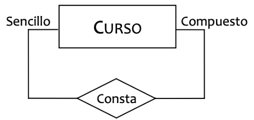

# **Transformació al model relacional (I)**

<div class="interactive-progress-tracker">
  <div class="tracker-header">
    <span>🏆 <strong>Progrés d'aquesta secció:</strong> <span class="tracker-count">0 de 4 superats (0%)</span></span>
    <span class="tracker-pts">⭐ <strong>0 punts</strong></span>
  </div>
  <div class="tracker-bar">
    <div class="tracker-fill" style="width: 0%;"></div>
  </div>
</div>

El pas del **disseny conceptual** (diagrama E/R) al **model relacional** consisteix en transformar tots els elements del diagrama Entitat/Relació en **taules** amb els seus atributs, claus i restriccions.

## **Regles de transformació**

Per a transformar un diagrama E/R en un esquema relacional seguirem els següents passos:

1. Es transformen en taules **tots els tipus d'entitats i relacions** que apareixen en el diagrama E/R.

1. Es **seleccionan les claus primàries** per a cada una de les taules del nostre esquema lògic.

1. **Fusió de taules**: es combinen aquelles taules que compartan la seua clau primària.

1. **Normalització**: es normaliza l'esquema resultant.

1. Es defineixen **totes les restriccions d'integritat** que siguen aplicables a l'esquema obtingut.

## **Transformació d'entitats**

Tota **entitat** del model E/R es transforma en una **relació (taula)** del model relacional:

- **Atributs**: Tots els atributs de l'entitat es transformen en un atribut de la relació.

- **Clau primària**: Una de les claus candidates del conjunt d'entitats.

- **Atributs compostos**: S'inclouen en la relació els **atributs simples (atòmics)** que formen part de l'atribut compost.

- **Atributs derivats**: **No s'emmagatzemaran** en la base de dades, per la qual cosa **no s'inclouen** com atributs de les relacions.

> **📌 Exemple**
> 

> Donada l'entitat `EMPLEADO` amb els atributs:

> - Identificador principal: `DNI`

> - Identificador alternatiu: `NSS`

> - Compost: `Nombre` (Nom, Ape-1, Ape-2)

> - Simples: `Edad`, `Sueldo`

> - Multivaluat: `telefono`

> - Derivat: `Antiguedad`

> La transformació al model relacional quedaria:

```sql
Empleado (DNI:cad-9, NSS:cad-9, {Nombre:cad-30, Ape-1:cad-30, Ape-2:cad-30}, Edad:num, Sueldo:moneda, {telefono:cad-9}n)
CP: {DNI}
CAlt: {NSS}
VNN: {Edad}
```

Observa que:

- L'atribut compost `Nombre` es ha descompost en els seus **atributs atòmics**.

- L'atribut derivat `Antiguedad` **no apareix** en la relació.

- L'atribut multivaluat `telefono` es manté com una llista `{...}n` (es resolverá en la **normalització**).

## **Transformació d'entitats febles**

Una **entitat feble** depèn existencialment d'una **entitat fort**:

- **Atributs**: A més dels atributs propis de l'entitat feble, es afegeixen els atributs pertenecientes a la **clau primària de l'entitat fort** de la que depèn existencialment.

- **Clau primària**: La clau primària de la **entitat fort més un conjunt d'atributs propis** de l'entitat feble (**discriminante**).

- **Clau forana**: Una clau que fa referència a la **entitat fort** de la que depèn existencialment l'entitat feble.

> **📌 Exemple**
> 

> L'entitat feble `EDICION` depèn de l'entitat fort `CURSO`. Si `CURSO (Cod-Cur)` i els atributs propis de `EDICION` són `{Edicion, Fecha, Plazas}`:

```sql
Edicion (Cod-Cur:cad-4, Edicion:num, Fecha:fecha, Plazas:num)
CP: {Cod-Cur, Edicion}
CAj: {Cod-Cur} → CURSO
VNN: {Edicion, Fecha}
```

La clau primària és composta: la clau de l'entitat fort (`Cod-Cur`) més el discriminante (`Edicion`).

## **Transformació de relacions unàries**

Les **relacions unàries o reflexivas** són aquelles en les que intervé **una única entitat**. La forma de transformar-les depèn del **tipus de correspondència**:



- **Relació Unària 1:1** → La **clau forana** serà també **clau alternativa**.

- **Relació Unària 1:N** → Treballem amb la **clau forana** solament.

- **Relació Unària N:N** → La relació E/R passa a tratar-se com una **nova relació** del model.

### **Relacions unàries 1:1**

Donada l'entitat `EMPLEADO` amb la relació reflexiva `SUPERVISA` 1:1 (un empleat supervisa a un únic empleat i viceversa):

```sql
Empleado (DNI:cad-9, NSS:cad-9, {Nombre:cad-30, Ape-1:cad-30, Ape-2:cad-30}, Edad:num, Sueldo:moneda, {telefono:cad-9}n, DNI-J:cad-9, Turno:num)
CP: {DNI}
CAlt: {NSS}, {DNI-J}
VNN: {Edad}
CAj: {DNI-J} → EMPLEADO
```

- **Clau forana** → `DNI-J`, però igualment podríem haver cogido `DNI-S`.

- **Clau alternativa** → `DNI-J`, és a dir, **la CAj ha de ser alternativa** per a garantir la relació tipus 1:1.

- **Atributs de la relació** → `Turno`, els atributs de la relació han d'anar juntament amb la CAj que representa a la relació.

### **Relacions unàries 1:N**

Donada l'entitat `EMPLEADO` amb la relació reflexiva `SUPERVISA` 1:N (un cap supervisa a molts empleats):

```sql
Empleado (DNI:cad-9, NSS:cad-9, {Nombre:cad-30, Ape-1:cad-30, Ape-2:cad-30}, Edad:num, Sueldo:moneda, {telefono:cad-9}n, DNI-J:cad-9, Turno:num)
CP: {DNI}
CAlt: {NSS}
VNN: {Edad}
CAj: {DNI-J} → EMPLEADO
```

- **Clau forana** → `DNI-J`, ja que el cap pot tindre **molts subordinats**, però un subordinat tindrà un **únic cap**.

  - Si la relació haguera tingut el molts cap al Cap, la clau forana tindria que ser `DNI-S`.

- **Atributs de la relació** → `Turno`, els atributs de la relació han d'anar juntament amb la CAj que representa a la relació.

> **📌 Diferència amb el cas 1:1**
> 

> En la relació **1:N la clau forana no és alternativa**, ja que un mateix cap pot aparèixer en moltes tuples.

### **Relacions unàries N:N**

En aquest cas **NO** anem a afegir els elements relatius a la relació a la taula de l'entitat, sinó que hem de **crear una nova relació**, així la nostra nova relació quedarà com segueix:

```sql
Supervisa (DNI-J:cad-9, DNI-S:cad-9, Turno:num)
CP: {DNI-J, DNI-S}
CAj: {DNI-J} → EMPLEADO
CAj: {DNI-S} → EMPLEADO
```

- **Clau principal** → És una **clau composta**, d'una banda `DNI-J` representa als Empleats Jefes, i pel un altre `DNI-S` representa als Empleats Subordinats, així tindrem una fila per cada connexió cap-subordinat que es establezca entre els nostres empleats.

- **Clau forana** → En aquest cas tindrem **dos**, i totes dues amb Dependència de Identificació:

  - `DNI-J` → connecta amb empleats assignant la funció de cap.

  - `DNI-S` → connecta amb empleats assignant la funció de subordinat.

- **Atributs de la relació** → `Turno`, els atributs de la relació han d'anar juntament amb la clau forana que representa a la relació.

> **📌 Resum relacions unàries**
> 

| Tipus de correspondència | Transformació | Clau forana |
| --- | --- | --- |
| **1:1** | Es afegeix la CAj a l'entitat | CAj que a més és **clau alternativa** |
| **1:N** | Es afegeix la CAj a l'entitat | CAj en el costat del **molts** |
| **N:N** | Es crea una **nova relació** | La CAj forma part de la **clau primària** |

## **Exercicis proposats**

> **📌 Exercici 1**
> 

> Donada l'entitat fort `PROFESOR (Cod-Prof, nombre, apellidos, departamento)` i l'entitat feble `EDICION_ASIG`, de la que es coneixen els atributs `{Cod-Edi, FechaInicio, Aula}` i que depèn de l'entitat `ASIGNATURA (Cod-Asig, nombre, creditos)`:

> 1. Obtingues l'esquema relacional de les tres taules, indicant CP, CAlt, CAj i VNN.

> 1. Raona quin és el discriminante de l'entitat feble.

> **📌 Exercici 2**
> 

> L'entitat `EMPLEADO` participa en la relació reflexiva `GESTIONA` de tipus **1:1** (cada empleat gestiona un únic empleat i viceversa). Si la clau primària és `DNI`, indica:

> 1. Què atribut ha de añadir-se a la taula EMPLEAT?

> 1. Ha d'eixa clau forana ser a més clau alternativa? Per què?

> **📌 Exercici 3**
> 

> Indica què transformació hi hauria que aplicar (afegir CAj a l'entitat o crear una nova relació) per a cada un dels següents casos de relacions unàries sobre l'entitat `PIEZA (Cod-Pieza, nombre, peso)`:

> 1. Una peça es **compon** de moltes peces i una peça forma part d'una única peça (COMPON 1:N).

> 1. Una peça **succeeix** a una única peça i viceversa (SUCCEEIX 1:1).

> 1. Una peça **comparteix** amb moltes altres peces (COMPARTEIX N:N).


---

## 🎮 Reptes Interactius d'Autoavaluació (+100 XP)

Comprova el teu domini sobre **3.2 Transformació al model relacional (I)** superant aquests 4 reptes gamificats (+25 punts cadascun):

<div class="interactive-mcq" data-answer="A" data-hint="La 1FN exigeix que tots els dominis siguen atòmics (sense atributs multivaluats ni compostos dins d'una columna).">
  <div class="mcq-question">🎯 <strong>Repte 1 (+25 pts):</strong> Quina condició ha de complir una taula per a trobar-se en Primera Forma Normal (1FN)?</div>
  <div class="mcq-options">
    <button type="button" class="btn-mcq-opt" data-opt="A">A) Tots els seus atributs han de contenir valors atòmics (indivisibles), sense grups repetitius ni llistes en una mateixa cel·la.</button>
    <button type="button" class="btn-mcq-opt" data-opt="B">B) Ha de tenir exactament 10 columnes.</button>
    <button type="button" class="btn-mcq-opt" data-opt="C">C) No pot tenir clau primària.</button>
    <button type="button" class="btn-mcq-opt" data-opt="D">D) Ha d'estar emmagatzemada en MongoDB.</button>
  </div>
  <div class="quiz-feedback"></div>
</div>

<div class="interactive-mcq" data-answer="A" data-hint="En una relació 1:N, la taula del costat 'molts' (N) incorpora com a clau forana la clau primària del costat '1'.">
  <div class="mcq-question">🎯 <strong>Repte 2 (+25 pts):</strong> En transformar una relació binària 1:N on el costat N té participació obligatòria (1,1), on es propaga la clau forana?</div>
  <div class="mcq-options">
    <button type="button" class="btn-mcq-opt" data-opt="A">A) La clau primària del costat '1' passa com a clau forana a la taula del costat 'N'.</button>
    <button type="button" class="btn-mcq-opt" data-opt="B">B) La clau del costat 'N' passa al costat '1' creant columnes infinites.</button>
    <button type="button" class="btn-mcq-opt" data-opt="C">C) Sempre es creen 4 taules noves.</button>
    <button type="button" class="btn-mcq-opt" data-opt="D">D) No es posa cap clau forana.</button>
  </div>
  <div class="quiz-feedback"></div>
</div>

<div class="interactive-vf" data-answer="V" data-hint="La 2FN elimina les dependències funcionals parcials respecte a una part d'una clau primària composta.">
  <div class="vf-statement">✅ <strong>Repte 3 (Vertader o Fals · +25 pts):</strong> La Segona Forma Normal (2FN) exigeix que la taula estiga en 1FN i que tots els atributs que no són clau depenguen de forma completa (total) de tota la clau primària composta.</div>
  <div class="vf-buttons">
    <button type="button" class="btn-vf" data-opt="V">Vertader (V)</button>
    <button type="button" class="btn-vf" data-opt="F">Fals (F)</button>
  </div>
  <div class="quiz-feedback" style="width: 100%;"></div>
</div>

<div class="interactive-quiz" data-answer="tupla|tuples" data-hint="En el model relacional formal, les files s'anomenen tuples.">
  <div class="quiz-question">⌨️ <strong>Repte 4 (+25 pts):</strong> Com s'anomena cada fila o registre d'una relació (taula) en la terminologia formal del model relacional?</div>
  <div class="quiz-controls">
    <input type="text" class="quiz-input" placeholder="Escriu la resposta..." />
    <button type="button" class="btn-quiz-check">Comprovar</button>
  </div>
  <div class="quiz-feedback"></div>
</div>

### 📋 Llista de Comprovació i Rúbrica d'Assoliment

Marca cada criteri a mesura que completes l'estudi o la resolució pràctica d'aquesta pàgina (**3.2 Transformació al model relacional (I)**):

- [ ] He llegit detingudament la teoria o l'enunciat d'aquesta secció i he anotat els conceptes clau.
- [ ] He revisat els esquemes, taules o blocs de codi i he verificat que sé aplicar-los a l'entorn de treball.
- [ ] He resolt correctament els **4 reptes interactius** superiors obtenint els **100 punts XP**.
- [ ] He descarregat el comprovant oficial en PDF per a adjuntar-lo a la tasca d'**Aules**.

<div class="aules-delivery-card">
  <h3>📤 Comprovant de Lliurament per a Aules</h3>
  <p>Quan hages completat els reptes interactius i la llista d'autoavaluació d'aquesta pàgina, introdueix el teu nom i descarrega el teu certificat oficial en PDF per a adjuntar-lo a la tasca d'<strong>Aules</strong>.</p>
  <div class="aules-student-field">
    <label for="aules-student-name">👤 Nom i Cognoms de l'Alumne/a:</label>
    <input type="text" id="aules-student-name" class="aules-student-name" placeholder="Ex: Joan Garcia Pérez" />
  </div>
  <div class="aules-score-badge">
    <span class="aules-score-count">0/4 reptes completats (0%) · 0 punts · 0/4 criteris d'autoavaluació</span>
  </div>
  <div class="aules-actions">
    <button type="button" class="btn-aules-dl" data-module="BBDD" data-unit="UD03" data-activity="ut0302">📥 Descarregar Comprovant PDF</button>
    <button type="button" class="btn-aules-copy">📋 Copiar Resum al Porta-retalls</button>
  </div>
  <div class="aules-toast"></div>
</div>
