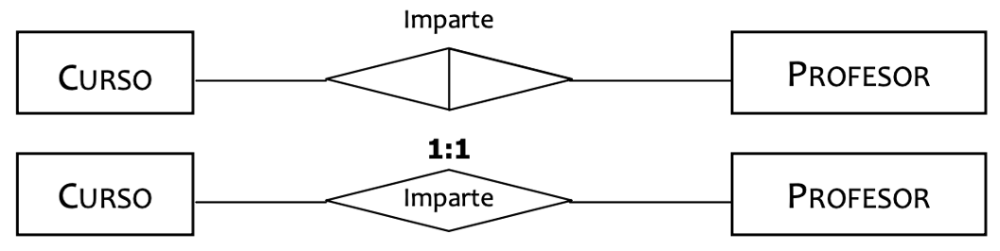
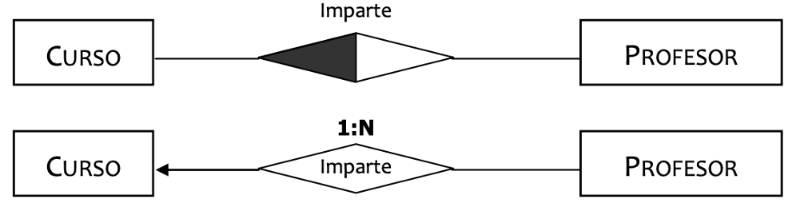
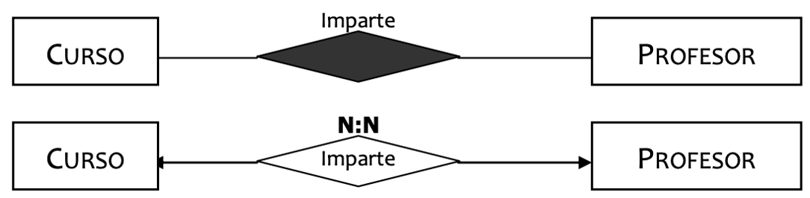
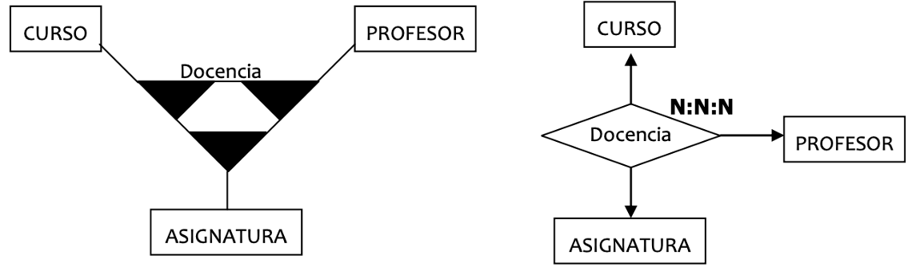
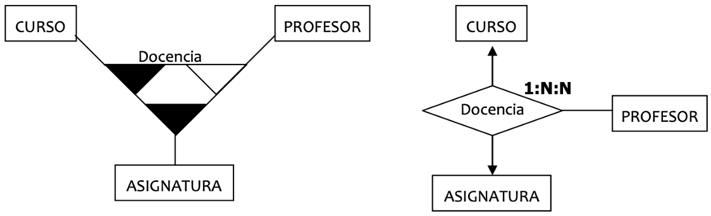
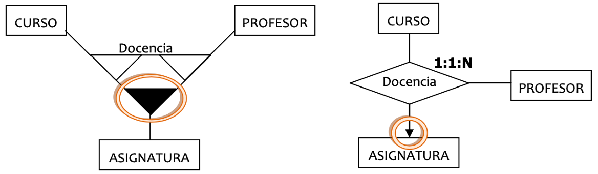
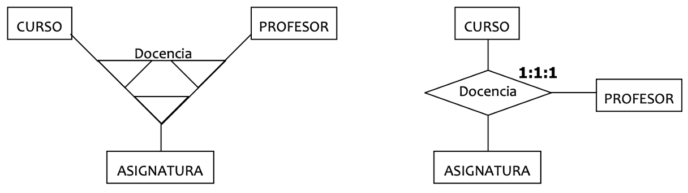

# **Transformació al model relacional (II)**

<div class="interactive-progress-tracker">
  <div class="tracker-header">
    <span>🏆 <strong>Progrés d'aquesta secció:</strong> <span class="tracker-count">0 de 4 superats (0%)</span></span>
    <span class="tracker-pts">⭐ <strong>0 punts</strong></span>
  </div>
  <div class="tracker-bar">
    <div class="tracker-fill" style="width: 0%;"></div>
  </div>
</div>

En aquesta pàgina anem a aumentar el grau de les relacions del model E/R i treballarem amb les **relacions binàries** i **ternàries**.

## **Transformació de relacions binàries**

Amb les relacions binàries es pretende **connectar dos entitats**. A l'igual que amb les relacions unàries, treballarem amb un supòsit en el que anirem canviant el tipus de correspondència de la relació.

- **Relació Binària 1:1** → La **clau forana** es pot incloure en **qualsevol de les dos relacions** (generalment en la relació on menys atributs tinguem). El que cal tindre en compte és que **la clau forana (estiga en la relació que estiga) serà també clau alternativa**.

- **Relació Binària 1:N** → Treballem amb la **clau forana** solament. Posem el **Atribut Identificador Principal** de l'entitat cap a on tenim **Cardinalitat Màxima 1** com **clau forana** en l'entitat cap a on tenim **Cardinalitat Màxima N**.

- **Relació Binària N:N** → La relació E/R passa a tratar-se com una **nova relació** del model.

### **Relacions binàries 1:1**

Veurem com transformar la relació `OCUPA` entre `EMPLEADO` i `PUESTO`, analitzant les dos opcions possibles posant la clau forana en una o en una altra entitat.



Opció 1Opción 2

**Clau forana en la relació EMPLEAT.**

```sql
Empleado (DNI:cad-9, NSS:cad-9, {Nombre:cad-30, Ape-1:cad-30, Ape-2:cad-30}, Edad:num, Sueldo:moneda, {telefono:cad-9}n, Cod-P:cad-9, Turno:num)
CP: {DNI}
CAlt: {NSS}, {Cod-P}
VNN: {Edad}
CAj: {Cod-P} → PUESTO
```

Afegim a la relació `EMPLEADO` dos nous atributs: `Cod-P` (clau principal de la relació `PUESTO`) que serà la clau forana permitiéndonos connectar les dos relacions, i d'altra banda l'atribut `Turno`, que és l'atribut de la relació `OCUPA` (en E/R).

**Clau forana en la relació POSAT.**

```sql
Puesto (Cod-P:cad-9, Descripcion:cad-30, Horario:num, DNI:cad-9, Turno:num)
CP: {Cod-P}
CAlt: {DNI}
CAj: {DNI} → EMPLEADO
```

Afegim a la relació `PUESTO` dos nous atributs: `DNI` (clau principal de la relació `EMPLEADO`) que serà la clau forana permitiéndonos connectar les dos relacions, i d'altra banda l'atribut `Turno`, que és l'atribut de la relació `OCUPA` (en E/R).

> **📌 Què opció triar?**
> 

> Es tria l'opció on la relació quede amb el **menor número possible d'atributs**. En aquest cas el més normal seria triar la **Opció 2**, ja que `PUESTO` té menys atributs que `EMPLEADO`.

### **Relacions binàries 1:N**

Veurem com transformar la relació `OCUPA` 1:N entre `EMPLEADO` i `PUESTO`, considerant les dos possibilitats d'aquest tipus de relació.



1 EMPLEAT – N PUESTOSN EMPLEATS – 1 POSAT

**Clau forana en la relació POSAT.**

```sql
Puesto (Cod-P:cad-9, Descripcion:cad-30, Horario:num, DNI:cad-9, Turno:num)
CP: {Cod-P}
CAj: {DNI} → EMPLEADO
```

Afegim a la relació `PUESTO` dos nous atributs: `DNI` (clau principal de la relació `EMPLEADO`) que serà la clau forana permitiéndonos connectar les dos relacions, i d'altra banda l'atribut `Turno`, que és l'atribut de la relació `OCUPA` (en E/R).

**Clau forana en la relació EMPLEAT.**

```sql
Empleado (DNI:cad-9, NSS:cad-9, {Nombre:cad-30, Ape-1:cad-30, Ape-2:cad-30}, Edad:num, Sueldo:moneda, {telefono:cad-9}n, Cod-P:cad-9, Turno:num)
CP: {DNI}
CAlt: {NSS}
VNN: {Edad}
CAj: {Cod-P} → PUESTO
```

Afegim a la relació `EMPLEADO` dos nous atributs: `Cod-P` (clau principal de la relació `PUESTO`) que serà la clau forana permitiéndonos connectar les dos relacions, i d'altra banda l'atribut `Turno`, que és l'atribut de la relació `OCUPA` (en E/R).

> **📌 Important**
> 

> Observamos que en **cap dels dos casos la clau forana apareix com clau alternativa**. La clau forana es col·loca sempre en l'entitat del costat de **cardinalitat màxima N**.

### **Relacions binàries N:N**

En aquest cas la transformació de la relació que tenim en el Model E/R a Model relacional **solament es pot fer d'una forma**. No hem de modificar les relacions corresponents a les entitats sinó que **creem una nova relació** en el Model relacional:



```sql
Ocupa (Cod-P:cad-9, DNI:cad-9, Turno:num)
CP: {Cod-P, DNI}
CAj: {DNI} → EMPLEADO
CAj: {Cod-P} → PUESTO
```

Com podem veure:

- **Pren el nom** de la Relació del Model E/R.

- Compta amb una **clau principal composta** per les claus principals de les relacions que interconecta.

- Les **claus foranes són els atributs** que integren la clau principal.

> **📌 Resum relacions binàries**
> 

| Tipus de correspondència | Transformació | Clau forana |
| --- | --- | --- |
| **1:1** | Es afegeix la CAj a una de les dos entitats | CAj que a més és **clau alternativa** |
| **1:N** | Es afegeix la CAj a l'entitat del costat **N** | CAj en el costat del **molts** |
| **N:N** | Es crea una **nova relació** | Les CAj formen part de la **clau primària** |

## **Transformació de relacions ternàries**

Per a la transformació de **relacions ternàries** del Model E/R, sempre haurem de **crear una relació nova** en el Model relacional. Depenent del tipus de correspondència ens trobem amb les següents quatre possibilitats:

| Tipus de correspondència | Clau principal | Claus alternatives | Valor no nul |
| --- | --- | --- | --- |
| **N:N:N** | Les **3 CAj** | — | — |
| **1:N:N** | Les **2 CAj** de cardinalitat N | — | La CAj de cardinalitat 1 |
| **1:1:N** | La CAj de cardinalitat **N** + **1** de les de cardinalitat 1 | (CAj N, CAj VNN) | La 3ª CAj |
| **1:1:1** | Un parell de CAj | Els altres **2 parells** de CAj | La CAj que no està en la CP |

Utilitzarem com exemple la relació ternària `DOCENCIA` entre `ALUMNO (NEXP)`, `PROFESOR (DNI-P)` i `ASIGNATURA (Cod-A)`, amb els atributs `{Ev-1:nota, Ev-2:nota, Ev-3:nota}`.

### **Relacions ternàries N:N:N**



```sql
Docencia (NEXP:cad-6, DNI-P:cad-9, Cod-A:cad-6, {Ev-1:nota, Ev-2:nota, Ev-3:nota})
CP: {NEXP, DNI-P, Cod-A}
CAj: {NEXP} → ALUMNO
CAj: {DNI-P} → PROFESOR
CAj: {Cod-A} → ASIGNATURA
```

En la **clau principal** tenim les **3 claus foranes**. A més, en la relació haurem d'incloure els **atributs que tinga la relació ternària** del Model E/R.

### **Relacions ternàries 1:N:N**



```sql
Docencia (NEXP:cad-6, DNI-P:cad-9, Cod-A:cad-6, {Ev-1:nota, Ev-2:nota, Ev-3:nota})
CP: {NEXP, DNI-P}
VNN: {Cod-A}
CAj: {NEXP} → ALUMNO
CAj: {DNI-P} → PROFESOR
CAj: {Cod-A} → ASIGNATURA
```

1º.- En la **clau principal** de la nostra nova relació, hem de tindre les **claus foranes** que ens porten a les dos entitats que es troben en els vértices de **cardinalitat N**, és a dir, `ALUMNO` i `PROFESOR`.
2º.- La **3ª clau forana**, la que correspon a l'entitat que està en el vértice de **cardinalitat 1**, ha de marcar-se com **atribut obligatori**, és a dir, **valor no nul (VNN)**.

### **Relacions ternàries 1:1:N**



```sql
Docencia (NEXP:cad-6, DNI-P:cad-9, Cod-A:cad-6, {Ev-1:nota, Ev-2:nota, Ev-3:nota})
CP: {NEXP, DNI-P}
CAlt: {NEXP, Cod-A}
VNN: {Cod-A}
CAj: {NEXP} → ALUMNO
CAj: {DNI-P} → PROFESOR
CAj: {Cod-A} → ASIGNATURA
```

1º.- En la **clau principal** de la nostra nova relació, hem de tindre **obligatòriament** la **clau forana** que ens porta a l'entitat que es troba en el vértice de **cardinalitat N**, és a dir, `ALUMNO`.
2º.- A més incluirem **una de les claus foranes** que corresponen a les entitats que estan en els vértices de **cardinalitat 1**.
3º.- La **3ª clau forana**, la que correspon a l'entitat que està en el vértice de **cardinalitat 1** que encara no es ha usat, ha de marcar-se com **atribut obligatori**, és a dir, **valor no nul (VNN)**.
4º.- Finalment hem d'establir com **clau alternativa** el **parell** format per la **clau forana de cardinalitat N** i la **clau forana** que no entra en la clau principal i que hem marcatge amb **VNN**.

### **Relacions ternàries 1:1:1**



```sql
Docencia (NEXP:cad-6, DNI-P:cad-9, Cod-A:cad-6, {Ev-1:nota, Ev-2:nota, Ev-3:nota})
CP: {NEXP, DNI-P}
CAlt: {NEXP, Cod-A}
CAlt: {DNI-P, Cod-A}
VNN: {Cod-A}
CAj: {NEXP} → ALUMNO
CAj: {DNI-P} → PROFESOR
CAj: {Cod-A} → ASIGNATURA
```

1º.- Com pas inicial, creem **3 claus alternatives**, cada una d'elles formada per un **parell de claus foranes** de dos de les nostres entitats.
2º.- Usarem **una d'aquestes claus alternatives com clau principal**.
3º.- La **3ª clau forana**, que no està inclosa en la clau principal, ha de marcar-se com **atribut obligatori**, és a dir, **valor no nul (VNN)**.

## **Exercicis proposats**

> **📌 Exercici 1**
> 

> Donades les entitats `EMPLEADO (DNI, NSS, nombre)` i `PROYECTO (Cod-Proy, nombre, presupuesto)`, transforma al model relacional la relació binària `TRABAJA` per a cada un dels següents casos, indicant CP, CAlt, CAj i VNN:

> 1. Un empleat treballa en un únic projecte i un projecte el formen molts empleats (**1:N**).

> 1. Un empleat treballa en diversos projectes i un projecte el formen diversos empleats (**N:N**).

> 1. Un empleat treballa en un únic projecte i un projecte el dirigeix un únic empleat (**1:1**).

> **📌 Exercici 2**
> 

> Siga la relació ternària `EVALUA` entre `ALUMNO (NEXP)`, `PROFESOR (DNI-P)` i `MODULO (Cod-Mod)` de tipus **1:1:N**, amb atribut `nota`:

> 1. Obtingues l'esquema relacional indicant CP, CAlt, VNN i CAj.

> 1. Justifica cada un dels elements de la solució.

> **📌 Exercici 3**
> 

> Indica el tipus de correspondència d'una relació ternària si en la seua transformació al model relacional:

> 1. Les tres claus foranes formen la clau principal.

> 1. Dos claus foranes formen la clau principal i la tercera és VNN.

> 1. La clau principal està formada per un parell de claus foranes i existeixen dos claus alternatives.


---

## 🎮 Reptes Interactius d'Autoavaluació (+100 XP)

Comprova el teu domini sobre **3.3 Transformació al model relacional (II)** superant aquests 4 reptes gamificats (+25 punts cadascun):

<div class="interactive-mcq" data-answer="A" data-hint="La 1FN exigeix que tots els dominis siguen atòmics (sense atributs multivaluats ni compostos dins d'una columna).">
  <div class="mcq-question">🎯 <strong>Repte 1 (+25 pts):</strong> Quina condició ha de complir una taula per a trobar-se en Primera Forma Normal (1FN)?</div>
  <div class="mcq-options">
    <button type="button" class="btn-mcq-opt" data-opt="A">A) Tots els seus atributs han de contenir valors atòmics (indivisibles), sense grups repetitius ni llistes en una mateixa cel·la.</button>
    <button type="button" class="btn-mcq-opt" data-opt="B">B) Ha de tenir exactament 10 columnes.</button>
    <button type="button" class="btn-mcq-opt" data-opt="C">C) No pot tenir clau primària.</button>
    <button type="button" class="btn-mcq-opt" data-opt="D">D) Ha d'estar emmagatzemada en MongoDB.</button>
  </div>
  <div class="quiz-feedback"></div>
</div>

<div class="interactive-mcq" data-answer="A" data-hint="En una relació 1:N, la taula del costat 'molts' (N) incorpora com a clau forana la clau primària del costat '1'.">
  <div class="mcq-question">🎯 <strong>Repte 2 (+25 pts):</strong> En transformar una relació binària 1:N on el costat N té participació obligatòria (1,1), on es propaga la clau forana?</div>
  <div class="mcq-options">
    <button type="button" class="btn-mcq-opt" data-opt="A">A) La clau primària del costat '1' passa com a clau forana a la taula del costat 'N'.</button>
    <button type="button" class="btn-mcq-opt" data-opt="B">B) La clau del costat 'N' passa al costat '1' creant columnes infinites.</button>
    <button type="button" class="btn-mcq-opt" data-opt="C">C) Sempre es creen 4 taules noves.</button>
    <button type="button" class="btn-mcq-opt" data-opt="D">D) No es posa cap clau forana.</button>
  </div>
  <div class="quiz-feedback"></div>
</div>

<div class="interactive-vf" data-answer="V" data-hint="La 2FN elimina les dependències funcionals parcials respecte a una part d'una clau primària composta.">
  <div class="vf-statement">✅ <strong>Repte 3 (Vertader o Fals · +25 pts):</strong> La Segona Forma Normal (2FN) exigeix que la taula estiga en 1FN i que tots els atributs que no són clau depenguen de forma completa (total) de tota la clau primària composta.</div>
  <div class="vf-buttons">
    <button type="button" class="btn-vf" data-opt="V">Vertader (V)</button>
    <button type="button" class="btn-vf" data-opt="F">Fals (F)</button>
  </div>
  <div class="quiz-feedback" style="width: 100%;"></div>
</div>

<div class="interactive-quiz" data-answer="tupla|tuples" data-hint="En el model relacional formal, les files s'anomenen tuples.">
  <div class="quiz-question">⌨️ <strong>Repte 4 (+25 pts):</strong> Com s'anomena cada fila o registre d'una relació (taula) en la terminologia formal del model relacional?</div>
  <div class="quiz-controls">
    <input type="text" class="quiz-input" placeholder="Escriu la resposta..." />
    <button type="button" class="btn-quiz-check">Comprovar</button>
  </div>
  <div class="quiz-feedback"></div>
</div>

### 📋 Llista de Comprovació i Rúbrica d'Assoliment

Marca cada criteri a mesura que completes l'estudi o la resolució pràctica d'aquesta pàgina (**3.3 Transformació al model relacional (II)**):

- [ ] He llegit detingudament la teoria o l'enunciat d'aquesta secció i he anotat els conceptes clau.
- [ ] He revisat els esquemes, taules o blocs de codi i he verificat que sé aplicar-los a l'entorn de treball.
- [ ] He resolt correctament els **4 reptes interactius** superiors obtenint els **100 punts XP**.
- [ ] He descarregat el comprovant oficial en PDF per a adjuntar-lo a la tasca d'**Aules**.

<div class="aules-delivery-card">
  <h3>📤 Comprovant de Lliurament per a Aules</h3>
  <p>Quan hages completat els reptes interactius i la llista d'autoavaluació d'aquesta pàgina, introdueix el teu nom i descarrega el teu certificat oficial en PDF per a adjuntar-lo a la tasca d'<strong>Aules</strong>.</p>
  <div class="aules-student-field">
    <label for="aules-student-name">👤 Nom i Cognoms de l'Alumne/a:</label>
    <input type="text" id="aules-student-name" class="aules-student-name" placeholder="Ex: Joan Garcia Pérez" />
  </div>
  <div class="aules-score-badge">
    <span class="aules-score-count">0/4 reptes completats (0%) · 0 punts · 0/4 criteris d'autoavaluació</span>
  </div>
  <div class="aules-actions">
    <button type="button" class="btn-aules-dl" data-module="BBDD" data-unit="UD03" data-activity="ut0303">📥 Descarregar Comprovant PDF</button>
    <button type="button" class="btn-aules-copy">📋 Copiar Resum al Porta-retalls</button>
  </div>
  <div class="aules-toast"></div>
</div>
