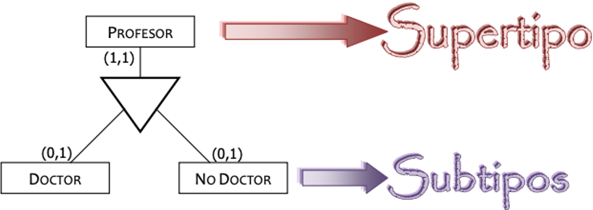
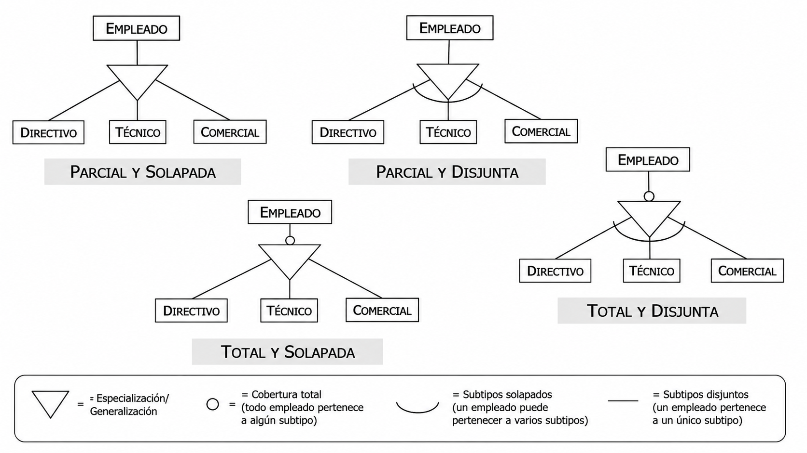

# **Especialització**

<div class="interactive-progress-tracker">
  <div class="tracker-header">
    <span>🏆 <strong>Progrés d'aquesta secció:</strong> <span class="tracker-count">0 de 4 superats (0%)</span></span>
    <span class="tracker-pts">⭐ <strong>0 punts</strong></span>
  </div>
  <div class="tracker-bar">
    <div class="tracker-fill" style="width: 0%;"></div>
  </div>
</div>

En la unitat anterior vam veure el concepte de **generalització/especialització** del model E/R estès, que permet modelar una jerarquia entre un **supertipus** (entitat pare) i diversos **subtipus** (entitats hijas) mitjançant una relació **ÉS-UN**.



En aquest tema estudiarem la **transformació al model relacional** d'aquestes jerarquías. Segons el tipus d'especialització ens trobarem amb les següents quatre possibilitats:

- **Especialització parcial i solapada.**

- **Especialització total i solapada.**

- **Especialització parcial i disjunta.**

- **Especialització total i disjunta.**

Recorda que una especialització pot ser:

|  | Total | Parcial |
| --- | --- | --- |
| **Disjunta** | Tot element del supertipus està en **un** dels subtipus. | No tots els elements del supertipus estan en els subtipus, i si l'estan, en **un** només. |
| **Solapada** | Tot element del supertipus està en **almenys un** dels subtipus. | No tots els elements del supertipus estan en els subtipus, podent estar en **diversos** alhora. |



## **Transformació general**

En tots els casos la **transformació bàsica** és la mateixa. Prenent com exemple el supertipus `PARTICIPANTE` i els subtipus `JUGADOR` i `ARBITRO`:

```sql
Participante (Num-Asoc:cad-6, nombre:cad-60, Telefono:cad-9, Direccion:cad-60)
CP: {Num-Asoc}

Jugador (Num-Asoc:cad-6, Nivel:num)
CP: {Num-Asoc}
CAj: {Num-Asoc} → PARTICIPANTE

Arbitro (Num-Asoc:cad-6, Categoria:cad-9)
CP: {Num-Asoc}
CAj: {Num-Asoc} → PARTICIPANTE
```

- El **supertipus** es transforma en una taula amb els atributs i les relacions comuns.

- Cada **subtipus** es transforma en una taula amb els seus atributs propis.

- La clau primària de cada subtipus és la mateixa que la del supertipus, que actua a la seua vegada com **clau forana** cap al supertipus.

La diferència entre els quatre casos està en les **restriccions d'integritat (R.I.)** que hem d'afegir a l'esquema.

## **Especialització parcial i solapada**

- **PARCIAL** → No tots els elements del supertipus han d'estar inclosos en algun dels subtipus.

- **SOLAPADA** → Un element del supertipus pot trobar-se en **diversos** subtipus.

```sql
Participante (Num-Asoc:cad-6, nombre:cad-60, Telefono:cad-9, Direccion:cad-60)
CP: {Num-Asoc}

Jugador (Num-Asoc:cad-6, Nivel:num)
CP: {Num-Asoc}
CAj: {Num-Asoc} → PARTICIPANTE

Arbitro (Num-Asoc:cad-6, Categoria:cad-9)
CP: {Num-Asoc}
CAj: {Num-Asoc} → PARTICIPANTE
```

No es afegeix cap restricció d'integritat extra.

## **Especialització total i solapada**

- **TOTAL** → Tots els elements del supertipus han d'estar inclosos en algun dels subtipus.

- **SOLAPADA** → Un element del supertipus pot trobar-se en **diversos** subtipus.

La transformació coincideix amb la transformació bàsica que ja hem mostrat en el cas general. Però a més hem d'incloure una **restricció d'integritat** que especifique:

> **📌 R.I. (TOTAL)**
> 

> **TOT ELEMENT DE LA ENTITAT SUPERTIPUS `PARTICIPANTE` HA D'ESTAR ALMENYS EN UNA DE LES ENTITATS SUBTIPUS.**

## **Especialització parcial i disjunta**

- **PARCIAL** → No tots els elements del supertipus han d'estar inclosos en algun dels subtipus.

- **DISJUNTA** → Un element del supertipus pot trobar-se **solament en un** dels subtipus.

La transformació coincideix amb la transformació bàsica que ja hem mostrat en el cas general. Però a més hem d'incloure una **restricció d'integritat** que especifique:

> **📌 R.I. (DISJUNTA)**
> 

> **TOT ELEMENT DE LA ENTITAT SUPERTIPUS `PARTICIPANTE` PODRÀ ESTAR SOLAMENT EN UNA DE LES ENTITATS SUBTIPUS.**

## **Especialització total i disjunta**

- **TOTAL** → Tots els elements del supertipus han d'estar inclosos en algun dels subtipus.

- **DISJUNTA** → Un element del supertipus pot trobar-se **solament en un** dels subtipus.

La transformació coincideix amb la transformació bàsica que ja hem mostrat en el cas general. Però a més hem d'incloure les **dos restriccions d'integritat**:

> **📌 R.I. (TOTAL)**
> 

> **TOT ELEMENT DE LA ENTITAT SUPERTIPUS `PARTICIPANTE` HA D'ESTAR ALMENYS EN UNA DE LES ENTITATS SUBTIPUS.**

> **📌 R.I. (DISJUNTA)**
> 

> **TOT ELEMENT DE LA ENTITAT SUPERTIPUS `PARTICIPANTE` PODRÀ ESTAR SOLAMENT EN UNA DE LES ENTITATS SUBTIPUS.**

## **Resum**

| Especialització | R.I. que es afegeix |
| --- | --- |
| **Parcial i solapada** | Cap |
| **Total i solapada** | R.I. (TOTAL): tot element del supertipus està en **almenys un** subtipus. |
| **Parcial i disjunta** | R.I. (DISJUNTA): tot element del supertipus està **solament en un** subtipus. |
| **Total i disjunta** | R.I. (TOTAL) + R.I. (DISJUNTA) |

> **📌 Restriccions no plasmables en el disseny lògic**
> 

> Aquestes restriccions d'integritat (**TOTAL** i **DISJUNTA**) **no poden plasmar-se directament en el disseny lògic** i hauran de documentar-se en el **diccionari de dades**, per a poder implementar-les posteriorment mitjançant triggers o procediments en el model físic. Aquest és el criteri d'avaluació **CE6h**.

## **Exercicis proposats**

> **📌 Exercici 1**
> 

> Donat el supertipus `VEHICULO (Matricula, marca, modelo, anio)` i els subtipus `CAMION (tara)` i `TURISMO (num_plazas)`:

> 1. Obtingues l'esquema relacional indicant CP, CAj i VNN.

> 1. Afegeix les restriccions d'integritat necessàries si l'especialització és **total i disjunta**.

> **📌 Exercici 2**
> 

> Indica què restricció o restriccions d'integritat hi hauria que afegir en cada un dels següents casos:

> 1. Tot `EMPLEADO` és, com a mínim, `TECNICO`, `COMERCIAL` o `DIRECTIVO`, però mai dos alhora.

> 1. Un `EMPLEADO` pot ser o no `COMERCIAL`, i si l'és, també pot ser `TECNICO`.

> 1. Tot `EMPLEADO` és necessàriament `TECNICO`, `COMERCIAL` o `DIRECTIVO`, podent ser diversos alhora.


---

## 🎮 Reptes Interactius d'Autoavaluació (+100 XP)

Comprova el teu domini sobre **3.4 Especialització** superant aquests 4 reptes gamificats (+25 punts cadascun):

<div class="interactive-mcq" data-answer="A" data-hint="La 1FN exigeix que tots els dominis siguen atòmics (sense atributs multivaluats ni compostos dins d'una columna).">
  <div class="mcq-question">🎯 <strong>Repte 1 (+25 pts):</strong> Quina condició ha de complir una taula per a trobar-se en Primera Forma Normal (1FN)?</div>
  <div class="mcq-options">
    <button type="button" class="btn-mcq-opt" data-opt="A">A) Tots els seus atributs han de contenir valors atòmics (indivisibles), sense grups repetitius ni llistes en una mateixa cel·la.</button>
    <button type="button" class="btn-mcq-opt" data-opt="B">B) Ha de tenir exactament 10 columnes.</button>
    <button type="button" class="btn-mcq-opt" data-opt="C">C) No pot tenir clau primària.</button>
    <button type="button" class="btn-mcq-opt" data-opt="D">D) Ha d'estar emmagatzemada en MongoDB.</button>
  </div>
  <div class="quiz-feedback"></div>
</div>

<div class="interactive-mcq" data-answer="A" data-hint="En una relació 1:N, la taula del costat 'molts' (N) incorpora com a clau forana la clau primària del costat '1'.">
  <div class="mcq-question">🎯 <strong>Repte 2 (+25 pts):</strong> En transformar una relació binària 1:N on el costat N té participació obligatòria (1,1), on es propaga la clau forana?</div>
  <div class="mcq-options">
    <button type="button" class="btn-mcq-opt" data-opt="A">A) La clau primària del costat '1' passa com a clau forana a la taula del costat 'N'.</button>
    <button type="button" class="btn-mcq-opt" data-opt="B">B) La clau del costat 'N' passa al costat '1' creant columnes infinites.</button>
    <button type="button" class="btn-mcq-opt" data-opt="C">C) Sempre es creen 4 taules noves.</button>
    <button type="button" class="btn-mcq-opt" data-opt="D">D) No es posa cap clau forana.</button>
  </div>
  <div class="quiz-feedback"></div>
</div>

<div class="interactive-vf" data-answer="V" data-hint="La 2FN elimina les dependències funcionals parcials respecte a una part d'una clau primària composta.">
  <div class="vf-statement">✅ <strong>Repte 3 (Vertader o Fals · +25 pts):</strong> La Segona Forma Normal (2FN) exigeix que la taula estiga en 1FN i que tots els atributs que no són clau depenguen de forma completa (total) de tota la clau primària composta.</div>
  <div class="vf-buttons">
    <button type="button" class="btn-vf" data-opt="V">Vertader (V)</button>
    <button type="button" class="btn-vf" data-opt="F">Fals (F)</button>
  </div>
  <div class="quiz-feedback" style="width: 100%;"></div>
</div>

<div class="interactive-quiz" data-answer="tupla|tuples" data-hint="En el model relacional formal, les files s'anomenen tuples.">
  <div class="quiz-question">⌨️ <strong>Repte 4 (+25 pts):</strong> Com s'anomena cada fila o registre d'una relació (taula) en la terminologia formal del model relacional?</div>
  <div class="quiz-controls">
    <input type="text" class="quiz-input" placeholder="Escriu la resposta..." />
    <button type="button" class="btn-quiz-check">Comprovar</button>
  </div>
  <div class="quiz-feedback"></div>
</div>

### 📋 Llista de Comprovació i Rúbrica d'Assoliment

Marca cada criteri a mesura que completes l'estudi o la resolució pràctica d'aquesta pàgina (**3.4 Especialització**):

- [ ] He llegit detingudament la teoria o l'enunciat d'aquesta secció i he anotat els conceptes clau.
- [ ] He revisat els esquemes, taules o blocs de codi i he verificat que sé aplicar-los a l'entorn de treball.
- [ ] He resolt correctament els **4 reptes interactius** superiors obtenint els **100 punts XP**.
- [ ] He descarregat el comprovant oficial en PDF per a adjuntar-lo a la tasca d'**Aules**.

<div class="aules-delivery-card">
  <h3>📤 Comprovant de Lliurament per a Aules</h3>
  <p>Quan hages completat els reptes interactius i la llista d'autoavaluació d'aquesta pàgina, introdueix el teu nom i descarrega el teu certificat oficial en PDF per a adjuntar-lo a la tasca d'<strong>Aules</strong>.</p>
  <div class="aules-student-field">
    <label for="aules-student-name">👤 Nom i Cognoms de l'Alumne/a:</label>
    <input type="text" id="aules-student-name" class="aules-student-name" placeholder="Ex: Joan Garcia Pérez" />
  </div>
  <div class="aules-score-badge">
    <span class="aules-score-count">0/4 reptes completats (0%) · 0 punts · 0/4 criteris d'autoavaluació</span>
  </div>
  <div class="aules-actions">
    <button type="button" class="btn-aules-dl" data-module="BBDD" data-unit="UD03" data-activity="ut0304">📥 Descarregar Comprovant PDF</button>
    <button type="button" class="btn-aules-copy">📋 Copiar Resum al Porta-retalls</button>
  </div>
  <div class="aules-toast"></div>
</div>
