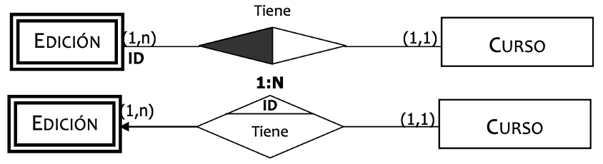
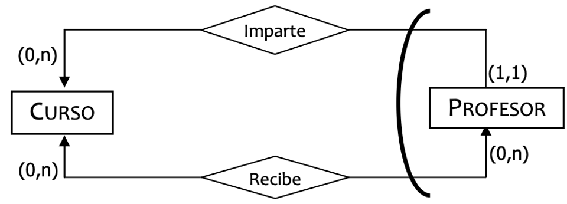
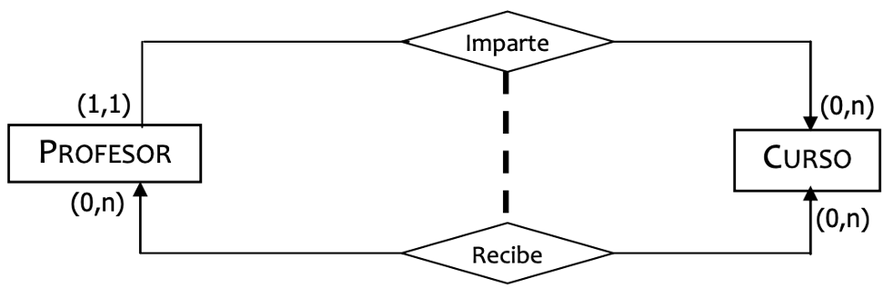
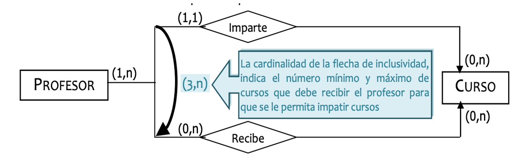
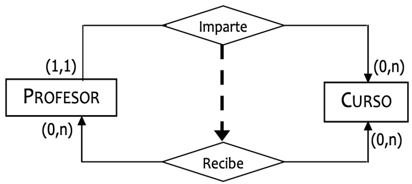

# **Dependències i restriccions**

<div class="interactive-progress-tracker">
  <div class="tracker-header">
    <span>🏆 <strong>Progrés d'aquesta secció:</strong> <span class="tracker-count">0 de 4 superats (0%)</span></span>
    <span class="tracker-pts">⭐ <strong>0 punts</strong></span>
  </div>
  <div class="tracker-bar">
    <div class="tracker-fill" style="width: 0%;"></div>
  </div>
</div>

En aquest tema veurem com es plasman en el model relacional les **dependències d'existència i identificació**, així com les **restriccions entre relacions** que no poden expresar-se únicament amb les claus.

## **Dependències**

- **DEPENDÈNCIA DE EXISTÈNCIA (DE)**: Es dóna quan els elements d'una de les entitats (coneguda com **FEBLE**) **no poden existir** si desaparece o no existeix l'element de la una altra entitat (coneguda com **FORT**) amb la que està relacionada.

- **DEPENDÈNCIA DE IDENTIFICACIÓ (DI)**: Es dóna quan, a més de donar-se una DE, els elements de la **ENTITAT FEBLE no poden identificar-se per sí mateixos**, sinó que necessiten recurrir al **identificador principal de la ENTITAT FORT** amb la que es ha establit la relació.

## **Dependència d'existència (DE)**

### **1º cas: Relació binària 1:1**

En aquest cas la transformació a Model relacional implica que la **clau forana** l'hem de posar en la relació `EMPLEADO`, per a així poder fer efectiva la DE indicant que la clau forana és un atribut **VNN**.

```sql
Puesto (Cod-P:cad-9, Descripcion:cad-30, Horario:num)
CP: {Cod-P}

Empleado (DNI:cad-9, NSS:cad-9, {Nombre:cad-30, Ape-1:cad-30, Ape-2:cad-30}, Edad:num, Sueldo:moneda, {telefono:cad-9}n, Cod-P:cad-9, Turno:num)
CP: {DNI}
CAlt: {NSS}, {Cod-P}
VNN: {Edad}, {Cod-P}
CAj: {Cod-P} → PUESTO
```

### **2º cas: Relació binària 1:1 amb interbloqueig**

Veiem que tenim un **interbloqueig** en una relació binària del tipus **1:1** (totes dues entitats depenen la una de la una altra). Açò ens indica que la forma més eficient de representar aquesta situació en el Model relacional seria **crear una única relació** de la qual estructura seria:

```sql
Em-Pu (DNI:cad-9, NSS:cad-9, {Nombre:cad-30, Ape-1:cad-30, Ape-2:cad-30}, Edad:num, Sueldo:moneda, {telefono:cad-9}n, Cod-P:cad-9, Descripcion:cad-30, Horario:num, Turno:num)
CP: {DNI}
CAlt: {Cod-P}, {NSS}
VNN: {Cod-P}, {Edad}
```

### **3º cas: Relació binària 1:N**

En aquest cas la transformació a Model relacional implica que la **clau forana** l'hem de posar en la relació `EMPLEADO`, per a així poder fer efectiva la DE indicant que la clau forana és un atribut **VNN**.

```sql
Puesto (Cod-P:cad-9, Descripcion:cad-30, Horario:num)
CP: {Cod-P}

Empleado (DNI:cad-9, NSS:cad-9, {Nombre:cad-30, Ape-1:cad-30, Ape-2:cad-30}, Edad:num, Sueldo:moneda, {telefono:cad-9}n, Cod-P:cad-9, Turno:num)
CP: {DNI}
CAlt: {NSS}
VNN: {Edad}, {Cod-P}
CAj: {Cod-P} → PUESTO
```

### **4º cas: Relació binària 1:N amb restricció**

Com veiem, la **Dependència de Existència està en el costat de cardinalitat màxima 1**, el que suposa un problema, ja que la clau forana que organitza la relació es encontrará en la relació del costat de **cardinalitat màxima N**.

Així ja que, la regla general de posar **VNN a la clau forana no es pot aplicar**, i per tant hem de recurrir a establir una **restricció**:

> **📌 R.I. (DE)**
> 

> **PER A TOT JA QUE TINGUEM REGISTRAT EN EL SISTEMA, HA DE DE EXISTIR ALMENYS UN EMPLEAT QUE EL TINGA ASSIGNAT.**

### **5º cas: Relació binària 1:N amb interbloqueig**

- `EMPLEADO` → Relació en el costat de **cardinalitat màxima N**, compta amb la **clau forana**, i per tant podem indicar la dependència d'existència amb **VNN**.

- `PUESTO` → Relació en el costat de **cardinalitat màxima 1**, **no compta amb la clau forana**, i per tant **no podem indicar la dependència d'existència amb VNN**, sinó que hem de recurrir novament a la **restricció**.

```sql
Empleado (DNI:cad-9, NSS:cad-9, {Nombre:cad-30, Ape-1:cad-30, Ape-2:cad-30}, Edad:num, Sueldo:moneda, {telefono:cad-9}n, Cod-P:cad-9, Turno:num)
CP: {DNI}
CAlt: {NSS}
VNN: {Edad}, {Cod-P}
CAj: {Cod-P} → PUESTO

Puesto (Cod-P:cad-9, Descripcion:cad-30, Horario:num)
CP: {Cod-P}
```

> **📌 R.I. (DE)**
> 

> **PER A TOT JA QUE TINGUEM REGISTRAT EN EL SISTEMA, HA DE DE EXISTIR ALMENYS UN EMPLEAT QUE EL TINGA ASSIGNAT.**

### **6º cas: Relació binària N:N**

En aquest cas comptem amb una relació del tipus **N:N**, el que suposa que, al realitzar la transformació del Esquema E/R al Esquema Relacional, aquesta ha d'aparèixer com una **nova relació**:

```sql
Ocupa (DNI:cad-9, Cod-P:cad-9, Turno:num)
CP: {DNI, Cod-P}
CAj: {DNI} → EMPLEADO
CAj: {Cod-P} → PUESTO
```

Però a més la transformació a Model relacional implica que hem d'indicar mitjançant una **restricció** que `EMPLEADO` necessita que es dé la relació `OCUPA`:

> **📌 R.I. (DE)**
> 

> **PER A TOT EMPLEAT QUE TINGUEM REGISTRAT EN EL SISTEMA, HA DE DE EXISTIR ALMENYS UNA OCUPACIÓ QUE EL ASSOCIE A UN POSAT.**

### **7º cas: Relació binària N:N**

A l'igual que en el cas anterior, la relació **N:N** apareix com una nova relació:

```sql
Ocupa (DNI:cad-9, Cod-P:cad-9, Turno:num)
CP: {DNI, Cod-P}
CAj: {DNI} → EMPLEADO
CAj: {Cod-P} → PUESTO
```

En aquest cas la transformació a Model relacional implica que hem d'indicar mitjançant una **restricció** que `PUESTO` necessita que es dé la relació `OCUPA`:

> **📌 R.I. (DE)**
> 

> **PER A TOT JA QUE TINGUEM REGISTRAT EN EL SISTEMA, HA DE DE EXISTIR ALMENYS UNA OCUPACIÓ QUE EL ASSOCIE A UN EMPLEAT.**

### **8º cas: Relació binària N:N**

Seguim treballant amb una relació del tipus **N:N**. En aquest cas es han de complir **les dos restriccions** indicades en els dos casos anteriors:

```sql
Ocupa (DNI:cad-9, Cod-P:cad-9, Turno:num)
CP: {DNI, Cod-P}
CAj: {DNI} → EMPLEADO
CAj: {Cod-P} → PUESTO
```

> **📌 R.I. (DE)**
> 

> **PER A TOT EMPLEAT QUE TINGUEM REGISTRAT EN EL SISTEMA, HA DE DE EXISTIR ALMENYS UNA OCUPACIÓ QUE EL ASSOCIE A UN POSAT.**

> **📌 R.I. (DE)**
> 

> **PER A TOT JA QUE TINGUEM REGISTRAT EN EL SISTEMA, HA DE DE EXISTIR ALMENYS UNA OCUPACIÓ QUE EL ASSOCIE A UN EMPLEAT.**

### **9º cas: Relació unària**

En el cas de les relacions unàries amb **dependència d'existència**, seguirem el mateix razonament que en els casos binaris: si l'entitat es troba en el costat de la **clau forana**, indicarem la DE mitjançant **VNN**; en cas contrari, mitjançant una **restricció** entre relacions.

### **10º cas: Relacions ternàries**

En la transformació de les relacions ternàries sempre haurem de **crear una relació nova** que corresponda a la ternària. Procederem com en el cas de les relacions binàries N:N, indicant la **restricció** que asegure la dependència de la relació on tenim la DE respecte a la relació que correspon a la ternària.

```sql
Alumno (NEXP:cad-6, nombre:cad-60, Edad:num)
CP: {NEXP}

Profesor (DNI-P:cad-9, nombre:cad-60)
CP: {DNI-P}

Asignatura (Cod-A:cad-6, nombre:cad-60, desc:cad-60)
CP: {Cod-A}

Docencia (NEXP:cad-6, DNI-P:cad-9, Cod-A:cad-6, {Ev-1:nota, Ev-2:nota, Ev-3:nota})
CP: {NEXP, DNI-P, Cod-A}
CAlt: {NEXP, Cod-A}, {DNI-P, Cod-A}, {NEXP, DNI-P}
VNN: {Cod-A}, {NEXP}, {DNI-P}
CAj: {NEXP} → ALUMNO
CAj: {DNI-P} → PROFESOR
CAj: {Cod-A} → ASIGNATURA
```

> **📌 R.I. (DE)**
> 

> **PER A TOTA ASSIGNATURA QUE TINGUEM REGISTRADA EN EL SISTEMA, HA DE DE EXISTIR ALMENYS UNA DOCENCIA QUE LA ASSOCIE AMB PROFESSORS I ALUMNES.**

## **Dependència d'identificació (DI)**

A causa del seu significat funcional, la **DEPENDÈNCIA DE IDENTIFICACIÓ** té sentit amb les **relacions binàries del tipus 1:N** o, com molt, amb les relacions **1:1** (encara que en aquest cas es solen fusionar les dos entitats), però **MAI** tindrà sentit amb les relacions tipus **N:N**, ni amb relacions **unàries o ternàries**.

### **1º cas: Relació binària 1:N amb DI**

Com ja vam veure en l'apartat corresponent, la transformació a Model relacional de la relació **1:N** implica que la clau forana l'hem de posar en la relació que es troba en el costat de **cardinalitat màxima N**:

```sql
Puesto (Cod-P:cad-9, Descripcion:cad-30, Horario:num)
CP: {Cod-P}

Empleado (DNI:cad-9, NSS:cad-9, {Nombre:cad-30, Ape-1:cad-30, Ape-2:cad-30}, Edad:num, Sueldo:moneda, {telefono:cad-9}n, Cod-P:cad-9, Turno:num)
CP: {DNI, Cod-P}
CAlt: {NSS}
VNN: {Edad}
CAj: {Cod-P} → PUESTO
```

Per a indicar la **DI** en la transformació, el que fem és **incloure la clau forana en la clau principal**.



### **2º cas: Relació binària 1:1 amb DI**

Com ja vam veure en l'apartat corresponent, la transformació a Model relacional de la relació **1:1** implica que la clau forana l'hem de posar en la relació que considerem més apropiada funcionalment, o la que tinga menys atributs.

En aquest cas el més apropiat és posar la clau forana en l'entitat on hem de representar la **Dependència de Identificació**:

```sql
Puesto (Cod-P:cad-9, Descripcion:cad-30, Horario:num)
CP: {Cod-P}

Empleado (DNI:cad-9, NSS:cad-9, {Nombre:cad-30, Ape-1:cad-30, Ape-2:cad-30}, Edad:num, Sueldo:moneda, {telefono:cad-9}n, Cod-P:cad-9, Turno:num)
CP: {DNI, Cod-P}
CAlt: {NSS}
VNN: {Edad}
CAj: {Cod-P} → PUESTO
```

Com podem observar, el resultat és el mateix que tuvimos en el cas 1:N, per tant, i encara que no tinga molt sentit semánticament, es indica mitjançant una **restricció** que un posat pot ser ocupat per un únic empleat. Encara que el que es sol fer en aquests casos realment és **fusionar totes dues entitats en una**.

## **Restriccions entre relacions**

Quan parlem de **restriccions entre relacions** ens podem trobar amb:

- **Restricció de Exclusivitat.**

- **Restricció de Exclusió.**

- **Restricció de Inclusivitat.**

- **Restricció de Inclusió.**

Com en altres casos, el primer que farem serà la **transformació de les entitats i relacions** que ja tinguem clares. Tomarem com exemple les relacions `IMPARTE` i `RECIBE` entre `PROFESOR` i `CURSO`:

```sql
Profesor (Cod-Prof:cad-4)
CP: {Cod-Prof}

Curso (Cod-Cur:cad-4, Prof-Imp:cad-4)
CP: {Cod-Cur}
CAj: {Prof-Imp} → PROFESOR

Recibe (Prof:cad-4, Cur:cad-4)
CP: {Prof, Cur}
CAj: {Prof} → PROFESOR
CAj: {Cur} → CURSO
```

> **📌 Recordatorio**
> 

> Com vam veure en la unitat anterior, la diferència entre aquestes restriccions està en **sobre què actua**:

> - **Exclusivitat / Inclusivitat** → actuen sobre **una entitat**.

> - **Exclusió / Inclusió** → actuen sobre **un parell d'entitats**.

### **Restricció de Exclusivitat**

El que ens indica aquesta restricció és que si un **Professor** imparteix un curs, ja no pot **rebre** cap curs, és a dir, si el seu codi apareix en la relació `IMPARTE` ja no pot aparèixer en la relació `RECIBE`.



Per tant, el que hem d'afegir al nostre esquema relacional és la següent **restricció** davall de les tres relacions (que ja hem transformat):

> **📌 R.I. (R. EXCLUSIVITAT)**
> 

> Si tenim el codi d'un professor en la relació `IMPARTE`, ja no podem tindre eixe mateix codi de professor en la relació `RECIBE` i viceversa.

### **Restricció de Exclusió**

El que implica aquesta restricció és que si un **Professor** imparteix un **Curs**, **NO pot rebre eixe mateix Curs**, però sí pot rebre altres. Per tant, el que hem d'afegir al nostre esquema relacional és la següent **restricció**:



> **📌 R.I. (R. EXCLUSIÓ)**
> 

> Si conectamos un codi de curs i un codi de professor en la relació `IMPARTE`, ja no podem tindre eixe mateix parell de codis en la relació `RECIBE` i viceversa.

### **Restricció de Inclusivitat**

El que ens indica aquesta restricció és que si un **Professor** imparteix un **Curs**, obligatòriament ha d'haver **rebut un curs**, no té per què ser el mateix. La relació que envia (fort) és aquella cap a on apunta la fletxa. Per tant, el que hem d'afegir al nostre esquema relacional és la següent **restricció**:



> **📌 R.I. (R. INCLUSIVITAT)**
> 

> Per a poder tindre el codi d'un professor en la relació `IMPARTE`, hem de tindre eixe mateix codi de professor en la relació `RECIBE`.

### **Restricció de Inclusió**

El que implica aquesta restricció és que **perquè un Professor imparta un Curs, ha de rebre eixe mateix Curs**. Per tant, el que hem d'afegir al nostre esquema relacional és la següent **restricció**:



> **📌 R.I. (R. INCLUSIÓ)**
> 

> Podrem establir una connexió entre un codi de curs i un codi de professor en la relació `IMPARTE`, si tenim eixe mateix parell de codis en la relació `RECIBE`.

## **Resum de restriccions**

| Restricció | Sobre què actua? | Significat | Com es representa en el model relacional |
| --- | --- | --- | --- |
| **Exclusivitat** | Una entitat | Una ocurrència només pot participar en una de les relacions. | R.I. entre les relacions |
| **Exclusió** | Un parell d'entitats | La mateixa parella no pot aparèixer en dos relacions distintes. | R.I. entre les relacions |
| **Inclusivitat** | Una entitat | Participar en una relació obliga a participar també en una altra. | R.I. entre les relacions |
| **Inclusió** | Un parell d'entitats | Una parella només pot estar en una relació si ja pertany a una altra. | R.I. entre les relacions |

> **📌 CE6h**
> 

> Totes aquestes restriccions, així com les de la **dependència d'existència** e **identificació**, **no poden plasmar-se directament en el disseny lògic**, per la qual cosa han de **analizar-se i documentar-se** en el diccionari de dades per al seu posterior implementació.

## **Exercicis proposats**

> **📌 Exercici 1**
> 

> Indica com transformarías al model relacional la dependència d'existència en una relació binària **1:N** en la que la DE es troba en l'entitat del costat de **cardinalitat màxima 1**. Per què no podem utilitzar VNN?

> **📌 Exercici 2**
> 

> Donada la relació binària **1:N** `PASA` entre `SOCIO (id)` i `CUOTA (numero)`, on un socio ha de tindre almenys una cuota (DE sobre SOCIO):

> 1. Obtingues l'esquema relacional.

> 1. Indica com es representa la DE (amb VNN o amb restricció?) i justifica la teua resposta.

> **📌 Exercici 3**
> 

> Entre `ALUMNO` i `ASIGNATURA` existeixen les relacions `MATRICULA` i `EXAMEN`. Indica què restricció d'integritat (R.I.) hauria de añadir-se per a representar cada una de les següents regles de negoci:

> 1. Un alumne només pot examinar-se d'una assignatura si està matriculat de **eixa mateixa** assignatura.

> 1. Tot alumne que es examina d'alguna assignatura ha d'estar matriculat de **alguna** assignatura.

> 1. Un alumne no pot estar matriculat i examinar-se de la **mateixa** assignatura alhora.


---

## 🎮 Reptes Interactius d'Autoavaluació (+100 XP)

Comprova el teu domini sobre **3.5 Dependències i restriccions** superant aquests 4 reptes gamificats (+25 punts cadascun):

<div class="interactive-mcq" data-answer="A" data-hint="La 1FN exigeix que tots els dominis siguen atòmics (sense atributs multivaluats ni compostos dins d'una columna).">
  <div class="mcq-question">🎯 <strong>Repte 1 (+25 pts):</strong> Quina condició ha de complir una taula per a trobar-se en Primera Forma Normal (1FN)?</div>
  <div class="mcq-options">
    <button type="button" class="btn-mcq-opt" data-opt="A">A) Tots els seus atributs han de contenir valors atòmics (indivisibles), sense grups repetitius ni llistes en una mateixa cel·la.</button>
    <button type="button" class="btn-mcq-opt" data-opt="B">B) Ha de tenir exactament 10 columnes.</button>
    <button type="button" class="btn-mcq-opt" data-opt="C">C) No pot tenir clau primària.</button>
    <button type="button" class="btn-mcq-opt" data-opt="D">D) Ha d'estar emmagatzemada en MongoDB.</button>
  </div>
  <div class="quiz-feedback"></div>
</div>

<div class="interactive-mcq" data-answer="A" data-hint="En una relació 1:N, la taula del costat 'molts' (N) incorpora com a clau forana la clau primària del costat '1'.">
  <div class="mcq-question">🎯 <strong>Repte 2 (+25 pts):</strong> En transformar una relació binària 1:N on el costat N té participació obligatòria (1,1), on es propaga la clau forana?</div>
  <div class="mcq-options">
    <button type="button" class="btn-mcq-opt" data-opt="A">A) La clau primària del costat '1' passa com a clau forana a la taula del costat 'N'.</button>
    <button type="button" class="btn-mcq-opt" data-opt="B">B) La clau del costat 'N' passa al costat '1' creant columnes infinites.</button>
    <button type="button" class="btn-mcq-opt" data-opt="C">C) Sempre es creen 4 taules noves.</button>
    <button type="button" class="btn-mcq-opt" data-opt="D">D) No es posa cap clau forana.</button>
  </div>
  <div class="quiz-feedback"></div>
</div>

<div class="interactive-vf" data-answer="V" data-hint="La 2FN elimina les dependències funcionals parcials respecte a una part d'una clau primària composta.">
  <div class="vf-statement">✅ <strong>Repte 3 (Vertader o Fals · +25 pts):</strong> La Segona Forma Normal (2FN) exigeix que la taula estiga en 1FN i que tots els atributs que no són clau depenguen de forma completa (total) de tota la clau primària composta.</div>
  <div class="vf-buttons">
    <button type="button" class="btn-vf" data-opt="V">Vertader (V)</button>
    <button type="button" class="btn-vf" data-opt="F">Fals (F)</button>
  </div>
  <div class="quiz-feedback" style="width: 100%;"></div>
</div>

<div class="interactive-quiz" data-answer="tupla|tuples" data-hint="En el model relacional formal, les files s'anomenen tuples.">
  <div class="quiz-question">⌨️ <strong>Repte 4 (+25 pts):</strong> Com s'anomena cada fila o registre d'una relació (taula) en la terminologia formal del model relacional?</div>
  <div class="quiz-controls">
    <input type="text" class="quiz-input" placeholder="Escriu la resposta..." />
    <button type="button" class="btn-quiz-check">Comprovar</button>
  </div>
  <div class="quiz-feedback"></div>
</div>

### 📋 Llista de Comprovació i Rúbrica d'Assoliment

Marca cada criteri a mesura que completes l'estudi o la resolució pràctica d'aquesta pàgina (**3.5 Dependències i restriccions**):

- [ ] He llegit detingudament la teoria o l'enunciat d'aquesta secció i he anotat els conceptes clau.
- [ ] He revisat els esquemes, taules o blocs de codi i he verificat que sé aplicar-los a l'entorn de treball.
- [ ] He resolt correctament els **4 reptes interactius** superiors obtenint els **100 punts XP**.
- [ ] He descarregat el comprovant oficial en PDF per a adjuntar-lo a la tasca d'**Aules**.

<div class="aules-delivery-card">
  <h3>📤 Comprovant de Lliurament per a Aules</h3>
  <p>Quan hages completat els reptes interactius i la llista d'autoavaluació d'aquesta pàgina, introdueix el teu nom i descarrega el teu certificat oficial en PDF per a adjuntar-lo a la tasca d'<strong>Aules</strong>.</p>
  <div class="aules-student-field">
    <label for="aules-student-name">👤 Nom i Cognoms de l'Alumne/a:</label>
    <input type="text" id="aules-student-name" class="aules-student-name" placeholder="Ex: Joan Garcia Pérez" />
  </div>
  <div class="aules-score-badge">
    <span class="aules-score-count">0/4 reptes completats (0%) · 0 punts · 0/4 criteris d'autoavaluació</span>
  </div>
  <div class="aules-actions">
    <button type="button" class="btn-aules-dl" data-module="BBDD" data-unit="UD03" data-activity="ut0305">📥 Descarregar Comprovant PDF</button>
    <button type="button" class="btn-aules-copy">📋 Copiar Resum al Porta-retalls</button>
  </div>
  <div class="aules-toast"></div>
</div>
