# 3.9 Quadern de Pràctiques de Disseny Lògic i Normalització

En aquest quadern de laboratori trobaràs totes les activitats pràctiques d'aquesta unitat, els criteris de qualificació per a Aules i les solucions explicades pas a pas.


---

### 📝 **Activitat 301**


Lliurament

- La lliurament será un **fitxer pdf** que contenga la respuesta a las preguntas de la activitat.

- El nombre del fitxer debe ser `301_NombreApellidos.pdf`.

- Se deberá lliuramentr en la tarea correspondiente de Aules en tiempo y forma.

Es valorarà

Es valorarà:

- La claridad de la respuesta.

- La correcta maquetación del documento.

- Respuesta correcta o aproximación a la misma.

Esta activitat servirá para calificar:

- RA6: Diseña modelos relacionales normalizados interpretando diagramas entidad/relación.

- CE6. b) Se han identificado las taules del disseny lògic. (5%)

- CE6. c) Se han identificado los camps que forman parte de las taules del disseny lògic. (5%)

- CE6. e) Se han identificado los camps clave. (5%)

- CE6. f) Se han aplicado reglas de integridad. (5%)

- CE6. h) Se han analizado y documentado las restricciones que no pueden plasmarse en el disseny lògic. (5%)

Recuerda

Debes obtener el **esquema relacional** (taules con sus atributos) indicando para cada una:

- **CP**: clau primària.

- **CAlt**: claves alternativas, si existen.

- **CAj**: claus foranes, indicando la taula a la que referencian.

- **VNN**: atributos que no pueden ser nulos.

## **Exercici 1**

**ARTÍCULOS Y ENCARGOS**

Una base de dades para una pequeña empresa debe contener información acerca de clientes, artículos y pedidos. Hasta el momento se registran los siguientes datos en documentos varios:

- Para cada **cliente**: Número de cliente (único), Nombre, NIF, Direcciones de envío (varias por cliente), Saldo, Límite de crédito (depende del cliente, pero en ningún caso debe superar los 18.000 €), Descuento.

- Para cada **artículo**: Número de artículo (único), Fábricas que lo distribuyen, Existencias de ese artículo en cada fábrica, Descripción del artículo.

- Para cada **pedido**: Cada pedido tiene una cabecera y el cuerpo del pedido. La cabecera está formada por el número de cliente, dirección de envío y fecha del pedido. El cuerpo del pedido son varias líneas, en cada línea se especifican el número del artículo pedido y la cantidad.

A més, se ha determinado que s'ha de almacenar la información de las **fábricas**. No obstant això, dado el uso de distribuidores, se usará: Número de la fábrica (único), Nombre y Teléfono de contacto. Y se desean ver cuántos artículos (en total) provee la fábrica. També, por información estratégica, se podría incluir información de fábricas alternativas respecto de las que ya fabrican artículos para esta empresa.

Nota

Una dirección se entenderá como **Calle, Número, Puerta, CP y Localidad**. Una fecha incluye **día, mes, año y hora**.

**Se pide:** obtener el model relacional de la base de dades.

## **Exercici 2**

**CASAS DE COLONIAS**

a) Cada casa de colonias tiene un **nombre** que la identifica. Se desea saber de cada una, aparte del nombre, la **capacidad** (el número de niños que es poden alojar en cada una como máximo), la **comarca** donde está situada y las **ofertas de activitates** que proporciona. Una casa puede ofrecer activitates como per exemple natación, esquí, remo, pintura, fotografía, música, etc.

b) Es necesario tener en cuenta que en una casa de colonias es poden practicar **varias activitates** (de hecho, cada casa debe ofrecer como mínimo una), y també puede ocurrir que una misma activitat se pueda llevar a cabo en varias casas. No obstant això, toda activitat que se registre en la base de dades debe ser ofertada como mínimo en una de las casas.

c) Interesa tener una **evaluación de las ofertas de activitates** que proporcionan las casas. Se asigna una calificación numérica que indica el nivel de calidad que tiene cada una de las activitates ofertadas.

d) Las casas de colonias **alojan niños** que se han inscrito para pasar en ellas unas pequeñas vacaciones. Se quiere tener constancia de los niños que se alojan en cada una de las casas en el momento actual. Se debe suponer que hay casas que están vacías (en las que no se aloja ningún niño) durante algunas temporadas.

e) De los niños que se alojan actualmente en alguna de las casas, interesa conocer un **código** que se les asigna para identificarlos, su **nombre**, su **apellido**, el **número de teléfono de sus padres** y su **comarca de residencia**.

f) De las **comarcas** donde hay casas o bien donde residen niños, se quiere tener registrados la **superficie** y el **número de habitantes**. Se debe considerar que puede haber comarcas donde no reside ninguno de los niños que se alojan en un momento determinado en las casas de colonias, y comarcas que no disponen de ninguna casa.

Nota

Es posible, per exemple, que una activitat como el esquí tenga una calificación de 10 en la oferta de la casa Grévol, y que la misma activitat tenga una calificación de 8 en la casa Ardilla.

**Se pide:** obtener el model relacional de la base de dades.

## **Exercici 3**

**TRANSPORTE**

Se desea mecanizar la gestión de una empresa de transportes que reparte paquetes por toda España. Los encargados de llevar los paquetes son los **camioneros** de los que se quiere guardar el DNI, nombre, teléfono, dirección, salario y localidad donde reside.

De los **paquetes** transportados interesa conocer el código de paquete, descripción, destinatario, y dirección del destinatario. Un camionero distribuye muchos paquetes y un paquete sólo puede ser distribuido por un camionero.

De las **provincias** a las que llegan los paquetes interesa guardar el código de provincia, y el nombre. Un paquete sólo puede llegar a una provincia, no obstant això, a una provincia pueden llegar muchos paquetes.

De los **camiones** que llevan los camioneros interesa conocer la matrícula, modelo, tipo y potencia. Un camionero puede conducir diferentes camiones en fechas diferentes y un camión puede ser conducido por varios camioneros.

**Se pide:** obtener el model relacional de la base de dades.

## **Exercici 4**

**PARADORES**

La red de Paradores de Turismo quiere mantener un servicio de atención y reservas a través de Internet. Una de las tareas dentro del desarrollo del sistema es la construcción del modelo lógico de datos. La información de partida para la construcción de dicho modelo es la siguiente:

- Los **Paradores** vendrán definidos por un código único, nombre, dirección, teléfono, nivel y número total de habitaciones. Los Paradores disponen de distintos tipos de habitaciones. De cada **habitación** se desea almacenar el número de habitación, la ubicación dentro del Parador, el tipo (normal o suite), una descripción y el precio por noche.

- Los Paradores pueden tener a més unas **instalaciones adicionales** (golf, piscina, hípica, etc.). De cada tipo de instalación se desea almacenar el código de instalación, el nombre y la descripción. Hay que tener en cuenta que un mismo tipo de instalación es pot encontrar en distintos Paradores.

- La información referente a los Paradores se completa con la **oferta gastronómica** que tienen. De la gastronomía ofrecida por cada Parador se almacenará un código, nombre y tipo de plato. Aunque un mismo plato puede ser servido por distintos Paradores, puede haber **variaciones de precio** en cada caso. Se desea almacenar la información de esta diferencia.

- Cuando un usuari se conecte al sitio web de los Paradores de Turismo, a més de poder consultar la información referente a lo descrito anteriormente, podrá hacer **reservas** de habitaciones. En el caso de realizar reservas, se toman los datos del cliente: NIF, nombre y apellidos. Se almacenará també un código de cliente generado por la aplicación si el cliente fuese nuevo.

- Una vez registrado el cliente, este podrá elegir en qué Parador o Paradores desea alojarse, la fecha de llegada y el número de noches, así como el tipo de la habitación que quiere. El sistema le asignará las habitaciones correspondientes, teniendo en cuenta que **un cliente no puede tener reservadas habitaciones de dos Paradores distintos en la misma fecha**.

- Por último, se desea que un cliente pueda consultar en cualquier momento **qué reservas ha realizado, en qué paradores y para cada fecha**, así como la habitación reservada.

**Se pide:** obtener el model relacional de la base de dades, documentando las restricciones que no pueden plasmarse en el disseny lògic.


<details>
<summary>💡 Veure solució detallada i recomanacions per a **Activitat 301**</summary>

```sql
-- Solució de referència i comprovació tècnica
-- Revisa que la sintaxi siga compatible amb el motor de base de dades (MySQL / MariaDB).
```
*Comprova cadascun dels camps i clàusules abans d'enviar el teu document a Aules.*
</details>


---

### 📝 **Activitat 302**


Lliurament

- La lliurament será un **fitxer pdf** que contenga la respuesta a las preguntas de la activitat.

- El nombre del fitxer debe ser `302_NombreApellidos.pdf`.

- Se deberá lliuramentr en la tarea correspondiente de Aules en tiempo y forma.

Es valorarà

Es valorarà:

- La claridad de la respuesta.

- La correcta maquetación del documento.

- Respuesta correcta o aproximación a la misma.

Esta activitat servirá para calificar:

- RA6: Diseña modelos relacionales normalizados interpretando diagramas entidad/relación.

- CE6. a) Se han utilizado herramientas gráficas para representar el disseny lògic. (5%)

- CE6. b) Se han identificado las taules del disseny lògic. (5%)

- CE6. c) Se han identificado los camps que forman parte de las taules del disseny lògic. (5%)

- CE6. d) Se han analizado las relaciones entre las taules del disseny lògic. (5%)

- CE6. e) Se han identificado los camps clave. (5%)

Recuerda

Para pasar de un **diagrama E/R** al **model relacional** debes aplicar las reglas de transformación estudiadas en clase:

- Cada **entidad** se transforma en una **taula**.

- Las relaciones **N:M** se convierten en **taules de unión** con su clave compuesta.

- Las relaciones **1:N** se resuelven añadiendo la **clau forana** en el lado del *muchos*.

- Las relaciones **1:1** se resuelven añadiendo la **clau forana** (que a més es **clave alternativa**).

## **Exercici 1**

Supongamos el siguiente modelo E/R donde representamos un sistema de información donde modelamos los datos de un **entrenador** y los **jugadores** de un equipo de baloncesto. De momento, sólo modelamos la relación entre el entrenador y los jugadores:

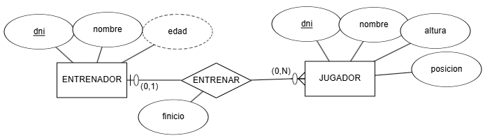

Obtén el **esquema relacional** y, a continuación, **dibuja el model relacional**.

## **Exercici 2**

Sobre el exercici anterior, vamos a añadir la entidad **EQUIPO** con el nombre del mismo, su logotipo, dirección y año de creación. Claramente, **cada equipo sólo tiene un único entrenador**, y **un entrenador sólo puede serlo de un equipo**.

Se pide:

- Modifica el modelo E/R para añadir la nueva entidad y la relación necesaria.

- Modifica el model relacional a partir del nuevo modelo E/R.

## **Exercici 3**

Tenemos el siguiente modelo E/R que representa las diferentes **ediciones** que de un libro publica una **editorial**, y los **autores** que escriben los libros:

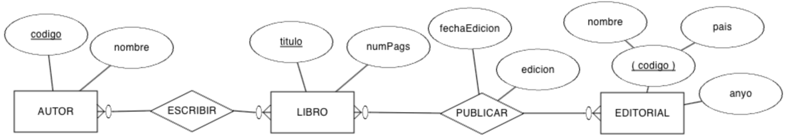

Obtén el **esquema relacional** y completa el **diccionario de datos**.

## **Exercici 4**

Realiza el **esquema lógico** mediante un **model relacional** del siguiente modelo E/R:

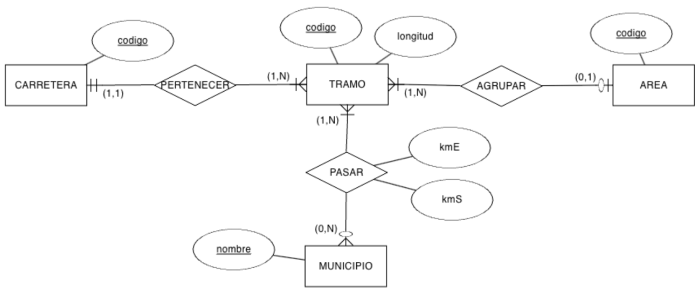

## **Exercici 5**

Tenemos el siguiente modelo E/R sobre la organización de una **empresa** en **departamentos** y las características de sus **empleados**:

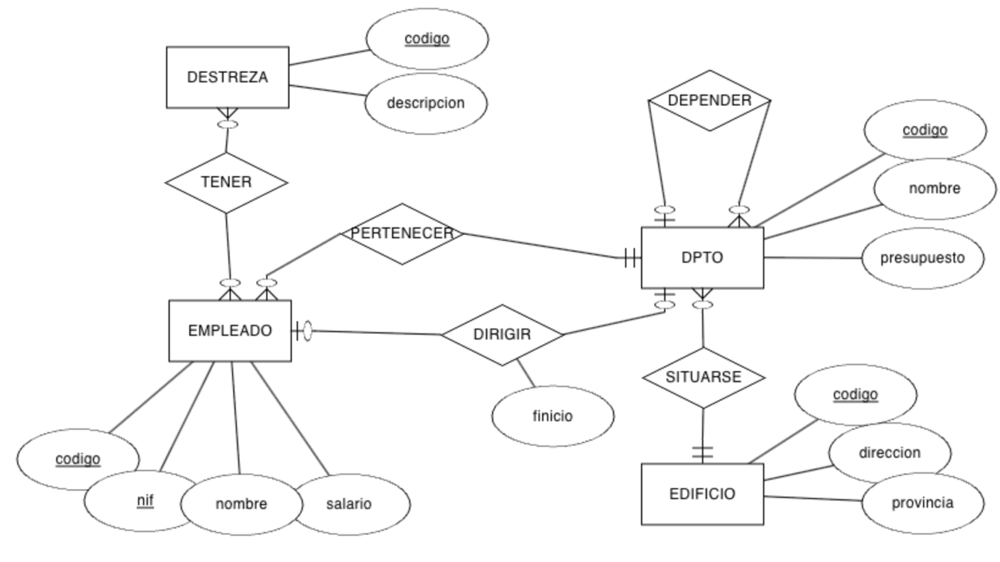

Obtén el **esquema relacional** e indica las **cardinalidades** de las relaciones.

## **Exercici 6**

A partir del siguiente modelo E/R que contiene restricciones de **cardinalidad mínima** y restricciones de **identificación**, se pide:

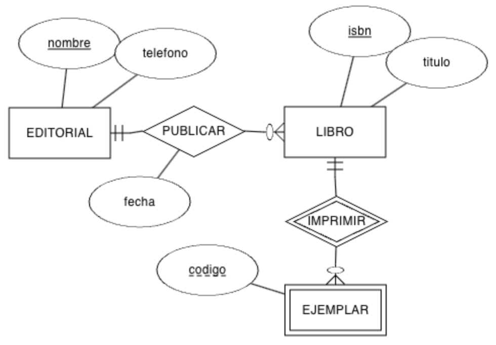

- Genera el **model relacional**.

- Indica las **cardinalidades** de las relaciones.

- Rellena **tres taules** con datos ficticios (al menos 3 registres por taula), ya sean datos relacionados o no, conforme consideres.

## **Exercici 7**

Crea el **model relacional** a partir del modelo conceptual sobre un **centro educativo**:

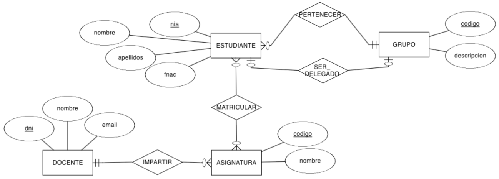

## **Exercici 8**

Crea el **model relacional** a partir del modelo conceptual:

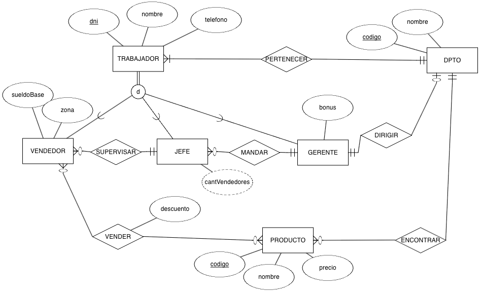

## **Exercici 9**

Crea el **model relacional** a partir del modelo conceptual:

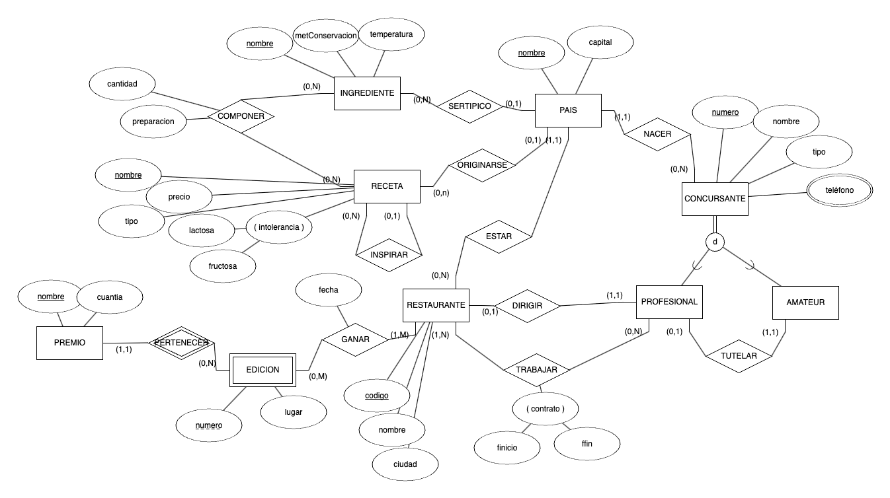

## **Exercici 10**

(RABD.6 // CE6a, CE6e // 3p) A partir de los siguientes **esquemas lógicos**, dibuja el **modelo E/R**:

### **Esquema 1**

```sql

```

```sql

```

| 1  2  3  4  5  6  7  8  9 10 11 12 13 14 | A (a0, a1) · PK: (a0)  B (b0, b1, b2, a0*, c0*) · PK: (a0) · FK: (a0) → A · FK: (c0) → C  C (c0, c1) · PK: (c0)  M (c0*, m, n) · PK: (c0, m) · FK: (c0) → C |
| --- | --- |

### **Esquema 2**

```sql

```

```sql

```

| 1  2  3  4  5  6  7  8  9 10 11 12 13 14 | A (a0, a1, bo*) · PK: (a0) · UK: (b0) · VNN: (b0) · FK: (b0) → B  B (b0, b1) · PK: (b0)  C (b0*, a0*, c0) · PK: (b0, a0) · FK: (b0) → B · FK: (a0) → A · VNN: (c0) |
| --- | --- |

## **Exercici 11**

(RABD.6 // CE6a, CE6e // 3p) A partir del siguiente **model relacional**, dibuja el **diagrama E/R**:

```sql

```

```sql

```

| 1  2  3  4  5  6  7  8  9 10 11 12 13 14 15 16 17 18 19 20 21 22 23 24 25 26 27 28 29 30 31 32 33 34 35 36 37 38 39 40 41 42 43 44 45 46 47 48 49 50 51 52 53 | EMPLEADO (num, dni, nombre, direccion, banco) · PK: (num) · UK: (dni)  MEDICO (num*, espec, anyo) · PK: (num) · FK: (num) → EMPLEADO  SOCIO (num*, dniS, fechaNac, medicoChequeo*, fechaChequeo, resultadoChequeo) · PK: (num) · UK: (dniS) · FK: (num) → EMPLEADO · FK: (medicoChequeo) → MEDICO  TAQUILLA (nun, estado, tamaño) · PK: (nun)  FIJA (num*, socio*) · PK: (num) · FK: (num) → TAQUILLA · FK: (socio) → SOCIO  DIARIA (num*, socio*) · PK: (num) · FK: (num) → TAQUILLA · FK: (socio) → SOCIO  DISCIPLINA (nombre, descripcion) · PK: (nombre)  MONITOR (num*, fechaNac, disciplina*) · PK: (num) · FK: (num) → EMPLEADO · FK: (disciplina) → DISCIPLINA  SESION (dia, hora, sala, monitor*, disciplina*) · PK: (dia, hora, sala) · FK: (monitor) → MONITOR · FK: (disciplina) → DISCIPLINA · VNN: (monitor) · VNN: (disciplina)  TECNICO (num*) · PK: (num) · FK: (num) → EMPLEADO  MODELO (codigo, descripcion, empresas, tecnico*) · PK: (codigo) · FK: (tecnico) → TECNICO  APARATO (num, codigo*, fechaAdquisic, estado) · PK: (num, codigo) · FK: (codigo) → MODELO |
| --- | --- |

## **Exercici 12**

(RABD.6 // CE6a, CE6e // 3p) A partir del siguiente **model relacional**, dibuja el **diagrama E/R**:

```sql

```

```sql

```

| 1  2  3  4  5  6  7  8  9 10 11 12 13 14 15 16 17 18 19 20 21 22 23 24 25 26 27 28 | EDIFICIO (num, numPlantas, gestor*) · PK: (num) · FK: (gestor) → GESTOR  GESTOR (codigo, nombre, apellido1, apellido2, salario, residencia*) · PK: (codigo) · FK: (residencia) → EDIFICIO · UK: (residencia)  INSPECTOR (codigo, nombre) · PK: (codigo)  SUPERVISAR (codigo*, num*, fUltima, fSiguiente) · PK: (codigo, num) · FK: (codigo) → INSPECTOR · FK: (num) → EDIFICIO  TRABAJADOR (codigo, nombre) · PK: (codigo)  APARTAMENTO (numA, numE*, dormitorios) · PK: (numA, numE) · FK: (numE) → EDIFICIO  LIMPIAR (codigo*, numA*, numE*) · PK: (codigo, numA, numE) · FK: (numA, numE) → APARTAMENTO · FK: (codigo) → TRABAJADOR |
| --- | --- |

## **Exercici 13**

A partir del siguiente **model relacional**:

```sql

```

```sql

```

| 1  2  3  4  5  6  7  8  9 10 11 12 13 14 15 16 17 18 19 20 21 22 23 24 25 26 27 28 29 30 31 32 | EQUIPO (num, fUltimaRevision, fAlta, detalle*) · PK: (num) · FK: (detalle) → DETALLE_EQUIPO · VNN: (detalle)  DETALLE_EQUIPO (codigo, tipo, modelo, fUltimaRevision) · PK: (codigo)  VENTA (codigo, precio, fecha, equipo*, cliente*, comercial*) · PK: (codigo) · FK: (equipo) → EQUIPO · FK: (cliente) → CLIENTE · FK: (comercial) → COMERCIAL · VNN: (equipo) · VNN: (cliente) · VNN: (comercial)  ALQUILER (codigo, precio, fecha, equipo*, cliente*, comercial*) · PK: (codigo) · FK: (equipo) → EQUIPO · FK: (cliente) → CLIENTE · FK: (comercial) → COMERCIAL · VNN: (equipo) · VNN: (cliente) · VNN: (comercial)  CLIENTE (id, nombre, categoría) · PK: (id)  COMERCIAL (codigo, nombre, apellido1, rango, mentor*) · PK: (id) · FK: (mentor) → COMERCIAL |
| --- | --- |

Contesta a las siguientes preguntas **argumentando** tus respuestas:

a. ¿Puede un **EQUIPO** tener más de un **DETALLE_EQUIPO**?

b. ¿Puede un **COMERCIAL** vender varios **EQUIPO**?

c. ¿Un **ALQUILER** cuántos **DETALLE_EQUIPO** tendrá?

d. ¿Puede un **CLIENTE** alquilar y vender el mismo **EQUIPO**?

e. ¿Podemos averiguar qué **COMERCIAL** vendió un determinado **EQUIPO**?

f. ¿Una persona puede ser **CLIENTE** y **COMERCIAL** a la vez?

g. ¿Todo **COMERCIAL** debe tener un **mentor**?

h. ¿Un **COMERCIAL** puede tener varios mentores o un mentor puede mentorizar a varios comerciales?


<details>
<summary>💡 Veure solució detallada i recomanacions per a **Activitat 302**</summary>

```sql
-- Solució de referència i comprovació tècnica
-- Revisa que la sintaxi siga compatible amb el motor de base de dades (MySQL / MariaDB).
```
*Comprova cadascun dels camps i clàusules abans d'enviar el teu document a Aules.*
</details>


---

### 📝 **Activitat 303**


Lliurament

- La lliurament será un **fitxer pdf** que contenga la respuesta a las preguntas de la activitat.

- El nombre del fitxer debe ser `303_NombreApellidos.pdf`.

- Se deberá lliuramentr en la tarea correspondiente de Aules en tiempo y forma.

Es valorarà

Es valorarà:

- La claridad de la respuesta.

- La correcta maquetación del documento.

- Respuesta correcta o aproximación a la misma.

Esta activitat servirá para calificar:

- RA6: Diseña modelos relacionales normalizados interpretando diagramas entidad/relación.

- CE6. g) Se han aplicado reglas de normalització. (5%)

Recuerda

****

****

****

****

****

****

| Forma Normal | Requisitos |
| --- | --- |
| 1FN | Atributos atómicos y files únicas. |
| 2FN | 1FN + dependencia funcional completa de la clau primària. |
| 3FN | 2FN + sin dependencias transitivas. |
| FNBC | 3FN + todo determinante debe ser una superclave. |
| 4FN | FNBC + sin dependencias multivaluadas. |
| 5FN | 4FN + sin dependencias de unión (pérdida de datos). |

## **Exercici 1: Primera Forma Normal (1FN) (1FN)**

### **Activitat 01**

La siguiente taula **no está en 1FN** porque contiene **atributos multivaluados**:

| ID_Cliente | Nombre | Teléfonos | Dirección |
| --- | --- | --- | --- |
| 1 | Ana Pérez | 123456, 789012 | Calle A |
| 2 | Juan López | 345678, 901234 | Calle B |

Transforma la taula a **1FN**, de manera que no haya atributos multivaluados.

### **Activitat 02**

La taula contiene **atributos multivaluados y valores repetidos en una misma celda**:

| ID_Pedido | Productos | Cantidad | Cliente |
| --- | --- | --- | --- |
| 1 | Lámpara, Mesa | 2, 1 | Ana Pérez |
| 2 | Silla, Escritorio | 4, 1 | Juan López |

Transforma la taula para que cumpla **1FN**.

### **Activitat 03**

La taula contiene **atributos multivaluados y valores repetidos en una misma celda**:

| ID_Cliente | Nombre | Compras |
| --- | --- | --- |
| 1 | Ana Pérez | Lámpara, Escritorio |
| 2 | Juan López | Silla |

Transforma la taula para que cumpla con **1FN** eliminando los valores multivaluados.

## **Exercici 2: Segona Forma Normal (2FN) (2FN)**

### **Activitat 01**

La siguiente taula está en **1FN**, pero no cumple **2FN** debido a **dependencias parciales**:

| ID_Orden | ID_Producto | Producto | Cantidad | Cliente | Dirección |
| --- | --- | --- | --- | --- | --- |
| 1 | 101 | Lámpara | 2 | Ana Pérez | Calle A |
| 1 | 102 | Mesa | 1 | Ana Pérez | Calle A |
| 2 | 103 | Silla | 4 | Juan López | Calle B |

Elimina las dependencias parciales. La clau primària es `(ID_Orden, ID_Producto)`.

### **Activitat 02**

La siguiente taula está en **1FN**, pero no cumple **2FN** debido a **dependencias parciales**:

| ID_Producto | ID_Pedido | Nombre_Producto | Cantidad | Cliente |
| --- | --- | --- | --- | --- |
| 1 | 101 | Lámpara | 2 | Ana Pérez |
| 2 | 101 | Escritorio | 1 | Ana Pérez |
| 3 | 102 | Silla | 4 | Juan López |

Descompón la taula para eliminar las dependencias parciales.

### **Activitat 03**

La siguiente taula está en **1FN**, pero no cumple **2FN** debido a **dependencias parciales**:

| ID_Pedido | ID_Producto | Nombre_Producto | Cantidad | Cliente | Dirección |
| --- | --- | --- | --- | --- | --- |
| 1 | 101 | Lámpara | 2 | Ana Pérez | Calle A |
| 1 | 102 | Mesa | 1 | Ana Pérez | Calle A |
| 2 | 103 | Silla | 4 | Juan López | Calle B |

Identifica y elimina las dependencias parciales.

## **Exercici 3: Tercera Forma Normal (3FN) (3FN)**

### **Activitat 01**

La siguiente taula está en **2FN**, pero no cumple **3FN** debido a **dependencias transitivas**:

| ID_Empleado | Nombre_Empleado | Departamento | Jefe_Departamento |
| --- | --- | --- | --- |
| 1 | Luis Gómez | Ventas | Ana Pérez |
| 2 | Marta Ruiz | Marketing | Juan López |

Descompón la taula para eliminar las dependencias transitivas.

### **Activitat 02**

La siguiente taula está en **2FN**, pero no cumple **3FN** debido a **dependencias transitivas**:

| ID_Empleado | Nombre | Departamento | Jefe_Departamento | Oficina |
| --- | --- | --- | --- | --- |
| 1 | Luis Gómez | Ventas | Ana Pérez | Oficina A |
| 2 | Marta Ruiz | Marketing | Juan López | Oficina B |

Elimina las dependencias transitivas.

### **Activitat 03**

La siguiente taula está en **2FN**, pero no cumple **3FN** debido a **dependencias transitivas**:

| ID_Empleado | Nombre | Departamento | Jefe_Departamento | Oficina |
| --- | --- | --- | --- | --- |
| 1 | Luis Gómez | Ventas | Ana Pérez | Oficina A |
| 2 | Marta Ruiz | Marketing | Juan López | Oficina B |

Elimina las dependencias transitivas.

## **Exercici 4: Forma Normal de Boyce-Codd (FNBC)**

### **Activitat 01**

Una taula que no cumple FNBC tiene dependencias funcionales donde **un atributo no clave determina parte de la clau primària**.

| ID_Proyecto | ID_Empleado | Rol |
| --- | --- | --- |
| 1 | 101 | Diseñador |
| 1 | 102 | Programador |
| 2 | 103 | Diseñador |

Dependencias funcionales:

- **Rol → ID_Empleado** (un rol determina al empleado).

Descompón la taula para que cumpla **FNBC**.

### **Activitat 02**

Una taula que no cumple FNBC tiene dependencias funcionales donde **un atributo no clave determina parte de la clau primària**.

| ID_Curso | ID_Profesor | Nombre_Curso |
| --- | --- | --- |
| 1 | 101 | Matemáticas |
| 2 | 101 | Física |
| 3 | 102 | Química |

Dependencia funcional:

- **ID_Profesor → Nombre_Curso** (un profesor enseña un curso específico).

Elimina las dependencias funcionales problemáticas.

## **Exercici 5: Cuarta Forma Normal (4FN)**

### **Activitat 01**

La taula está en **3FN**. En esta taula hay una **dependencia multivaluada**, donde un cliente puede tener múltiples **teléfonos** y **correos electrónicos**.

| Cliente | Teléfono | Correo Electrónico |
| --- | --- | --- |
| Ana Pérez | 123456789 | ana@gmail.com |
| Ana Pérez | 987654321 | ana.perez@yahoo.com |
| Juan López | 555666777 | juan@gmail.com |

Elimina la dependencia multivaluada.

### **Activitat 02**

La taula está en **3FN**. En esta taula hay una **dependencia multivaluada**, donde un cliente puede tener múltiples **teléfonos** y **compras**.

| Cliente | Teléfono | Producto |
| --- | --- | --- |
| Ana Pérez | 123456789 | Lámpara |
| Ana Pérez | 987654321 | Escritorio |
| Juan López | 555666777 | Silla |

Elimina las dependencias multivaluadas.

## **Exercici 6: Quinta Forma Normal (5FN)**

### **Activitat 01**

La taula está en **4FN**. La taula representa relaciones entre **clientes**, **productos** y **vendedores**.

| Cliente | Producto | Vendedor |
| --- | --- | --- |
| Ana Pérez | Lámpara | Juan Gómez |
| Ana Pérez | Mesa | Juan Gómez |
| Ana Pérez | Mesa | Marta Ruiz |

Descompón la taula en relaciones independientes para evitar redundancias.

### **Activitat 02**

La taula está en **4FN**. La taula representa relaciones entre **proyectos**, **empleados** y **roles**.

| Proyecto | Empleado | Rol |
| --- | --- | --- |
| Proyecto A | Luis Gómez | Diseñador |
| Proyecto A | Luis Gómez | Programador |
| Proyecto B | Marta Ruiz | Diseñador |

Elimina redundancias distribuyendo los datos en taules más pequeñas.


<details>
<summary>💡 Veure solució detallada i recomanacions per a **Activitat 303**</summary>

```sql
-- Solució de referència i comprovació tècnica
-- Revisa que la sintaxi siga compatible amb el motor de base de dades (MySQL / MariaDB).
```
*Comprova cadascun dels camps i clàusules abans d'enviar el teu document a Aules.*
</details>


---

### 📝 **Activitat 304**


Lliurament

- La lliurament será un **fitxer pdf** que contenga la respuesta a las preguntas de la activitat.

- El nombre del fitxer debe ser `304_NombreApellidos.pdf`.

- Se deberá lliuramentr en la tarea correspondiente de Aules en tiempo y forma.

Es valorarà

Es valorarà:

- La claridad de la respuesta.

- La correcta maquetación del documento.

- Respuesta correcta o aproximación a la misma.

Esta activitat servirá para calificar:

- RA6: Diseña modelos relacionales normalizados interpretando diagramas entidad/relación.

- CE6. g) Se han aplicado reglas de normalització. (5%)

Recuerda

Dadas las siguientes taules, realiza la **normalització** de las bases de dades aplicando las **3 Formas Normales** vistes en clase:

- **1FN**: atributos atómicos y files únicas.

- **2FN**: dependencia funcional completa de la clau primària.

- **3FN**: sin dependencias transitivas.

## **Activitat 01**

**Series**

Tenemos la siguiente taula. Aplica las **tres formas normales** vistes en clase.

| CodSerie | Título | Genero | AñoLanzamiento | Plataforma |
| --- | --- | --- | --- | --- |
| 0123 | The Last of Us | Suspense, Drama | 2023 | HBO |
| 0219 | The Mandalorian | Ciencia ficción, Accion, Fantasia | 12-11-2019 | Disney+ |
| 0318 | Succession | Comedia negra, tragicomedia | 03-Junio-2018 | HBO |
| 0419 | The Boys | Superheroes | 2019 | PrimeVideo |
| 0519 | Sex Education | Drama, Comedia | 11/1/2019 | Netflix |
| 0619 | The Umbrella Academy | Drama, Superhéroes | 2019 | Netflix |
| 0720 | Ted Lasso | Comedia | 2020 | Apple TV |

## **Activitat 02**

**Ordenes**

Tenemos la siguiente taula relacionada con una **compra**. Realiza las tres formas normales de la taula.

| Id_Orden | Fecha | Id_cliente | Nom_client | Id_art | Nom_art | Cant | Precio |
| --- | --- | --- | --- | --- | --- | --- | --- |
| 2301 | 23/febrero /24 | 101 | José Perez | 3786 | Red | 3 | 3500 céntimos |
| 2301 | 23/febrero /24 | 101 | José Perez | 4011 | Raqueta | 6 | 65 € |
| 2301 | 23/febrero /24 | 101 | José Perez | 9132 | 3 Pelotas | 8 | 4,75 € |
| 2302 | 25/02/24 | 107 | Fernando Hernandez | 5794 | 6 Pelotas | 4 | 500 céntimos |
| 2303 | 27/2/24 | 110 | Pedro Fernandez | 4011 | Raqueta | 2 | 65 € |
| 2303 | 27/2/24 | 110 | Pedro Fernandez | 3141 | Funda | 2 | 10 € |


<details>
<summary>💡 Veure solució detallada i recomanacions per a **Activitat 304**</summary>

```sql
-- Solució de referència i comprovació tècnica
-- Revisa que la sintaxi siga compatible amb el motor de base de dades (MySQL / MariaDB).
```
*Comprova cadascun dels camps i clàusules abans d'enviar el teu document a Aules.*
</details>


---

### 📝 **Activitat 305**


Lliurament

- La lliurament será un **fitxer pdf** que contenga la respuesta a las preguntas de la activitat.

- El nombre del fitxer debe ser `305_NombreApellidos.pdf`.

- Se deberá lliuramentr en la tarea correspondiente de Aules en tiempo y forma.

Es valorarà

Es valorarà:

- La claridad de la respuesta.

- La correcta maquetación del documento.

- Respuesta correcta o aproximación a la misma.

Esta activitat servirá para calificar:

- RA6: Diseña modelos relacionales normalizados interpretando diagramas entidad/relación.

- CE6. a) Se han utilizado herramientas gráficas para representar el disseny lògic. (5%)

- CE6. b) Se han identificado las taules del disseny lògic. (5%)

- CE6. c) Se han identificado los camps que forman parte de las taules del disseny lògic. (5%)

- CE6. d) Se han analizado las relaciones entre las taules del disseny lògic. (5%)

- CE6. e) Se han identificado los camps clave. (5%)

- CE6. f) Se han aplicado reglas de integridad. (5%)

- CE6. g) Se han aplicado reglas de normalització. (5%)

- CE6. h) Se han analizado y documentado las restricciones que no pueden plasmarse en el disseny lògic. (5%)

Recuerda

Esta es una activitat **integradora** de toda la unidad. Para cada exercici deberás:

- **Leer la descripción del modelo E/R** que acompaña al diagrama.

- **Analizar el diagrama E/R** y aplicar las reglas de transformación vistes en clase.

- **Obtener el model relacional**, indicando para cada taula:

- **CP**: clau primària.

- **CAlt**: claves alternativas, si existen.

- **CAj**: claus foranes, indicando la taula a la que referencian.

- **VNN**: atributos que no pueden ser nulos.

- **Normalizar** las taules cuando sea necesario aplicando las 3 Formas Normales vistes en clase:

- **1FN**: atributos atómicos y files únicas.

- **2FN**: dependencia funcional completa de la clau primària.

- **3FN**: sin dependencias transitivas.

- **Documentar las restricciones** que no pueden plasmarse en el disseny lògic.

## **Exercici 1**

**INSTITUTO**

El modelo E/R representa la gestión de un **instituto**. La entidad **CURSO** se identifica por su **Codigo** y guarda a més el **Nombre** y el **NumHoras**. La entidad **ALUMNO** se identifica por su **Expediente** y guarda **Nombre**, **Apellidos** y los **Telefonos** de contacto (varios por alumno, por eso aparece con doble elipse). Un **alumno** se matricula en **varios cursos** y en cada **curso** hay **varios alumnos**; esta relación N:M se llama **MATRICULA** y tiene sus propios atributos: la **FechaMatriculacion** y la **NotaFinal**. Cada **curso** es impartido por **un único profesor** (relación 1:1 **imparte**) y un **profesor** pertenece a **un único departamento**, aunque un **departamento** puede tener **varios profesores** (relación N:1 **PERTENECE**). La entidad **PROFESOR** se identifica por su **DNI** y guarda **Nombre**, **Apellidos** y la **CodDepto** del departamento al que pertenece. La entidad **DEPARTAMENTO** se identifica por su **CodDepto** y guarda su **Nombre**.

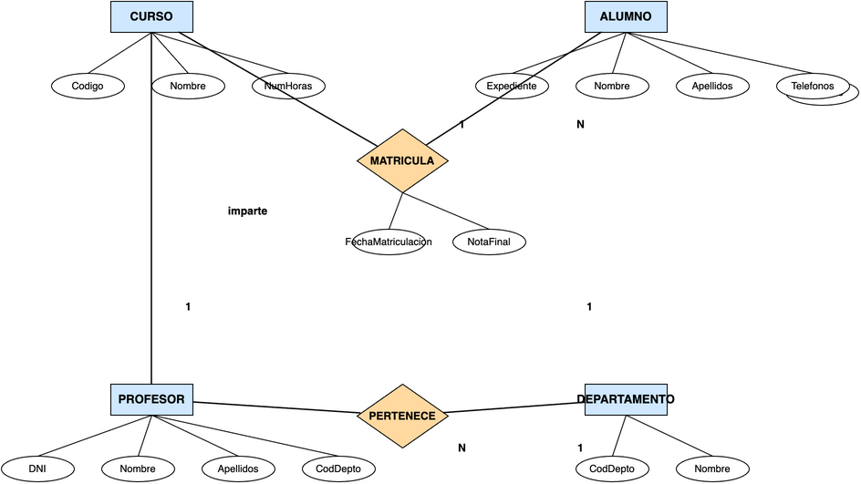

**Se pide:**

a) Obtener el **model relacional** correspondiente al diagrama E/R, indicando para cada taula su **CP**, **CAlt**, **CAj** y **VNN**.

b) **Normalizar** la taula de alumnos para eliminar el atributo multivaluado *telefonos*, documentando el proceso de 1FN y 2FN.

## **Exercici 2**

**EMPRESA**

El modelo E/R representa la gestión de una **empresa**. La entidad **DEPARTAMENTO** se identifica por su **CodDepto** y guarda su **Nombre**. La entidad **EMPLEADO** se identifica por su **DNI** y guarda **Nombre**, **Apellidos** y **Salario**. Un **departamento** tiene **varios empleados** y cada **empleado** pertenece a **un único departamento** (relación N:1). La entidad **PROYECTO** se identifica por su **Codigo** y guarda el **Nombre** y las **HorasPrevistes**. Un **empleado** puede **trabajar en varios proyectos** y un **proyecto** puede tener **varios empleados**; esta relación N:M se llama **TRABAJA** y guarda el atributo **NumHoras** dedicadas por cada empleado a cada proyecto.

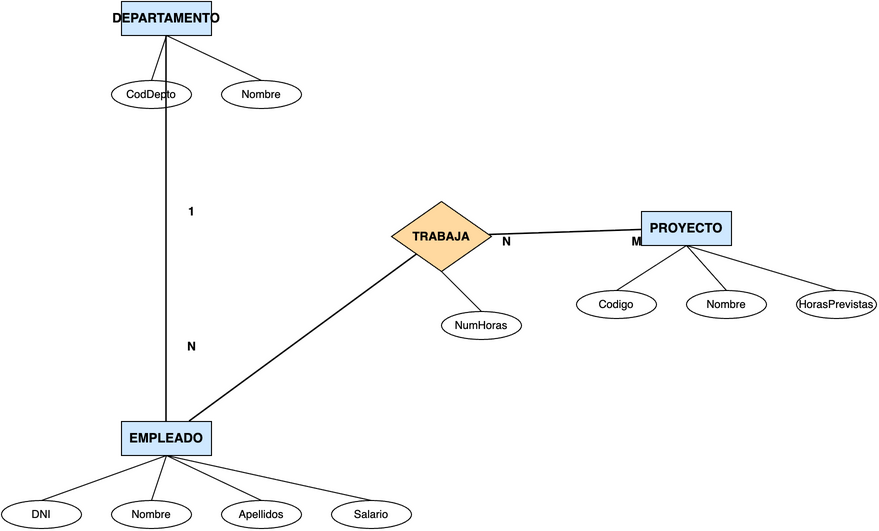

**Se pide:**

a) Obtener el **model relacional** correspondiente al diagrama E/R, indicando para cada taula su **CP**, **CAlt**, **CAj** y **VNN**.

b) Documentar las **restricciones** que no pueden plasmarse en el disseny lògic. Se sabe que:

- Un empleado puede trabajar como máximo en 3 proyectos.

- El salario de un empleado no puede superar los 5.000 €.

- Un departamento puede no tener empleados, pero un empleado siempre pertenece a un departamento.

- Un proyecto no puede estar sin empleados.

## **Exercici 3**

**CLÍNICA DENTAL**

El modelo E/R representa la gestión de una **clínica dental**. La entidad **PACIENTE** se identifica por su **NIF** y guarda **Nombre**, **Apellidos**, **Telefono** y la **dirección** descompuesta en **Calle**, **Numero**, **CP** y **Localidad**. La entidad **DENTISTA** se identifica por su **DNI** y guarda **Nombre**, **Apellidos** y **Especialidad**. Un **paciente** tiene **varias citas** y un **dentista** tiene **varias citas**; esta relación N:M se llama **CITA** y guarda la **Fecha**, la **Hora** y el **Tratamiento** realizado. Un **paciente** puede tener **varias facturas** y cada **factura** corresponde a **un único paciente** (relación N:1). La entidad **FACTURA** se identifica por su **NumFactura** y guarda la **FechaEmision** y el **ImporteTotal**. La entidad **TRATAMIENTO** se identifica por su **Codigo** y guarda la **Descripcion** y el **Precio**. Una **factura** detalla **varios tratamientos** y un **tratamiento** puede aparecer en **varias facturas**; esta relación N:M se llama **LINEA_FACTURA** y guarda la **Cantidad** de cada tratamiento en cada factura.

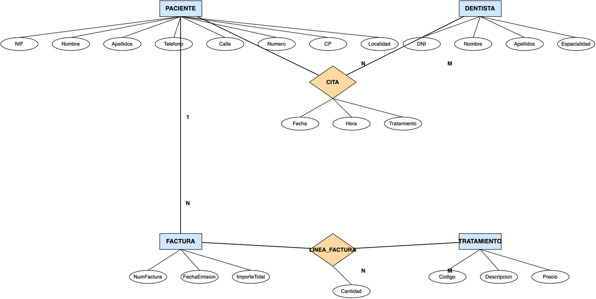

**Se pide:**

a) Obtener el **model relacional** correspondiente al diagrama E/R, indicando para cada taula su **CP**, **CAlt**, **CAj** y **VNN**.

b) Documentar las **restricciones** que no pueden plasmarse en el disseny lògic.

## **Exercici 4**

**ESPECIALIZACIÓN**

El modelo E/R representa la gestión de los **empleados** de una empresa mediante una **especialización**. La entidad **EMPLEADO** se identifica por su **DNI** y guarda **Nombre**, **Apellidos** y **Salario**. Un empleado es de dos tipos posibles: la entidad **TECNICO** guarda su **Especialidad** y la entidad **COMERCIAL** guarda su **Zona**. La especialización se representa con el símbolo **ISA**.

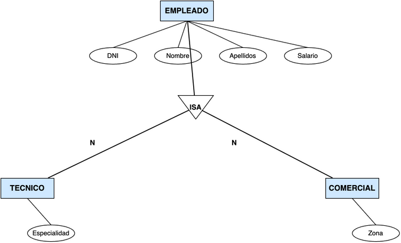

**Se pide:**

a) Obtener el **model relacional** correspondiente al diagrama E/R con la especialización, indicando para cada taula su **CP**, **CAlt**, **CAj** y **VNN**.

b) Indicar en qué casos se guardarían los datos de técnicos y comerciales en **taules independientes** y en qué casos se guardarían en la **misma taula** que los empleados.


<details>
<summary>💡 Veure solució detallada i recomanacions per a **Activitat 305**</summary>

```sql
-- Solució de referència i comprovació tècnica
-- Revisa que la sintaxi siga compatible amb el motor de base de dades (MySQL / MariaDB).
```
*Comprova cadascun dels camps i clàusules abans d'enviar el teu document a Aules.*
</details>


---
## 🏆 Reptes Interactius d'Autoavaluació (Gamificació)

Posa a prova els teus coneixements adquirits en aquesta unitat abans de fer el lliurament a Aules. Cada repte superat suma **+25 punts**!

<div class="interactive-progress-tracker">
  <div class="tracker-header">
    <span class="tracker-title">🎯 Progrés dels Reptes de la Unitat</span>
    <span class="tracker-pts">⭐ <strong>0 punts</strong></span>
  </div>
  <div class="tracker-track">
    <div class="tracker-fill" style="width: 0%;"></div>
  </div>
  <div class="tracker-status"><span class="tracker-count">0 de 4 reptes superats (0%)</span></div>
</div>

<div class="interactive-quiz" data-answer="2FN|2a Forma Normal|segona forma normal" data-hint="Elimina dependències parcials de la clau primària composta." data-quiz-id="ut03_q1">
  <div class="quiz-badge">Repte 1 · Pregunta d'Autoavaluació (+25 pts)</div>
  <div class="quiz-question">Repte 1: Segona Forma Normal (2FN)</div>
  <p style="margin: 0 0 10px 0; font-size: 0.95rem;">Quina forma normal exigeix estar en 1FN i que cap atribut no clau depenga d'una part de la clau primària (sense dependència parcial)?</p>
  <div class="quiz-input-group">
    <input type="text" class="quiz-input" placeholder="Escriu la teua resposta..." />
    <button type="button" class="btn-quiz-check">Comprovar</button>
  </div>
  <div class="quiz-feedback"></div>
</div>

<div class="interactive-mcq" data-answer="A" data-hint="Tota relació molts a molts genera una taula associativa o intermèdia." data-quiz-id="ut03_q2">
  <div class="quiz-badge">Repte 2 · Pregunta Tipus Test (+25 pts)</div>
  <div class="mcq-question">Repte 2: Transformació de Relacions M:N</div>
  <p style="margin: 0 0 12px 0; font-size: 0.95rem;">Quan es transforma una relació M:N del model E/R al model relacional, què s'ha de fer obligatòriament?</p>
  <div class="mcq-options">
    <button type="button" class="btn-mcq-opt" data-opt="A">A) Crear una nova taula amb les claus foranes de totes dues entitats</button><button type="button" class="btn-mcq-opt" data-opt="B">B) Afegir la clau primària d'una a l'altra</button><button type="button" class="btn-mcq-opt" data-opt="C">C) Fusionar totes dues entitats en una única taula</button><button type="button" class="btn-mcq-opt" data-opt="D">D) Eliminar la relació</button>
  </div>
  <div class="quiz-feedback"></div>
</div>

<div class="interactive-vf" data-answer="V" data-hint="Així és: si A -> B i B -> C, C ha d'anar a una altra taula." data-quiz-id="ut03_q3">
  <div class="quiz-badge">Repte 3 · Vertader o Fals (+25 pts)</div>
  <div class="vf-statement"><strong>Repte 3: Tercera Forma Normal (3FN):</strong> Una taula està en 3FN si està en 2FN i no conté cap dependència transitiva entre atributs no clau.</div>
  <div class="vf-buttons">
    <button type="button" class="btn-vf" data-opt="V">✅ Vertader</button>
    <button type="button" class="btn-vf" data-opt="F">❌ Fals</button>
  </div>
  <div class="quiz-feedback"></div>
</div>

<div class="interactive-mcq" data-answer="A" data-hint="Evita 'registres orfes' referenciats cap al buit." data-quiz-id="ut03_q4">
  <div class="quiz-badge">Repte 4 · Pregunta de Consolidació (+25 pts)</div>
  <div class="mcq-question">Repte 4: Integritat Referencial</div>
  <p style="margin: 0 0 12px 0; font-size: 0.95rem;">Què garanteix la regla d'integritat referencial en una base de dades relacional?</p>
  <div class="mcq-options">
    <button type="button" class="btn-mcq-opt" data-opt="A">A) Que tot valor d'una clau forana existisca a la clau primària de la taula referenciada o siga NULL</button><button type="button" class="btn-mcq-opt" data-opt="B">B) Que la clau primària no continga valors repetits</button><button type="button" class="btn-mcq-opt" data-opt="C">C) Que tots els camps tinguen valor per defecte</button><button type="button" class="btn-mcq-opt" data-opt="D">D) Que la base de dades estiga en 3FN</button>
  </div>
  <div class="quiz-feedback"></div>
</div>

<div class="aules-delivery-card">
  <div class="aules-card-badge">📤 LLIURAMENT OFICIAL DE TASCA (AULES)</div>
  <div class="aules-card-title">Comprovant de Treball i Activitats Pràctiques</div>
  <p class="aules-card-desc">
    Quan hages completat els exercicis pràctics i superat els reptes interactius, escriu el teu nom complet i genera el comprovant per a adjuntar-lo al lliurament d'Aules corresponent.
  </p>
  <div class="aules-input-group">
    <label for="aules-student-name">Nom de l'alumne/a:</label>
    <input type="text" id="aules-student-name" placeholder="Cognoms, Nom" />
  </div>
  <div class="aules-score-box">
    Puntuació actual: <span class="aules-score-count">0/4 reptes superats (0 punts)</span>
  </div>
  <div class="aules-actions">
    <button type="button" class="btn-aules-copy">📋 Copiar Resum per a Aules</button>
    <button type="button" class="btn-aules-dl">📄 Descarregar Comprovant (.pdf)</button>
  </div>
  <div class="aules-toast" style="display:none;"></div>
</div>

