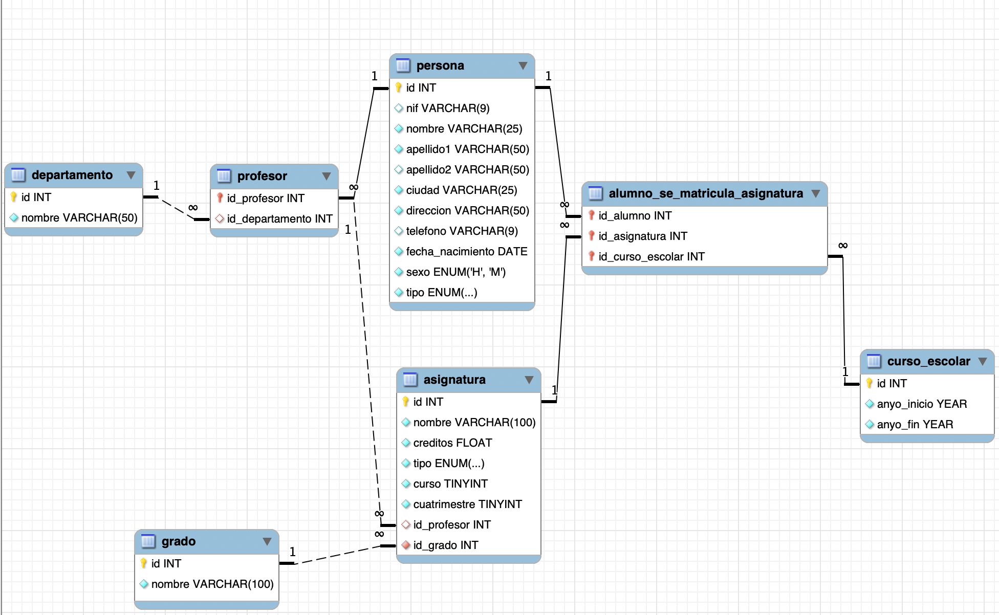

# **Actividad 403**

  

    🏆 <strong>Progreso de esta sección:</strong> 0 de 4 superados (0%)
    ⭐ <strong>0 puntos</strong>
  

  

    

  

> **📌 Entrega**
> 

> - El lliurament serà un **fitxer `.sql`** amb el script DDL de l'activitat.

> - El nombre del fichero debe ser `403_NombreApellidos.sql`.

> - Se deberá entregar en la tarea correspondiente de Aules en tiempo y forma.

> **📌 Se valorará:**
> 

> Es valorarà:

> - La correcta selecció dels tipus de dades.

> - L'ús adequat dels tipus `ENUM` quan el requiera el model.

> - La correcta definició de les claus primàries.

> - La correcta definició de les claus foranes i les seues relacions.

> - La correcta implantació de les restriccions.

> - El resultat obtingut a l'executar el script.

> Esta actividad servirá para calificar:

> - RA2: Crea bases de dades definint la seua estructura i les característiques dels seus elements segons el model relacional.

>   - CE2. a) S'ha analitzat el format d'emmagatzematge de la informació. (5%)

>   - CE2. b) S'han creat les taules i les relacions entre elles. (5%)

>   - CE2. c) Es han seleccionat els tipus de dades adequats. (5%)

>   - CE2. d) S'han definit els camps clau en les taules. (5%)

>   - CE2. e) Es han implantat les restriccions reflectides en el disseny lògic. (5%)

## **Disseny físic - Universitat**

Crea les instruccions DDL per a crear la base de dades **universitat** a partir del model lògic que es mostra a continuació.

> **📌 Taules del model**
> 

> El model lògic conté les taules: **departament**, **persona**, **professor**, **grau**, **assignatura**, **curso_escolar** i **alumno_se_matricula_asignatura**.

> **📌 Enumerats**
> 

> - El camp `tipo` de la taula **persona** és un enumerat amb els valors (`profesor`, `alumno`).

> - El camp `tipo` de la taula **assignatura** és un enumerat amb els valors (`básica`, `obligatoria`, `optativa`).

> **📌 Recorda**
> 

> Has de definir, per a cada taula:

> - La **clau primària** (`PRIMARY KEY`).

> - Les **claus foranes** (`FOREIGN KEY`), indicant la taula a la que referencian.

> - Els camps que **no poden ser nuls** (`NOT NULL`).

> - Els camps amb valors **únics** (`UNIQUE`) quan el model l'indique.

## **Es demana**

1. Escriu el script DDL complet: el `CREATE DATABASE` (amb joc de caràcters `utf8mb4`) i el `CREATE TABLE` de cada taula del model.

1. Executa el script en el teu MySQL i comprova que es ha creat correctament.

1. Lliurament el fitxer `403_NombreApellidos.sql`.

---

## 🎮 Retos Interactivos de Autoevaluación (+100 XP)

Comprueba tu dominio sobre **Activitat 403: Disseny físic - Universitat** superando estos 4 retos gamificados (+25 puntos cada uno):

  
🎯 <strong>Reto 1 (+25 pts):</strong> Quina sentència del subllenguatge SQL DDL s'utilitza per a modificar l'estructura d'una taula existent (afegir columnes o restriccions)?

  

    <button type="button" class="btn-mcq-opt" data-opt="A">A) UPDATE TABLE</button>
    <button type="button" class="btn-mcq-opt" data-opt="B">B) ALTER TABLE</button>
    <button type="button" class="btn-mcq-opt" data-opt="C">C) MODIFY ROW</button>
    <button type="button" class="btn-mcq-opt" data-opt="D">D) SELECT INTO</button>
  

  

  
🎯 <strong>Reto 2 (+25 pts):</strong> Quin efecte té l'opció <code>ON DELETE CASCADE</code> definida sobre una clau forana (<code>FOREIGN KEY</code>) en SQL?

  

    <button type="button" class="btn-mcq-opt" data-opt="A">A) Impedeix esborrar qualsevol fila de la taula pare llançant un error.</button>
    <button type="button" class="btn-mcq-opt" data-opt="B">B) Quan s'esborra una fila de la taula referenciada (pare), s'esborren automàticament les files relacionades de la taula filla.</button>
    <button type="button" class="btn-mcq-opt" data-opt="C">C) Esborra tota la base de dades si queda una taula buida.</button>
    <button type="button" class="btn-mcq-opt" data-opt="D">D) Converteix la clau primària en un camp de text variable.</button>
  

  

  
✅ <strong>Repte 3 (Vertader o Fals · +25 pts):</strong> La restricció <code>UNIQUE</code> en SQL permet assegurar que no hi haja dos valors iguals en una columna, tot i no ser la clau primària.

  

    <button type="button" class="btn-vf" data-opt="V">Vertader (V)</button>
    <button type="button" class="btn-vf" data-opt="F">Fals (F)</button>
  

  

  
⌨️ <strong>Repte 4 (+25 pts):</strong> Quina sentència SQL DDL s'utilitza per a eliminar completament una taula (tant les dades com la seua estructura del diccionari)?

  

    <input type="text" class="quiz-input" placeholder="Escriu la resposta..." />
    <button type="button" class="btn-quiz-check">Comprovar</button>
  

  

### 📋 Llista de Comprovació i Rúbrica d'Assoliment

Marca cada criteri a mesura que completes l'estudi o la resolució pràctica d'aquesta pàgina (**Activitat 403: Disseny físic - Universitat**):

- [ ] He llegit detingudament la teoria o l'enunciat d'aquesta secció i he anotat els conceptes clau.
- [ ] He revisat els esquemes, taules o blocs de codi i he verificat que sé aplicar-los a l'entorn de treball.
- [ ] He resolt correctament els **4 reptes interactius** superiors obtenint els **100 puntos XP**.
- [ ] He descarregat el comprovant oficial en PDF per a adjuntar-lo a la tasca d'**Aules**.

  <h3>📤 Comprovant de Lliurament per a Aules</h3>
  
Quan hages completat els reptes interactius i la llista d'autoavaluació d'aquesta pàgina, introdueix el teu nom i descarrega el teu certificat oficial en PDF per a adjuntar-lo a la tasca d'<strong>Aules</strong>.

  

    <label for="aules-student-name">👤 Nom i Cognoms de l'Alumne/a:</label>
    <input type="text" id="aules-student-name" class="aules-student-name" placeholder="Ex: Joan Garcia Pérez" />
  

  

    0/4 reptes completats (0%) · 0 puntos · 0/4 criteris d'autoavaluació
  

  

    <button type="button" class="btn-aules-dl" data-module="BBDD" data-unit="UD04" data-activity="act403">📥 Descarregar Comprovant PDF</button>
    <button type="button" class="btn-aules-copy">📋 Copiar Resum al Porta-retalls</button>
  

  

