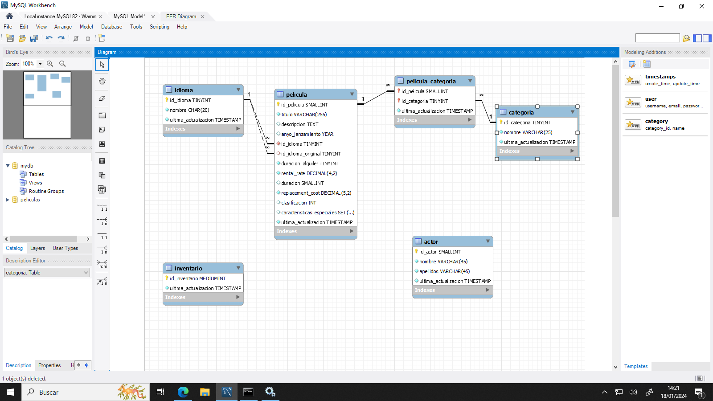

# **Activitat 405**

  

    🏆 <strong>Progrés d'aquesta secció:</strong> 0 de 4 superats (0%)
    ⭐ <strong>0 punts</strong>
  

  

    

  

> **📌 Lliurament**
> 

> - El lliurament serà un **fitxer `.sql`** amb el script complet de l'activitat (creació de la base de dades i totes les modificacions `ALTER`).

> - El nom del fitxer ha de ser `405_NombreApellidos.sql`.

> - S'haurà de lliurar en la tasca corresponent d'Aules en temps i forma.

> **📌 Es valorarà**
> 

> Es valorarà:

> - La correcta traducció del diagrama E/R a SQL.

> - La correcta utilització de `ALTER TABLE` per a afegir, modificar i eliminar columnes.

> - La correcta creació de claus foranes i de taules de relació.

> - L'ús adequat dels tipus `ENUM` i `SET`.

> - El resultat obtingut a l'executar el script.

> Aquesta activitat servirà per a qualificar:

> - RA2: Crea bases de dades definint la seua estructura i les característiques dels seus elements segons el model relacional.

>   - CE2. a) S'ha analitzat el format d'emmagatzematge de la informació. (5%)

>   - CE2. b) S'han creat les taules i les relacions entre elles. (5%)

>   - CE2. c) Es han seleccionat els tipus de dades adequats. (5%)

>   - CE2. d) S'han definit els camps clau en les taules. (5%)

>   - CE2. e) Es han implantat les restriccions reflectides en el disseny lògic. (5%)

## **Disseny físic - Películas**

A partir del següent diagrama E/R:

> **📌 Taules del model**
> 

> El diagrama conté les taules: **actor**, **categoria**, **idioma**, **pelicula**, **pelicula_categoria** e **inventari**.

Realitza els següents exercicis en MySQL:

1. Passa el diagrama anterior a SQL i llança el script en la base de dades.

1. Inclou la columna `edad` en la taula `actor`. La columna nova haurà d'estar després de `apellidos`. El dada serà `int` i no podrà ser `null`.

1. Hauràs d'eliminar la columna `apellidos` i crear les columnes `apellido1` i `apellido2`. Les columnes estaran després de `nombre` i seran de tipus `varchar(45)` i no poden ser nulas.

1. Inclou en la taula `inventario` la relació amb la taula `pelicula`. Crea la columna `id_pelicula`, no podrà ser `null`. Crea la *foreign key* per a la relació.

1. Crea la taula que relaciona la taula `peliculas` i la taula `actores`. La taula haurà de tindre 3 columnes, una per a la relació amb `actor`, una altra per a la relació amb `pelicula` i una altra que es anomene `ultima_actualizacion` de tipus `TIMESTAMP`.

1. Modifica la columna `nombre` de la taula `categoria` perquè siga un `varchar(50)`.

1. Modifica la columna `duracion_alquiler` de la taula `pelicula` perquè el seu tipus siga `INT` i valor per defecte `3`.

1. Modifica el tipus de dada de la columna `clasificacion` de la taula `pelicula`. Haurà de ser un enumerat amb els possibles valors `'G', 'PG', 'PG-13', 'R', 'NC-17'` i per defecte `'G'`.

1. Modifica el tipus de dada de la columna `caracteristicas_especiales` de la taula `pelicula`. Hauràs de fer un `SET('Trailers', 'Commentaries', 'Deleted Scenes', 'Behind the Scenes')`.

> **📌 Recorda**
> 

> Per a comprovar l'estructura de les taules després de cada modificació pots utilitzar `DESCRIBE nombre_tabla;` o `SHOW CREATE TABLE nombre_tabla;`.

---

## 🎮 Reptes Interactius d'Autoavaluació (+100 XP)

Comprova el teu domini sobre **Activitat 405: Disseny físic - Películas** superant aquests 4 reptes gamificats (+25 punts cadascun):

  
🎯 <strong>Repte 1 (+25 pts):</strong> Quina instrucció del subllenguatge DCL permet atorgar permisos d'accés (com <code>SELECT</code> o <code>INSERT</code>) a un usuari sobre una taula?

  

    <button type="button" class="btn-mcq-opt" data-opt="A">A) GRANT</button>
    <button type="button" class="btn-mcq-opt" data-opt="B">B) REVOKE</button>
    <button type="button" class="btn-mcq-opt" data-opt="C">C) COMMIT</button>
    <button type="button" class="btn-mcq-opt" data-opt="D">D) CHECK</button>
  

  

  
🎯 <strong>Repte 2 (+25 pts):</strong> Quina restricció SQL s'utilitza per a validar que el valor d'una columna complisca una condició booleana (per exemple <code>preu &gt; 0</code>)?

  

    <button type="button" class="btn-mcq-opt" data-opt="A">A) DEFAULT</button>
    <button type="button" class="btn-mcq-opt" data-opt="B">B) CHECK</button>
    <button type="button" class="btn-mcq-opt" data-opt="C">C) AUTO_INCREMENT</button>
    <button type="button" class="btn-mcq-opt" data-opt="D">D) INDEX</button>
  

  

  
✅ <strong>Repte 3 (Vertader o Fals · +25 pts):</strong> En MySQL/MariaDB, la col·lació (<code>COLLATE</code>) determina les regles d'ordenació alfabètica i si les comparacions de text distingeixen majúscules o accents.

  

    <button type="button" class="btn-vf" data-opt="V">Vertader (V)</button>
    <button type="button" class="btn-vf" data-opt="F">Fals (F)</button>
  

  

  
⌨️ <strong>Repte 4 (+25 pts):</strong> Quina sentència SQL DDL permet crear una taula nova en la base de dades?

  

    <input type="text" class="quiz-input" placeholder="Escriu la resposta..." />
    <button type="button" class="btn-quiz-check">Comprovar</button>
  

  

### 📋 Llista de Comprovació i Rúbrica d'Assoliment

Marca cada criteri a mesura que completes l'estudi o la resolució pràctica d'aquesta pàgina (**Activitat 405: Disseny físic - Películas**):

- [ ] He llegit detingudament la teoria o l'enunciat d'aquesta secció i he anotat els conceptes clau.
- [ ] He revisat els esquemes, taules o blocs de codi i he verificat que sé aplicar-los a l'entorn de treball.
- [ ] He resolt correctament els **4 reptes interactius** superiors obtenint els **100 punts XP**.
- [ ] He descarregat el comprovant oficial en PDF per a adjuntar-lo a la tasca d'**Aules**.

  <h3>📤 Comprovant de Lliurament per a Aules</h3>
  
Quan hages completat els reptes interactius i la llista d'autoavaluació d'aquesta pàgina, introdueix el teu nom i descarrega el teu certificat oficial en PDF per a adjuntar-lo a la tasca d'<strong>Aules</strong>.

  

    <label for="aules-student-name">👤 Nom i Cognoms de l'Alumne/a:</label>
    <input type="text" id="aules-student-name" class="aules-student-name" placeholder="Ex: Joan Garcia Pérez" />
  

  

    0/4 reptes completats (0%) · 0 punts · 0/4 criteris d'autoavaluació
  

  

    <button type="button" class="btn-aules-dl" data-module="BBDD" data-unit="UD04" data-activity="act405">📥 Descarregar Comprovant PDF</button>
    <button type="button" class="btn-aules-copy">📋 Copiar Resum al Porta-retalls</button>
  

  

