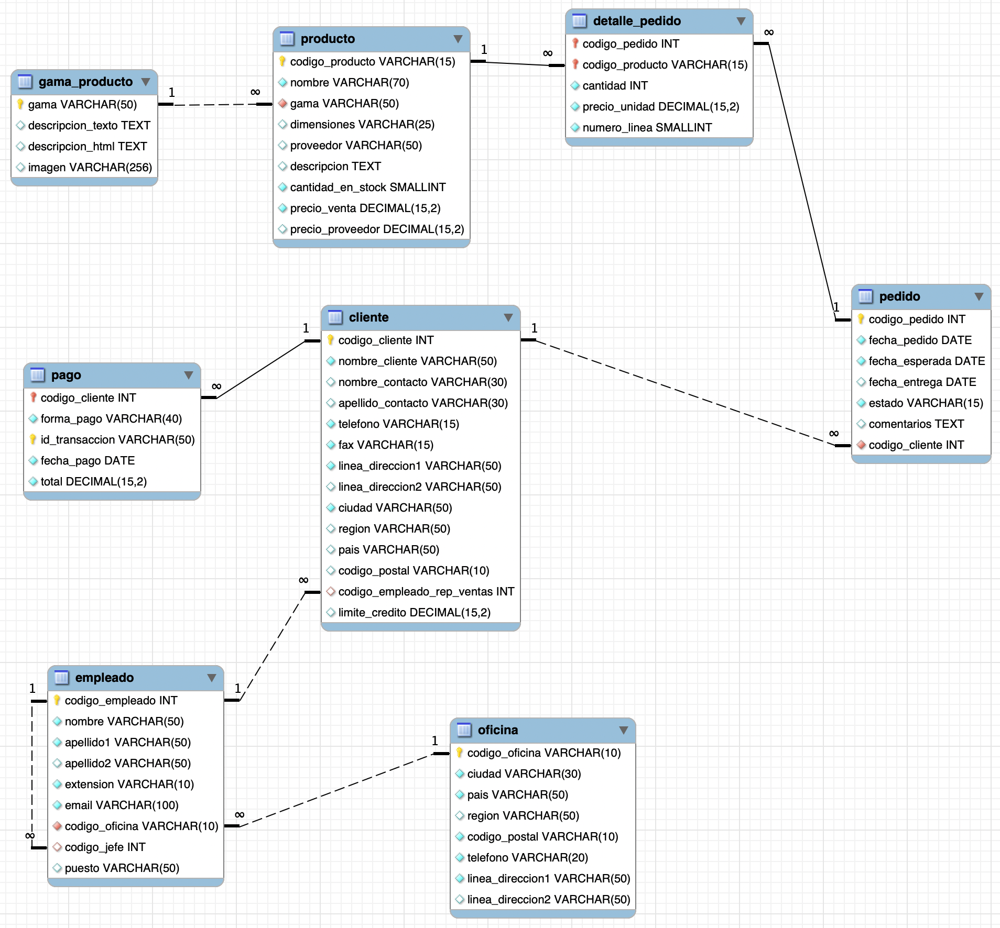

# **Actividad 402**

> **📌 Entrega**
> 

> - La entrega será un **fichero `.sql`** con el script DDL de la actividad.

> - El nombre del fichero debe ser `402_NombreApellidos.sql`.

> - Se deberá entregar en la tarea correspondiente de Aules en tiempo y forma.

> **📌 Se valorará**
> 

> Se valorará:

> - La correcta selección de los tipos de datos.

> - La correcta definición de las claves primarias.

> - La correcta definición de las claves ajenas y sus relaciones.

> - La correcta implantación de las restricciones (`NOT NULL`, `DEFAULT`, etc.).

> - El resultado obtenido al ejecutar el script.

> Esta actividad servirá para calificar:

> - RA2: Crea bases de datos definiendo su estructura y las características de sus elementos según el modelo relacional.

>   - CE2. a) Se ha analizado el formato de almacenamiento de la información. (5%)

>   - CE2. b) Se han creado las tablas y las relaciones entre ellas. (5%)

>   - CE2. c) Se han seleccionado los tipos de datos adecuados. (5%)

>   - CE2. d) Se han definido los campos clave en las tablas. (5%)

>   - CE2. e) Se han implantado las restricciones reflejadas en el diseño lógico. (5%)

## **Diseño físico - Jardinería**

Crea las instrucciones DDL para crear la base de datos **jardinería** a partir del modelo lógico que se muestra a continuación.

> **📌 Tablas del modelo**
> 

> El modelo lógico contiene las tablas: **oficina**, **empleado**, **gama_producto**, **cliente**, **pedido**, **producto**, **detalle_pedido** y **pago**.

> **📌 Recuerda**
> 

> Debes definir, para cada tabla:

> - La **clave primaria** (`PRIMARY KEY`).

> - Las **claves ajenas** (`FOREIGN KEY`), indicando la tabla a la que referencian.

> - Los campos que **no pueden ser nulos** (`NOT NULL`).

> - Los **valores por defecto** (`DEFAULT`) cuando sea necesario.

## **Se pide**

1. Escribe el script DDL completo: el `CREATE DATABASE` (con juego de caracteres `utf8mb4`) y el `CREATE TABLE` de cada tabla del modelo.

1. Ejecuta el script en tu MySQL y comprueba que se ha creado correctamente (`SHOW TABLES;` y `DESCRIBE` sobre las tablas).

1. Entrega el fichero `402_NombreApellidos.sql`.
