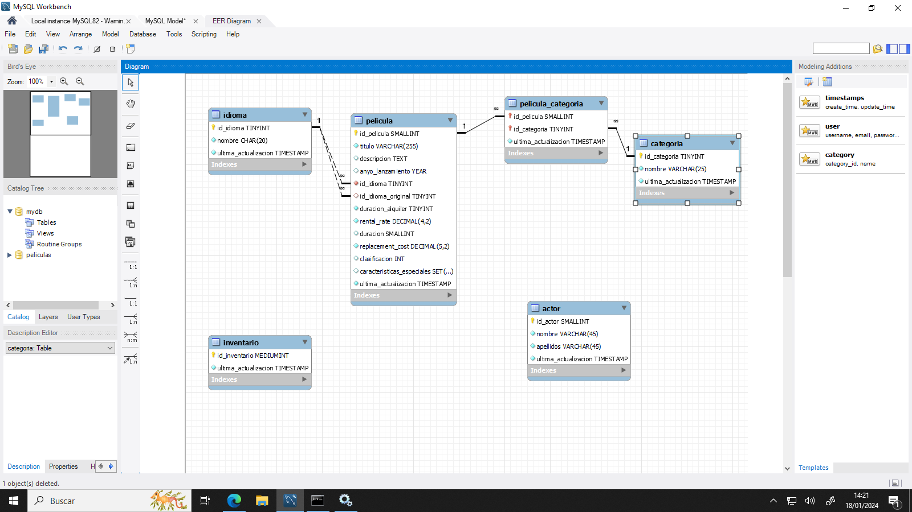

# **Actividad 405**

> **📌 Entrega**
> 

> - La entrega será un **fichero `.sql`** con el script completo de la actividad (creación de la base de datos y todas las modificaciones `ALTER`).

> - El nombre del fichero debe ser `405_NombreApellidos.sql`.

> - Se deberá entregar en la tarea correspondiente de Aules en tiempo y forma.

> **📌 Se valorará**
> 

> Se valorará:

> - La correcta traducción del diagrama E/R a SQL.

> - La correcta utilización de `ALTER TABLE` para añadir, modificar y eliminar columnas.

> - La correcta creación de claves ajenas y de tablas de relación.

> - El uso adecuado de los tipos `ENUM` y `SET`.

> - El resultado obtenido al ejecutar el script.

> Esta actividad servirá para calificar:

> - RA2: Crea bases de datos definiendo su estructura y las características de sus elementos según el modelo relacional.

>   - CE2. a) Se ha analizado el formato de almacenamiento de la información. (5%)

>   - CE2. b) Se han creado las tablas y las relaciones entre ellas. (5%)

>   - CE2. c) Se han seleccionado los tipos de datos adecuados. (5%)

>   - CE2. d) Se han definido los campos clave en las tablas. (5%)

>   - CE2. e) Se han implantado las restricciones reflejadas en el diseño lógico. (5%)

## **Diseño físico - Películas**

A partir del siguiente diagrama E/R:

> **📌 Tablas del modelo**
> 

> El diagrama contiene las tablas: **actor**, **categoria**, **idioma**, **pelicula**, **pelicula_categoria** e **inventario**.

Realiza los siguientes ejercicios en MySQL:

1. Pasa el diagrama anterior a SQL y lanza el script en la base de datos.

1. Incluye la columna `edad` en la tabla `actor`. La columna nueva deberá estar después de `apellidos`. El dato será `int` y no podrá ser `null`.

1. Deberás eliminar la columna `apellidos` y crear las columnas `apellido1` y `apellido2`. Las columnas estarán después de `nombre` y serán de tipo `varchar(45)` y no pueden ser nulas.

1. Incluye en la tabla `inventario` la relación con la tabla `pelicula`. Crea la columna `id_pelicula`, no podrá ser `null`. Crea la *foreign key* para la relación.

1. Crea la tabla que relaciona la tabla `peliculas` y la tabla `actores`. La tabla deberá tener 3 columnas, una para la relación con `actor`, otra para la relación con `pelicula` y otra que se llame `ultima_actualizacion` de tipo `TIMESTAMP`.

1. Modifica la columna `nombre` de la tabla `categoria` para que sea un `varchar(50)`.

1. Modifica la columna `duracion_alquiler` de la tabla `pelicula` para que su tipo sea `INT` y valor por defecto `3`.

1. Modifica el tipo de dato de la columna `clasificacion` de la tabla `pelicula`. Deberá ser un enumerado con los posibles valores `'G', 'PG', 'PG-13', 'R', 'NC-17'` y por defecto `'G'`.

1. Modifica el tipo de dato de la columna `caracteristicas_especiales` de la tabla `pelicula`. Deberás hacer un `SET('Trailers', 'Commentaries', 'Deleted Scenes', 'Behind the Scenes')`.

> **📌 Recuerda**
> 

> Para comprobar la estructura de las tablas tras cada modificación puedes utilizar `DESCRIBE nombre_tabla;` o `SHOW CREATE TABLE nombre_tabla;`.
