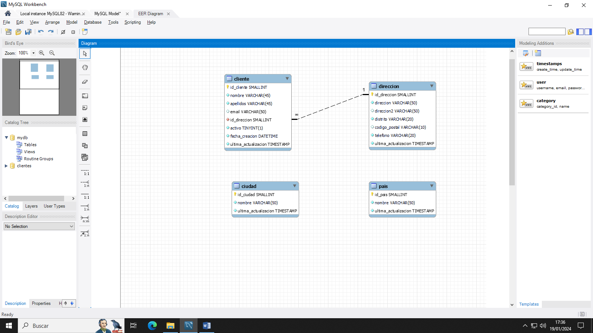

# **Actividad 406**

> **📌 Entrega**
> 

> - La entrega será un **fichero `.sql`** con el script completo de la actividad (creación de la base de datos y todas las modificaciones `ALTER`).

> - El nombre del fichero debe ser `406_NombreApellidos.sql`.

> - Se deberá entregar en la tarea correspondiente de Aules en tiempo y forma.

> **📌 Se valorará**
> 

> Se valorará:

> - La correcta traducción del diagrama E/R a SQL.

> - La correcta creación de las relaciones entre las tablas.

> - La correcta utilización de `ALTER TABLE` para añadir, modificar y eliminar columnas.

> - La correcta selección de los tipos de datos.

> - El resultado obtenido al ejecutar el script.

> Esta actividad servirá para calificar:

> - RA2: Crea bases de datos definiendo su estructura y las características de sus elementos según el modelo relacional.

>   - CE2. a) Se ha analizado el formato de almacenamiento de la información. (5%)

>   - CE2. b) Se han creado las tablas y las relaciones entre ellas. (5%)

>   - CE2. c) Se han seleccionado los tipos de datos adecuados. (5%)

>   - CE2. d) Se han definido los campos clave en las tablas. (5%)

>   - CE2. e) Se han implantado las restricciones reflejadas en el diseño lógico. (5%)

## **Diseño físico - Clientes**

A partir del siguiente diagrama E/R:

> **📌 Tablas del modelo**
> 

> El diagrama contiene las tablas: **pais**, **ciudad**, **direccion** y **cliente**.

Realiza los siguientes ejercicios en MySQL:

1. Pasa el diagrama anterior a SQL y lanza el script en la base de datos.

1. Relaciona la tabla `ciudad` con la tabla `direccion`.

1. Relaciona la tabla `pais` con la tabla `ciudad`.

1. Deberás eliminar la columna `apellidos` y crear las columnas `apellido1` y `apellido2` de la tabla `cliente`. Las columnas estarán después de `nombre` y serán de tipo `varchar(45)` y no pueden ser nulas.

1. Modifica la columna `distrito` de la tabla `direccion` para que sea un `varchar(50)`.

1. Incluye la columna `num_habitantes` como entero en la tabla `ciudad` y la tabla `pais`.

1. Modifica la columna `telefono` de tipo de dato `varchar` a `int`.

> **📌 Recuerda**
> 

> Para comprobar la estructura de las tablas tras cada modificación puedes utilizar `DESCRIBE nombre_tabla;` o `SHOW CREATE TABLE nombre_tabla;`.
