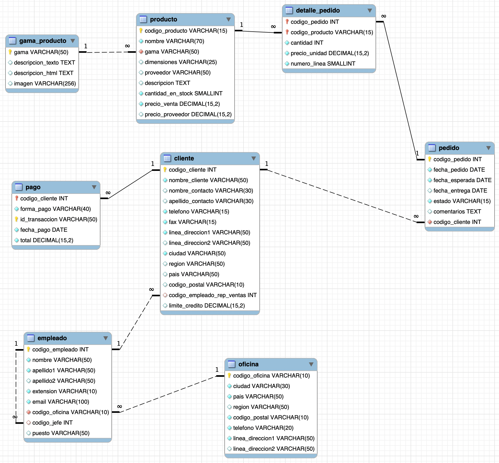
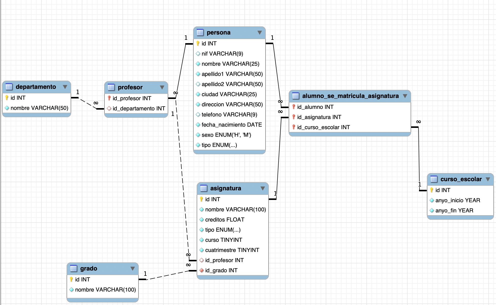
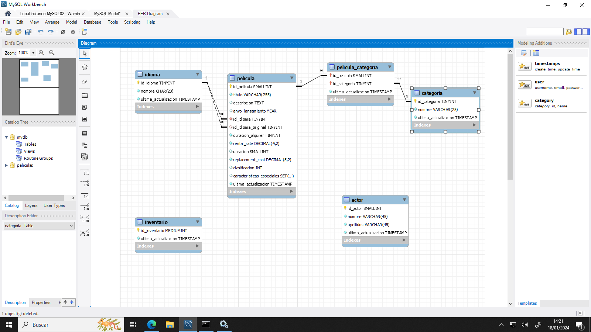
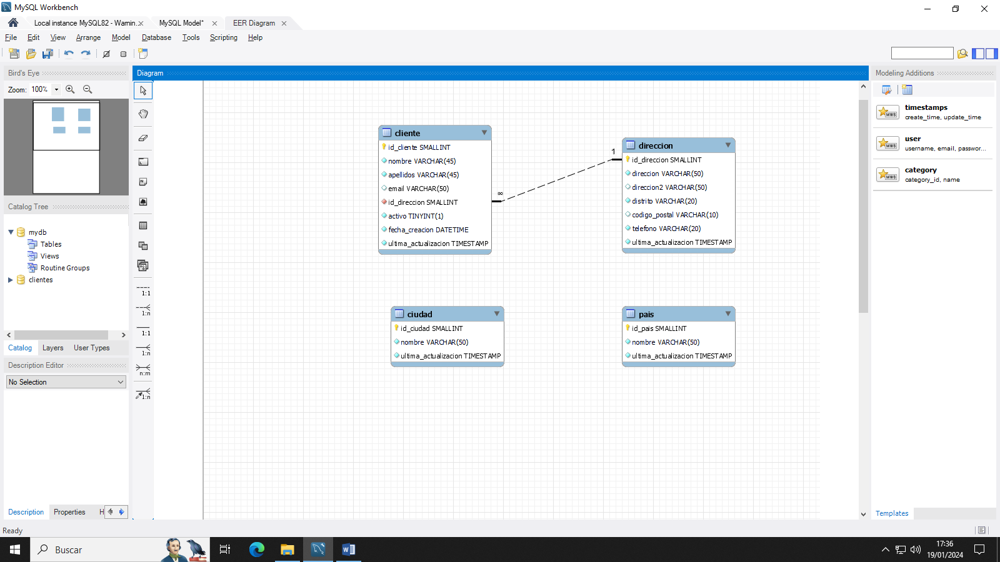

# Cuaderno Práctico de Actividades — UD4: Disseny Físic — Llenguatge SQL: DDL i DCL

<div class="interactive-progress-tracker">
  <div class="tracker-header">
    <span>🏆 <strong>Progreso de esta sección:</strong> <span class="tracker-count">0 de 4 superados (0%)</span></span>
    <span class="tracker-pts">⭐ <strong>0 puntos</strong></span>
  </div>
  <div class="tracker-bar">
    <div class="tracker-fill" style="width: 0%;"></div>
  </div>
</div>

En esta sección tienes acceso directo a todas las actividades prácticas, fichas de trabajo y retos evaluables de esta unidad didáctica. Puedes acceder a cada actividad individualmente o consultar la recopilación completa a continuación:

## 🗂️ Índice de Actividades de la Unidad

- **[⚡ Activitat 401](act401.html)**
- **[⚡ Activitat 402: Disseny físic - Jardineria](act402.html)**
- **[⚡ Activitat 403: Disseny físic - Universitat](act403.html)**
- **[⚡ Activitat 404: Llenguatge de Control de Dades (DCL)](act404.html)**
- **[⚡ Activitat 405: Disseny físic - Películas](act405.html)**
- **[⚡ Activitat 406: Disseny físic - Clients](act406.html)**

---

## Actividad 401

👉 *[Obrir aquesta activitat en pàgina individual](act401.html)*

# **Actividad 401**

> **📌 Entrega**
> 

> - El lliurament serà un **fitxer `.sql`** amb el script complet de l'activitat i una **captura de pantalla** on es comprove que es ha executat correctament.

> - El nombre del fichero debe ser `401_NombreApellidos.sql`.

> - Se deberá entregar en la tarea correspondiente de Aules en tiempo y forma.

> **📌 Se valorará:**
> 

> Es valorarà:

> - La claredat i l'ordre del codi.

> - La correcta selecció dels tipus de dades.

> - La correcta definició de les claus primàries i foranes.

> - La correcta implantació de les restriccions.

> - El resultat obtingut a l'executar el script.

> Esta actividad servirá para calificar:

> - RA2: Crea bases de dades definint la seua estructura i les característiques dels seus elements segons el model relacional.

>   - CE2. a) S'ha analitzat el format d'emmagatzematge de la informació. (5%)

>   - CE2. b) S'han creat les taules i les relacions entre elles. (5%)

>   - CE2. c) Es han seleccionat els tipus de dades adequats. (5%)

>   - CE2. d) S'han definit els camps clau en les taules. (5%)

>   - CE2. e) Es han implantat les restriccions reflectides en el disseny lògic. (5%)

> **📌 Objectiu**
> 

> Aquesta activitat és un **exemple guiat i complet** del disseny físic d'una base de dades: partint de l'enunciat obtindrem el model entitat/relació, el model físic i, finalment, el script SQL per a MySQL.

## **Enunciat: Gestió de vendes**

Tenim una fàbrica on volem controlar els comandes que realitzen els clients per mitjà del comercial.

Per a definir a un **client** necessitarem guardarnos el seu **nom i cognoms**, el seu **ciutat** i el seu **categoria**.

Per a definir un **comercial** necessitarem guardarnos el seu **nom i cognoms**, **ciutat** i el seu **comisió**.

Per a cada **comanda** es necessita saber la **data** i la **quantitat**.

## **Model entitat/relació**

El model entitat/relació de la base de dades és el següent:

- **client** (1) ── realitza ── (N) **comanda**

- **comercial** (1) ── gestiona ── (N) **comanda**

## **Model físic**

Del model entitat/relació obtenim el següent model relacional:

| Taula | Camps | Clau primària | Claus foranes |
| --- | --- | --- | --- |
| **client** | id, nom, apellido1, apellido2, ciutat, categoria | id |  |
| **comercial** | id, nom, apellido1, apellido2, ciutat, comisió | id |  |
| **comanda** | id, total, data, id_cliente, id_comercial | id | id_cliente → client(id), id_comercial → comercial(id) |

## **Base de dades per a MySQL**

> **📌 CREATE DATABASE vendes**
> 

```sql
DROP DATABASE IF EXISTS ventas;
CREATE DATABASE ventas CHARACTER SET utf8mb4;
USE ventas;
```

> **📌 CREATE TABLE client**
> 

```sql
CREATE TABLE cliente (
  id INT UNSIGNED AUTO_INCREMENT PRIMARY KEY,
  nombre VARCHAR(100) NOT NULL,
  apellido1 VARCHAR(100) NOT NULL,
  apellido2 VARCHAR(100),
  ciudad VARCHAR(100),
  categoría INT UNSIGNED
);
```

> **📌 CREATE TABLE comercial**
> 

```sql
CREATE TABLE comercial (
  id INT UNSIGNED AUTO_INCREMENT PRIMARY KEY,
  nombre VARCHAR(100) NOT NULL,
  apellido1 VARCHAR(100) NOT NULL,
  apellido2 VARCHAR(100),
  comisión FLOAT
);
```

> **📌 CREATE TABLE comanda**
> 

```sql
CREATE TABLE pedido (
  id INT UNSIGNED AUTO_INCREMENT PRIMARY KEY,
  total DOUBLE NOT NULL,
  fecha DATE,
  id_cliente INT UNSIGNED NOT NULL,
  id_comercial INT UNSIGNED NOT NULL,
  FOREIGN KEY (id_cliente) REFERENCES cliente(id),
  FOREIGN KEY (id_comercial) REFERENCES comercial(id)
);
```

## **Inserir les dades**

El script complet, amb les instruccions `INSERT` de les dades d'exemple, es troba en el fitxer vendes.sql.

## **Es demana**

1. Executa el script complet vendes.sql en el teu MySQL i comprova que les taules es creen correctament (`SHOW TABLES;` i `DESCRIBE pedido;`).

1. Explica amb les teues paraules què representa cada camp de la taula `pedido`.

1. Què tipus de dades es ha utilitzat per a `categoría`? I per a `comisión`? Per què creus que es ha triat eixe tipus?

1. Què ocorre si intentas inserir un `pedido` amb un `id_cliente` que no existeix? Pruébalo i justifica la resposta.

1. Lliurament el fitxer `401_NombreApellidos.sql` amb el script executat.

---

## Actividad 402: Disseny físic - Jardineria

👉 *[Obrir aquesta activitat en pàgina individual](act402.html)*

# **Actividad 402**

> **📌 Entrega**
> 

> - El lliurament serà un **fitxer `.sql`** amb el script DDL de l'activitat.

> - El nombre del fichero debe ser `402_NombreApellidos.sql`.

> - Se deberá entregar en la tarea correspondiente de Aules en tiempo y forma.

> **📌 Se valorará:**
> 

> Es valorarà:

> - La correcta selecció dels tipus de dades.

> - La correcta definició de les claus primàries.

> - La correcta definició de les claus foranes i les seues relacions.

> - La correcta implantació de les restriccions (`NOT NULL`, `DEFAULT`, etc.).

> - El resultat obtingut a l'executar el script.

> Esta actividad servirá para calificar:

> - RA2: Crea bases de dades definint la seua estructura i les característiques dels seus elements segons el model relacional.

>   - CE2. a) S'ha analitzat el format d'emmagatzematge de la informació. (5%)

>   - CE2. b) S'han creat les taules i les relacions entre elles. (5%)

>   - CE2. c) Es han seleccionat els tipus de dades adequats. (5%)

>   - CE2. d) S'han definit els camps clau en les taules. (5%)

>   - CE2. e) Es han implantat les restriccions reflectides en el disseny lògic. (5%)

## **Disseny físic - Jardineria**

Crea les instruccions DDL per a crear la base de dades **jardineria** a partir del model lògic que es mostra a continuació.



> **📌 Taules del model**
> 

> El model lògic conté les taules: **oficina**, **empleat**, **gama_producto**, **client**, **comanda**, **producte**, **detalle_pedido** i **pagament**.

> **📌 Recorda**
> 

> Has de definir, per a cada taula:

> - La **clau primària** (`PRIMARY KEY`).

> - Les **claus foranes** (`FOREIGN KEY`), indicant la taula a la que referencian.

> - Els camps que **no poden ser nuls** (`NOT NULL`).

> - Els **valors per defecte** (`DEFAULT`) quan siga necessari.

## **Es demana**

1. Escriu el script DDL complet: el `CREATE DATABASE` (amb joc de caràcters `utf8mb4`) i el `CREATE TABLE` de cada taula del model.

1. Executa el script en el teu MySQL i comprova que es ha creat correctament (`SHOW TABLES;` i `DESCRIBE` sobre les taules).

1. Lliurament el fitxer `402_NombreApellidos.sql`.

---

## Actividad 403: Disseny físic - Universitat

👉 *[Obrir aquesta activitat en pàgina individual](act403.html)*

# **Actividad 403**

> **📌 Entrega**
> 

> - El lliurament serà un **fitxer `.sql`** amb el script DDL de l'activitat.

> - El nombre del fichero debe ser `403_NombreApellidos.sql`.

> - Se deberá entregar en la tarea correspondiente de Aules en tiempo y forma.

> **📌 Se valorará:**
> 

> Es valorarà:

> - La correcta selecció dels tipus de dades.

> - L'ús adequat dels tipus `ENUM` quan el requiera el model.

> - La correcta definició de les claus primàries.

> - La correcta definició de les claus foranes i les seues relacions.

> - La correcta implantació de les restriccions.

> - El resultat obtingut a l'executar el script.

> Esta actividad servirá para calificar:

> - RA2: Crea bases de dades definint la seua estructura i les característiques dels seus elements segons el model relacional.

>   - CE2. a) S'ha analitzat el format d'emmagatzematge de la informació. (5%)

>   - CE2. b) S'han creat les taules i les relacions entre elles. (5%)

>   - CE2. c) Es han seleccionat els tipus de dades adequats. (5%)

>   - CE2. d) S'han definit els camps clau en les taules. (5%)

>   - CE2. e) Es han implantat les restriccions reflectides en el disseny lògic. (5%)

## **Disseny físic - Universitat**

Crea les instruccions DDL per a crear la base de dades **universitat** a partir del model lògic que es mostra a continuació.



> **📌 Taules del model**
> 

> El model lògic conté les taules: **departament**, **persona**, **professor**, **grau**, **assignatura**, **curso_escolar** i **alumno_se_matricula_asignatura**.

> **📌 Enumerats**
> 

> - El camp `tipo` de la taula **persona** és un enumerat amb els valors (`profesor`, `alumno`).

> - El camp `tipo` de la taula **assignatura** és un enumerat amb els valors (`básica`, `obligatoria`, `optativa`).

> **📌 Recorda**
> 

> Has de definir, per a cada taula:

> - La **clau primària** (`PRIMARY KEY`).

> - Les **claus foranes** (`FOREIGN KEY`), indicant la taula a la que referencian.

> - Els camps que **no poden ser nuls** (`NOT NULL`).

> - Els camps amb valors **únics** (`UNIQUE`) quan el model l'indique.

## **Es demana**

1. Escriu el script DDL complet: el `CREATE DATABASE` (amb joc de caràcters `utf8mb4`) i el `CREATE TABLE` de cada taula del model.

1. Executa el script en el teu MySQL i comprova que es ha creat correctament.

1. Lliurament el fitxer `403_NombreApellidos.sql`.

---

## Actividad 404: Llenguatge de Control de Dades (DCL)

👉 *[Obrir aquesta activitat en pàgina individual](act404.html)*

# **Actividad 404**

> **📌 Entrega**
> 

> - El lliurament serà un **document** que continga la resposta a cada un dels exercicis: les instruccions SQL utilitzades i l'eixida obtenida en cada cas (pots copiar les consultes i realitzar capturas de pantalla).

> - El nombre del fichero debe ser `404_NombreApellidos.pdf`.

> - Se deberá entregar en la tarea correspondiente de Aules en tiempo y forma.

> **📌 Se valorará:**
> 

> Es valorarà:

> - La correcta creació d'usuaris.

> - La correcta assignació i revocació de privilegis.

> - La correcta utilització dels nivells de privilegi (global, base de dades, taula i columna).

> - La correcta comprovació dels permisos mitjançant `SHOW GRANTS`.

> Esta actividad servirá para calificar:

> - RA2: Crea bases de dades definint la seua estructura i les característiques dels seus elements segons el model relacional.

>   - CE2. g) S'han creat els usuaris i es els han assignat privilegis. (5%)

>   - CE2. h) S'han utilitzat assistents, eines gràfiques i els llenguatges de definició i control de dades. (5%)

## **Llenguatge de Control de Dades (DCL)**

Per a realitzar aquesta activitat necesitarás la base de dades **futbol**. Pots descarregar el script que la crea en futbol.sql.

> **📌 Recorda**
> 

> Recorda que en MySQL un usuari s'identifica mitjançant `usuario@host`, per exemple `'root'@'localhost'`.

Realitza els següents exercicis en MySQL:

1. Crea un usuari `'tengopermisos'` i otórgale permisos perquè puga crear usuaris.

1. Connectat com `'tengopermisos'`, crea un nou usuari `'user1'`.

1. Connectat com `root`, otórgale permisos a l'usuari `'user1'` perquè puga consultar les taules de les bases de dades.

1. Connectat com `root`, mostra els permisos que té l'usuari `'user1'`.

1. Connectat com `'user1'`, mostra els permisos que posseeix i comprova que són els mateixos de l'ordre anterior.

1. Connectat com `root`, otorga permís de creació i esborrat de taules a l'usuari `'user1'` sobre la base de dades `jardinería`.

1. Connectat com `root`, crea un usuari de nom `'creartablas'` que tinga permisos per a crear, esborrar i modificar taules de la base de dades `fútbol`.

1. Connectat com `'creartablas'`, crea una taula senzilla d'almenys dos columnes. Les columnes es llamarán `estadio` i haurà de tindre un `nombre_estadio varchar(25)`, que serà la *primary key*, i un altre camp que serà `ciudad varchar(25)` i que per defecte serà `null`.

1. Connectat com `root`, crea un usuari de nom `'accesoglobal'` que puga realitzar operacions de selecció i inserció sobre totes les taules de totes les bases de dades.

1. Connectat com `'accesoglobal'`, afegeix una fila a la taula `futbol.estadios`. Intenta esborrar la fila creada.

1. Connectat com `root`, crea un usuari de nom `'accesolocal'` que puga seleccionar totes les taules de la base de dades anterior.

1. Conéctate com `'accesolocal'` i comprova que pots seleccionar la fila `futbol.estadios.nombre_estadio`.

1. Connectat com `root`, crea un usuari de nom `'accesolimitado'` que puga realitzar operacions d'inserció, actualització i selecció sobre la primera columna de la taula `futbol.estadios`.

1. Conéctate com `'accesolimitado'` i comprova que tens els permisos executant les ordres SQL `SELECT`, `UPDATE` e `INSERT`. Comprova què permisos tens.

1. Connectat com `root`, revoca tots els permisos de l'usuari `'user1'`.

1. Connectat com `'user1'`, valida que no pots realitzar cap acció.

1. Connectat com `root`, revoca el permís de modificar les taules de la base de dades `fútbol` de l'usuari `'creartablas'`.

1. Connectat com `'creartablas'`, intenta incloure una nova columna en la taula `futbol.estadios`.

---

## Actividad 405: Disseny físic - Películas

👉 *[Obrir aquesta activitat en pàgina individual](act405.html)*

# **Actividad 405**

> **📌 Entrega**
> 

> - El lliurament serà un **fitxer `.sql`** amb el script complet de l'activitat (creació de la base de dades i totes les modificacions `ALTER`).

> - El nombre del fichero debe ser `405_NombreApellidos.sql`.

> - Se deberá entregar en la tarea correspondiente de Aules en tiempo y forma.

> **📌 Se valorará:**
> 

> Es valorarà:

> - La correcta traducció del diagrama E/R a SQL.

> - La correcta utilització de `ALTER TABLE` per a afegir, modificar i eliminar columnes.

> - La correcta creació de claus foranes i de taules de relació.

> - L'ús adequat dels tipus `ENUM` i `SET`.

> - El resultat obtingut a l'executar el script.

> Esta actividad servirá para calificar:

> - RA2: Crea bases de dades definint la seua estructura i les característiques dels seus elements segons el model relacional.

>   - CE2. a) S'ha analitzat el format d'emmagatzematge de la informació. (5%)

>   - CE2. b) S'han creat les taules i les relacions entre elles. (5%)

>   - CE2. c) Es han seleccionat els tipus de dades adequats. (5%)

>   - CE2. d) S'han definit els camps clau en les taules. (5%)

>   - CE2. e) Es han implantat les restriccions reflectides en el disseny lògic. (5%)

## **Disseny físic - Películas**

A partir del següent diagrama E/R:



> **📌 Taules del model**
> 

> El diagrama conté les taules: **actor**, **categoria**, **idioma**, **pelicula**, **pelicula_categoria** e **inventari**.

Realitza els següents exercicis en MySQL:

1. Passa el diagrama anterior a SQL i llança el script en la base de dades.

1. Inclou la columna `edad` en la taula `actor`. La columna nova haurà d'estar després de `apellidos`. El dada serà `int` i no podrà ser `null`.

1. Hauràs d'eliminar la columna `apellidos` i crear les columnes `apellido1` i `apellido2`. Les columnes estaran després de `nombre` i seran de tipus `varchar(45)` i no poden ser nulas.

1. Inclou en la taula `inventario` la relació amb la taula `pelicula`. Crea la columna `id_pelicula`, no podrà ser `null`. Crea la *foreign key* per a la relació.

1. Crea la taula que relaciona la taula `peliculas` i la taula `actores`. La taula haurà de tindre 3 columnes, una per a la relació amb `actor`, una altra per a la relació amb `pelicula` i una altra que es anomene `ultima_actualizacion` de tipus `TIMESTAMP`.

1. Modifica la columna `nombre` de la taula `categoria` perquè siga un `varchar(50)`.

1. Modifica la columna `duracion_alquiler` de la taula `pelicula` perquè el seu tipus siga `INT` i valor per defecte `3`.

1. Modifica el tipus de dada de la columna `clasificacion` de la taula `pelicula`. Haurà de ser un enumerat amb els possibles valors `'G', 'PG', 'PG-13', 'R', 'NC-17'` i per defecte `'G'`.

1. Modifica el tipus de dada de la columna `caracteristicas_especiales` de la taula `pelicula`. Hauràs de fer un `SET('Trailers', 'Commentaries', 'Deleted Scenes', 'Behind the Scenes')`.

> **📌 Recorda**
> 

> Per a comprovar l'estructura de les taules després de cada modificació pots utilitzar `DESCRIBE nombre_tabla;` o `SHOW CREATE TABLE nombre_tabla;`.

---

## Actividad 406: Disseny físic - Clients

👉 *[Obrir aquesta activitat en pàgina individual](act406.html)*

# **Actividad 406**

> **📌 Entrega**
> 

> - El lliurament serà un **fitxer `.sql`** amb el script complet de l'activitat (creació de la base de dades i totes les modificacions `ALTER`).

> - El nombre del fichero debe ser `406_NombreApellidos.sql`.

> - Se deberá entregar en la tarea correspondiente de Aules en tiempo y forma.

> **📌 Se valorará:**
> 

> Es valorarà:

> - La correcta traducció del diagrama E/R a SQL.

> - La correcta creació de les relacions entre les taules.

> - La correcta utilització de `ALTER TABLE` per a afegir, modificar i eliminar columnes.

> - La correcta selecció dels tipus de dades.

> - El resultat obtingut a l'executar el script.

> Esta actividad servirá para calificar:

> - RA2: Crea bases de dades definint la seua estructura i les característiques dels seus elements segons el model relacional.

>   - CE2. a) S'ha analitzat el format d'emmagatzematge de la informació. (5%)

>   - CE2. b) S'han creat les taules i les relacions entre elles. (5%)

>   - CE2. c) Es han seleccionat els tipus de dades adequats. (5%)

>   - CE2. d) S'han definit els camps clau en les taules. (5%)

>   - CE2. e) Es han implantat les restriccions reflectides en el disseny lògic. (5%)

## **Disseny físic - Clients**

A partir del següent diagrama E/R:



> **📌 Taules del model**
> 

> El diagrama conté les taules: **pais**, **ciutat**, **direccion** i **client**.

Realitza els següents exercicis en MySQL:

1. Passa el diagrama anterior a SQL i llança el script en la base de dades.

1. Relaciona la taula `ciudad` amb la taula `direccion`.

1. Relaciona la taula `pais` amb la taula `ciudad`.

1. Hauràs d'eliminar la columna `apellidos` i crear les columnes `apellido1` i `apellido2` de la taula `cliente`. Les columnes estaran després de `nombre` i seran de tipus `varchar(45)` i no poden ser nulas.

1. Modifica la columna `distrito` de la taula `direccion` perquè siga un `varchar(50)`.

1. Inclou la columna `num_habitantes` com enter en la taula `ciudad` i la taula `pais`.

1. Modifica la columna `telefono` de tipus de dada `varchar` a `int`.

> **📌 Recorda**
> 

> Per a comprovar l'estructura de les taules després de cada modificació pots utilitzar `DESCRIBE nombre_tabla;` o `SHOW CREATE TABLE nombre_tabla;`.

---


---

## 🎮 Retos Interactivos de Autoevaluación (+100 XP)

Comprueba tu dominio sobre **Cuaderno Completo de Actividades — UD4** superando estos 4 retos gamificados (+25 puntos cada uno):

<div class="interactive-mcq" data-answer="B" data-hint="ALTER TABLE modifica l'estructura (DDL), mentre que UPDATE modifica les files de dades (DML).">
  <div class="mcq-question">🎯 <strong>Reto 1 (+25 pts):</strong> Quina sentència del subllenguatge SQL DDL s'utilitza per a modificar l'estructura d'una taula existent (afegir columnes o restriccions)?</div>
  <div class="mcq-options">
    <button type="button" class="btn-mcq-opt" data-opt="A">A) UPDATE TABLE</button>
    <button type="button" class="btn-mcq-opt" data-opt="B">B) ALTER TABLE</button>
    <button type="button" class="btn-mcq-opt" data-opt="C">C) MODIFY ROW</button>
    <button type="button" class="btn-mcq-opt" data-opt="D">D) SELECT INTO</button>
  </div>
  <div class="quiz-feedback"></div>
</div>

<div class="interactive-mcq" data-answer="B" data-hint="CASCADE propaga l'esborrament o l'actualització des de la taula pare cap a les files vinculades de la taula filla.">
  <div class="mcq-question">🎯 <strong>Reto 2 (+25 pts):</strong> Quin efecte té l'opció <code>ON DELETE CASCADE</code> definida sobre una clau forana (<code>FOREIGN KEY</code>) en SQL?</div>
  <div class="mcq-options">
    <button type="button" class="btn-mcq-opt" data-opt="A">A) Impedeix esborrar qualsevol fila de la taula pare llançant un error.</button>
    <button type="button" class="btn-mcq-opt" data-opt="B">B) Quan s'esborra una fila de la taula referenciada (pare), s'esborren automàticament les files relacionades de la taula filla.</button>
    <button type="button" class="btn-mcq-opt" data-opt="C">C) Esborra tota la base de dades si queda una taula buida.</button>
    <button type="button" class="btn-mcq-opt" data-opt="D">D) Converteix la clau primària en un camp de text variable.</button>
  </div>
  <div class="quiz-feedback"></div>
</div>

<div class="interactive-vf" data-answer="V" data-hint="UNIQUE garanteix la unicitat dels valors d'una columna o grup de columnes (clau alternativa).">
  <div class="vf-statement">✅ <strong>Repte 3 (Vertader o Fals · +25 pts):</strong> La restricció <code>UNIQUE</code> en SQL permet assegurar que no hi haja dos valors iguals en una columna, tot i no ser la clau primària.</div>
  <div class="vf-buttons">
    <button type="button" class="btn-vf" data-opt="V">Vertader (V)</button>
    <button type="button" class="btn-vf" data-opt="F">Fals (F)</button>
  </div>
  <div class="quiz-feedback" style="width: 100%;"></div>
</div>

<div class="interactive-quiz" data-answer="drop table|drop" data-hint="És la sentència DROP TABLE.">
  <div class="quiz-question">⌨️ <strong>Repte 4 (+25 pts):</strong> Quina sentència SQL DDL s'utilitza per a eliminar completament una taula (tant les dades com la seua estructura del diccionari)?</div>
  <div class="quiz-controls">
    <input type="text" class="quiz-input" placeholder="Escriu la resposta..." />
    <button type="button" class="btn-quiz-check">Comprovar</button>
  </div>
  <div class="quiz-feedback"></div>
</div>

### 📋 Llista de Comprovació i Rúbrica d'Assoliment

Marca cada criteri a mesura que completes l'estudi o la resolució pràctica d'aquesta pàgina (**Cuaderno Completo de Actividades — UD4**):

- [ ] He llegit detingudament la teoria o l'enunciat d'aquesta secció i he anotat els conceptes clau.
- [ ] He revisat els esquemes, taules o blocs de codi i he verificat que sé aplicar-los a l'entorn de treball.
- [ ] He resolt correctament els **4 reptes interactius** superiors obtenint els **100 puntos XP**.
- [ ] He descarregat el comprovant oficial en PDF per a adjuntar-lo a la tasca d'**Aules**.

<div class="aules-delivery-card">
  <h3>📤 Comprovant de Lliurament per a Aules</h3>
  <p>Quan hages completat els reptes interactius i la llista d'autoavaluació d'aquesta pàgina, introdueix el teu nom i descarrega el teu certificat oficial en PDF per a adjuntar-lo a la tasca d'<strong>Aules</strong>.</p>
  <div class="aules-student-field">
    <label for="aules-student-name">👤 Nom i Cognoms de l'Alumne/a:</label>
    <input type="text" id="aules-student-name" class="aules-student-name" placeholder="Ex: Joan Garcia Pérez" />
  </div>
  <div class="aules-score-badge">
    <span class="aules-score-count">0/4 reptes completats (0%) · 0 puntos · 0/4 criteris d'autoavaluació</span>
  </div>
  <div class="aules-actions">
    <button type="button" class="btn-aules-dl" data-module="BBDD" data-unit="UD04" data-activity="activitats">📥 Descarregar Comprovant PDF</button>
    <button type="button" class="btn-aules-copy">📋 Copiar Resum al Porta-retalls</button>
  </div>
  <div class="aules-toast"></div>
</div>
