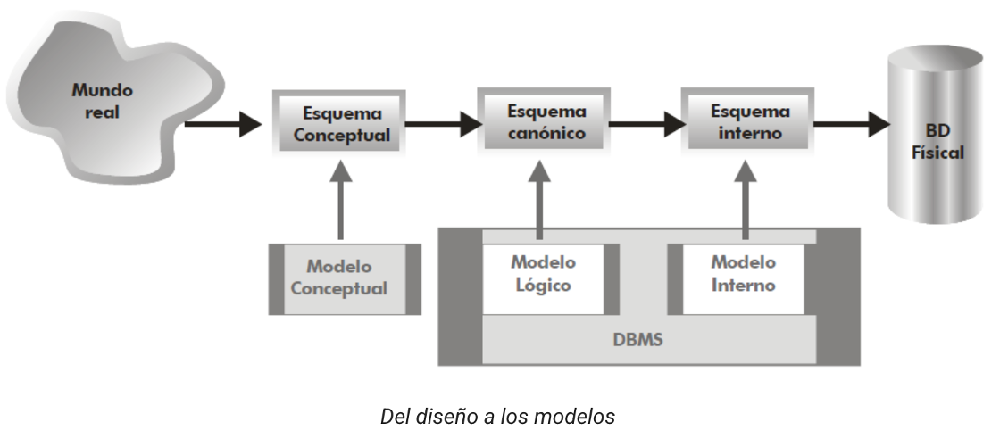
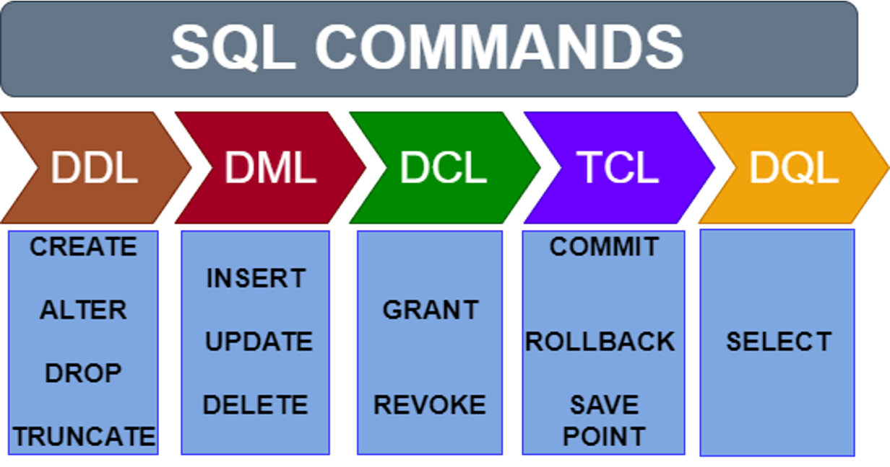
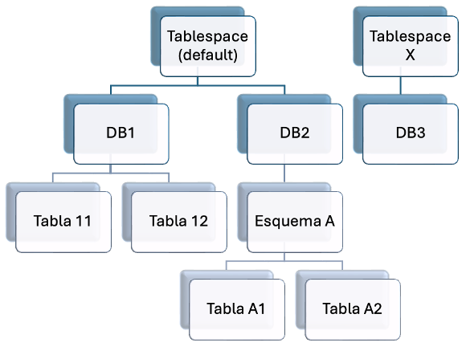
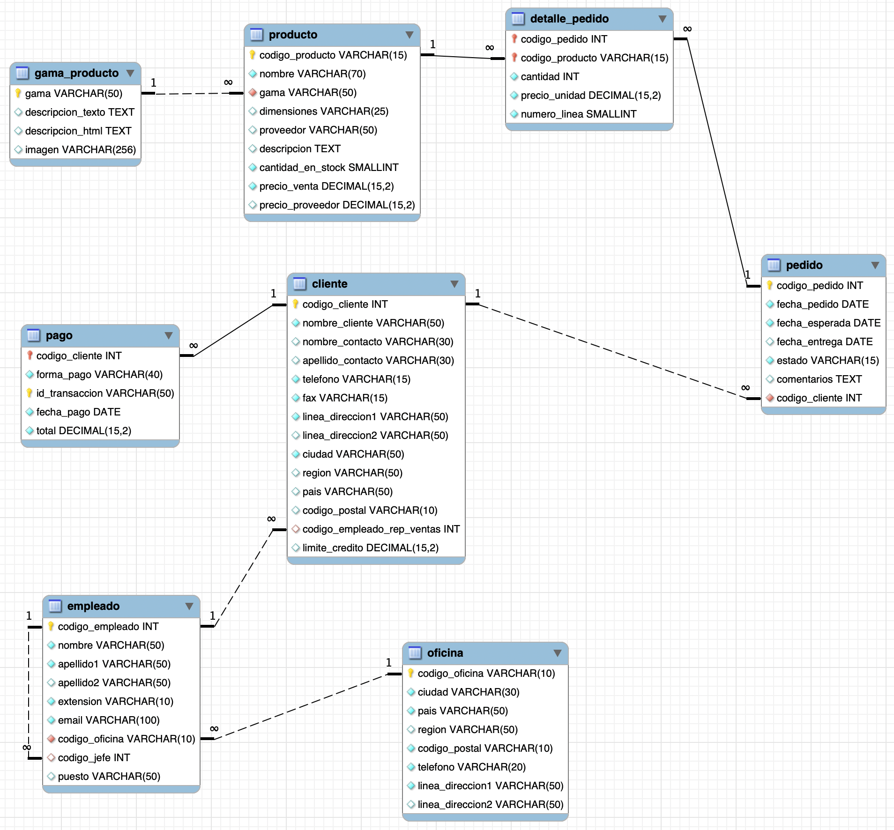
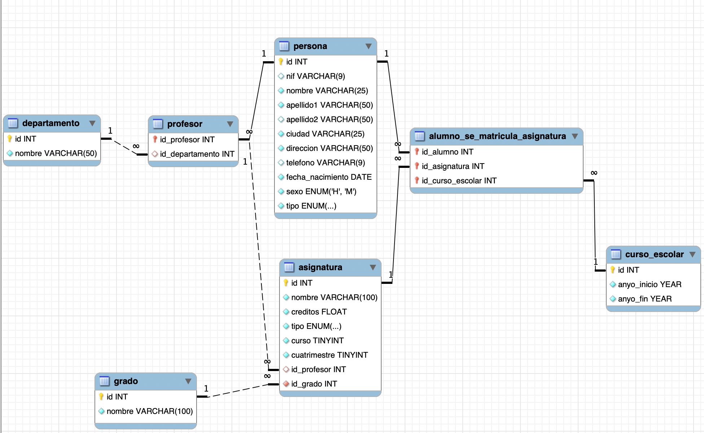
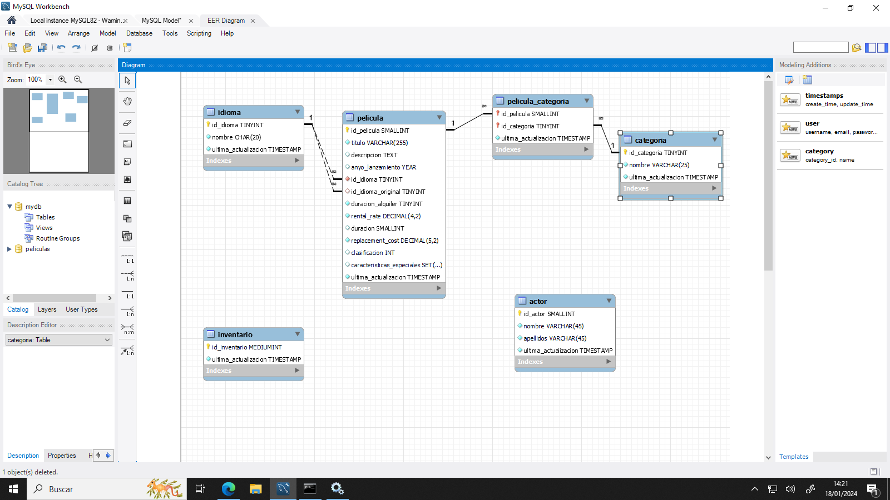
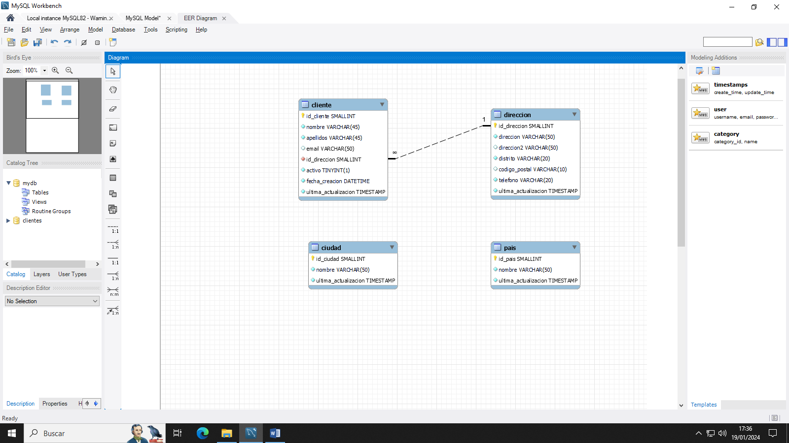

# UD4: Diseño Físico — Lenguaje SQL: DDL y DCL

Bienvenido/a a la **UD4: Diseño Físico — Lenguaje SQL: DDL y DCL** del módulo profesional de **Bases de Datos** (1º DAW / DAM / ASIX · Bases de Datos).

En esta unidad encontrarás los contenidos teóricos, ejemplos prácticos, ejercicios resueltos y actividades de evaluación curricular desarrollados por el profesor **Manuel Alonso Argente**.

---

### 📑 Índice de Apartados y Actividades de la Unidad

- [**📋 4.0 Propuesta Didáctica: Diseño Físico. Modelo Físico. (DDL y DCL)**](./ut0400.html)
- [**4.1 Introducción**](./ut0401.html)
- [**4.2 Almacenamiento de la información**](./ut0402.html)
- [**4.3 Tipos de datos (Dominios)**](./ut0403.html)
- [**4.4 DDL (Data Definition Language)**](./ut0404.html)
- [**4.5 DCL (Data Control Language)**](./ut0405.html)

**Actividades Prácticas y Fichas de Trabajo:**

- [**✏️ ACT401 401**](./act_act401.html)
- [**✏️ ACT402 402**](./act_act402.html)
- [**✏️ ACT403 403**](./act_act403.html)
- [**✏️ ACT404 404**](./act_act404.html)
- [**✏️ ACT405 405**](./act_act405.html)
- [**✏️ ACT406 406**](./act_act406.html)

---

# 📖 Vista Completa de la Unidad

## 4.0 Propuesta Didáctica — Diseño Físico. Modelo Físico. (DDL y DCL)

# **Diseño Físico. Modelo Físico. (DDL y DCL)**

## **Propuesta didáctica**

Una vez conocido el modelo relacional, en esta unidad vamos a comenzar a trabajar el RA2:
**"Crea bases de datos definiendo su estructura y las características de sus elementos según el modelo relacional"**.

## **Criterios de evaluación**

### **Respecto al RA2**:

| Código | Descripción | Peso (%) | Herramientas Evaluación |
| --- | --- | --- | --- |
| **CE2a** | Se ha analizado el formato de almacenamiento de la información. | 10% | ACT401 (5%) -- ACT402 (5%) -- ACT403 (5%) -- ACT405 (5%) -- ACT406 (5%) -- EXA201 (75%) |
| **CE2b** | Se han creado las tablas y las relaciones entre ellas. | 15% | ACT401 (5%) -- ACT402 (5%) -- ACT403 (5%) -- ACT405 (5%) -- ACT406 (5%) -- EXA201 (75%) |
| **CE2c** | Se han seleccionado los tipos de datos adecuados. | 10% | ACT401 (5%) -- ACT402 (5%) -- ACT403 (5%) -- ACT405 (5%) -- ACT406 (5%) -- EXA201 (75%) |
| **CE2d** | Se han definido los campos clave en las tablas. | 15% | ACT401 (5%) -- ACT402 (5%) -- ACT403 (5%) -- ACT405 (5%) -- ACT406 (5%) -- EXA201 (75%) |
| **CE2e** | Se han implantado las restricciones reflejadas en el diseño lógico. | 15% | ACT401 (5%) -- ACT402 (5%) -- ACT403 (5%) -- ACT405 (5%) -- ACT406 (5%) -- EXA201 (75%) |
| **CE2g** | Se han creado los usuarios y se les han asignado privilegios. | 15% | ACT404 (5%) -- EXA201 (95%) |
| **CE2h** | Se han utilizado asistentes, herramientas gráficas y los lenguajes de definición y control de datos. | 10% | ACT404 (5%) -- EXA201 (95%) |

## **Contenidos**

### **Modelo Físico: SQL - Instrucciones DDL y DML**:

- Introducción.

- Almacenamiento.

- Tipos básicos de dominio.

- Creación, Eliminación y modificación de objetos de una BBDD. (DDL).

- Lenguaje de control de datos (DCL).

> **📌 Cuestionario inicial**
> 

> 1. ¿Cuál es el propósito de las sentencias DDL?

> 1. ¿Y DML?

> 1. ¿Cómo averiguamos tanto las tablas de una base de datos como su estructura?

> 1. ¿Para qué sirve el comando `CREATE TABLE`?

> 1. ¿Qué diferencia `CREATE TYPE` de `CREATE DOMAIN`?

> 1. A la hora de crear una tabla, ¿Dónde definiremos la clave primaria? ¿Y las restricciones de valor no nulo?

> 1. ¿Qué restricciones SQL podemos aplicar sobre las columnas?

> 1. ¿Por qué es mejor definir las restricciones al final de cada tabla mediante la keyword `CONSTRAINT`?

> 1. ¿Cómo puedo ejecutar un script SQL, que tengo almacenado en un archivo, de una sola vez?

> 1. ¿Puedo eliminar las tablas en cualquier orden mediante `DROP TABLE`?

> 1. ¿Es obligatorio que una clave ajena siempre referencia a una clave primaria?

> 1. ¿Para qué sirve el comando `INSERT INTO`?

> 1. ¿Qué sucede si omitimos el `WHERE` en un `DELETE FROM`?

## **Programación de Aula (15 sesiones)**

Esta unidad es la cuarta, con lo que se imparte en la segunda evaluación, a finales de noviembre y principios de diciembre, con una duración estimada de 15 sesiones lectivas:

### **Noviembre 2026**

| Lunes | Martes | Miércoles | Jueves | Viernes | Sábado | Domingo |
| --- | --- | --- | --- | --- | --- | --- |
|  |  |  |  |  |  | **1 🛑** |
| 2 | 3 | 4 | 5 | 6 | **7 🛑** | **8 🛑** |
| 9 | 10 | 11 | 12 | 13 | **14 🛑** | **15 🛑** |
| 16 | 17 | 18 | 19 | 20 | **21 🛑** | **22 🛑** |
| 23 | **24 📚** | **25 📚** | 26 | **27 📚** | **28 🛑** | **29 🛑** |
| 30 |  |  |  |  |  |  |

### **Diciembre 2026**

| Lunes | Martes | Miércoles | Jueves | Viernes | Sábado | Domingo |
| --- | --- | --- | --- | --- | --- | --- |
|  | **1 📚** | **2 📚** | 3 | **4 📚** | **5 🛑** | **6 🛑** |
| **7 🛑** | **8 🛑** | **9 📚** | 10 | **11 📚** | **12 🛑** | **13 🛑** |
| 14 | **15 📚** | 16 | 17 | 18 | **19 🛑** | **20 🛑** |
| 21 | **22 🛑** | **23 🛑** | **24 🛑** | **25 🛑** | **26 🛑** | **27 🛑** |
| **28 🛑** | **29 🛑** | **30 🛑** | **31 🛑** |  |  |  |

| Sesión | Contenidos | Actividades | Criterios trabajados |
| --- | --- | --- | --- |
| 1 | Introducción. Lenguaje SQL |  | CE2a |
| 2 | Almacenamiento de la Información |  | CE2a |
| 3 | Tipos de Datos (Dominios) |  | CE2b |
| 4 | DDL | ACT401 | CE2b, CE2d, CE2e |
| 5 | DDL | ACT402 -- ACT403 | CE2b, CE2d, CE2e |
| 6 | DDL | ACT405 -- ACT406 | CE2b, CE2d, CE2e |
| 7 | DDL | ACT405 -- ACT406 | CE2b, CE2d, CE2e |
| 8 | DCL | ACT404 | CE2g, CE2h |
| 9 | DCL |  | CE2g, CE2h |
| 10 | DCL | ACT404 | CE2g, CE2h |
| 11 | Actividades | ACT401 -- ACT402 -- ACT403 -- ACT404 -- ACT405 -- ACT406 | CE2a, CE2b, CE2c, CE2d, CE2e, CE2g, CE2h |
| 11 | Actividades | ACT401 -- ACT402 -- ACT403 -- ACT404 -- ACT405 -- ACT406 | CE2a, CE2b, CE2c, CE2d, CE2e, CE2g, CE2h |
| 11 | Actividades | ACT401 -- ACT402 -- ACT403 -- ACT404 -- ACT405 -- ACT406 | CE2a, CE2b, CE2c, CE2d, CE2e, CE2g, CE2h |
| 14 | Actividades | EXA0401 | CE2a, CE2b, CE2c, CE2d, CE2e, CE2g, CE2h |
| 15 | Actividades | EXA0401 | CE2a, CE2b, CE2c, CE2d, CE2e, CE2g, CE2h |

---

## 4.1 Introducción

# **Introducción**

Hasta ahora hemos estudiado cómo analizar un problema y cómo representar la información mediante modelos conceptuales y relacionales. Sin embargo, estos modelos todavía no pueden ser utilizados directamente por un Sistema Gestor de Bases de Datos (SGBD).



El siguiente paso consiste en transformar el **modelo lógico** en una estructura que pueda ser creada y gestionada por un SGBD concreto. Este proceso recibe el nombre de **diseño físico**.

El diseño físico es la última etapa del proceso de diseño de una base de datos y consiste en definir cómo se almacenarán realmente los datos, qué tipos de datos utilizarán los atributos, qué restricciones garantizarán la integridad y qué características propias del gestor de bases de datos serán necesarias.

> **📌 Diseño físico**
> 

> El **modelo físico** es la traducción del **modelo lógico** a un esquema que puede ser interpretado por un SGBD específico mediante instrucciones SQL.

Durante esta unidad trabajaremos utilizando **MySQL**, aunque la mayoría de los conceptos estudiados son comunes al resto de sistemas gestores relacionales.

## **Lenguaje SQL**

Para poder comunicarnos con un SGBD utilizaremos **SQL (Structured Query Language)**. SQL es un **lenguaje específico de dominio** (*Domain Specific Language - DSL*) diseñado para crear, modificar, consultar y administrar bases de datos relacionales.

A través de SQL podremos:

- Crear bases de datos.

- Crear tablas.

- Definir relaciones entre ellas.

- Insertar datos.

- Consultar información.

- Modificar registros.

- Eliminar información.

- Gestionar usuarios y permisos.

> **📌 ¿Por qué SQL es un DSL?**
> 

> Un **DSL (Domain Specific Language)** es un lenguaje creado para resolver problemas de un dominio concreto.

> SQL está diseñado exclusivamente para trabajar con bases de datos.

## **Los sublenguajes de SQL**

Aunque solemos hablar simplemente de **SQL**, realmente el lenguaje se divide en varios grupos de instrucciones según la función que realizan.



| Sub lenguaje | Actúa sobre | Objetivo | ¿Qué permite hacer? | Instrucciones principales | Ejemplos de uso |
| --- | --- | --- | --- | --- | --- |
| **DDL** (Data Definition Language) | La estructura de la base de datos | Definir y modificar la **estructura** de la base de datos. | Crear, modificar y eliminar bases de datos, tablas, índices y otros objetos. | `CREATE` `ALTER` `DROP` `RENAME` `TRUNCATE` | Crear una base de datos, añadir una columna, eliminar una tabla. |
| **DML** (Data Manipulation Language) | Los datos de las tablas | Manipular los **datos** almacenados en las tablas. | Insertar, modificar y eliminar registros. | `INSERT` `UPDATE` `DELETE` | Añadir un alumno, modificar un precio, borrar un pedido. |
| **DQL** (Data Query Language) | Los datos de las tablas | Consultar la información almacenada en la base de datos. | Recuperar, filtrar, ordenar, agrupar y realizar cálculos sobre los datos. | `SELECT` | Consultar los alumnos de una provincia, ordenar productos por precio, calcular la nota media. |
| **DCL** (Data Control Language) | Los usuarios y permisos | Controlar la **seguridad** y los permisos de acceso. | Crear usuarios, asignar y revocar permisos, gestionar roles. | `GRANT` `REVOKE` | Permitir que un usuario consulte una base de datos o eliminar sus permisos. |
| **TCL** (Transaction Control Language) | Las transacciones | Gestionar las **transacciones** realizadas sobre la base de datos. | Confirmar cambios, deshacer operaciones y crear puntos de recuperación. | `COMMIT` `ROLLBACK` `SAVEPOINT` | Confirmar una venta, deshacer una actualización errónea o volver a un punto de control. |

## **Palabras reservadas de SQL**

Al igual que ocurre en cualquier lenguaje de programación, SQL dispone de un conjunto de **palabras reservadas** que tienen un significado propio y forman parte de la sintaxis del lenguaje.

Estas palabras no deberían utilizarse como nombres de tablas, columnas o bases de datos, salvo que el SGBD permita delimitarlas mediante caracteres especiales.

| Palabra | Descripción |
| --- | --- |
| `SELECT` | Recupera información |
| `FROM` | Indica la tabla de origen |
| `WHERE` | Filtra registros |
| `GROUP BY` | Agrupa resultados |
| `ORDER BY` | Ordena resultados |
| `HAVING` | Filtra grupos |
| `INSERT` | Inserta registros |
| `UPDATE` | Modifica registros |
| `DELETE` | Elimina registros |
| `CREATE` | Crea objetos |

| Palabra | Descripción |
| --- | --- |
| `ALTER` | Modifica objetos |
| `DROP` | Elimina objetos |
| `PRIMARY KEY` | Define la clave primaria |
| `FOREIGN KEY` | Define una clave ajena |
| `UNIQUE` | Evita valores duplicados |
| `NOT NULL` | Impide valores nulos |
| `DEFAULT` | Establece un valor por defecto |
| `CHECK` | Define una validación |
| `AND` | Conjunción lógica |
| `OR` | Disyunción lógica |

| Palabra | Descripción |
| --- | --- |
| `NOT` | Niega una condición |
| `IN` | Comprueba pertenencia |
| `BETWEEN` | Comprueba un intervalo |
| `LIKE` | Busca mediante patrones |
| `IS NULL` | Comprueba valores nulos |
| `COUNT` | Cuenta registros |
| `SUM` | Suma valores |
| `AVG` | Calcula la media |
| `MIN` | Obtiene el valor mínimo |
| `MAX` | Obtiene el valor máximo |

> **📌 Importante**
> 

> Evita utilizar palabras reservadas como nombres de tablas o columnas.

> Por ejemplo, una tabla llamada **ORDER** o una columna llamada **SELECT** puede provocar errores o dificultar la escritura de consultas.

---

## 4.2 Almacenamiento de la información

# **Almacenamiento de la información**

Una vez diseñada la estructura lógica de una base de datos, el siguiente paso consiste en decidir **cómo se almacenarán físicamente los datos** dentro del Sistema Gestor de Bases de Datos (SGBD).

Aunque para el usuario una base de datos parezca un único archivo, internamente está formada por diferentes elementos que permiten organizar la información de forma eficiente.

Entre los aspectos más importantes del almacenamiento encontramos:

- El motor de almacenamiento.

- La organización lógica de la base de datos.

- La organización física de los datos.

- Los juegos de caracteres.

- La colación.

## **Motores de almacenamiento**

Los **motores de almacenamiento** (*Storage Engines*) son los componentes encargados de gestionar cómo se almacenan, organizan y recuperan los datos dentro del SGBD. En **MySQL**, cada tabla puede utilizar un motor diferente, aunque normalmente toda la base de datos utiliza el mismo. Cada motor está diseñado para un tipo concreto de aplicaciones.

### **Motores más utilizados en MySQL**

#### **InnoDB**

Es el motor de almacenamiento predeterminado en las versiones actuales de MySQL.

**Características:**

- Soporta transacciones (**ACID**).

- Permite claves ajenas (**Foreign Key**).

- Utiliza bloqueo a nivel de fila.

- Ofrece una elevada integridad de los datos.

- Es adecuado para aplicaciones con muchas operaciones de inserción y actualización.

> **📌 Recomendación**
> 

> En la mayoría de aplicaciones actuales se recomienda utilizar **InnoDB**, ya que proporciona mayor seguridad e integridad de los datos.

#### **MyISAM**

Durante muchos años fue el motor predeterminado de MySQL.

Actualmente ha quedado prácticamente sustituido por InnoDB debido a sus limitaciones.

**Características:**

- No soporta transacciones.

- No permite claves ajenas.

- Está optimizado para consultas de lectura.

- Resulta más rápido en determinadas consultas simples.

> **📌 Limitaciones**
> 

> MyISAM no resulta recomendable cuando la integridad referencial o las transacciones son importantes.

#### **Otros motores**

MySQL dispone además de otros motores especializados para situaciones concretas.

| Motor | Uso principal |
| --- | --- |
| **Memory** | Tablas temporales almacenadas en memoria RAM |
| **Aria** | Recuperación rápida y consultas de solo lectura |
| **TokuDB** | Grandes volúmenes de información con compresión |
| **ColumnStore** | Análisis de datos y Business Intelligence |

Aunque existen muchos más motores, durante este curso trabajaremos principalmente con **InnoDB**.

## **Jerarquía lógica de una base de datos**

Desde el punto de vista lógico, una base de datos está formada por distintos niveles de organización.

La jerarquía utilizada en MySQL es la siguiente:



- **Tablespace o espacio de tablas**: constituye el nivel físico donde se almacenan los archivos que contienen la información. Habitualmente corresponde a uno o varios archivos del sistema operativo. Su función es almacenar: Tablas, Índices, Información interna del SGBD.

- **Base de datos**: representa el elemento lógico de nivel superior. Agrupa todos los objetos relacionados con una determinada aplicación. Por ejemplo: Instituto, Biblioteca, Hospital, Tienda Online.

- **Esquema**: agrupación lógica de una o más tablas (en MySQL un esquema es una base de datos).

- **Tabla**: representación de una tabla relacional, que contiene datos organizados en filas y columnas. Cada tabla pertenece a un base de datos específica, y sus datos se almacenan en el tablespace asociado.

- **Fila**: cada uno de los registros de la tabla.

- **Columna**:  Cada columna almacena un atributo de la tabla.

### **Organización física del almacenamiento**

En cambio, a nivel físico, el formato de almacenamiento depende principalmente del motor de almacenamiento que se esté utilizando, ya que cada motor tiene su propia manera de organizar y almacenar los datos. En MySQL con el motor InnoDB:

- Un bloque almacena los datos de tablas e índices mediante páginas (normalmente de 16 KB).

- Los bloques se almacenan en un archivo de tablespace (generalmente ibdata1 para bases de datos que comparten un tablespace, o en un archivo por tabla).

- Respecto a las filas, se almacenan utilizando un formato compacto o redondeado, dependiendo de la configuración. Cada fila contiene una clave primaria (o un índice que actúa como clave primaria) y los datos correspondientes.

### **Formato de las filas**

Las filas también poseen una estructura interna. Cada registro contiene la **clave primaria**, los valores de todas las **columnas** y la información utilizada por el motor para **localizar el registro**. Este formato depende del motor de almacenamiento utilizado.

## **Juegos de caracteres**

Cuando almacenamos texto en una base de datos, el SGBD necesita conocer **cómo representar cada carácter**. Para ello utiliza un **Juego de Caracteres** (*Character Set*). Un juego de caracteres define:

- Qué símbolos pueden almacenarse.

- Cómo se codifican.

- Cuántos bytes ocupa cada carácter.

### **Juegos de caracteres más habituales**

| Juego de caracteres | Características |
| --- | --- |
| ASCII | Caracteres básicos en inglés |
| ISO-8859-1 (Latin1) | Incluye caracteres occidentales y acentos |
| UTF-8 | Codificación Unicode ampliamente utilizada |
| UTF8MB4 | Implementación completa de UTF-8 en MySQL |

> **📌 Recomendación**
> 

> Actualmente se recomienda utilizar **utf8mb4**, ya que permite almacenar cualquier carácter Unicode, incluidos emojis y símbolos especiales.

### **Colación (Collation)**

La **colación** determina cómo se comparan y ordenan las cadenas de texto. Gracias a la colación, el SGBD puede decidir, por ejemplo:

- Si distingue mayúsculas y minúsculas.

- Cómo ordenar los caracteres acentuados.

- En qué posición debe aparecer la letra **ñ**.

### **Configuración del juego de caracteres en MySQL**

Al crear una base de datos es posible indicar el juego de caracteres y la colación que utilizará.

> **📌 CREAR BASE DE DATOS juego caracteres y colación**
> 

```sql
CREATE DATABASE instituto
CHARACTER SET utf8mb4
COLLATE utf8mb4_general_ci;
```

También es posible definirlos al crear una tabla.

> **📌 CREAR TABLA juego caracteres y colación**
> 

```sql
CREATE TABLE alumno (

    id INT PRIMARY KEY,

    nombre VARCHAR(100)

)

CHARACTER SET utf8mb4
COLLATE utf8mb4_unicode_ci;
```

Incluso una única columna puede utilizar una configuración diferente.

> **📌 CREAR COLUMNA juego caracteres y colación**
> 

```sql
CREATE TABLE alumno (

    id INT PRIMARY KEY,

    nombre VARCHAR(100)
        CHARACTER SET utf8mb4
        COLLATE utf8mb4_unicode_ci

);
```

### **Consultar la configuración**

MySQL permite consultar fácilmente el juego de caracteres y la colación utilizados.

> **📌 Consultar configuración**
> 

```sql
SHOW CREATE DATABASE instituto;

SHOW CREATE TABLE alumno;

SHOW VARIABLES LIKE 'character_set%';

SHOW VARIABLES LIKE 'collation%';
```

Estas instrucciones resultan muy útiles cuando trabajamos con bases de datos ya existentes y queremos conocer su configuración.

---

## 4.3 Tipos de datos (Dominios)

# **Tipos de datos (Dominios)**

Una vez diseñada la estructura de una tabla, el siguiente paso consiste en seleccionar el **tipo de dato** más adecuado para cada uno de sus atributos. El tipo de dato determina:

- El tipo de información que podrá almacenarse.

- El espacio ocupado en disco.

- El rango de valores permitidos.

- Las operaciones que podrán realizarse sobre ese campo.

Seleccionar correctamente el tipo de dato mejora el rendimiento de la base de datos, reduce el espacio utilizado y evita errores de integridad.

## **Clasificación de los tipos de datos**

MySQL agrupa los [tipos de datos](https://dev.mysql.com/doc/refman/8.0/en/data-types.html) en cinco grandes categorías:

- Tipos numéricos.

- Tipos de cadenas de caracteres.

- Tipos de fecha y hora.

- Tipos espaciales.

- Tipo JSON.

### **Tipos de datos numéricos**

Los tipos numéricos permiten almacenar números enteros y decimales. Su elección dependerá principalmente del rango de valores que necesitemos almacenar.

#### **Enteros**

| Tipo | Uso recomendado | Tamaño | Rango (con signo) | Rango (sin signo) |
| --- | --- | --- | --- | --- |
| TINYINT | Valores pequeños, estados, edades | 1 byte | -128 a 127 | 0 a 255 |
| SMALLINT | Cantidades moderadas | 2 bytes | -32.768 a 32.767 | 0 a 65.535 |
| MEDIUMINT | Entero mediano | 3 bytes | -8.388.608 a 8.388.607 | 0 a 16.777.215 |
| INT | Identificadores y valores generales | 4 bytes | -2.147.483.648 a 2.147.483.647 | 0 a 4.294.967.295 |
| BIGINT | Grandes cantidades o identificadores masivos | 8 bytes | -9.223.372.036.854.775.808 a 9.223.372.036.854.775.807 | 0 a 18.446.744.073.709.551.615 |

Si el número nunca será negativo puede utilizarse el modificador:

```sql
INT UNSIGNED
```

lo que permite duplicar el rango positivo disponible.

#### **Números decimales**

Cuando es necesario almacenar valores con decimales, MySQL ofrece varios tipos.

| Tipo | Uso recomendado | Tamaño | Rango (con signo) |
| --- | --- | --- | --- |
| DECIMAL(M,D) | Importes económicos, precios y datos que requieren precisión exacta | Variable | Hasta 65 cifras (30 decimales como máximo) |
| FLOAT | Mediciones aproximadas, datos científicos con menor precisión | 4 bytes | ±3,4 × 10³⁸ (≈ 7 cifras significativas) |
| DOUBLE | Cálculos científicos o estadísticos que requieren mayor precisión | 8 bytes | ±1,79 × 10³⁰⁸ (≈ 15 cifras significativas) |

### **Tipos de cadenas de caracteres**

Estos tipos almacenan texto. La principal diferencia entre ellos reside en el tamaño máximo y en si ocupan una longitud fija o variable.

| **Tipo de dato** | **Descripción** |
| --- | --- |
| CHAR(N) | Cadena de caracteres de longitud fija (**N** caracteres). |
| VARCHAR(N) | Cadena de caracteres de longitud variable (hasta **N** caracteres). |
| TEXT | Cadena de texto larga (hasta **65.535** caracteres). |
| TINYTEXT | Cadena de texto corta (hasta **255** caracteres). |
| MEDIUMTEXT | Cadena de texto mediana (hasta **16.777.215** caracteres). |
| LONGTEXT | Cadena de texto muy larga (hasta **4.294.967.295** caracteres). |
| BLOB | Almacena datos binarios (hasta **65.535** bytes). |
| TINYBLOB | Almacena datos binarios pequeños (hasta **255** bytes). |
| MEDIUMBLOB | Almacena datos binarios medianos (hasta **16.777.215** bytes). |
| LONGBLOB | Almacena datos binarios muy grandes (hasta **4.294.967.295** bytes). |
| BOOLEAN o BOOL | Usado para valores booleanos (`0` o `1`, `FALSE` o `TRUE`). |

### **Tipos de fecha y hora**

Permiten almacenar información temporal.

| Tipo | Formato | Ejemplo | Descripción |
| --- | --- | --- | --- |
| DATE | YYYY-MM-DD | 2005-11-18 | Fecha en formato YYYY-MM-DD. |
| TIME | HH:MM:SS | 08:15:00 | Solo el tiempo en formato HH:MM:SS. |
| DATETIME | YYYY-MM-DD HH:MM:SS | 2026-10-15 09:45:30 | Fecha y hora en formato YYYY-MM-DD HH:MM:SS. |
| TIMESTAMP | Marca temporal. YYYY-MM-DD HH:MM:SS | 2026-08-03 17:45:30 | Marca de tiempo, fecha y hora con un rango más limitado (1970-2038). |
| YEAR | YYYY | 2026 | Año en formato YYYY. |

### **Tipos espaciales**

MySQL incorpora varios tipos para trabajar con información geográfica. Estos tipos se utilizan principalmente en aplicaciones GIS (Sistemas de Información Geográfica).

| Tipo | Uso |
| --- | --- |
| POINT | Punto |
| LINESTRING | Línea |
| POLYGON | Polígono |
| GEOMETRY | Geometría genérica |
| GEOGRAPHY | Datos geográficos sobre la Tierra |

### **Tipo JSON**

Desde MySQL 5.7 existe un tipo específico para almacenar documentos JSON.

> **📌 CREATE TABLE**
> 

```sql
CREATE TABLE productos(
    id INT PRIMARY KEY,
    caracteristicas JSON
);
```

Ejemplo de contenido:

> **📌 JSON**
> 

```sql
{
"color":"Rojo",
"peso":3.5,
"garantia":true
}
```

El SGBD valida automáticamente que el contenido sea un documento JSON válido.

## **Creación de dominios**

Además de todos los tipos de datos vistos (y algunos más que se salen del alcance del curso), en algunos SGBD (por ejemplo, PostgreSQL sí que lo permite, pero MySQL no), podemos crear nuestros propios tipos de datos o dominios.

> **📌 CREATE DOMAIN**
> 

```sql
CREATE DOMAIN numero_positivo
AS INTEGER
CHECK (VALUE > 0);
```

Mediante CREATE TYPE podemos definir tipos de datos complejos, como tipos de registros, arrays o tipos compuestos de varios atributos. Por ejemplo, podemos crear un tipo de dato para almacenar coordenadas:

> **📌 CREATE TYPE**
> 

```sql
CREATE TYPE coordenada AS (
    x FLOAT,
    y FLOAT
);
```

## **Enumeraciones (ENUM)**

Cuando un atributo solo puede tomar un conjunto reducido de valores, MySQL permite utilizar el tipo `ENUM`.

Ejemplo:

> **📌 CREATE TABLE**
> 

```sql
CREATE TABLE empleado(
    id INT AUTO_INCREMENT PRIMARY KEY,
    nombre VARCHAR(100),
    estado ENUM(
        'Activo',
        'Inactivo',
        'Suspendido'
    ) NOT NULL
);
```

Solo podrán almacenarse esos tres valores. Si se intenta insertar otro distinto, como "Vacaciones", MySQL generará un error.

> **📌 ¿Cuándo utilizar 'ENUM'?**
> 

> Este tipo de dato los utilizaremos cuando los valores posibles son muy reducidos y cambian muy poco. Como por ejemplo, el estado de un pedido, el sexo de una persona, el nivel de acceso, los días de la semana o los tipos de usuario.

> No es recomendable utilizarlo para listas que cambian frecuentemente, ya que obligaría a modificar la estructura de la tabla.

---

## 4.4 DDL (Data Definition Language)

# **DDL (Data Definition Language)**

El **Lenguaje de Definición de Datos (DDL)** (*Data Definition Language*) es el conjunto de instrucciones SQL encargado de crear y modificar la estructura de una base de datos.

Con DDL podemos:

- Crear bases de datos.

- Crear tablas.

- Definir relaciones.

- Crear índices.

- Modificar la estructura de las tablas.

- Eliminar objetos de la base de datos.

A diferencia del DML, el DDL **no manipula los datos**, sino que trabaja sobre la estructura de la base de datos.

> **📌 DDL**
> 

> Las instrucciones DDL modifican el **esquema** de la base de datos, no la información almacenada.

## **Principales instrucciones DDL**

| Instrucción | Función |
| --- | --- |
| `CREATE` | Crear objetos |
| `ALTER` | Modificar objetos |
| `DROP` | Eliminar objetos |
| `RENAME` | Cambiar nombres |
| `TRUNCATE` | Vaciar una tabla |
| `COMMENT` | Añadir comentarios (según SGBD) |
| `SHOW` | Mostrar objetos |
| `DESCRIBE` | Mostrar la estructura de una tabla |

## **CREATE DATABASE**

La instrucción `CREATE DATABASE` crea una nueva base de datos.

> **📌 Sintaxis básica**
> 

```sql
CREATE DATABASE nombre_bd;
```

Normalmente también se especifica el **juego de caracteres** y la **colación**.

> **📌 CREATE DATABASE con juego de caracteres y colación**
> 

```sql
CREATE DATABASE instituto
CHARACTER SET utf8mb4
COLLATE utf8mb4_general_ci;
```

Una vez creada, seleccionaremos la base de datos con:

> **📌 Seleccionar la base de datos**
> 

```sql
USE instituto;
```

### **Comprobar las bases de datos existentes**

> **📌 Mostrar las bases de datos**
> 

```sql
SHOW DATABASES;
```

### **Ejemplo completo**

> **📌 Crear la base de datos 'peliculas'**
> 

```sql
CREATE DATABASE peliculas
CHARACTER SET utf8mb4
COLLATE utf8mb4_spanish2_ci;
USE peliculas;
```

## **CREATE TABLE**

Una vez creada la base de datos podemos comenzar a crear sus tablas.

La instrucción `CREATE TABLE` define completamente una tabla:

- Nombre.

- Columnas.

- Tipos de datos.

- Restricciones.

- Claves.

- Motor de almacenamiento.

> **📌 Sintaxis general**
> 

```sql
CREATE TABLE nombre_tabla(
    campo tipo,
    campo tipo,
    ...
);
```

### **Estructura general**

> **📌 Estructura completa de CREATE TABLE**
> 

```sql
CREATE TABLE tabla (
    campo1 TIPO
        [NOT NULL]
        [DEFAULT valor]
        [PRIMARY KEY]
        [UNIQUE],
    campo2 TIPO,
    ...

    CONSTRAINT nombre_restriccion ...
)
ENGINE = InnoDB;
```

### **Ejemplo de creación de una tabla**

> **📌 CREATE TABLE actor**
> 

```sql
CREATE TABLE actor(
    idActor INT PRIMARY KEY,
    nombreActor VARCHAR(30)
        COLLATE utf8mb4_spanish2_ci
        NOT NULL,
    nacionalidadActor INT
        NOT NULL
)
ENGINE = InnoDB
DEFAULT CHARSET = utf8mb4
COLLATE = utf8mb4_spanish2_ci;
```

En este ejemplo:

- `idActor` será la clave primaria.

- `nombreActor` no admite valores nulos.

- Se especifica una colación concreta.

- La tabla utilizará el motor **InnoDB**.

## **Claves primarias (PRIMARY KEY)**

Toda tabla debe disponer de una **clave primaria**.

Su función es identificar de forma única cada registro.

Una clave primaria:

- No admite valores repetidos.

- No admite valores NULL.

- Debe identificar unívocamente cada fila.

Existen 3 formas de definirla dependiendo de su posición o composición.

### **Forma 1: Como propiedad del atributo**

> **📌 PRIMARY KEY como propiedad**
> 

```sql
CREATE TABLE actor(
    idActor INT PRIMARY KEY,
    nombre VARCHAR(30),
    nacionalidad INT
);
```

Es la forma más sencilla.

### **Forma 2: Como restricción**

> **📌 PRIMARY KEY como restricción**
> 

```sql
CREATE TABLE actor(
    idActor INT,
    nombre VARCHAR(30),
    nacionalidad INT,
    CONSTRAINT pk_actor
        PRIMARY KEY(idActor)
);
```

Esta opción resulta más recomendable porque permite asignar un nombre a la restricción.

### **Clave primaria compuesta**

Cuando la clave está formada por varios atributos:

> **📌 Clave primaria compuesta**
> 

```sql
CREATE TABLE alquiler(
    dni VARCHAR(9),
    codPelicula INT,
    CONSTRAINT pk_alquiler
        PRIMARY KEY(
            dni,
            codPelicula
        )
);
```

## **AUTO_INCREMENT**

En muchas tablas resulta conveniente utilizar un identificador numérico que aumente automáticamente.

Para ello MySQL proporciona la propiedad:

> **📌 AUTO_INCREMENT**
> 

```sql
AUTO_INCREMENT
```

> **📌 Ejemplo con AUTO_INCREMENT**
> 

```sql
CREATE TABLE empleado(
    id INT AUTO_INCREMENT,
    nombre VARCHAR(100),
    puesto VARCHAR(50),
    CONSTRAINT pk_empleado
        PRIMARY KEY(id)
);
```

Cada nuevo registro recibirá automáticamente un identificador distinto.

> **📌 INSERT y comprobación del identificador**
> 

```sql
INSERT INTO empleado (nombre, puesto)
VALUES ('Juan Pérez', 'Gerente');

INSERT INTO empleado (nombre, puesto)
VALUES ('Ana López', 'Desarrolladora');
```

| id | nombre | puesto |
| --- | --- | --- |
| 1 | Juan Pérez | Gerente |
| 2 | Ana López | Desarrolladora |

> **📌 AUTO_INCREMENT**
> 

> El uso de `AUTO_INCREMENT` simplifica enormemente la creación de claves primarias.

## **Restricciones**

Las restricciones permiten garantizar la integridad de los datos.

Entre las más habituales encontramos:

- PRIMARY KEY

- FOREIGN KEY

- UNIQUE

- NOT NULL

- DEFAULT

- CHECK

### **NOT NULL**

Impide que una columna quede vacía.

> **📌 NOT NULL**
> 

```sql
nombre VARCHAR(100) NOT NULL
```

Si intentamos insertar un registro sin indicar dicho valor:

```sql
ERROR
```

### **DEFAULT**

Permite establecer un valor por defecto.

> **📌 DEFAULT**
> 

```sql
estado VARCHAR(20)
DEFAULT 'Pendiente'
```

Si el usuario no proporciona un valor:

```sql
Pendiente
```

será almacenado automáticamente.

### **UNIQUE**

Impide que existan valores repetidos. Cuando en el modelo relacional marcamos una propiedad como **clave única (UK)**, en el modelo físico la definimos con la propiedad `UNIQUE`.

> **📌 Ejemplo con UNIQUE**
> 

```sql
CREATE TABLE empleado(
    dni VARCHAR(9),
    nSegSocial VARCHAR(15),
    nombre VARCHAR(40),
    CONSTRAINT pk_empleado
        PRIMARY KEY(dni),
    CONSTRAINT uk_seg_social
        UNIQUE(nSegSocial)
);
```

Una diferencia importante respecto a la clave primaria es que:

- PRIMARY KEY → no admite NULL.

- UNIQUE → sí permite valores NULL (según el SGBD).

> **📌 Clave única vs clave primaria**
> 

> La principal diferencia entre una clave primaria y una clave única es que **la clave única permite valores nulos**.

### **FOREIGN KEY**

Las claves ajenas establecen relaciones entre tablas.

Una clave ajena siempre hace referencia a una **clave primaria** de otra tabla.

> **📌 Ejemplo con FOREIGN KEY**
> 

```sql
CREATE TABLE alquiler(
    dni VARCHAR(9),
    codPelicula INT,
    CONSTRAINT pk_alquiler
        PRIMARY KEY(
            dni,
            codPelicula
        ),
    CONSTRAINT fk_cliente
        FOREIGN KEY(dni)
        REFERENCES cliente(dni),
    CONSTRAINT fk_pelicula
        FOREIGN KEY(codPelicula)
        REFERENCES pelicula(cod)
);
```

> **📌 FOREIGN KEY**
> 

> Una **FOREIGN KEY** siempre referencia una **PRIMARY KEY** (o una clave única equivalente) de otra tabla.

### **Propagación de cambios**

Cuando una clave primaria cambia o desaparece, debemos decidir qué ocurrirá con las claves ajenas.

MySQL permite definir este comportamiento mediante:

- `ON DELETE`

- `ON UPDATE`

> **📌 Sintaxis general de la propagación**
> 

```sql
[CONSTRAINT [symbol]] FOREIGN KEY
    [index_name] (col_name, ...)
    REFERENCES tabla (col_name, ...)
    [ON DELETE reference_option]
    [ON UPDATE reference_option]

reference_option:
    RESTRICT | CASCADE | SET NULL | NO ACTION | SET DEFAULT
```

#### **NO ACTION**

Impide realizar la operación.

> **📌 ON DELETE NO ACTION**
> 

```sql
ON DELETE NO ACTION
```

Es el comportamiento por defecto si no indicamos nada.

#### **CASCADE**

Propaga automáticamente los cambios.

> **📌 ON DELETE CASCADE**
> 

```sql
ON DELETE CASCADE
```

Si se elimina el registro padre:

- También se eliminan todos los registros hijos.

#### **SET NULL**

> **📌 ON DELETE SET NULL**
> 

```sql
ON DELETE SET NULL
```

La clave ajena pasa a contener:

```sql
NULL
```

Perdiéndose la relación existente.

#### **RESTRICT**

No permite eliminar el registro mientras existan referencias.

> **📌 ON DELETE RESTRICT**
> 

```sql
ON DELETE RESTRICT
```

#### **SET DEFAULT**

Algunos SGBD permiten establecer un valor por defecto.

> **📌 ON DELETE SET DEFAULT**
> 

```sql
ON DELETE SET DEFAULT
```

> **📌 SET DEFAULT**
> 

> MySQL actualmente **no soporta** `SET DEFAULT`.

### **CHECK**

Permite validar que los datos cumplan determinadas condiciones.

> **📌 Ejemplo con CHECK**
> 

```sql
CREATE TABLE ingreso(
    codigo INT PRIMARY KEY,
    importe DECIMAL(11,2),
    CONSTRAINT ck_importe
        CHECK(
            importe > 0
            AND importe < 8000
        )
);
```

También puede comparar varias columnas.

> **📌 CHECK comparando dos columnas**
> 

```sql
CHECK(
    importe < importeMax
)
```

## **Índices**

Los índices permiten localizar registros mucho más rápidamente.

Funcionan de forma similar al índice de un libro.

- Sin índice: **Buscar registro** --> **Recorrer toda la tabla**

- Con índice: **Buscar registro** --> **Acceso directo**

### **¿Cuándo crear un índice?**

Resulta recomendable crear índices sobre columnas utilizadas frecuentemente en:

- `WHERE`

- `ORDER BY`

- `JOIN`

> **📌 Índices**
> 

> Para mejorar el rendimiento, podemos crear un índice para cada columna que se utiliza en la cláusula `WHERE` o en `ORDER BY`.

### **CREATE INDEX**

La instrucción `CREATE INDEX` se utiliza para crear índices en nuestras tablas.

> **📌 Sintaxis básica**
> 

```sql
CREATE INDEX nombre_indice
ON tabla(
    columna
);
```

### **Índice único**

> **📌 CREATE UNIQUE INDEX**
> 

```sql
CREATE UNIQUE INDEX uk_nia
ON alumnado(
    nia
);
```

No permitirá valores duplicados.

### **Ventajas de los índices**

- Aceleran las consultas.

- Mejoran la ordenación.

- Reducen el tiempo de búsqueda.

### **Inconvenientes**

- Ocupan espacio adicional.

- Hacen más lentas las inserciones y modificaciones.

- Deben utilizarse únicamente cuando sean necesarios.

> **📌 Resumen**
> 

> - `CREATE DATABASE` crea una nueva base de datos.

> - `CREATE TABLE` define tablas y sus columnas.

> - Toda tabla debe tener una **PRIMARY KEY**.

> - `AUTO_INCREMENT` genera identificadores automáticamente.

> - Las restricciones garantizan la integridad de los datos.

> - Las **FOREIGN KEY** establecen relaciones entre tablas.

> - Los índices mejoran el rendimiento de las consultas.

## **Modificación de la estructura de las bases de datos (DDL Avanzado)**

Hasta ahora hemos aprendido a crear bases de datos y tablas mediante la instrucción `CREATE`. Sin embargo, una vez creada una base de datos, es muy habitual que sea necesario modificar su estructura para adaptarla a nuevas necesidades.

El lenguaje **DDL** proporciona varias instrucciones que permiten modificar, renombrar, eliminar o vaciar los distintos objetos de una base de datos.

En este apartado estudiaremos las siguientes instrucciones:

- `ALTER`

- `DROP`

- `RENAME`

- `TRUNCATE`

### **ALTER TABLE**

La instrucción `ALTER TABLE` permite modificar la estructura de una tabla ya existente sin necesidad de eliminarla y volverla a crear.

Con ella podemos:

- Añadir columnas.

- Eliminar columnas.

- Modificar columnas.

- Añadir restricciones.

- Eliminar restricciones.

- Cambiar el nombre de columnas (según el SGBD).

> **📌 ¿Cuándo utilizar ALTER?**
> 

> Siempre que sea necesario modificar la estructura de una tabla sin perder los datos almacenados.

#### **Sintaxis general**

> **📌 Sintaxis general de ALTER TABLE**
> 

```sql
ALTER TABLE nombre_tabla
acción;
```

Las acciones más habituales son:

- `ADD`

- `MODIFY`

- `CHANGE`

- `DROP`

#### **Añadir columnas**

Para incorporar un nuevo atributo utilizaremos `ADD COLUMN`.

> **📌 Sintaxis ADD COLUMN**
> 

```sql
ALTER TABLE tabla
ADD COLUMN columna tipo;
```

> **📌 Ejemplo: añadir un alias artístico a 'actor'**
> 

```sql
ALTER TABLE actor
ADD COLUMN aliasActor VARCHAR(30);
```

La nueva estructura será:

| idActor | nombreActor | nacionalidadActor | aliasActor |
| --- | --- | --- | --- |
|  |  |  |  |

#### **Añadir varias columnas**

También es posible añadir varias columnas en una sola instrucción.

> **📌 Añadir varias columnas**
> 

```sql
ALTER TABLE actor
ADD COLUMN fechaNacimiento DATE,
ADD COLUMN salario DECIMAL(10,2);
```

#### **Modificar una columna**

Si queremos cambiar el tipo de dato, el tamaño o las restricciones de una columna utilizaremos `MODIFY`.

> **📌 Sintaxis MODIFY**
> 

```sql
ALTER TABLE tabla
MODIFY columna nuevo_tipo;
```

> **📌 Ejemplo: modificar el tamaño del apellido de un alumno**
> 

```sql
ALTER TABLE alumno
MODIFY apellidos VARCHAR(40)
NOT NULL;
```

#### **Modificar varias propiedades**

También es posible modificar simultáneamente:

- Tipo de dato.

- Longitud.

- Restricciones.

- Valor por defecto.

> **📌 Ejemplo: modificar varias propiedades**
> 

```sql
ALTER TABLE empleado
MODIFY salario DECIMAL(12,2)
DEFAULT 1200.00;
```

#### **Eliminar una columna**

Cuando un atributo deja de ser necesario podemos eliminarlo.

> **📌 Sintaxis DROP COLUMN**
> 

```sql
ALTER TABLE tabla
DROP COLUMN columna;
```

> **📌 Ejemplo: eliminar la columna 'aliasActor'**
> 

```sql
ALTER TABLE actor
DROP COLUMN aliasActor;
```

> **📌 Eliminar una columna**
> 

> Al eliminar una columna también desaparecen todos los datos almacenados en ella.

#### **Añadir restricciones**

Aunque normalmente las restricciones se crean junto con la tabla, también pueden incorporarse posteriormente mediante `ALTER TABLE`.

> **📌 Sintaxis general ADD CONSTRAINT**
> 

```sql
ALTER TABLE tabla
ADD CONSTRAINT nombre
tipo_restriccion;
```

> **📌 Ejemplo: añadir una clave ajena**
> 

```sql
ALTER TABLE empleado
ADD CONSTRAINT fk_oficina
FOREIGN KEY(oficina)
REFERENCES oficina(codigo);
```

Con esta instrucción se establece la relación entre ambas tablas.

#### **Eliminar restricciones**

También es posible eliminar una restricción existente.

> **📌 Eliminar una clave ajena**
> 

```sql
ALTER TABLE empleado
DROP FOREIGN KEY fk_oficina;
```

En MySQL es necesario indicar el nombre de la restricción.

### **DROP**

La instrucción `DROP` elimina completamente un objeto de la base de datos.

Puede utilizarse sobre:

- Bases de datos.

- Tablas.

- Índices.

- Vistas.

- Procedimientos.

- Triggers.

> **📌 Atención**
> 

> `DROP` elimina definitivamente el objeto y toda la información contenida en él.

#### **DROP DATABASE**

Elimina una base de datos completa.

> **📌 DROP DATABASE**
> 

```sql
DROP DATABASE instituto;
```

Si queremos evitar errores cuando no exista:

> **📌 DROP DATABASE IF EXISTS**
> 

```sql
DROP DATABASE IF EXISTS instituto;
```

#### **DROP TABLE**

Elimina completamente una tabla.

> **📌 DROP TABLE**
> 

```sql
DROP TABLE alumnado;
```

Al hacerlo desaparecen:

- Su estructura.

- Todos los registros.

- Sus índices.

- Sus restricciones.

#### **DROP INDEX**

También podemos eliminar un índice.

> **📌 Sintaxis DROP INDEX**
> 

```sql
DROP INDEX nombre_indice
ON nombre_tabla;
```

> **📌 Ejemplo: eliminar el índice único de 'alumnado'**
> 

```sql
DROP INDEX uk_nia
ON alumnado;
```

En algunos SGBD también es posible indicar:

> **📌 Otra forma de DROP INDEX**
> 

```sql
DROP INDEX alumnado.uk_nia;
```

### **RENAME**

La instrucción `RENAME` permite cambiar el nombre de distintos objetos de la base de datos.

Los más habituales son:

- Tablas.

- Índices.

#### **Renombrar una tabla**

> **📌 Sintaxis RENAME TABLE**
> 

```sql
RENAME TABLE
nombre_actual
TO
nuevo_nombre;
```

> **📌 Ejemplo: renombrar la tabla 'actor'**
> 

```sql
RENAME TABLE actor
TO artista;
```

A partir de ese momento todas las consultas deberán utilizar el nuevo nombre.

#### **Renombrar un índice**

En versiones recientes de MySQL también es posible cambiar el nombre de un índice.

> **📌 Ejemplo: renombrar un índice**
> 

```sql
ALTER TABLE alumnado
RENAME INDEX indice_valor_unico_NIA
TO NIA_UK;
```

Esto facilita trabajar con nombres más cortos y descriptivos.

### **TRUNCATE**

La instrucción `TRUNCATE` elimina **todos los registros** de una tabla.

> **📌 Sintaxis TRUNCATE**
> 

```sql
TRUNCATE TABLE nombre_tabla;
```

#### **¿Qué ocurre internamente?**

Aunque desde el punto de vista del usuario parece un borrado masivo, internamente MySQL realiza una operación similar a **DROP TABLE** --> **CREATE TABLE**

Por ello `TRUNCATE` pertenece al lenguaje **DDL** y no al **DML**.

#### **TRUNCATE vs DELETE**

Ambas instrucciones eliminan registros, pero existen diferencias importantes.

| Característica | DELETE | TRUNCATE |
| --- | --- | --- |
| Elimina registros | Sí | Sí |
| Elimina toda la tabla | No | No |
| Permite WHERE | Sí | No |
| Es más rápido | No | Sí |
| Reinicia AUTO_INCREMENT | No (habitualmente) | Sí |
| Pertenece a | DML | DDL |

> **📌 Ejemplo DELETE**
> 

```sql
DELETE
FROM alumno
WHERE provincia='Valencia';
```

Solo elimina algunos registros.

> **📌 Ejemplo TRUNCATE**
> 

```sql
TRUNCATE TABLE alumno;
```

Elimina todos los registros de la tabla.

### **SHOW**

La instrucción `SHOW` permite consultar información sobre la base de datos.

> **📌 Mostrar las bases de datos**
> 

```sql
SHOW DATABASES;
```

> **📌 Mostrar las tablas**
> 

```sql
SHOW TABLES;
```

> **📌 Mostrar la creación de una tabla**
> 

```sql
SHOW CREATE TABLE alumno;
```

> **📌 Mostrar la creación de una base de datos**
> 

```sql
SHOW CREATE DATABASE instituto;
```

### **DESCRIBE**

Permite consultar la estructura de una tabla.

> **📌 DESCRIBE**
> 

```sql
DESCRIBE alumno;
```

o bien

> **📌 DESC**
> 

```sql
DESC alumno;
```

Obtendremos información como:

- Nombre de la columna.

- Tipo de dato.

- Clave primaria.

- Valores nulos.

- Valor por defecto.

> **📌 Salida de DESCRIBE**
> 

```sql
+----------+--------------+------+-----+---------+-------+
| Campo    | Tipo         | Null | Key | Default | Extra |
+----------+--------------+------+-----+---------+-------+
| id       | int          | NO   | PRI |         |       |
| nombre   | varchar(100) | NO   |     |         |       |
| telefono | varchar(20)  | YES  |     |         |       |
+----------+--------------+------+-----+---------+-------+
```

## **Resumen**

> **📌 Ideas clave**
> 

> - `ALTER TABLE` permite modificar la estructura de una tabla existente.

> - `ADD`, `MODIFY` y `DROP COLUMN` son las operaciones más habituales.

> - `ADD CONSTRAINT` permite añadir restricciones posteriormente.

> - `DROP` elimina completamente un objeto de la base de datos.

> - `RENAME` cambia el nombre de tablas e índices.

> - `TRUNCATE` elimina todos los registros de una tabla de forma muy rápida.

> - `SHOW` y `DESCRIBE` permiten consultar la estructura de la base de datos y sus tablas.

> **📌 Buenas prácticas**
> 

> - Utiliza `ALTER TABLE` siempre que puedas antes de eliminar y volver a crear una tabla.

> - Antes de ejecutar un `DROP` o un `TRUNCATE`, asegúrate de disponer de una copia de seguridad.

> - Emplea `SHOW` y `DESCRIBE` para comprobar la estructura de las tablas antes de modificarlas.

---

## 4.5 DCL (Data Control Language)

# **DCL (Data Control Language)**

El **Lenguaje de Control de Datos (Data Control Language - DCL)** es el conjunto de instrucciones SQL encargado de gestionar la **seguridad** de una base de datos.

Mientras que el **DDL** define la estructura y el **DML** manipula los datos, el **DCL** controla **quién puede acceder a la información y qué operaciones puede realizar**.

Gracias al DCL es posible:

- Crear usuarios.

- Modificar usuarios.

- Eliminar usuarios.

- Asignar permisos.

- Revocar permisos.

- Gestionar la seguridad de la base de datos.

> **📌 Objetivo del DCL**
> 

> El DCL garantiza que **cada usuario solo pueda realizar las operaciones para las que ha sido autorizado**, protegiendo la integridad y confidencialidad de la información.

## **Usuarios**

Antes de asignar permisos es necesario crear los usuarios que accederán al sistema.

Cada usuario dispone de:

- Un nombre.

- Un equipo (host) desde el que puede conectarse.

- Una contraseña.

- Un conjunto de privilegios.

En MySQL un usuario se identifica mediante:

```sql
usuario@host
```

Por ejemplo:

```sql
profesor@localhost
```

o

```sql
administrador@192.168.1.10
```

### **CREATE USER**

La instrucción `CREATE USER` crea un nuevo usuario.

> **📌 Sintaxis básica**
> 

```sql
CREATE USER
'nombre_usuario'@'localhost'
IDENTIFIED BY 'contraseña';
```

> **📌 Ejemplo: crear el usuario 'profesor'**
> 

```sql
CREATE USER
'profesor'@'localhost'
IDENTIFIED BY 'abc123';
```

El usuario podrá conectarse a MySQL utilizando esas credenciales.

> **📌 Usuarios y permisos**
> 

> Crear un usuario **no implica que tenga permisos sobre ninguna base de datos**.

### **ALTER USER**

Permite modificar las características de un usuario existente.

Normalmente se utiliza para cambiar la contraseña.

> **📌 ALTER USER**
> 

```sql
ALTER USER
'profesor'@'localhost'
IDENTIFIED BY 'NuevaContraseña';
```

### **DROP USER**

Elimina completamente un usuario.

> **📌 DROP USER**
> 

```sql
DROP USER
'profesor'@'localhost';
```

Después de ejecutar esta instrucción el usuario ya no podrá acceder al servidor.

## **Privilegios**

Los privilegios determinan las operaciones que un usuario puede realizar.

Existen privilegios para:

- Consultar datos.

- Insertar registros.

- Modificar información.

- Eliminar registros.

- Crear tablas.

- Modificar tablas.

- Crear usuarios.

- Administrar el servidor.

Los permisos se gestionan mediante dos instrucciones:

- `GRANT`

- `REVOKE`

> **📌 Efecto de los cambios de permisos**
> 

> - Los cambios en los privilegios de **tabla y columna** tienen efecto inmediatamente, aunque el usuario ya se encuentre conectado.

> - Los cambios a nivel de **base de datos** no tienen efecto hasta que el usuario ejecuta `USE nombre_db;`.

> - Los cambios en los privilegios **globales** no tienen efecto hasta que el cliente vuelve a conectarse.

### **GRANT**

La instrucción `GRANT` permite conceder permisos a usuarios o roles.

> **📌 Sintaxis general**
> 

```sql
GRANT
privilegios
ON objeto
TO usuario;
```

### **Ejemplo básico**

Conceder todos los permisos sobre una base de datos.

> **📌 GRANT ALL**
> 

```sql
GRANT ALL
ON instituto.*
TO
'profesor'@'localhost';
```

### **Permiso de consulta**

> **📌 GRANT SELECT**
> 

```sql
GRANT SELECT
ON instituto.*
TO
'profesor'@'localhost';
```

El usuario únicamente podrá consultar información.

### **Varios permisos simultáneamente**

Es posible conceder varios permisos en una sola instrucción.

> **📌 GRANT con varios permisos**
> 

```sql
GRANT
SELECT,
INSERT,
UPDATE
ON instituto.*
TO
'profesor'@'localhost';
```

### **SHOW GRANTS**

Permite consultar los permisos que posee un usuario.

Consultar los permisos del usuario actual:

> **📌 SHOW GRANTS**
> 

```sql
SHOW GRANTS;
```

Consultar otro usuario:

> **📌 SHOW GRANTS FOR**
> 

```sql
SHOW GRANTS
FOR
'profesor'@'localhost';
```

Consultar el usuario conectado:

> **📌 SHOW GRANTS FOR CURRENT_USER**
> 

```sql
SHOW GRANTS
FOR CURRENT_USER;
```

> **📌 SHOW GRANTS**
> 

> Todo usuario tiene permiso para consultar sus propios privilegios. Para consultar los privilegios de otro usuario es necesario tener permiso `SELECT` sobre la base de datos `mysql`.

### **Consultar los usuarios existentes**

También es posible consultar los usuarios almacenados por MySQL.

> **📌 Consultar usuarios**
> 

```sql
SELECT *
FROM mysql.user;
```

> **📌 Acceso a mysql.user**
> 

> Para consultar esta información es necesario disponer de privilegios suficientes.

## **Privilegios globales**

Los privilegios globales afectan a **todo el servidor MySQL**.

Para ello se utiliza:

```sql
ON *.*
```

Ejemplo:

> **📌 GRANT a nivel global**
> 

```sql
GRANT SELECT
ON *.*
TO
'profesor'@'localhost';
```

Este usuario podrá consultar cualquier tabla de cualquier base de datos.

> **📌 Varios permisos globales**
> 

```sql
GRANT SELECT, UPDATE
ON *.*
TO
'profesor'@'localhost';
```

> **📌 Efecto de los permisos globales**
> 

> Si el usuario ya está conectado cuando se modifica un permiso global, el cambio **no se aplicará** hasta que cierre la sesión y vuelva a conectarse.

### **Privilegios globales más habituales**

| Privilegio | Descripción |
| --- | --- |
| `SELECT` | Consultar datos |
| `INSERT` | Insertar registros |
| `UPDATE` | Modificar registros |
| `DELETE` | Eliminar registros |
| `CREATE USER` | Crear usuarios |
| `SHOW DATABASES` | Mostrar las bases de datos |
| `EXECUTE` | Ejecutar procedimientos almacenados |
| `SHUTDOWN` | Apagar el servidor |
| `SUPER` | Operaciones administrativas |
| `USAGE` | Permite conectarse al servidor sin otros permisos |

> **📌 El privilegio USAGE**
> 

> Cuando se crea un usuario nuevo, el único privilegio que posee es **USAGE**, que únicamente permite conectarse al servidor.

## **Privilegios sobre una base de datos**

Es el nivel más utilizado.

Se conceden permisos únicamente sobre una base de datos concreta.

> **📌 GRANT ALL sobre una base de datos**
> 

```sql
GRANT ALL
ON instituto.*
TO
'profesor'@'localhost';
```

### **Ejemplo**

Permitir consultar e insertar información.

> **📌 GRANT SELECT, INSERT sobre una base de datos**
> 

```sql
GRANT
SELECT,
INSERT
ON instituto.*
TO
'profesor'@'localhost';
```

### **Permisos disponibles**

| Permiso | Función |
| --- | --- |
| SELECT | Consultar datos |
| INSERT | Insertar registros |
| UPDATE | Modificar registros |
| DELETE | Eliminar registros |
| CREATE | Crear tablas |
| DROP | Eliminar tablas |
| ALTER | Modificar tablas |
| REFERENCES | Crear claves ajenas |
| EVENT | Gestionar eventos |
| LOCK TABLES | Bloquear tablas |

> **📌 Permisos CREATE, ALTER y DROP**
> 

> - `CREATE` permite crear tablas.

> - `DROP` elimina tablas.

> - `ALTER` modifica una tabla (requiere el privilegio `CREATE`).

## **Privilegios sobre procedimientos**

También pueden concederse permisos relacionados con procedimientos almacenados y funciones.

> **📌 GRANT sobre rutinas**
> 

```sql
GRANT
CREATE ROUTINE,
ALTER ROUTINE
ON instituto.*
TO
'profesor'@'localhost';
```

> **📌 Rutinas**
> 

> No existe el permiso `DROP ROUTINE`. Si un usuario posee el permiso `ALTER ROUTINE` puede modificar o borrar una rutina.

## **WITH GRANT OPTION**

Existe un permiso especial denominado **WITH GRANT OPTION**.

Permite que el usuario pueda conceder a otros usuarios los mismos permisos que ha recibido.

> **📌 Ejemplo con WITH GRANT OPTION**
> 

```sql
GRANT
SELECT,
INSERT
ON instituto.*
TO
'profesor'@'localhost'
WITH GRANT OPTION;
```

## **Permisos sobre tablas**

En ocasiones únicamente interesa permitir el acceso a una tabla concreta.

> **📌 GRANT sobre una tabla**
> 

```sql
GRANT
SELECT,
INSERT
ON instituto.alumno
TO
'profesor'@'localhost';
```

En este caso el usuario únicamente podrá trabajar con la tabla `alumno`.

> **📌 Privilegios a nivel de tabla**
> 

> Los privilegios que manejan la estructura de la tabla son `CREATE`, `ALTER` y `DROP`. Los que manejan los datos de la tabla son `DELETE`, `SELECT`, `UPDATE` e `INSERT`. También existen privilegios para vistas (`CREATE VIEW`, `SHOW VIEW`, `DROP VIEW`), índices (`INDEX`) y disparadores (`TRIGGER`).

## **Permisos sobre columnas**

MySQL también permite conceder permisos únicamente sobre determinadas columnas.

> **📌 GRANT sobre columnas**
> 

```sql
GRANT
SELECT(nombre),
UPDATE(nombre)
ON instituto.alumno
TO
'profesor'@'localhost';
```

El usuario únicamente podrá consultar y modificar la columna `nombre`.

## **REVOKE**

La instrucción `REVOKE` elimina permisos previamente concedidos.

Su sintaxis es muy similar a `GRANT`.

> **📌 Sintaxis general**
> 

```sql
REVOKE
privilegios
ON objeto
FROM usuario;
```

### **Ejemplo**

Eliminar el permiso de inserción.

> **📌 REVOKE INSERT**
> 

```sql
REVOKE
INSERT
ON instituto.*
FROM
'profesor'@'localhost';
```

### **Eliminar todos los privilegios**

También es posible eliminar todos los permisos concedidos.

> **📌 REVOKE ALL PRIVILEGES**
> 

```sql
REVOKE
ALL PRIVILEGES,
GRANT OPTION
FROM
'profesor'@'localhost';
```

Después de ejecutar esta instrucción el usuario únicamente conservará el privilegio **USAGE**.

## **Buenas prácticas de seguridad**

> **📌 Recomendaciones**
> 

> - Concede únicamente los permisos estrictamente necesarios.

> - Evita utilizar el usuario `root` para aplicaciones.

> - Asigna permisos sobre bases de datos concretas en lugar de privilegios globales.

> - Utiliza contraseñas seguras.

> - Revisa periódicamente los permisos de los usuarios.

> - Elimina los usuarios que ya no sean necesarios.

## **Resumen**

> **📌 Ideas clave**
> 

> - El **DCL** controla el acceso a la base de datos mediante usuarios y permisos.

> - `CREATE USER`, `ALTER USER` y `DROP USER` permiten gestionar usuarios.

> - `GRANT` concede privilegios y `REVOKE` los elimina.

> - Los permisos pueden aplicarse a nivel global, de base de datos, de tabla o incluso de columna.

> - `SHOW GRANTS` permite consultar los privilegios asignados a un usuario.

> - Es recomendable aplicar siempre el **principio del mínimo privilegio**, concediendo únicamente los permisos necesarios para realizar cada tarea.

---

## ✏️ Actividades y Prácticas de la Unidad


---

### Actividad Práctica ACT401 — 401

# **Actividad 401**

> **📌 Entrega**
> 

> - La entrega será un **fichero `.sql`** con el script completo de la actividad y una **captura de pantalla** donde se compruebe que se ha ejecutado correctamente.

> - El nombre del fichero debe ser `401_NombreApellidos.sql`.

> - Se deberá entregar en la tarea correspondiente de Aules en tiempo y forma.

> **📌 Se valorará**
> 

> Se valorará:

> - La claridad y el orden del código.

> - La correcta selección de los tipos de datos.

> - La correcta definición de las claves primarias y ajenas.

> - La correcta implantación de las restricciones.

> - El resultado obtenido al ejecutar el script.

> Esta actividad servirá para calificar:

> - RA2: Crea bases de datos definiendo su estructura y las características de sus elementos según el modelo relacional.

>   - CE2. a) Se ha analizado el formato de almacenamiento de la información. (5%)

>   - CE2. b) Se han creado las tablas y las relaciones entre ellas. (5%)

>   - CE2. c) Se han seleccionado los tipos de datos adecuados. (5%)

>   - CE2. d) Se han definido los campos clave en las tablas. (5%)

>   - CE2. e) Se han implantado las restricciones reflejadas en el diseño lógico. (5%)

> **📌 Objetivo**
> 

> Esta actividad es un **ejemplo guiado y completo** del diseño físico de una base de datos: partiendo del enunciado obtendremos el modelo entidad/relación, el modelo físico y, finalmente, el script SQL para MySQL.

## **Enunciado: Gestión de ventas**

Tenemos una fábrica donde queremos controlar los pedidos que realizan los clientes por medio del comercial.

Para definir a un **cliente** necesitaremos guardarnos su **nombre y apellidos**, su **ciudad** y su **categoría**.

Para definir un **comercial** necesitaremos guardarnos su **nombre y apellidos**, **ciudad** y su **comisión**.

Para cada **pedido** se necesita saber la **fecha** y la **cantidad**.

## **Modelo entidad/relación**

El modelo entidad/relación de la base de datos es el siguiente:

- **cliente** (1) ── realiza ── (N) **pedido**

- **comercial** (1) ── gestiona ── (N) **pedido**

## **Modelo físico**

Del modelo entidad/relación obtenemos el siguiente modelo relacional:

| Tabla | Campos | Clave primaria | Claves ajenas |
| --- | --- | --- | --- |
| **cliente** | id, nombre, apellido1, apellido2, ciudad, categoría | id |  |
| **comercial** | id, nombre, apellido1, apellido2, ciudad, comisión | id |  |
| **pedido** | id, total, fecha, id_cliente, id_comercial | id | id_cliente → cliente(id), id_comercial → comercial(id) |

## **Base de datos para MySQL**

> **📌 CREATE DATABASE ventas**
> 

```sql
DROP DATABASE IF EXISTS ventas;
CREATE DATABASE ventas CHARACTER SET utf8mb4;
USE ventas;
```

> **📌 CREATE TABLE cliente**
> 

```sql
CREATE TABLE cliente (
  id INT UNSIGNED AUTO_INCREMENT PRIMARY KEY,
  nombre VARCHAR(100) NOT NULL,
  apellido1 VARCHAR(100) NOT NULL,
  apellido2 VARCHAR(100),
  ciudad VARCHAR(100),
  categoría INT UNSIGNED
);
```

> **📌 CREATE TABLE comercial**
> 

```sql
CREATE TABLE comercial (
  id INT UNSIGNED AUTO_INCREMENT PRIMARY KEY,
  nombre VARCHAR(100) NOT NULL,
  apellido1 VARCHAR(100) NOT NULL,
  apellido2 VARCHAR(100),
  comisión FLOAT
);
```

> **📌 CREATE TABLE pedido**
> 

```sql
CREATE TABLE pedido (
  id INT UNSIGNED AUTO_INCREMENT PRIMARY KEY,
  total DOUBLE NOT NULL,
  fecha DATE,
  id_cliente INT UNSIGNED NOT NULL,
  id_comercial INT UNSIGNED NOT NULL,
  FOREIGN KEY (id_cliente) REFERENCES cliente(id),
  FOREIGN KEY (id_comercial) REFERENCES comercial(id)
);
```

## **Insertar los datos**

El script completo, con las instrucciones `INSERT` de los datos de ejemplo, se encuentra en el fichero ventas.sql.

## **Se pide**

1. Ejecuta el script completo ventas.sql en tu MySQL y comprueba que las tablas se crean correctamente (`SHOW TABLES;` y `DESCRIBE pedido;`).

1. Explica con tus palabras qué representa cada campo de la tabla `pedido`.

1. ¿Qué tipo de datos se ha utilizado para `categoría`? ¿Y para `comisión`? ¿Por qué crees que se ha elegido ese tipo?

1. ¿Qué ocurre si intentas insertar un `pedido` con un `id_cliente` que no existe? Pruébalo y justifica la respuesta.

1. Entrega el fichero `401_NombreApellidos.sql` con el script ejecutado.

---

### Actividad Práctica ACT402 — 402

# **Actividad 402**

> **📌 Entrega**
> 

> - La entrega será un **fichero `.sql`** con el script DDL de la actividad.

> - El nombre del fichero debe ser `402_NombreApellidos.sql`.

> - Se deberá entregar en la tarea correspondiente de Aules en tiempo y forma.

> **📌 Se valorará**
> 

> Se valorará:

> - La correcta selección de los tipos de datos.

> - La correcta definición de las claves primarias.

> - La correcta definición de las claves ajenas y sus relaciones.

> - La correcta implantación de las restricciones (`NOT NULL`, `DEFAULT`, etc.).

> - El resultado obtenido al ejecutar el script.

> Esta actividad servirá para calificar:

> - RA2: Crea bases de datos definiendo su estructura y las características de sus elementos según el modelo relacional.

>   - CE2. a) Se ha analizado el formato de almacenamiento de la información. (5%)

>   - CE2. b) Se han creado las tablas y las relaciones entre ellas. (5%)

>   - CE2. c) Se han seleccionado los tipos de datos adecuados. (5%)

>   - CE2. d) Se han definido los campos clave en las tablas. (5%)

>   - CE2. e) Se han implantado las restricciones reflejadas en el diseño lógico. (5%)

## **Diseño físico - Jardinería**

Crea las instrucciones DDL para crear la base de datos **jardinería** a partir del modelo lógico que se muestra a continuación.



> **📌 Tablas del modelo**
> 

> El modelo lógico contiene las tablas: **oficina**, **empleado**, **gama_producto**, **cliente**, **pedido**, **producto**, **detalle_pedido** y **pago**.

> **📌 Recuerda**
> 

> Debes definir, para cada tabla:

> - La **clave primaria** (`PRIMARY KEY`).

> - Las **claves ajenas** (`FOREIGN KEY`), indicando la tabla a la que referencian.

> - Los campos que **no pueden ser nulos** (`NOT NULL`).

> - Los **valores por defecto** (`DEFAULT`) cuando sea necesario.

## **Se pide**

1. Escribe el script DDL completo: el `CREATE DATABASE` (con juego de caracteres `utf8mb4`) y el `CREATE TABLE` de cada tabla del modelo.

1. Ejecuta el script en tu MySQL y comprueba que se ha creado correctamente (`SHOW TABLES;` y `DESCRIBE` sobre las tablas).

1. Entrega el fichero `402_NombreApellidos.sql`.

---

### Actividad Práctica ACT403 — 403

# **Actividad 403**

> **📌 Entrega**
> 

> - La entrega será un **fichero `.sql`** con el script DDL de la actividad.

> - El nombre del fichero debe ser `403_NombreApellidos.sql`.

> - Se deberá entregar en la tarea correspondiente de Aules en tiempo y forma.

> **📌 Se valorará**
> 

> Se valorará:

> - La correcta selección de los tipos de datos.

> - El uso adecuado de los tipos `ENUM` cuando lo requiera el modelo.

> - La correcta definición de las claves primarias.

> - La correcta definición de las claves ajenas y sus relaciones.

> - La correcta implantación de las restricciones.

> - El resultado obtenido al ejecutar el script.

> Esta actividad servirá para calificar:

> - RA2: Crea bases de datos definiendo su estructura y las características de sus elementos según el modelo relacional.

>   - CE2. a) Se ha analizado el formato de almacenamiento de la información. (5%)

>   - CE2. b) Se han creado las tablas y las relaciones entre ellas. (5%)

>   - CE2. c) Se han seleccionado los tipos de datos adecuados. (5%)

>   - CE2. d) Se han definido los campos clave en las tablas. (5%)

>   - CE2. e) Se han implantado las restricciones reflejadas en el diseño lógico. (5%)

## **Diseño físico - Universidad**

Crea las instrucciones DDL para crear la base de datos **universidad** a partir del modelo lógico que se muestra a continuación.



> **📌 Tablas del modelo**
> 

> El modelo lógico contiene las tablas: **departamento**, **persona**, **profesor**, **grado**, **asignatura**, **curso_escolar** y **alumno_se_matricula_asignatura**.

> **📌 Enumerados**
> 

> - El campo `tipo` de la tabla **persona** es un enumerado con los valores (`profesor`, `alumno`).

> - El campo `tipo` de la tabla **asignatura** es un enumerado con los valores (`básica`, `obligatoria`, `optativa`).

> **📌 Recuerda**
> 

> Debes definir, para cada tabla:

> - La **clave primaria** (`PRIMARY KEY`).

> - Las **claves ajenas** (`FOREIGN KEY`), indicando la tabla a la que referencian.

> - Los campos que **no pueden ser nulos** (`NOT NULL`).

> - Los campos con valores **únicos** (`UNIQUE`) cuando el modelo lo indique.

## **Se pide**

1. Escribe el script DDL completo: el `CREATE DATABASE` (con juego de caracteres `utf8mb4`) y el `CREATE TABLE` de cada tabla del modelo.

1. Ejecuta el script en tu MySQL y comprueba que se ha creado correctamente.

1. Entrega el fichero `403_NombreApellidos.sql`.

---

### Actividad Práctica ACT404 — 404

# **Actividad 404**

> **📌 Entrega**
> 

> - La entrega será un **documento** que contenga la respuesta a cada uno de los ejercicios: las instrucciones SQL utilizadas y la salida obtenida en cada caso (puedes copiar las consultas y realizar capturas de pantalla).

> - El nombre del fichero debe ser `404_NombreApellidos.pdf`.

> - Se deberá entregar en la tarea correspondiente de Aules en tiempo y forma.

> **📌 Se valorará**
> 

> Se valorará:

> - La correcta creación de usuarios.

> - La correcta asignación y revocación de privilegios.

> - La correcta utilización de los niveles de privilegio (global, base de datos, tabla y columna).

> - La correcta comprobación de los permisos mediante `SHOW GRANTS`.

> Esta actividad servirá para calificar:

> - RA2: Crea bases de datos definiendo su estructura y las características de sus elementos según el modelo relacional.

>   - CE2. g) Se han creado los usuarios y se les han asignado privilegios. (5%)

>   - CE2. h) Se han utilizado asistentes, herramientas gráficas y los lenguajes de definición y control de datos. (5%)

## **Lenguaje de Control de Datos (DCL)**

Para realizar esta actividad necesitarás la base de datos **futbol**. Puedes descargar el script que la crea en futbol.sql.

> **📌 Recuerda**
> 

> Recuerda que en MySQL un usuario se identifica mediante `usuario@host`, por ejemplo `'root'@'localhost'`.

Realiza los siguientes ejercicios en MySQL:

1. Crea un usuario `'tengopermisos'` y otórgale permisos para que pueda crear usuarios.

1. Conectado como `'tengopermisos'`, crea un nuevo usuario `'user1'`.

1. Conectado como `root`, otórgale permisos al usuario `'user1'` para que pueda consultar las tablas de las bases de datos.

1. Conectado como `root`, muestra los permisos que tiene el usuario `'user1'`.

1. Conectado como `'user1'`, muestra los permisos que posee y comprueba que son los mismos del orden anterior.

1. Conectado como `root`, otorga permiso de creación y borrado de tablas al usuario `'user1'` sobre la base de datos `jardinería`.

1. Conectado como `root`, crea un usuario de nombre `'creartablas'` que tenga permisos para crear, borrar y modificar tablas de la base de datos `fútbol`.

1. Conectado como `'creartablas'`, crea una tabla sencilla de al menos dos columnas. Las columnas se llamarán `estadio` y deberá tener un `nombre_estadio varchar(25)`, que será la *primary key*, y otro campo que será `ciudad varchar(25)` y que por defecto será `null`.

1. Conectado como `root`, crea un usuario de nombre `'accesoglobal'` que pueda realizar operaciones de selección e inserción sobre todas las tablas de todas las bases de datos.

1. Conectado como `'accesoglobal'`, añade una fila a la tabla `futbol.estadios`. Intenta borrar la fila creada.

1. Conectado como `root`, crea un usuario de nombre `'accesolocal'` que pueda seleccionar todas las tablas de la base de datos anterior.

1. Conéctate como `'accesolocal'` y comprueba que puedes seleccionar la fila `futbol.estadios.nombre_estadio`.

1. Conectado como `root`, crea un usuario de nombre `'accesolimitado'` que pueda realizar operaciones de inserción, actualización y selección sobre la primera columna de la tabla `futbol.estadios`.

1. Conéctate como `'accesolimitado'` y comprueba que tienes los permisos ejecutando las órdenes SQL `SELECT`, `UPDATE` e `INSERT`. Comprueba qué permisos tienes.

1. Conectado como `root`, revoca todos los permisos del usuario `'user1'`.

1. Conectado como `'user1'`, valida que no puedes realizar ninguna acción.

1. Conectado como `root`, revoca el permiso de modificar las tablas de la base de datos `fútbol` del usuario `'creartablas'`.

1. Conectado como `'creartablas'`, intenta incluir una nueva columna en la tabla `futbol.estadios`.

---

### Actividad Práctica ACT405 — 405

# **Actividad 405**

> **📌 Entrega**
> 

> - La entrega será un **fichero `.sql`** con el script completo de la actividad (creación de la base de datos y todas las modificaciones `ALTER`).

> - El nombre del fichero debe ser `405_NombreApellidos.sql`.

> - Se deberá entregar en la tarea correspondiente de Aules en tiempo y forma.

> **📌 Se valorará**
> 

> Se valorará:

> - La correcta traducción del diagrama E/R a SQL.

> - La correcta utilización de `ALTER TABLE` para añadir, modificar y eliminar columnas.

> - La correcta creación de claves ajenas y de tablas de relación.

> - El uso adecuado de los tipos `ENUM` y `SET`.

> - El resultado obtenido al ejecutar el script.

> Esta actividad servirá para calificar:

> - RA2: Crea bases de datos definiendo su estructura y las características de sus elementos según el modelo relacional.

>   - CE2. a) Se ha analizado el formato de almacenamiento de la información. (5%)

>   - CE2. b) Se han creado las tablas y las relaciones entre ellas. (5%)

>   - CE2. c) Se han seleccionado los tipos de datos adecuados. (5%)

>   - CE2. d) Se han definido los campos clave en las tablas. (5%)

>   - CE2. e) Se han implantado las restricciones reflejadas en el diseño lógico. (5%)

## **Diseño físico - Películas**

A partir del siguiente diagrama E/R:



> **📌 Tablas del modelo**
> 

> El diagrama contiene las tablas: **actor**, **categoria**, **idioma**, **pelicula**, **pelicula_categoria** e **inventario**.

Realiza los siguientes ejercicios en MySQL:

1. Pasa el diagrama anterior a SQL y lanza el script en la base de datos.

1. Incluye la columna `edad` en la tabla `actor`. La columna nueva deberá estar después de `apellidos`. El dato será `int` y no podrá ser `null`.

1. Deberás eliminar la columna `apellidos` y crear las columnas `apellido1` y `apellido2`. Las columnas estarán después de `nombre` y serán de tipo `varchar(45)` y no pueden ser nulas.

1. Incluye en la tabla `inventario` la relación con la tabla `pelicula`. Crea la columna `id_pelicula`, no podrá ser `null`. Crea la *foreign key* para la relación.

1. Crea la tabla que relaciona la tabla `peliculas` y la tabla `actores`. La tabla deberá tener 3 columnas, una para la relación con `actor`, otra para la relación con `pelicula` y otra que se llame `ultima_actualizacion` de tipo `TIMESTAMP`.

1. Modifica la columna `nombre` de la tabla `categoria` para que sea un `varchar(50)`.

1. Modifica la columna `duracion_alquiler` de la tabla `pelicula` para que su tipo sea `INT` y valor por defecto `3`.

1. Modifica el tipo de dato de la columna `clasificacion` de la tabla `pelicula`. Deberá ser un enumerado con los posibles valores `'G', 'PG', 'PG-13', 'R', 'NC-17'` y por defecto `'G'`.

1. Modifica el tipo de dato de la columna `caracteristicas_especiales` de la tabla `pelicula`. Deberás hacer un `SET('Trailers', 'Commentaries', 'Deleted Scenes', 'Behind the Scenes')`.

> **📌 Recuerda**
> 

> Para comprobar la estructura de las tablas tras cada modificación puedes utilizar `DESCRIBE nombre_tabla;` o `SHOW CREATE TABLE nombre_tabla;`.

---

### Actividad Práctica ACT406 — 406

# **Actividad 406**

> **📌 Entrega**
> 

> - La entrega será un **fichero `.sql`** con el script completo de la actividad (creación de la base de datos y todas las modificaciones `ALTER`).

> - El nombre del fichero debe ser `406_NombreApellidos.sql`.

> - Se deberá entregar en la tarea correspondiente de Aules en tiempo y forma.

> **📌 Se valorará**
> 

> Se valorará:

> - La correcta traducción del diagrama E/R a SQL.

> - La correcta creación de las relaciones entre las tablas.

> - La correcta utilización de `ALTER TABLE` para añadir, modificar y eliminar columnas.

> - La correcta selección de los tipos de datos.

> - El resultado obtenido al ejecutar el script.

> Esta actividad servirá para calificar:

> - RA2: Crea bases de datos definiendo su estructura y las características de sus elementos según el modelo relacional.

>   - CE2. a) Se ha analizado el formato de almacenamiento de la información. (5%)

>   - CE2. b) Se han creado las tablas y las relaciones entre ellas. (5%)

>   - CE2. c) Se han seleccionado los tipos de datos adecuados. (5%)

>   - CE2. d) Se han definido los campos clave en las tablas. (5%)

>   - CE2. e) Se han implantado las restricciones reflejadas en el diseño lógico. (5%)

## **Diseño físico - Clientes**

A partir del siguiente diagrama E/R:



> **📌 Tablas del modelo**
> 

> El diagrama contiene las tablas: **pais**, **ciudad**, **direccion** y **cliente**.

Realiza los siguientes ejercicios en MySQL:

1. Pasa el diagrama anterior a SQL y lanza el script en la base de datos.

1. Relaciona la tabla `ciudad` con la tabla `direccion`.

1. Relaciona la tabla `pais` con la tabla `ciudad`.

1. Deberás eliminar la columna `apellidos` y crear las columnas `apellido1` y `apellido2` de la tabla `cliente`. Las columnas estarán después de `nombre` y serán de tipo `varchar(45)` y no pueden ser nulas.

1. Modifica la columna `distrito` de la tabla `direccion` para que sea un `varchar(50)`.

1. Incluye la columna `num_habitantes` como entero en la tabla `ciudad` y la tabla `pais`.

1. Modifica la columna `telefono` de tipo de dato `varchar` a `int`.

> **📌 Recuerda**
> 

> Para comprobar la estructura de las tablas tras cada modificación puedes utilizar `DESCRIBE nombre_tabla;` o `SHOW CREATE TABLE nombre_tabla;`.
