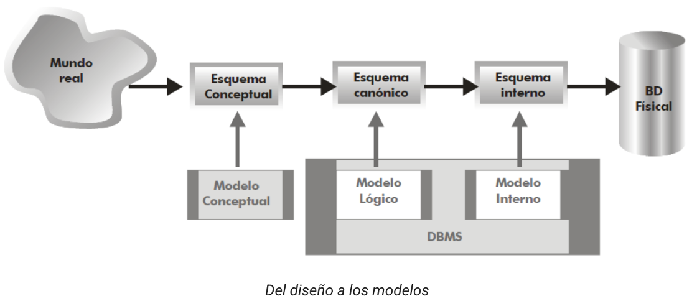
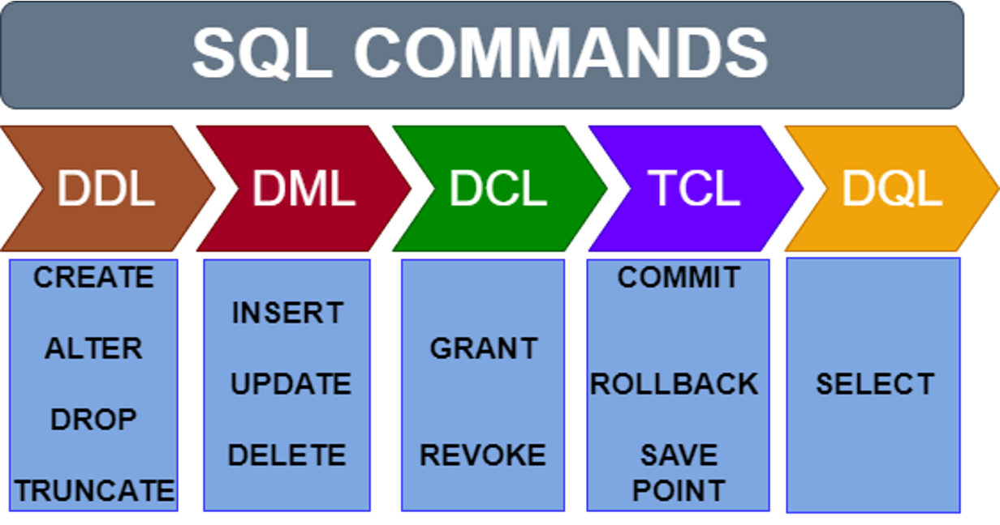

# **Introducció**

  

    🏆 <strong>Progrés d'aquesta secció:</strong> 0 de 4 superats (0%)
    ⭐ <strong>0 punts</strong>
  

  

    

  

Fins a ara hem estudiado com analitzar un problema i com representar la informació mitjançant models conceptuals i relacionals. No obstant això, aquests models encara no poden ser utilitzats directament per un Sistema gestor de bases de dades (SGBD).

El següent pas consisteix en transformar el **model lògic** en una estructura que puga ser creada i gestionada per un SGBD concret. Aquest procés rep el nom de **disseny físic**.

El disseny físic és la última etapa del procés de disseny d'una base de dades i consisteix en definir com s'emmagatzemaran realment les dades, què tipus de dades utilizarán els atributs, què restriccions garantizarán la integritat i què característiques pròpies del gestor de bases de dades seran necessàries.

> **📌 Disseny físic**
> 

> El **model físic** és la traducció del **model lògic** a un esquema que pot ser interpretat per un SGBD específic mitjançant instruccions SQL.

Durant aquesta unitat treballarem utilitzant **MySQL**, encara que la majoria dels conceptes estudiats són comuns al resta de sistemes gestors relacionals.

## **Llenguatge SQL**

Per a poder comunicarnos amb un SGBD utilitzarem **SQL (Structured Query Language)**. SQL és un **llenguatge específic de domini** (*Domain Specific Language - DSL*) dissenyat per a crear, modificar, consultar i administrar bases de dades relacionals.

A través de SQL podrem:

- Crear bases de dades.

- Crear taules.

- Definir relacions entre elles.

- Inserir dades.

- Consultar informació.

- Modificar registres.

- Eliminar informació.

- Gestionar usuaris i permisos.

> **📌 Per què SQL és un DSL?**
> 

> Un **DSL (Domain Specific Language)** és un llenguatge creat per a resoldre problemes d'un domini concret.

> SQL està dissenyat exclusivament per a treballar amb bases de dades.

## **Els sublenguatges de SQL**

Encara que solemos parlar simplement de **SQL**, realment el llenguatge es divideix en diversos grups d'instruccions segons la funció que realitzen.

| Sub llenguatge | Actua sobre | Objectiu | Què permet fer? | Instruccions principals | Exemples d'ús |
| --- | --- | --- | --- | --- | --- |
| **DDL** (Data Definition Language) | L'estructura de la base de dades | Definir i modificar la **estructura** de la base de dades. | Crear, modificar i eliminar bases de dades, taules, índexs i altres objectes. | `CREATE` `ALTER` `DROP` `RENAME` `TRUNCATE` | Crear una base de dades, afegir una columna, eliminar una taula. |
| **DML** (Data Manipulation Language) | Les dades de les taules | Manipular els **dades** emmagatzemats en les taules. | Inserir, modificar i eliminar registres. | `INSERT` `UPDATE` `DELETE` | Afegir un alumne, modificar un preu, esborrar una comanda. |
| **DQL** (Data Query Language) | Les dades de les taules | Consultar la informació emmagatzemada en la base de dades. | Recuperar, filtrar, ordenar, agrupar i realitzar càlculs sobre les dades. | `SELECT` | Consultar els alumnes d'una província, ordenar productes per preu, calcular la nota mitjana. |
| **DCL** (Data Control Language) | Els usuaris i permisos | Controlar la **seguretat** i els permisos d'accés. | Crear usuaris, assignar i revocar permisos, gestionar rols. | `GRANT` `REVOKE` | Permetre que un usuari consulte una base de dades o eliminar els seus permisos. |
| **TCL** (Transaction Control Language) | Les transaccions | Gestionar les **transaccions** realitzades sobre la base de dades. | Confirmar canvis, desfer operacions i crear punts de recuperació. | `COMMIT` `ROLLBACK` `SAVEPOINT` | Confirmar una venda, desfer una actualització errónea o tornar a un punt de control. |

## **Paraules reservades de SQL**

A l'igual que ocorre en qualsevol llenguatge de programació, SQL disposa d'un conjunt de **paraules reservades** que tenen un significat propi i formen part de la sintaxi del llenguatge.

Aquestes paraules no haurien d'utilitzar-se com noms de taules, columnes o bases de dades, excepte que el SGBD permeta delimitar-les mitjançant caràcters especials.

| Paraula | Descripció |
| --- | --- |
| `SELECT` | Recupera informació |
| `FROM` | Indica la taula d'origen |
| `WHERE` | Filtra registres |
| `GROUP BY` | Agrupa resultats |
| `ORDER BY` | Ordena resultats |
| `HAVING` | Filtra grups |
| `INSERT` | Insereix registres |
| `UPDATE` | Modifica registres |
| `DELETE` | Elimina registres |
| `CREATE` | Crea objectes |

| Paraula | Descripció |
| --- | --- |
| `ALTER` | Modifica objectes |
| `DROP` | Elimina objectes |
| `PRIMARY KEY` | Defineix la clau primària |
| `FOREIGN KEY` | Defineix una clau forana |
| `UNIQUE` | Evita valors duplicats |
| `NOT NULL` | Impedeix valors nuls |
| `DEFAULT` | Estableix un valor per defecte |
| `CHECK` | Defineix una validació |
| `AND` | Conjunció lògica |
| `OR` | Disyunció lògica |

| Paraula | Descripció |
| --- | --- |
| `NOT` | Niega una condició |
| `IN` | Comprova pertenencia |
| `BETWEEN` | Comprova un intervalo |
| `LIKE` | Cerca mitjançant patrons |
| `IS NULL` | Comprova valors nuls |
| `COUNT` | Compta registres |
| `SUM` | Suma valors |
| `AVG` | Calcula la mitjana |
| `MIN` | Obté el valor mínim |
| `MAX` | Obté el valor màxim |

> **📌 Important**
> 

> Evita utilitzar paraules reservades com noms de taules o columnes.

> Per exemple, una taula anomenada **ORDER** o una columna anomenada **SELECT** pot provocar errors o dificultar l'escriptura de consultes.

---

## 🎮 Reptes Interactius d'Autoavaluació (+100 XP)

Comprova el teu domini sobre **4.1 Introducció** superant aquests 4 reptes gamificats (+25 punts cadascun):

  
🎯 <strong>Repte 1 (+25 pts):</strong> Quina instrucció del subllenguatge DCL permet atorgar permisos d'accés (com <code>SELECT</code> o <code>INSERT</code>) a un usuari sobre una taula?

  

    <button type="button" class="btn-mcq-opt" data-opt="A">A) GRANT</button>
    <button type="button" class="btn-mcq-opt" data-opt="B">B) REVOKE</button>
    <button type="button" class="btn-mcq-opt" data-opt="C">C) COMMIT</button>
    <button type="button" class="btn-mcq-opt" data-opt="D">D) CHECK</button>
  

  

  
🎯 <strong>Repte 2 (+25 pts):</strong> Quina restricció SQL s'utilitza per a validar que el valor d'una columna complisca una condició booleana (per exemple <code>preu &gt; 0</code>)?

  

    <button type="button" class="btn-mcq-opt" data-opt="A">A) DEFAULT</button>
    <button type="button" class="btn-mcq-opt" data-opt="B">B) CHECK</button>
    <button type="button" class="btn-mcq-opt" data-opt="C">C) AUTO_INCREMENT</button>
    <button type="button" class="btn-mcq-opt" data-opt="D">D) INDEX</button>
  

  

  
✅ <strong>Repte 3 (Vertader o Fals · +25 pts):</strong> En MySQL/MariaDB, la col·lació (<code>COLLATE</code>) determina les regles d'ordenació alfabètica i si les comparacions de text distingeixen majúscules o accents.

  

    <button type="button" class="btn-vf" data-opt="V">Vertader (V)</button>
    <button type="button" class="btn-vf" data-opt="F">Fals (F)</button>
  

  

  
⌨️ <strong>Repte 4 (+25 pts):</strong> Quina sentència SQL DDL permet crear una taula nova en la base de dades?

  

    <input type="text" class="quiz-input" placeholder="Escriu la resposta..." />
    <button type="button" class="btn-quiz-check">Comprovar</button>
  

  

### 📋 Llista de Comprovació i Rúbrica d'Assoliment

Marca cada criteri a mesura que completes l'estudi o la resolució pràctica d'aquesta pàgina (**4.1 Introducció**):

- [ ] He llegit detingudament la teoria o l'enunciat d'aquesta secció i he anotat els conceptes clau.
- [ ] He revisat els esquemes, taules o blocs de codi i he verificat que sé aplicar-los a l'entorn de treball.
- [ ] He resolt correctament els **4 reptes interactius** superiors obtenint els **100 punts XP**.
- [ ] He descarregat el comprovant oficial en PDF per a adjuntar-lo a la tasca d'**Aules**.

  <h3>📤 Comprovant de Lliurament per a Aules</h3>
  
Quan hages completat els reptes interactius i la llista d'autoavaluació d'aquesta pàgina, introdueix el teu nom i descarrega el teu certificat oficial en PDF per a adjuntar-lo a la tasca d'<strong>Aules</strong>.

  

    <label for="aules-student-name">👤 Nom i Cognoms de l'Alumne/a:</label>
    <input type="text" id="aules-student-name" class="aules-student-name" placeholder="Ex: Joan Garcia Pérez" />
  

  

    0/4 reptes completats (0%) · 0 punts · 0/4 criteris d'autoavaluació
  

  

    <button type="button" class="btn-aules-dl" data-module="BBDD" data-unit="UD04" data-activity="ut0401">📥 Descarregar Comprovant PDF</button>
    <button type="button" class="btn-aules-copy">📋 Copiar Resum al Porta-retalls</button>
  

  

