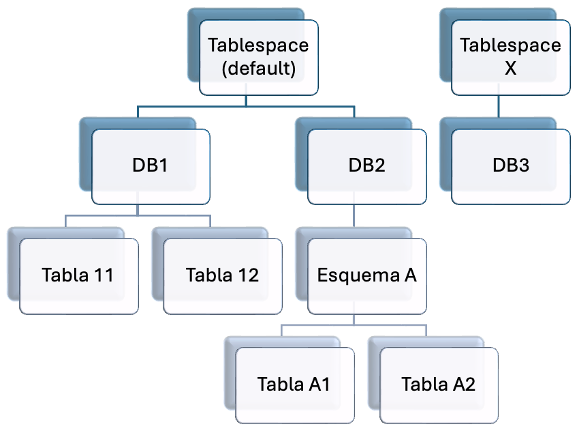

# **Almacenamiento de la información**

Una vez diseñada la estructura lógica de una base de datos, el siguiente paso consiste en decidir **cómo se almacenarán físicamente los datos** dentro del Sistema Gestor de Bases de Datos (SGBD).

Aunque para el usuario una base de datos parezca un único archivo, internamente está formada por diferentes elementos que permiten organizar la información de forma eficiente.

Entre los aspectos más importantes del almacenamiento encontramos:

- El motor de almacenamiento.

- La organización lógica de la base de datos.

- La organización física de los datos.

- Los juegos de caracteres.

- La colación.

## **Motores de almacenamiento**

Los **motores de almacenamiento** (*Storage Engines*) son los componentes encargados de gestionar cómo se almacenan, organizan y recuperan los datos dentro del SGBD. En **MySQL**, cada tabla puede utilizar un motor diferente, aunque normalmente toda la base de datos utiliza el mismo. Cada motor está diseñado para un tipo concreto de aplicaciones.

### **Motores más utilizados en MySQL**

#### **InnoDB**

Es el motor de almacenamiento predeterminado en las versiones actuales de MySQL.

**Características:**

- Soporta transacciones (**ACID**).

- Permite claves ajenas (**Foreign Key**).

- Utiliza bloqueo a nivel de fila.

- Ofrece una elevada integridad de los datos.

- Es adecuado para aplicaciones con muchas operaciones de inserción y actualización.

> **📌 Recomendación**
> 

> En la mayoría de aplicaciones actuales se recomienda utilizar **InnoDB**, ya que proporciona mayor seguridad e integridad de los datos.

#### **MyISAM**

Durante muchos años fue el motor predeterminado de MySQL.

Actualmente ha quedado prácticamente sustituido por InnoDB debido a sus limitaciones.

**Características:**

- No soporta transacciones.

- No permite claves ajenas.

- Está optimizado para consultas de lectura.

- Resulta más rápido en determinadas consultas simples.

> **📌 Limitaciones**
> 

> MyISAM no resulta recomendable cuando la integridad referencial o las transacciones son importantes.

#### **Otros motores**

MySQL dispone además de otros motores especializados para situaciones concretas.

| Motor | Uso principal |
| --- | --- |
| **Memory** | Tablas temporales almacenadas en memoria RAM |
| **Aria** | Recuperación rápida y consultas de solo lectura |
| **TokuDB** | Grandes volúmenes de información con compresión |
| **ColumnStore** | Análisis de datos y Business Intelligence |

Aunque existen muchos más motores, durante este curso trabajaremos principalmente con **InnoDB**.

## **Jerarquía lógica de una base de datos**

Desde el punto de vista lógico, una base de datos está formada por distintos niveles de organización.

La jerarquía utilizada en MySQL es la siguiente:



- **Tablespace o espacio de tablas**: constituye el nivel físico donde se almacenan los archivos que contienen la información. Habitualmente corresponde a uno o varios archivos del sistema operativo. Su función es almacenar: Tablas, Índices, Información interna del SGBD.

- **Base de datos**: representa el elemento lógico de nivel superior. Agrupa todos los objetos relacionados con una determinada aplicación. Por ejemplo: Instituto, Biblioteca, Hospital, Tienda Online.

- **Esquema**: agrupación lógica de una o más tablas (en MySQL un esquema es una base de datos).

- **Tabla**: representación de una tabla relacional, que contiene datos organizados en filas y columnas. Cada tabla pertenece a un base de datos específica, y sus datos se almacenan en el tablespace asociado.

- **Fila**: cada uno de los registros de la tabla.

- **Columna**:  Cada columna almacena un atributo de la tabla.

### **Organización física del almacenamiento**

En cambio, a nivel físico, el formato de almacenamiento depende principalmente del motor de almacenamiento que se esté utilizando, ya que cada motor tiene su propia manera de organizar y almacenar los datos. En MySQL con el motor InnoDB:

- Un bloque almacena los datos de tablas e índices mediante páginas (normalmente de 16 KB).

- Los bloques se almacenan en un archivo de tablespace (generalmente ibdata1 para bases de datos que comparten un tablespace, o en un archivo por tabla).

- Respecto a las filas, se almacenan utilizando un formato compacto o redondeado, dependiendo de la configuración. Cada fila contiene una clave primaria (o un índice que actúa como clave primaria) y los datos correspondientes.

### **Formato de las filas**

Las filas también poseen una estructura interna. Cada registro contiene la **clave primaria**, los valores de todas las **columnas** y la información utilizada por el motor para **localizar el registro**. Este formato depende del motor de almacenamiento utilizado.

## **Juegos de caracteres**

Cuando almacenamos texto en una base de datos, el SGBD necesita conocer **cómo representar cada carácter**. Para ello utiliza un **Juego de Caracteres** (*Character Set*). Un juego de caracteres define:

- Qué símbolos pueden almacenarse.

- Cómo se codifican.

- Cuántos bytes ocupa cada carácter.

### **Juegos de caracteres más habituales**

| Juego de caracteres | Características |
| --- | --- |
| ASCII | Caracteres básicos en inglés |
| ISO-8859-1 (Latin1) | Incluye caracteres occidentales y acentos |
| UTF-8 | Codificación Unicode ampliamente utilizada |
| UTF8MB4 | Implementación completa de UTF-8 en MySQL |

> **📌 Recomendación**
> 

> Actualmente se recomienda utilizar **utf8mb4**, ya que permite almacenar cualquier carácter Unicode, incluidos emojis y símbolos especiales.

### **Colación (Collation)**

La **colación** determina cómo se comparan y ordenan las cadenas de texto. Gracias a la colación, el SGBD puede decidir, por ejemplo:

- Si distingue mayúsculas y minúsculas.

- Cómo ordenar los caracteres acentuados.

- En qué posición debe aparecer la letra **ñ**.

### **Configuración del juego de caracteres en MySQL**

Al crear una base de datos es posible indicar el juego de caracteres y la colación que utilizará.

> **📌 CREAR BASE DE DATOS juego caracteres y colación**
> 

```sql
CREATE DATABASE instituto
CHARACTER SET utf8mb4
COLLATE utf8mb4_general_ci;
```

También es posible definirlos al crear una tabla.

> **📌 CREAR TABLA juego caracteres y colación**
> 

```sql
CREATE TABLE alumno (

    id INT PRIMARY KEY,

    nombre VARCHAR(100)

)

CHARACTER SET utf8mb4
COLLATE utf8mb4_unicode_ci;
```

Incluso una única columna puede utilizar una configuración diferente.

> **📌 CREAR COLUMNA juego caracteres y colación**
> 

```sql
CREATE TABLE alumno (

    id INT PRIMARY KEY,

    nombre VARCHAR(100)
        CHARACTER SET utf8mb4
        COLLATE utf8mb4_unicode_ci

);
```

### **Consultar la configuración**

MySQL permite consultar fácilmente el juego de caracteres y la colación utilizados.

> **📌 Consultar configuración**
> 

```sql
SHOW CREATE DATABASE instituto;

SHOW CREATE TABLE alumno;

SHOW VARIABLES LIKE 'character_set%';

SHOW VARIABLES LIKE 'collation%';
```

Estas instrucciones resultan muy útiles cuando trabajamos con bases de datos ya existentes y queremos conocer su configuración.
