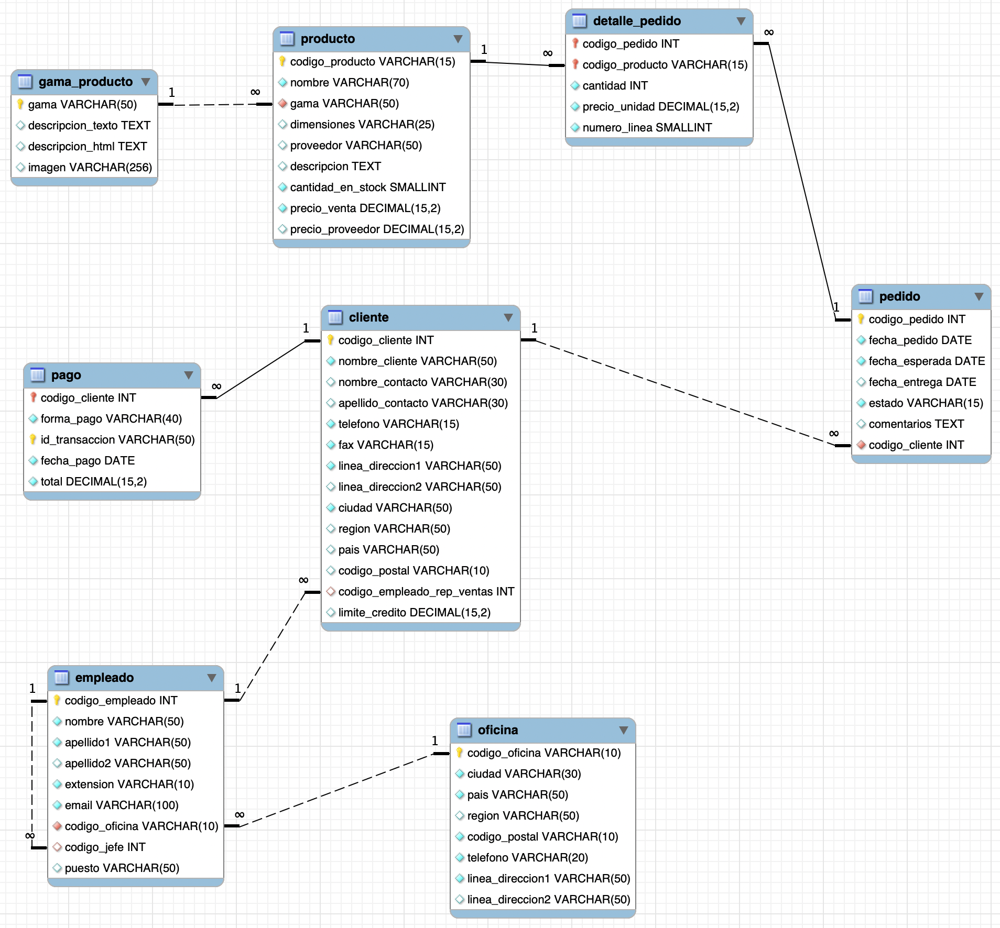
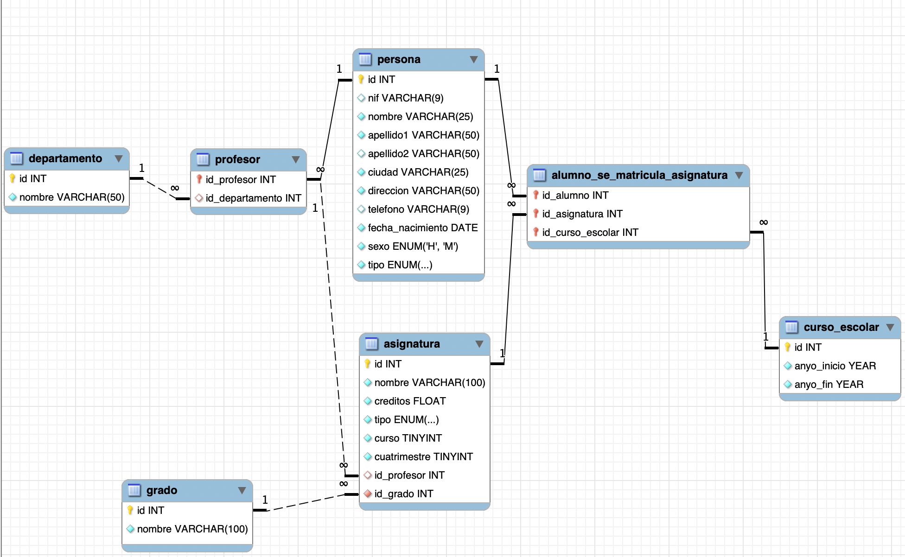
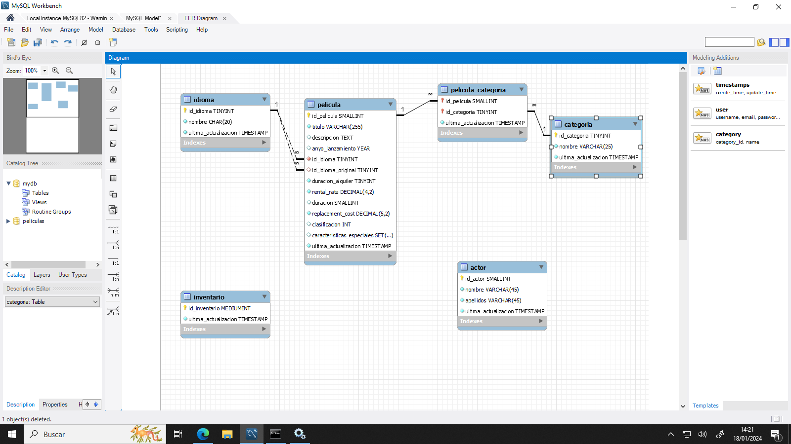
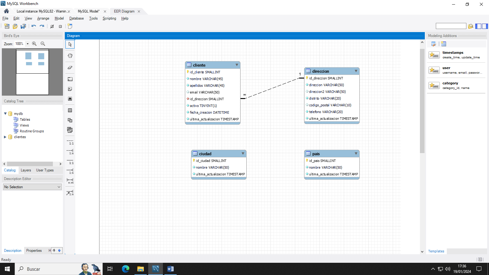

# 4.6 Quadern de Pràctiques DDL/DCL

En aquest quadern de laboratori trobaràs totes les activitats pràctiques d'aquesta unitat, els criteris de qualificació per a Aules i les solucions explicades pas a pas.


---

### 📝 **Activitat 401**


Lliurament

- La lliurament será un **fitxer `.sql`** con el script completo de la activitat y una **captura de pantalla** donde se compruebe que se ha ejecutado correctamente.

- El nombre del fitxer debe ser `401_NombreApellidos.sql`.

- Se deberá lliuramentr en la tarea correspondiente de Aules en tiempo y forma.

Es valorarà

Es valorarà:

- La claridad y el orden del código.

- La correcta selección de los tipos de datos.

- La correcta definición de las claus primàries y ajenas.

- La correcta implantación de las restricciones.

- El resultado obtenido al ejecutar el script.

Esta activitat servirá para calificar:

- RA2: Crea bases de dades definiendo su estructura y las características de sus elementos según el model relacional.

- CE2. a) Se ha analizado el formato de emmagatzematge de la informació. (5%)

- CE2. b) Se han creado las taules y las relaciones entre ellas. (5%)

- CE2. c) Se han seleccionado los tipos de datos adecuados. (5%)

- CE2. d) Se han definido los camps clave en las taules. (5%)

- CE2. e) Se han implantado las restricciones reflejadas en el disseny lògic. (5%)

Objetivo

Esta activitat es un **ejemplo guiado y completo** del disseny físic de una base de dades: partiendo del enunciado obtendremos el model entitat-relació (E/R), el modelo físico y, finalmente, el script SQL para MySQL.

## **Enunciado: Gestión de ventas**

Tenemos una fábrica donde queremos controlar los pedidos que realizan los clientes por medio del comercial.

Para definir a un **cliente** necesitaremos guardarnos su **nombre y apellidos**, su **ciudad** y su **categoría**.

Para definir un **comercial** necesitaremos guardarnos su **nombre y apellidos**, **ciudad** y su **comisión**.

Para cada **pedido** se necesita saber la **fecha** y la **cantidad**.

## **Modelo entidad/relación**

El model entitat-relació (E/R) de la base de dades es el siguiente:

- **cliente** (1) ── realiza ── (N) **pedido**

- **comercial** (1) ── gestiona ── (N) **pedido**

## **Modelo físico**

Del model entitat-relació (E/R) obtenemos el siguiente model relacional:

****

****

****

| Taula | Campos | Clau primària | Claves ajenas |
| --- | --- | --- | --- |
| cliente | id, nombre, apellido1, apellido2, ciudad, categoría | id |  |
| comercial | id, nombre, apellido1, apellido2, ciudad, comisión | id |  |
| pedido | id, total, fecha, id_cliente, id_comercial | id | id_cliente → cliente(id), id_comercial → comercial(id) |

## **Base de dades para MySQL**

CREATE DATABASE ventas

```sql

```

```sql

```

| 1 2 3 | DROP DATABASE IF EXISTS ventas; CREATE DATABASE ventas CHARACTER SET utf8mb4; USE ventas; |
| --- | --- |

CREATE TABLE cliente

```sql

```

```sql

```

| 1 2 3 4 5 6 7 8 | CREATE TABLE cliente (   id INT UNSIGNED AUTO_INCREMENT PRIMARY KEY,   nombre VARCHAR(100) NOT NULL,   apellido1 VARCHAR(100) NOT NULL,   apellido2 VARCHAR(100),   ciudad VARCHAR(100),   categoría INT UNSIGNED ); |
| --- | --- |

CREATE TABLE comercial

```sql

```

```sql

```

| 1 2 3 4 5 6 7 | CREATE TABLE comercial (   id INT UNSIGNED AUTO_INCREMENT PRIMARY KEY,   nombre VARCHAR(100) NOT NULL,   apellido1 VARCHAR(100) NOT NULL,   apellido2 VARCHAR(100),   comisión FLOAT ); |
| --- | --- |

CREATE TABLE pedido

```sql

```

```sql

```

| 1 2 3 4 5 6 7 8 9 | CREATE TABLE pedido (   id INT UNSIGNED AUTO_INCREMENT PRIMARY KEY,   total DOUBLE NOT NULL,   fecha DATE,   id_cliente INT UNSIGNED NOT NULL,   id_comercial INT UNSIGNED NOT NULL,   FOREIGN KEY (id_cliente) REFERENCES cliente(id),   FOREIGN KEY (id_comercial) REFERENCES comercial(id) ); |
| --- | --- |

## **Insertar los datos**

El script completo, con las instrucciones `INSERT` de los datos de ejemplo, se encuentra en el fitxer ventas.sql.

## **Se pide**

- Ejecuta el script completo ventas.sql en tu MySQL y comprueba que las taules se crean correctamente (`SHOW TABLES;` y `DESCRIBE pedido;`).

- Explica con tus palabras qué representa cada camp de la taula `pedido`.

- ¿Qué tipo de datos se ha utilizado para `categoría`? ¿Y para `comisión`? ¿Por qué crees que se ha elegido ese tipo?

- ¿Qué ocurre si intentas insertar un `pedido` con un `id_cliente` que no existe? Pruébalo y justifica la respuesta.

- Lliurament el fitxer `401_NombreApellidos.sql` con el script ejecutado.


<details>
<summary>💡 Veure solució detallada i recomanacions per a **Activitat 401**</summary>

```sql
-- Solució de referència i comprovació tècnica
-- Revisa que la sintaxi siga compatible amb el motor de base de dades (MySQL / MariaDB).
```
*Comprova cadascun dels camps i clàusules abans d'enviar el teu document a Aules.*
</details>


---

### 📝 **Activitat 402**


Lliurament

- La lliurament será un **fitxer `.sql`** con el script DDL de la activitat.

- El nombre del fitxer debe ser `402_NombreApellidos.sql`.

- Se deberá lliuramentr en la tarea correspondiente de Aules en tiempo y forma.

Es valorarà

Es valorarà:

- La correcta selección de los tipos de datos.

- La correcta definición de las claus primàries.

- La correcta definición de las claus foranes y sus relaciones.

- La correcta implantación de las restricciones (`NOT NULL`, `DEFAULT`, etc.).

- El resultado obtenido al ejecutar el script.

Esta activitat servirá para calificar:

- RA2: Crea bases de dades definiendo su estructura y las características de sus elementos según el model relacional.

- CE2. a) Se ha analizado el formato de emmagatzematge de la informació. (5%)

- CE2. b) Se han creado las taules y las relaciones entre ellas. (5%)

- CE2. c) Se han seleccionado los tipos de datos adecuados. (5%)

- CE2. d) Se han definido los camps clave en las taules. (5%)

- CE2. e) Se han implantado las restricciones reflejadas en el disseny lògic. (5%)

## **Disseny físic - Jardinería**

Crea las instrucciones DDL para crear la base de dades **jardinería** a partir del modelo lógico que se muestra a continuación.



Taules del modelo

El modelo lógico contiene las taules: **oficina**, **empleado**, **gama_producto**, **cliente**, **pedido**, **producto**, **detalle_pedido** y **pago**.

Recuerda

Debes definir, para cada taula:

- La **clau primària** (`PRIMARY KEY`).

- Las **claus foranes** (`FOREIGN KEY`), indicando la taula a la que referencian.

- Los camps que **no pueden ser nulos** (`NOT NULL`).

- Los **valores por defecto** (`DEFAULT`) cuando sea necesario.

## **Se pide**

- Escribe el script DDL completo: el `CREATE DATABASE` (con juego de caracteres `utf8mb4`) y el `CREATE TABLE` de cada taula del modelo.

- Ejecuta el script en tu MySQL y comprueba que se ha creado correctamente (`SHOW TABLES;` y `DESCRIBE` sobre las taules).

- Lliurament el fitxer `402_NombreApellidos.sql`.


<details>
<summary>💡 Veure solució detallada i recomanacions per a **Activitat 402**</summary>

```sql
-- Solució de referència i comprovació tècnica
-- Revisa que la sintaxi siga compatible amb el motor de base de dades (MySQL / MariaDB).
```
*Comprova cadascun dels camps i clàusules abans d'enviar el teu document a Aules.*
</details>


---

### 📝 **Activitat 403**


Lliurament

- La lliurament será un **fitxer `.sql`** con el script DDL de la activitat.

- El nombre del fitxer debe ser `403_NombreApellidos.sql`.

- Se deberá lliuramentr en la tarea correspondiente de Aules en tiempo y forma.

Es valorarà

Es valorarà:

- La correcta selección de los tipos de datos.

- El uso adecuado de los tipos `ENUM` cuando lo requiera el modelo.

- La correcta definición de las claus primàries.

- La correcta definición de las claus foranes y sus relaciones.

- La correcta implantación de las restricciones.

- El resultado obtenido al ejecutar el script.

Esta activitat servirá para calificar:

- RA2: Crea bases de dades definiendo su estructura y las características de sus elementos según el model relacional.

- CE2. a) Se ha analizado el formato de emmagatzematge de la informació. (5%)

- CE2. b) Se han creado las taules y las relaciones entre ellas. (5%)

- CE2. c) Se han seleccionado los tipos de datos adecuados. (5%)

- CE2. d) Se han definido los camps clave en las taules. (5%)

- CE2. e) Se han implantado las restricciones reflejadas en el disseny lògic. (5%)

## **Disseny físic - Universidad**

Crea las instrucciones DDL para crear la base de dades **universidad** a partir del modelo lógico que se muestra a continuación.



Taules del modelo

El modelo lógico contiene las taules: **departamento**, **persona**, **profesor**, **grado**, **asignatura**, **curso_escolar** y **alumno_se_matricula_asignatura**.

Enumerados

- El camp `tipo` de la taula **persona** es un enumerado con los valores (`profesor`, `alumno`).

- El camp `tipo` de la taula **asignatura** es un enumerado con los valores (`básica`, `obligatoria`, `optativa`).

Recuerda

Debes definir, para cada taula:

- La **clau primària** (`PRIMARY KEY`).

- Las **claus foranes** (`FOREIGN KEY`), indicando la taula a la que referencian.

- Los camps que **no pueden ser nulos** (`NOT NULL`).

- Los camps con valores **únicos** (`UNIQUE`) cuando el modelo lo indique.

## **Se pide**

- Escribe el script DDL completo: el `CREATE DATABASE` (con juego de caracteres `utf8mb4`) y el `CREATE TABLE` de cada taula del modelo.

- Ejecuta el script en tu MySQL y comprueba que se ha creado correctamente.

- Lliurament el fitxer `403_NombreApellidos.sql`.


<details>
<summary>💡 Veure solució detallada i recomanacions per a **Activitat 403**</summary>

```sql
-- Solució de referència i comprovació tècnica
-- Revisa que la sintaxi siga compatible amb el motor de base de dades (MySQL / MariaDB).
```
*Comprova cadascun dels camps i clàusules abans d'enviar el teu document a Aules.*
</details>


---

### 📝 **Activitat 404**


Lliurament

- La lliurament será un **documento** que contenga la respuesta a cada uno de los exercicis: las instrucciones SQL utilizadas y la salida obtenida en cada caso (puedes copiar las consultes y realizar capturas de pantalla).

- El nombre del fitxer debe ser `404_NombreApellidos.pdf`.

- Se deberá lliuramentr en la tarea correspondiente de Aules en tiempo y forma.

Es valorarà

Es valorarà:

- La correcta creación de usuaris.

- La correcta asignación y revocación de privilegis.

- La correcta utilización de los niveles de privilegi (global, base de dades, taula y columna).

- La correcta comprobación de los permisos mediante `SHOW GRANTS`.

Esta activitat servirá para calificar:

- RA2: Crea bases de dades definiendo su estructura y las características de sus elementos según el model relacional.

- CE2. g) Se han creado los usuaris y se les han asignado privilegis. (5%)

- CE2. h) Se han utilizado asistentes, herramientas gráficas y los lenguajes de definición y control de datos. (5%)

## **Lenguaje de Control de Datos (DCL)**

Para realizar esta activitat necesitarás la base de dades **futbol**. Puedes descargar el script que la crea en futbol.sql.

Recuerda

Recuerda que en MySQL un usuari se identifica mediante `usuari@host`, per exemple `'root'@'localhost'`.

Realiza los siguientes exercicis en MySQL:

- Crea un usuari `'tengopermisos'` y otórgale permisos para que pueda crear usuaris.

- Conectado como `'tengopermisos'`, crea un nuevo usuari `'user1'`.

- Conectado como `root`, otórgale permisos al usuari `'user1'` para que pueda consultar las taules de las bases de dades.

- Conectado como `root`, muestra los permisos que tiene el usuari `'user1'`.

- Conectado como `'user1'`, muestra los permisos que posee y comprueba que son los mismos del orden anterior.

- Conectado como `root`, otorga permiso de creación y borrado de taules al usuari `'user1'` sobre la base de dades `jardinería`.

- Conectado como `root`, crea un usuari de nombre `'creartaules'` que tenga permisos para crear, borrar y modificar taules de la base de dades `fútbol`.

- Conectado como `'creartaules'`, crea una taula sencilla de al menos dos columnes. Las columnes se llamarán `estadio` y deberá tener un `nombre_estadio varchar(25)`, que será la *primary key*, y otro camp que será `ciudad varchar(25)` y que por defecto será `null`.

- Conectado como `root`, crea un usuari de nombre `'accesoglobal'` que pueda realizar operaciones de selección e inserción sobre todas las taules de todas las bases de dades.

- Conectado como `'accesoglobal'`, añade una fila a la taula `futbol.estadios`. Intenta borrar la fila creada.

- Conectado como `root`, crea un usuari de nombre `'accesolocal'` que pueda seleccionar todas las taules de la base de dades anterior.

- Conéctate como `'accesolocal'` y comprueba que puedes seleccionar la fila `futbol.estadios.nombre_estadio`.

- Conectado como `root`, crea un usuari de nombre `'accesolimitado'` que pueda realizar operaciones de inserción, actualización y selección sobre la primera columna de la taula `futbol.estadios`.

- Conéctate como `'accesolimitado'` y comprueba que tienes los permisos ejecutando las órdenes SQL `SELECT`, `UPDATE` e `INSERT`. Comprueba qué permisos tienes.

- Conectado como `root`, revoca todos los permisos del usuari `'user1'`.

- Conectado como `'user1'`, valida que no puedes realizar ninguna acción.

- Conectado como `root`, revoca el permiso de modificar las taules de la base de dades `fútbol` del usuari `'creartaules'`.

- Conectado como `'creartaules'`, intenta incluir una nueva columna en la taula `futbol.estadios`.


<details>
<summary>💡 Veure solució detallada i recomanacions per a **Activitat 404**</summary>

```sql
-- Solució de referència i comprovació tècnica
-- Revisa que la sintaxi siga compatible amb el motor de base de dades (MySQL / MariaDB).
```
*Comprova cadascun dels camps i clàusules abans d'enviar el teu document a Aules.*
</details>


---

### 📝 **Activitat 405**


Lliurament

- La lliurament será un **fitxer `.sql`** con el script completo de la activitat (creación de la base de dades y todas las modificaciones `ALTER`).

- El nombre del fitxer debe ser `405_NombreApellidos.sql`.

- Se deberá lliuramentr en la tarea correspondiente de Aules en tiempo y forma.

Es valorarà

Es valorarà:

- La correcta traducción del diagrama E/R a SQL.

- La correcta utilización de `ALTER TABLE` para añadir, modificar y eliminar columnes.

- La correcta creación de claus foranes y de taules de relación.

- El uso adecuado de los tipos `ENUM` y `SET`.

- El resultado obtenido al ejecutar el script.

Esta activitat servirá para calificar:

- RA2: Crea bases de dades definiendo su estructura y las características de sus elementos según el model relacional.

- CE2. a) Se ha analizado el formato de emmagatzematge de la informació. (5%)

- CE2. b) Se han creado las taules y las relaciones entre ellas. (5%)

- CE2. c) Se han seleccionado los tipos de datos adecuados. (5%)

- CE2. d) Se han definido los camps clave en las taules. (5%)

- CE2. e) Se han implantado las restricciones reflejadas en el disseny lògic. (5%)

## **Disseny físic - Películas**

A partir del siguiente diagrama E/R:



Taules del modelo

El diagrama contiene las taules: **actor**, **categoria**, **idioma**, **pelicula**, **pelicula_categoria** e **inventario**.

Realiza los siguientes exercicis en MySQL:

- Pasa el diagrama anterior a SQL y lanza el script en la base de dades.

- Incluye la columna `edad` en la taula `actor`. La columna nueva deberá estar después de `apellidos`. El dato será `int` y no podrá ser `null`.

- Deberás eliminar la columna `apellidos` y crear las columnes `apellido1` y `apellido2`. Las columnes estarán después de `nombre` y serán de tipo `varchar(45)` y no pueden ser nulas.

- Incluye en la taula `inventario` la relación con la taula `pelicula`. Crea la columna `id_pelicula`, no podrá ser `null`. Crea la *foreign key* para la relación.

- Crea la taula que relaciona la taula `peliculas` y la taula `actores`. La taula deberá tener 3 columnes, una para la relación con `actor`, otra para la relación con `pelicula` y otra que se llame `ultima_actualizacion` de tipo `TIMESTAMP`.

- Modifica la columna `nombre` de la taula `categoria` para que sea un `varchar(50)`.

- Modifica la columna `duracion_alquiler` de la taula `pelicula` para que su tipo sea `INT` y valor por defecto `3`.

- Modifica el tipo de dato de la columna `clasificacion` de la taula `pelicula`. Deberá ser un enumerado con los posibles valores `'G', 'PG', 'PG-13', 'R', 'NC-17'` y por defecto `'G'`.

- Modifica el tipo de dato de la columna `caracteristicas_especiales` de la taula `pelicula`. Deberás hacer un `SET('Trailers', 'Commentaries', 'Deleted Scenes', 'Behind the Scenes')`.

Recuerda

Para comprobar la estructura de las taules tras cada modificación puedes utilizar `DESCRIBE nombre_taula;` o `SHOW CREATE TABLE nombre_taula;`.


<details>
<summary>💡 Veure solució detallada i recomanacions per a **Activitat 405**</summary>

```sql
-- Solució de referència i comprovació tècnica
-- Revisa que la sintaxi siga compatible amb el motor de base de dades (MySQL / MariaDB).
```
*Comprova cadascun dels camps i clàusules abans d'enviar el teu document a Aules.*
</details>


---

### 📝 **Activitat 406**


Lliurament

- La lliurament será un **fitxer `.sql`** con el script completo de la activitat (creación de la base de dades y todas las modificaciones `ALTER`).

- El nombre del fitxer debe ser `406_NombreApellidos.sql`.

- Se deberá lliuramentr en la tarea correspondiente de Aules en tiempo y forma.

Es valorarà

Es valorarà:

- La correcta traducción del diagrama E/R a SQL.

- La correcta creación de las relaciones entre las taules.

- La correcta utilización de `ALTER TABLE` para añadir, modificar y eliminar columnes.

- La correcta selección de los tipos de datos.

- El resultado obtenido al ejecutar el script.

Esta activitat servirá para calificar:

- RA2: Crea bases de dades definiendo su estructura y las características de sus elementos según el model relacional.

- CE2. a) Se ha analizado el formato de emmagatzematge de la informació. (5%)

- CE2. b) Se han creado las taules y las relaciones entre ellas. (5%)

- CE2. c) Se han seleccionado los tipos de datos adecuados. (5%)

- CE2. d) Se han definido los camps clave en las taules. (5%)

- CE2. e) Se han implantado las restricciones reflejadas en el disseny lògic. (5%)

## **Disseny físic - Clientes**

A partir del siguiente diagrama E/R:



Taules del modelo

El diagrama contiene las taules: **pais**, **ciudad**, **direccion** y **cliente**.

Realiza los siguientes exercicis en MySQL:

- Pasa el diagrama anterior a SQL y lanza el script en la base de dades.

- Relaciona la taula `ciudad` con la taula `direccion`.

- Relaciona la taula `pais` con la taula `ciudad`.

- Deberás eliminar la columna `apellidos` y crear las columnes `apellido1` y `apellido2` de la taula `cliente`. Las columnes estarán después de `nombre` y serán de tipo `varchar(45)` y no pueden ser nulas.

- Modifica la columna `distrito` de la taula `direccion` para que sea un `varchar(50)`.

- Incluye la columna `num_habitantes` como entero en la taula `ciudad` y la taula `pais`.

- Modifica la columna `telefono` de tipo de dato `varchar` a `int`.

Recuerda

Para comprobar la estructura de las taules tras cada modificación puedes utilizar `DESCRIBE nombre_taula;` o `SHOW CREATE TABLE nombre_taula;`.


<details>
<summary>💡 Veure solució detallada i recomanacions per a **Activitat 406**</summary>

```sql
-- Solució de referència i comprovació tècnica
-- Revisa que la sintaxi siga compatible amb el motor de base de dades (MySQL / MariaDB).
```
*Comprova cadascun dels camps i clàusules abans d'enviar el teu document a Aules.*
</details>


---
## 🏆 Reptes Interactius d'Autoavaluació (Gamificació)

Posa a prova els teus coneixements adquirits en aquesta unitat abans de fer el lliurament a Aules. Cada repte superat suma **+25 punts**!

<div class="interactive-progress-tracker">
  <div class="tracker-header">
    <span class="tracker-title">🎯 Progrés dels Reptes de la Unitat</span>
    <span class="tracker-pts">⭐ <strong>0 punts</strong></span>
  </div>
  <div class="tracker-track">
    <div class="tracker-fill" style="width: 0%;"></div>
  </div>
  <div class="tracker-status"><span class="tracker-count">0 de 4 reptes superats (0%)</span></div>
</div>

<div class="interactive-quiz" data-answer="ALTER TABLE|alter table" data-hint="Comença per ALTER i indica l'objecte TABLE." data-quiz-id="ut04_q1">
  <div class="quiz-badge">Repte 1 · Pregunta d'Autoavaluació (+25 pts)</div>
  <div class="quiz-question">Repte 1: Sentències DDL</div>
  <p style="margin: 0 0 10px 0; font-size: 0.95rem;">Quina comanda DDL s'utilitza per a afegir, modificar o eliminar columnes i restriccions en una taula ja existent?</p>
  <div class="quiz-input-group">
    <input type="text" class="quiz-input" placeholder="Escriu la teua resposta..." />
    <button type="button" class="btn-quiz-check">Comprovar</button>
  </div>
  <div class="quiz-feedback"></div>
</div>

<div class="interactive-mcq" data-answer="A" data-hint="TRUNCATE és una sentència DDL de reinici d'estructura i contingut." data-quiz-id="ut04_q2">
  <div class="quiz-badge">Repte 2 · Pregunta Tipus Test (+25 pts)</div>
  <div class="mcq-question">Repte 2: Vaciament ràpid de taula</div>
  <p style="margin: 0 0 12px 0; font-size: 0.95rem;">Quina instrucció DDL buida completament totes les files d'una taula de manera instantània i reinicia el comptador AUTO_INCREMENT?</p>
  <div class="mcq-options">
    <button type="button" class="btn-mcq-opt" data-opt="A">A) TRUNCATE TABLE</button><button type="button" class="btn-mcq-opt" data-opt="B">B) DROP TABLE</button><button type="button" class="btn-mcq-opt" data-opt="C">C) DELETE FROM</button><button type="button" class="btn-mcq-opt" data-opt="D">D) ALTER TABLE</button>
  </div>
  <div class="quiz-feedback"></div>
</div>

<div class="interactive-vf" data-answer="F" data-hint="REVOKE retira privilegis. Per atorgar-los s'usa GRANT." data-quiz-id="ut04_q3">
  <div class="quiz-badge">Repte 3 · Vertader o Fals (+25 pts)</div>
  <div class="vf-statement"><strong>Repte 3: Permisos amb DCL:</strong> La comanda REVOKE atoga privilegis d'accés a un usuari sobre una taula.</div>
  <div class="vf-buttons">
    <button type="button" class="btn-vf" data-opt="V">✅ Vertader</button>
    <button type="button" class="btn-vf" data-opt="F">❌ Fals</button>
  </div>
  <div class="quiz-feedback"></div>
</div>

<div class="interactive-mcq" data-answer="A" data-hint="CASCADE propaga l'operació en cadena a les taules relacionades." data-quiz-id="ut04_q4">
  <div class="quiz-badge">Repte 4 · Pregunta de Consolidació (+25 pts)</div>
  <div class="mcq-question">Repte 4: Integritat en cascada</div>
  <p style="margin: 0 0 12px 0; font-size: 0.95rem;">Quina clàusula aplicada a una FOREIGN KEY provoca que, en esborrar una fila a la taula mare, s'eliminen automàticament les files filles relacionades?</p>
  <div class="mcq-options">
    <button type="button" class="btn-mcq-opt" data-opt="A">A) ON DELETE CASCADE</button><button type="button" class="btn-mcq-opt" data-opt="B">B) ON DELETE SET NULL</button><button type="button" class="btn-mcq-opt" data-opt="C">C) ON DELETE RESTRICT</button><button type="button" class="btn-mcq-opt" data-opt="D">D) AUTO_INCREMENT</button>
  </div>
  <div class="quiz-feedback"></div>
</div>

<div class="aules-delivery-card">
  <div class="aules-card-badge">📤 LLIURAMENT OFICIAL DE TASCA (AULES)</div>
  <div class="aules-card-title">Comprovant de Treball i Activitats Pràctiques</div>
  <p class="aules-card-desc">
    Quan hages completat els exercicis pràctics i superat els reptes interactius, escriu el teu nom complet i genera el comprovant per a adjuntar-lo al lliurament d'Aules corresponent.
  </p>
  <div class="aules-input-group">
    <label for="aules-student-name">Nom de l'alumne/a:</label>
    <input type="text" id="aules-student-name" placeholder="Cognoms, Nom" />
  </div>
  <div class="aules-score-box">
    Puntuació actual: <span class="aules-score-count">0/4 reptes superats (0 punts)</span>
  </div>
  <div class="aules-actions">
    <button type="button" class="btn-aules-copy">📋 Copiar Resum per a Aules</button>
    <button type="button" class="btn-aules-dl">💾 Descarregar Comprovant (.txt)</button>
  </div>
  <div class="aules-toast" style="display:none;"></div>
</div>

