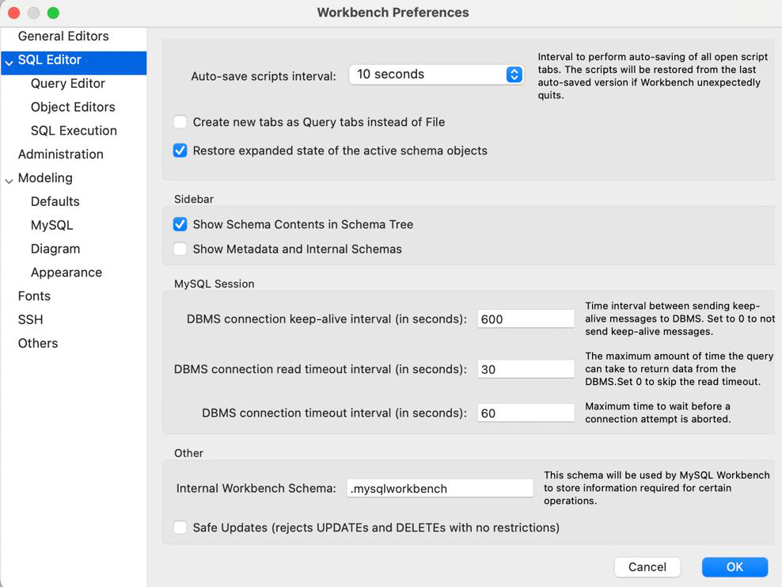
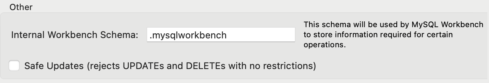
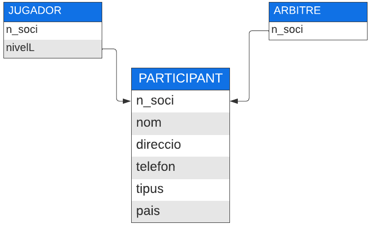
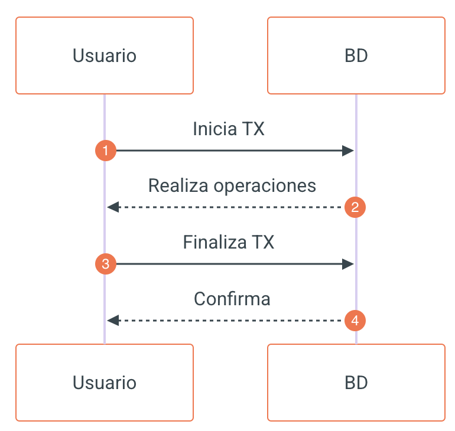

# UD5: Manipulación de Datos y Transacciones — SQL DML y TCL

Bienvenido/a a la **UD5: Manipulación de Datos y Transacciones — SQL DML y TCL** del módulo profesional de **Bases de Datos** (1º DAW / DAM / ASIX · Bases de Datos).

En esta unidad encontrarás los contenidos teóricos, ejemplos prácticos, ejercicios resueltos y actividades de evaluación curricular desarrollados por el profesor **Manuel Alonso Argente**.

---

### 📑 Índice de Apartados y Actividades de la Unidad

- [**📋 5.0 Propuesta Didáctica: Tratamiento de datos (DML y TCL)**](./ut0500.html)
- [**5.1 Introducción al SQL. DML**](./ut0501.html)
- [**5.2 Creación de registros. INSERT**](./ut0502.html)
- [**5.3 Borrado de registros. DELETE**](./ut0503.html)
- [**5.4 Modificación de registros. UPDATE**](./ut0504.html)
- [**5.5 Transacciones (TCL)**](./ut0505.html)

**Actividades Prácticas y Fichas de Trabajo:**

- [**✏️ ACT501 501**](./act_act501.html)
- [**✏️ ACT502 502**](./act_act502.html)
- [**✏️ ACT503 503**](./act_act503.html)
- [**✏️ ACT504 504**](./act_act504.html)
- [**✏️ ACT505 505**](./act_act505.html)

---

# 📖 Vista Completa de la Unidad

## 5.0 Propuesta Didáctica — Tratamiento de datos (DML y TCL)

# **Tratamiento de datos (DML y TCL)**

## **Propuesta didáctica**

En esta unidad vamos a trabajar el RA4:
**"Modifica la información almacenada en la base de datos utilizando asistentes, herramientas gráficas y el lenguaje de manipulación de datos"**.

## **Criterios de evaluación**

### **Respecto al RA4**:

| Código | Descripción | Peso (%) | Herramientas Evaluación |
| --- | --- | --- | --- |
| **CE4a** | Se han identificado las herramientas y sentencias para modificar el contenido de la base de datos. | 5% | ACT501 (5%) -- ACT502 (5%) -- ACT503 (5%) -- ACT505 (5%) -- EXA0501 (80%) |
| **CE4b** | Se han insertado, borrado y actualizado datos en las tablas. | 20% | ACT501 (5%) -- ACT502 (5%) -- ACT503 (5%) -- ACT505 (5%) -- EXA0501 (80%) |
| **CE4c** | Se ha incluido en una tabla la información resultante de la ejecución de una consulta. | 10% | ACT501 (5%) -- ACT503 (5%) -- ACT505 (5%) -- EXA0501 (85%) |
| **CE4d** | Se han diseñado guiones de sentencias para llevar a cabo tareas complejas. | 20% | ACT501 (5%) -- ACT502 (5%) -- ACT503 (5%) -- ACT504 (5%) -- ACT505 (5%) -- EXA0501 (75%) |
| **CE4e** | Se ha reconocido el funcionamiento de las transacciones. | 15% | ACT504 (5%) -- EXA0501 (95%) |
| **CE4f** | Se han anulado parcial o totalmente los cambios producidos por una transacción. | 10% | ACT504 (5%) -- EXA0501 (95%) |
| **CE4g** | Se han identificado los efectos de las diferentes políticas de bloqueo de registros. | 10% | ACT504 (5%) -- EXA0501 (95%) |
| **CE4h** | Se han adoptado medidas para mantener la integridad y consistencia de la información. | 10% | ACT501 (5%) -- ACT505 (5%) -- EXA0501 (90%) |

## **Contenidos**

### **Tratamiento de datos: instrucciones DML y TCL**:

- Introducción al Lenguaje SQL.

- Creación de registros. `INSERT`.

- Modificación de registros. `UPDATE`.

- Eliminación de registros. `DELETE`.

- Transacciones. `TCL`.

> **📌 Cuestionario inicial**
> 

> 1. ¿Qué son las instrucciones DML y para qué sirven?

> 1. ¿Qué significa CRUD?

> 1. ¿Cómo se inserta un nuevo registro en una tabla?

> 1. ¿Qué sucede si omitimos las columnas en un `INSERT`?

> 1. ¿Qué sucede si omitimos el `WHERE` en un `DELETE FROM`?

> 1. ¿Qué sucede si omitimos el `WHERE` en un `UPDATE`?

> 1. ¿Qué es una transacción? ¿Qué propiedades debe cumplir?

> 1. ¿Qué diferencia hay entre `COMMIT` y `ROLLBACK`?

> 1. ¿Qué es el autocommit? ¿Cómo se desactiva?

> 1. ¿Para qué sirve un `SAVEPOINT`?

## **Programación de Aula (10 sesiones)**

Esta unidad es la quinta y se imparte a caballo entre la primera y la segunda evaluación, a mediados y finales de diciembre de 2026, retomándose a principios de enero de 2027, con una duración estimada de 10 sesiones lectivas:

### **Diciembre 2026**

| Lunes | Martes | Miércoles | Jueves | Viernes | Sábado | Domingo |
| --- | --- | --- | --- | --- | --- | --- |
|  | **1** | **2** | **3** | **4** | **5 🛑** | **6 🛑** |
| **7 🛑** | **8 🛑** | **9** | **10** | **11** | **12 🛑** | **13 🛑** |
| **14** | **15** | **16 📚** | **17** | **18 📚** | **19 🛑** | **20 🛑** |
| **21** | **22 🛑** | **23 🛑** | **24 🛑** | **25 🛑** | **26 🛑** | **27 🛑** |
| **28 🛑** | **29 🛑** | **30 🛑** | **31 🛑** |  |  |  |

### **Enero 2027**

| Lunes | Martes | Miércoles | Jueves | Viernes | Sábado | Domingo |
| --- | --- | --- | --- | --- | --- | --- |
|  |  |  |  | **1 🛑** | **2 🛑** | **3 🛑** |
| **4 🛑** | **5 🛑** | **6 🛑** | **7** | **8 📚** | **9 🛑** | **10 🛑** |
| **11** | **12 📚** | **13 📚** | **14** | **15 📚** | **16 🛑** | **17 🛑** |
| **18** | **19** | **20** | **21** | **22** | **23 🛑** | **24 🛑** |
| **25** | **26** | **27** | **28** | **29** | **30 🛑** | **31 🛑** |

| Sesión | Contenidos | Actividades | Criterios trabajados |
| --- | --- | --- | --- |
| 1 | Introducción. Lenguaje SQL |  | CE4a, CE4b |
| 1 | Creación de registros. INSERT |  | CE4a, CE4b |
| 2 | Modificación de registros. UPDATE |  | CE4a, CE4b |
| 3 | Eliminación de registros. DELETE |  | CE4a, CE4b |
| 4 | Transacciones. TCL |  | CE4d, CE4e, CE4f, CE4g |
| 5 | Transacciones. TCL |  | CE4d, CE4e, CE4f, CE4g |
| 6 | Actividades | ACT501 -- ACT502 -- ACT503 -- ACT504 -- ACT505 | CE4a, CE4b, CE4c, CE4d, CE4e, CE4f, CE4g, CE4h |
| 7 | Actividades | ACT501 -- ACT502 -- ACT503 -- ACT504 -- ACT505 | CE4a, CE4b, CE4c, CE4d, CE4e, CE4f, CE4g, CE4h |
| 8 | Actividades | ACT501 -- ACT502 -- ACT503 -- ACT504 -- ACT505 | CE4a, CE4b, CE4c, CE4d, CE4e, CE4f, CE4g, CE4h |
| 9 | Actividades | EXA0501 | CE4a, CE4b, CE4c, CE4d, CE4e, CE4f, CE4g, CE4h |
| 10 | Actividades | EXA0501 | CE4a, CE4b, CE4c, CE4d, CE4e, CE4f, CE4g, CE4h |

---

## 5.1 Introducción al SQL. DML

# **Introducción al SQL. DML**

Una vez creadas las tablas que forman parte de nuestra base de datos, el siguiente paso es **poder utilizar esa información**: insertar datos, consultarlos, modificarlos o eliminarlos.

El **DML (Data Manipulation Language)** (*Lenguaje de Manipulación de Datos*) agrupa las instrucciones SQL encargadas de **manipular los datos** almacenados en las tablas.

> **📌 DML**
> 

> A diferencia del **DDL**, que trabaja sobre la **estructura** de la base de datos, el **DML** trabaja sobre los **datos** almacenados en las tablas.

## **Los sublenguajes de SQL**

Como ya vimos en la unidad anterior, las instrucciones SQL se agrupan en 5 categorías dependiendo de su funcionalidad:

| Sub lenguaje | Función | Instrucciones principales |
| --- | --- | --- |
| **DDL** (Data Definition Language) | Definir la estructura de la base de datos | `CREATE`, `ALTER`, `DROP`, `TRUNCATE` |
| **DML** (Data Manipulation Language) | Manipular los datos de las tablas | `INSERT`, `UPDATE`, `DELETE` |
| **DCL** (Data Control Language) | Controlar la seguridad y los permisos | `GRANT`, `REVOKE` |
| **TCL** (Transaction Control Language) | Gestionar las transacciones | `COMMIT`, `ROLLBACK`, `SAVEPOINT` |
| **DQL** (Data Query Language) | Consultar la información | `SELECT` |

## **Instrucciones DML**

Las instrucciones DML más importantes y utilizadas son:

- **`INSERT`**: para **añadir** información nueva.

- **`UPDATE`**: para **actualizar** la información existente.

- **`DELETE`**: para **borrar** la información que ya no nos sirve.

> **📌 CRUD**
> 

> Básicamente con estas 3 órdenes de SQL y la consulta (`SELECT`) ya podremos crear aplicaciones externas con lenguajes de programación. Estas 4 operaciones se conocen como aplicación **CRUD**:

> - **C**: *Create* → Altas (`INSERT`).

> - **R**: *Read* → Consultas (`SELECT`).

> - **U**: *Update* → Modificaciones (`UPDATE`).

> - **D**: *Delete* → Bajas (`DELETE`).


> **📌 Resumen**
> 

> - El **DML** permite manipular los datos de las tablas.

> - Sus instrucciones principales son `INSERT`, `UPDATE` y `DELETE`.

> - Junto con `SELECT` forman el ciclo **CRUD** (*Create, Read, Update, Delete*).

> - Estas operaciones son la base de cualquier aplicación que utilice una base de datos.

---

## 5.2 Creación de registros. INSERT

# **Creación de registros. INSERT**

Para crear nuevos registros en las tablas utilizaremos la instrucción SQL **`INSERT`**.

## **Sintaxis**

> **📌 Sintaxis de INSERT**
> 

```sql
INSERT INTO {nombre_tabla | nombre_vista} [(columna1 [, columna2]...)]
VALUES (valor1 [, valor2] ...);
```

Indicamos la instrucción, la tabla o vista donde vamos a realizarla, las columnas afectadas y los valores que van a recibir cada columna.

## **Ejemplo básico**

Vamos a trabajar con la tabla `EMPLEADOS`:

> **📌 Creación de la tabla EMPLEADOS**
> 

```sql
CREATE TABLE EMPLEADOS (
    COD INT PRIMARY KEY,
    NOMBRE VARCHAR(50) NOT NULL,
    LOCALIDAD VARCHAR(50) DEFAULT 'Écija',
    FECHANAC DATE
);
```

> **📌 Inserciones en EMPLEADOS**
> 

```sql
INSERT INTO EMPLEADOS
VALUES (1, 'Pepe', 'Osuna', '1970-01-01');

INSERT INTO EMPLEADOS
VALUES (2, 'Juan', DEFAULT, NULL);

INSERT INTO EMPLEADOS
VALUES (3, 'Sara', NULL, NULL);

INSERT INTO EMPLEADOS (COD, NOMBRE, LOCALIDAD, FECHANAC)
VALUES (4, 'Luis', 'Algemesi', '1987-02-14');
```

En los ejemplos anteriores podemos observar distintas formas de invocar la sentencia `INSERT`:

- Si **no se indican las columnas**, se deben proporcionar valores para **todas** las columnas en el orden en que se definieron.

- `DEFAULT` utiliza el valor por defecto definido en la columna.

- `NULL` asigna valor nulo.

## **INSERT con AUTO_INCREMENT**

Si tenemos la clave primaria con autoincremento podremos insertar registros sin indicar su valor:

> **📌 Tabla con AUTO_INCREMENT**
> 

```sql
CREATE TABLE EMPLEADOS (
    COD int NOT NULL AUTO_INCREMENT,
    NOMBRE varchar(50) NOT NULL,
    LOCALIDAD varchar(50) DEFAULT 'Écija',
    FECHANAC date DEFAULT NULL,
    PRIMARY KEY (COD)
);
```

Las tres formas siguientes producen el mismo resultado:

> **📌 Insertar sin indicar el código**
> 

```sql
INSERT INTO EMPLEADOS (COD, NOMBRE, LOCALIDAD) VALUES (null, 'Luis', 'Algemesi');
```

> **📌 Insertar con valor 0**
> 

```sql
INSERT INTO EMPLEADOS (COD, NOMBRE, LOCALIDAD) VALUES (0, 'Luis', 'Algemesi');
```

> **📌 Insertar omitiendo la columna**
> 

```sql
INSERT INTO EMPLEADOS (NOMBRE, LOCALIDAD) VALUES ('Luis', 'Algemesi');
```

> **📌 AUTO_INCREMENT**
> 

> Al indicar `NULL` o `0` en una columna `AUTO_INCREMENT`, MySQL genera automáticamente el siguiente valor disponible.

## **Fechas y funciones**

Los campos de tipo `DATE` tienen un formato especial, y además podemos utilizar funciones.

El formato es `'YYYY-MM-DD'`, modelo americano.

> **📌 Insertar con formato de fecha**
> 

```sql
INSERT INTO EMPLEADOS VALUES (1, 'Pepe', 'Osuna', '1970-01-01');
```

También se puede utilizar la función `current_date()`:

> **📌 Insertar con current_date()**
> 

```sql
INSERT INTO EMPLEADOS VALUES (0, 'Pepe', 'Osuna', current_date());
```

## **INSERT ... SELECT**

La sentencia `INSERT` puede nutrirse de valores utilizando una consulta a otra tabla. Lo único que tenemos que hacer es **respetar el número de elementos (columnas)** de la tabla donde vamos a insertar.

> **📌 INSERT a partir de una consulta**
> 

```sql
INSERT INTO EMPLEADOS
SELECT "0", c.nombre, "Algemesi", current_date()
FROM cliente c;
```

> **📌 INSERT ... SELECT indicando columnas**
> 

```sql
INSERT INTO EMPLEADOS (COD, NOMBRE, LOCALIDAD, FECHANAC)
SELECT "0", c.nombre, "Algemesi", current_date()
FROM cliente c;
```

> **📌 INSERT ... SELECT**
> 

> Esta variante permite **copiar registros** de una tabla a otra e incluso **construir valores** a partir de una consulta, lo que resulta muy útil para poblar tablas a partir de otras.

> **📌 Resumen**
> 

> - `INSERT` permite crear nuevos registros en una tabla.

> - Si no indicamos las columnas, hay que proporcionar valores para todas ellas.

> - `DEFAULT` y `NULL` asignan el valor por defecto y nulo respectivamente.

> - Con `AUTO_INCREMENT` no es necesario indicar el valor de la clave.

> - Las fechas se insertan en formato `'YYYY-MM-DD'`.

> - `INSERT ... SELECT` inserta los resultados de una consulta.

---

## 5.3 Borrado de registros. DELETE

# **Borrado de registros. DELETE**

Utilizaremos **`DELETE`** para eliminar parte o todos los registros de una tabla.

## **Sintaxis**

> **📌 Sintaxis de DELETE**
> 

```sql
DELETE FROM nombre_tabla;

DELETE FROM <nombre_tabla>
WHERE <condición> [ {AND | OR} <condición> [, ...] ]
[ORDER BY <nombre_campo1> [, <nombre_campo2> [, ...]] [DESC]]
[LIMIT [<posición_inicial>], <número_registros>];
```

- **Opción 1**: elimina **todos** los registros de la tabla.

- **Opción 2**: elimina **solo** los registros que cumplan las condiciones.

> **📌 DELETE sin WHERE**
> 

> Si omitimos el `WHERE` en un `DELETE FROM`, se eliminarán **todos** los registros de la tabla.

## **Ejemplos**

> **📌 Eliminar todos los registros**
> 

```sql
DELETE FROM comercial;
```

> **📌 Eliminar registros que cumplen una condición**
> 

```sql
DELETE FROM comercial
WHERE ciudad = 'Vitoria';
```

## **DELETE con subconsultas**

En el `DELETE` también usamos las **subconsultas** para hacer de filtro:

> **📌 DELETE con subconsulta**
> 

```sql
DELETE FROM comercial
WHERE ciudad =
    (SELECT ciudad
     FROM cliente
     WHERE nombre = 'Luis');
```

> **📌 Otro ejemplo de DELETE con subconsulta**
> 

```sql
DELETE FROM comercial
WHERE ciudad =
    (SELECT ciudad
     FROM comercial
     WHERE nombre = 'Luis');
```

> **📌 Subconsultas en DELETE**
> 

> Las subconsultas permiten **seleccionar dinámicamente** qué registros eliminar, en función de los datos almacenados en otras tablas.

> **📌 Resumen**
> 

> - `DELETE` elimina registros de una tabla.

> - Sin `WHERE` elimina **todos** los registros.

> - `WHERE` permite eliminar solo los registros que cumplen una condición.

> - Podemos utilizar **subconsultas** como filtro.

> - `ORDER BY` y `LIMIT` permiten controlar el orden y el número de registros eliminados.

---

## 5.4 Modificación de registros. UPDATE

# **Modificación de registros. UPDATE**

Vamos a pasar a la parte de la **modificación** de los registros que tenemos en las tablas de nuestra base de datos. La instrucción SQL es **`UPDATE`**.

## **Sintaxis**

> **📌 Sintaxis de UPDATE**
> 

```sql
UPDATE {nombre_tabla | nombre_vista}
SET columna1 = valor1 [, columna2 = valor2] ...
[WHERE condición];
```

## **Ejemplos**

> **📌 Actualizar registros que cumplen una condición**
> 

```sql
-- Para los empleados que nacieron a partir de 1970
-- ponemos nombres con inicial mayúscula y localidad Marchena
UPDATE EMPLEADOS
SET NOMBRE = INITCAP(NOMBRE), LOCALIDAD = 'Marchena'
WHERE FECHANAC >= '01/01/1970';
```

> **📌 Actualizar todos los registros**
> 

```sql
-- Ponemos todos los nombres a mayúsculas
-- y todas las localidades a Estepa
UPDATE EMPLEADOS
SET NOMBRE = UPPER(NOMBRE), LOCALIDAD = 'Estepa';
```

> **📌 UPDATE sin WHERE**
> 

> Si omitimos el `WHERE`, el `UPDATE` se aplicará a **todos** los registros de la tabla.

## **Safe mode (modo seguro) de MySQL Workbench**

Es posible que al intentar realizar una modificación Workbench nos diga:

```sql
Error Code: 1175. You are using safe update mode and you tried to update
a table without a WHERE that uses a KEY column. To disable safe mode,
toggle the option in Preferences -> SQL Editor and reconnect.
```

Entonces tenemos dos opciones:

- **Opción 1**: lanzar la sentencia:

> **📌 Desactivar el modo seguro**
> 

```sql
SET SQL_SAFE_UPDATES = 0;
```

- **Opción 2**: modificar las **preferencias** de Workbench para quitar la seguridad a las modificaciones y a los borrados.





## **UPDATE con subconsultas**

En los `UPDATE` también usamos las **subconsultas**, bien sea para obtener los valores como para hacer de filtro.

> **📌 UPDATE con subconsulta como filtro**
> 

```sql
UPDATE comercial
SET comision = comision + 20
WHERE ciudad = (SELECT ciudad FROM cliente WHERE nombre = 'Juan');
```

> **📌 UPDATE con subconsulta como valor**
> 

```sql
UPDATE comercial
SET comision = ((SELECT MAX(c.comision) FROM comercial c) + 20)
WHERE nombre = 'Juan';
```

## **Actualizaciones bajo integridad referencial**

Hay que tener en cuenta que las tablas de tipo **InnoDB** (MySQL) permiten integridad referencial para las acciones de borrado y modificación impuestas en el diseño de la base de datos a la hora de eliminar o modificar registros.

Las posibles acciones son:

| Acción | Descripción |
| --- | --- |
| **NO ACTION** | Se impide la eliminación o modificación de un registro en una tabla que tiene registros relacionados en otras tablas. |
| **RESTRICT** | Equivale a `NO ACTION`. |
| **SET NULL** | Permite borrar o actualizar un registro de la tabla "madre" poniendo en `NULL` el campo o campos relacionados en la tabla "hija". |
| **CASCADE** | Propaga las modificaciones o borrados en los registros de la tabla hija relacionados con los de la tabla madre. |

> **📌 Inserción de datos bajo integridad referencial**
> 

> Si queremos hacer una inserción masiva de todos los datos del **equipo** y de los **jugadores**, la integridad referencial nos lo impedirá, porque:

> - Si insertamos primero los datos del equipo, no podemos introducir un equipo cuyo **capitán** no exista en la tabla `jugador`.

> - Si lo hacemos al revés, insertando primero los datos de los jugadores, tampoco podemos introducir un jugador cuyo **equipo** no exista en la tabla `equipo`.

```sql
Jugador (id_jugador, ..., equipo)    Equipo (id_equipo, ..., id_capitan)
```

Esto se puede solucionar insertando primero los datos **e imponiendo después las restricciones de integridad**.

En general, y para otras situaciones, debemos introducir en primer lugar los datos de las **tablas principales** (a los que apuntan las claves ajenas) y luego los datos de las **tablas secundarias**.

> **📌 Resumen**
> 

> - `UPDATE` permite modificar los valores de los registros.

> - `SET` indica las columnas y los nuevos valores.

> - Sin `WHERE` se modifican **todos** los registros.

> - `SET SQL_SAFE_UPDATES = 0` desactiva el modo seguro de Workbench.

> - Se pueden utilizar **subconsultas** tanto como valor como para filtrar.

> - Las acciones `NO ACTION`, `RESTRICT`, `SET NULL` y `CASCADE` controlan el comportamiento bajo integridad referencial.

---

## 5.5 Transacciones (TCL)

# **Transacciones (TCL)**

## **¿Qué es una transacción?**

Una **transacción** es un conjunto de órdenes (comandos SQL) que se ejecutan de manera **atómica o indivisible**, es decir, **o se ejecutan todas o no se ejecuta ninguna**.

Por ejemplo, cuando demos de alta a un **participante** comportará dar de alta a un **jugador** o a un **árbitro** dependiendo del tipo de participante.

Si queremos insertar al jugador *"Garri Kaspárov"*, que vive en C/ Volgogrado nº 1 con teléfono 908908776, es un jugador que envía Croacia y tiene un nivel 10, esta acción contaría con **dos `INSERT`**: uno para el `PARTICIPANTE` y otro para incluir al `JUGADOR`.



> **📌 ¿Y si falla el segundo INSERT?**
> 

> ¿Qué pasaría si falla el segundo `INSERT` o el sistema cae?

> Tendríamos el primer registro en la tabla `PARTICIPANTE`, pero la base de datos quedaría en un estado **inconsistente**.

## **Pasos para crear una transacción**

Los pasos para hacer uso de una transacción siempre son los mismos en cualquier gestor de bases de datos:

1. **Iniciar la transacción** (a partir de este punto todas las operaciones que se hagan sobre la base de datos estarán dentro de la transacción).

1. **Realizar todas las operaciones**.

1. Si todo ha ido bien, **confirmar** la transacción.

1. Si ha habido un error, **deshacer** la transacción y dejar la base de datos como estaba antes de iniciarla.



## **Propiedades ACID**

Todo SGBD que se considera transaccional debe cumplir con las propiedades **ACID**:

| Propiedad | Descripción |
| --- | --- |
| **Atomicidad** | La transacción es indivisible: o se ejecutan todas las sentencias o no lo hará ninguna. |
| **Consistencia** | Después de una transacción, la base de datos estará en un estado válido y consistente. |
| **Aislamiento** *(Isolation)* | Cada transacción está aislada del resto de transacciones y el acceso a los datos se hace de forma exclusiva. Si una transacción quiere acceder de forma concurrente a los datos que están siendo utilizados por otra transacción, no podrá hacerlo hasta que la primera haya terminado. |
| **Durabilidad** | Los cambios que realiza una transacción sobre la base de datos son permanentes. |

## **Sintaxis de una transacción**

> **📌 Sintaxis de una transacción**
> 

```sql
START TRANSACTION
[transaction_characteristic [, transaction_characteristic] ...]

transaction_characteristic: {
    WITH CONSISTENT SNAPSHOT
    | READ WRITE
    | READ ONLY
}
```

Las instrucciones principales del **TCL (Transaction Control Language)** son:

| Instrucción | Descripción |
| --- | --- |
| `START TRANSACTION` o `BEGIN` | Empezar una nueva transacción. |
| `COMMIT` | Confirma la transacción actual, haciendo que sus cambios sean permanentes. |
| `ROLLBACK` | Revierte la transacción actual y cancela sus cambios. |
| `SET autocommit = {0 \\| 1}` | Deshabilita o habilita el modo de confirmación automática predeterminado para la sesión actual. |

> **📌 Sintaxis de COMMIT y ROLLBACK**
> 

```sql
BEGIN [WORK]
COMMIT [WORK] [AND [NO] CHAIN] [[NO] RELEASE]
ROLLBACK [WORK] [AND [NO] CHAIN] [[NO] RELEASE]
SET autocommit = {0 | 1}
```

## **Auto Commit**

El SGBD define el parámetro **autocommit** para indicar si se aceptan automáticamente todos los cambios realizados y no es posible deshacerlos.

De forma predeterminada, MySQL se ejecuta con el modo de confirmación automática habilitado. Esto significa que, cuando no se encuentra dentro de una transacción, cada instrucción es atómica, como si estuviera rodeada por `START TRANSACTION` y `COMMIT`.

No se puede utilizar `ROLLBACK` para deshacer el efecto; sin embargo, si se produce un error durante la ejecución de la instrucción, la instrucción se revierte.

- Para **consultar** el nivel del autocommit, necesitamos realizar una consulta sobre la propiedad `@@AUTOCOMMIT`:

> **📌 Consultar el valor de autocommit**
> 

```sql
SELECT @@AUTOCOMMIT;
```

- Para **desactivarlo**, le asignamos el valor 0:

> **📌 Desactivar autocommit**
> 

```sql
SET AUTOCOMMIT = 0;
```

Al desactivarlo tendremos una transacción abierta. Los cambios solo se aplicarían ejecutando la sentencia `COMMIT` de forma explícita.

- Para **volver a activarlo**, le asignamos el valor 1:

> **📌 Activar autocommit**
> 

```sql
SET AUTOCOMMIT = 1;
```

### **Iniciar, confirmar y deshacer una transacción**

**Iniciar transacción**: podremos utilizar una de las tres formas siguientes:

> **📌 Iniciar una transacción**
> 

```sql
SET AUTOCOMMIT = 0;
START TRANSACTION;
BEGIN WORK;
```

**Confirmar transacción**: para que todas las acciones ejecutadas en la transacción sean aceptadas, y por lo tanto consolidadas, debemos ejecutar:

> **📌 Confirmar una transacción**
> 

```sql
COMMIT;
COMMIT WORK;
```

**Deshacer transacción**: en caso de que comprobemos que haya habido algún error, podremos deshacer los cambios que se produjeran en la base de datos desde el comienzo de la transacción con la orden:

> **📌 Deshacer una transacción**
> 

```sql
ROLLBACK;
ROLLBACK WORK;
```

## **Ejemplo de transacción**

Vamos a ver el comportamiento de una transacción y el autocommit:

> **📌 Ejemplo completo**
> 

```sql
DROP DATABASE IF EXISTS pruebas;
CREATE DATABASE pruebas CHARACTER SET utf8mb4;
USE pruebas;

CREATE TABLE cliente (
    id INT UNSIGNED PRIMARY KEY,
    nombre VARCHAR (32)
);

START TRANSACTION;
INSERT INTO cliente VALUES (1, 'José Manuel');
COMMIT;

SET AUTOCOMMIT = 0;
INSERT INTO cliente VALUES (2, 'Marina');
INSERT INTO cliente VALUES (33, 'Pedro');
```

En este ejemplo:

1. Ejecutamos la creación de la base de datos `pruebas` y creamos una tabla `cliente`.

1. Insertamos a *José Manuel* dentro de una transacción; la transacción con el `COMMIT` confirma la modificación y el cambio queda registrado en la base de datos.

1. Modificamos el autocommit y realizamos `INSERT` en la tabla.

> **📌 Pregunta**
> 

> ¿Qué sucederá si accedemos con otro usuario o si cerramos nuestra sesión?

> Los `INSERT` de *Marina* y *Pedro* aún no han sido confirmados con `COMMIT`, por lo que **no serán visibles** para otros usuarios y se perderán al cerrar la sesión.

## **Niveles de aislamiento**

Una de las características que tienen las transacciones es impedir que un usuario pueda acceder a información que está siendo modificada por otro usuario y aún no está confirmada (**lecturas sucias**).

Para gestionar este caso los gestores de BBDD utilizan la instrucción `ISOLATION` para aislar estos datos.

> **📌 Establecer el nivel de aislamiento**
> 

```sql
SET TRANSACTION ISOLATION LEVEL nivel_aislamiento;
```

Los niveles de aislamiento que disponemos en los gestores de BBDD son:

| Nivel | Descripción |
| --- | --- |
| **READ UNCOMMITTED** | Lecturas no confirmadas. |
| **READ COMMITTED** | Lecturas confirmadas. |
| **REPEATABLE READ** | Lecturas repetibles. |
| **SERIALIZABLE** | Serializable. |

### **READ UNCOMMITTED**

Lecturas no confirmadas, nivel **más bajo** de aislamiento; solamente protege de lecturas de datos físicamente dañadas.

Es el que produce mayor nivel de concurrencia (nunca hay un bloqueo), pero también el que **no garantiza en absoluto la coherencia** de los datos. Este nivel de aislamiento **no soluciona** el problema de lecturas sucias.

### **READ COMMITTED**

Lecturas confirmadas. Este nivel de aislamiento soluciona el problema anterior, el de las **lecturas sucias**, pero no soluciona el problema de **lecturas no repetibles** (*non-repeatable read*): el fenómeno que se puede producir al ejecutar la instrucción varias veces durante la misma transacción produciendo diferentes conjuntos de resultados.

### **REPEATABLE READ**

Lecturas repetibles. Este nivel de aislamiento devuelve el **mismo conjunto de resultados** para diferentes ejecuciones de la `SELECT` dentro de una misma transacción.

Una transacción que se ejecuta en este nivel de aislamiento no tiene en cuenta los cambios de los datos realizados por otras transacciones, independientemente de si los cambios se han confirmado (`COMMIT`) o no. Esto asegura que las lecturas siempre son consistentes (repetibles).

Este nivel de aislamiento es el **predeterminado para InnoDB**. Aunque resuelve el problema de lectura no repetible, existe otro fenómeno: los datos **fantasma** (*phantom read*).

### **SERIALIZABLE**

Este nivel de aislamiento soluciona el problema de datos fantasma (*phantom read*). Lo que hace el gestor es **bloquear todos los recursos** utilizados por la transacción.

> **📌 DeadLock o abrazo mortal**
> 

> El nivel `SERIALIZABLE` puede dar lugar a un problema denominado **DeadLock** o *abrazo mortal*, que se produce cuando **dos transacciones están esperando por recursos que están siendo bloqueados por ellas**.

## **Sentencias que no se pueden revertir (sin Rollback)**

Algunas sentencias **no se pueden revertir**. En general, se trata de sentencias del lenguaje de definición de datos (**DDL**):

- Sentencias del lenguaje de definición de datos (DDL): `ALTER EVENT`, `ALTER FUNCTION`, `ALTER PROCEDURE`, `ALTER SERVER`, `ALTER TABLE`, `ALTER TABLESPACE`, `ALTER VIEW`, `CREATE DATABASE`, `CREATE EVENT`, `CREATE FUNCTION`, `CREATE INDEX`, `CREATE PROCEDURE`, `CREATE ROLE`, `CREATE SERVER`, `CREATE SPATIAL REFERENCE SYSTEM`, `CREATE TABLE`, `CREATE TABLESPACE`, `CREATE TRIGGER`, `CREATE VIEW`, `DROP DATABASE`, `DROP EVENT`, `DROP FUNCTION`, `DROP INDEX`, `DROP PROCEDURE`, `DROP ROLE`, `DROP SERVER`, `DROP SPATIAL REFERENCE SYSTEM`, `DROP TABLE`, `DROP TABLESPACE`, `DROP TRIGGER`, `DROP VIEW`, `INSTALL PLUGIN`, `RENAME TABLE`, `TRUNCATE TABLE`, `UNINSTALL PLUGIN`.

- Sentencias que utilizan o modifican implícitamente tablas en la base de datos `mysql`: `ALTER USER`, `CREATE USER`, `DROP USER`, `GRANT`, `RENAME USER`, `REVOKE`, `SET PASSWORD`.

- Sentencias de bloqueo y control de transacciones: `BEGIN`, `LOCK TABLES`, `SET autocommit = 1`, `START TRANSACTION`, `UNLOCK TABLES`.

- Instrucciones de carga de datos: `LOAD DATA`.

- Instrucciones administrativas: `ANALYZE TABLE`, `CACHE INDEX`, `CHECK TABLE`, `FLUSH`, `LOAD INDEX INTO CACHE`, `OPTIMIZE TABLE`, `REPAIR TABLE`, `RESET`.

- Declaraciones de control de replicación: `START REPLICA`, `STOP REPLICA`, `RESET REPLICA`, `CHANGE REPLICATION SOURCE TO`.

> **📌 DDL y transacciones**
> 

> Las sentencias **DDL** provocan un **COMMIT implícito** en MySQL y **no pueden deshacerse con ROLLBACK**.

## **SAVEPOINT (puntos de control)**

Los **savepoints** o puntos de parada posicionan paradas entre los pasos de una transacción, de forma que si se efectúa `ROLLBACK` este pueda ser total (toda la transacción) o hasta uno de los puntos de control de la transacción.

- Para **definirlos** utilizaremos la etiqueta `SAVEPOINT`.

- Posteriormente, al ocurrir un error, podemos indicar que realice un `ROLLBACK TO [SAVEPOINT]`, deshaciendo **solo** las instrucciones que se han ejecutado hasta el punto de parada indicado.

- Para **eliminar** un savepoint, necesitaremos hacerlo mediante `RELEASE SAVEPOINT`.

> **📌 Ejemplo con SAVEPOINT**
> 

```sql
INSERT INTO cliente VALUES (1, 'José Manuel', 'Alberic');
SAVEPOINT P1;
INSERT INTO cliente VALUES (2, 'Marina', 'València');
SAVEPOINT P2;
INSERT INTO cliente VALUES (3, 'Andreu', 'Gavarda');

-- Recuperamos los clientes que acabamos de insertar
SELECT * FROM cliente;

ROLLBACK TO P1;   -- Deshace los insert de Marina y Andreu
SELECT * FROM cliente;  -- Mostrará solo José Manuel

ROLLBACK TO P2;   -- Dará error porque al haber hecho rollback
                  -- a un punto de control anterior desaparece P2

COMMIT;           -- Sólo quedará guardado José Manuel
```

> **📌 Resumen**
> 

> - Una **transacción** es un conjunto de sentencias que se ejecutan de forma atómica.

> - Las propiedades **ACID** garantizan el comportamiento transaccional.

> - `START TRANSACTION`, `COMMIT` y `ROLLBACK` controlan la transacción.

> - `SET AUTOCOMMIT = 0` abre una transacción en la sesión actual.

> - Los **niveles de aislamiento** van de `READ UNCOMMITTED` a `SERIALIZABLE`.

> - Las sentencias **DDL** no se pueden deshacer con `ROLLBACK`.

> - Los **SAVEPOINT** permiten deshacer parcialmente una transacción.

---

## ✏️ Actividades y Prácticas de la Unidad


---

### Actividad Práctica ACT501 — 501

# **Actividad 501**

> **📌 Entrega**
> 

> - La entrega será un **fichero `.sql`** con el script `actualiza.sql` que resuelve todos los apartados de la actividad.

> - El nombre del fichero debe ser `501_NombreApellidos.sql`.

> - Se deberá entregar en la tarea correspondiente de Aules en tiempo y forma.

> **📌 Se valorará**
> 

> Se valorará:

> - La correcta utilización de las sentencias `INSERT`, `UPDATE` y `DELETE`.

> - La correcta utilización de las **subconsultas**.

> - La correcta utilización de las **transacciones**.

> - El uso de `ALTER TABLE` para modificar la estructura de las tablas.

> - El resultado obtenido al ejecutar el script.

> Esta actividad servirá para calificar:

> - RA4: Modifica la información almacenada en la base de datos utilizando asistentes, herramientas gráficas y el lenguaje de manipulación de datos.

>   - CE4. a) Se han identificado las herramientas y sentencias para modificar el contenido de la base de datos. (5%)

>   - CE4. b) Se han insertado, borrado y actualizado datos en las tablas. (5%)

>   - CE4. c) Se ha incluido en una tabla la información resultante de la ejecución de una consulta. (5%)

>   - CE4. d) Se han diseñado guiones de sentencias para llevar a cabo tareas complejas. (5%)

## **Gestión de datos - Jardinería**

Con la BBDD **jardinería** facilitada (jardineria.sql), crea y ejecuta un script **`actualiza.sql`** que realice las siguientes acciones.

### **1. Inserciones y transacción**

**a.** Incluye una oficina con sede en **Fuenlabrada**. Los datos deberán ser:

| Campo | Valor |
| --- | --- |
| codigo_oficina | FUE-EST |
| ciudad | Fuenlabrada |
| pais | España |
| region | Madrid |
| codigo_postal | 28941 |
| telefono | 918837627 |
| linea_direccion1 | c/ Las suertes, 27 |
| linea_direccion2 | Bajo A |

**b.** Incluye un empleado para la oficina de Fuenlabrada que sea **representante de ventas**:

| Campo | Valor |
| --- | --- |
| Codigoempleado | 400 |
| nombre | Luis |
| apellido1 | Sanchez |
| extension | 0021 |
| email | luis@hotmail.com |
| puesto | Rep. Ventas |

**c.** Crea un cliente y relacionalo con el representante de ventas creado en el punto anterior. El Codigocliente deberá ser **290**:

| Campo | Valor |
| --- | --- |
| Codigocliente | 290 |
| Nombrecliente | Riesgos Perez |
| Telefono | 918827373 |
| Fax | 918827374 |
| LineaDireccion1 | Calle sin número |
| Ciudad | Madrid |

**d.** Incluye un pedido (pedido) del cliente anterior (con su detalle) de al menos **dos productos**, dentro de una **transacción**.

**e.** Actualiza el código del cliente insertado y consulta si hay cambios en las tablas relacionadas (CodigoCliente actual 290, CodigoCliente después 288).

### **2. Borrado, actualización y subconsultas**

Realiza las siguientes acciones:

**a.** Borrar los clientes que no tienen pedidos.
**b.** Decrementar en un 20% el precio de los productos que no tengan pedidos.
**c.** Borra los pagos del cliente con menor límite de crédito.
**d.** Establecer a 0 el límite de crédito del cliente que menos unidades pedidas tenga del producto `OR-179`.

### **3. Modificación de la estructura y transacciones**

**a.** Modifica la tabla `DetallePedidos` para insertar un campo numérico llamado **IVA**. Mediante una **transacción**, establece el valor de ese campo a **18** para aquellos registros cuyo pedido tenga fecha a partir de Julio de 2010. A continuación actualiza el resto de los pedidos estableciendo al **16** el IVA.

**b.** Modifica la tabla `DetallePedidos` para incorporar un campo numérico llamado **TotalLinea** y actualiza todos sus registros para calcular su valor con la fórmula:

```sql
TotalLinea = PrecioUnidad * Cantidad * IVA / 100
```

**c.** Borra el cliente que menor límite de crédito tenga. ¿Es posible borrarlo solo con una consulta? Razona tu respuesta.

---

### Actividad Práctica ACT502 — 502

# **Actividad 502**

> **📌 Entrega**
> 

> - La entrega será un **fichero `.sql`** con el script que resuelve todos los apartados de la actividad.

> - El nombre del fichero debe ser `502_NombreApellidos.sql`.

> - Se deberá entregar en la tarea correspondiente de Aules en tiempo y forma.

> **📌 Se valorará**
> 

> Se valorará:

> - La correcta utilización de las sentencias `INSERT`, `UPDATE` y `DELETE`.

> - La correcta utilización de las **subconsultas**.

> - El resultado obtenido al ejecutar el script.

> Esta actividad servirá para calificar:

> - RA4: Modifica la información almacenada en la base de datos utilizando asistentes, herramientas gráficas y el lenguaje de manipulación de datos.

>   - CE4. a) Se han identificado las herramientas y sentencias para modificar el contenido de la base de datos. (5%)

>   - CE4. b) Se han insertado, borrado y actualizado datos en las tablas. (5%)

>   - CE4. c) Se ha incluido en una tabla la información resultante de la ejecución de una consulta. (5%)

>   - CE4. d) Se han diseñado guiones de sentencias para llevar a cabo tareas complejas. (5%)

## **Hospitales**

Ejecuta el DDL que se adjunta a la actividad (hospitales.sql) y realiza las siguientes actividades.

### **Se pide**

**1.** Insertar en la tabla `Plantilla` al enfermero **Garcia J.** con un sueldo de **3.000 €**, y número de empleado **1234**. Trabaja en el hospital **22**, sala **2**, turno **matutino**.

**2.** Cambiar al paciente número **74835** la dirección a **MADRID 411**.

**3.** Actualizar la dirección del paciente **22335** a `NULL`.

**4.** Igualar la dirección del paciente número **10995** al valor correspondiente en la columna almacenada para el paciente número **14024**.

**5.** En todos los hospitales del país se ha recibido un aumento del presupuesto, por lo que se incrementará el número de **camas disponibles en un 10%**.

---

### Actividad Práctica ACT503 — 503

# **Actividad 503**

> **📌 Entrega**
> 

> - La entrega será un **fichero `.sql`** con el script que resuelve todos los apartados de la actividad.

> - El nombre del fichero debe ser `503_NombreApellidos.sql`.

> - Se deberá entregar en la tarea correspondiente de Aules en tiempo y forma.

> **📌 Se valorará**
> 

> Se valorará:

> - La correcta utilización de las sentencias `INSERT`, `UPDATE` y `DELETE`.

> - La correcta utilización de la sentencia `INSERT ... SELECT`.

> - La correcta utilización de `CREATE TABLE ... AS` para crear la tabla.

> - El razonamiento de las respuestas sobre integridad referencial.

> Esta actividad servirá para calificar:

> - RA4: Modifica la información almacenada en la base de datos utilizando asistentes, herramientas gráficas y el lenguaje de manipulación de datos.

>   - CE4. a) Se han identificado las herramientas y sentencias para modificar el contenido de la base de datos. (5%)

>   - CE4. b) Se han insertado, borrado y actualizado datos en las tablas. (5%)

>   - CE4. c) Se ha incluido en una tabla la información resultante de la ejecución de una consulta. (5%)

>   - CE4. d) Se han diseñado guiones de sentencias para llevar a cabo tareas complejas. (5%)

## **Tienda**

Ejecuta el DDL que se adjunta a la actividad (tienda.sql) y realiza las siguientes actividades sobre la base de datos `tienda`.

### **Se pide**

**1.** Inserta un nuevo fabricante indicando su código (**10**) y su nombre (**Logitech**).

**2.** Inserta un nuevo fabricante indicando solamente su nombre (**Ati**).

**3.** Inserta un nuevo producto asociado a uno de los nuevos fabricantes. La sentencia de inserción debe incluir:

- **Código:** `AUTO_INCREMENT`

- **Nombre:** Ratón mx master 3s

- **Precio:** 78,39

- **Código_fabricante:** 10

**4.** Inserta un nuevo producto asociado a uno de los nuevos fabricantes. La sentencia de inserción debe incluir **SOLO**:

- **Nombre:** Ratón mx master 2s

- **Precio:** 85,90

- **Código_fabricante:** 10

**5.** Crea una nueva tabla con el nombre `fabricante_productos` que tenga las siguientes columnas: `nombre_fabricante` (`varchar(100)`) y no nulo, `nombre_producto` (`varchar(100)`) y no nulo y `precio` (`double`) y no nulo. Una vez creada la tabla inserta **todos los registros** de la base de datos `tienda` en esta tabla haciendo uso de **una única operación de inserción**.

**6.** Elimina el fabricante **Asus**. ¿Es posible eliminarlo? Si no fuese posible, ¿qué cambios debería realizar para que fuese posible borrarlo?

**7.** Elimina el fabricante **Xiaomi**. ¿Es posible eliminarlo? Si no fuese posible, ¿qué cambios debería realizar para que fuese posible borrarlo?

**8.** Actualiza el código del fabricante **Lenovo** y asígnale el valor **20**. ¿Es posible actualizarlo? Si no fuese posible, ¿qué cambios debería realizar para que fuese posible actualizarlo?

**9.** Actualiza el código del fabricante **Huawei** y asígnale el valor **30**. ¿Es posible actualizarlo? Si no fuese posible, ¿qué cambios debería realizar para que fuese posible actualizarlo?

**10.** Actualiza el precio de todos los productos sumándole **5 €** al precio actual.

**11.** Elimina **todas las impresoras** que tienen un precio menor de **200 €**.

---

### Actividad Práctica ACT504 — 504

# **Actividad 504**

> **📌 Entrega**
> 

> - La entrega será un **fichero `.sql`** con las respuestas comentadas de todos los apartados de la actividad.

> - El nombre del fichero debe ser `504_NombreApellidos.sql`.

> - Se deberá entregar en la tarea correspondiente de Aules en tiempo y forma.

> **📌 Se valorará**
> 

> Se valorará:

> - La correcta comprensión del funcionamiento de las **transacciones**.

> - La correcta comprensión del **autocommit**.

> - La correcta comprensión de los **SAVEPOINT**.

> - El razonamiento de las respuestas.

> Esta actividad servirá para calificar:

> - RA4: Modifica la información almacenada en la base de datos utilizando asistentes, herramientas gráficas y el lenguaje de manipulación de datos.

>   - CE4. d) Se han diseñado guiones de sentencias para llevar a cabo tareas complejas. (5%)

>   - CE4. e) Se ha reconocido el funcionamiento de las transacciones. (5%)

>   - CE4. f) Se han anulado parcial o totalmente los cambios producidos por una transacción. (5%)

>   - CE4. g) Se han identificado los efectos de las diferentes políticas de bloqueo de registros. (5%)

## **Transacciones**

En esta actividad trabajaremos los conceptos de **transacciones**, **autocommit** y **SAVEPOINT**. Para ello ejecutaremos paso a paso cada uno de los bloques SQL y contestaremos las preguntas que aparecen en los comentarios.

### **1. Transacciones y autocommit**

Ejecuta el siguiente SQL y contesta las preguntas que aparecen en los comentarios:

> **📌 Ejercicio 1**
> 

```sql
DROP DATABASE IF EXISTS test;
CREATE DATABASE test CHARACTER SET utf8mb4;
USE test;

CREATE TABLE cliente (
    id INT UNSIGNED PRIMARY KEY,
    nombre CHAR (20)
);

START TRANSACTION;
INSERT INTO cliente VALUES (1, 'Pepe');
COMMIT;

-- 1. ¿Qué devolverá esta consulta?
SELECT * FROM cliente;

SET AUTOCOMMIT=0;
INSERT INTO cliente VALUES (2, 'Maria');
INSERT INTO cliente VALUES (20, 'Juan');
DELETE FROM cliente WHERE nombre = 'Pepe';

-- 2. ¿Qué devolverá esta consulta?
SELECT * FROM cliente;

ROLLBACK;

-- 3. ¿Qué devolverá esta consulta?
SELECT * FROM cliente;
```

### **2. Transferencia bancaria**

Ejecuta el siguiente SQL y contesta las preguntas que aparecen en los comentarios:

> **📌 Ejercicio 2**
> 

```sql
DROP DATABASE IF EXISTS test;
CREATE DATABASE test CHARACTER SET utf8mb4;
USE test;

CREATE TABLE cuentas (
    id INTEGER UNSIGNED PRIMARY KEY,
    saldo DECIMAL(11,2) CHECK (saldo >= 0)
);

INSERT INTO cuentas VALUES (1, 1000);
INSERT INTO cuentas VALUES (2, 2000);
INSERT INTO cuentas VALUES (3, 0);

-- 1. Consultamos el estado actual de las cuentas
SELECT * FROM cuentas;

-- 2. Suponga que queremos realizar una transferencia de dinero entre dos
--    cuentas bancarias con la siguiente transacción:
START TRANSACTION;
UPDATE cuentas SET saldo = saldo - 100 WHERE id = 1;
UPDATE cuentas SET saldo = saldo + 100 WHERE id = 2;
COMMIT;

-- 3. ¿Qué devolverá esta consulta?
SELECT * FROM cuentas;

-- 4. Suponga que queremos realizar una transferencia de dinero entre dos
--    cuentas bancarias con la siguiente transacción y una de las dos cuentas
--    no existe:
START TRANSACTION;
UPDATE cuentas SET saldo = saldo - 100 WHERE id = 9999;
UPDATE cuentas SET saldo = saldo + 100 WHERE id = 2;
COMMIT;

-- 5. ¿Qué devolverá esta consulta?
SELECT * FROM cuentas;

-- 6. Suponga que queremos realizar una transferencia de dinero entre dos
--    cuentas bancarias con la siguiente transacción y la cuenta origen no
--    tiene saldo:
START TRANSACTION;
UPDATE cuentas SET saldo = saldo - 100 WHERE id = 3;
UPDATE cuentas SET saldo = saldo + 100 WHERE id = 2;
COMMIT;

-- 7. ¿Qué devolverá esta consulta?
SELECT * FROM cuentas;
```

> **📌 CHECK**
> 

> El `CHECK (saldo >= 0)` impide que el saldo de una cuenta sea negativo. Cuando se viola una restricción `CHECK`, la sentencia falla pero la transacción continúa, por lo que habría que anularla con `ROLLBACK` para evitar un saldo inconsistente.

### **3. Pérdida de conexión**

Ejecuta las siguientes instrucciones y resuelve las cuestiones que se plantean en cada paso:

> **📌 Ejercicio 3**
> 

```sql
SET AUTOCOMMIT = 0;
SELECT @@AUTOCOMMIT;

DROP DATABASE IF EXISTS test;
CREATE DATABASE test CHARACTER SET utf8mb4;
USE test;

CREATE TABLE producto (
  id INT UNSIGNED AUTO_INCREMENT PRIMARY KEY,
  nombre VARCHAR(100) NOT NULL,
  precio DOUBLE
);

INSERT INTO producto (id, nombre) VALUES (1, 'Primero');
INSERT INTO producto (id, nombre) VALUES (2, 'Segundo');
INSERT INTO producto (id, nombre) VALUES (3, 'Tercero');

-- 1. Comprueba que las filas se han insertado en la tabla de forma correcta.
SELECT * FROM producto;
```

Ahora vamos a **simular que perdemos la conexión con el servidor** antes de que la transacción sea completada (observa que hemos ejecutado `SET AUTOCOMMIT = 0`).

Para simular que perdemos la conexión desde MySQL Workbench hay que **cerrar la pestaña de conexión** con el servidor. Si estás conectado al servidor desde la consola de MySQL sólo tienes que ejecutar el comando `EXIT`.

Volvemos a conectar con el servidor y ejecutamos las siguientes instrucciones:

> **📌 Reconexión**
> 

```sql
USE test;

-- ¿Qué devolverá esta consulta?
SELECT * FROM producto;
```

### **4. ROLLBACK y autocommit**

Ejecuta las siguientes instrucciones y resuelve las cuestiones que se plantean en cada paso:

> **📌 Ejercicio 4**
> 

```sql
SET AUTOCOMMIT = 1;
SELECT @@AUTOCOMMIT;

DROP DATABASE IF EXISTS test;
CREATE DATABASE test CHARACTER SET utf8mb4;
USE test;

CREATE TABLE producto (
  id INT UNSIGNED AUTO_INCREMENT PRIMARY KEY,
  nombre VARCHAR(100) NOT NULL,
  precio DOUBLE
);

INSERT INTO producto (id, nombre) VALUES (1, 'Primero');
INSERT INTO producto (id, nombre) VALUES (2, 'Segundo');
INSERT INTO producto (id, nombre) VALUES (3, 'Tercero');

-- 1. ¿Qué devolverá esta consulta?
SELECT * FROM producto;

-- 2. Vamos a intentar deshacer la transacción actual
ROLLBACK;

-- 3. ¿Qué devolverá esta consulta? Justifique su respuesta.
SELECT * FROM producto;

-- 4. Ejecutamos la siguiente transacción
START TRANSACTION;
INSERT INTO producto (id, nombre) VALUES (4, 'Cuarto');
SELECT * FROM producto;
ROLLBACK;

-- 5. ¿Qué devolverá esta consulta? Justifique su respuesta.
SELECT * FROM producto;

-- 6. Ejecutamos la siguiente transacción
INSERT INTO producto (id, nombre) VALUES (5, 'Quinto');
ROLLBACK;

-- 7. ¿Qué devolverá esta consulta? Justifique su respuesta.
SELECT * FROM producto;

-- 8. Desactivamos el modo AUTOCOMMIT y borramos el contenido de la tabla
SET AUTOCOMMIT = 0;
SELECT @@AUTOCOMMIT;

DELETE FROM producto WHERE id > 0;

-- 9. Comprobamos que la tabla esta vacia
SELECT * FROM producto;

-- 10. Insertamos dos filas nuevas
INSERT INTO producto (id, nombre) VALUES (6, 'Sexto');
INSERT INTO producto (id, nombre) VALUES (7, 'Séptimo');
SELECT * FROM producto;

-- 11. Hacemos un ROLLBACK
ROLLBACK;

-- 12. ¿Qué devolverá esta consulta? Justifique su respuesta.
SELECT * FROM producto;

-- 13. Ejecutamos la siguiente transacción
SET AUTOCOMMIT = 0;
START TRANSACTION;
CREATE TABLE fabricante (id INT UNSIGNED);
INSERT INTO fabricante (id) VALUES (1);
SELECT * FROM fabricante;
ROLLBACK;

-- 14. ¿Se puede hacer ROLLBACK de instrucciones de tipo DDL (CREATE, ALTER,
--     DROP, RENAME y TRUNCATE)?
```

### **5. SAVEPOINT**

A partir del siguiente fragmento de código que realiza transacciones, contesta a las preguntas que aparecen como comentarios dentro del código:

> **📌 Ejercicio 5**
> 

```sql
DROP DATABASE IF EXISTS test;
CREATE DATABASE test CHARACTER SET utf8mb4;
USE test;

CREATE TABLE producto (
  id INT UNSIGNED AUTO_INCREMENT PRIMARY KEY,
  nombre VARCHAR(100) NOT NULL,
  precio DOUBLE
);

INSERT INTO producto (id, nombre) VALUES (1, 'Primero');
INSERT INTO producto (id, nombre) VALUES (2, 'Segundo');
INSERT INTO producto (id, nombre) VALUES (3, 'Tercero');

-- 1. Comprobamos las filas que existen en la tabla
SELECT * FROM producto;

-- 2. Ejecutamos una transacción que incluye un SAVEPOINT
START TRANSACTION;
INSERT INTO producto (id, nombre) VALUES (4, 'Cuarto');
SAVEPOINT sp1;
INSERT INTO producto (id, nombre) VALUES (5, 'Cinco');
INSERT INTO producto (id, nombre) VALUES (6, 'Seis');
ROLLBACK TO sp1;

-- 3. ¿Qué devolverá esta consulta?
SELECT * FROM producto;
```

---

### Actividad Práctica ACT505 — 505

# **Actividad 505**

> **📌 Entrega**
> 

> - La entrega será un **fichero `.sql`** con la resolución de los ejercicios de la actividad de clase.

> - El nombre del fichero debe ser `505_NombreApellidos.sql`.

> - Se deberá entregar en la tarea correspondiente de Aules en tiempo y forma.

> **📌 Se valorará**
> 

> Se valorará:

> - La correcta utilización de las sentencias `INSERT`, `UPDATE` y `DELETE`.

> - La correcta utilización de `INSERT ... SELECT`.

> - La correcta utilización de una **transacción** con `COMMIT`.

> - El tratamiento correcto de la **integridad referencial**.

> - El resultado obtenido al ejecutar el script.

> Esta actividad servirá para calificar:

> - RA4: Modifica la información almacenada en la base de datos utilizando asistentes, herramientas gráficas y el lenguaje de manipulación de datos.

>   - CE4. a) Se han identificado las herramientas y sentencias para modificar el contenido de la base de datos. (5%)

>   - CE4. b) Se han insertado, borrado y actualizado datos en las tablas. (5%)

>   - CE4. c) Se ha incluido en una tabla la información resultante de la ejecución de una consulta. (5%)

>   - CE4. d) Se han diseñado guiones de sentencias para llevar a cabo tareas complejas. (5%)

## **Actividad de clase: tienda**

Ejecuta el DDL que se adjunta a la actividad (tienda_estructura.sql) y resuelve los siguientes ejercicios sobre la base de datos `tienda`.

La base de datos `tienda` tiene el siguiente esquema:

- **clientes** (id_cliente, nombre, email, fecha_alta)

- **productos** (id_producto, nombre, precio, stock, activo)

- **pedidos** (id_pedido, id_cliente, fecha, estado)

- **pedido_lineas** (id_pedido, num_linea, id_producto, cantidad, precio_unitario)

### **1) Inserts**

**1.** Inserta un nuevo cliente: **Lucía Mora**, email `lucia@demo.com`, fecha_alta **2025-10-01**.

**2.** Inserta un producto: **Alfombrilla XXL**, precio **15.00**, stock **30**, activo **1**.

**3.** Crea un pedido **PENDIENTE** para el cliente Lucía Mora con fecha `NOW()`.

**4.** Añade **2 líneas** a ese pedido:

- 2 unidades de **USB 64GB** al precio actual del producto.

- 1 unidad de **Ratón gaming** al precio actual del producto.

### **2) Updates**

**5.** Sube el precio del **USB 64GB** un **10%**.

**6.** Marca como inactivo (`activo=0`) el producto **Monitor 24"**.

**7.** Cambia el email de **Pablo Sanz** a `pablo.sanz@demo.com`.

### **3) Deletes**

**8.** Borra el cliente **Ana Ruiz**.
Si da error por clave ajena, ajusta lo necesario (sin perder integridad) y repite.

**9.** Elimina el producto **Alfombrilla XXL**.

### **4) Transacción**

**10.** Simula el pago de un pedido con una transacción:

- Elige un pedido existente (por ejemplo, el de Lucía).

- Cambia su estado a **PAGADO**.

- Si todo va bien, `COMMIT`.

Comprueba al final el contenido de las tablas con:

> **📌 Comprobación final**
> 

```sql
SELECT * FROM clientes;
SELECT * FROM productos;
SELECT * FROM pedidos ORDER BY id_pedido DESC;
SELECT * FROM pedido_lineas ORDER BY id_pedido DESC, num_linea;
```
