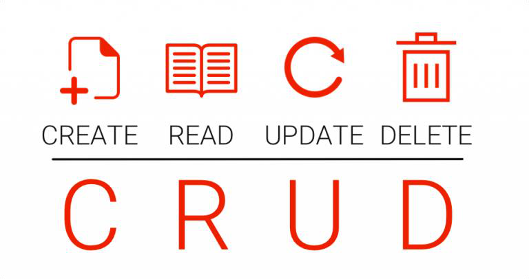

# 5.1 Introducció al DML i Integritat de Dades

Una vez creadas las taules que forman parte de nuestra base de dades, el siguiente paso es **poder utilizar esa información**: insertar datos, consultarlos, modificarlos o eliminarlos.

El **DML (Data Manipulation Language)** (*Lenguaje de Manipulación de Datos*) agrupa las instrucciones SQL encargadas de **manipular los datos** almacenados en las taules.

DML

A diferencia del **DDL**, que trabaja sobre la **estructura** de la base de dades, el **DML** trabaja sobre los **datos** almacenados en las taules.

## **Los sublenguajes de SQL**

Como ya vimos en la unidad anterior, las instrucciones SQL se agrupan en 5 categorías dependiendo de su funcionalidad:

****

````````

****

``````

****

````

****

``````

****

``

| Sub lenguaje | Función | Instrucciones principales |
| --- | --- | --- |
| DDL(Data Definition Language) | Definir la estructura de la base de dades | CREATE, ALTER, DROP, TRUNCATE |
| DML(Data Manipulation Language) | Manipular los datos de las taules | INSERT, UPDATE, DELETE |
| DCL(Data Control Language) | Controlar la seguridad y los permisos | GRANT, REVOKE |
| TCL(Transaction Control Language) | Gestionar las transaccions | COMMIT, ROLLBACK, SAVEPOINT |
| DQL(Data Query Language) | Consultar la información | SELECT |

## **Instrucciones DML**

Las instrucciones DML más importantes y utilizadas son:

- **`INSERT`**: para **añadir** información nueva.

- **`UPDATE`**: para **actualizar** la información existente.

- **`DELETE`**: para **borrar** la información que ya no nos sirve.

CRUD

Básicamente con estas 3 órdenes de SQL y la consulta (`SELECT`) ya podremos crear aplicaciones externas con lenguajes de programación. Estas 4 operaciones se conocen como aplicación **CRUD**:

- **C**: *Create* → Altas (`INSERT`).

- **R**: *Read* → Consultes (`SELECT`).

- **U**: *Update* → Modificaciones (`UPDATE`).

- **D**: *Delete* → Bajas (`DELETE`).



Resumen

- El **DML** permet manipular los datos de las taules.

- Sus instrucciones principales son `INSERT`, `UPDATE` y `DELETE`.

- Junto con `SELECT` forman el ciclo **CRUD** (*Create, Read, Update, Delete*).

- Estas operaciones son la base de cualquier aplicación que utilice una base de dades.