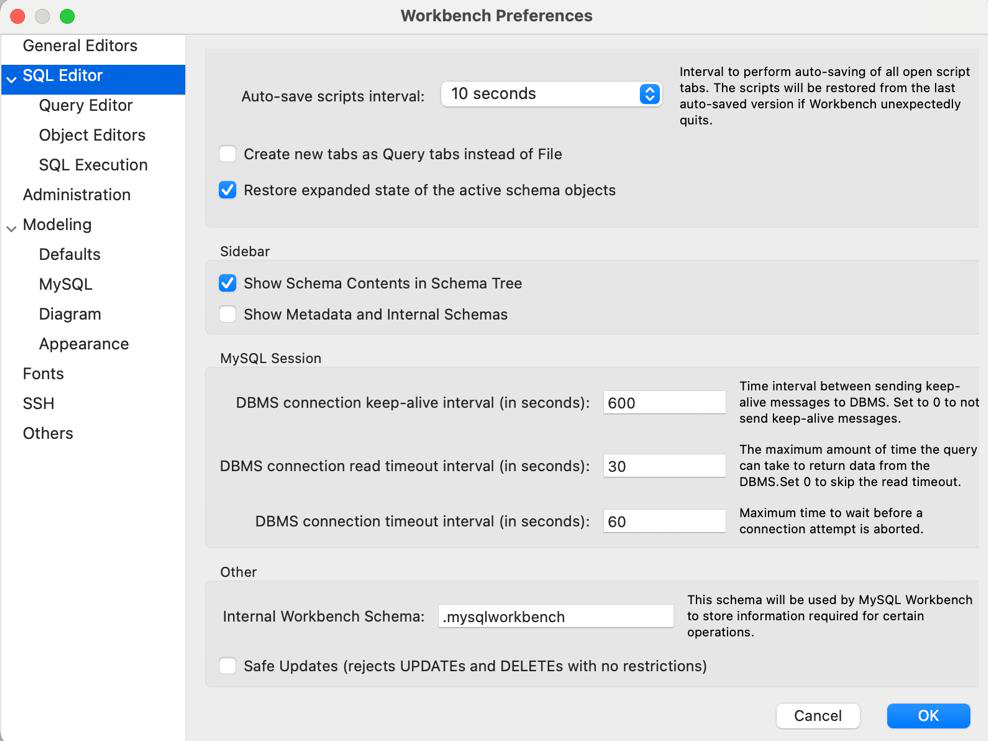
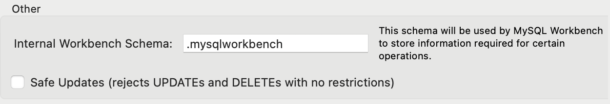

# 5.4 Modificació de Registres: Sentència UPDATE amb Condicions

Vamos a pasar a la parte de la **modificación** de los registres que tenemos en las taules de nuestra base de dades. La instrucción SQL es **`UPDATE`**.

## **Sintaxis**

Sintaxis de UPDATE

```sql

```

```sql

```

| 1 2 3 | UPDATE {nombre_taula | nombre_vista} SET columna1 = valor1 [, columna2 = valor2] ... [WHERE condición]; |
| --- | --- |

## **Ejemplos**

Actualizar registres que cumplen una condición

```sql

```

```sql

```

| 1 2 3 4 5 | -- Para los empleados que nacieron a partir de 1970 -- ponemos nombres con inicial mayúscula y localidad Marchena UPDATE EMPLEADOS SET NOMBRE = INITCAP(NOMBRE), LOCALIDAD = 'Marchena' WHERE FECHANAC >= '01/01/1970'; |
| --- | --- |

Actualizar todos los registres

```sql

```

```sql

```

| 1 2 3 4 | -- Ponemos todos los nombres a mayúsculas -- y todas las localidades a Estepa UPDATE EMPLEADOS SET NOMBRE = UPPER(NOMBRE), LOCALIDAD = 'Estepa'; |
| --- | --- |

UPDATE sin WHERE

Si omitimos el `WHERE`, el `UPDATE` se aplicará a **todos** los registres de la taula.

## **Safe mode (modo seguro) de MySQL Workbench**

Es posible que al intentar realizar una modificación Workbench nos diga:

```sql

```

```sql

```

| 1 2 3 | Error Code: 1175. You are using safe update mode and you tried to update a table without a WHERE that uses a KEY column. To disable safe mode, toggle the option in Preferences -> SQL Editor and reconnect. |
| --- | --- |

Entonces tenemos dos opciones:

- **Opción 1**: lanzar la sentencia:

Desactivar el modo seguro

```sql

```

```sql

```

| 1 | SET SQL_SAFE_UPDATES = 0; |
| --- | --- |

- **Opción 2**: modificar las **preferencias** de Workbench para quitar la seguridad a las modificaciones y a los borrados.





## **UPDATE con subconsultes**

En los `UPDATE` també usamos las **subconsultes**, bien sea para obtener los valores como para hacer de filtro.

UPDATE con subconsulta como filtro

```sql

```

```sql

```

| 1 2 3 | UPDATE comercial SET comision = comision + 20 WHERE ciudad = (SELECT ciudad FROM cliente WHERE nombre = 'Juan'); |
| --- | --- |

UPDATE con subconsulta como valor

```sql

```

```sql

```

| 1 2 3 | UPDATE comercial SET comision = ((SELECT MAX(c.comision) FROM comercial c) + 20) WHERE nombre = 'Juan'; |
| --- | --- |

## **Actualizaciones bajo integritat referencial**

Hay que tener en cuenta que las taules de tipo **InnoDB** (MySQL) permeten integritat referencial para las acciones de borrado y modificación impuestas en el diseño de la base de dades a la hora de eliminar o modificar registres.

Las posibles acciones son:

****

****
``

****
``

****

| Acción | Descripción |
| --- | --- |
| NO ACTION | Se impide la eliminación o modificación de un registre en una taula que tiene registres relacionados en otras taules. |
| RESTRICT | Equivale a NO ACTION. |
| SET NULL | Permite borrar o actualizar un registre de la taula "madre" poniendo en NULL el camp o camps relacionados en la taula "hija". |
| CASCADE | Propaga las modificaciones o borrados en los registres de la taula hija relacionados con los de la taula madre. |

Inserción de datos bajo integritat referencial

Si queremos hacer una inserción masiva de todos los datos del **equipo** y de los **jugadores**, la integritat referencial nos lo impedirá, porque:

- Si insertamos primero los datos del equipo, no podemos introducir un equipo cuyo **capitán** no exista en la taula `jugador`.

- Si lo hacemos al revés, insertando primero los datos de los jugadores, tampoco podemos introducir un jugador cuyo **equipo** no exista en la taula `equipo`.

```sql

```

```sql

```

| 1 | Jugador (id_jugador, ..., equipo)    Equipo (id_equipo, ..., id_capitan) |
| --- | --- |

Esto es pot solucionar insertando primero los datos **e imponiendo después las restricciones de integridad**.

En general, y para otras situaciones, debemos introducir en primer lugar los datos de las **taules principales** (a los que apuntan las claus foranes) y luego los datos de las **taules secundarias**.

Resumen

- `UPDATE` permet modificar los valores de los registres.

- `SET` indica las columnes y los nuevos valores.

- Sin `WHERE` se modifican **todos** los registres.

- `SET SQL_SAFE_UPDATES = 0` desactiva el modo seguro de Workbench.

- Se pueden utilizar **subconsultes** tanto como valor como para filtrar.

- Las acciones `NO ACTION`, `RESTRICT`, `SET NULL` y `CASCADE` controlan el comportamiento bajo integritat referencial.