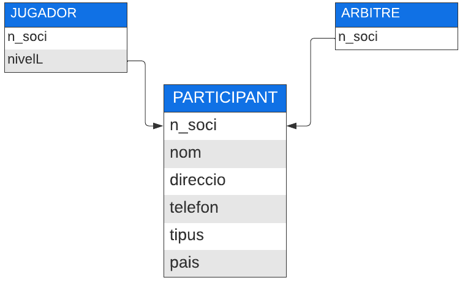
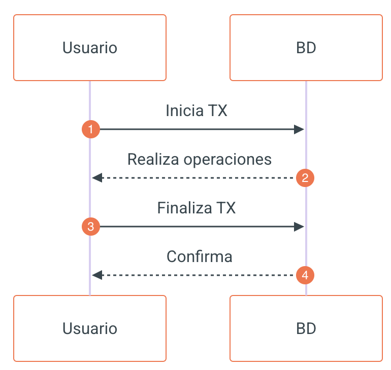

# 5.5 Transaccions (TCL): Propietats ACID, COMMIT, ROLLBACK i Savepoints

## **¿Qué es una transacció?**

Una **transacció** es un conjunto de órdenes (comandos SQL) que se ejecutan de manera **atómica o indivisible**, és a dir, **o se ejecutan todas o no se ejecuta ninguna**.

Per exemple, cuando demos de alta a un **participante** comportará dar de alta a un **jugador** o a un **árbitro** dependiendo del tipo de participante.

Si queremos insertar al jugador *"Garri Kaspárov"*, que vive en C/ Volgogrado nº 1 con teléfono 908908776, es un jugador que envía Croacia y tiene un nivel 10, esta acción contaría con **dos `INSERT`**: uno para el `PARTICIPANTE` y otro para incluir al `JUGADOR`.



¿Y si falla el segundo INSERT?

¿Qué pasaría si falla el segundo `INSERT` o el sistema cae?

Tendríamos el primer registre en la taula `PARTICIPANTE`, pero la base de dades quedaría en un estado **inconsistente**.

## **Pasos para crear una transacció**

Los pasos para hacer uso de una transacció siempre son los mismos en cualquier gestor de bases de dades:

- **Iniciar la transacció** (a partir de este punto todas las operaciones que se hagan sobre la base de dades estarán dentro de la transacció).

- **Realizar todas las operaciones**.

- Si todo ha ido bien, **confirmar** la transacció.

- Si ha habido un error, **deshacer** la transacció y dejar la base de dades como estaba antes de iniciarla.



## **Propiedades ACID**

Todo SGBD que se considera transaccional debe cumplir con las propiedades **ACID**:

****

****

******

****

| Propiedad | Descripción |
| --- | --- |
| Atomicidad | La transacció es indivisible: o se ejecutan todas las sentencias o no lo hará ninguna. |
| Consistencia | Después de una transacció, la base de dades estará en un estado válido y consistente. |
| Aislamiento (Isolation) | Cada transacció está aislada del resto de transaccions y el acceso a los datos se hace de forma exclusiva. Si una transacció quiere acceder de forma concurrente a los datos que están siendo utilizados por otra transacció, no podrá hacerlo hasta que la primera haya terminado. |
| Durabilidad | Los cambios que realiza una transacció sobre la base de dades son permanentes. |

## **Sintaxis de una transacció**

Sintaxis de una transacció

```sql

```

```sql

```

| 1 2 3 4 5 6 7 8 | START TRANSACTION [transaction_characteristic [, transaction_characteristic] ...]  transaction_characteristic: {     WITH CONSISTENT SNAPSHOT     | READ WRITE     | READ ONLY } |
| --- | --- |

Las instrucciones principales del **TCL (Transaction Control Language)** son:

````

``

``

``

| Instrucción | Descripción |
| --- | --- |
| START TRANSACTION o BEGIN | Empezar una nueva transacció. |
| COMMIT | Confirma la transacció actual, haciendo que sus cambios sean permanentes. |
| ROLLBACK | Revierte la transacció actual y cancela sus cambios. |
| SET autocommit = {0 \| 1} | Deshabilita o habilita el modo de confirmación automática predeterminado para la sesión actual. |

Sintaxis de COMMIT y ROLLBACK

```sql

```

```sql

```

| 1 2 3 4 | BEGIN [WORK] COMMIT [WORK] [AND [NO] CHAIN] [[NO] RELEASE] ROLLBACK [WORK] [AND [NO] CHAIN] [[NO] RELEASE] SET autocommit = {0 | 1} |
| --- | --- |

## **Auto Commit**

El SGBD define el parámetro **autocommit** para indicar si se aceptan automáticamente todos los cambios realizados y no es posible deshacerlos.

De forma predeterminada, MySQL se ejecuta con el modo de confirmación automática habilitado. Esto significa que, cuando no se encuentra dentro de una transacció, cada instrucción es atómica, como si estuviera rodeada por `START TRANSACTION` y `COMMIT`.

No es pot utilizar `ROLLBACK` para deshacer el efecto; no obstant això, si se produce un error durante la ejecución de la instrucción, la instrucción se revierte.

- Para **consultar** el nivel del autocommit, necesitamos realizar una consulta sobre la propiedad `@@AUTOCOMMIT`:

Consultar el valor de autocommit

```sql

```

```sql

```

| 1 | SELECT @@AUTOCOMMIT; |
| --- | --- |

- Para **desactivarlo**, le asignamos el valor 0:

Desactivar autocommit

```sql

```

```sql

```

| 1 | SET AUTOCOMMIT = 0; |
| --- | --- |

Al desactivarlo tendremos una transacció abierta. Los cambios solo se aplicarían ejecutando la sentencia `COMMIT` de forma explícita.

- Para **volver a activarlo**, le asignamos el valor 1:

Activar autocommit

```sql

```

```sql

```

| 1 | SET AUTOCOMMIT = 1; |
| --- | --- |

### **Iniciar, confirmar y deshacer una transacció**

**Iniciar transacció**: podremos utilizar una de las tres formas siguientes:

Iniciar una transacció

```sql

```

```sql

```

| 1 2 3 | SET AUTOCOMMIT = 0; START TRANSACTION; BEGIN WORK; |
| --- | --- |

**Confirmar transacció**: para que todas las acciones ejecutadas en la transacció sean aceptadas, y per tant consolidadas, debemos ejecutar:

Confirmar una transacció

```sql

```

```sql

```

| 1 2 | COMMIT; COMMIT WORK; |
| --- | --- |

**Deshacer transacció**: en caso de que comprobemos que haya habido algún error, podremos deshacer los cambios que se produjeran en la base de dades desde el comienzo de la transacció con la orden:

Deshacer una transacció

```sql

```

```sql

```

| 1 2 | ROLLBACK; ROLLBACK WORK; |
| --- | --- |

## **Ejemplo de transacció**

Vamos a ver el comportamiento de una transacció y el autocommit:

Ejemplo completo

```sql

```

```sql

```

| 1  2  3  4  5  6  7  8  9 10 11 12 13 14 15 16 | DROP DATABASE IF EXISTS pruebas; CREATE DATABASE pruebas CHARACTER SET utf8mb4; USE pruebas;  CREATE TABLE cliente (     id INT UNSIGNED PRIMARY KEY,     nombre VARCHAR (32) );  START TRANSACTION; INSERT INTO cliente VALUES (1, 'José Manuel'); COMMIT;  SET AUTOCOMMIT = 0; INSERT INTO cliente VALUES (2, 'Marina'); INSERT INTO cliente VALUES (33, 'Pedro'); |
| --- | --- |

En este ejemplo:

- Ejecutamos la creación de la base de dades `pruebas` y creamos una taula `cliente`.

- Insertamos a *José Manuel* dentro de una transacció; la transacció con el `COMMIT` confirma la modificación y el cambio queda registrado en la base de dades.

- Modificamos el autocommit y realizamos `INSERT` en la taula.

Pregunta

¿Qué sucederá si accedemos con otro usuari o si cerramos nuestra sesión?

Los `INSERT` de *Marina* y *Pedro* aún no han sido confirmados con `COMMIT`, por lo que **no serán visibles** para otros usuaris y se perderán al cerrar la sesión.

## **Niveles de aislamiento**

Una de las características que tienen las transaccions es impedir que un usuari pueda acceder a información que está siendo modificada por otro usuari y aún no está confirmada (**lecturas sucias**).

Para gestionar este caso los gestores de BBDD utilizan la instrucción `ISOLATION` para aislar estos datos.

Establecer el nivel de aislamiento

```sql

```

```sql

```

| 1 | SET TRANSACTION ISOLATION LEVEL nivel_aislamiento; |
| --- | --- |

Los niveles de aislamiento que disponemos en los gestores de BBDD son:

****

****

****

****

| Nivel | Descripción |
| --- | --- |
| READ UNCOMMITTED | Lecturas no confirmadas. |
| READ COMMITTED | Lecturas confirmadas. |
| REPEATABLE READ | Lecturas repetibles. |
| SERIALIZABLE | Serializable. |

### **READ UNCOMMITTED**

Lecturas no confirmadas, nivel **más bajo** de aislamiento; solamente protege de lecturas de datos físicamente dañadas.

Es el que produce mayor nivel de concurrencia (nunca hay un bloqueo), pero també el que **no garantiza en absoluto la coherencia** de los datos. Este nivel de aislamiento **no soluciona** el problema de lecturas sucias.

### **READ COMMITTED**

Lecturas confirmadas. Este nivel de aislamiento soluciona el problema anterior, el de las **lecturas sucias**, pero no soluciona el problema de **lecturas no repetibles** (*non-repeatable read*): el fenómeno que es pot producir al ejecutar la instrucción varias veces durante la misma transacció produciendo diferentes conjuntos de resultados.

### **REPEATABLE READ**

Lecturas repetibles. Este nivel de aislamiento devuelve el **mismo conjunto de resultados** para diferentes ejecuciones de la `SELECT` dentro de una misma transacció.

Una transacció que se ejecuta en este nivel de aislamiento no tiene en cuenta los cambios de los datos realizados por otras transaccions, independientemente de si los cambios se han confirmado (`COMMIT`) o no. Esto asegura que las lecturas siempre son consistentes (repetibles).

Este nivel de aislamiento es el **predeterminado para InnoDB**. Aunque resuelve el problema de lectura no repetible, existe otro fenómeno: los datos **fantasma** (*phantom read*).

### **SERIALIZABLE**

Este nivel de aislamiento soluciona el problema de datos fantasma (*phantom read*). Lo que hace el gestor es **bloquear todos los recursos** utilizados por la transacció.

DeadLock o abrazo mortal

El nivel `SERIALIZABLE` puede dar lugar a un problema denominado **DeadLock** o *abrazo mortal*, que se produce cuando **dos transaccions están esperando por recursos que están siendo bloqueados por ellas**.

## **Sentencias que no es poden revertir (sin Rollback)**

Algunas sentencias **no es poden revertir**. En general, se trata de sentencias del lenguaje de definición de datos (**DDL**):

- Sentencias del lenguaje de definición de datos (DDL): `ALTER EVENT`, `ALTER FUNCTION`, `ALTER PROCEDURE`, `ALTER SERVER`, `ALTER TABLE`, `ALTER TABLESPACE`, `ALTER VIEW`, `CREATE DATABASE`, `CREATE EVENT`, `CREATE FUNCTION`, `CREATE INDEX`, `CREATE PROCEDURE`, `CREATE ROLE`, `CREATE SERVER`, `CREATE SPATIAL REFERENCE SYSTEM`, `CREATE TABLE`, `CREATE TABLESPACE`, `CREATE TRIGGER`, `CREATE VIEW`, `DROP DATABASE`, `DROP EVENT`, `DROP FUNCTION`, `DROP INDEX`, `DROP PROCEDURE`, `DROP ROLE`, `DROP SERVER`, `DROP SPATIAL REFERENCE SYSTEM`, `DROP TABLE`, `DROP TABLESPACE`, `DROP TRIGGER`, `DROP VIEW`, `INSTALL PLUGIN`, `RENAME TABLE`, `TRUNCATE TABLE`, `UNINSTALL PLUGIN`.

- Sentencias que utilizan o modifican implícitamente taules en la base de dades `mysql`: `ALTER USER`, `CREATE USER`, `DROP USER`, `GRANT`, `RENAME USER`, `REVOKE`, `SET PASSWORD`.

- Sentencias de bloqueo y control de transaccions: `BEGIN`, `LOCK TABLES`, `SET autocommit = 1`, `START TRANSACTION`, `UNLOCK TABLES`.

- Instrucciones de carga de datos: `LOAD DATA`.

- Instrucciones administrativas: `ANALYZE TABLE`, `CACHE INDEX`, `CHECK TABLE`, `FLUSH`, `LOAD INDEX INTO CACHE`, `OPTIMIZE TABLE`, `REPAIR TABLE`, `RESET`.

- Declaraciones de control de replicación: `START REPLICA`, `STOP REPLICA`, `RESET REPLICA`, `CHANGE REPLICATION SOURCE TO`.

DDL y transaccions

Las sentencias **DDL** provocan un **COMMIT implícito** en MySQL y **no pueden deshacerse con ROLLBACK**.

## **SAVEPOINT (puntos de control)**

Los **savepoints** o puntos de parada posicionan paradas entre los pasos de una transacció, de forma que si se efectúa `ROLLBACK` este pueda ser total (toda la transacció) o hasta uno de los puntos de control de la transacció.

- Para **definirlos** utilizaremos la etiqueta `SAVEPOINT`.

- Posteriormente, al ocurrir un error, podemos indicar que realice un `ROLLBACK TO [SAVEPOINT]`, deshaciendo **solo** las instrucciones que se han ejecutado hasta el punto de parada indicado.

- Para **eliminar** un savepoint, necesitaremos hacerlo mediante `RELEASE SAVEPOINT`.

Ejemplo con SAVEPOINT

```sql

```

```sql

```

| 1  2  3  4  5  6  7  8  9 10 11 12 13 14 15 16 | INSERT INTO cliente VALUES (1, 'José Manuel', 'Alberic'); SAVEPOINT P1; INSERT INTO cliente VALUES (2, 'Marina', 'València'); SAVEPOINT P2; INSERT INTO cliente VALUES (3, 'Andreu', 'Gavarda');  -- Recuperamos los clientes que acabamos de insertar SELECT * FROM cliente;  ROLLBACK TO P1;   -- Deshace los insert de Marina y Andreu SELECT * FROM cliente;  -- Mostrará solo José Manuel  ROLLBACK TO P2;   -- Dará error porque al haber hecho rollback                   -- a un punto de control anterior desaparece P2  COMMIT;           -- Sólo quedará guardado José Manuel |
| --- | --- |

Resumen

- Una **transacció** es un conjunto de sentencias que se ejecutan de forma atómica.

- Las propiedades **ACID** garantizan el comportamiento transaccional.

- `START TRANSACTION`, `COMMIT` y `ROLLBACK` controlan la transacció.

- `SET AUTOCOMMIT = 0` abre una transacció en la sesión actual.

- Los **niveles de aislamiento** van de `READ UNCOMMITTED` a `SERIALIZABLE`.

- Las sentencias **DDL** no es poden deshacer con `ROLLBACK`.

- Los **SAVEPOINT** permeten deshacer parcialmente una transacció.