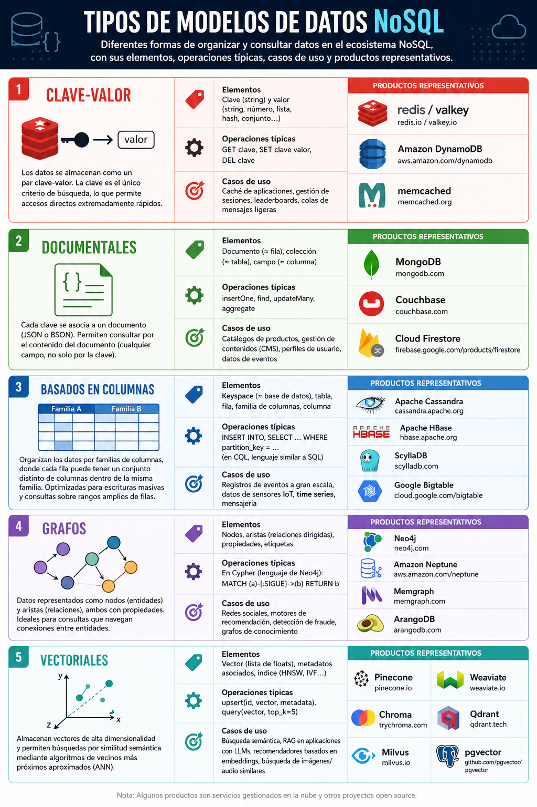

# **Bases de dades no relacionals (NoSQL)**

  

    🏆 <strong>Progrés d'aquesta secció:</strong> 0 de 4 superats (0%)
    ⭐ <strong>0 punts</strong>
  

  

    

  

## **NoSQL**

Abans de definir **NoSQL**, convé entendre **per què surgió**. A finals dels 2000, empreses com *Google*, *Amazon* o *Facebook* es enfrentaven a problemes que els SGBD relacionals no podien resoldre eficientement:

- Volum: bases de dades de diversos *petabytes* que no caben en un servidor únic.

- Esquemes variables: els productes d'un catàleg o els perfiles d'usuari evolucionan continuament i no encajan en un esquema rígido.

- Latencia baixa a escala global: usuaris en tot el món esperant respostes de milisegundos.

- Cost: escalar verticalment amb *maquinari* especialitzat resulta prohibitivo.

Les publicacions fundacionals del moviment NoSQL són [BigTable](https://research.google/pubs/bigtable-a-distributed-storage-system-for-structured-data/) (Google, 2006) i [Dynamo](https://www.allthingsdistributed.com/files/amazon-dynamo-sosp2007.pdf) (Amazon, 2007), que inspiraron a bona part de les solucions actuals (*HBase*, *Cassandra*, *DynamoDB*…).

Aquest açò, si definim **NoSQL** formalment, podem dir que es tracta d'un conjunt de tecnologies que permeten el processament ràpid i eficient de conjunts de dades dando la major importància al rendiment, la fiabilitat i l'agilitat.

Si ens basamos en l'acrónimo, el terme dóna la sensació de que es refereix a qualsevol magatzem de dades que no segueix un model relacional, les dades no són relacionals i per tant no utilitzen SQL com llenguatge de consulta. Realment implica que el *No* fa referència a *not only*, és a dir, que els sistemes NoSQL es centran en sistemes complementarios als SGBD relacionals, que fixen les seues prioritats en l'escalabilitat i la disponibilitat en contra de l'atomicitat i consistència de les dades.

Així ja que, la revolució NoSQL es basa en comprendre que hi ha més d'una manera de resoldre els problemes. Hi ha vida més enllà dels sistemes de bases de dades relacionals, i NoSQL permet triar la millor eina per a cada situació, que en algunes ocasions serà una base de dades relacional, però en altres no. Per tant, més que sustitutos dels sistemes relacionals, les solucions NoSQL es plantean com alternatives i complementarias als sistemes gestors de bases de dades relacionals.

- **Clau-Valor**: Els magatzems clau-valor són les bases de dades NoSQL més simples. Cada element de la base de dades s'emmagatzema amb un nom d'atribut (o clau) al costat del seu valor, a mode de diccionari. Els magatzems més coneguts són [Redis](https://redis.io), [Riak](https://riak.com) i [AWS DynamoDB](https://aws.amazon.com/es/dynamodb/). Alguns magatzems, com és el cas de *Redis*, permeten que cada valor tinga un tipus (per exemple, *integer*) la qual cosa afegeix funcionalitat extra.

### **Classificació segons el model de dades**

Els diferents tipus de bases de dades NoSQL existents es poden agrupar tradicionalment en quatre categories, a les que recientement es ha afegit una cinquena: les bases de dades vectorials.

#### **Clau-Valor**

Els magatzems clau-valor són les bases de dades NoSQL més simples. Cada element s'emmagatzema amb un nom d'atribut (o **clau**) al costat del seu **valor**, a mode de diccionari. La clau és l'únic criteri de cerca, el que les fa extremadament rápides per a accés directe, però limitades per a consultes complexes.

|  |  |
| --- | --- |
| Elements | Clau (string) i valor (string, número, llista, hash, conjunt…) |
| Operacions típiques | `GET clave`, `SET clave valor`, `DEL clave` |
| Casos d'ús | Caché d'aplicacions, gestió de sessions, *leaderboards*, colas de missatges ligeras |
| Productes representatius | [Redis](https://redis.io) / [Valkey](https://valkey.io/), [AWS DynamoDB](https://aws.amazon.com/es/dynamodb/), [Memcached](https://memcached.org/) |

#### **Documentals**

Cada clau s'associa a una estructura complexa que es coneix com **document**, normalment en format JSON o BSON. Els documents poden contindre parells clau-valor, arrays i fins i tot documents imbricats. A diferència de clau-valor, els motors documentals permeten consultar pel contingut del document (per qualsevol camp, no només per la clau).

|  |  |
| --- | --- |
| Elements | Document (≈ fila), col·lecció (≈ taula), camp (≈ columna) |
| Operacions típiques | `insertOne`, `find`, `updateMany`, `aggregate` |
| Casos d'ús | Catálogos de productes, gestió de continguts (CMS), perfiles d'usuari, dades d'esdeveniments |
| Productes representatius | [MongoDB](https://www.mongodb.com), [Couchbase](https://www.couchbase.com/), [Firestore](https://firebase.google.com/products/firestore) (en aplicacions mòbils i web) |

#### **Basats en columnes**

A pesar del nom, no emmagatzemen les dades columna per columna en el sentit analític (això el fan els formats com *Parquet*), sinó que organitzen les dades per **familias de columnes**, on cada fila pot tindre un conjunt distint de columnes dins de la mateixa família. Estan optimitzats per a escrituras masivas i consultes sobre rangs amplios de files.

|  |  |
| --- | --- |
| Elements | *Keyspace* (≈ base de dades), taula, fila, família de columnes, columna |
| Operacions típiques | `INSERT INTO`, `SELECT … WHERE partition_key = …` (en CQL, llenguatge similar a SQL) |
| Casos d'ús | Registres d'esdeveniments a gran escala, dades de sensors IoT, *time sèries*, mensajería |
| Productes representatius | [Apache Cassandra](https://cassandra.apache.org/), [HBase](https://hbase.apache.org/), [ScyllaDB](https://www.scylladb.com/), [Google Bigtable](https://cloud.google.com/bigtable) |

#### **Grafos**

Els magatzems de grafos estan dissenyats perquè les relacions siguen tan importants com els propis dades: es representen com **nodes** (entitats) i **aristas** (relacions), tots dos amb propietats. Són ideals quan les consultes es basen en navegar les connexions (amigos d'amigos?, recomendacions?, detecció de fraude?).

|  |  |
| --- | --- |
| Elements | Nodes, aristas (relacions dirigides), propietats, etiquetes |
| Operacions típiques | En *Cypher* (llenguatge de *Neo4j*): `MATCH (a)-[:SIGUE]->(b) RETURN b` |
| Casos d'ús | Xarxes socials, motors de recomanació, detecció de fraude, grafos de coneixement |
| Productes representatius | [Neo4j](https://neo4j.com/), [AWS Neptune](https://aws.amazon.com/es/neptune/), [Memgraph](https://memgraph.com/), [ArangoDB](https://www.arangodb.com/) (multimodal) |

#### **Vectorials**

Les bases de dades vectorials són una categoria que ha emergido amb fuerza des de 2022 a arrel de l'auge dels LLMs i els models de *embeddings*. Emmagatzemen vectors d'alta dimensionalitat (típicament 384, 768 o 1536 dimensions) i permeten realitzar cerques per similitud semàntica mitjançant algoritmos de veïns més pròxims aproximats (*ANN, Approximate Nearest Neighbours*).

|  |  |
| --- | --- |
| Elements | Vector (llista de *floats*), metadades associats, índex (HNSW, IVF…) |
| Operacions típiques | `upsert(id, vector, metadata)`, `query(vector, top_k=5)` |
| Casos d'ús | Cerca semàntica, RAG (*Retrieval Augmented Generation*) en aplicacions amb LLMs, recomendadors basats en *embeddings*, cerca d'imatges/àudio similars |
| Productes representatius | [Pinecone](https://www.pinecone.io/), [Weaviate](https://weaviate.io/), [Chroma](https://www.trychroma.com/), [Qdrant](https://qdrant.tech/), [Milvus](https://milvus.io/), o l'extensió [pgvector](https://github.com/pgvector/pgvector) per a *PostgreSQL* |

> **📌 Bases de dades multimodals**
> 

> Cada vegada més sistemes combinen diversos models en un només producte. *MongoDB Atlas* inclou *Atlas Vector Search*, *Redis* té un mòdul vectorial, *PostgreSQL* amb *pgvector* mescla relacional i vectorial. La frontera entre tipus NoSQL és més difusa que fa 5 anys.

### **Característiques**

Les bases de dades no relacionals (*NoSQL*) presentan característiques que les diferencian de les bases de dades relacionals. Els seus principals característiques són:

1. **Flexibilitat en l'esquema**: No requereixen un esquema fix, el que permet emmagatzemar dades amb estructures variades i evolucionar sense grans modificacions. És a dir, són capaços de treballar
   amb dades estructurats, semi-estructurats i sense estructurar. Quasi totes les implementacions NoSQL ofereixen algun tipus de representació per a dades sense esquema, el que permet començar amb una estructura i amb el pas del temps, afegir nous camps, ja siguen senzills o imbricats a dades ja existents.

1. **Escalabilitat horitzontal**: Estan dissenyades per a distribuir dades en múltiples servidors mitjançant tècniques com el *sharding* o particionado, el que permet aumentar la capacitat del sistema simplement afegint més nodes. A diferència de les bases de dades relacionals, que solen escalar verticalment (aumentant la capacitat d'un només servidor), les bases de dades NoSQL poden crecer de forma distribuïda sense afectar el rendiment, d'un mode transparent per al desenvolupador.

1. **Models de dades** diversos: Poden organizar-se en diferents tipus d'emmagatzematge, que resolen diversos problemes que no es plantearon al definir el model relacional, com els models clau-valor (*Redis*), documental (*MongoDB*), columnar (*Cassandra*) o basada en grafos (*Neo4j*).

1. **Alta disponibilitat** i tolerància a fallades: Utilitzen replicació i distribució de dades en múltiples nodes per a garantir que el sistema continúe funcionant ante fallades de maquinari o xarxa. Alguns sistemes NoSQL implementan models de replicació primari-secundari (també anomenat *leader-follower*, terminología que ha sustituido al clàssic *master-slave*) o replicació distribuïda sense node principal per a assegurar la continuitat del servei.

1. **Optimització per a lectura/escriptura masiva**: Aquestes bases de dades estan dissenyades per a gestionar grans volums de dades i transaccions d'alta velocitat. Són ideals per a aplicacions amb una carrega intensa d'escriptura, com xarxes socials, registres de sensors IoT o anàlisi de grans volums de dades en temps real.

1. **Consistència eventual**: En lloc de seguir l'estricte model ACID de les bases de dades relacionals, moltes bases de dades NoSQL priorizan la disponibilitat i la tolerància a particions, segons el teorema CAP. Açò significa que, en alguns casos, les dades poden no estar sincronitzats en tots els nodes de manera immediata, però eventualment alcanzan la consistència. Aquest enfocament és útil per a aplicacions distribuïdes on la latencia és més crítica que la consistència immediata.

1. **Emmagatzematge distribuït**: Poden operar en entorns de computació en la núvol i escalar dinámicament segons la demanda. Gràcies a la seua arquitectura distribuïda, són altament eficients per a manejar dades en infraestructuras descentralitzades i en plataformes de serveis en la núvol com *AWS*, *Google Cloud* o *Azure*.

Aquestes característiques fan que les bases de dades NoSQL siguen ideals per a aplicacions modernes com xarxes socials, IoT, anàlisi de dades i sistemes en temps real.

Aquest açò, a diferència de les bases de dades relacionals, on SQL actua com llenguatge comú a quasi tots els productes, en NoSQL no existeix un llenguatge de consulta universal. Cada família té la seua pròpia API o llenguatge: comandes en *Redis*, *aggregation pipeline* en *MongoDB*, CQL en *Cassandra*, *Cypher* o *Gremlin* en bases de grafos, SDKs específics en bases vectorials… L'elecció del tipus de base de dades condiciona profundament com es diseñan les consultes i les estructures de dades, el que veurem en detall en la següent unitat *MongoDB*.

---

## 🎮 Reptes Interactius d'Autoavaluació (+100 XP)

Comprova el teu domini sobre **8.1 Bases de dades no relacionals (NoSQL)** superant aquests 4 reptes gamificats (+25 punts cadascun):

  
🎯 <strong>Repte 1 (+25 pts):</strong> En les bases de dades NoSQL documentals com MongoDB, quin format binari s'utilitza internament per a emmagatzemar els documents amb suport de tipus de dades estès?

  

    <button type="button" class="btn-mcq-opt" data-opt="A">A) CSV delimitat per punt i coma.</button>
    <button type="button" class="btn-mcq-opt" data-opt="B">B) BSON (Binary JSON).</button>
    <button type="button" class="btn-mcq-opt" data-opt="C">C) HTML4 transicional.</button>
    <button type="button" class="btn-mcq-opt" data-opt="D">D) Taules relacionals planes.</button>
  

  

  
🎯 <strong>Repte 2 (+25 pts):</strong> A què equival una 'taula' i una 'fila/tupla' del model relacional dins de la terminologia de MongoDB?

  

    <button type="button" class="btn-mcq-opt" data-opt="A">A) A una 'col·lecció' (collection) i un 'document' (document) respectivament.</button>
    <button type="button" class="btn-mcq-opt" data-opt="B">B) A un 'trigger' i una 'vista'.</button>
    <button type="button" class="btn-mcq-opt" data-opt="C">C) A un 'full de càlcul' i una 'macro'.</button>
    <button type="button" class="btn-mcq-opt" data-opt="D">D) A un 'arbre DTD' i un 'atribut XML'.</button>
  

  

  
✅ <strong>Repte 3 (Vertader o Fals · +25 pts):</strong> En MongoDB, tot document emmagatzemat dins d'una col·lecció posseeix un camp clau <code>_id</code> que l'identifica de manera única.

  

    <button type="button" class="btn-vf" data-opt="V">Vertader (V)</button>
    <button type="button" class="btn-vf" data-opt="F">Fals (F)</button>
  

  

  
⌨️ <strong>Repte 4 (+25 pts):</strong> Quin mètode de <code>mongosh</code> s'utilitza sobre una col·lecció (<code>db.colleccio.____()</code>) per a cercar i recuperar documents que compleixen un filtre?

  

    <input type="text" class="quiz-input" placeholder="Escriu la resposta..." />
    <button type="button" class="btn-quiz-check">Comprovar</button>
  

  

### 📋 Llista de Comprovació i Rúbrica d'Assoliment

Marca cada criteri a mesura que completes l'estudi o la resolució pràctica d'aquesta pàgina (**8.1 Bases de dades no relacionals (NoSQL)**):

- [ ] He llegit detingudament la teoria o l'enunciat d'aquesta secció i he anotat els conceptes clau.
- [ ] He revisat els esquemes, taules o blocs de codi i he verificat que sé aplicar-los a l'entorn de treball.
- [ ] He resolt correctament els **4 reptes interactius** superiors obtenint els **100 punts XP**.
- [ ] He descarregat el comprovant oficial en PDF per a adjuntar-lo a la tasca d'**Aules**.

  <h3>📤 Comprovant de Lliurament per a Aules</h3>
  
Quan hages completat els reptes interactius i la llista d'autoavaluació d'aquesta pàgina, introdueix el teu nom i descarrega el teu certificat oficial en PDF per a adjuntar-lo a la tasca d'<strong>Aules</strong>.

  

    <label for="aules-student-name">👤 Nom i Cognoms de l'Alumne/a:</label>
    <input type="text" id="aules-student-name" class="aules-student-name" placeholder="Ex: Joan Garcia Pérez" />
  

  

    0/4 reptes completats (0%) · 0 punts · 0/4 criteris d'autoavaluació
  

  

    <button type="button" class="btn-aules-dl" data-module="BBDD" data-unit="UD08" data-activity="ut0801">📥 Descarregar Comprovant PDF</button>
    <button type="button" class="btn-aules-copy">📋 Copiar Resum al Porta-retalls</button>
  

  

