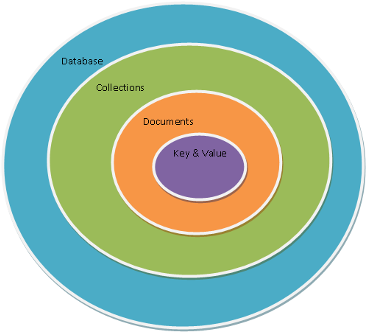
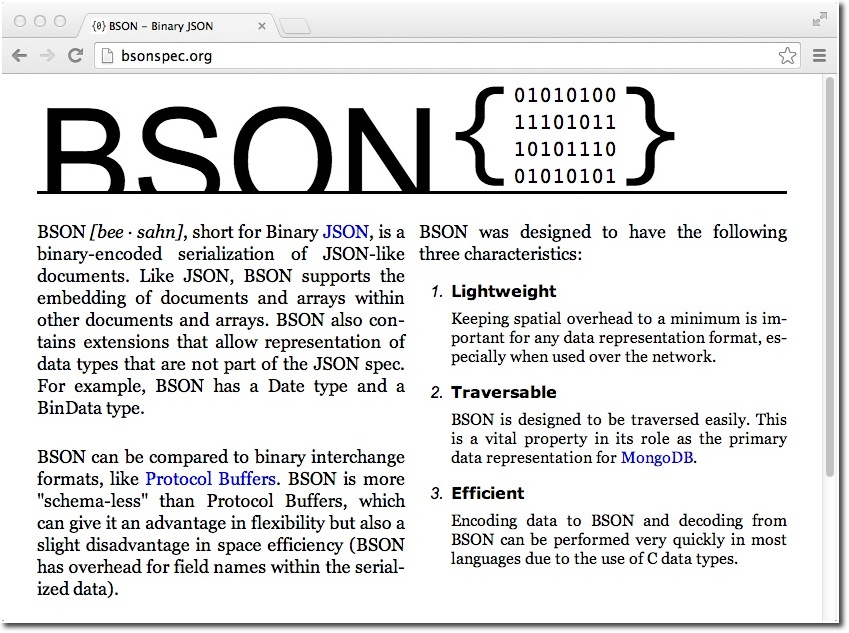
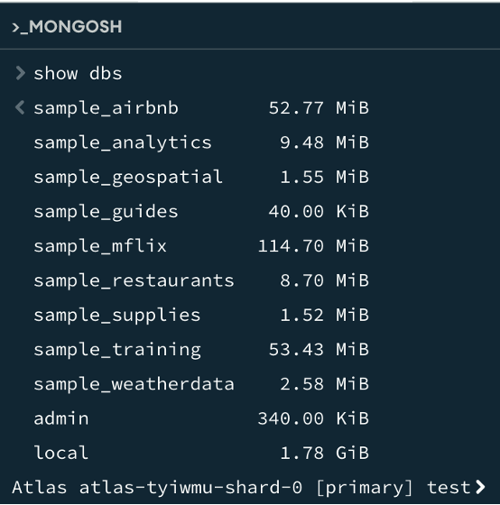

# **MongoDB**


[**MongoDB**](https://www.mongodb.com) es una de las bases de datos NoSQL más conocidas y empleadas. Sigue un modelo de datos documental, donde los documentos se basan en el formato JSON.

**MongoDB** destaca porque:

- Soporta esquemas dinámicos: diferentes documentos de una misma colección pueden tener atributos diferentes.

- Aunque inicialmente tenía un soporte limitado de *joins*, desde la versión 5.2 se pueden realizar incluso entre colecciones particionadas.

- Soporte de transacciones sólo a nivel de aplicación. Lo que en un SGBD relacional puede suponer múltiples operaciones, con *MongoDB* se puede hacer en una sola operación al insertar/actualizar todo un documento de una sola vez, pero si queremos crear una transacción entre dos documentos, la gestión la debe realizar el driver.

> **📌 huMONGOus**
> 

> Como curiosidad, su nombre viene de la palabra inglesa *humongous*, que significa gigantesco/enorme.

## **Puesta en Marcha**

En la actualidad,** MongoDB** se comercializa mediante tres productos:

- [**Mongo Atlas**](https://www.mongodb.com/developer/products/atlas/), como plataforma cloud, con una opción gratuita mediante un clúster de 512MB.

- [**MongoDB Community Edition**](https://www.mongodb.com/try/download/community), versión gratuita para trabajar on-premise, con versiones para Windows, MacOS y Linux.

- [**MongoDB Enterprise Advanced**](https://www.mongodb.com/products/mongodb-enterprise-advanced), versión de pago con soporte, herramientas avanzadas de monitorización y seguridad, y administración automatizada.

En nuestro caso, y para simplificar, trabajaremos con la versión cloud **Mongo Atlas**. Los pasos necesarios para su creación, configuración y uso, así como la conexión mediante *MongoDBCompass* los puedes encontrar en la sección de **Instalación MongoDB**.

## **Elementos**

Hay una serie de conceptos que conviene conocer antes de entrar en detalle:



- *MongoDB* tiene el mismo concepto de **base de datos** que un SGBD relacional. Dentro de una instancia de *MongoDB* podemos tener 0 o más bases de datos, actuando cada una como un contenedor de alto nivel.

- Una base de datos tendrá 0 o más colecciones. Una **colección** es muy similar a lo que entendemos como tabla dentro de una base de datos relacional. *MongoDB* ofrece diferentes tipos de colecciones, desde las normales cuyo tamaño crece conforme lo hace el número de documentos, como las colecciones *capped*, las cuales tienen un tamaño predefinido y que pueden contener una cierta cantidad de información que se sustituirá por nueva cuando se llene.

- Las colecciones contienen 0 o más **documentos**, por lo que es similar a una fila o registro de una tabla relacional.

- Cada documento contiene 0 o más atributos, compuestos de **parejas clave/valor**. Cada uno de estos documentos no sigue ningún esquema, por lo que dos documentos de una misma colección pueden contener todos los atributos diferentes entre sí. Todo documento contiene un campo `_id` que hace la función de atributo identificador del documento.

Así pues, tenemos que una base de datos va a contener varias colecciones, donde cada colección contendrá un conjunto de documentos.

Además, *MongoDB* soporta **índices**, igual que cualquier RDBMS, para acelerar la búsqueda de datos. Al realizar cualquier consulta, se devuelve un **cursor**, con el cual podemos realizar operaciones como contar, ordenar, limitar o saltar documentos.

### **BSON**

Mediante *JavaScript* podemos crear objetos que se representan con JSON. Internamente, *MongoDB* almacena los documentos mediante BSON (*Binary JSON*). Podemos consultar la especificación en [BSONSpec.org](https://BSONSpec.org)



BSON representa un **superset** de JSON ya que:

- Permite almacenar datos en binario

- Incluye un conjunto de tipos de datos no incluidos en JSON, como pueden ser `ObjectId`, `Date` o `BinData`.

- Diseñado para ser más eficiente en espacio y realizar búsquedas de forma más rápida.

Podemos consultar todos los tipos que soporta un objeto BSON en el [Manuel de MongoDB](https://docs.mongodb.org/manual/reference/bson-types/)

Un ejemplo de un objeto BSON podría ser:

> **📌 BSON**
> 

```sql
var yo = {
  nombre: "Aitor",
  apellidos: "Medrano",
  fnac: new Date("Oct 3, 1977"),
  hobbies: ["programación", "videojuegos", "baloncesto"],
  casado: true,
  hijos: 2,
  contacto: {
    bsky: "@aitormedrano.bsky.social",
    email: "a.medrano@edu.gva.es"
  },
  fechaCreacion: new Timestamp()
}
```

Los [documentos](https://www.mongodb.com/docs/manual/core/document/) BSON tienen las siguientes restricciones:

- No pueden tener un tamaño superior a 16 MB.

- El atributo `_id` queda reservado para la clave primaria.

- Desde *MongoDB* 5.0 los nombres de los campos pueden [empezar por `$` y/o contener el `.`](https://www.mongodb.com/docs/manual/core/dot-dollar-considerations), aunque en la medida de lo posible, es recomendable evitar su uso.

Además, *MongoDB*:

- No asegura que el orden de los campos se respete.

- Es sensible a los tipos de los datos

- Es sensible a las mayúsculas.

Por lo que estos documentos son distintos:

> **📌 JSON**
> 

```sql
{"edad": "18"}
{"edad": 18}
{"Edad": 18}
```

Si queremos validar si un documento JSON es válido, podemos usar [https://jsonlint.com/](https://jsonlint.com/). Hemos de tener en cuenta que sólo valida JSON y no BSON, por tanto nos dará errores en los tipos de datos propios de BSON.

### **Uso del shell**

Una vez ya tenemos en marcha *MongoDB*, llega el momento de conectarnos. Aunque utilizaremos *MongoDB Compass*, durante esta unidad vamos a practicar los diferentes comandos haciendo uso del cliente [`mongosh`](https://www.mongodb.com/docs/mongodb-shell/) (en versiones anteriores el comando utilizado era `mongo`). Para ello, en la parte superior derecha, tenemos la opción de `>_ Open MongoDB shell`.

El *shell* de *MongoDB* utiliza *JavaScript* como lenguaje de interacción con la base de datos, y como buen *shell*, mediante la flecha hacia arriba visualizaremos el último comando.

Si queremos ver las bases de datos que existen ejecutaremos el comando `show dbs`:



> **📌 Uso externo**
> 

> Si nos queremos conectar únicamente desde un terminal, podemos instalar únicamente el *shell* desde [https://www.mongodb.com/try/download/shell](https://www.mongodb.com/try/download/shell)

## **Data Definition Language (DDL)**

Conjunto de instrucciones sobre los METADATOS (Lenguaje de Definición de Datos):

- El **DDL** (**Data Definition Language**) se encarga de la creación, modificación y eliminación de los objetos/contenedores de información de la base de datos entre los que se encuentran, principalmente, las bases de datos, las tablas y los campos que, en nuestro SGBD no relacional documental (MongoDB) nos quedaremos con operaciones sobre **bases de datos**, **colecciones**, **vistas** e **índices**.

### **Operaciones sobre bases de datos**

Las operaciones sobre bases de datos se limitan a listar las BBDD existentes, conectarse a una BD, crear una BD o destruir una BD (y todas sus colecciones). Como ya vimos, serían estas instrucciones:

- **Listar** todas las bases de datos (recuerda que solo aparecen las que tienen colecciones)

  - `show databases` o `show dbs`

- **Crear** una BD (recurrimos a la misma orden que para conectarnos a una existente):

  - `use institutoBD`

- Para **borrar** una BD tenemos antes que asegurarnos que estamos conectados a ella:

  - `use institutoBD`

  - `db.dropDatabase()` /* ¡Cuidado! Tendremos que conectarnos a una BD para poder borrarla */

### **Operaciones sobre colecciones.**

#### **Crear y Listar**

Las operaciones sobre colecciones consistirán en crear, modificar y borrar una colección y en listarlas todas de manera simplificada y extendida.

- Tenemos un comando para enumerar todas las colecciones y otro para obtener la información detallada de cada una de ellas.

> **📌 MongoDB shell**
> 

```sql
use institutoBD
show collections /* ¡Cuidado! Sin el db. */
db.getCollectionInfos() /* ¡Cuidado! No olvides que es infos, y no info */
```

- Para crear una colección (equivale a **CREATE TABLE**) podemos crearla sin opciones, añadir opciones directamente, o crear una variable local en js con esas opciones y crear la colección usando esa variable.

> **📌 MongoDB shell**
> 

```sql
use institutoBD
db.createCollection("horarios") /* nombre colección + sin opciones */
db.createCollection("profesores", {capped:true, size: 1024, max:3}) /* colección + opciones */
let capada1mb3docs = {capped:true, size: 1024, max:3} /* Variable para capar a 1MB y 3 documentos */
db.createCollection("estudiantes", capada1mb3docs) /* colección + opciones en variable*/
db.getCollectionInfos()
```

Sintaxis de **createCollection**:

Las opciones más habituales son estas:

```sql
db.createCollection(<nombreColección>,[opciones])
```

- **capped**: permite definir una capped collection fijando un tamaño máximo en bytes. Se suele usar para guardar datos volátiles como un log de acceso. Por defecto=false

  - size: máximo en bytes (número entero). Por defecto=indefinido

  - max: núm. máx. de documentos que la colección admite. Por defecto=indefinido

- **validator**: documento que define las validaciones de cada campo, estableciendo ciertas restricciones sobre los documentos que puede contener esa colección.

En esta unidad de trabajo, solo usaremos las 3 primeras. Tenemos todas aquí: [Manuel MongoDB](https://www.mongodb.com/docs/manual/reference/method/db.createCollection/)

#### **Modificar**

- Para modificar una colección existente (el equivalente a un **ALTER TABLE**) usamos el comando `db.runCommand(collMod:"colección", [opciones])`. Pero solo permite modificar opciones que no veremos.

- En su lugar, cambiaremos de no capada a capada con la orden siguiente (no olvides las llaves) `db.runCommand({convertToCapped:"colección", [opciones]})`.

> **📌 MongoDB**
> 

```sql
use institutoBD
db.runCommand({convertToCapped:"horarios", size: 1024 } )
db.getCollectionInfos() /* ¡Cuidado! No olvides que es infos, y no info */
```

> **📌 ATENCIÓN**
> 

> collMod y convertToCapped son comandos y van sin comillas
max sólo es válida en createCollection, no en convertToCapped. Para cambiar el max de una colección existente tendremos que borrarla y crearla de nuevo.
Solo las "colecciones capadas" admiten límites en el número de documentos de una colección (max) o en el número de bytes (size).
Si la colección es “capped”, el campo size es siempre obligatorio, incluso cuando se especifica max. MongoDB elimina los documentos más antiguos si una colección alcanza el límite de tamaño máximo antes de alcanzar el recuento máximo de documentos. El valor de size debe ser mayor que 0 y menor o igual que 1024^5 (1 PB). Si no quieres especificar size, indica un número muy alto y listo.
La única manera de convertir una colección capada a no capada es borrar la colección y crearla de nuevo.

#### **Renombrar**

Para renombrar una colección existente usamos este comando:

> **📌 MongoDB**
> 

```sql
use institutoBD
db.profesores.renameCollection("docentes") /* ¡Cuidado! Nombre de la colección delante */
db.getCollectionInfos()
```

#### **Borrar**

Para borrar una colección (el equivalente a un **DROP TABLE**) desde la BD correcta haremos:

> **📌 MongoDB**
> 

```sql
use institutoBD
db.docentes.drop()
db.getCollectionInfos()
```

### **Operaciones sobre vistas**

#### **Crear**

En MongoDB podemos crear colecciones virtuales llamadas vistas que contienen consultas predefinidas complejas. Las operaciones sobre vistas consistirán en crear y borrar una vista.
Para crear una vista (el equivalente a un **CREATE VIEW**) desde la BD correcta haremos:

> **📌 MongoDB**
> 

```sql
use institutoBD
db.createView("vi_docentes", "docentes", [ ]) /* nombre de la vista + colección origen + opciones */
```

Como tercer parámetro podemos incluir (de manera opcional) varios parámetros para indicar qué datos queremos mostrar (lo que conocemos como SELECT) y qué datos queremos filtrar (lo que conocemos como WHERE). De momento indicaremos un array vacio con dos corchetes: [ ]
Tenemos toda la info aquí: [Create view](https://www.mongodb.com/docs/manual/core/views/create-view/)

#### **Borrar**

Para borrar una vista (el equivalente a un DROP VIEW) desde la BD correcta haremos:

> **📌 MongoDB**
> 

```sql
use institutoBD
db.vi_docentes.drop() /* nombre de la vista delante */
```

### **Operaciones sobre índices**

En MongoDB las colecciones se ordenan internamente por las claves primarias de esas colecciones, de manera que cualquier ordenación por esos campos es instantánea y bastante costosa cuando no se ordenan los resultados por esos campos.

Las operaciones sobre índices consistirán en crear, borrar un índice y listarlos todos.
Tenemos cuatro tipos de índices en MongoDB (simples, compuestos, únicos y dispersos). Veremos sólo los simples y los únicos. Tienes toda la info aquí: [indices](https://www.mongodb.com/docs/manual/indexes/)

#### **Crear**

Para crear un índice (el equivalente a un **CREATE INDEX**), supondremos que esas colecciones tienen ciertos campos en sus documentos y desde la BD haremos:

> **📌 MongoDB**
> 

```sql
use institutoBD
db.docentes.createIndex({"nombre":1}) /* índice ascendente simple en el campo nombre */
db.docentes.createIndex({"edad":-1}) /* índice descendente simple en el campo edad */
db.docentes.createIndex({"codP":1},{unique:true}) /* índice asc. Simp. único en campo codP */
```

#### **Listar**

Para listar todos los índices de una colección concreta desde la BD haremos:

> **📌 MongoDB**
> 

```sql
use institutoBD
db.docentes.getIndexes() /* nombre de la colección primero */
```

#### **Borrar**

Para borrar un índice (el equivalente a un **DROP INDEX**) la cosa no es tan simple, ya que no sabemos el “nombre del índice” hasta que no lo creamos. Por tanto, tenemos tres opciones para borrar un índice:

- **MÉTODO A)** Podemos ver el nombre que MongoDB le ha asignado al índice con getIndexes y ejecutar la orden dropIndex("nombredelindice")

- **MÉTODO B)** Podemos borrar el índice por su especificación en lugar de por su nombre usando dropIndex("especificación")

- **MÉTODO C)** Podemos borrar todos los índices de una colección con dropIndexes()

> **📌 MongoDB**
> 

```sql
use institutoBD
/* MÉTODO A */
db.docentes.getIndexes() /* vemos que el nombre del indice es nombre_1 */
db.docentes.dropIndex("nombre_1")
/* MÉTODO B */
db.docentes.dropIndex({ "edad" : -1 })
/* MÉTODO C */
db.docentes.dropIndexes()
```

## **Data Management Language (DML)**

### **Inserción de documentos (INSERT).**

Para insertar documentos en una colección debemos conectarnos a la BD que la contiene y ejecutar los comandos insertOne o insertMany, que nos permiten insertar un único documento o varios al mismo tiempo.

InsertOneInsertMany

```sql
var j_doc1 = {nombre:"Juan"}
var j_doc2 =
    {
        nombre:"Eva",
        apellidos:"García"
    }
db.docentes.insertOne(j_doc1)
db.docentes.insertOne(j_doc2)
```

```sql
db.docentes.insertOne({nombre:"juan"})
db.docentes.insertOne({nombre:"Eva", apellidos:"García"})
```

```sql
var j_doc1 = {nombre:"Juan"}
var j_doc2 =
    {
        nombre:"Eva",
        apellidos:"García"
    }
db.docentes.insertMany([j_doc1, j_doc2])
```

```sql
db.docentes.insertMany([
{nombre:"Juan"},{nombre:"Eva" , apellidos:"García"}])
```

#### **ObjectId**

En **MongoDB**, el **atributo _id** es único dentro de la colección, y hace la función de clave primaria. Se le asocia un **ObjectId**, el cual es un tipo BSON de 12 bytes que se crea mediante:

- el timestamp actual (4 bytes)

- un valor aleatorio y único por máquina y proceso (5 bytes)

- un contador inicializado a número aleatorio (3 bytes).

Este objeto lo crea el driver y no MongoDB, por lo cual no deberemos considerar que siguen un orden concreto, ya que clientes diferentes pueden tener timestamps desincronizados. Lo que sí que podemos obtener a partir del ObjectId es la fecha de creación del documento, mediante el método **getTimestamp()** del atributo _id.
Obteniendo la fecha de creación de un documento:

> **📌 MongoDB**
> 

```sql
>db.docentes.findOne().id
<ObjectId('680935e01b574ba3dce81fd3')
>db.docentes.findOne().-id.getTimestamp()
>2025-04-23T18:48:00.000Z
```

Este identificador es global, único e inmutable. Esto es, no habrá dos repetidos y una vez un documento tiene un `_id`, éste no se puede modificar.
Si en la definición del objeto a insertar no ponemos el atributo identificador, **MongoDB** creará uno de manera automática. Si lo ponemos nosotros de manera explícita, **MongoDB** no añadirá ningún `ObjectId`. Eso sí, debemos asegurarnos que sea único (podemos usar números, cadenas, etc…​).
Por lo tanto, podemos asignar un identificador al insertar:

> **📌 MongoDB**
> 

```sql
db.docente.insertOne({_id:4, nombre:"Marina", edad:17 }) // { acknowledged: true, insertedIds: { '0': 4 } }
```

O también, si queremos podemos hacer que el `_id` de un documento sea un documento en sí, y no un entero, para ello, al insertarlo, podemos asignarle un objeto JSON al atributo identificador:

> **📌 MongoDB**
> 

```sql
db.docente.insertOne({_id:{nombre:'Manuel', apellidos:'Alonso', bsky:’@malonsoa.bsky.social'}, ciudad:’Alberic'})
// {
//  acknowledged: true,
//  insertedId: {
//      nombre: ‘Manuel’,
//      apellidos: ‘Alonso’,
//      bsky: ‘@malonsoa.bsky.social’
//  }
// }
```

> **📌 Ejemplo indicando id**
> 

> Para poder hacer esta ejecución tenemos que borrar la colección de estudiantes y volverla a crear, recordad que estaba capada a solamente 3 documentos.

```sql
// crea varios documentos
var j_est1 = {_id: 100, nombre:"Sergio", apellidos:"Gracia Merinda", email:"sergio@gmail.com", edad:19, nota:5}
var j_est2 = {_id: 200, nombre:"Pablo", apellidos:"Concar López", email:"concarlopez@gmail.com", nota:6}
var j_est3 = {_id: 300, nombre:"Eva", apellidos:"Gredos Martínez", email:"gredoseva@gmail.com", edad:13, nota:7}
var j_est4 = {_id: 400, nombre:"Miranda", apellidos:"Aranda Bada", email:"indo@arandabada.com", edad:49, nota:8}
var j_est5 = {_id: 500, nombre:"Gabriel", apellidos:"Muro Menéndez", edad:12, nota:2}
var j_est6 = {_id: 600, nombre:"Ana", apellidos:"Gracia Merinda", email:"ana@gmail.com", edad:19, nota:4}
var j_est7 = {_id: 700, nombre:"Tania", apellidos:"Concar López", email:"tania@gmail.com", nota:6}
var j_est8 = {_id: 800, nombre:"Miguel", apellidos:"Gredos Martínez", email:"miguel@gmail.com", edad:39, nota:9}
var j_est9 = {_id: 900, nombre:"Álvaro", apellidos:"Aranda Bada", email:"diana@genial.com", edad:49, nota:1}
var j_est10 = {_id: 1000 , nombre:"Diana", apellidos:"Muro Menéndez", edad:29, nota:7}
// inserta esos documentos en la colección
db.estudiantes.insertMany([j_est1, j_est2, j_est3, j_est4, j_est5, j_est6, j_est7, j_est8, j_est9, j_est10])
```

### **Actualización de documentos (Update)**

Para actualizar documentos en una colección debemos conectarnos a la bbdd que la contiene y ejecutar los comandos **updateOne** o **updateMany**, que nos permiten actualizar un único documento (el primero que encuentre ordenado por _id) o todos los que cumplan la condición.

> **📌 MongoDB**
> 

```sql
//SINTAXIS para actualizar los documentos
db.estidiantes.updateOne(filtro,accion)
db.estidiantes.updateMany(filtro,accion)
//OPERADORES para <accion> (CON SÍMBOLO DÓLAR):
$set:json //asigna un valor a un campo {campo1:"sergio"}
$unset:json //elimina un campo y su valor {campo1:"sergio"}
$inc:json //incrementa en x unidades el valor del campo indicado campo {campo1:5}
$rename:json //cambia un campo de nombre {campo1:campo2}
//OPCIONES de UPDATE (SIN SÍMBOLO DÓLAR):
upsert:true/false //si ningún dococumento cumple el <filtro> se inserta el json del $set al final
```

> **📌 Ejemplos update**
> 

> La acción es siempre obligatoria y el filtro, si no existe, hay que indicarlo como {}.

```sql
//Ejemplos:
//a) Actualización de todos los documentos que cumplan un filtro determinado:
    var j_filtro = {nombre:"Pedro"}
    var j_set = {nota:5}
    var j_accion = {$set:j_set}
    db.<coleccion>.updateMany(j_filtro, j_accion)
//b) Actualización del primer documento que cumpla un filtro determinado:
// Con updateOne se recomienda usar el _id en el filtro para asegurarnos que se actualiza el
    documento que queremos que se actualice
    db.<coleccion>.updateOne(j_filtro, j_accion)
//c) Actualización de todos los documentos de una colección
// Para no usar filtro, tenemos que dejar expresamente en blanco el filtro, como hacíamos con el
    find cuando queríamos aplicar una proyección sin filtrar
    db.<coleccion>.updateMany({}, j_accion)
//d) Actualización de todos documentos de la colección que cumplen el filtro y, si ninguno lo cumple, inserto un nuevo
//Si el <filtro> NO se cumple inserto un <json> nuevo con el o los campos del $set
    var j_opciones = {upsert:true}
    db.<coleccion>.updateMany(j_filtro, j_accion, j_opciones)
//e) Borrado de los valores de un campo
    var j_set = {nota:""}
    var j_accion = {$set:j_set}
    db.<coleccion>.updateMany(j_filtro, j_accion)
//f) Borrado de un campo y sus valores
    var j_set = {nota:1}
    var j_accion = {$unset:j_set}
    db.<coleccion>.updateMany(j_filtro, j_accion)
//g) Borrado de dos campos y sus valores
    var j_set = {nota:1, nombre:1}
    var j_accion = {$unset:j_set}
    db.<coleccion>.updateMany(j_filtro, j_accion)
//Variantes válidas:
    db.<col>.updateOne(j_filtro, j_accion)
    db.<col>.updateOne({}, j_accion)
    db.<col>.updateOne({}, j_accion, j_opciones
```

#### **Actividades**

**Actividad 1**

> **📌 Enunciado**
> 

> - Sube +1 punto la nota de los estudiantes >30 años.

> - Muestra el antes y el después (solo apellidos y nota).

> - Déjalo como estaba antes para poder ejecutar este script varias veces.

> **Operadores de búsqueda**

| Operador | Comparador |
| --- | --- |
| [$lt](https://www.mongodb.com/docs/manual/reference/operator/query/lt/) | menor que (<) |
| [$lte](https://www.mongodb.com/docs/manual/reference/operator/query/lte/) | menor o igual que (≤) |
| [$gt](https://www.mongodb.com/docs/manual/reference/operator/query/gt/) | mayor que (>) |
| [$gte](https://www.mongodb.com/docs/manual/reference/operator/query/gte/) | mayor o igual que (≥) |
| [$eq](https://www.mongodb.com/docs/manual/reference/operator/query/eq/#mongodb-query-op.-eq) | Igual (=) |
| [$in](https://www.mongodb.com/docs/manual/reference/operator/query/in/#mongodb-query-op.-in) | En la lista (in) |
| [$ne](https://www.mongodb.com/docs/manual/reference/operator/query/ne/#mongodb-query-op.-ne) | No igual a (único valor) |
| [$nin](https://www.mongodb.com/docs/manual/reference/operator/query/nin/#mongodb-query-op.-nin) | No está en la lista (not in) |

<details markdown="1">

<summary>💡 Solució</summary>

```sql
var j_proyeccion = {apellidos: 1, nota:1, _id: 0}
var j_valor = {$gt:30}
var j_filtro = {edad: j_valor}
db.estudiantes.find(j_filtro,j_proyeccion)
var j_valor = {nota: 1}
var j_accion = {$inc: j_valor}
db.estudiantes.updateMany(j_filtro, j_accion)
db.estudiantes.find(j_filtro,j_proyeccion)
var j_valor = {nota: -1}
var j_accion = {$inc: j_valor}
db.estudiantes.updateMany(j_filtro, j_accion)
db.estudiantes.find(j_filtro,j_proyeccion)
```

</details>

**Actividad 2**

> **📌 Enunciado**
> 

> - Cambia el email graciamerinda@gmail.com por gracia@gmail.com.

> - Muestra el antes y el después (solo los emails).

> - Déjalo como estaba antes para poder ejecutar este script varias veces.

<details markdown="1">

<summary>💡 Solució</summary>

```sql
var j_filtro = {email:"graciamerinda@gmail.com"}
var j_proyeccion = {email:1,_id:0}
db.estudiantes.find(j_filtro,j_proyeccion)
var j_valor = {email:"gracia@gmail.com"}
var j_accion ={$set:j_valor}
db.estudiantes.updateOne(j_filtro,j_accion)
var j_filtro = {email:"gracia@gmail.com"}
db.estudiantes.find(j_filtro,j_proyeccion)
var j_valor = {email:"graciamerinda@gmail.com"}
var j_accion ={$set:j_valor}
db.estudiantes.updateOne(j_filtro,j_accion)
var j_filtro = {email:"graciamerinda@gmail.com"}
db.estudiantes.find(j_filtro,j_proyeccion)
```

</details>

**Actividad 3**

> **📌 Enunciado**
> 

> - Baja un punto a todos los estudiantes.

> - Muestra el antes y el después (solo apellidos y nota).

> - Déjalo como estaba antes para poder ejecutar este script varias veces.

<details markdown="1">

<summary>💡 Solució</summary>

```sql
var j_proyeccion = {apellidos: 1, nota:1, _id: 0}
db.estudiantes.find({},j_proyeccion)
var j_valor = {nota: -1}
var j_accion = {$inc: j_valor}
db.estudiantes.updateMany({}, j_accion)
db.estudiantes.find({},j_proyeccion)
var j_valor = {nota: 1}
var j_accion = {$inc: j_valor}
db.estudiantes.updateMany({}, j_accion)
db.estudiantes.find({},j_proyeccion)
```

</details>

**Actividad 4**

> **📌 Enunciado**
> 

> - Sube un punto al primer estudiante que encuentres.

> - Borra su email y sus apellidos, y elimina su campo edad.

> - Muestra el antes y el después (solo _id, apellidos y nota).

<details markdown="1">

<summary>💡 Solució</summary>

```sql
var j_proyeccion = {apellidos: 1, nota:1}
db.estudiantes.findOne({},j_proyeccion)
var j_valor1 = {apellidos: "", email:""}
var j_accion1 = {$set: j_valor1}
var j_valor2 = {edad:1}
var j_accion2 = {$unset: j_valor2}
var j_valor3 = {nota:+1}
var j_accion3 = {$inc: j_valor3}
db.estudiantes.updateOne({}, j_accion1)
db.estudiantes.updateOne({}, j_accion2)
db.estudiantes.updateOne({}, j_accion3)
db.estudiantes.findOne({},j_proyeccion)
```

</details>

### **Borrado de documentos (Delete)**

Para borrar documentos en una colección debemos conectarnos a la base de datos y ejecutar los comandos deleteOne o deleteMany, que nos permiten borrar un único documento (el primero que encuentre ordenado por _id) o todos los que cumplan la condición.

> **📌 MongoDB**
> 

```sql
//SINTAXIS para borrar los documentos
    db.coleccion.deleteOne(filtro)
    db.coleccion.deleteMany(filtro)
//Ejemplos:
//a) Borrado de todos los documentos que tengan como nombre “Pedro”
    var j_filtro = {nombre:"Pedro"}
    db.coleccion.deleteMany(j_filtro)
//o también
    var j_valor = {nombre:"Pedro"}
    var j_filtro = {$eq:j_valor}
    db.coleccion.deleteMany(j_filtro)
//b) Borrado del primer documento que encuentre con nota > 5
    var j_valor = {$gt:5}
    var j_filtro = {nota: j_valor}
    db.coleccion.deleteOne(j_filtro)
//c) Borrado de todos los documentos de una colección (truncate)
    db.coleccion.deleteMany({})
//Variantes válidas:
    db.col.deleteOne(j_filtro)
    db.col.deleteOne({})
    db.col.deleteMany (j_filtro)
    db.col.deleteMany({})
```

#### **Actividades**

Antes de ejecutar estas actividades deberemos ejecutar de nuevo la carga de documentos de estudiantes.

**Actividad 1**

> **📌 Enunciado**
> 

> - Borra los estudiantes mayores de 30 años.

> - Muestra el antes y el después (solo apellidos y edad)

<details markdown="1">

<summary>💡 Solució</summary>

```sql
var j_proyeccion = {apellidos: 1, edad:1, _id: 0}
var j_valor = {$gt:30}
var j_filtro = {edad: j_valor}
db.estudiantes.find(j_filtro,j_proyeccion)
db.estudiantes.deleteMany(j_filtro)
db.estudiantes.find(j_filtro,j_proyeccion)
```

</details>

**Actividad 2**

> **📌 Enunciado**
> 

> - Borra el primer estudiante que tenga nota <5

> - Muestra el antes y el después (solo apellidos y nota)

<details markdown="1">

<summary>💡 Solució</summary>

```sql
var j_proyeccion = {apellidos: 1, nota:1, _id: 0}
var j_valor = {$lt:5}
var j_filtro = {nota: j_valor}
db.estudiantes.find(j_filtro, j_proyeccion)
db.estudiantes.deleteOne(j_filtro)
db.estudiantes.find(j_filtro, j_proyeccion)
```

</details>

**Actividad 3**

> **📌 Enunciado**
> 

> - Borra el primer estudiante que encuentres

> - Muestra el antes y el después (solo apellidos y _id)

<details markdown="1">

<summary>💡 Solució</summary>

```sql
var j_proyeccion = {apellidos: 1}
db.estudiantes.find({}, j_proyeccion)
db.estudiantes.deleteOne({})
db.estudiantes.find({}, j_proyeccion)
```

</details>

## **Data Query Language (DQL)**

El **Lenguaje de Consultas de Datos** o Data Query Language (DQL) nos permite establecer una “conversación con la BD” para obtener combinaciones de datos a partir de un enunciado o consulta.
Para leer documentos de una colección usamos el comando `find`.

> **📌 MongoDB**
> 

```sql
db.colección>.find(filtro, proyección).operaciones
filtro = {condición}
proyección = {campo1:1/0, ... , campoN:1/0}
operaciones = .sort(condición) / .limit(num) / .count()
```

- **filtro**. *Opcional*. Filtra qué documentos mostrar, usando operadores.

- **proyección**. *Opcional*. Filtra qué campos mostrar.

- **operaciones**. *Opcional*. Aplica una operación al resultado (como ordenar).

### **Filtros**

> **📌 MongoDB**
> 

```sql
//OPERADORES genéricos (CON SÍMBOLO DÓLAR)
    $exists:true/false //el campo debe existir (o no)
    $and[,,,], $or[,,,], $not[,,,]: //acumulación de condiciones
    $in[,,,], $nin[,,,]: //el campo debe estar (o no) en ese conjunto de valores
    $gt[]://val (mayor que)
    $gte[]://val (mayor o igual que)
    $lt[]://val (menor que)
    $lte[]://val (menor o igual que)
    $ne[]://val (no igual que)
    $eq[]://val (igual que)
    $in[]://val (en la lista)
    $nin[]://val (no está en la lista)
//Ejemplos:
    db.estudiantes.find({nombre:"Sergio"})
    db.estudiantes.find({$and:[{nombre:"Sergio"}, {email:{$exists:true}}]})
```

#### **Actividades**

**Actividad 1**

> **📌 Enunciado**
> 

> - Find sin operadores

> - Muestra todos los documentos que tienen como nombre "Sergio”

<details markdown="1">

<summary>💡 Solució</summary>

```sql
var j_valor1 = "Sergio"
var j_filtro1 = {nombre:j_valor1}
db.estudiantes.find(j_filtro1)
```

</details>

**Actividad 2**

> **📌 Enunciado**
> 

> - Find con $exists

> - Muestra todos los documentos que NO tienen un campo llamado email

<details markdown="1">

<summary>💡 Solució</summary>

```sql
var j_valor1 = "Sergio"
var j_filtro1 = {nombre:j_valor1}
db.estudiantes.find(j_filtro1)
```

</details>

**Actividad 3**

> **📌 Enunciado**
> 

> - Find con $or

> - Muestra todos los documentos que NO tienen un campo llamado email

> - o tienen de nombre "Sergio"

<details markdown="1">

<summary>💡 Solució</summary>

```sql
var j_valor1 = "Sergio"
var j_filtro1 = {nombre:j_valor1}
db.estudiantes.find(j_filtro1)
```

</details>

### **Proyecciones**

**MongoDB** nos permite ocultar o mostrar ciertos campos de cada documento. Utiliza el formato `{campo: valor, campo:valor}`, de manera que si el valor es 1 se incluirá ese campo.
Por defecto, se muestran todos los campos no asociados expresamente al valor 0 excepto si hay algún campo a 1. En este caso, NO puede haber campos a 0 (salvo el `_id`). Es decir, si indico que dos, tres o cuatro campos concretos deben aparecer, solo aparecerán esos dos, tres o cuatro.

> **📌 MongoDB**
> 

```sql
db.estudiantes.find({}, {nombre:1, apellidos:1})
db.estudiantes.find({}, {_id:0, apellidos:1})
```

#### **Actividades**

**Actividad 1**

> **📌 Enunciado**
> 

> - Mostrar solo los nombres (sin el _ID).

> - Hago una proyección, con el filtro vacío indicando que solo quiero el campo nombre.

> - Al indicar un campo a 1, ya se eliminan todos los demás (apellidos y email, en este caso).

> - ¡NO se elimina el _id! Hay que indicarlo expresamente.

> - Si no hay filtro definido, hay que indicarlo vacío {}.

<details markdown="1">

<summary>💡 Solució</summary>

```sql
var j_campos_proyeccion = {nombre:1, _id:0}
db.estudiantes.find({}, j_campos_proyeccion)
```

</details>

**Actividad 2**

> **📌 Enunciado**
> 

> - Mostrar solo nombre y apellidos (con el _ID)

> - Hago una proyección, con el filtro vacío indicando que solo quiero esos dos campos

> - Al indicar un campo a 1, ya se eliminan todos los demás (el email, en este caso)

> - Si no hay filtro definido, hay que indicarlo vacío {}.

<details markdown="1">

<summary>💡 Solució</summary>

```sql
var j_campos_proyeccion = {nombre:1, apellidos:1}
db.estudiantes.find({}, j_campos_proyeccion)
```

</details>

**Actividad 3**

> **📌 Enunciado**
> 

> - Mostrar todos los campos salvo el _id

> - En este caso, debemos forzar a que aparezca el _id

> - Recuerda que el _id es el único campo que debo marcar a 0 si no lo quiero ver

> - Si no hay filtro definido, hay que indicarlo vacío {}.

<details markdown="1">

<summary>💡 Solució</summary>

```sql
var j_campos_proyeccion = {_id:0}
db.estudiantes.find({}, j_campos_proyeccion)
```

</details>
