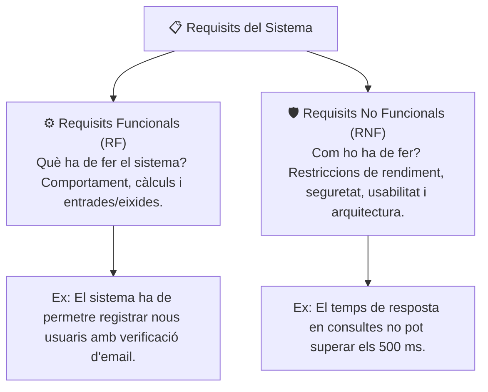

# 1.19 Activitat Pràctica: Especificació de Requisits de Programari (Estàndard IEEE 830)

L'anàlisi de requisits és la fase més crítica de l'enginyeria del programari: un error no detectat en la definició dels requisits pot costar fins a 100 vegades més de solucionar quan l'aplicació ja està en fase de producció.

En aquesta activitat pràctica aprendràs a analitzar un escenari de negoci real i a redactar el document d'**Especificació de Requisits de Programari (SRS - *Software Requirements Specification*)** seguint l'estàndard **IEEE 830**.

---

## 🎯 Classificació dels Requisits

| Categoria | Descripció | Exemple en una Aplicació Web |
| :--- | :--- | :--- |
| **Requisit Funcional (RF)** | Defineix una funció, procés o càlcul que el programari ha d'executar davant una petició de l'usuari. | *RF-01: El sistema permetrà als clients descarregar les seues factures en format PDF signat digitalment.* |
| **RNF - Rendiment** | Mètriques de velocitat, concurrència i consum de recursos. | *RNF-01: La passarel·la de pagament suportarà almenys 200 transaccions concurrents per segon.* |
| **RNF - Seguretat** | Protecció de dades, xifrat i control d'accés. | *RNF-02: Totes les contrasenyes s'emmagatzemaran utilitzant l'algorisme hash bcrypt amb salt.* |
| **RNF - Usabilitat** | Disseny accessible i facilitat d'ús. | *RNF-03: La interfície complirà les pautes d'accessibilitat WCAG 2.1 nivell AA.* |

---

## 📝 Cas Pràctic: Sistema de Gestió d'un Centre Mèdic (*SalusTIC*)

### Escenari de negoci:
El centre mèdic *SalusTIC* vol desenvolupar una nova aplicació web i mòbil per a gestionar les cites mèdiques, les consultes dels pacients i l'historial clínic dels facultatius. Actualment porten el registre en fulls de càlcul compartits que generen duplicats i pèrdua de confidencialitat.

### Tasques a Realitzar:
1. **Redacció de 4 Requisits Funcionals (RF):**
   - Utilitza la plantilla estàndard: `Codi`, `Nom del Requisit`, `Descripció detallada`, `Prioritat` (Alta, Mitjana, Baixa) i `Criteri d'Acceptació`.
2. **Redacció de 3 Requisits No Funcionals (RNF):**
   - Defineix un requisit de **Seguretat** (autenticació, xifrat o compliment de la RGPD).
   - Defineix un requisit de **Rendiment** (temps de càrrega o concurrència d'usuaris).
   - Defineix un requisit de **Portabilitat / Compatibilitat** (navegadors o sistemes operatius mòbils suportats).
3. **Matriu de Traçabilitat:**
   - Vincula cada requisit funcional amb el perfil d'usuari responsable (Pacient, Metge o Administrador de Recepció).

---

## 📋 Criteris d'Avaluació de l'Activitat
- [ ] Formulació precisa dels requisits sense ambigüitats (*evitar termes com "ràpid", "fàcil" o "intuïtiu" sense mètriques*).
- [ ] Ús de la nomenclatura estàndard `RF-xx` i `RNF-xx`.
- [ ] Definició clara de criteris d'acceptació verificables mitjançant proves.
