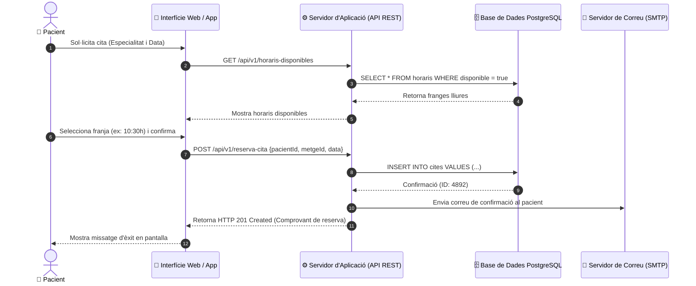

# 1.20 Activitat Pràctica: Modelatge de Casos d'Ús i Diagrames de Seqüència UML

El llenguatge unificat de modelatge (**UML - *Unified Modeling Language***) permet representar gràficament l'estructura i el comportament d'un sistema informàtic, servint de pont entre els analistes de negoci, els desenvolupadors i els clients.

En aquesta activitat aprendràs a formalitzar els requisits del sistema mitjançant **Casos d'Ús** i a detallar les interaccions dinàmiques mitjançant **Diagrames de Seqüència UML**.

---

## 🎭 Diagrama de Seqüència: Reserva de Cita Mèdica en Línia

---

## 📝 Tasques Pràctiques a Desenvolupar

### Exercici 1: Plantilla de Descripció Textual d'un Cas d'Ús
Tria el cas d'ús **"CU-02: Prescripció de Tractament i Recepta Electrònica"** i ompli la fitxa tècnica formal:
- **Identificador i Nom:** CU-02 Prescripció de Tractament.
- **Actor Principal:** Metge especialista.
- **Precondicions:** El metge ha d'haver iniciat sessió amb certificat digital i tindre la consulta del pacient oberta.
- **Flux Principal d'Esdeveniments:**
  1. El facultatiu selecciona el diagnòstic segons el catàleg CIE-10.
  2. Introdueix el principi actiu del medicament i la posologia.
  3. El sistema valida si el pacient té al·lèrgies registrades al medicament.
  4. El sistema signa electrònicament la recepta i genera el codi de recollida a la farmàcia.
- **Fluxos Alternatius (Excepcions):**
  - *3a. Al·lèrgia detectada:* El sistema mostra una alerta vermella bloquejant la prescripció i proposa alternatives terapèutiques.
- **Postcondicions:** La recepta queda associada a la targeta sanitària del pacient a la base de dades central.

### Exercici 2: Modelatge amb Mermaid / PlantUML
Dissenya un diagrama de casos d'ús amb Mermaid que mostre la interacció dels actors **Pacient**, **Metge** i **Personal de Recepció**, incloent-hi almenys una relació `<<include>>` (ex: Autenticació obligatòria) i una relació `<<extend>>` (ex: Cancel·lació de cita amb penalització).

---

## 📋 Criteris de Qualitat del Modelatge
- [ ] Definició rigorosa dels actors (humans i sistemes externs com la passarel·la de pagament o el servidor de correu).
- [ ] Separació neta entre el flux d'èxit (camí feliç) i els fluxos alternatius d'error.
- [ ] Sintaxi UML correcta en les fletxes de missatges síncrons i respostes.
