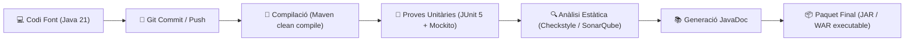

# 16.6 Consolidació del Projecte Final de Desenvolupament de Programari

Arribats a l'última unitat del mòdul d'Entorns de Desenvolupament, consolidaràs el teu projecte de programari integrant totes les eines i bones pràctiques apreses al llarg del curs: control de versions amb **Git**, gestió de dependències amb **Maven / Gradle**, proves automatitzades amb **JUnit 5**, documentació amb **Javadoc** i integració contínua.

---

## 🚀 Cicle de Construcció i Qualitat (CI/CD Pipeline)



---

## 📋 Estructura Estàndard del Repositori Git

El projecte ha de presentar l'estructura normalitzada de Maven:

```text
meu-projecte-daw/
├── .gitignore
├── README.md                  # Documentació tècnica d'arrencada i arquitectura
├── pom.xml                    # Configuració Maven, dependències i plugins
└── src/
    ├── main/
    │   ├── java/              # Codi font de l'aplicació organitzat per paquets
    │   └── resources/         # Fitxers de configuració (application.properties, assets)
    └── test/
        ├── java/              # Classes de test unitàries i d'integració
        └── resources/         # Dades de prova mockejades
```

---

## 📝 Llista de Verificació per al Lliurament del Projecte

### 1. Documentació en el `README.md`
- Descripció de la finalitat de l'aplicació i la seua arquitectura (patró MVC o per capes).
- Requisits previs de l'entorn: versió mínima del JDK (Java 21 LTS) i eina de construcció (Maven 3.9+).
- Instruccions de compilació i arrencada (`mvn clean package` i `java -jar target/app.jar`).

### 2. Proves Automatitzades (Testing)
- Cobertura de proves unitàries mitjançant **JUnit 5** per a tota la lògica de negoci (*Services* i càlculs).
- Ús de **Mockito** per a simular accessos a dades i evitar dependències externes durant els tests.
- Totes les proves han de finalitzar en estat verd (`BUILD SUCCESS`).

### 3. Documentació de Codi Font
- Totes les classes i mètodes públics han de comptar amb comentaris **Javadoc** (`@param`, `@return`, `@throws`).
- Comprovació de generació correcta mitjançant `mvn javadoc:javadoc`.

---

## 📋 Criteris d'Avaluació de l'Entrega
- [ ] Repositori Git net, amb historial de commits descriptiu seguint *Conventional Commits* (`feat:`, `fix:`, `docs:`).
- [ ] Fitxer `.gitignore` configurat evitant fitxers binaris temporals (`target/`, `.idea/`, `.vscode/`).
- [ ] Absència d'errors i avisos crítics en l'anàlisi de codi.
- [ ] Funcionament complet de l'artefacte executable generat.
