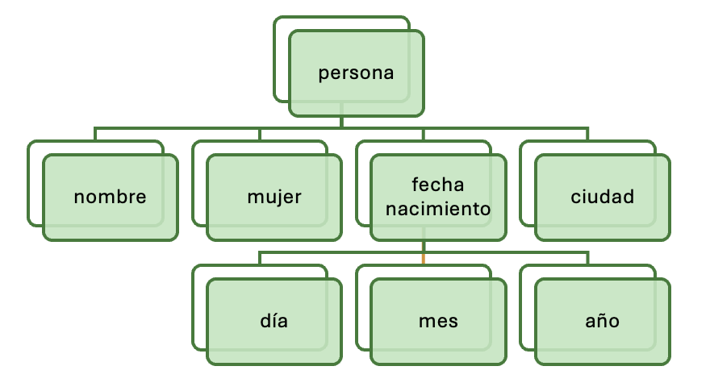

# UD1: Introducción a los Lenguajes de Marcas (XML y JSON)

Bienvenido/a a la **UD1: Introducción a los Lenguajes de Marcas (XML y JSON)** del módulo profesional de **Lenguajes de Marcas y Sistemas de Gestión de Información** (1º DAW / DAM / ASIX · Lenguajes de Marcas (LMSGI)).

En esta unidad encontrarás los contenidos teóricos, ejemplos prácticos, ejercicios resueltos y actividades de evaluación curricular desarrollados por el profesor **Manuel Alonso Argente**.

---

### 📑 Índice de Apartados y Actividades de la Unidad

- [**📋 1.0 Propuesta Didáctica: Introducción a los Lenguajes de Marcas.**](./ut0100.html)
- [**1.1.1 Introducción a los lenguajes de marcas.**](./ut0111.html)
- [**1.1.2 Clasificación y principales lenguajes**](./ut0112.html)
- [**1.1.3 Lenguajes de marcas de propósito general**](./ut0113.html)
- [**1.1.4 Estructura y sintaxis de documentos XML**](./ut0114.html)
- [**1.1.5 Espacios de nombres (Namespaces)**](./ut0115.html)

**Actividades Prácticas y Fichas de Trabajo:**

- [**✏️ ACT101 101**](./act_act101.html)
- [**✏️ ACT102 102**](./act_act102.html)
- [**✏️ ACT103 103**](./act_act103.html)
- [**✏️ ACT104 104**](./act_act104.html)
- [**✏️ ACT105 105**](./act_act105.html)
- [**✏️ ACT106 106**](./act_act106.html)
- [**✏️ ACT107 107**](./act_act107.html)
- [**✏️ ACT108 108**](./act_act108.html)
- [**✏️ ACT109 109**](./act_act109.html)

---

# 📖 Vista Completa de la Unidad

## 1.0 Propuesta Didáctica — Introducción a los Lenguajes de Marcas.

# **Introducción a los Lenguajes de Marcas.**

## **Propuesta didáctica**

En esta unidad vamos a trabajar el RA1: **Reconoce las características de los lenguajes de marcas analizando y interpretando fragmentos de código.**

## **Criterios de evaluación**

### **Respecto al RA1:**

| Código | Descripción | Peso (%) | Herramientas Evaluación |
| --- | --- | --- | --- |
| **CE1a** | Se han identificado las características generales de los lenguajes de marcas. | 10% | ACT101 (5%) -- EXA101 (95%) |
| **CE1b** | Se han reconocido las ventajas que proporcionan en el tratamiento de la información. | 10% | ACT102 (5%) -- EXA101 (95%) |
| **CE1c** | Se han clasificado los lenguajes de marcas e identificado los más relevantes. | 15% | ACT103 (10%) -- EXA101 (90%) |
| **CE1d** | Se han diferenciado sus ámbitos de aplicación. | 10% | ACT104 (5%) -- EXA101 (95%) |
| **CE1e** | Se han reconocido la necesidad y los ámbitos específicos de aplicación de un lenguaje de marcas de propósito general. | 10% | ACT105 (10%) -- EXA101 (90%) |
| **CE1f** | Se han analizado las características propias de diferentes lenguajes de marcas. | 15% | ACT106 (5%) -- EXA101 (95%) |
| **CE1g** | Se han identificado la estructura de un documento y sus reglas sintácticas. | 10% | ACT107 (5%) -- EXA101 (95%) |
| **CE1h** | Se han contrastado la necesidad de crear documentos bien formados y la influencia en su procesamiento. | 10% | ACT108 (10%) -- EXA101 (90%) |
| **CE1i** | Se han identificado las ventajas que aportan los espacios de nombres. | 10% | ACT109 (10%) -- EXA101 (90%) |

## **Contenidos**

### **Lenguajes de marcas:**

- Introducción a los lenguajes de marcas. (CE1.a, CE1.b)

- Clasificación y principales lenguajes. (CE1.c, CE1.d)

- Lenguajes de marcas de propósito general. (CE1.e)

- Estructura y sintaxis de documentos XML. (CE1.f, CE1.g, CE1.h)

- Espacios de nombres en XML (Namespaces). (CE1.i)

**Cuestionario inicial**

1. ¿Qué es un lenguaje de marcas?

1. ¿Puedes citar tres lenguajes de marcas?

1. ¿Qué diferencia existe entre un lenguaje de marcas y un lenguaje de programación?

1. ¿Para qué se utiliza HTML y en qué se diferencia de XML?

1. ¿Qué es una etiqueta (tag) en un documento de marcas?

1. ¿Qué significa que un documento XML esté bien formado?

1. ¿Qué son los espacios de nombres (namespaces) en XML y para qué sirven?

## **Programación de Aula (5 sesiones)**

Esta unidad es la primera del módulo, con lo que se imparte en la primera evaluación. El curso comienza el miércoles 9 de septiembre, la primera sesion se impartirá el 10 de septiembre. La unidad tiene una duración estimada de 5 sesiones lectivas, repartidas entre el lunes (1 sesión) y jueves (2 sesiones):

### **Calendario**

#### **Septiembre 2026**

| Lunes | Martes | Miércoles | Jueves | Viernes | Sábado | Domingo |
| --- | --- | --- | --- | --- | --- | --- |
|  | 1 | 2 | 3 | 4 | **5 🛑** | **6 🛑** |
| 7 | 8 | **9 🎒** | **10 📚** | 11 | **12 🛑** | **13 🛑** |
| **14 📚** | 15 | 16 | **17 📚** | 18 | **19 🛑** | **20 🛑** |
| 21 | 22 | 23 | 24 | 25 | **26 🛑** | **27 🛑** |
| 28 | 29 | 30 |  |  |  |  |

### **Sesiones**

| Sesión | Contenidos | Actividades | Criterios trabajados |
| --- | --- | --- | --- |
| 1 | Presntación módulo - 1.1 Introducción a los lenguajes de marcas | ACT101 -- ACT102 | CE1.a, CE1.b |
| 2 | 1.2 Clasificación y principales lenguajes -- 1.3 Lenguajes de marcas de propósito general | ACT103 -- ACT104 -- ACT105 | CE1.c, CE1.d, CE1.e |
| 3 | 1.4 Estructura y sintaxis de documentos XML | ACT106 -- ACT107 | CE1.f, CE1.g, CE1.h, CE1.i |
| 4 | 1.5 Espacios de nombres (Namespaces) | ACT108 -- ACT109 | CE1.f, CE1.g, CE1.h, CE1.i |
| 5 | Actividades | EXA101 | CE1.a, CE1.b, CE1.c, CE1.d, CE1.e, CE1.f, CE1.g, CE1.h, CE1.i |

### **Seguimiento**

| Sesión | Contenidos | Actividades | Descripción | Fecha |
| --- | --- | --- | --- | --- |
| 1 | Presntación módulo - 1.1 Introducción a los lenguajes de marcas - 1.2 Clasificación y principales lenguajes |  | Se realiza presentación del módulo, se presenta la unidad de programación con la propuesta didáctica y se empieza con el punto 1.1 y el punto 1.2 | 10/09/2026 |
| 2 | 1.2 Clasificación y principales lenguajes |  | Se continua con el punto 1.2. | 10/09/2026 |
| 3 | 1.3 Lenguajes de marcas de propósito general - 1.4 Estructura y sintaxis de documentos XML |  | Se continua con el punto 1.3 y del 1.4 (estructura) se revisa hasta el punto de marcado. | 14/09/2026 |
| 4 | 1.4 Estructura y sintaxis de documentos XML |  | Se continua con el punto 1.4 (estructura). | 17/09/2026 |
| 5 | 1.4 Estructura y sintaxis de documentos XML |  | Se continua con el punto 1.4 (estructura). | 17/09/2026 |
| 6 | Examen Unidad | Actividades | EXA101 | 08/10/2026 |
| 7 | Examen Unidad | Actividades | EXA101 | 08/10/2026 |

---

## 1.1.1 Introducción a los lenguajes de marcas.

# **Introducción a los lenguajes de marcas.**

## **¿Qué es un lenguaje de marcas?**

Un **lenguaje de marcas** (**markup language**) es un modo de **codificar un documento** donde, junto con el texto, se incorporan **etiquetas, marcas o anotaciones** con información adicional relativa a la estructura del texto, contenido del documento o su formato de presentación. Permiten hacer explícita la estructura de un documento, su contenido semántico o cualquier otra información lingüística o extralingüística que se quiera hacer patente.
A diferencia de los lenguajes de programación, que ejecutan acciones, los lenguajes de marcas **describen datos**. Su objetivo principal es organizar la información para que pueda ser entendida tanto por personas como por máquinas.

> **📌 Exemple**
> 

> Supongamos que tenemos la siguiente información:

```html
22/11/2006
    Estimado cliente:
    bla bla bla bla ...
    Don José Gutiérrez González
```

El aspecto de un documento realizado en un lenguaje de marcas es el siguiente:

> **📌 Xml**
> 

```html
<carta>
        <fecha>22/11/2006</fecha>
        <presentacion>Estimado cliente:</presentacion>
        <contenido>bla bla bla bla ...</contenido>
        <firma>Don José Gutiérrez González</firma>
    </carta>
```

## **Características generales de los lenguajes de marcas**

Los lenguajes de marcas comparten una serie de **características comunes**:

| Característica | Descripción |
| --- | --- |
| **Basados en texto plano** | Se escriben con caracteres normales, no binarios. Pueden abrirse con editores como Notepad o VS Code. |
| **Estructura jerárquica** | Las etiquetas pueden contener otras etiquetas (anidamiento), formando árboles de información. |
| **Legibles por humanos y máquinas** | Son comprensibles para una persona y también interpretables por software. |
| **Separación de contenido y forma** | Especialmente en HTML y XML, el contenido está separado del diseño visual o de la lógica de aplicación. |
| **Extensibles** | Es posible crear nuevas etiquetas, especialmente en XML. |
| **Abiertos y estandarizados** | Siguen especificaciones públicas que aseguran su compatibilidad. |
| **Utilizados en muchos entornos** | Web, documentos, exportaciones de datos, configuración de programas, etc. |

## **Ventajas en el tratamiento de la información**

Los lenguajes de marcas han sido ampliamente adoptados debido a las siguientes ventajas:

- **Interoperabilidad**: Permiten compartir información entre sistemas distintos, sin importar el lenguaje de programación o el sistema operativo utilizado.

- **Automatización**: Facilitan el procesamiento automático de datos, ya que la estructura es predecible y válida.

- **Reutilización de contenidos**: Separar contenido de formato permite reutilizar el contenido en diferentes plataformas (por ejemplo, en web, móviles, PDF…).

- **Independencia del software**: Al ser texto plano y estándar, no dependen de un programa específico (como sí ocurre con .docx o .xlsx).

- **Accesibilidad**: Los documentos pueden ser leídos por tecnologías de asistencia, indexados fácilmente por buscadores o adaptados a diferentes dispositivos.

- **Adaptabilidad**: El contenido puede transformarse fácilmente a otros formatos, como PDF, JSON, etc., usando herramientas como XSLT o scripts.

---

## 1.1.2 Clasificación y principales lenguajes

# **Clasificación y principales lenguajes**

## **Clasificación de los lenguajes de marcas**

Los lenguajes de marcas se pueden clasificar atendiendo a su **uso interno del lenguaje en el documento**:

- **De presentación**: Se centran en cómo se ve el contenido, es decir, su aspecto visual.

- **De procedimientos**: Marcas que indican acciones que deben ejecutarse en orden.

- **Descriptivos o semánticos**: Describen el significado del contenido.

| Tipo de lenguaje | Objetivo principal | Ejemplos | Aplicaciones comunes |
| --- | --- | --- | --- |
| **Presentación** | Estética / visual | `<b>`, RTF (usado en WordPad) | Documentos ricos, HTML antiguo |
| **Procedimientos** | Flujo de ejecución | LaTeX, troff/nroff (usados en UNIX) | Documentación científica, UNIX |
| **Descriptivo o semántico** | Estructura / significado | XML, HTML5, Markdown | Web moderna, intercambio de datos |

## **Principales lenguajes de marcas**

Los lenguajes de marcas más relevantes:

- **HTML** (HyperText Markup Language) Presentación de páginas web.

- **XML** (eXtensible Markup Language) Representar información estructurada.

- **XHTML** Variante de HTML que sigue la sintaxis estricta de XML.

- **XSLT** (eXtensible Stylesheet Language Transformations) Transformar documentos XML en otros formatos como HTML, texto plano, u otros XML.

- **JSON** (JavaScript Object Notation) (no es un lenguaje de marcas pero su es uso equivalente) Formato ligero para el intercambio de datos estructurados. Sintaxis basada en objetos y arrays. Muy usado en APIs y aplicaciones web modernas. No utiliza etiquetas, pero cumple la misma finalidad que XML en muchos contextos.

- **SVG** (Scalable Vector Graphics) Representación de gráficos vectoriales en web. Basado en XML.

- **MathML** Representación de fórmulas matemáticas. También basado en XML. Usado en educación, investigación y publicación científica.

- **RDF** (Resource Description Framework) Descripción semántica de recursos (Web Semántica). Útil para bases de datos semánticas y motores de inferencia.

## **Diferencias claves entre los distintos lenguajes de marcas**

| Lenguaje | Tipo | Etiquetas | Sintaxis | Presentación | Extensible |
| --- | --- | --- | --- | --- | --- |
| **HTML** | Presentación | Predefinidas | Laxa | 🟢 Sí | 🔴 No |
| **XML** | Datos | Personalizables | Estricta | 🔴 No | 🟢 Sí |
| **XHTML** | Presentación | Predefinidas | Estricta | 🟢 Sí | 🔴 No |
| **XSLT** | Transformación | Predefinidas (XML) | Estricta | 🔴 No | 🟢 Sí |
| **JSON** | Datos | No usa etiquetas | Estructura de objetos | 🔴 No | 🟠 Limitado |
| **SVG** | Especializado (gráficos) | Predefinidas | XML | 🟢 Sí | 🟢 Sí |
| **MathML** | Especializado (matemáticas) | Predefinidas | XML | 🟢 Sí | 🟢 Sí |
| **RDF** | Semántico | Predefinidas | XML | 🔴 No | 🟢 Sí |

## **Ámbitos de aplicación**

**Documentación electrónica**

- **Markdown**: creado en 2004, es un lenguaje de marcado ligero ampliamente utilizado en la actualidad, especialmente en el ámbito de desarrollo de software.

- **RTF **(Rich Text Format) o Formato de Texto Enriquecido: fue desarrollado por Microsoft en 1987. Permite el intercambio de documentos de texto entre distintos procesadores de texto.

- **TeX **(Text EXecutive processor): su objetivo es la creación de ecuaciones matemáticas complejas.

- **Wikitexto**: permite la creación de páginas wiki en servidores preparados para soportar este lenguaje.

- **DocBook**: permite generar documentos separando la estructura lógica del documento de su formato. De este modo, dichos documentos, pueden publicarse en diferentes formatos sin necesidad de realizar modificaciones en el documento original.

**Tecnologías de Internet**

- **HTML** (Hypertext Markup Language): uno de los más populares con diferencia. Su objetivo es la creación de páginas web.

- **XHTML** (eXtensible Hypertext Markup Language): es idéntico a HTML, pero expresado de otra forma (representado como XML válido).

- **RSS** (Really Simple Syndication): permite la difusión de contenidos web. Utilizado por agregadores de noticias para extraer la información de diferentes medios de comunicación, blogs, portales de información, etc.

- **JSON**: JSON no es un lenguaje de marcas como tal, pero sí se usa masivamente para transmitir datos estructurados en la web, sobre todo en APIs. Comparte con XML ese rol de “estructura de datos para la web”, por eso encajaría bien aquí

**Multimedia**

- **SVG** (Scalable Vector Graphics): permite definir gráficos vectoriales de dos dimensiones y soporta animación.

- **VoiceXML** (Voice Extended Markup Language): tiene como objetivo el intercambio de información entre un usuario y una aplicación con capacidad de reconocimiento de habla.

- **MusicXML** (Music Extended Markup Language): permite el intercambio de partituras entre distintos editores de partituras.

**Otras aplicaciones**

- **MathML** (Mathematical Markup Language): su objetivo es expresar el formalismo matemático de tal modo que pueda ser entendido por distintos sistemas y aplicaciones.

- **XSLT** (eXtensible Stylesheet Language Transformations): XSLT sirve para transformar documentos XML en otros formatos (HTML, texto plano, PDF). Se utiliza para dar formato o modificar la estructura, así que su función es de transformación.

---

## 1.1.3 Lenguajes de marcas de propósito general

# **Lenguajes de marcas de propósito general**

## **¿Qué és un lenguaje de marcas de propósito general?**

Un **lenguaje de marcas de propósito general** es aquel que no está restringido a un solo ámbito de uso, sino que puede adaptarse para representar **información estructurada** en múltiples contextos, gracias a su **diseño extensible** y **neutral**.

**Características principales**:

- **Versatilidad**: pueden aplicarse a múltiples áreas (documentos, bases de datos, aplicaciones web, etc.).

- **Extensibilidad**: permiten crear nuevas etiquetas según las necesidades.

- **Separación de contenido y presentación**: definen la estructura y el significado, dejando el aspecto visual a otros lenguajes o herramientas.

- **Estandarización**: suelen estar regulados por organismos como el W3C.

## **XML como estándar de propósito general**

### **Características clave**

**Características clave de XML**:

- **Extensible**: se pueden definir etiquetas personalizadas.

- **Estructurado**: jerarquía clara entre elementos.

- **Portátil**: puede ser leído y escrito en múltiples plataformas.

- **Validable**: mediante DTD o XML Schema.

- **Legible**: tanto por humanos como por máquinas.

- **Transformable**: mediante XSLT o herramientas personalizadas.

> **📌 Xml**
> 

```html
<cliente>
    <nombre>Lucía</nombre>
    <telefono>654987321</telefono>
    <activo>true</activo>
</cliente>
```

### **Ámbitos de aplicación**

**Ámbitos de aplicación de XML:**

| Contexto | Ejemplo de uso de XML |
| --- | --- |
| **Comunicaciones entre sistemas** | Servicios web con SOAP, intercambio de datos entre empresas (EDI, UBL). |
| **Configuración de software** | Archivos `.xml` para configurar entornos Java, aplicaciones Android, frameworks web. |
| **Almacenamiento de datos** | Bases de datos XML nativas (eXistDB, BaseX), exportaciones complejas. |
| **Publicación de contenidos** | Artículos científicos, libros electrónicos con DocBook o TEI. |
| **Representación de información técnica** | Lenguajes como SVG, MathML o GML (geolocalización) están basados en XML. |
| **Interoperabilidad en administración pública** | Estructura de facturas electrónicas (Facturae), catálogos de datos abiertos. |

---

## 1.1.4 Estructura y sintaxis de documentos XML

# **Estructura y sintaxis de documentos XML**

## **Introducción**

**XML** (eXtensible Markup Language) es un lenguaje de etiquetas o un lenguaje de marcado que **estructura** y guarda de forma ordenada la **información**. No representa datos por sí mismo, solamente organiza la estructura. En XML, las etiquetas son creadas por el programador.
XML **ahorra tiempos de desarrollo** y proporciona **ventajas**, dotando a webs y a aplicaciones de una forma realmente potente de guardar la información. Además, se ha convertido en un formato universal que ha sido asimilado por todo tipo de sistemas operativos y dispositivos móviles.
Un documento **XML** es un **documento de texto** que tiene las siguientes características:

- La extensión de fichero es .xml.

- Está compuesto de parejas de etiquetas estructuradas en árbol, que describen una función en la organización del documento.

- Puede editarse con cualquier editor de texto.

- Es interpretado por los navegadores web.

### **Características del lenguaje XML**

- Dado que XML se concibió para trabajar en la web, es directamente compatible con protocolos que ya funcionan (como HTTP y HTTPS).

- Todo documento que verifique las reglas de XML está conforme con SGML.

- No se requieren conocimientos de programación para realizar tareas sencillas en XML.

- Los documentos XML son fáciles de crear.

- La difusión de los documentos XML está asegurada, ya que cualquier procesador de XML puede leer un documento de XML.

- El marcado de XML es legible para los humanos (human readable).

- El diseño XML es formal y conciso.

- XML es extensible, adaptable y aplicable a una gran variedad de situaciones.

- XML es orientado a objetos.

- Todo documento XML se compone exclusivamente de datos de marcado y datos carácter entremezclados.

### **Proceso de creación**

El **proceso de creación** de un documento XML pasa por varias etapas, en las que el éxito de cada una de ellas se basa en la calidad de la anterior. Estas etapas son:

- Especificación de requisitos.

- Diseño de etiquetas.

- Marcado de los documentos.

> **📌 Ampliar conocimientos sobre XML**
> 

> - [Tutorial de XML de W3C Schools](https://www.w3schools.com/xml/)

> - [Introducción a XML de Mozilla Developer Network (MDN)](https://developer.mozilla.org/es/docs/Web/XML/Guides/XML_introduction)

> **📌 Xml**
> 

```html
<?xml version="1.0"?>
<customers>
    <customer id="55000">
        <name>Charter Group</name>
        <address>
            <street>100 Main</street>
            <city>Framingham</city>
            <state>MA</state>
            <zip>01701</zip>
        </address>
        <address>
            <street>720 Prospect</street>
            <city>Framingham</city>
            <state>MA</state>
            <zip>01701</zip>
        </address>
    </customer>
</customers>
```

## **Marcado**

El **marcado** en XML son etiquetas que se añaden a un texto para estructurar el contenido del documento. Esta información extra permite a los ordenadores interpretar los textos. El marcado es todo lo que se sitúa entre:

### **Elementos**

Todo lo que se encuentra entre:

```html
< >
```

Ejemplo:

```html
<body>
```

### **Entidades**

Todo lo que se encuentra entre:

```html
& ;
```

Ejemplo:

```html
&gt;
```

> **📌 Importante**
> 

> El marcado puede ser tan rico como se desee.

> Una buena estructura facilita:

> - el mantenimiento del documento.

> - su actualización.

> - el intercambio de información.

> - la reutilización de los datos.

Los datos que se encuentran encerrados **entre marcas** son los que forman la verdadera **información** del documento XML. Por ejemplo, en el siguiente documento, el dato es 12.39:

```html
<precio>12.39</precio>
```

## **Comentarios**

Los documentos XML pueden tener **comentarios**, que se utilizan para incluir información para el desarrollador, ya que **no son interpretados** por el intérprete XML.

Se incluyen entre las cadenas:

```html
<!-- Comentario -->
```

Pueden estar en cualquier posición del documento, excepto:

- 

Antes del prólogo.

- 

Dentro de una etiqueta.

> **📌 Correcto**
> 

```html
<?xml version="1.0" encoding="UTF-8"?>

<!-- Comentario correcto -->

<b>
    <c cantidad="4">cccc<!-- Comentario correcto --></c>
    <d cantidad="2">ddd</d>
</b>
```

> **📌 Incorrecto**
> 

> **Antes del prólogo**

```html
<!-- Comentario -->

<?xml version="1.0" encoding="UTF-8"?>
```

**Dentro de una etiqueta**

```html
<c cantidad="4" <!-- comentario --> >cccc</c>
```

> **📌 Error de sintaxis**
> 

> No está permitido escribir dos guiones consecutivos (`--`) dentro del contenido de un comentario.

```html
<!-- Comentario -- incorrecto -->
```

## **Estructura de un documento XML**

Los documentos XML están formados por las siguientes partes:

- 

**Prólogo** *(opcional)*.

- 

**Ejemplar** o **elemento raíz** *(obligatorio)*.

A continuación se muestra un ejemplo resaltando el **prólogo** y el **ejemplar**.

> **📌 Ejemplo XML**
> 

```html
<?xml version="1.0" encoding="UTF-8"?> <!-- (1)! -->
<!DOCTYPE libro> <!-- (1)! -->

<libro> <!-- (2)! -->
    <titulo>XML práctico</titulo>
    <autor>Sebastien Lecomte</autor>
    <autor>Thierry Boulanger</autor>
    <editorial>Ediciones Enik</editorial>
    <isbn>978-2-7460-4958-1</isbn>
    <edicion>1</edicion>
    <paginas>347</paginas>
</libro>
```

1. **Prologo.** Incluye la declaración XML y, opcionalmente, la definición del tipo de documento (DTD)..

1. **Ejemplar (elemento raíz)** Es el elemento principal del documento XML. Contiene todos los demás elementos y **es obligatorio**.

## **Prologo**

El prólogo es una parte **opcional** de un documento XML que, si se incluye, debe preceder al ejemplar. Su inclusión facilita el procesado de la información del ejemplar.
El **prólogo** está dividido en dos partes:

- La **declaración XML**.

- La **declaración del tipo de documento**.

> **📌 Ejemplo Prologo**
> 

```html
<?xml version="1.0" encoding="UTF-8"?> <!-- (1)! -->
<!DOCTYPE libro> <!-- (2)! -->

<libro>
    <titulo>XML práctico</titulo>
    <autor>Sebastien Lecomte</autor>
    <autor>Thierry Boulanger</autor>
    <editorial>Ediciones Enik</editorial>
    <isbn>978-2-7460-4958-1</isbn>
    <edicion>1</edicion>
    <paginas>347</paginas>
</libro>
```

1. 

**Declaración XML.** Indica la versión de XML utilizada y la codificación del documento.

1. 

**Declaración del tipo de documento.** Forma parte del prólogo y vincula el documento con una DTD.

### **Declaración XML**

En el caso de incluirse, ha de ser **la primera línea del documento**. De no ser así, se genera un error que impide que el documento sea procesado. El hecho de que sea opcional, permite el procesamiento de documentos HTML y SGML como si fueran XML. Si fuera obligatoria, éstos deberían incluir una declaración de versión XML que no tienen.

> **📌 Recuerda**
> 

> Si existe una declaración XML, **debe ser siempre la primera línea del documento**, sin espacios ni comentarios delante.

#### **Funciones de la declaración XML**

La declaración XML puede indicar:

1. 

La **versión** La declaración de la versión de XML usada para elaborar el documento se indica con el atributo version. En este caso, se indica que el documento fue creado para la versión 1.0 de XML.

1. 

La declaración de la **codificación** empleada para representar los caracteres se indica con el atributo encoding. En este caso, se indica que el conjunto de caracteres que se utiliza en el documento es es UTF-8, el cual permite el uso de acentos o caracteres como la ñ.

1. 

La declaración de la autonomía del documento informa de si el documento necesita de otro para su interpretación. Para esto, se utiliza el atributo **standalone**. En este caso, se indica que el documento es independiente. De no ser así, el atributo standalone hubiese tomado el valor no. Para declarar el atributo standalone, hay que definir el prólogo completo.

> **📌 Ejemplo Declaración XML**
> 

```html
<?xml version="1.0" encoding="UTF-8" standalone="yes"?> <!-- (1)! -->
```

1. 

**`version`** indica la versión de XML utilizada (habitualmente `1.0`).

**`encoding`** especifica la codificación de caracteres (normalmente `UTF-8`).

**`standalone`** indica si el documento necesita recursos externos (`yes`) o no (`no`).

### **Declaración del tipo de documento (DOCTYPE)**

La declaración **DOCTYPE** indica el tipo de documento XML y permite asociarlo a una **DTD (Document Type Definition)** para validar su estructura.

> **📌 Ejemplo DOCTYPE**
> 

```html
<!DOCTYPE libro SYSTEM "libro.dtd"> <!-- (1)! -->
```

1. 

**Partes de la declaración**

  - 

**`<!DOCTYPE`** → Inicio de la declaración.

  - 

**`libro`** → Nombre del elemento raíz.

  - 

**`SYSTEM`** → Indica que la DTD es externa.

  - 

**`"libro.dtd"`** → Archivo que contiene la definición de la estructura.

## **Ejemplar**

El **ejemplar** (o **elemento raíz**) es la parte principal de un documento XML. Contiene toda la información del documento y **todos los elementos deben estar anidados dentro de él**.

> **📌 Ejemplo Ejemplar**
> 

```html
<?xml version="1.0" encoding="UTF-8"?>
<!DOCTYPE libro>

<libro> <!-- (1)! -->
    <titulo>XML práctico</titulo> <!-- (2)! -->
    <autor>Sebastien Lecomte</autor>
    <autor>Thierry Boulanger</autor>
    <editorial>Ediciones Enik</editorial>
    <isbn>978-2-7460-4958-1</isbn>
    <edicion>1</edicion>
    <paginas>347</paginas>
</libro>
```

1. 

**Elemento raíz o ejemplar.**
    Es el elemento principal del documento XML y contiene todos los demás elementos.

1. 

**Elementos hijos.**
    Todos los elementos del documento deben estar contenidos dentro del elemento raíz.

## **Elementos**

Un **elemento** es la unidad básica de información de un documento XML. Está formado por una **etiqueta de apertura**, un **contenido** (opcional) y una **etiqueta de cierre**.

```html
<libro>XML práctico</libro>
```

### **Partes de un elemento**

- Etiqueta

- Contenido

- Etiqueta de Cierre

> **📌 Partes de un elemento**
> 

```html
<libro> <!-- (1)! -->
    XML práctico <!-- (2)! -->
</libro> <!-- (3)! -->
```

1. 

**Etiqueta de apertura.** Indica el comienzo del elemento.

1. 

**Contenido.** Información almacenada por el elemento.

1. 

**Etiqueta de cierre.** Indica el final del elemento.

> **📌 Tip**
> 

> En realidad, el ejemplar es el elemento raíz (root) de un documento XML (en este ejemplo, el elemento ). Todos los datos de un documento XML han de pertenecer a un elemento del mismo.
Los nombres de las etiquetas han de ser autodescriptivos, lo que facilita el trabajo que se hace con ellas.

### **Sintaxis**

#### Regla 1. Un único elemento raíz

Todo documento XML debe tener **un único elemento raíz** (*root element*), que contiene al resto de elementos del documento.

> **📌 Documento XML no válido**
> 

> 

```html
<?xml version="1.0" encoding="UTF-8"?>
<!DOCTYPE libro>

<persona>
    <nombre>Elsa</nombre>
    <ciudad>Pamplona</ciudad>
</persona>

<persona>
    <nombre>Luis</nombre>
    <ciudad>Bilbao</ciudad>
</persona>
```

Este documento **no es válido** porque contiene **dos elementos raíz**.

> **📌 Documento XML válido**
> 

```html
<personas>
    <persona>
        <nombre>Elsa</nombre>
        <ciudad>Pamplona</ciudad>
    </persona>

    <persona>
        <nombre>Luis</nombre>
        <ciudad>Bilbao</ciudad>
    </persona>
</personas>
```

**Estructura jerárquica**

Gracias a que existe un único elemento raíz, un documento XML puede representarse como un árbol.



Su representación en XML es:

```html
<persona> <!-- (1)! -->
    <nombre>Elsa</nombre> <!-- (2)! -->
    <fecha-de-nacimiento> <!-- (3)! -->
        <dia>18</dia>
        <mes>6</mes>
        <año>1996</año>
    </fecha-de-nacimiento>
</persona>
```

1. 

**Elemento raíz.** Solo puede existir uno por documento.

1. 

**Elemento hijo** del elemento raíz.

1. 

Los elementos también pueden contener **otros elementos**, formando una estructura jerárquica.

#### **Regla 2. Etiquetas de apertura y cierre**

Todo elemento XML debe tener una **etiqueta de apertura** y una **etiqueta de cierre**.

> **📌 Etiquetas apertura y cierre**
> 

```html
<libro> <!-- (1)! -->
    XML práctico
</libro> <!-- (2)! -->
```

1. 

**Etiqueta de apertura**.

1. 

**Etiqueta de cierre**.

> **📌 Documento no válido**
> 

> 

```html
<libro>XML práctico
```

Falta la **etiqueta de cierre** `</libro>`.

**Elementos vacíos**

> **📌 Importante**
> 

> La forma abreviada `<libro/>` solo puede utilizarse cuando el elemento **no tiene contenido ni elementos hijos**.

Cuando un elemento **no contiene información**, puede escribirse mediante una **etiqueta de elemento vacío**.

Las siguientes expresiones son equivalentes:

> **📌 Ejemplo elementos vacíos**
> 

```html
<libro></libro> <!-- (1)! -->

<!-- Equivale a -->

<libro/> <!-- (2)! -->
```

1. 

Forma completa de un elemento vacío.

1. 

Forma abreviada equivalente.

#### **Regla 3. Anidación de elementos**

Al anidar elementos (introducir unos dentro de otros), hay que tener en cuenta que no puede cerrarse un elemento que contenga algún otro elemento que aún no se haya cerrado.
Cuando un elemento contiene a otro, **el elemento interior debe cerrarse antes que el exterior**.

> **📌 Anidación válida**
> 

```html
<libro>
    <titulo>XML práctico</titulo>
</libro>
```

> **📌 Anidació no válida**
> 

> 

```html
<libro>
    <titulo>XML práctico</libro>
</titulo>
```

La etiqueta `</libro>` se cierra **antes** que `</titulo>`, rompiendo la estructura jerárquica.

#### **Regla 4. Nomenclatura de las etiquetas**

Las etiquetas de apertura y cierre de un mismo elemento deben tener **exactamente el mismo nombre**, respetando las **mayúsculas y minúsculas**.

> **📌 Etiqueta válida**
> 

```html
<cuaderno></cuaderno>
```

> **📌 Etiqueta no válida**
> 

```html
<Libro></libro>
```

XML distingue entre mayúsculas y minúsculas (*case sensitive*), por lo que `Libro` y `libro` son etiquetas diferentes.

Las normas de sintaxis básicas en relación a los nombres de etiquetas son:

| Regla | Ejemplo |
| --- | --- |
| Deben empezar por una **letra** o un **guion bajo (`_`)**. | ✅ `<persona>` |
| Pueden contener letras, números, guiones (`-`), guiones bajos (`_`) y puntos (`.`). | ✅ `<fecha-nacimiento>` |
| Distinguen entre **mayúsculas y minúsculas** (case sensitive). | `<Libro>` ≠ `<libro>` |
| No pueden comenzar por **xml** (en cualquier combinación de mayúsculas y minúsculas). | ❌ `<xmlDatos>` |
| Se recomienda evitar caracteres especiales y espacios. | Mejor `<nombre_alumno>` que `<nombre alumno>` |
| Aunque XML permite utilizar caracteres Unicode (como ñ, á o ç), se recomienda utilizar únicamente letras sin acentos para evitar problemas de compatibilidad. | Mejor `<codigo>` que `<código>` |

#### **Regla 5. Contenido de los elementos**

Algunos caracteres tienen un significado especial en XML y **no pueden escribirse directamente** dentro del contenido de un elemento, como son >, <, &, " y ', ya que son caracteres reservados. En el caso de tener que utilizar alguno de estos caracteres, se sustituyen por las siguientes cadenas:

| Carácter | Entidad | Representación |
| --- | --- | --- |
| < | lt | `&lt;` |
| `>` | gt | `&gt;` |
| `&` | amp | `&amp;` |
| `"` | quot | `&quot;` |
| `'` | apos | `&apos;` |

Cuando utilizamos una entidad en un documento XML debe hacerse mediante su representación, es decir, el nombre de la entidad entre los símbolos & y ;. Por ejemplo:

> **📌 Contenido válido**
> 

```html
<libro>Elemento &lt;libro&lt;</libro>
```

El contenido mostrado será:

```html
Elemento <libro>
```

> **📌 Contenido no válido**
> 

```html
<libro>Elemento <libro></libro>
```

El procesador XML interpreta `<` como el comienzo de una nueva etiqueta.

#### Caracteres especiales y Unicode

Gracias a la codificación **UTF-8**, un documento XML puede contener directamente la mayoría de caracteres Unicode.

Para utilizar caracteres especiales (como £, ©, ®, etc.) hay que usar las expresiones &#D; o &#H;, donde D y H se corresponden respectivamente con el número decimal o hexadecimal asociado al caracter que se quiere representar en el código UNICODE.
Por ejemplo, para incluir €, se usarían las cadenas `&#8364;` o `&#x20AC;`.

No siempre es necesario sustituir estos caracteres por códigos numéricos. Las referencias numéricas son útiles cuando el editor o el sistema no permite escribir directamente un carácter.

En el siguiente enlace podemos encontrar una tabla con los caracteres ASCII, el nombre HTML, y el número HTML de cada uno de ellos que te será imprescindible a la hora de realizar documentos en HTML y XML. [http://ascii.cl/es/codigos-html.htm](http://ascii.cl/es/codigos-html.htm)

## **Atributos**

Los **atributos** proporcionan información adicional sobre un elemento y se escriben en la **etiqueta de apertura**.

> **📌 Ejemplo**
> 

> Supongamos que tenemos el siguiente elemento:

```html
<precio>14.95</precio>
```

El elemento anterior indica que el precio es 14.95. Si queremos indicar que el precio está en euros, podemos añadir un atributo divisa de la siguiente forma:

```html
<precio divisa="EUR">14.95</precio> <!-- (1)! -->
```

1. El atributo **divisa** indica una propiedad del precio. Su valor siempre va entre comillas.

A un elemento, podemos añadir uno o más atributos. Por ejemplo:

```html
<precio divisa="EUR" descuento="no">14.95</precio>
```

### ¿Elemento o atributo?

Aunque tanto los elementos como los atributos sirven para almacenar información en un documento XML, no cumplen la misma función. Los elementos se utilizan para representar los datos principales y la estructura del documento, mientras que los atributos describen propiedades o características adicionales de esos elementos. Elegir correctamente entre uno u otro hace que el documento sea más claro, legible y fácil de procesar.

ElementoAtributo

```html
<persona>
    <nombre>Ana</nombre>
    <apellido>Pérez</apellido>
</persona>
```

```html
<persona id="125" activo="true">
    <nombre>Ana</nombre>
    <apellido>Pérez</apellido>
</persona>
```

> **📌 Buenas prácticas**
> 

> Utiliza **atributos** para describir propiedades del elemento.
Utiliza **elementos** para almacenar información del documento.

| Atributos | Elementos |
| --- | --- |
| Describen propiedades. | Contienen información. |
| No pueden contener otros elementos. | Pueden contener texto y otros elementos. |
| No forman una jerarquía. | Forman la estructura del documento. |
| Se escriben en la etiqueta de apertura. | Se escriben entre la etiqueta de apertura y cierre. |

> **📌 Ejemplo completo**
> 

> En el siguiente documento XML se combinan **elementos** y **atributos**. Observa que los atributos describen propiedades de los elementos, mientras que la información principal se almacena en los propios elementos.

```html
<?xml version="1.0" encoding="UTF-8"?>

<biblioteca>
    <libro isbn="978-2-7460-4958-1" disponible="true"> <!-- (1)! -->
        <titulo>XML práctico</titulo>                  <!-- (2)! -->
        <autor>Sebastien Lecomte</autor>
        <editorial>Ediciones Eni</editorial>
        <precio divisa="EUR">14.95</precio>            <!-- (3)! -->
    </libro>
</biblioteca>
```

1. **isbn** y **disponible** son atributos del elemento `libro`.

1. **titulo** es un elemento que contiene información.

1. **divisa** es un atributo del elemento `precio`.

## **Espacios en blanco**

Los espacios, tabulaciones y saltos de línea utilizados para **dar formato al documento** no modifican su estructura ni su significado.

Las siguientes representaciones son equivalentes:

> **📌 Importante**
> 

> La indentación y los saltos de línea mejoran la **legibilidad**, pero no cambian la estructura del documento XML.

Documento indentadoDocumento en una sola línea

```html
<peliculas>
    <pelicula genero="histórica">
        El discurso del rey
    </pelicula>

    <pelicula genero="bélica">
        En tierra hostil
    </pelicula>
</peliculas>
```

```html
<peliculas><pelicula genero="histórica">El discurso del rey</pelicula><pelicula genero="bélica">En tierra hostil</pelicula></peliculas>
```

## **Conservación de espacios (`xml:space`)**

Por defecto, un procesador XML puede **ignorar o normalizar** los espacios, tabulaciones y saltos de línea utilizados únicamente para dar formato al documento.

Cuando es necesario conservar exactamente el contenido de un elemento, puede utilizarse el atributo **`xml:space="preserve"`**.

> **📌 Valores del atributo**
> 

> - **`preserve`**: conserva todos los espacios y saltos de línea.

> - **`default`**: el procesador aplica el tratamiento habitual de los espacios.

> **📌 Ejemplo xml:space**
> 

```html
<clasificacion xml:space="preserve">
    1 Fernando Alonso  1:55.341
    2 Lewis Hamilton   1:55.729
    3 Sebastian Vettel 1:56.122
</clasificacion>
```

En este caso, los espacios y saltos de línea se conservan exactamente como aparecen en el documento.

## **Documentos XML bien formados**

Un documento XML **bien formado** es aquel que cumple todas las reglas sintácticas definidas por la especificación XML del W3C. Si alguna de estas reglas se incumple, el documento no podrá procesarse correctamente mediante un analizador XML.

Supongamos el siguiente documento:

> **📌 Ejemplo Documento XML con errores**
> 
Documento XML con errores

```html
<?xml version="1.0"?>
<mensaje>
    <destinatario>Tomas</ destinatario>
    <remitente>Juan</ remitente>
    <asunto>Recogida
    <contenido>No olvides ir a recogerme al aeropuerto mañana por la mañana.</contenido>
</mensaje>
```

Este documento **no está bien formado** por los siguientes motivos:

1. 

Las etiquetas de cierre `</ destinatario>` y `</ remitente>` contienen un espacio después de la barra `/`. En XML no puede existir ningún espacio entre `</` y el nombre de la etiqueta.

1. 

El elemento `<asunto>` no tiene su correspondiente etiqueta de cierre `</asunto>`.

El documento correctamente escrito sería el siguiente:

> **📌 Ejemplo Documento XML bien formado**
> 
Documento XML bien formado

```html
<?xml version="1.0"?>
<mensaje>
    <destinatario>Tomas</destinatario>
    <remitente>Juan</remitente>
    <asunto>Recogida</asunto>
    <contenido>No olvides ir a recogerme al aeropuerto mañana por la mañana.</contenido>
</mensaje>
```

> **📌 Localización de los errores**
> 

> Un analizador XML puede señalar el error en una línea posterior a aquella donde se encuentra realmente el problema.

> Por ejemplo, podría indicar que existe un error en `</mensaje>`, aunque el problema se haya producido anteriormente al no cerrar el elemento `<asunto>`.

**Herramienta de validación**
Los validadores XML disponibles en Internet ayudan a localizar errores de sintaxis e indican normalmente la línea y la columna donde se ha detectado el problema.

Puedes utilizar el siguiente validador: [Acceder al validador XML](https://www.xmlvalidation.com/)

> **📌 Bien formado no significa válido**
> 

> Un documento XML puede estar **bien formado** y, aun así, no ser **válido**.

> Para que un documento sea válido, además de cumplir las reglas sintácticas de XML, debe ajustarse a una estructura definida mediante un **DTD** o un **XML Schema**.

## **Secciones CDATA**

Una sección **CDATA** (*Character Data*) permite incluir texto dentro de un documento XML **sin que el analizador interprete los caracteres especiales** que contiene.

Resulta especialmente útil cuando se desea almacenar código fuente, fragmentos HTML o cualquier texto que incluya caracteres como `<` o `&`.

La sintaxis es la siguiente:

sintaxisejemplo

```html
<![CDATA[
Contenido de la sección CDATA
]]>
```

Por ejemplo, el siguiente documento XML almacena código en lenguaje C:

```html
<?xml version="1.0" encoding="UTF-8"?>
<ejemplo_CDATA>
    <![CDATA[
    #include <stdio.h>

    int main() {
        float nota;
        printf("Introduzca la nota: ");
        scanf("%f", &nota);

        if (nota >= 5)
            printf("APROBADO");

        return 0;
    }
    ]]>
</ejemplo_CDATA>
```

Sin la sección CDATA, el documento produciría errores porque el analizador XML interpretaría caracteres como `<` y `&` como parte de la sintaxis del propio XML.

**Limitaciones de CDATA**

- No es posible incluir la secuencia `]]>` dentro de una sección CDATA, ya que indica su final.

- No se pueden anidar secciones CDATA.

- La apertura y el cierre deben escribirse exactamente como `<![CDATA[` y `]]>`.

**¿Cuándo utilizar CDATA?**

Es recomendable utilizar CDATA cuando sea necesario almacenar:

- Código fuente.

- Fragmentos HTML.

- Consultas SQL.

- Expresiones que contengan muchos caracteres especiales.

> **📌 ejemplo CDATA**
> 

```html
<codigo>
    <![CDATA[
        if (a < b && b > 0) {
            printf("Correcto");
        }
    ]]>
</codigo>
```

---

## 1.1.5 Espacios de nombres (Namespaces)

# **Espacios de nombres (Namespaces)**

## **¿Qué es un espacio de nombres?**

Un **espacio de nombres** (*namespace*) es un mecanismo de XML que permite diferenciar elementos y atributos que tienen el mismo nombre pero pertenecen a **vocabularios distintos**.

Su objetivo principal es **evitar conflictos de nombres** cuando se combinan documentos XML procedentes de diferentes aplicaciones.

Por ejemplo, la etiqueta `<carta>` puede representar cosas completamente distintas:

- Una carta de una **baraja**.

- La carta (menú) de un **restaurante**.

Si ambos documentos se unen en uno solo, XML no sabría a cuál de ellas pertenece cada elemento.

### **El problema sin namespaces**

Supongamos los siguientes documentos XML.

> **📌 Baraja**
> 

```html
<carta>
    <palo>Corazones</palo>
    <numero>7</numero>
</carta>
```

> **📌 Restaurante**
> 

```html
<carta>
    <carnes>
        <solomillo precio="13.60"/>
    </carnes>

    <pescados>
        <merluza precio="15.85"/>
    </pescados>
</carta>
```

Si ambos documentos se fusionan obtenemos algo parecido a esto:

> **📌 Conflicto de nombres**
> 

> XML no sabe si una etiqueta `<carta>` hace referencia a una carta de una baraja o a la carta de un restaurante.

> **📌 Documento Completo**
> 

```html
<ejemplo>

    <carta>
        <palo>Corazones</palo>
        <numero>7</numero>
    </carta>

    <carta>
        <carnes>
            <solomillo precio="13.60"/>
        </carnes>

        <pescados>
            <merluza precio="15.85"/>
        </pescados>
    </carta>

</ejemplo>
```

Aunque el documento es correcto desde el punto de vista sintáctico, existe un **problema semántico**: aparecen dos elementos llamados `<carta>` que representan conceptos completamente distintos.

### **La solución: utilizar namespaces**

Para evitar esta ambigüedad se utilizan **espacios de nombres**. Cada vocabulario recibe un **prefijo**, que identifica el contexto al que pertenece cada elemento.

> **📌 Prefijos**
> 

```html
<baraja:carta>
    <baraja:palo>Corazones</baraja:palo>
    <baraja:numero>7</baraja:numero>
</baraja:carta>

<restaurante:carta>
    <restaurante:carnes>
        <restaurante:solomillo precio="13.60"/>
    </restaurante:carnes>
</restaurante:carta>
```

Ahora ya no existe ninguna duda sobre el significado de cada etiqueta.

### **Nombres cualificados (QName)**

Cuando una etiqueta está precedida por un prefijo separado mediante dos puntos (`:`), recibe el nombre de **nombre cualificado** (**Qualified Name** o **QName**).

Por ejemplo:

> **📌 Text**
> 

```html
baraja:palo
```

En esta etiqueta:

- **baraja** es el prefijo del namespace.

- **palo** es el nombre del elemento.

## **Definición de espacios de nombres**

Antes de utilizar un prefijo es necesario declararlo mediante el atributo especial `xmlns`. Normalmente esta declaración se realiza en el elemento raíz del documento.

> **📌 Declaración namespace**
> 

```html
<?xml version="1.0" encoding="UTF-8"?>

<ejemplo
    xmlns:baraja="https://www.ejemplo.com/baraja"
    xmlns:rest="https://www.ejemplo.com/restaurante">

    <baraja:carta>
        <baraja:palo>Corazones</baraja:palo>
        <baraja:numero>7</baraja:numero>
    </baraja:carta>

    <rest:carta>
        <rest:carnes>
            <rest:solomillo precio="13.60"/>
        </rest:carnes>
    </rest:carta>

</ejemplo>
```

El namespace está compuesto por un definición `xmlns`, un prefijo y una uri, tomamos xmlns:baraja="https://www.ejemplo.com/baraja" de ejemplo.

**xmlsn**

La palabra `xmlns` proviene de:

- **xml** → XML

- **ns** → Namespace

**Prefijo**

Al indicar el prefijo estamos indicando que todas las etiquetas cuyo prefijo sea `baraja:` pertenecen al espacio de nombres identificado por esa URI.

**URI**

Cada namespace se identifica mediante una **URI** (*Uniform Resource Identifier*), en este caso **https://www.ejemplo.com/baraja**. Normalmente tiene aspecto de dirección web.

Sin embargo, **no es necesario que exista realmente**. Su función es únicamente identificar de forma única un vocabulario XML.

**Declaración en el elemento raíz o en un elemento concreto**

El namespace puede declararse en un elemento raíz o en un elemento en concreto, como podemos ver en los siguientes ejemplos:

Elemento raízElemento concreto

```html
<ejemplo xmlns:baraja="https://www.ejemplo.com/baraja">

    <baraja:carta>
        <baraja:palo>Corazones</baraja:palo>
    </baraja:carta>

</ejemplo>
```

```html
<ejemplo>

    <baraja:carta
        xmlns:baraja="https://www.ejemplo.com/baraja">

        <baraja:palo>Corazones</baraja:palo>

    </baraja:carta>

</ejemplo>
```

### **Buenas prácticas**

- Utilizar prefijos cortos y descriptivos.

- Declarar los namespaces en el elemento raíz cuando sea posible.

- No reutilizar un mismo prefijo para espacios de nombres distintos.

- Utilizar una URI única para cada vocabulario.

> **📌 Idea clave**
> 

> Los **namespaces** no modifican el funcionamiento de XML.

> Simplemente permiten distinguir elementos con el mismo nombre que pertenecen a vocabularios diferentes.

> **📌 Ejemplo Completo**
> 

> Los namespaces son muy habituales cuando un documento XML combina diferentes lenguajes de marcas.

> Por ejemplo, un documento puede contener elementos XHTML y SVG simultáneamente.

```html
<documento
    xmlns:html="http://www.w3.org/1999/xhtml"
    xmlns:svg="http://www.w3.org/2000/svg">

    <html:p>Ejemplo de gráfico:</html:p>

    <svg:svg width="120" height="120">
        <svg:circle
            cx="60"
            cy="60"
            r="40"
            fill="steelblue"/>
    </svg:svg>

</documento>
```

En este documento:

- Los elementos `html:*` pertenecen al vocabulario **XHTML**.

- Los elementos `svg:*` pertenecen al vocabulario **SVG**.

Gracias a los namespaces, ambos vocabularios pueden convivir en un mismo documento XML sin producir conflictos de nombres.

---

## ✏️ Actividades y Prácticas de la Unidad


---

### Actividad Práctica ACT101 — 101

# Actividad 101

> **📌 Entrega**
> 

> - La entrega será un **fichero pdf** que contenga la respuesta a las preguntas de la actividad.

> - El nombre del fichero debe ser `101_NombreApellidos.pdf`.

> - Se deberá entregar en la tarea correspondiente de Aules en tiempo y forma.

> **📌 Se valorará**
> 

> Se valorará:

> - La claridad de la respuesta.

> - La correcta maquetación del documento.

> - Respuesta correcta o aproximación a la misma.

> Esta actividad servirá para calificar:

> - RA1: Reconoce las características de lenguajes de marcas analizando e interpretando fragmentos de código.

>   - CA1. a) Se han identificado las características generales de los lenguajes de marcas. (5%)

## **Ejercicio 1**

**¿Qué sabes sobre los lenguajes de marcas?**

- ¿Qué es un lenguaje de marcas?

- ¿Dónde crees que se utilizan?

- ¿Conoces alguno? ¿Cuál?

- ¿En qué se diferencia de un lenguaje de programación?

## **Ejercicio 2**

**¿Lenguaje de marcas o lenguaje de programación?**

Para cada fragmento:

- Indica el nombre del lenguaje.

- Especifica si se trata de un **lenguaje de marcas** o un **lenguaje de programación**.

- Justifica tu respuesta.

- Explica cuál es su finalidad o principal ámbito de aplicación.

> **📌 Fragmento 1**
> 

```html
<h1>Bienvenido</h1>
<p>Mi primera página web.</p>
```

> **📌 Fragmento 2**
> 

```html
<alumno>
    <nombre>Ana</nombre>
    <curso>1º DAW</curso>
</alumno>
```

> **📌 Fragmento 3**
> 

```html
print("Hola mundo")
```

> **📌 Fragmento 4**
> 

```html
let edad = 18;

if (edad >= 18) {
    console.log("Mayor de edad");
}
```

> **📌 Fragmento 5**
> 

```html
# Lenguajes de marcas

Este documento está escrito en **Markdown**.

- HTML
- XML
- RSS
```

> **📌 Fragmento 6**
> 

```html
{
    "nombre": "Ana",
    "edad": 20,
    "curso": "DAW"
}
```

> **📌 Fragmento 7**
> 

```html
nombre: Ana
edad: 20
curso: DAW
```

> **📌 Fragmento 8**
> 

```html
<svg width="120" height="120">
    <circle cx="60" cy="60" r="40" fill="blue"/>
</svg>
```

> **📌 Fragmento 9**
> 

```html
public class Hola {
    public static void main(String[] args) {
        System.out.println("Hola");
    }
}
```

> **📌 Fragmento 10**
> 

```html
<?php
    echo "Hola mundo";
?>
```

> **📌 Fragmento 11**
> 

```html
h1 {
    color: blue;
    font-size: 2rem;
}
```

> **📌 Fragmento 12**
> 

```html
<rss version="2.0">
    <channel>
        <title>Noticias de tecnología</title>
    </channel>
</rss>
```

> **📌 Fragmento 13**
> 

```html
SELECT nombre, apellidos
FROM alumnos
WHERE curso = 'DAW';
```

> **📌 Fragmento 14**
> 

```html
#include <stdio.h>

int main() {
    printf("Hola");
    return 0;
}
```

> **📌 Fragmento 15**
> 

```html
<html xmlns="http://www.w3.org/1999/xhtml">
    <head>
        <title>Ejemplo</title>
    </head>
    <body>
        <h1>Hola</h1>
    </body>
</html>
```

> **📌 Fragmento 16**
> 

```html
<math>
    <mrow>
        <mi>x</mi>
        <mo>+</mo>
        <mn>2</mn>
    </mrow>
</math>
```

**Tabla de respuestas**

| Fragmento | Lenguaje | ¿Lenguaje de marcas o de programación? | Justificación | Finalidad |
| --- | --- | --- | --- | --- |
| 1 |  |  |  |  |
| 2 |  |  |  |  |
| 3 |  |  |  |  |
| 4 |  |  |  |  |
| 5 |  |  |  |  |
| 6 |  |  |  |  |
| 7 |  |  |  |  |
| 8 |  |  |  |  |
| 9 |  |  |  |  |
| 10 |  |  |  |  |
| 11 |  |  |  |  |
| 12 |  |  |  |  |
| 13 |  |  |  |  |
| 14 |  |  |  |  |
| 15 |  |  |  |  |
| 16 |  |  |  |  |

---

### Actividad Práctica ACT102 — 102

# Actividad 102

> **📌 Entrega**
> 

> - La entrega será un **fichero pdf** que contenga la respuesta a las preguntas de la actividad.

> - El nombre del fichero debe ser `102_NombreApellidos.pdf`.

> - Se deberá entregar en la tarea correspondiente de Aules en tiempo y forma.

> **📌 Se valorará**
> 

> Se valorará:

> - La claridad de la respuesta.

> - La correcta maquetación del documento.

> - Respuesta correcta o aproximación a la misma.

> Esta actividad servirá para calificar:

> - RA1: Reconoce las características de lenguajes de marcas analizando e interpretando fragmentos de código.

>   - CA1. b) Se han reconocido los beneficios que proporcionan los lenguajes de marcas en el tratamiento de la información. (5%)

## **Ejercicio 1**

**¿Qué ventajas tienen los lenguajes de marcas?**

Lee las siguientes **afirmaciones** e **indica** si son **Verdaderas (V)** o **Falsas (F)**. Justifica brevemente cada respuesta.

| Afirmación | V/F | Justificación |
| --- | --- | --- |
| Los lenguajes de marcas permiten organizar la información de forma estructurada. |  |  |
| Los lenguajes de marcas solo pueden utilizarse para crear páginas web. |  |  |
| Facilitan el intercambio de información entre diferentes aplicaciones. |  |  |
| La información puede ser interpretada tanto por personas como por aplicaciones informáticas. |  |  |
| Es obligatorio utilizar siempre las mismas etiquetas en todos los lenguajes de marcas. |  |  |
| Permiten separar el contenido de la presentación. |  |  |
| Son independientes del sistema operativo utilizado. |  |  |
| Facilitan la reutilización de la información. |  |  |

## **Ejercicio 2**

**¿Qué formato elegirías?**

Para cada una de las siguientes situaciones, **indica** cuál de los **formatos** **utilizarías** y **justifica** tu elección.

Opciones:

- Texto plano

- Documento de texto (Word, Writer...)

- Lenguaje de marcas (XML, HTML...)

- Hoja de cálculo

| Situación | Formato elegido | Justificación |
| --- | --- | --- |
| Catálogo de productos de una tienda online. |  |  |
| Intercambio de datos entre dos aplicaciones. |  |  |
| Página web de un instituto. |  |  |
| Lista de alumnos para imprimir. |  |  |
| Archivo de configuración de una aplicación. |  |  |

## **Ejercicio 3**

**Caso práctico**

Una empresa almacena el catálogo de sus productos en un documento de texto.

Ahora quiere:

- Publicarlo en su página web.

- Compartirlo con otras empresas.

- Importarlo a una aplicación móvil.

- Generar automáticamente un catálogo en formato PDF.

**Preguntas**

1. 

¿Crees que un documento de texto es la mejor opción para almacenar esta información? Justifica tu respuesta.

1. 

¿Qué ventajas tendría utilizar un lenguaje de marcas para almacenar los datos?

1. 

Indica al menos **cinco beneficios** que obtendría la empresa al utilizar un lenguaje de marcas.

1. 

¿Qué lenguaje de marcas utilizarías para este caso? Justifica tu elección.

---

### Actividad Práctica ACT103 — 103

# Actividad 103

> **📌 Entrega**
> 

> - La entrega será un **fichero pdf** que contenga la respuesta a las preguntas de la actividad.

> - El nombre del fichero debe ser `103_NombreApellidos.pdf`.

> - Se deberá entregar en la tarea correspondiente de Aules en tiempo y forma.

> **📌 Se valorará**
> 

> Se valorará:

> - La claridad de la respuesta.

> - La correcta maquetación del documento.

> - Respuesta correcta o aproximación a la misma.

> Esta actividad servirá para calificar:

> - RA1: Reconoce las características de lenguajes de marcas analizando e interpretando fragmentos de código.

>   - CA1. c) Se han clasificado los lenguajes de marcas e identificado los más relevantes. (5%).

## **Ejercicio 1**

**Completa** la siguiente tabla:

| Lenguaje | Descripción | Propósito | Estructura | Sintaxis | Flexibilidad | Compatibilidad |
| --- | --- | --- | --- | --- | --- | --- |
| **HTML** (HyperText MarkupLanguage) |  |  |  | No es estrictamente sensible a mayúsculas/minúsculas. Etiquetas de apertura y cierre no siempre son obligatorias. |  |  |
| **XML** (eXtensible Markup Language) |  |  |  |  |  | Amplia compatibilidad con diferentes sistemas y aplicaciones para el intercambio de datos. |
| **XHTML** (Extensible HyperText Markup Language) |  |  | Usa las mismas etiquetas que HTML pero siguiendo las reglas de XML. |  |  |  |
| **RSS** (Really Simple Syndication) | Lenguaje de marcas basado en XML utilizado para la sindicación de contenido web, como blogs o noticias. |  |  |  |  |  |
| **SVG** (Scalable Vector Graphics) |  | Crear gráficos escalables e interactivos. |  |  |  |  |
| **MathML** (Mathematical Markup Language) | Lenguaje XML para representar expresiones matemáticas. |  |  |  |  |  |
| **Markdown** |  |  |  | Sintaxis simple mediante caracteres como `#`, `*`, `>` o ```. |  |  |
| **JSON** (JavaScript Object Notation) |  |  |  |  | Muy compatible con aplicaciones web, APIs y la mayoría de lenguajes de programación. |  |

---

### Actividad Práctica ACT104 — 104

# Actividad 104

> **📌 Entrega**
> 

> - La entrega será un **fichero pdf** que contenga la respuesta a las preguntas de la actividad.

> - El nombre del fichero debe ser `104_NombreApellidos.pdf`.

> - Se deberá entregar en la tarea correspondiente de Aules en tiempo y forma.

> **📌 Se valorará**
> 

> Se valorará:

> - La claridad de la respuesta.

> - La correcta maquetación del documento.

> - Respuesta correcta o aproximación a la misma.

> Esta actividad servirá para calificar:

> - RA1: Reconoce las características de lenguajes de marcas analizando e interpretando fragmentos de código.

>   - CA1. d) Se han diferenciado sus ámbitos de aplicación. (5%)

## **Ejercicio 1**

A continuación se muestra el contenido de un archivo XML. **Transforma** esa información al formato **CSV**.

> **📌 Xml**
> 

```html
<?xml version="1.0" encoding="UTF-8"?>
<!DOCTYPE cataleg>
<cataleg>
    <llibreid="bk101">
        <autor>Garcia, Frederic</autor>
        <titol>La formiga</titol>
        <preu>14.95</preu>
        <publicacio>2011-05-01</publicacio>
        <descripcio>En aquest llibre es descriuen amb detall les tasques diàries que fan les formigues</descripcio>
    </llibre>
    <llibreid="bk102">
        <autor>Puigdevall Garcés, Marcel</autor>
        <titol>Carns a la brasa</titol>
        <preu>5.95</preu>
        <publicacio>2012-10-01</publicacio>
        <descripcio>S'hi descriuen les bondats alimentàries de coure la carn a la brasa a més de truquets per incrementar-ne el gust</descripcio>
    </llibre>
    <llibreid="bk103">
        <autor>Bisbe, Bernat</autor>
        <titol>Diari d'un idiota</titol>
        <preu>14.5</preu>
        <publicacio>2012-07-30</publicacio>
        <descripcio>L'autor descriu en clau d'humor la vida de la gent actual, que descriu genèricament com a &quot;idiotes&quot;</descripcio>
    </llibre>
</cataleg>
```

---

### Actividad Práctica ACT105 — 105

# Actividad 105

> **📌 Entrega**
> 

> - La entrega será un **fichero pdf** que contenga la respuesta a las preguntas de la actividad.

> - El nombre del fichero debe ser `105_NombreApellidos.pdf`.

> - Se deberá entregar en la tarea correspondiente de Aules en tiempo y forma.

> **📌 Se valorará**
> 

> Se valorará:

> - La claridad de la respuesta.

> - La correcta maquetación del documento.

> - Respuesta correcta o aproximación a la misma.

> Esta actividad servirá para calificar:

> - RA1: Reconoce las características de lenguajes de marcas analizando e interpretando fragmentos de código.

>   - CA1. e)  Se han reconocido la necesidad y los ámbitos específicos de aplicación de un lenguaje de marcas de propósito general (5%)

Comparación rápida de los ámbitos:

- JSON: Muy popular para APIs web, ya que es más ligero y fácil de manejar por aplicaciones modernas. Es excelente cuando el intercambio de datos es frecuente y se prioriza la eficiencia.

- XML: Preferido para archivos de configuración y almacenamiento estructurado, especialmente en sistemas más complejos o en los que se necesita una mayor formalidad en la estructura de datos (como en documentos o sistemas empresariales).

Ambos lenguajes de propósito general permiten organizar y transportar datos de manera estructurada en diferentes entornos y aplicaciones.

## **Ejercicio 1**

Pasos a seguir:

1. Ves a la web de la AEMET

1. Despliega Datos abiertos

1. Clica sobre Plan RISP (Reutilización de la información del Sector Público)

1. Clica sobre Predicción horaria por municipios, 2 días

1. Selecciona la Provincia sobre el mapa.

1. Selecciona el municipio

1. Por defecto nos sitúa en la predicción para 7 días. Cambia a la pestaña de la predicción por horas.

1. Descargar XML de la predicción por horas de .....

Se nos solicita los fragmentos de información del documento XML en los que se observen los siguientes datos de la fecha actual:
•   Fecha, Orto y Ocaso
•   Temperatura por horas

## **Ejercicio 2**

Supongamos que una empresa está configurando un archivo para gestionar las preferencias de un software empresarial. El formato elegido para las configuraciones es XML:

> **📌 Xml**
> 

```html
<configuracion>
<usuario>
    <id>12345</id>
    <nombre>Juan Pérez</nombre>
    <correo>juan.perez@example.com</correo>
    <activo>true</activo>
</usuario>
<preferencias>
    <tema>oscuro</tema>
    <idioma>es</idioma>
</preferencias>
</configuracion>
```

Indica con base al anterior documento XML cuántas propiedades estamos almacenando de ese usuario y cuántas preferencias tiene el usuario establecidas para el entorno de la aplicación que va a ejecutar.

Para la próxima versión de la aplicación nos dicen que han añadido cinco propiedades más del usuario y otras tantas preferencias que el usuario puede establecer cuando esté utilizando la aplicación.

Amplia el documento XML anterior para que incorpore toda la información que ahora puede manejar la aplicación.

## **Ejercicio 3**

A continuación vemos la información que se está transmitiendo para cada vecino del sistema informático A al B.

> **📌 Json**
> 

```html
{
"resident": {
    "name": "Carlos García",
    "apartment": "A1",
    "phone": "+34 600 123 456",
    "email": "carlos.garcia@example.com",
    "isOwner": true,
    "hasParking": true,
    "balanceDue": 0,
    "lastPaymentDate": "2024-08-10",
    "notes": "Pago al día"
}
}
```

Imaginemos que podemos hacer clic sobre un listado de vecinos que se nos muestra en una página web. Cuando hagamos clic sobre un vecino en cuestión queremos obtener alguna indicación de si el vecino es moroso o no lo es.

Entonces, basándonos en el documento JSON anterior, ¿cuál sería la información esencial a transmitir (cuanta menos información se transmita, mejor) para asegurarnos de que una vez que se ha clicado sobre un vecino desde el navegador web del cliente, el servidor web nos va a hacer llegar la situación de morosidad de ese vecino.

---

### Actividad Práctica ACT106 — 106

# Actividad 106

> **📌 Entrega**
> 

> - La entrega será un **fichero pdf** que contenga la respuesta a las preguntas de la actividad.

> - El nombre del fichero debe ser `106_NombreApellidos.pdf`.

> - Se deberá entregar en la tarea correspondiente de Aules en tiempo y forma.

> **📌 Se valorará**
> 

> Se valorará:

> - La claridad de la respuesta.

> - La correcta maquetación del documento.

> - Respuesta correcta o aproximación a la misma.

> Esta actividad servirá para calificar:

> - RA1: Reconoce las características de lenguajes de marcas analizando e interpretando fragmentos de código.

>   - CA1. f) Se han analizado las características propias de diferentes lenguajes de marcas. (5%)

## **Ejercicio 1**

Indica a qué lenguaje de marcas pertenece cada uno de los siguientes fragmentos (HTML, XML, JSON o YAML) y justifica tu respuesta enumerando, al menos, **dos características propias** de ese lenguaje que se observen en el fragmento.

> **📌 Fragmento 1**
> 

```html
<!DOCTYPE html>
<html lang="es">
<head>
    <meta charset="UTF-8">
    <title>Mi página</title>
</head>
<body>
    <h1>Bienvenidos</h1>
    <p>Este es un <strong>texto</strong> en negrita.</p>
</body>
</html>
```

> **📌 Fragmento 2**
> 

```html
<?xml version="1.0" encoding="UTF-8"?>
<catalogo>
    <libro id="11">
        <titulo>El Quijote</titulo>
        <precio divisa="EUR">19.95</precio>
    </libro>
    <libro id="12">
        <titulo>La Celestina</titulo>
    </libro>
</catalogo>
```

> **📌 Fragmento 3**
> 

```html
{
    "usuario": {
        "nombre": "Ana",
        "edad": 28,
        "activo": true,
        "cursos": ["DAW", "ASIR"]
    }
}
```

```html
libro:
  titulo: La Celestina
  autor: Fernando de Rojas
  precio: 12.50
  disponible: true
```

## **Ejercicio 2**

A continuación se muestra un documento XML en el que se combinan varias de las características propias del lenguaje XML.

> **📌 Documento XML**
> 

```html
<?xml version="1.0" encoding="UTF-8" standalone="yes"?>
<!-- Listado de asignaturas del centro -->
<asignaturas>
    <asignatura codigo="LLM-01" obligatoria="true">
        <nombre>Lenguajes &amp; Marcas</nombre>
        <horas>128</horas>
        <validacion>
            <![CDATA[
            Requisito: curso < 2 faltas de asistencia
            Se usa el símbolo & en expresiones lógicas.
            ]]>
        </validacion>
    </asignatura>
    <asignatura codigo="BD-01">
        <nombre>Bases de Datos</nombre>
        <horas></horas>
    </asignatura>
</asignaturas>
```

Responde a las siguientes preguntas, analizando las **características propias** del lenguaje que aparecen en el documento:

1. ¿Qué parte del documento corresponde al **prólogo**? Indica qué información aporta cada una de sus líneas.

1. ¿Cuál es el **elemento raíz**? ¿Por qué un documento XML solo puede tener uno?

1. Indica dos características de este documento relacionadas con la **sintaxis de las etiquetas** que puedas comprobar en el fragmento (por ejemplo, apertura y cierre, mayúsculas/minúsculas, elementos vacíos, anidación...).

1. En el elemento `<nombre>Lenguajes &amp; Marcas</nombre>` se utiliza la entidad `&amp;`. ¿Qué característica propia de XML obliga a escribirla así y cuál sería el texto que se mostraría al procesarlo?

1. ¿Qué función cumple la **sección CDATA** dentro del elemento `<validacion>`? Explica por qué no podría escribirse su contenido directamente como texto.

1. ¿Qué diferencia existe entre el elemento `<horas>128</horas>` y el elemento `<horas></horas>`?

## **Ejercicio 3**

Analiza las siguientes afirmaciones sobre las **características propias** de los distintos lenguajes de marcas e indica si son **verdaderas (V)** o **falsas (F)**, justificando brevemente tu respuesta:

1. HTML permite que el programador cree etiquetas nuevas para cualquier propósito, igual que XML.

1. En XML, las etiquetas `<Cliente>` y `<cliente>` se refieren al mismo elemento.

1. JSON es un lenguaje de marcas extensible pensado para la presentación de información en páginas web.

1. Tanto XML como JSON pueden utilizarse para el intercambio de datos entre aplicaciones, aunque con sintaxis y enfoques distintos.

1. Un documento HTML mal escrito (sin cerrar algunas etiquetas) puede interpretarse igualmente por los navegadores, mientras que un documento XML mal formado no puede procesarse. Esta es una de las diferencias clave entre ambos.

1. YAML destaca por ser muy fácil de leer para las personas y se utiliza habitualmente en archivos de configuración, mientras que XML es más verboso pero muy adecuado para documentos estructurados y empresariales.

## **Ejercicio 4**

Supón tres escenarios diferentes en los que debes **elegir el lenguaje de marcas más adecuado** entre HTML, XML y JSON. Justifica cada elección a partir de las características propias de cada lenguaje:

| Escenario | Lenguaje elegido | Justificación |
| --- | --- | --- |
| a) Un navegador debe renderizar una página web con títulos, párrafos e imágenes para usuarios. |  |  |
| b) Una empresa debe intercambiar pedidos con sus proveedores durante años, garantizando que se respete una estructura fija (facturas, fechas, importes) validable automáticamente. |  |  |
| c) Una aplicación móvil recibe en cada consulta los datos de los pedidos y necesitan que el intercambio sea ligero y rápido de procesar. |  |  |

---

### Actividad Práctica ACT107 — 107

# Actividad 107

> **📌 Entrega**
> 

> - La entrega será un **fichero pdf** que contenga la respuesta a las preguntas de la actividad.

> - El nombre del fichero debe ser `107_NombreApellidos.pdf`.

> - Se deberá entregar en la tarea correspondiente de Aules en tiempo y forma.

> **📌 Se valorará**
> 

> Se valorará:

> - La claridad de la respuesta.

> - La correcta maquetación del documento.

> - Respuesta correcta o aproximación a la misma.

> Esta actividad servirá para calificar:

> - RA1: Reconoce las características de lenguajes de marcas analizando e interpretando fragmentos de código.

>   - CA1. g) Se han identificado la estructura de un documento y sus reglas sintácticas. (5%)

## **Ejercicio 1**

A continuación se muestra un documento XML completo. Identifica en él todas las **partes de su estructura** que puedas encontrar y responde a las preguntas.

> **📌 Documento XML**
> 

```html
<?xml version="1.0" encoding="UTF-8" standalone="yes"?>
<!DOCTYPE peliculas>
<!-- Documento con las películas del festival -->
<peliculas>
    <pelicula id="F-01" genero="ciencia ficción">
        <titulo>Origen</titulo>
        <director>Christopher Nolan</director>
        <precio divisa="EUR">14.95</precio>
    </pelicula>
    <pelicula id="F-02">
        <titulo>El viaje de Chihiro</titulo>
        <director>Hayao Miyazaki</director>
        <director>Joe Hisaishi</director>
        <precio divisa="EUR">10.50</precio>
    </pelicula>
</peliculas>
```

1. Escribe las líneas que forman el **prólogo** e indica qué información aporta cada una de ellas.

1. ¿Cuál es el **elemento raíz** o ejemplar? ¿Por qué un documento XML solo puede admitir uno?

1. Señala un ejemplo de cada uno de los siguientes componentes en el documento: **etiqueta de apertura**, **etiqueta de cierre**, **elemento vacío** (si existe), **atributo** y **comentario**.

1. ¿Cómo se denomina la relación entre el elemento `<peliculas>` y el elemento `<pelicula>`? ¿Y entre `<pelicula>` y `<titulo>`?

## **Ejercicio 2**

Los siguientes documentos XML **no cumplen alguna de las reglas sintácticas** del lenguaje. Para cada uno de ellos:

- Marca el error o errores que encuentres.

- Indica **qué regla sintáctica** se está incumpliendo.

- Reescribe el documento corregido.

> **📌 Documento 1**
> 

```html
<?xml version="1.0" encoding="UTF-8"?>
<club>
    <socio>Laura García</socio>
    <socio>Mario Ruiz</socio>
</club>
<club>
    <socio>Elena Díaz</socio>
</club>
```

> **📌 Documento 2**
> 

```html
<?xml version="1.0" encoding="UTF-8"?>
<biblioteca>
    <libro Titulo="La isla del tesoro"
    <autor>Robert L. Stevenson</autor>
    <paginas>220</paginas>
</biblioteca>
```

> **📌 Documento 3**
> 

```html
<?xml version="1.0" encoding="UTF-8"?>
<clase>
    <alumno>
        <nombre>Ana</nombre>
        <apellido>Martín</apellido>
</clase>
    </alumno>
```

> **📌 Documento 4**
> 

```html
<Ejemplo>
    <Contenido>Un mensaje</contenido>
</Ejemplo>
```

## **Ejercicio 3**

El siguiente documento XML contiene **varias reglas sintácticas** respetadas a la vez. Léelo con atención y responde.

> **📌 Documento XML**
> 

```html
<?xml version="1.0" encoding="UTF-8"?>
<conciertos>
    <concierto fecha="2026-12-05">
        <grupo>Vetusta Morla</grupo>
        <ciudad>Valencia</ciudad>
        <precio>35</precio>
    </concierto>
    <concierto>
        <grupo>Carolina Durante</grupo>
        <ciudad>Madrid</ciudad>
    </concierto>
</conciertos>
```

1. Indica la **regla sintáctica** que está bien aplicada en el elemento `<concierto fecha="2026-12-05">` y explica por qué su valor va entre comillas.

1. Explica por qué el segundo `<concierto>` está bien formado aunque le falte el elemento `<precio>`.

1. ¿Qué regla sintáctica permite afirmar que los dos elementos `<concierto>` son hermanos y que ambos descienden del elemento raíz?

1. Escribe este mismo documento reemplazando cada elemento y atributo por otros equivalentes de tu elección, sin cambiar la estructura, de modo que siga cumpliendo todas las reglas sintácticas.

---

### Actividad Práctica ACT108 — 108

# Actividad 108

> **📌 Entrega**
> 

> - La entrega será un **fichero pdf** que contenga la respuesta a las preguntas de la actividad.

> - El nombre del fichero debe ser `108_NombreApellidos.pdf`.

> - Se deberá entregar en la tarea correspondiente de Aules en tiempo y forma.

> **📌 Se valorará**
> 

> Se valorará:

> - La claridad de la respuesta.

> - La correcta maquetación del documento.

> - Respuesta correcta o aproximación a la misma.

> Esta actividad servirá para calificar:

> - RA1: Reconoce las características de lenguajes de marcas analizando e interpretando fragmentos de código.

>   - CA1. h) Se han contrastado la necesidad de crear documentos bien formados y la influencia en su procesamiento. (5%)

Los siguientes documentos XML no están bien formados, revisa su estructura, marca donde crees que está el error y vuelvo a escribirlos para crear un documento bien formado.

## **Ejercicio 1**

> **📌 Xml**
> 

```html
<?xml version="1.0" encoding="UTF-8"?>
<deportistas>
<deportista>
    <deporte Atletismo />
    <nombre>Jesse Owens</nombre>
<deportista>
    <deporte Natación />
    <nombre>Mark Spitz</nombre>
</deportista>
</deportistas>
```

## **Ejercicio 2**

> **📌 Xml**
> 

```html
<?xml version="1.0" encoding="UTF-8"?>
<pelicula>
<titulo>Con faldas y a lo loco</titulo>
<director>Billy Wilder</director>
</pelicula>
<pelicula>
<director>Leo McCarey</director>
<titulo>Sopa de ganso</titulo>
</pelicula>
<autor />barto</autor>
```

## **Ejercicio 3**

> **📌 Xml**
> 

```html
<?xml version="1.0" encoding="UTF-8"?>
<texto>
<Titulo>XML explicado a los niños</titulo>
<párrafo>El <abreviatura>XML</abreviatura>define cómo crear
lenguajes de marcas.</párrafo>
<párrafo>Las marcas se añaden a un documento de texto
para añadir información.</párrafo>
<http://>www.example.org</http://>
</texto>
```

## **Ejercicio 4**

> **📌 Xml**
> 

```html
<?xml version="1.0" encoding="UTF-8"?>
<geografia mundial>
<pais>
    <pais>España</pais>
    <continente>Europa</continente>
    <capital></capital nombre="Madrid">
</pais>
</geografia mundial>
```

## **Ejercicio 5**

> **📌 Xml**
> 

```html
<?xml version="1.0" encoding="UTF-8"?>
<programas>
<programa nombre="Firefox" licencia="GPL" licencia="MPL" />
<programa nombre="LibreOffice" licencia="LGPL" />
<programa nombre="Inkscape" licencia=GPL />
</programas>
```

## **Ejercicio 6**

> **📌 Xml**
> 

```html
<?xml version="1.0" encoding="UTF-8"?>
<mundiales-de-futbol>
<mundial>
    <pais="España" />
    <1982 />
</mundial>
</mundiales-de-futbol>
```

## **Ejercicio 7**

> **📌 Xml**
> 

```html
<?xml version="1.0" encoding="UTF-8"?>
<mediosDeTransporte>
<bicicleta velocidad="v<100km/h" />
<patinete velocidad maxima="50 km/h"
</mediosDeTransporte>
```

## **Ejercicio 8**

> **📌 Xml**
> 

```html
<?xml version="1.0" encoding="UTF-8"?>
<documento>
    <titulo>Introducción a XML
    <autor>David</autor>
    <autor>Juan</autor>
    <resumen>Este es un ejemplo de XML</resumen>
    <contenido>
    <sección título="Sección 1">
        <párrafo>Este es el primer párrafo.
    </sección>
    <sección>
        <título>Sección 2</titulo>
        <párrafo>Este es el segundo párrafo.</párrafo>
    </sección>
    </contenido>
<documento>
```

---

### Actividad Práctica ACT109 — 109

# Actividad 109

> **📌 Entrega**
> 

> - La entrega será un **fichero pdf** que contenga la respuesta a las preguntas de la actividad.

> - El nombre del fichero debe ser `109_NombreApellidos.pdf`.

> - Se deberá entregar en la tarea correspondiente de Aules en tiempo y forma.

> **📌 Se valorará**
> 

> Se valorará:

> - La claridad de la respuesta.

> - La correcta maquetación del documento.

> - Respuesta correcta o aproximación a la misma.

> Esta actividad servirá para calificar:

> - RA1: Reconoce las características de lenguajes de marcas analizando e interpretando fragmentos de código.

>   - CA1. i) Se han identificado las ventajas que aportan los espacios de nombres. (10%)

## **Ejercicio 1**

Supongamos dos documentos que organizan la información sobre los profesores y los alumnos del Ciclo Formativo.

> **📌 XML de alumnos**
> 

```html
<?xml version="1.0" encoding="iso-8859-1" standalone="yes"?>
<!DOCTYPE alumnos>
<alumnos>
    <nombre>Fernando Fernández González</nombre>
    <nombre>Isabel González Fernández</nombre>
    <nombre>Ricardo Martínez López</nombre>
</alumnos>
```

> **📌 XML de profesores**
> 

```html
<?xml version="1.0" encoding="iso-8859-1" standalone="yes" ?>
<!DOCTYPE profesores>
<profesores>
    <nombre>Pilar Ruiz Pérez</nombre>
    <nombre>Tomás Rodríguez Hernández</nombre>
</profesores>
```

Si uniéramos los dos documentos en uno único, sin usar espacios de nombres, no se distinguirían los profesores de los alumnos ya que en los dos casos la etiqueta  se llama igual.
Para resolverlo necesitamos definir un espacio de nombres para cada contexto.

## **Ejercicio 2**

El siguiente documento XML presenta conflictos en la nomenclatura de sus elementos. Haciendo uso de los espacios de nombres, soluciona dichos conflictos.

> **📌 Xml**
> 

```html
<?xml version="1.0" encoding="iso-8859-1" standalone="yes" ?>
<!DOCTYPE registros>
<registro>
    <persona>
        <nombre>Juan Pérez</nombre>
        <edad>30</edad>
        <direccion>
            <calle>Calle Falsa 123</calle>
            <ciudad>Madrid</ciudad>
        </direccion>
    </persona>
    <producto>
        <nombre>Ordenador Portátil</nombre>
        <precio>1200</precio>
        <caracteristicas>
            <procesador>Intel Core i7</procesador>
            <ram>16GB</ram>
        </caracteristicas>
    </producto>
</registro>
```
