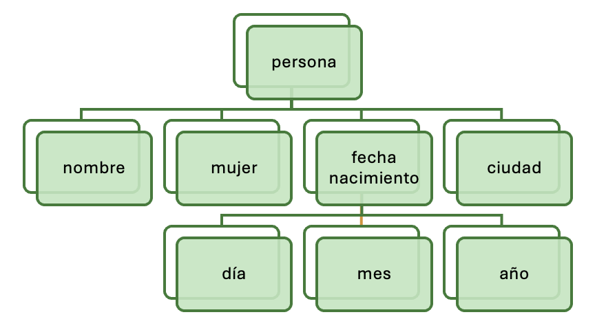

# **Estructura i sintaxi de documents XML**

<div class="interactive-progress-tracker">
  <div class="tracker-header">
    <span>🏆 <strong>Progrés d'aquesta secció:</strong> <span class="tracker-count">0 de 4 superats (0%)</span></span>
    <span class="tracker-pts">⭐ <strong>0 punts</strong></span>
  </div>
  <div class="tracker-bar">
    <div class="tracker-fill" style="width: 0%;"></div>
  </div>
</div>

## **Introducció**

**XML** (eXtensible Markup Language) és un llenguatge d'etiquetes o un llenguatge de marcatge que **estructura** i guarda de forma ordenada la **informació**. No representa dades per sí mateix, solament organitza l'estructura. En XML, les etiquetes són creades pel programador.
XML **ahorra temps de desenvolupament** i proporciona **avantatges**, dotant a webs i a aplicacions d'una forma realment potent de guardar la informació. A més, es ha convertido en un format universal que ha sigut asimilado per tot tipus de sistemes operatius i dispositius mòbils.
Un document **XML** és un **document de text** que té les següents característiques:

- L'extensió de fitxer és .xml.

- Està compost de parelles d'etiquetes estructurades en arbre, que descriuen una funció en l'organització del document.

- Pot editar-se amb qualsevol editor de text.

- És interpretat pels navegadors web.

### **Característiques del llenguatge XML**

- Atès que XML es concibió per a treballar en la web, és directament compatible amb protocols que ja funcionen (com HTTP i HTTPS).

- Tot document que verifique les regles de XML està conforme amb SGML.

- No es requereixen coneixements de programació per a realitzar tasques senzilles en XML.

- Els documents XML són fàcils de crear.

- La difusió dels documents XML està asegurada, ja que qualsevol processador de XML pot llegir un document de XML.

- El marcatge de XML és llegible per als humans (human readable).

- El disseny XML és formal i conciso.

- XML és extensible, adaptable i aplicable a una gran varietat de situacions.

- XML és orientat a objectes.

- Tot document XML es compon exclusivament de dades de marcatge i dades caràcter entremezclats.

### **Procés de creació**

El **procés de creació** d'un document XML passa per diverses etapas, en les que l'èxit de cada una d'elles es basa en la qualitat de l'anterior. Aquestes etapas són:

- Especificació de requisits.

- Disseny d'etiquetes.

- Marcatge dels documents.

> **📌 Ampliar coneixements sobre XML**
> 

> - [Tutorial de XML de W3C Schools](https://www.w3schools.com/xml/)

> - [Introducció a XML de Mozilla Developer Network (MDN)](https://developer.mozilla.org/es/docs/Web/XML/Guides/XML_introduction)

> **📌 Xml**
> 

```html
<?xml version="1.0"?>
<customers>
    <customer id="55000">
        <name>Charter Group</name>
        <address>
            <street>100 Main</street>
            <city>Framingham</city>
            <state>MA</state>
            <zip>01701</zip>
        </address>
        <address>
            <street>720 Prospect</street>
            <city>Framingham</city>
            <state>MA</state>
            <zip>01701</zip>
        </address>
    </customer>
</customers>
```

## **Marcatge**

El **marcatge** en XML són etiquetes que es afegeixen a un text per a estructurar el contingut del document. Aquesta informació extra permet als ordinadors interpretar els textos. El marcatge és tot el que es sitúa entre:

### **Elements**

Tot el que es troba entre:

```html
< >
```

Exemple:

```html
<body>
```

### **Entitats**

Tot el que es troba entre:

```html
& ;
```

Exemple:

```html
&gt;
```

> **📌 Important**
> 

> El marcatge pot ser tan rico com es desee.

> Una bona estructura facilita:

> - el manteniment del document.

> - la seua actualització.

> - l'intercanvi d'informació.

> - la reutilització de les dades.

Les dades que es troben encerrats **entre marques** són els que formen la vertadera **informació** del document XML. Per exemple, en el següent document, el dada és 12.39:

```html
<precio>12.39</precio>
```

## **Comentaris**

Els documents XML poden tindre **comentaris**, que s'utilitzen per a incloure informació per al desenvolupador, ja que **no són interpretats** pel intèrpret XML.

S'inclouen entre les cadenes:

```html
<!-- Comentario -->
```

Poden estar en qualsevol posició del document, excepte:

- 

Abans del pròleg.

- 

Dins d'una etiqueta.

> **📌 Correcte**
> 

```html
<?xml version="1.0" encoding="UTF-8"?>

<!-- Comentario correcto -->

<b>
    <c cantidad="4">cccc<!-- Comentario correcto --></c>
    <d cantidad="2">ddd</d>
</b>
```

> **📌 Incorrecte**
> 

> **Abans del pròleg**

```html
<!-- Comentario -->

<?xml version="1.0" encoding="UTF-8"?>
```

**Dins d'una etiqueta**

```html
<c cantidad="4" <!-- comentario --> >cccc</c>
```

> **📌 Error de sintaxi**
> 

> No està permitido escriure dos guions consecutius (`--`) dins del contingut d'un comentari.

```html
<!-- Comentario -- incorrecto -->
```

## **Estructura d'un document XML**

Els documents XML estan formats per les següents parts:

- 

**Pròleg** *(opcional)*.

- 

**Exemplar** o **element arrel** *(obligatori)*.

A continuació es mostra un exemple resaltant el **pròleg** i el **exemplar**.

> **📌 Exemple XML**
> 

```html
<?xml version="1.0" encoding="UTF-8"?> <!-- (1)! -->
<!DOCTYPE libro> <!-- (1)! -->

<libro> <!-- (2)! -->
    <titulo>XML práctico</titulo>
    <autor>Sebastien Lecomte</autor>
    <autor>Thierry Boulanger</autor>
    <editorial>Ediciones Enik</editorial>
    <isbn>978-2-7460-4958-1</isbn>
    <edicion>1</edicion>
    <paginas>347</paginas>
</libro>
```

1. **Prologo.** Inclou la declaració XML i, opcionalment, la definició del tipus de document (DTD)..

1. **Exemplar (element arrel)** És l'element principal del document XML. Conté tots els resta elements i **és obligatori**.

## **Prologo**

El pròleg és una part **opcional** d'un document XML que, si s'inclou, ha de preceder a l'exemplar. La seua inclusió facilita el processat de la informació de l'exemplar.
El **pròleg** està dividido en dos parts:

- La **declaració XML**.

- La **declaració del tipus de document**.

> **📌 Exemple Prologo**
> 

```html
<?xml version="1.0" encoding="UTF-8"?> <!-- (1)! -->
<!DOCTYPE libro> <!-- (2)! -->

<libro>
    <titulo>XML práctico</titulo>
    <autor>Sebastien Lecomte</autor>
    <autor>Thierry Boulanger</autor>
    <editorial>Ediciones Enik</editorial>
    <isbn>978-2-7460-4958-1</isbn>
    <edicion>1</edicion>
    <paginas>347</paginas>
</libro>
```

1. 

**Declaració XML.** Indica la versió de XML utilitzada i la codificació del document.

1. 

**Declaració del tipus de document.** Forma part del pròleg i vincula el document amb una DTD.

### **Declaració XML**

En el cas d'incluir-se, ha de ser **la primera línia del document**. De no ser així, es genera un error que impedeix que el document siga processat. El fet de que siga opcional, permet el processament de documents HTML i SGML com si fueran XML. Si fóra obligatòria, éstos haurien d'incloure una declaració de versió XML que no tenen.

> **📌 Recorda**
> 

> Si existeix una declaració XML, **ha de ser sempre la primera línia del document**, sense espais ni comentaris davant.

#### **Funcions de la declaració XML**

La declaració XML pot indicar:

1. 

La **versió** La declaració de la versió de XML usada per a elaborar el document es indica amb l'atribut version. En aquest cas, es indica que el document va ser creat per a la versió 1.0 de XML.

1. 

La declaració de la **codificació** emprada per a representar els caràcters es indica amb l'atribut encoding. En aquest cas, es indica que el conjunt de caràcters que s'utilitza en el document és és UTF-8, el qual permet l'ús d'acentos o caràcters com la ñ.

1. 

La declaració de l'autonomía del document informa de si el document necessita d'un altre per a la seua interpretació. Per a açò, s'utilitza l'atribut **standalone**. En aquest cas, es indica que el document és independent. De no ser així, l'atribut standalone haguera pres el valor no. Per a declarar l'atribut standalone, cal definir el pròleg complet.

> **📌 Exemple Declaració XML**
> 

```html
<?xml version="1.0" encoding="UTF-8" standalone="yes"?> <!-- (1)! -->
```

1. 

**`version`** indica la versió de XML utilitzada (habitualment `1.0`).

**`encoding`** especifica la codificació de caràcters (normalment `UTF-8`).

**`standalone`** indica si el document necessita recursos externs (`yes`) o no (`no`).

### **Declaració del tipus de document (DOCTYPE)**

La declaració **DOCTYPE** indica el tipus de document XML i permet asociar-lo a una **DTD (Document Type Definition)** per a validar la seua estructura.

> **📌 Exemple DOCTYPE**
> 

```html
<!DOCTYPE libro SYSTEM "libro.dtd"> <!-- (1)! -->
```

1. 

**Parts de la declaració**

  - 

**`<!DOCTYPE`** → Inici de la declaració.

  - 

**`libro`** → Nom de l'element arrel.

  - 

**`SYSTEM`** → Indica que la DTD és externa.

  - 

**`"libro.dtd"`** → Arxiu que conté la definició de l'estructura.

## **Exemplar**

El **exemplar** (o **element arrel**) és la part principal d'un document XML. Conté tota la informació del document i **tots els elements han d'estar imbricats dins d'ell**.

> **📌 Exemple Exemplar**
> 

```html
<?xml version="1.0" encoding="UTF-8"?>
<!DOCTYPE libro>

<libro> <!-- (1)! -->
    <titulo>XML práctico</titulo> <!-- (2)! -->
    <autor>Sebastien Lecomte</autor>
    <autor>Thierry Boulanger</autor>
    <editorial>Ediciones Enik</editorial>
    <isbn>978-2-7460-4958-1</isbn>
    <edicion>1</edicion>
    <paginas>347</paginas>
</libro>
```

1. 

**Element arrel o exemplar.**
    És l'element principal del document XML i conté tots els resta elements.

1. 

**Elements fills.**
    Tots els elements del document han d'estar continguts dins de l'element arrel.

## **Elements**

Un **element** és la unitat bàsica d'informació d'un document XML. Està format per una **etiqueta d'obertura**, un **contingut** (opcional) i una **etiqueta de tancament**.

```html
<libro>XML práctico</libro>
```

### **Parts d'un element**

- Etiqueta

- Contingut

- Etiqueta de Tancament

> **📌 Parts d'un element**
> 

```html
<libro> <!-- (1)! -->
    XML práctico <!-- (2)! -->
</libro> <!-- (3)! -->
```

1. 

**Etiqueta d'obertura.** Indica el començament de l'element.

1. 

**Contingut.** Informació emmagatzemada pel element.

1. 

**Etiqueta de tancament.** Indica el final de l'element.

> **📌 Tip**
> 

> En realitat, l'exemplar és l'element arrel (root) d'un document XML (en aquest exemple, l'element ). Totes les dades d'un document XML han de pertànyer a un element del mateix.
Els noms de les etiquetes han de ser autodescriptivos, el que facilita el treball que es fa amb elles.

### **Sintaxi**

#### Regla 1. Un únic element arrel

Tot document XML ha de tindre **un únic element arrel** (*root element*), que conté al resta d'elements del document.

> **📌 Document XML no vàlid**
> 

> 

```html
<?xml version="1.0" encoding="UTF-8"?>
<!DOCTYPE libro>

<persona>
    <nombre>Elsa</nombre>
    <ciudad>Pamplona</ciudad>
</persona>

<persona>
    <nombre>Luis</nombre>
    <ciudad>Bilbao</ciudad>
</persona>
```

Aquest document **no és vàlid** perquè conté **dos elements arrel**.

> **📌 Document XML vàlid**
> 

```html
<personas>
    <persona>
        <nombre>Elsa</nombre>
        <ciudad>Pamplona</ciudad>
    </persona>

    <persona>
        <nombre>Luis</nombre>
        <ciudad>Bilbao</ciudad>
    </persona>
</personas>
```

**Estructura jeràrquica**

Gràcies a que existeix un únic element arrel, un document XML pot representar-se com un arbre.



La seua representació en XML és:

```html
<persona> <!-- (1)! -->
    <nombre>Elsa</nombre> <!-- (2)! -->
    <fecha-de-nacimiento> <!-- (3)! -->
        <dia>18</dia>
        <mes>6</mes>
        <año>1996</año>
    </fecha-de-nacimiento>
</persona>
```

1. 

**Element arrel.** Només pot existir un per document.

1. 

**Element fill** de l'element arrel.

1. 

Els elements també poden contindre **altres elements**, formant una estructura jeràrquica.

#### **Regla 2. Etiquetes d'obertura i tancament**

Tot element XML ha de tindre una **etiqueta d'obertura** i una **etiqueta de tancament**.

> **📌 Etiquetes obertura i tancament**
> 

```html
<libro> <!-- (1)! -->
    XML práctico
</libro> <!-- (2)! -->
```

1. 

**Etiqueta d'obertura**.

1. 

**Etiqueta de tancament**.

> **📌 Document no vàlid**
> 

> 

```html
<libro>XML práctico
```

Falta la **etiqueta de tancament** `</libro>`.

**Elements buits**

> **📌 Important**
> 

> La forma abreujada `<libro/>` només pot utilitzar-se quan l'element **no té contingut ni elements fills**.

Quan un element **no conté informació**, pot escriure's mitjançant una **etiqueta d'element buit**.

Les següents expressions són equivalents:

> **📌 Exemple elements buits**
> 

```html
<libro></libro> <!-- (1)! -->

<!-- Equivale a -->

<libro/> <!-- (2)! -->
```

1. 

Forma completa d'un element buit.

1. 

Forma abreujada equivalent.

#### **Regla 3. Anidació d'elements**

A l'imbricar elements (introduir uns dins d'altres), cal tindre en compte que no pot cerrar-se un element que continga algun un altre element que encara no es haja tancat.
Quan un element conté a un altre, **l'element interior ha de cerrar-se abans que l'exterior**.

> **📌 Anidació vàlida**
> 

```html
<libro>
    <titulo>XML práctico</titulo>
</libro>
```

> **📌 Anidació no vàlida**
> 

> 

```html
<libro>
    <titulo>XML práctico</libro>
</titulo>
```

L'etiqueta `</libro>` es tanca **abans** que `</titulo>`, rompent l'estructura jeràrquica.

#### **Regla 4. Nomenclatura de les etiquetes**

Les etiquetes d'obertura i tancament d'un mateix element han de tindre **exactament el mateix nom**, respetant les **majúscules i minúscules**.

> **📌 Etiqueta vàlida**
> 

```html
<cuaderno></cuaderno>
```

> **📌 Etiqueta no vàlida**
> 

```html
<Libro></libro>
```

XML distingeix entre majúscules i minúscules (*case sensitive*), per la qual cosa `Libro` i `libro` són etiquetes diferents.

Les normes de sintaxi bàsiques en relació als noms d'etiquetes són:

| Regla | Exemple |
| --- | --- |
| Han de començar per una **lletra** o un **guion sota (`_`)**. | ✅ `<persona>` |
| Poden contindre lletres, números, guions (`-`), guions bajos (`_`) i punts (`.`). | ✅ `<fecha-nacimiento>` |
| Distingeixen entre **majúscules i minúscules** (case sensitive). | `<Libro>` ≠ `<libro>` |
| No poden començar per **xml** (en qualsevol combinació de majúscules i minúscules). | ❌ `<xmlDatos>` |
| Es recomana evitar caràcters especials i espais. | Millor `<nombre_alumno>` que `<nombre alumno>` |
| Encara que XML permet utilitzar caràcters Unicode (com ñ, á o ç), es recomana utilitzar únicament lletres sense acentos per a evitar problemes de compatibilitat. | Millor `<codigo>` que `<código>` |

#### **Regla 5. Contingut dels elements**

Alguns caràcters tenen un significat especial en XML i **no poden escriure's directament** dins del contingut d'un element, com són >, <, &, " y ', ya que son caracteres reservados. En el caso de tener que utilizar alguno de estos caracteres, se sustituyen por las siguientes cadenas:

| Carácter | Entidad | Representación |
| --- | --- | --- |
| < | lt | `&lt;` |
| `>` | gt | `&gt;` |
| `&` | amp | `&amp;` |
| `"` | quot | `&quot;` |
| `'` | apos | `&apos;` |

Quan utilitzem una entitat en un document XML ha d'hacerse mitjançant la seua representació, és a dir, el nom de l'entitat entre els símbols & i ;. Per exemple:

> **📌 Contingut vàlid**
> 

```html
<libro>Elemento &lt;libro&lt;</libro>
```

El contingut mostrat serà:

```html
Elemento <libro>
```

> **📌 Contingut no vàlid**
> 

```html
<libro>Elemento <libro></libro>
```

El processador XML interpreta `<` com el començament d'una nova etiqueta.

#### Caràcters especials i Unicode

Gràcies a la codificació **UTF-8**, un document XML pot contindre directament la majoria de caràcters Unicode.

Per a utilitzar caràcters especials (com £, ©, ®, etc.) cal usar les expressions &#D; o &#H;, on D i H es corresponen respectivament amb el número decimal o hexadecimal associat al caracter que es vol representar en el codi UNICODE.
Per exemple, per a incloure €, s'usarían les cadenes `&#8364;` o `&#x20AC;`.

No sempre és necessari sustituir aquests caràcters per codis numèrics. Les referències numèriques són útils quan l'editor o el sistema no permet escriure directament un caràcter.

En el següent enllaç podem trobar una taula amb els caràcters ASCII, el nom HTML, i el número HTML de cada un d'ells que et serà imprescindible a l'hora de realitzar documents en HTML i XML. [http://ascii.cl/es/codigos-html.htm](http://ascii.cl/es/codigos-html.htm)

## **Atributs**

Els **atributs** proporcionen informació addicional sobre un element i es escriuen en la **etiqueta d'obertura**.

> **📌 Exemple**
> 

> Suposem que tenim el següent element:

```html
<precio>14.95</precio>
```

L'element anterior indica que el preu és 14.95. Si volem indicar que el preu està en euros, podem afegir un atribut divisa de la següent forma:

```html
<precio divisa="EUR">14.95</precio> <!-- (1)! -->
```

1. L'atribut **divisa** indica una propietat del preu. El seu valor sempre va entre cometes.

A un element, podem afegir un o més atributs. Per exemple:

```html
<precio divisa="EUR" descuento="no">14.95</precio>
```

### Element o atribut?

Encara que tant els elements com els atributs serveixen per a emmagatzemar informació en un document XML, no compleixen la mateixa funció. Els elements s'utilitzen per a representar les dades principals i l'estructura del document, mentre que els atributs descriuen propietats o característiques addicionals d'eixos elements. Triar correctament entre un o un altre fa que el document siga més clar, llegible i fàcil de processar.

ElementoAtributo

```html
<persona>
    <nombre>Ana</nombre>
    <apellido>Pérez</apellido>
</persona>
```

```html
<persona id="125" activo="true">
    <nombre>Ana</nombre>
    <apellido>Pérez</apellido>
</persona>
```

> **📌 Bones pràctiques**
> 

> Utilitza **atributs** per a descriure propietats de l'element.
Utilitza **elements** per a emmagatzemar informació del document.

| Atributs | Elements |
| --- | --- |
| Descriuen propietats. | Contenen informació. |
| No poden contindre altres elements. | Poden contindre text i altres elements. |
| No formen una jerarquia. | Formen l'estructura del document. |
| Es escriuen en l'etiqueta d'obertura. | Es escriuen entre l'etiqueta d'obertura i tancament. |

> **📌 Exemple complet**
> 

> En el següent document XML es combinen **elements** i **atributs**. Observa que els atributs descriuen propietats dels elements, mentre que la informació principal s'emmagatzema en els propis elements.

```html
<?xml version="1.0" encoding="UTF-8"?>

<biblioteca>
    <libro isbn="978-2-7460-4958-1" disponible="true"> <!-- (1)! -->
        <titulo>XML práctico</titulo>                  <!-- (2)! -->
        <autor>Sebastien Lecomte</autor>
        <editorial>Ediciones Eni</editorial>
        <precio divisa="EUR">14.95</precio>            <!-- (3)! -->
    </libro>
</biblioteca>
```

1. **isbn** i **disponible** són atributs de l'element `libro`.

1. **titulo** és un element que conté informació.

1. **divisa** és un atribut de l'element `precio`.

## **Espais en blanc**

Els espais, tabulacions i salts de línia utilitzats per a **donar format al document** no modifiquen la seua estructura ni el seu significat.

Les següents representacions són equivalents:

> **📌 Important**
> 

> La indentació i els salts de línia mejoran la **legibilitat**, però no canvien l'estructura del document XML.

Document indentadoDocumento en una sola línia

```html
<peliculas>
    <pelicula genero="histórica">
        El discurso del rey
    </pelicula>

    <pelicula genero="bélica">
        En tierra hostil
    </pelicula>
</peliculas>
```

```html
<peliculas><pelicula genero="histórica">El discurso del rey</pelicula><pelicula genero="bélica">En tierra hostil</pelicula></peliculas>
```

## **Conservació d'espais (`xml:space`)**

Per defecte, un processador XML pot **ignorar o normalitzar** els espais, tabulacions i salts de línia utilitzats únicament per a donar format al document.

Quan és necessari conservar exactament el contingut d'un element, pot utilitzar-se l'atribut **`xml:space="preserve"`**.

> **📌 Valors de l'atribut**
> 

> - **`preserve`**: conserva tots els espais i salts de línia.

> - **`default`**: el processador aplica el tractament habitual dels espais.

> **📌 Exemple xml:space**
> 

```html
<clasificacion xml:space="preserve">
    1 Fernando Alonso  1:55.341
    2 Lewis Hamilton   1:55.729
    3 Sebastian Vettel 1:56.122
</clasificacion>
```

En aquest cas, els espais i salts de línia es conservan exactament com apareixen en el document.

## **Documents XML bé formats**

Un document XML **bé format** és aquell que compleix totes les regles sintàctiques definides per l'especificació XML del W3C. Si alguna d'aquestes regles es incumple, el document no podrà procesar-se correctament mitjançant un analitzador XML.

Suposem el següent document:

> **📌 Exemple Document XML amb errors**
> 
Document XML amb errors

```html
<?xml version="1.0"?>
<mensaje>
    <destinatario>Tomas</ destinatario>
    <remitente>Juan</ remitente>
    <asunto>Recogida
    <contenido>No olvides ir a recogerme al aeropuerto mañana por la mañana.</contenido>
</mensaje>
```

Aquest document **no està bé format** pels següents motivos:

1. 

Les etiquetes de tancament `</ destinatario>` i `</ remitente>` contenen un espai després de la barra `/`. En XML no pot existir cap espai entre `</` i el nom de l'etiqueta.

1. 

L'element `<asunto>` no té el seu corresponent etiqueta de tancament `</asunto>`.

El document correctament escrit seria el següent:

> **📌 Exemple Document XML bé format**
> 
Document XML bé format

```html
<?xml version="1.0"?>
<mensaje>
    <destinatario>Tomas</destinatario>
    <remitente>Juan</remitente>
    <asunto>Recogida</asunto>
    <contenido>No olvides ir a recogerme al aeropuerto mañana por la mañana.</contenido>
</mensaje>
```

> **📌 Localització dels errors**
> 

> Un analitzador XML pot señalar l'error en una línia posterior a aquella on es troba realment el problema.

> Per exemple, podria indicar que existeix un error en `</mensaje>`, encara que el problema es haja producido anteriorment al no tancar l'element `<asunto>`.

**Eina de validació**
Els validadors XML disponibles en Internet ayudan a localitzar errors de sintaxi i indiquen normalment la línia i la columna on es ha detectado el problema.

Pots utilitzar el següent validador: [Accedir al validador XML](https://www.xmlvalidation.com/)

> **📌 Bé format no significa vàlid**
> 

> Un document XML pot estar **bé format** i, aun així, no ser **vàlid**.

> Perquè un document siga vàlid, a més de complir les regles sintàctiques de XML, ha d'ajustar-se a una estructura definida mitjançant un **DTD** o un **XML Schema**.

## **Seccions CDATA**

Una secció **CDATA** (*Character Data*) permet incloure text dins d'un document XML **sense que l'analitzador interprete els caràcters especials** que conté.

Resulta especialment útil quan es desitja emmagatzemar codi font, fragments HTML o qualsevol text que incloga caràcters com `<` o `&`.

La sintaxi és la següent:

sintaxisejemplo

```html
<![CDATA[
Contenido de la sección CDATA
]]>
```

Per exemple, el següent document XML emmagatzema codi en llenguatge C:

```html
<?xml version="1.0" encoding="UTF-8"?>
<ejemplo_CDATA>
    <![CDATA[
    #include <stdio.h>

    int main() {
        float nota;
        printf("Introduzca la nota: ");
        scanf("%f", &nota);

        if (nota >= 5)
            printf("APROBADO");

        return 0;
    }
    ]]>
</ejemplo_CDATA>
```

Sense la secció CDATA, el document produciría errors perquè l'analitzador XML interpretaría caràcters com `<` i `&` com part de la sintaxi del propi XML.

**Limitacions de CDATA**

- No és possible incloure la seqüència `]]>` dins d'una secció CDATA, ja que indica el seu final.

- No es poden imbricar seccions CDATA.

- L'obertura i el tancament han d'escriure's exactament com `<![CDATA[` i `]]>`.

**Quan utilitzar CDATA?**

És recomanable utilitzar CDATA quan siga necessari emmagatzemar:

- Codi font.

- Fragments HTML.

- Consultes SQL.

- Expressions que continguen molts caràcters especials.

> **📌 exemple CDATA**
> 

```html
<codigo>
    <![CDATA[
        if (a < b && b > 0) {
            printf("Correcto");
        }
    ]]>
</codigo>
```


---

## 🎮 Reptes Interactius d'Autoavaluació (+100 XP)

Comprova el teu domini sobre **1.1.4 Estructura i sintaxi de documents XML** superant aquests 4 reptes gamificats (+25 punts cadascun):

<div class="interactive-mcq" data-answer="B" data-hint="XML és sensible a majúscules/minúscules, exigeix un sol node arrel i tancament estricte de totes les etiquetes.">
  <div class="mcq-question">🎯 <strong>Repte 1 (+25 pts):</strong> Quina és una regla fonamental perquè un document XML siga considerat 'ben format' (well-formed)?</div>
  <div class="mcq-options">
    <button type="button" class="btn-mcq-opt" data-opt="A">A) Ha de tenir almenys un full d'estils CSS vinculat.</button>
    <button type="button" class="btn-mcq-opt" data-opt="B">B) Ha de tenir un únic element arrel, totes les etiquetes han de tancar-se i estar correctament imbricades, i els atributs han d'anar entre cometes.</button>
    <button type="button" class="btn-mcq-opt" data-opt="C">C) Totes les etiquetes s'han d'escriure obligatòriament en majúscules.</button>
    <button type="button" class="btn-mcq-opt" data-opt="D">D) No pot contenir més de tres nivells de profunditat.</button>
  </div>
  <div class="quiz-feedback"></div>
</div>

<div class="interactive-mcq" data-answer="B" data-hint="Els espais de noms (xmlns:prefix="URI") qualifiquen les etiquetes amb un prefix únic.">
  <div class="mcq-question">🎯 <strong>Repte 2 (+25 pts):</strong> Per a què serveixen els espais de noms (<code>Namespaces</code>, atribut <code>xmlns</code>) en un document XML?</div>
  <div class="mcq-options">
    <button type="button" class="btn-mcq-opt" data-opt="A">A) Per a comprimir el fitxer XML en format ZIP.</button>
    <button type="button" class="btn-mcq-opt" data-opt="B">B) Per a evitar conflictes d'identificadors (col·lisions de noms) quan es combinen vocabularis XML diferents en un mateix document.</button>
    <button type="button" class="btn-mcq-opt" data-opt="C">C) Per a ocultar les dades a l'usuari final.</button>
    <button type="button" class="btn-mcq-opt" data-opt="D">D) Per a canviar el color de fons de la pàgina web.</button>
  </div>
  <div class="quiz-feedback"></div>
</div>

<div class="interactive-vf" data-answer="F" data-hint="Fals! XML és 'case-sensitive' (distingeix entre majúscules i minúscules), i no admet espais després de '<'.">
  <div class="vf-statement">✅ <strong>Repte 3 (Vertader o Fals · +25 pts):</strong> En XML, les etiquetes <code>&lt; Alumne &gt;</code> i <code>&lt;alumne&gt;</code> es consideren exactament la mateixa etiqueta perquè XML no distingeix majúscules de minúscules.</div>
  <div class="vf-buttons">
    <button type="button" class="btn-vf" data-opt="V">Vertader (V)</button>
    <button type="button" class="btn-vf" data-opt="F">Fals (F)</button>
  </div>
  <div class="quiz-feedback" style="width: 100%;"></div>
</div>

<div class="interactive-quiz" data-answer="cdata" data-hint="És la secció CDATA (<![CDATA[ ... ]]>).">
  <div class="quiz-question">⌨️ <strong>Repte 4 (+25 pts):</strong> Com s'anomena la secció especial d'XML (<code>&lt;![_____[ ... ]]&gt;</code>) que permet incloure text amb caràcters especials (<code>&lt;</code>, <code>&</code>) sense que l'analitzador l'interprete com a marcatge?</div>
  <div class="quiz-controls">
    <input type="text" class="quiz-input" placeholder="Escriu la resposta..." />
    <button type="button" class="btn-quiz-check">Comprovar</button>
  </div>
  <div class="quiz-feedback"></div>
</div>

### 📋 Llista de Comprovació i Rúbrica d'Assoliment

Marca cada criteri a mesura que completes l'estudi o la resolució pràctica d'aquesta pàgina (**1.1.4 Estructura i sintaxi de documents XML**):

- [ ] He llegit detingudament la teoria o l'enunciat d'aquesta secció i he anotat els conceptes clau.
- [ ] He revisat els esquemes, taules o blocs de codi i he verificat que sé aplicar-los a l'entorn de treball.
- [ ] He resolt correctament els **4 reptes interactius** superiors obtenint els **100 punts XP**.
- [ ] He descarregat el comprovant oficial en PDF per a adjuntar-lo a la tasca d'**Aules**.

<div class="aules-delivery-card">
  <h3>📤 Comprovant de Lliurament per a Aules</h3>
  <p>Quan hages completat els reptes interactius i la llista d'autoavaluació d'aquesta pàgina, introdueix el teu nom i descarrega el teu certificat oficial en PDF per a adjuntar-lo a la tasca d'<strong>Aules</strong>.</p>
  <div class="aules-student-field">
    <label for="aules-student-name">👤 Nom i Cognoms de l'Alumne/a:</label>
    <input type="text" id="aules-student-name" class="aules-student-name" placeholder="Ex: Joan Garcia Pérez" />
  </div>
  <div class="aules-score-badge">
    <span class="aules-score-count">0/4 reptes completats (0%) · 0 punts · 0/4 criteris d'autoavaluació</span>
  </div>
  <div class="aules-actions">
    <button type="button" class="btn-aules-dl" data-module="LMSGI" data-unit="UD01" data-activity="ut0114">📥 Descarregar Comprovant PDF</button>
    <button type="button" class="btn-aules-copy">📋 Copiar Resum al Porta-retalls</button>
  </div>
  <div class="aules-toast"></div>
</div>
