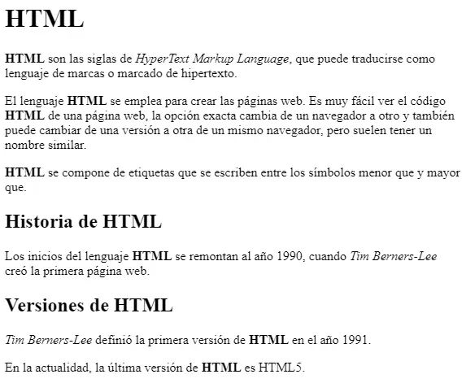
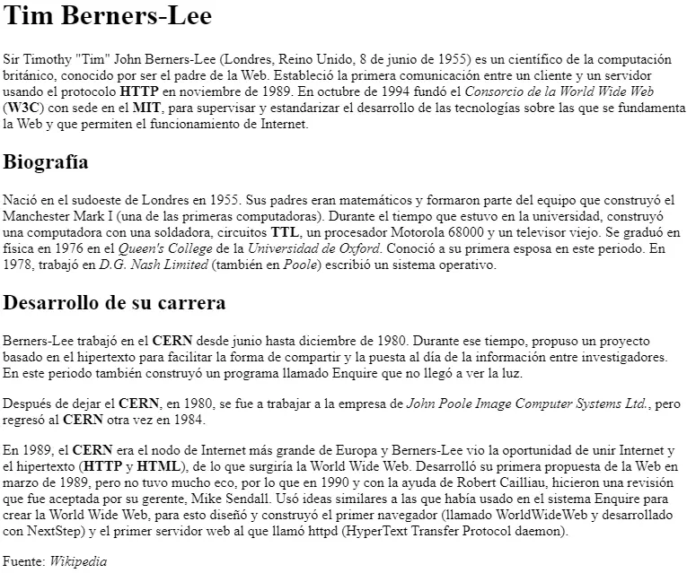

# Activitat 205

<div class="interactive-progress-tracker">
  <div class="tracker-header">
    <span>🏆 <strong>Progrés d'aquesta secció:</strong> <span class="tracker-count">0 de 4 superats (0%)</span></span>
    <span class="tracker-pts">⭐ <strong>0 punts</strong></span>
  </div>
  <div class="tracker-bar">
    <div class="tracker-fill" style="width: 0%;"></div>
  </div>
</div>

> **📌 Lliurament**
> 

> - El lliurament serà un **fitxer pdf** que continga la resposta a les preguntes de l'activitat.

> - El nom del fitxer ha de ser `205_NombreApellidos.pdf`.

> - S'haurà de lliurar en la tasca corresponent d'Aules en temps i forma.

> **📌 Es valorarà**
> 

> Es valorarà:

> - La claredat de la resposta.

> - La correcta maquetació del document.

> - Resposta correcta o aproximació a aquesta.

> Aquesta activitat servirà per a qualificar:

> - RA2: Utilitza llenguatges de marques per a la transmissió i presentació d'informació a través de la web analitzant l'estructura dels documents i identificant els seus elements.

>   - CA2. c) Es ha reconegut la funcionalitat de les principals etiquetes i atributs del llenguatge HTML. (2%)

## **Exercici 1**

**Encapçalaments i paràgrafs**

Llegix l'apartat 2.4.3 Text i crea un document HTML que mostre:

1. Un `h1` amb el títol "Cicles formativos de la família de IFC".

1. Dos `h2` amb "Cicles mitjans (CM)" i "Cicles superiors (CS)".

1. Sota el primer, un `h3` amb "SMR" i dos paràgrafs.

1. Sota el segon, tres `h3` amb "ASIR", "DAM" i "DAW", cada un amb un paràgraf.

## **Exercici 2**

**Salts de línia i espais**

Crea un document HTML que:

1. Mostre un paràgraf amb diversos espais consecutius usant `&nbsp;`.

1. Introduzca un salt de línia amb `<br>`.

1. Mostre un bloc de codi amb `<pre>` conservant els salts de línia.

## **Exercici 3**

**Format de text**

Crea un document HTML que continga un paràgraf que utilitze els elements `b`, `i`, `u`, `sub`, `sup` i `strong`, amb anidament d'almenys negreta i subratllat simultáneos.

## **Exercici 4**

**Hipervínculos i semàntica**

Crea un document HTML que continga:

1. Un enllaç a la pàgina del [W3C](https://www.w3.org/) que es abra en una pestanya nova (`target="_blank"`).

1. Un enllaç amb `target="_self"`.

1. Una abreviatura usant `<abbr>` amb el seu `title`.

1. Text amb `<em>` i `<small>`.

## **Exercici 5**

Donat el següent document HTML:

Modifica el codi per a complir amb els següents requisits:

- Les **sigles HTML** han d'aparèixer com text **destacat** en tota la pàgina.

- `Tim Berners-Lee` ha d'aparèixer com text **enfatitzat** en tota la pàgina.

- Cada **paràgraf** s'ha de marcar com tal.

- S'ha d'afegir un **encapçalament** de nivell 1 amb el text `HTML` abans de `HTML son las siglas de...`

- S'ha d'afegir un **encapçalament** de nivell 2 amb el text `Historia de HTML` abans de `Los inicios del lenguaje HTML...`

- S'ha d'afegir un **encapçalament** de nivell 2 amb el text `Versiones de HTML` abans `Tim Berners-Lee definió....`

El resultat final ha de ser una pàgina web que tinga el mateix aspecte que la següent imatge:



## **Exercici 6**

**Pàgina web sobre Tim Berners-Llegix**

A partir del text proporcionat, crea una **pàgina web** que tinga el mateix aspecte que la següent imatge:



A més, has de tindre en compte els següents requisits:

- El **títol** de la pàgina (el que apareix en la pestanya del navegador) ha de ser `Tim Berners-Lee`.

- El text `Tim Berners-Lee` com **encapçalament** de nivell 1.

- El text `Biografía` com **encapçalament** de nivell 2.

- Totes les **sigles** (com HTTP, W3C o MIT) han d'aparèixer com text **destacat** i, al posar el ratolí damunt, ha de mostrar el **significat de les sigles**.

- Els **noms** de les institucions o empreses, com Consorcio de la World Wide Web o Universitat de Oxford, han d'aparèixer com text **enfatitzat**.

El text base és el següent:

```html
Tim Berners-Lee

Sir Timothy "Tim" John Berners-Lee (Londres, Reino Unido, 8 de junio de 1955) es un
científico de la computación británico, conocido por ser el padre de la Web. Estableció
la primera comunicación entre un cliente y un servidor usando el protocolo HTTP en
noviembre de 1989. En octubre de 1994 fundó el Consorcio de la World Wide Web (W3C) con
sede en el MIT, para supervisar y estandarizar el desarrollo de las tecnologías sobre
las que se fundamenta la Web y que permiten el funcionamiento de Internet.

Biografía

Nació en el sudoeste de Londres en 1955. Sus padres eran matemáticos y formaron parte
del equipo que construyó el Manchester Mark I (una de las primeras computadoras).
Durante el tiempo que estuvo en la universidad, construyó una computadora con una
soldadora, circuitos TTL, un procesador Motorola 68000 y un televisor viejo. Se graduó
en física en 1976 en el Queen's College de la Universidad de Oxford. Conoció a su
primera esposa en este periodo. En 1978, trabajó en D.G. Nash Limited (también en Poole)
escribió un sistema operativo.

Desarrollo de su carrera

Berners-Lee trabajó en el CERN desde junio hasta diciembre de 1980. Durante ese tiempo,
propuso un proyecto basado en el hipertexto para facilitar la forma de compartir y la
puesta al día de la información entre investigadores. En este periodo también construyó
un programa llamado Enquire que no llegó a ver la luz.

Después de dejar el CERN, en 1980, se fue a trabajar a la empresa de John Poole Image
Computer Systems Ltd., pero regresó al CERN otra vez en 1984.

En 1989, el CERN era el nodo de Internet más grande de Europa y Berners-Lee vio la
oportunidad de unir Internet y el hipertexto (HTTP y HTML), de lo que surgiría la World
Wide Web. Desarrolló su primera propuesta de la Web en marzo de 1989, pero no tuvo mucho
eco, por lo que en 1990 y con la ayuda de Robert Cailliau, hicieron una revisión que fue
aceptada por su gerente, Mike Sendall. Usó ideas similares a las que había usado en el
sistema Enquire para crear la World Wide Web, para esto diseñó y construyó el primer
navegador (llamado WorldWideWeb y desarrollado con NextStep) y el primer servidor web
al que llamó httpd (HyperText Transfer Protocol daemon).

Fuente: Wikipedia
```


---

## 🎮 Reptes Interactius d'Autoavaluació (+100 XP)

Comprova el teu domini sobre **Activitat 205** superant aquests 4 reptes gamificats (+25 punts cadascun):

<div class="interactive-mcq" data-answer="B" data-hint="colspan fusiona columnes horitzontalment i rowspan fusiona files verticalment.">
  <div class="mcq-question">🎯 <strong>Repte 1 (+25 pts):</strong> En una taula HTML, quin atribut permet fusionar diverses columnes en una mateixa cel·la horitzontalment?</div>
  <div class="mcq-options">
    <button type="button" class="btn-mcq-opt" data-opt="A">A) rowspan</button>
    <button type="button" class="btn-mcq-opt" data-opt="B">B) colspan</button>
    <button type="button" class="btn-mcq-opt" data-opt="C">C) cellpadding</button>
    <button type="button" class="btn-mcq-opt" data-opt="D">D) border</button>
  </div>
  <div class="quiz-feedback"></div>
</div>

<div class="interactive-mcq" data-answer="B" data-hint="L'atribut booleà 'required' activa la validació nativa de camp obligatori en el navegador.">
  <div class="mcq-question">🎯 <strong>Repte 2 (+25 pts):</strong> Quin atribut d'un camp <code>&lt;input&gt;</code> d'HTML5 impedeix que el formulari s'envie si l'usuari el deixa buit?</div>
  <div class="mcq-options">
    <button type="button" class="btn-mcq-opt" data-opt="A">A) readonly</button>
    <button type="button" class="btn-mcq-opt" data-opt="B">B) required</button>
    <button type="button" class="btn-mcq-opt" data-opt="C">C) placeholder</button>
    <button type="button" class="btn-mcq-opt" data-opt="D">D) disabled</button>
  </div>
  <div class="quiz-feedback"></div>
</div>

<div class="interactive-vf" data-answer="V" data-hint="El contingut visible de la pàgina s'ubica dins de l'element <body>.">
  <div class="vf-statement">✅ <strong>Repte 3 (Vertader o Fals · +25 pts):</strong> L'etiqueta <code>&lt;head&gt;</code> d'un document HTML conté les metadades (<code>&lt;meta&gt;</code>, <code>&lt;title&gt;</code>, <code>&lt;link&gt;</code>) que no es renderitzen directament com a contingut visible de la pàgina.</div>
  <div class="vf-buttons">
    <button type="button" class="btn-vf" data-opt="V">Vertader (V)</button>
    <button type="button" class="btn-vf" data-opt="F">Fals (F)</button>
  </div>
  <div class="quiz-feedback" style="width: 100%;"></div>
</div>

<div class="interactive-quiz" data-answer="a|<a>" data-hint="És l'etiqueta <a> (anchor).">
  <div class="quiz-question">⌨️ <strong>Repte 4 (+25 pts):</strong> Quina etiqueta HTML s'utilitza per a crear un hipervincle o enllaç mitjançant l'atribut <code>href</code>?</div>
  <div class="quiz-controls">
    <input type="text" class="quiz-input" placeholder="Escriu la resposta..." />
    <button type="button" class="btn-quiz-check">Comprovar</button>
  </div>
  <div class="quiz-feedback"></div>
</div>

### 📋 Llista de Comprovació i Rúbrica d'Assoliment

Marca cada criteri a mesura que completes l'estudi o la resolució pràctica d'aquesta pàgina (**Activitat 205**):

- [ ] He llegit detingudament la teoria o l'enunciat d'aquesta secció i he anotat els conceptes clau.
- [ ] He revisat els esquemes, taules o blocs de codi i he verificat que sé aplicar-los a l'entorn de treball.
- [ ] He resolt correctament els **4 reptes interactius** superiors obtenint els **100 punts XP**.
- [ ] He descarregat el comprovant oficial en PDF per a adjuntar-lo a la tasca d'**Aules**.

<div class="aules-delivery-card">
  <h3>📤 Comprovant de Lliurament per a Aules</h3>
  <p>Quan hages completat els reptes interactius i la llista d'autoavaluació d'aquesta pàgina, introdueix el teu nom i descarrega el teu certificat oficial en PDF per a adjuntar-lo a la tasca d'<strong>Aules</strong>.</p>
  <div class="aules-student-field">
    <label for="aules-student-name">👤 Nom i Cognoms de l'Alumne/a:</label>
    <input type="text" id="aules-student-name" class="aules-student-name" placeholder="Ex: Joan Garcia Pérez" />
  </div>
  <div class="aules-score-badge">
    <span class="aules-score-count">0/4 reptes completats (0%) · 0 punts · 0/4 criteris d'autoavaluació</span>
  </div>
  <div class="aules-actions">
    <button type="button" class="btn-aules-dl" data-module="LMSGI" data-unit="UD02" data-activity="act205">📥 Descarregar Comprovant PDF</button>
    <button type="button" class="btn-aules-copy">📋 Copiar Resum al Porta-retalls</button>
  </div>
  <div class="aules-toast"></div>
</div>
