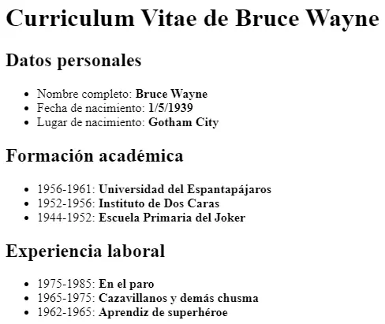
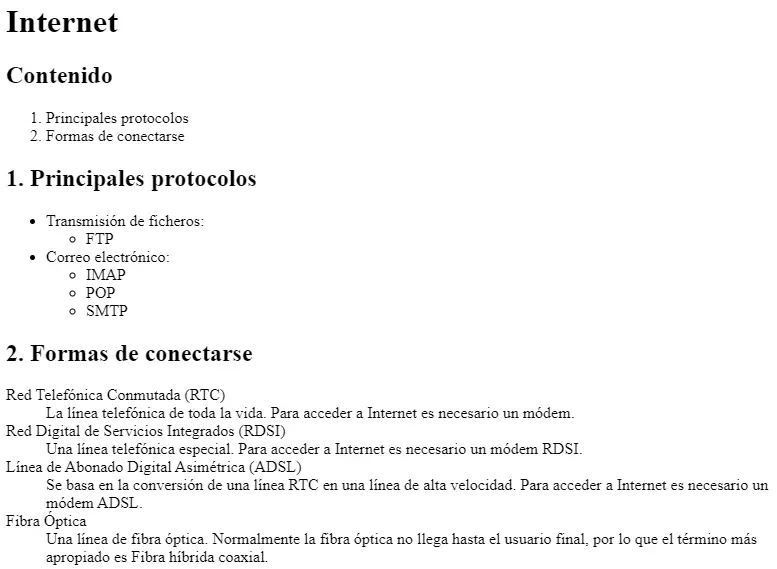
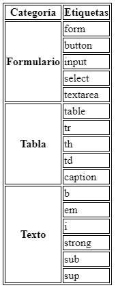
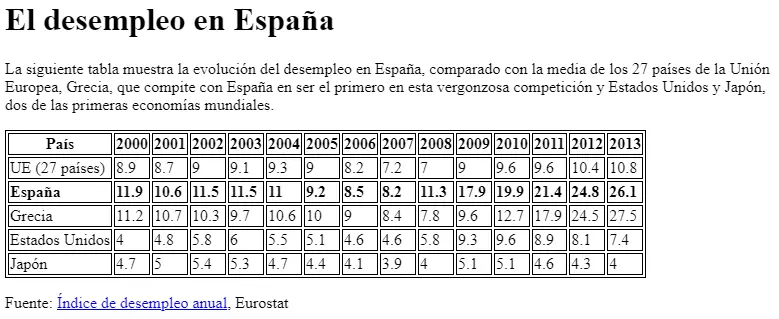

# Activitat 206

<div class="interactive-progress-tracker">
  <div class="tracker-header">
    <span>🏆 <strong>Progrés d'aquesta secció:</strong> <span class="tracker-count">0 de 4 superats (0%)</span></span>
    <span class="tracker-pts">⭐ <strong>0 punts</strong></span>
  </div>
  <div class="tracker-bar">
    <div class="tracker-fill" style="width: 0%;"></div>
  </div>
</div>

> **📌 Lliurament**
> 

> - El lliurament serà un **fitxer pdf** que continga la resposta a les preguntes de l'activitat.

> - El nom del fitxer ha de ser `206_NombreApellidos.pdf`.

> - S'haurà de lliurar en la tasca corresponent d'Aules en temps i forma.

> **📌 Es valorarà**
> 

> Es valorarà:

> - La claredat de la resposta.

> - La correcta maquetació del document.

> - Resposta correcta o aproximació a aquesta.

> Aquesta activitat servirà per a qualificar:

> - RA2: Utilitza llenguatges de marques per a la transmissió i presentació d'informació a través de la web analitzant l'estructura dels documents i identificant els seus elements.

>   - CA2. c) Es ha reconegut la funcionalitat de les principals etiquetes i atributs del llenguatge HTML. (2%)

## **Exercici 1**

**Llistes**

Llegix els apartats 2.4.2 Llistes i 2.4.3 Taules i crea un document HTML que incloga:

1. Una llista desordenada amb els mòduls de 1º de DAW.

1. Una llista ordenada amb els mateixos mòduls començant en 1.

1. Una llista ordenada que comience en 4 usant l'atribut `start`.

1. Una llista de definicions amb els termes "LLMMSGI" i "Bases de dades" i les seues definicions.

## **Exercici 2**

**Currículum de Bruce Wayne**

Crea una **pàgina web** que tinga el mateix aspecte que la següent imatge:



El text que ha de contindre és el següent:

```html
Datos personales
 Nombre completo: Bruce Wayne
 Fecha de nacimiento: 1/5/1939
 Lugar de nacimiento: Gotham City

Formación académica
 1956-1961: Universidad del Espantapájaros
 1952-1956: Instituto de Dos Caras
 1944-1952: Escuela Primaria del Joker

Experiencia laboral
 1975-1985: En el paro
 1965-1975: Cazavillanos y demás chusma
 1962-1965: Aprendiz de superhéroe
```

## **Exercici 3**

**Llistes de Internet**

Crea una **pàgina web** que tinga el mateix aspecte que la següent imatge:



## **Exercici 4**

**Taula de socios**

Crea un document HTML amb una taula que complisca el següent:

1. Títol amb `<caption>`: "Taula de socios".

1. Capçalera amb `<thead>` i cel·les `<th>` per a "Nom" i "Cognom".

1. Cos amb `<tbody>` i dos files de socios.

1. Peu amb `<tfoot>` mostrant el total.

## **Exercici 5**

**Taula d'horari**

Crea una taula que represente un horari semanal senzill amb les files "Dilluns", "Dimecres" i "Divendres" i les columnes "1.ª hora", "2.ª hora" i "3.ª hora", emplenant les cel·les amb assignatures ficticias.

## **Exercici 6**

**Colapsar Columnes i Files**



Replica la mateixa taula a partir del document base:

<details markdown="1">

<summary>💡 Html</summary>

```html
<!DOCTYPE html>
<html>
<head>
<title>Tabla compleja</title>
<style>
table, tr, th, td {
  border: 1px solid black;
}
</style>
</head>
<body>
Categoría   Etiquetas

Formulario
form
button
input
select
textarea

Tabla
table
tr
th
td
caption

Texto
b
em
i
strong
sub
sup
</body>
</html>
```

</details>

## **Exercici 7**

Crea una pàgina web que tinga el mateix aspecte que la següent imatge:



El destí de l'enllaç Índex de desempleo anual és la pàgina web:
[https://ec.europa.eu/eurostat/statistics-explained/index.php?oldid=220991](https://ec.europa.eu/eurostat/statistics-explained/index.php?oldid=220991)

El document HTML base és el següent:

<details markdown="1">

<summary>💡 Html</summary>

```html
<!DOCTYPE html>
<html>
  <head>
    <title>Desempleo</title>
    <style>
    table, tr, th, td {
      border: 1px solid black;
    }
    </style>
  </head>
  <body>

    El desempleo en España

    La siguiente tabla muestra la evolución del desempleo en España, comparado con la
    media de los 27 países de la Unión Europea, Grecia, que compite con España en ser
    el primero en esta vergonzosa competición y Estados Unidos y Japón, dos de las
    primeras economías mundiales.

    País
    2000
    2001
    2002
    2003
    2004
    2005
    2006
    2007
    2008
    2009
    2010
    2011
    2012
    2013

    UE (27 países)
    8.9
    8.7
    9
    9.1
    9.3
    9
    8.2
    7.2
    7
    9
    9.6
    9.6
    10.4
    10.8

    España
    11.9
    10.6
    11.5
    11.5
    11
    9.2
    8.5
    8.2
    11.3
    17.9
    19.9
    21.4
    24.8
    26.1

    Grecia
    11.2
    10.7
    10.3
    9.7
    10.6
    10
    9
    8.4
    7.8
    9.6
    12.7
    17.9
    24.5
    27.5

    Estados Unidos
    4
    4.8
    5.8
    6
    5.5
    5.1
    4.6
    4.6
    5.8
    9.3
    9.6
    8.9
    8.1
    7.4

    Japón
    4.7
    5
    5.4
    5.3
    4.7
    4.4
    4.1
    3.9
    4
    5.1
    5.1
    4.6
    4.3
    4

    Fuente: Índice de desempleo anual, Eurostat

  </body>
</html>
```

</details>


---

## 🎮 Reptes Interactius d'Autoavaluació (+100 XP)

Comprova el teu domini sobre **Activitat 206** superant aquests 4 reptes gamificats (+25 punts cadascun):

<div class="interactive-mcq" data-answer="B" data-hint="colspan fusiona columnes horitzontalment i rowspan fusiona files verticalment.">
  <div class="mcq-question">🎯 <strong>Repte 1 (+25 pts):</strong> En una taula HTML, quin atribut permet fusionar diverses columnes en una mateixa cel·la horitzontalment?</div>
  <div class="mcq-options">
    <button type="button" class="btn-mcq-opt" data-opt="A">A) rowspan</button>
    <button type="button" class="btn-mcq-opt" data-opt="B">B) colspan</button>
    <button type="button" class="btn-mcq-opt" data-opt="C">C) cellpadding</button>
    <button type="button" class="btn-mcq-opt" data-opt="D">D) border</button>
  </div>
  <div class="quiz-feedback"></div>
</div>

<div class="interactive-mcq" data-answer="B" data-hint="L'atribut booleà 'required' activa la validació nativa de camp obligatori en el navegador.">
  <div class="mcq-question">🎯 <strong>Repte 2 (+25 pts):</strong> Quin atribut d'un camp <code>&lt;input&gt;</code> d'HTML5 impedeix que el formulari s'envie si l'usuari el deixa buit?</div>
  <div class="mcq-options">
    <button type="button" class="btn-mcq-opt" data-opt="A">A) readonly</button>
    <button type="button" class="btn-mcq-opt" data-opt="B">B) required</button>
    <button type="button" class="btn-mcq-opt" data-opt="C">C) placeholder</button>
    <button type="button" class="btn-mcq-opt" data-opt="D">D) disabled</button>
  </div>
  <div class="quiz-feedback"></div>
</div>

<div class="interactive-vf" data-answer="V" data-hint="El contingut visible de la pàgina s'ubica dins de l'element <body>.">
  <div class="vf-statement">✅ <strong>Repte 3 (Vertader o Fals · +25 pts):</strong> L'etiqueta <code>&lt;head&gt;</code> d'un document HTML conté les metadades (<code>&lt;meta&gt;</code>, <code>&lt;title&gt;</code>, <code>&lt;link&gt;</code>) que no es renderitzen directament com a contingut visible de la pàgina.</div>
  <div class="vf-buttons">
    <button type="button" class="btn-vf" data-opt="V">Vertader (V)</button>
    <button type="button" class="btn-vf" data-opt="F">Fals (F)</button>
  </div>
  <div class="quiz-feedback" style="width: 100%;"></div>
</div>

<div class="interactive-quiz" data-answer="a|<a>" data-hint="És l'etiqueta <a> (anchor).">
  <div class="quiz-question">⌨️ <strong>Repte 4 (+25 pts):</strong> Quina etiqueta HTML s'utilitza per a crear un hipervincle o enllaç mitjançant l'atribut <code>href</code>?</div>
  <div class="quiz-controls">
    <input type="text" class="quiz-input" placeholder="Escriu la resposta..." />
    <button type="button" class="btn-quiz-check">Comprovar</button>
  </div>
  <div class="quiz-feedback"></div>
</div>

### 📋 Llista de Comprovació i Rúbrica d'Assoliment

Marca cada criteri a mesura que completes l'estudi o la resolució pràctica d'aquesta pàgina (**Activitat 206**):

- [ ] He llegit detingudament la teoria o l'enunciat d'aquesta secció i he anotat els conceptes clau.
- [ ] He revisat els esquemes, taules o blocs de codi i he verificat que sé aplicar-los a l'entorn de treball.
- [ ] He resolt correctament els **4 reptes interactius** superiors obtenint els **100 punts XP**.
- [ ] He descarregat el comprovant oficial en PDF per a adjuntar-lo a la tasca d'**Aules**.

<div class="aules-delivery-card">
  <h3>📤 Comprovant de Lliurament per a Aules</h3>
  <p>Quan hages completat els reptes interactius i la llista d'autoavaluació d'aquesta pàgina, introdueix el teu nom i descarrega el teu certificat oficial en PDF per a adjuntar-lo a la tasca d'<strong>Aules</strong>.</p>
  <div class="aules-student-field">
    <label for="aules-student-name">👤 Nom i Cognoms de l'Alumne/a:</label>
    <input type="text" id="aules-student-name" class="aules-student-name" placeholder="Ex: Joan Garcia Pérez" />
  </div>
  <div class="aules-score-badge">
    <span class="aules-score-count">0/4 reptes completats (0%) · 0 punts · 0/4 criteris d'autoavaluació</span>
  </div>
  <div class="aules-actions">
    <button type="button" class="btn-aules-dl" data-module="LMSGI" data-unit="UD02" data-activity="act206">📥 Descarregar Comprovant PDF</button>
    <button type="button" class="btn-aules-copy">📋 Copiar Resum al Porta-retalls</button>
  </div>
  <div class="aules-toast"></div>
</div>
